## About this lecture {.smaller}

Every earlier unit in this block built **one piece** of a Bayesian model. Today we assemble all of them on a single, realistic biological dataset and take it end to end.

- Turn a **biological question** into a generative model: error model + covariates + hierarchy + priors.
- Recognise why **count data across patients and treatments** needs a negative-binomial error model, not a Gaussian.
- Read a fitted **posterior**: point estimate, credible interval, and a direct probability statement about a treatment effect.
- **Check the model** with posterior predictive checks — the Bayesian version of "does my model actually reproduce my data?"
- See the whole workflow as **STATIC R code** (via `brms`, which compiles to Stan). Nothing is executed here — this is the map, not the drive.

::: {.callout-warning collapse="false"}
**Provisional block.** The Bayesian statistics block may move to a later statistics / machine-learning course. Treat it as a coherent capstone of the ideas you have met, not as examined by-hand material in its current form.
:::

::: notes
This is a consolidation lecture: no single new technique, but the integration of everything from the block — Bayes' theorem, the Poisson/negative-binomial error models, covariates, hierarchy, and priors — into one workflow on one dataset. Emphasise the shift in mindset: we write down a story for how the data were generated, put that story into a model, fit it, and then interrogate the posterior and check the fit. Keep reminding students the code will not run at render time; it is here to be read and recognised, and they will run analogous code in the exercise. Flag the provisional status honestly up front.
:::

## The biological question {.smaller}

A small immunology trial. For each blood sample we count **activated T cells** (a discrete count) by flow cytometry or from single-cell data.

- **12 patients**, each sampled under **placebo** and under **drug** (paired design).
- Question: *does the drug change the number of activated T cells, and by how much?*
- Nuisance structure we must respect: patients differ in baseline immune activity (**age** matters), samples differ in how many total cells were assayed (**exposure**), and repeated samples from one patient are **not independent**.

A naive `t.test(count ~ treatment)` ignores all three. We will build a model that handles them together.

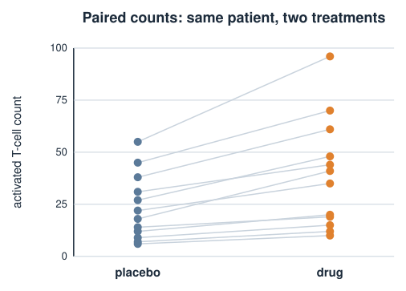{width="60%" fig-align="center"}

::: notes
Ground the whole lecture in one concrete question with a real answer we want: the size and direction of a treatment effect on a count. Name the three complications now because each maps onto one building block later: exposure -> offset in the error model; age -> a covariate; repeated samples per patient -> hierarchy. The paired design is deliberately simple so students can hold the whole dataset in their heads. Stress that the frequentist one-liner throws away the pairing, the exposure, and the count nature of the data all at once.
:::

## What the data look like {.smaller}

One row per sample. Counts are small, integer, and right-skewed — the hallmark of biological count data.

```r
head(dat)
#>   patient treatment   age  count  n_cells   log_exp
#> 1     P01   placebo    34     18    50218    10.824
#> 2     P01      drug    34     41    48903    10.797
#> 3     P02   placebo    51      7    39044    10.572
#> 4     P02      drug    51     12    52771    10.874
#> 5     P03   placebo    29     55    61233    11.022
#> 6     P03      drug    29     96    60918    11.017

str(dat)
#> 'data.frame': 24 obs. of 6 variables:
#>  $ patient  : Factor w/ 12 levels "P01",...
#>  $ treatment: Factor w/ 2 levels "placebo","drug"
#>  $ age      : num  34 51 29 ...
#>  $ count    : int  18 41 7 12 55 96 ...
#>  $ n_cells  : int  50218 48903 ...
#>  $ log_exp  : num  10.82 10.80 ...   # = log(n_cells), the exposure offset
```

::: notes
Walk the columns: count is the response; treatment and age are the effects we care about and want to adjust for; patient labels the grouping for the hierarchy; n_cells is how many cells were assayed, and log_exp is its log, which becomes the offset. Point out that the raw counts are not comparable across samples until we account for n_cells — 41 out of 49k cells is very different from 41 out of 5k. This is exactly the library-size problem they met with RNA-seq counts. Twenty-four rows, twelve patients, two treatments each.
:::

## Why not a Gaussian linear model? {.smaller}

A `lm(count ~ treatment)` assumes the response is **continuous, symmetric, and constant-variance**. Counts violate all three:

- counts are **non-negative integers** — a Gaussian puts probability on $-3.7$ cells;
- their spread **grows with the mean** — big-count samples are noisier in absolute terms;
- they are often **overdispersed**: variance $>$ mean, more than Poisson allows.

We met these facts in the count-distributions unit (Poisson and the negative binomial). The fix is to choose an **error model that generates counts**, and let the mean depend on covariates through a **log link**.

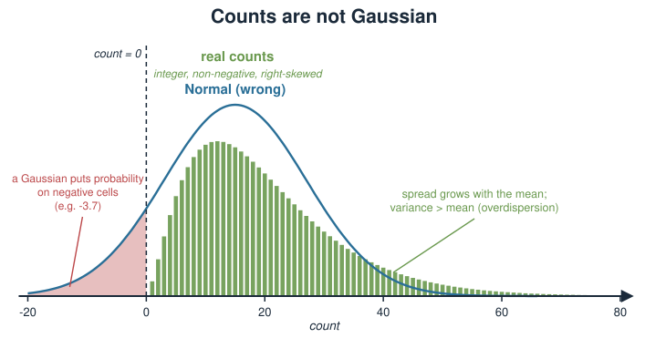{width="70%" fig-align="center"}

::: notes
This slide reactivates the count-distributions unit and motivates the whole modelling choice. The three bullets are the standard case against a linear model for counts. The log link is the bridge: it keeps the mean positive and turns multiplicative biological effects (fold changes) into additive terms we can reason about. Do not re-derive the negative binomial here; just recall that it is the Poisson with an extra dispersion knob, and that biological count data almost always needs that knob.
:::

## Building block 1 — the error model {.smaller}

Model each count with a **negative binomial**, the overdispersed cousin of the Poisson:

$$y_i \sim \text{NegBinomial}(\mu_i, \phi), \qquad \operatorname{Var}(y_i) = \mu_i + \frac{\mu_i^2}{\phi}.$$

- $\mu_i$ is the expected count; $\phi$ (the **shape** / dispersion) controls the extra spread.
- As $\phi \to \infty$ the extra term vanishes and we recover the **Poisson** ($\operatorname{Var}=\mu$).
- Small $\phi$ = strong **overdispersion**: biological heterogeneity between samples beyond pure counting noise.

Letting the data estimate $\phi$ means we *test* whether Poisson would have been enough, rather than assuming it.

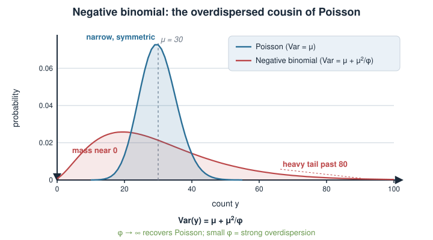{width="65%" fig-align="center"}

::: notes
This is the NB2 parameterisation used by brms and most count-modelling tools: mean mu, variance mu + mu^2/phi. The key teaching point is that phi is not a nuisance to be hidden — it is a biologically meaningful quantity measuring sample-to-sample heterogeneity, and by putting a prior on it and estimating it we let the data tell us how far from Poisson we are. Reassure students that if the data really were Poisson, phi would be estimated large and the model would reduce to Poisson automatically. Overdispersion in immune counts is the rule, not the exception.
:::

## Building block 2 — covariates and exposure {.smaller}

Let the log of the mean be a **linear predictor** — the same additive structure as a linear model, on the log scale:

$$\log \mu_i = \underbrace{\log(\text{n\_cells}_i)}_{\text{offset (exposure)}} + \alpha + \beta_{\text{drug}}\,x_i + \beta_{\text{age}}\,(\text{age}_i - \overline{\text{age}})$$

- The **offset** (coefficient fixed at 1) turns counts into **rates per cell assayed** — the standard fix for library size / sequencing depth.
- $x_i = 1$ for drug, $0$ for placebo, so $\beta_{\text{drug}}$ is the drug effect *on the log scale*.
- $e^{\beta_{\text{drug}}}$ is a **rate ratio**: a multiplicative fold-change in activated T cells. Centring age makes $\alpha$ interpretable at the mean age.

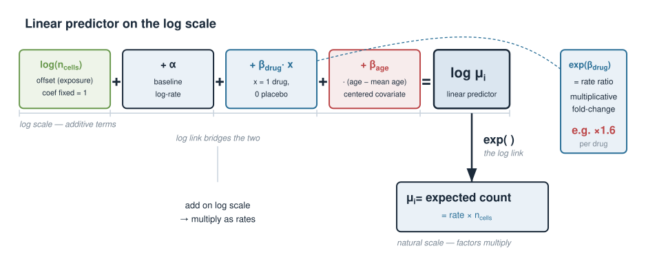{width="80%" fig-align="center"}

::: notes
Everything here reuses the linear-model machinery students already have, but with two twists: the log link (so coefficients are multiplicative, i.e. fold changes) and the offset (so we model a rate, not a raw count). The offset is the same idea as dividing by library size in RNA-seq, done properly inside the model rather than as a pre-normalisation. Drill the interpretation of exp(beta) as a rate ratio because that is what a biologist actually reports: "the drug multiplies activated T-cell abundance by 1.6." Centring covariates is a small but real habit that keeps the intercept meaningful and helps sampling.
:::

## Building block 3 — hierarchy {.smaller}

Two samples from the same patient share that patient's biology. Give each patient a **random intercept**:

$$\log \mu_i = \dots + u_{\text{patient}[i]}, \qquad u_p \sim \text{Normal}(0,\ \sigma_{\text{patient}}).$$

- $u_p$ shifts a patient up or down; $\sigma_{\text{patient}}$ is the **between-patient** spread (the *biological replicate* variance).
- The remaining scatter within a patient is **technical / residual** — captured by $\phi$.
- Hierarchy gives **partial pooling**: noisy patients are shrunk toward the group, borrowing strength across the cohort.

This is the hierarchical-models unit (biological vs technical replicates) applied to our cohort.

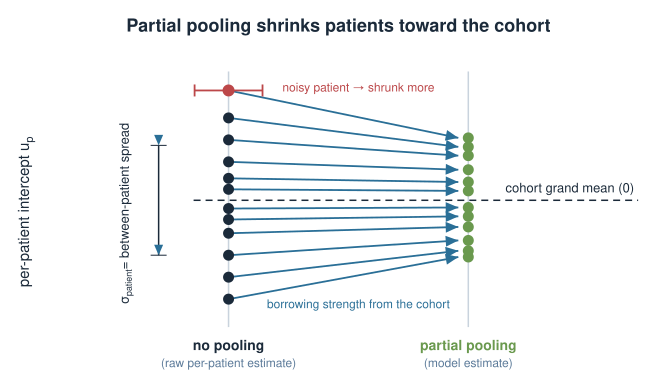{width="60%" fig-align="center"}

::: notes
The hierarchy is what makes this a proper analysis of a repeated-measures design rather than a pile of pseudo-replicated points. Split the variance conceptually: sigma_patient is variation between individuals (biological replicates), phi absorbs the leftover within-patient counting noise (closer to technical replication). Partial pooling / shrinkage is the payoff — a patient with only extreme samples is not trusted at face value; the model pulls it toward the cohort in proportion to how noisy it is. Connect explicitly to the replicates discussion from the hierarchical unit: ignoring the grouping inflates false positives.
:::

## Try it: shrinking the patients {.smaller}

A Gaussian sketch on the log scale: a patient with $c$ activated cells counted has a raw log-rate with noise variance $\approx 1/c$, so its weight is $w_p = c/(c + 1/\sigma_{\text{patient}}^2)$.

```{=html}
<link rel="stylesheet" href="../demos/dist/demo.css">
<div data-demo="shrinkage" data-n="8 12 15 20 25 30 40 50 60 80 110 150" data-mu="0" data-sigma2="1" data-tau2="0.1" data-prefix="P" data-nunit=" cells" data-tauname="σ²ₚ" data-xlabel="patient effect uₚ (log-rate)"></div>
<script src="../demos/dist/shrinkage.js"></script>
```

::: notes
This is the normal–normal version of partial pooling from the hierarchical unit, transplanted onto our twelve patients. It is a sketch, not the brms fit: on the log scale a Poisson count of c cells has a raw log-rate with variance about 1/c, so the number of cells counted plays the role of n_i/sigma^2. Rows are patients sorted by how many activated cells they contributed; the slider is sigma_patient^2, the between-patient variance; the green tick is the simulated true patient effect. At the true value, low-count patients (8–20 cells) are pulled strongly toward the cohort mean, high-count patients barely move. Slide to 0 (every patient identical: complete pooling) and to infinity (every patient on its own: no pooling), and point at the error box: the middle is usually best. In the real model sigma_patient is estimated, so the data choose the amount of shrinkage.
:::

## Building block 4 — priors {.smaller}

Bayesian fitting needs a **prior** on every parameter. We use **weakly informative** priors on the log scale:

```r
priors <- c(
  prior(normal(0, 2),   class = "Intercept"),  # baseline log-rate, broad
  prior(normal(0, 1),   class = "b"),           # each effect: fold-changes mostly within ~e^2
  prior(exponential(1), class = "sd"),          # between-patient SD, positive, modest
  prior(gamma(0.01, 0.01), class = "shape")     # NB dispersion phi, very diffuse
)
```

- `normal(0, 1)` on a log-scale coefficient says: effects near zero are most plausible, but a rate ratio of $e^{\pm 2}\approx 0.14$–$7.4$ is easily allowed. Sceptical, not restrictive.
- Priors here play the role that **regularisation** will play in the penalized-models block: they tame the fit without dictating the answer.

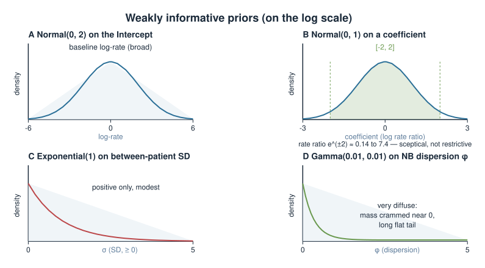{width="65%" fig-align="center"}

::: notes
Priors are where students new to Bayes get nervous, so make the point that weakly informative priors encode common sense (a treatment is unlikely to change abundance a thousand-fold) without forcing a conclusion — the likelihood dominates once there is real data. Explain each: broad Normal on the intercept because we do not know the baseline rate; Normal(0,1) on effects because they live on the log scale where 1 is already a big fold change; a positive-only prior (exponential) on the standard deviation because SDs cannot be negative; a diffuse prior on the dispersion. Plant the forward link to penalized models: an L2 penalty is exactly a Gaussian prior on coefficients. This is the "explore similarity to Bayesian models" connection.
:::

## The full model on one slide {.smaller}

The generative story, read top to bottom — *how a count is born*:

$$
\begin{aligned}
y_i &\sim \text{NegBinomial}(\mu_i,\ \phi) &&\text{(error model)}\\
\log \mu_i &= \log(\text{n\_cells}_i) + \alpha + \beta_{\text{drug}} x_i + \beta_{\text{age}}\,\widetilde{\text{age}}_i + u_{\text{patient}[i]} &&\text{(covariates + hierarchy)}\\
u_p &\sim \text{Normal}(0,\ \sigma_{\text{patient}}) &&\text{(between-patient)}\\
\alpha \sim \text{N}(0,2),\ \ \beta &\sim \text{N}(0,1),\ \ \sigma_{\text{patient}} \sim \text{Exp}(1),\ \ \phi \sim \text{Gamma}(0.01,0.01) &&\text{(priors)}
\end{aligned}
$$

Bayes' theorem ties it together: $\;p(\text{parameters}\mid\text{data}) \propto \underbrace{p(\text{data}\mid\text{parameters})}_{\text{likelihood (NB)}}\;\underbrace{p(\text{parameters})}_{\text{priors}}.$

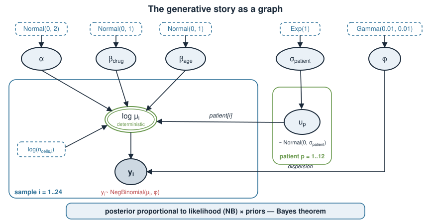{width="55%" fig-align="center"}

::: notes
This is the whole model in one place: read it as a recipe that manufactures a count. Every line is a building block from earlier slides. The final proportionality is Bayes' theorem from the opening unit of the block — posterior proportional to likelihood times prior — now instantiated with a negative-binomial likelihood and the priors we just chose. Emphasise that "fitting" means characterising that posterior distribution over alpha, the betas, sigma_patient, phi, and the twelve u_p, not finding a single best value. This slide is the one to photograph.
:::

## Fitting it in R {.smaller}

One `brms` call expresses the entire model; it writes and compiles a Stan program under the hood (the R-STAN unit).

```r
library(brms)

# Centre age before using it in the formula; this makes the intercept the
# baseline log-rate at the average age.
dat$age_c <- dat$age - mean(dat$age)

fit <- brm(
  count ~ treatment + age_c + offset(log_exp) + (1 | patient),
  data    = dat,
  family  = negbinomial(),        # log link + dispersion phi
  prior   = priors,               # from the previous slide
  chains  = 4, iter = 2000, warmup = 1000,
  cores   = 4, seed = 1
)
```

- `treatment + age_c` are the fixed effects; `offset(log_exp)` is the exposure term.
- `(1 | patient)` is the per-patient random intercept — the hierarchy.
- 4 chains of MCMC explore the posterior; `warmup` samples are discarded.

::: notes
The formula is the model: response on the left, fixed effects and offset in the middle, the (1 | patient) grouping on the right giving the random intercept. family = negbinomial() supplies the log link and the dispersion parameter. Point out that brms is a friendly front end that generates Stan code and runs Hamiltonian Monte Carlo — the same R-STAN engine from the fitting unit, without hand-writing the Stan blocks. Four chains started from different points let us check they agree. Nothing here executes at render time; in the exercise students run an analogous fit on a provided dataset.
:::

## Did the sampler work? {.smaller}

Before interpreting anything, check that the MCMC actually converged. Diagnostics come before conclusions.

```r
summary(fit)
#> Group-Level Effects (patient):  sd(Intercept)  ...
#> Population-Level Effects:
#>                 Estimate  Est.Error  l-95% CI  u-95% CI  Rhat  Bulk_ESS  Tail_ESS
#> Intercept        -7.31      0.14      -7.59     -7.04    1.00     2600      2900
#> treatmentdrug     0.47      0.09       0.29      0.65    1.00     4100      3200
#> age_c            -0.012     0.010     -0.031     0.008   1.00     3500      3000
```

- **`Rhat` $\approx 1.00$** (want $< 1.01$): the chains agree — they mixed.
- **`ESS` in the thousands**: enough effectively-independent draws to trust the summaries.
- Also check **0 divergent transitions** (a Stan-specific warning); divergences mean the geometry was too hard and the fit is untrustworthy.

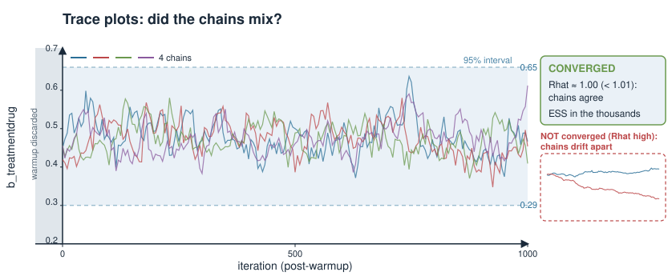{width="70%" fig-align="center"}

::: notes
Hammer the discipline: convergence diagnostics are a gate, not an afterthought. Rhat compares within-chain and between-chain variance; values above ~1.01 mean the chains disagree and the posterior summaries are meaningless. Effective sample size accounts for autocorrelation in MCMC — a few thousand is plenty for stable 95% intervals. Divergent transitions are Stan's honest signal that Hamiltonian dynamics broke down, often fixed by reparameterising or raising adapt_delta. Only once these pass do we read the estimates. This mirrors checking residuals before trusting an lm.
:::

## Reading the posterior {.smaller}

The treatment coefficient lives on the log scale; exponentiate for the biological quantity — a **rate ratio**.

```r
post <- as_draws_df(fit)

# Rate ratio for the drug: multiplicative fold-change in activated T cells
exp(quantile(post$b_treatmentdrug, c(0.025, 0.5, 0.975)))
#>     2.5%      50%    97.5%
#>    1.34     1.60     1.92

# Direct probability the drug increases the count
mean(post$b_treatmentdrug > 0)
#> [1] 0.9998
```

- Point estimate: the drug **multiplies** activated T cells by $\approx 1.6$.
- **95% credible interval** $[1.34,\ 1.92]$: a plausible range for the true effect — a statement about the *parameter*, unlike a confidence interval.
- $P(\beta_{\text{drug}} > 0 \mid \text{data}) \approx 0.9998$: an answer to the actual question, no null hypothesis needed.

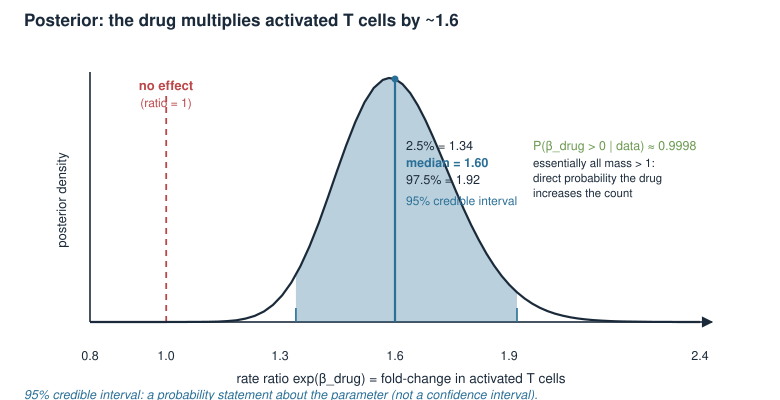{width="65%" fig-align="center"}

::: notes
This is the Bayesian payoff and the place to contrast framings explicitly. The credible interval is a direct probability statement about the parameter: given the data and model, there is 95% posterior probability the rate ratio lies in [1.34, 1.92]. That is what people wrongly wish a confidence interval meant. The probability of direction, P(effect > 0), answers the biologist's question directly without a p-value or a null. Keep the interpretation multiplicative because of the log link: 1.6-fold more activated T cells on the drug. Age's interval straddles zero, so the data are inconclusive about age here.
:::

## Model checking — the idea {.smaller}

A converged sampler only means we fitted *the model we wrote*. Is that model any good? **Posterior predictive checking** asks: if the model is right, would it generate data that look like ours?

$$y^{\text{rep}} \sim p(y^{\text{rep}} \mid \text{data}) = \int p(y^{\text{rep}}\mid\theta)\,p(\theta\mid\text{data})\,d\theta$$

- Draw parameters from the **posterior**, then simulate **new datasets** $y^{\text{rep}}$ from the error model.
- Compare those simulated datasets to the **real** data. Systematic mismatch = the model is missing something.

This is the Bayesian analogue of residual plots — but it checks the *whole* generative story, counts and all.

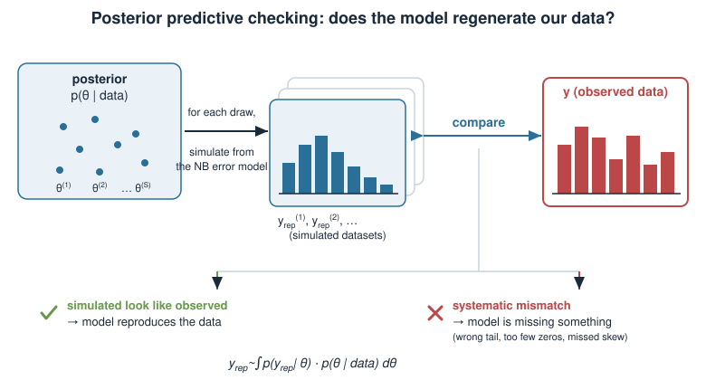{width="75%" fig-align="center"}

::: notes
Make the logic crisp: we already have a posterior over parameters; for each posterior draw we can generate a fake dataset from the negative-binomial error model. If the model captures the data-generating process, these fake datasets should be statistically indistinguishable from the real one. Where they differ systematically, that difference names the model's flaw — too few zeros, wrong tail, missed skew. Contrast with a converged-but-wrong model: MCMC can perfectly sample a bad model. Posterior predictive checks are how we catch that, and they are far more informative than a single goodness-of-fit number.
:::

## Model checking — what to plot {.smaller}

```r
# Overlay: distribution of observed counts vs many simulated datasets
pp_check(fit, ndraws = 100)

# Targeted checks on summary statistics the model must reproduce
pp_check(fit, type = "stat", stat = "mean")
pp_check(fit, type = "stat", stat = "max")                 # is the tail right?
pp_check(fit, type = "stat", stat = function(y) mean(y == 0))  # zero-inflation?
```

- **Density overlay:** the observed count histogram should sit inside the cloud of simulated ones.
- **Test statistics:** if the observed **max** or **proportion of zeros** falls in the tail of the simulated distribution, the error model is wrong — e.g. real data are *more* overdispersed or zero-inflated than a negative binomial allows.
- A failed check sends you back to the model (a different error model, an extra covariate), not to the data.

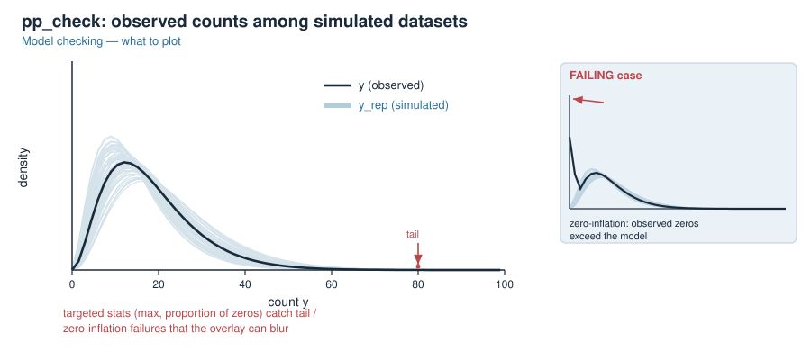{width="65%" fig-align="center"}

::: notes
Give students a concrete menu. The density overlay is the first look: observed distribution as a dark line, simulated datasets as a light band; the dark line should be unremarkable within the band. Then targeted statistics catch specific failures the overlay can blur: the max tests the tail (is dispersion adequate?), the proportion of zeros tests for zero-inflation common in single-cell data. The crucial habit: a failing check is diagnostic feedback about the model, so you iterate on the model — maybe a zero-inflated negative binomial, maybe a missing covariate — never by deleting inconvenient data points.
:::

## Frequentist vs Bayesian, on this case {.smaller}

Same data, two philosophies — and this block chose the Bayesian one for concrete reasons.

| Question | Frequentist tool | Bayesian answer here |
|---|---|---|
| Effect size | coefficient $\pm$ SE from a GLM | full **posterior** for $\beta_{\text{drug}}$ |
| Uncertainty | 95% **confidence** interval | 95% **credible** interval (a real probability) |
| "Is there an effect?" | p-value vs a null | $P(\beta_{\text{drug}}>0\mid\text{data})$ directly |
| Patient structure | random effects via `glmer` | hierarchy with **partial pooling** |
| Prior knowledge | none (or ad-hoc) | encoded, and dominated by data when data are plentiful |
| Model check | residual diagnostics | **posterior predictive** checks |

Neither is "correct"; the Bayesian workflow makes the **uncertainty and the assumptions explicit**, which suits small, structured biological datasets.

::: notes
Return to the Bayesian-vs-frequentist distinction from the opening of the block, now grounded in a worked case. A frequentist GLMM (glmer with a negative-binomial family) would give broadly similar point estimates here — the point is not that one is right, but that the Bayesian version answers the biologist's question in its native language (probabilities about effects), handles small hierarchical datasets gracefully through partial pooling, and forces the assumptions (priors, error model) into the open where they can be criticised and checked. With large data the prior washes out and the two largely agree.
:::

## Summary {.smaller}

| Step | What we did |
|---|---|
| Question | drug effect on **activated T-cell counts**, paired across 12 patients |
| Error model | **negative binomial** — counts, mean-variance link, overdispersion $\phi$ |
| Covariates | log link; **offset** for exposure; $e^{\beta}$ = **rate ratio** |
| Hierarchy | per-patient random intercept → **partial pooling** of replicates |
| Priors | weakly informative on the log scale (regularisation, not dictation) |
| Fit | one `brms` formula → Stan → MCMC (the R-STAN engine) |
| Trust it | `Rhat`, `ESS`, divergences **before** interpreting |
| Read it | posterior, **credible interval**, $P(\text{effect}>0\mid\text{data})$ |
| Check it | **posterior predictive** checks on distribution, max, zeros |

You now have the full arc: **question → generative model → fit → posterior → check**. That arc, not any one formula, is the deliverable of this block.

::: notes
The summary is the workflow, and the workflow is the exam of this unit conceptually even if the block is provisional. Recite the arc once more: write a generative story combining an error model, covariates, hierarchy and priors; fit it with Stan via brms; gate on convergence diagnostics; read the posterior as direct probability statements; and check the model against its own predictions, iterating on the model when checks fail. Point forward: the penalized-models block reframes priors as regularisation, and the single-cell block reuses count models at scale. The exercise walks a smaller version of this exact pipeline by hand and in static R.
:::
