## About this lecture

In the linear algebra block you fitted a straight line by **least squares**: one best line, one number per coefficient. Today we ask a different question — *how sure are we?* — and answer it by fitting the same line the **Bayesian** way.

- The model is unchanged: $y = a + b\,x + \text{noise}$. What changes is the **answer**: each coefficient becomes a **distribution**, not a single number.
- Put **priors** on the intercept $a$, slope $b$, and noise scale $\sigma$; combine with the data (**likelihood**) to get the **posterior**.
- Read a slope as *"there is a 96% chance it is positive"* instead of a bare point estimate and a p-value.
- **Predict** a new observation **with uncertainty** — a credible band, not just a line.
- Biology: does a gene's expression rise with donor **age**? With only a handful of samples, honest uncertainty matters more than a single best-fit slope.

::: notes
The one-sentence pitch: same line, honest uncertainty. Students already know how to get the best-fit line (least squares, the normal equations from the linear algebra block). The new idea is that instead of one number per coefficient we carry a whole distribution, which lets us make probability statements about the slope and put error bars on predictions. Keep reassuring them that the model equation is identical to ordinary regression — only the machinery for answering "how confident?" is new. This is concept-plus-tooling day: understand prior/likelihood/posterior for a line, and read what brms hands back.
:::

## A note on where this block sits {.smaller}

::: {.callout-warning title="Provisional block"}
This **Bayesian statistics** block is **provisional**. It may be moved into a later statistics / machine-learning course rather than staying in this one. Treat the Bayesian machinery here as an **enrichment** of the least-squares fitting you already met — the core, examinable skill remains the by-hand linear fit from the linear algebra block. Nothing here is assumed by later units in *this* course.
:::

::: notes
Be upfront with students and reviewers: the placement of the whole Bayesian block is not settled. It builds on the frequentist regression they already have and could equally live in a dedicated stats/ML course. Say plainly that the examinable core is the least-squares fit; the Bayesian layer is enrichment. This keeps expectations calibrated and flags to any reviewer that dependencies must stay one-directional (this block leans on earlier blocks, nothing earlier leans on it).
:::

## A biology picture first {.smaller}

We measure expression of an ageing-associated gene (normalised RNA-seq, log scale) in blood from a small cohort of donors, and plot it against **age**.

- The cloud slopes gently **upward**: older donors tend to have higher expression.
- But there are only **~15 donors**, and the points are scattered. Is the upward slope **real**, or could a flat line fit almost as well?
- A single best-fit line cannot answer that. We need the **range of slopes** the data are compatible with.

The biological questions are really questions about **uncertainty**: *Is the slope different from zero? By how much, plausibly? What expression should we expect for a new 70-year-old, and how tightly?*

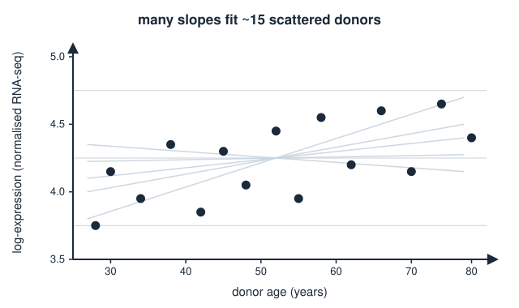{width="65%" fig-align="center"}

::: notes
Anchor everything in a concrete, small-n biological problem before any formalism. Small n is deliberate: it is exactly where a single least-squares line is misleading and where honest uncertainty pays off. Emphasise that the interesting biological questions (is expression changing with age? how much? predict a new donor) are all uncertainty questions. Draw several plausible lines through the sparse cloud to make the point that many slopes are compatible with the data. This motivates wanting a distribution over slopes rather than one slope.
:::

## The model: a line plus noise {.smaller}

We assume each donor's expression $y_i$ is a straight-line function of age $x_i$ plus random scatter:

$$y_i = a + b\,x_i + \varepsilon_i, \qquad \varepsilon_i \sim \mathcal{N}(0,\ \sigma^2)$$

Three unknowns to learn from the data:

- $a$ — the **intercept** (expression at $x=0$, or at a centred reference age),
- $b$ — the **slope** (change in expression **per year** of age); this is the biology we care about,
- $\sigma$ — the **noise scale**: how far points scatter around the line (donor-to-donor variability, measurement error).

This is the *same* model as ordinary linear regression. The Bayesian and least-squares approaches differ only in **what they report about $a$, $b$, $\sigma$**.

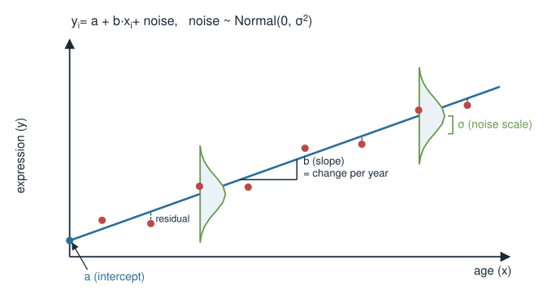{width="60%" fig-align="center"}

::: notes
Write the model and name all three parameters, stressing that sigma is a parameter too, not a nuisance to be swept away — its size controls how confident predictions can be. Interpret the slope in biological units (change in log-expression per year) because coefficients are only meaningful with units attached. Reiterate the through-line: identical model, different accounting of uncertainty. Mention centring age (subtracting the mean) so the intercept is interpretable as expression at the average age rather than at the biologically meaningless age zero.
:::

## Recap: the least-squares fit {.smaller}

From the linear algebra block, the **least-squares** line minimises the sum of squared residuals. Stacking the data into a design matrix $X$ (a column of 1s for $a$, a column of ages for $b$), the best-fit coefficients solve the **normal equations**:

$$\hat{\boldsymbol\beta} = (X^\top X)^{-1} X^\top \mathbf{y}$$

In R this is one call:

```r
fit_ls <- lm(expr ~ age, data = donors)
coef(fit_ls)      # (Intercept)  age   -> point estimates of a and b
confint(fit_ls)   # 95% confidence intervals
```

This gives **one** number for $a$ and **one** for $b$ (plus a confidence interval and a p-value). It is fast, familiar, and often enough.

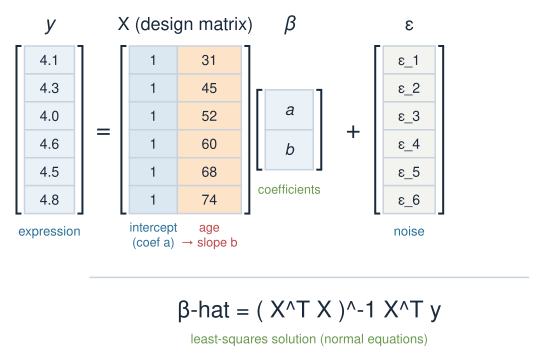{width="60%" fig-align="center"}

::: notes
Deliberately re-derive the connection to linear algebra: least squares is exactly the normal equations they solved by hand, beta_hat = (X^T X)^{-1} X^T y. Show that lm() is the production tool for it. The point of this slide is continuity — the Bayesian fit is not a replacement or a rival, it is the same fit seen through a probabilistic lens. Note in passing that under Gaussian noise the least-squares estimate coincides with the maximum-likelihood estimate; this sets up the likelihood on a later slide. Keep it short; they know this material.
:::

## What least squares does — and doesn't — give {.smaller}

Least squares hands you a **point estimate**: the single most-consistent $a$ and $b$.

- A **confidence interval** and **p-value** come with it, but their interpretation is subtle: the 95% refers to the *procedure over hypothetical repeated experiments*, not to *this* slope.
- It gives **no direct probability statement** about the parameter, e.g. you cannot say "there is a 96% probability the slope is positive."
- Incorporating **prior knowledge** (we already know ageing genes change slowly) is awkward.
- With **few data points**, the point estimate can look deceptively precise.

The Bayesian version fixes exactly these: it returns a **full distribution** for each parameter, so probability statements and honest prediction bands come for free.

::: notes
This is the motivational hinge. Be careful and correct about the frequentist confidence interval: the 95% is a property of the long-run procedure, not a probability about the fixed-but-unknown parameter. Students almost always misread a CI as "95% probability the parameter is in here" — that misreading is actually the Bayesian credible interval, which is what they will get today. So the Bayesian output matches the intuition people already wrongly attach to CIs. Also flag prior knowledge and small-n as the practical wins. Do not disparage frequentism; frame Bayes as answering a directly probabilistic question.
:::

## The Bayesian shift: parameters as distributions {.smaller}

Frequentist: $a$, $b$, $\sigma$ are **fixed unknown numbers**; the data are random.

Bayesian: we describe our **uncertainty about** $a$, $b$, $\sigma$ with **probability distributions**, and update them using data via **Bayes' theorem** (from the prior/likelihood/posterior unit):

$$\underbrace{p(\theta \mid \text{data})}_{\text{posterior}} \ \propto\ \underbrace{p(\text{data} \mid \theta)}_{\text{likelihood}} \times \underbrace{p(\theta)}_{\text{prior}}$$

Here $\theta = (a, b, \sigma)$. The output is the **posterior**: a distribution over *all three parameters at once* that says which combinations are plausible given the data.

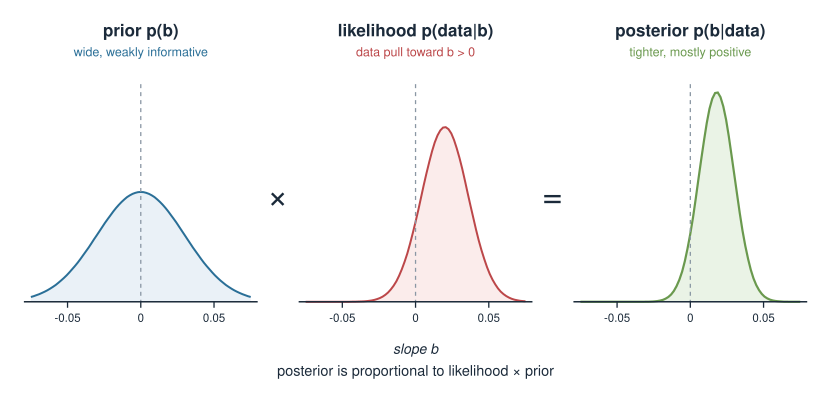{width="80%" fig-align="center"}

::: notes
State the philosophical switch cleanly, then immediately ground it in Bayes' theorem, which they met in the prior/likelihood/posterior unit. The key mental move: uncertainty about a parameter is itself represented by a distribution. Read the theorem in words - posterior is proportional to likelihood times prior. Stress that the posterior is joint over (a, b, sigma); we usually look at one coefficient at a time (a marginal), but the machinery handles their correlations. Keep the proportionality sign honest: the missing constant (the evidence) is what makes it a proper distribution, and is what MCMC lets us avoid computing directly.
:::

## Priors: what we believe before the data {.smaller}

A prior encodes what is plausible for each parameter **before** seeing this dataset. Weakly-informative priors are a good default — wide enough not to force a conclusion, tight enough to rule out the absurd.

$$a \sim \mathcal{N}(0,\ 5), \qquad b \sim \mathcal{N}(0,\ 0.1), \qquad \sigma \sim \text{Exponential}(1)$$

- **Intercept** $a$: centred, broad — expression at the mean age could be a range of values.
- **Slope** $b$: centred at **0** (no assumed direction) but on a biologically sane scale — ageing genes change *slowly* per year, so large slopes are implausible.
- **Noise** $\sigma$: must be **positive**, so an Exponential (or half-Normal) prior; mass on small-to-moderate scatter.

A centred prior on $b$ is **honest**, not a thumb on the scale: it lets the data move the slope, but resists over-reacting to a few noisy points.

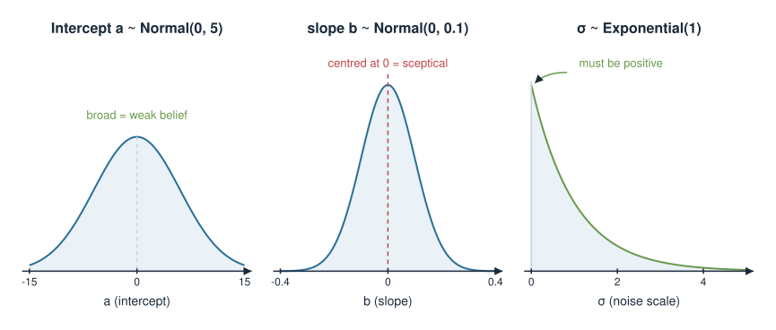{width="80%" fig-align="center"}

::: notes
Priors are where students get nervous, so demystify them: a weakly-informative prior states the scale of plausible values, not the answer. Justify each choice biologically. The slope prior centred at zero is important to explain - it is the sceptical, conservative choice; it does not assume the gene is flat, it just requires evidence to move away from flat, which regularises small-n fits. Emphasise sigma must be positive so its prior lives on the positive line (Exponential or half-Normal). Mention prior predictive checks in passing as the principled way to sanity-check priors (simulate lines from the prior and see if they are biologically ridiculous). Numbers here are illustrative for a centred, standardised-ish response.
:::

## The likelihood: how data pull on the parameters {.smaller}

The **likelihood** measures how well a given $(a, b, \sigma)$ explains the observed points. Under the line-plus-Gaussian-noise model, each donor contributes a normal density:

$$p(y_i \mid a, b, \sigma) = \mathcal{N}\!\left(y_i \ \middle|\ a + b\,x_i,\ \sigma^2\right)$$

and, assuming donors are independent, the full likelihood is the product:

$$p(\text{data} \mid a,b,\sigma) = \prod_{i=1}^{n} \mathcal{N}\!\left(y_i \ \middle|\ a + b\,x_i,\ \sigma\right)$$

Maximising this product **alone** (ignoring priors) gives back the **least-squares** line — the frequentist and Bayesian fits share the same likelihood, and differ only by the prior.

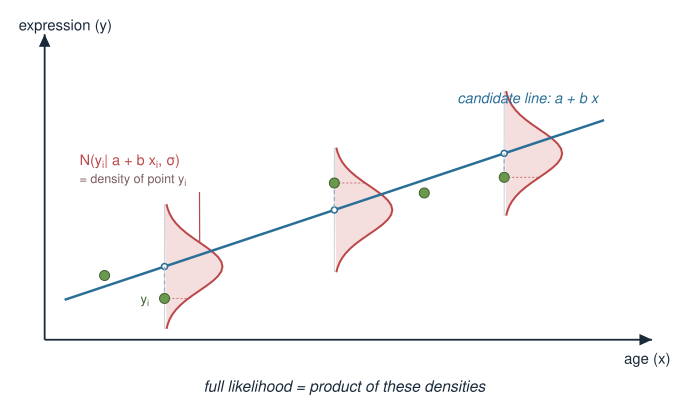{width="60%" fig-align="center"}

::: notes
Define likelihood concretely: plug a candidate line into the model and ask how probable the observed points are. Each point is a Gaussian centred on the line's prediction for that x; independence makes the joint likelihood a product. The punchline ties the whole lecture together: maximising the Gaussian likelihood on its own reproduces least squares (minimising squared residuals is the same as maximising a Gaussian likelihood). So least squares is the "no prior / flat prior, take the peak" special case. The Bayesian answer multiplies in the prior and keeps the whole distribution instead of only its peak.
:::

## The posterior: prior × likelihood {.smaller}

Multiply prior and likelihood and normalise — the result is the **posterior** over $(a, b, \sigma)$:

$$p(a, b, \sigma \mid \text{data}) \ \propto\ \left[\prod_{i} \mathcal{N}(y_i \mid a + b x_i,\ \sigma)\right]\ p(a)\,p(b)\,p(\sigma)$$

- For a straight line with Gaussian noise there is **no simple formula** to write down for the full posterior, so we **sample** from it with **MCMC** (Markov-chain Monte Carlo).
- MCMC returns thousands of **draws** $(a^{(k)}, b^{(k)}, \sigma^{(k)})$ — a cloud of plausible parameter sets.
- The **spread** of the draws *is* the uncertainty. Summaries (mean, 95% interval) are just descriptions of that cloud.

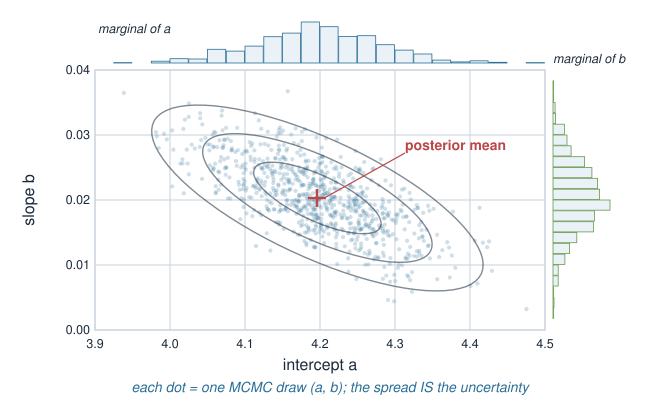{width="55%" fig-align="center"}

::: notes
Assemble the posterior explicitly as prior times likelihood, normalised. Be honest that for regression the posterior has no tidy closed form once you use general priors, which is why we sample. MCMC is the engine; you can name-drop that it is a Markov chain (link to the Markov chains block conceptually - it walks parameter space so its stationary distribution is the posterior) without teaching the algorithm. The crucial intuition: we get a big table of plausible (a, b, sigma) triples, and everything we report - coefficient distributions, prediction bands, probabilities - is computed by summarising that table. No integrals by hand.
:::

## Fitting it in R with brms {.smaller}

`brms` writes and runs the MCMC for you from an `lm`-style formula.

```r
library(brms)

fit <- brm(
  expr ~ age,                       # same formula as lm()
  data   = donors,
  family = gaussian(),              # line + Gaussian noise
  prior  = c(
    prior(normal(0, 5),    class = "Intercept"),
    prior(normal(0, 0.1),  class = "b"),        # slope
    prior(exponential(1),  class = "sigma")     # noise scale
  ),
  chains = 4, iter = 2000, seed = 1
)
```

The formula `expr ~ age` is identical to what you would pass to `lm()`. The extra arguments declare the **priors** and how much to **sample**.

::: notes
Show that the Bayesian fit is a near drop-in for lm: same formula interface, plus explicit priors and sampling controls. Walk the prior() lines and match them to the previous slide's choices - class Intercept, class b for the slope, class sigma for noise. Mention that family = gaussian() is exactly the line-plus-normal-noise assumption; swapping the family (e.g. to negative binomial for counts) is how this generalises to the count models from the distributions block, but today stays Gaussian. Note brms compiles a Stan model under the hood; chains and iter control the MCMC. This is static code - nothing runs at render time.
:::

## Always check the sampling {.smaller}

Before trusting anything, confirm the MCMC actually converged.

```r
summary(fit)          # look at Rhat and ESS for every parameter
plot(fit)             # trace plots: chains should overlap like "fuzzy caterpillars"
```

- **`Rhat`** should be $\approx 1.00$ for every parameter (chains agree). Values $\gtrsim 1.01$ signal trouble.
- **`ESS`** (effective sample size) should be comfortably large (hundreds+).
- **Trace plots** should look like stationary noise with the chains fully overlapping.

If these fail, the numbers are unreliable — re-run with more iterations or reconsider the model, don't interpret.

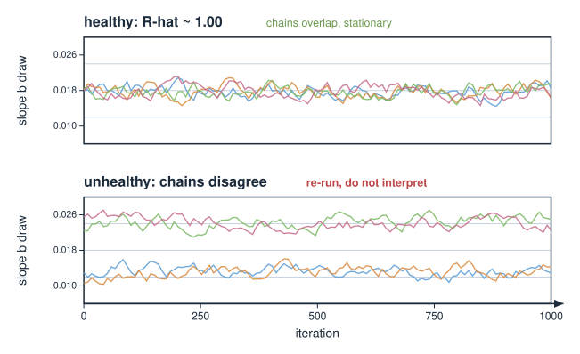{width="60%" fig-align="center"}

::: notes
Instil the discipline that sampling diagnostics come before interpretation, analogous to checking residuals before trusting an lm. Give the two headline numbers: Rhat near 1 means the independent chains have mixed to the same distribution; effective sample size tells you how many near-independent draws you effectively have. Trace plots that look like fuzzy caterpillars with overlapping chains are healthy; drifting or separated chains mean non-convergence. The rule: never read coefficients off a fit that failed diagnostics. This is a common exam-style "what would you check?" point.
:::

## Reading the posterior: coefficients are distributions {.smaller}

```r
posterior_summary(fit)     # mean, SE, and 95% credible interval per parameter
```

| Parameter | Estimate | 95% credible interval |
|---|---|---|
| Intercept $a$ | 4.20 | [3.95, 4.45] |
| slope $b$ | 0.018 | [0.001, 0.035] |
| $\sigma$ | 0.31 | [0.22, 0.44] |

- Each row is a **summary of that parameter's marginal posterior** — the shape of the whole distribution, boiled down.
- The slope's 95% **credible interval** $[0.001, 0.035]$ means: *given the data and priors, there is a 95% probability the true per-year change lies in this range.*
- That is the plain-English reading people **wrongly** attach to a frequentist CI — here it is actually correct.

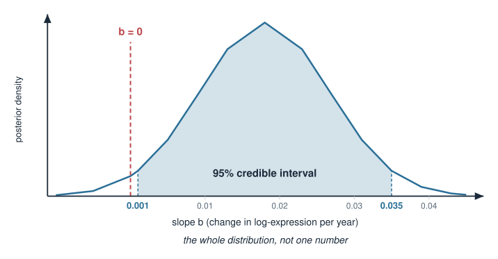{width="55%" fig-align="center"}

::: notes
This table is illustrative, not computed. The teaching point: every coefficient now has a full distribution, summarised by a posterior mean and a credible interval. Hammer the interpretation contrast from earlier - the credible interval is a direct probability statement about the parameter, which is exactly the (incorrect) intuition students bring to confidence intervals. So Bayes legitimises the intuition. Point out the slope interval sits just above zero, foreshadowing the next slide's probability-of-positive-slope computation. Note sigma also has a posterior; uncertainty about the noise scale feeds into prediction uncertainty.
:::

## Interpreting a coefficient as a probability {.smaller}

Because the slope is a full distribution of draws, we can ask direct biological questions by **counting draws**:

```r
draws <- as_draws_df(fit)

mean(draws$b_age > 0)          # P(slope > 0 | data)  e.g. 0.98
quantile(draws$b_age, c(0.025, 0.975))   # 95% credible interval
```

- `mean(draws$b_age > 0)` is just *the fraction of posterior draws with a positive slope* — a genuine probability that the gene's expression **increases** with age.
- No null hypothesis, no p-value: a probability you can report and act on.
- Want the chance the effect exceeds a **biologically meaningful** size? `mean(draws$b_age > 0.01)`.

This is the payoff: coefficients you can **reason about probabilistically**.

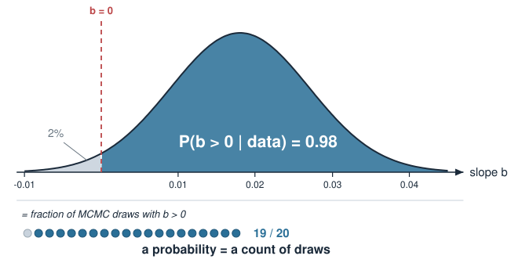{width="55%" fig-align="center"}

::: notes
Show how trivially the posterior answers real questions: a probability is just a proportion of draws. P(slope > 0) is the fraction of the MCMC table with positive slope - report it directly as the probability the gene goes up with age. Contrast with the frequentist detour through a null hypothesis and p-value. Emphasise the flexibility: you can ask about any threshold, including a minimum biologically relevant effect size (a ROPE-style question), which a p-value cannot address. This is the slide that makes Bayesian regression feel useful rather than philosophical.
:::

## Prediction with uncertainty: two questions {.smaller}

For a new donor aged 70, "predict the expression" is really **two** questions:

- **Where is the average line?** Uncertainty in $a$ and $b$ only → a **credible interval for the mean** expression at age 70. Narrow.
- **Where will one new donor land?** Adds the noise $\sigma$ on top → a wider **prediction interval** for a single observation.

```r
newdata <- data.frame(age = 70)

# uncertainty in the regression line (mean response)
fitted(fit, newdata = newdata)          # estimate + 95% credible interval

# uncertainty for a brand-new individual (adds sigma)
predict(fit, newdata = newdata)         # estimate + 95% prediction interval
```

Confusing these two is a classic error: the second band is always **wider** because it includes donor-to-donor scatter, not just uncertainty about the line.

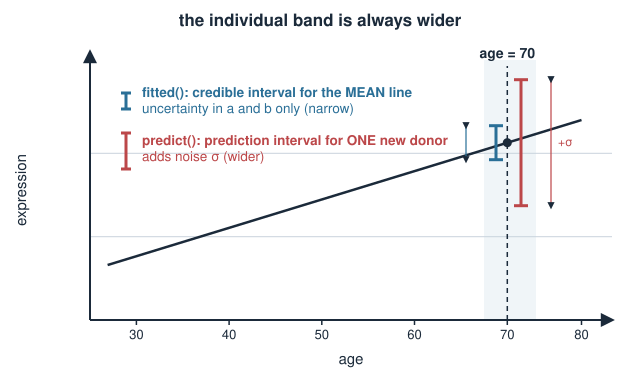{width="55%" fig-align="center"}

::: notes
This is the single most useful practical distinction and a frequent exam-style trap. Two sources of uncertainty: (1) we do not know the true line (parameter uncertainty in a and b), giving a credible band for the mean; (2) even if we knew the line exactly, a new donor scatters around it by sigma, giving a wider prediction band for an individual. fitted() gives the first, predict() gives the second. Draw both bands: the mean band hugs the line, the prediction band is fatter and roughly parallel. Stress that reporting the narrow band when you meant an individual prediction badly understates uncertainty.
:::

## Prediction bands over the whole range {.smaller}

`conditional_effects` draws the fitted line with its uncertainty across all ages at once:

```r
conditional_effects(fit)                          # mean line + 95% credible band

# to show the wider band for individual new donors:
conditional_effects(fit, method = "posterior_predict")
```

- The shaded band is **narrowest near the mean age** (where the data are densest) and **flares out at the extremes** — we extrapolate with less confidence.
- Every point on the band is a summary of the **posterior-predictive** draws at that age.

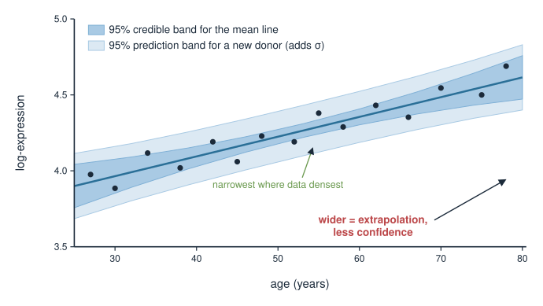{width="60%" fig-align="center"}

::: notes
Reinforce visually: the uncertainty band is not constant width. It pinches near the centre of the data and flares at the ends, which is the honest statement that extrapolation beyond your donors' ages is uncertain. Distinguish again the mean band (default) from the wider posterior-predictive band for individuals. Everything shown is derived by pushing every posterior draw through the model at each age and summarising - the same draw-counting logic as the coefficient slide, just done pointwise. This picture is the emotional payoff of the whole lecture: a fit that shows its own uncertainty.
:::

## Bayesian vs least squares, side by side {.smaller}

| Aspect | Least squares (`lm`) | Bayesian (`brms`) |
|---|---|---|
| Output per coefficient | one number + CI | full **posterior distribution** |
| Slope reading | estimate + p-value | $P(b>0\mid\text{data})$ directly |
| Interval meaning | long-run procedure | **probability about this parameter** |
| Prior knowledge | hard to include | built in as the **prior** |
| Small samples | can look over-precise | prior **regularises** honestly |
| Prediction | interval formulae | **posterior-predictive** draws |
| Cost / speed | instant | MCMC, slower; needs diagnostics |
| When the priors are flat | — | posterior **peak = least-squares fit** |

Same line, same likelihood — Bayes keeps the **whole distribution** where least squares keeps only its **peak**.

::: notes
The consolidation slide. Walk each row as a contrast, but keep returning to the unifying fact in the last row: with flat priors the posterior mode is exactly the least-squares estimate, so Bayes is a strict generalisation, not a competitor. The costs are real and worth stating honestly - MCMC is slower and demands convergence checks, so for a quick look lm is fine; you reach for brms when uncertainty, priors, or principled prediction bands matter. Encourage students to see the two as the same regression with different amounts of information retained.
:::

## Summary {.smaller}

| Idea | Key fact |
|---|---|
| Model | $y = a + b\,x + \varepsilon$, $\varepsilon\sim\mathcal N(0,\sigma^2)$ — same as ordinary regression |
| Bayesian shift | parameters $a,b,\sigma$ get **distributions**, not single numbers |
| Bayes' theorem | posterior $\propto$ likelihood $\times$ prior |
| Prior | weakly-informative; slope centred at 0 = sceptical, regularising |
| Likelihood | Gaussian; maximised alone → **least-squares** line |
| Posterior | sampled by **MCMC**; draws = a cloud of plausible $(a,b,\sigma)$ |
| Coefficient reading | $P(b>0\mid\text{data})$ = fraction of draws with $b>0$ |
| Credible interval | direct probability the parameter lies in the range |
| Prediction | **mean** band (narrow) vs **individual** band (wider, adds $\sigma$) |
| Diagnostics | check `Rhat` $\approx 1$ and trace plots **before** interpreting |

**Builds on:** least-squares fitting and the normal equations (linear algebra block); prior / likelihood / posterior (Bayes' theorem). **Generalises to:** swapping `family = gaussian()` for a count family, linking to the Poisson / negative-binomial models in the distributions block.

::: notes
The summary is the revision sheet. Drill the through-line one more time: identical model, priors turn parameters into distributions, Bayes combines prior and likelihood, MCMC samples the posterior, and every question - is the slope positive, predict a new donor - is answered by summarising draws. Remind them least squares is the flat-prior peak, so nothing they learned earlier is discarded. Point forward: the same brms machinery with a different family handles the overdispersed count data from the distributions block, which is the natural next step for omics. And repeat: diagnostics before interpretation, always.
:::
