## About this lecture

In the linear algebra block you fitted a straight line by **least squares**: one best line, one number per coefficient. Today we ask a different question — *how sure are we?* — and answer it by fitting the same line the **Bayesian** way.

- The model is unchanged: $y = a + b\,x + \text{noise}$. What changes is the **answer**: each coefficient becomes a **distribution**, not a single number.
- Put **priors** on the intercept $a$, slope $b$, and noise scale $\sigma$; combine with the data (**likelihood**) to get the **posterior**.
- Two interactive demos carry the ideas: *many plausible lines* and *inside the sampler*.
- Read a slope as *"there is a 96% chance it is positive"* instead of a bare point estimate and a p-value.
- **Predict** a new observation **with uncertainty** — a credible band, not just a line.
- Biology: does a gene's expression rise with donor **age**? With only a handful of samples, honest uncertainty matters more than a single best-fit slope.

::: notes
The one-sentence pitch: same line, honest uncertainty. Students already know how to get the best-fit line (least squares from the linear algebra block, or simply lm()). The new idea is that instead of one number per coefficient we carry a whole distribution, which lets us make probability statements about the slope and put error bars on predictions. Keep reassuring them that the model equation is identical to ordinary regression — only the machinery for answering "how confident?" is new. This is concept-plus-tooling day: understand prior/likelihood/posterior for a line, and read what brms hands back. No formulas need to be evaluated by hand; the maths is collected on one optional slide at the end.
:::

## A biology picture first {.smaller}

We measure expression of an ageing-associated gene (normalised RNA-seq, log scale) in blood from a small cohort of donors, and plot it against **age**.

- The cloud slopes gently **upward**: older donors tend to have higher expression.
- But there are only **12 donors**, and the points are scattered. Is the upward slope **real**, or could a flat line fit almost as well?
- A single best-fit line cannot answer that. We need the **range of slopes** the data are compatible with.

The biological questions are really questions about **uncertainty**: *Is the slope different from zero? By how much, plausibly? What expression should we expect for a new 70-year-old, and how tightly?*

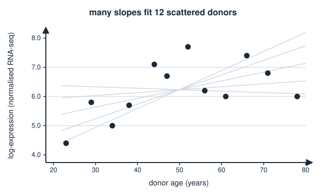{width="65%" fig-align="center"}

::: notes
Anchor everything in a concrete, small-n biological problem before any formalism. Small n is deliberate: it is exactly where a single least-squares line is misleading and where honest uncertainty pays off. Emphasise that the interesting biological questions (is expression changing with age? how much? predict a new donor) are all uncertainty questions. Draw several plausible lines through the sparse cloud to make the point that many slopes are compatible with the data. This motivates wanting a distribution over slopes rather than one slope.
:::

## The model: a line plus noise {.smaller}

We assume each donor's expression $y$ is a straight-line function of age $x$ plus random scatter:

$$y = a + b\,x + \varepsilon, \qquad \varepsilon \sim \mathcal{N}(0,\ \sigma^2)$$

Read in words: *the noise $\varepsilon$ is bell-shaped (Normal), centred on 0, with spread $\sigma$.* Points fall on both sides of the line, mostly close to it.

Three unknowns to learn from the data:

- $a$ — the **intercept** (expression at $x=0$, or at a centred reference age),
- $b$ — the **slope** (change in expression **per year** of age); this is the biology we care about,
- $\sigma$ — the **noise scale**: how far points scatter around the line (donor-to-donor variability, measurement error).

This is the *same* model as ordinary linear regression. The Bayesian and least-squares approaches differ only in **what they report about $a$, $b$, $\sigma$**.

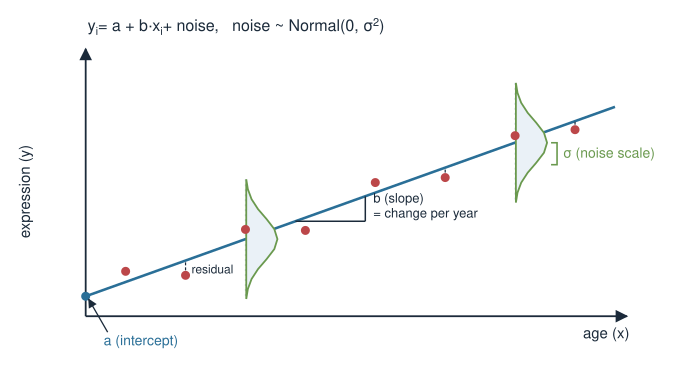{width="60%" fig-align="center"}

::: notes
Write the model and read it aloud in words (line plus bell-shaped noise centred on zero with spread sigma), then name all three parameters, stressing that sigma is a parameter too, not a nuisance to be swept away — its size controls how confident predictions can be. Interpret the slope in biological units (change in log-expression per year) because coefficients are only meaningful with units attached. Reiterate the through-line: identical model, different accounting of uncertainty. Mention centring age (subtracting the mean) so the intercept is interpretable as expression at the average age rather than at the biologically meaningless age zero.
:::

## Least squares: one best line {.smaller}

From the linear algebra block: the **least-squares** line is *the line with the smallest total squared miss* — add up the squared vertical distances from each point to the line, and pick the line that makes this total as small as possible. In R this is one call:

```r
fit_ls <- lm(expr ~ age, data = donors)
coef(fit_ls)      # (Intercept)  age   -> point estimates of a and b
confint(fit_ls)   # 95% confidence intervals
```

This gives **one** number for $a$ and **one** for $b$ (plus a confidence interval and a p-value). It is fast, familiar, and often enough. But:

- The confidence interval's 95% refers to the *procedure over hypothetical repeated experiments*, not to *this* slope.
- There is **no direct probability statement** such as "there is a 96% probability the slope is positive."
- **Prior knowledge** (ageing genes change slowly) is awkward to include, and with **few data points** the single line can look deceptively precise.

The Bayesian version returns a **full distribution** for each parameter, so probability statements and honest prediction bands come for free.

::: notes
Continuity first: least squares is the fit they already know, and lm() is the production tool for it. Say it in words, "the line with the smallest total squared miss"; the matrix form from the linear algebra block is on the optional maths slide at the end and is not needed today. The Bayesian fit is not a rival, it is the same fit seen through a probabilistic lens.

Then the motivational hinge. Be careful and correct about the frequentist confidence interval: the 95% is a property of the long-run procedure, not a probability about the fixed-but-unknown parameter. Students almost always misread a CI as "95% probability the parameter is in here" — that misreading is actually the Bayesian credible interval, which is what they will get today. Also flag prior knowledge and small n as the practical wins. Do not disparage frequentism; frame Bayes as answering a directly probabilistic question.
:::

## The Bayesian shift: parameters as distributions {.smaller}

Frequentist: $a$, $b$, $\sigma$ are **fixed unknown numbers**; the data are random.

Bayesian: we describe our **uncertainty about** $a$, $b$, $\sigma$ with **probability distributions**, and update them using data via **Bayes' theorem** (from the prior/likelihood/posterior unit):

$$\underbrace{p(\theta \mid \text{data})}_{\text{posterior}} \ \propto\ \underbrace{p(\text{data} \mid \theta)}_{\text{likelihood}} \times \underbrace{p(\theta)}_{\text{prior}}$$

Here $\theta = (a, b, \sigma)$. The output is the **posterior**: a distribution over *all three parameters at once* that says which combinations are plausible given the data.

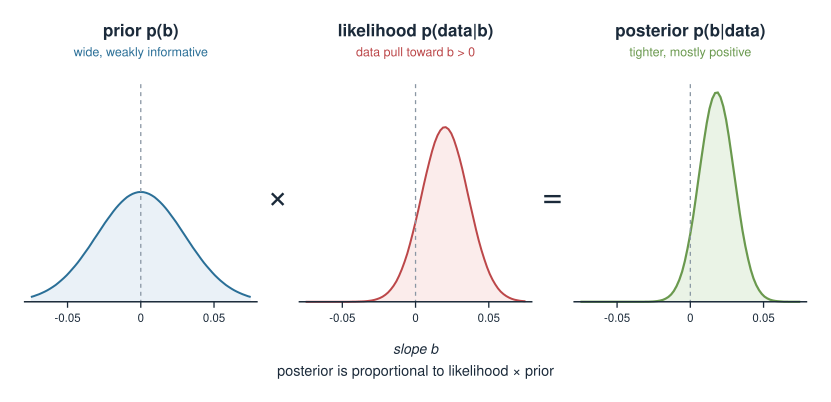{width="80%" fig-align="center"}

::: notes
State the philosophical switch cleanly, then immediately ground it in Bayes' theorem, which they met in the prior/likelihood/posterior unit. The key mental move: uncertainty about a parameter is itself represented by a distribution. Read the theorem in words - posterior is proportional to likelihood times prior. Stress that the posterior is joint over (a, b, sigma); we usually look at one coefficient at a time (a marginal), but the machinery handles their correlations. Keep the proportionality sign honest: the missing constant (the evidence) is just "divide by the total so it sums to 1", exactly as in the grid tables of the Bayes unit, and it is what MCMC lets us avoid computing directly.
:::

## Priors: what we believe before the data {.smaller}

A prior encodes what is plausible for each parameter **before** seeing this dataset. Weakly-informative priors are a good default — wide enough not to force a conclusion, tight enough to rule out the absurd.

- **Intercept** $a$: a broad bell curve — expression at the mean age could be a wide range of values.
- **Slope** $b$: a bell curve centred at **0** (no assumed direction) but on a biologically sane scale — ageing genes change *slowly* per year (roughly within ±0.2 per year), so large slopes are implausible.
- **Noise** $\sigma$: must be **positive**, so a prior that lives only above 0 and puts most weight on small-to-moderate scatter.

In R you write these as `normal(0, 5)`, `normal(0, 0.1)` and `exponential(1)` (next slides).

A centred prior on $b$ is **honest**, not a thumb on the scale: it lets the data move the slope, but resists over-reacting to a few noisy points.

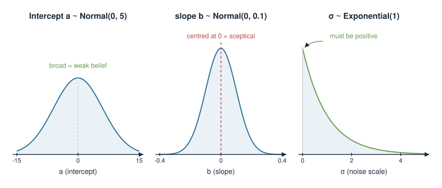{width="80%" fig-align="center"}

::: notes
Priors are where students get nervous, so demystify them: a weakly-informative prior states the scale of plausible values, not the answer. Justify each choice biologically. The slope prior centred at zero is important to explain - it is the sceptical, conservative choice; it does not assume the gene is flat, it just requires evidence to move away from flat, which regularises small-n fits. Emphasise sigma must be positive so its prior lives on the positive line (Exponential or half-Normal). Mention prior predictive checks in passing as the principled way to sanity-check priors (simulate lines from the prior and see if they are biologically ridiculous). Numbers here are illustrative for a centred, standardised-ish response. The brms names: normal(0, 5) for the intercept, normal(0, 0.1) for the slope (sd 0.1 per year, so about 95% of the prior within ±0.2 per year), exponential(1) for sigma. The "many plausible lines" demo two slides on has a slider for the slope prior width: with all 12 donors, narrowing it from ±1 to ±0.2 per 10 years pulls the slope from 0.30 to 0.18 per 10 years.
:::

## The likelihood: how data pull on the parameters {.smaller}

The **likelihood** asks: *if this candidate line were the truth, how probable would the points we actually saw be?*

- Each point gets a bell curve centred on the line's prediction at that age. A point close to the line sits near the top of its bell (probable); a point far away sits out in the tail (improbable).
- Donors are independent, so the probabilities of all points multiply together into one number for the whole line.
- So **points far from the line make that line less believable.** The line with the smallest total squared miss — the least-squares line — is the most believable one.

The least-squares and Bayesian fits share this same likelihood; they differ only by the **prior**, and by keeping the whole distribution instead of only its peak.

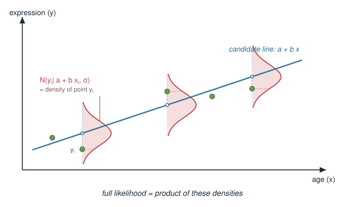{width="55%" fig-align="center"}

::: notes
Define likelihood concretely: plug a candidate line into the model and ask how probable the observed points are. Each point is a bell curve centred on the line's prediction for that x; independence makes the joint likelihood a product. The punchline ties the whole lecture together: the line that makes the points most probable is exactly the least-squares line, because big misses land in the tails of the bells. So least squares is the "flat prior, take the peak" special case. The formula is on the optional maths slide at the end; the next slide lets students feel it instead.
:::

## Try it: many plausible lines {.smaller}

```{=html}
<link rel="stylesheet" href="../demos/dist/demo.css">
<div data-demo="bayesline"></div>
<script src="../demos/dist/bayesline.js"></script>
```

::: notes
Interactive demo on 12 donors (age vs expression; the same data as the sampler demo later). Panel (a) is the likelihood slide made tangible. It starts with a flat line (height 6.2 at age 50, slope 0): the red sticks are the misses, total squared miss 10.3 against 7.1 for the best line, and the "believable" bar says this flat line is only about 20% as believable as the best line. Drag the handles or the sliders: every time a stick gets longer the bar drops. Press "best line" to jump to least squares (100%). Panel (b) is the posterior: press "show 50 posterior lines". Each line is one plausible line given the data and a slope prior; 48 of 50 rise (exact probability 96%), slope 0.30 per 10 years, 95% credible interval −0.03 to 0.64. That is "a coefficient is a distribution", drawn as lines. Then the slope prior slider: narrowing it to ±0.2 per 10 years pulls the slope to 0.18 and P(slope > 0) to 91%. With the donors slider at 3, the narrow prior pulls a lot harder (0.47 to 0.15, P from 95% to 82%): priors matter most when data are few. Leave the bands for the prediction slides.
:::

## The posterior: prior × likelihood {.smaller}

Multiply prior and likelihood and normalise — the result is the **posterior** over $(a, b, \sigma)$: how plausible each combination is, given the data.

- For a straight line with Gaussian noise and general priors there is **no simple formula** for the full posterior, so we **sample** from it with **MCMC** (Markov-chain Monte Carlo).
- MCMC returns thousands of **draws**, each one a plausible $(a, b, \sigma)$ — a **cloud of draws**. Each draw is one plausible line, like the 50 lines in the demo.
- The **spread** of the draws *is* the uncertainty. Summaries (mean, 95% interval) are just descriptions of that cloud.

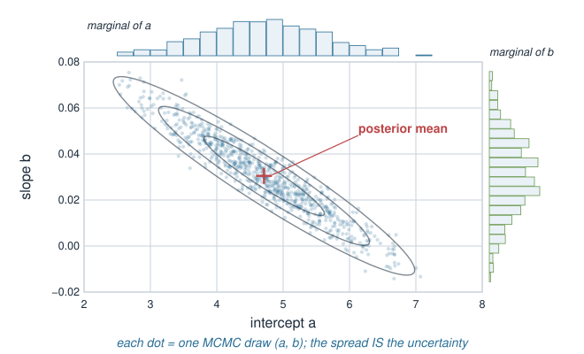{width="55%" fig-align="center"}

::: notes
Assemble the posterior in words as prior times likelihood, normalised (the formula is on the optional maths slide). Be honest that for regression the posterior has no tidy closed form once you use general priors, which is why we sample. MCMC is the engine; you can name-drop that it is a Markov chain (link to the Markov chains block conceptually - it walks parameter space so its stationary distribution is the posterior) without teaching the algorithm. The figure is the posterior for the 12 donors (intercept at age 0, slope per year): the cloud is tilted because age 0 is far from the data, so a steeper line must start lower. The crucial intuition: we get a big table of plausible (a, b, sigma) triples, and everything we report - coefficient distributions, prediction bands, probabilities - is computed by summarising that table. No integrals by hand.
:::

## Fitting it in R with brms {.smaller}

`brms` writes and runs the MCMC for you from an `lm`-style formula.

```r
library(brms)

fit <- brm(
  expr ~ age,                       # same formula as lm()
  data   = donors,
  family = gaussian(),              # line + Gaussian noise
  prior  = c(
    prior(normal(0, 5),    class = "Intercept"),
    prior(normal(0, 0.1),  class = "b"),        # slope
    prior(exponential(1),  class = "sigma")     # noise scale
  ),
  chains = 4, iter = 2000, seed = 1
)
```

The formula `expr ~ age` is identical to what you would pass to `lm()`. The extra arguments declare the **priors** and how much to **sample**.

::: notes
Show that the Bayesian fit is a near drop-in for lm: same formula interface, plus explicit priors and sampling controls. Walk the prior() lines and match them to the previous slide's choices - class Intercept, class b for the slope, class sigma for noise. Mention that family = gaussian() is exactly the line-plus-normal-noise assumption; swapping the family (e.g. to negative binomial for counts) is how this generalises to the count models in Error models (next unit), but today stays Gaussian. Note brms compiles a Stan model under the hood; chains and iter control the MCMC. This is static code - nothing runs at render time.
:::

## Always check the sampling {.smaller}

Before trusting anything, confirm the MCMC actually converged.

```r
summary(fit)          # look at Rhat and ESS for every parameter
plot(fit)             # trace plots: chains should overlap like "fuzzy caterpillars"
```

- **`Rhat`** should be $\approx 1.00$ for every parameter (chains agree). Values $\gtrsim 1.01$ signal trouble.
- **`ESS`** (effective sample size) should be comfortably large (hundreds+).
- **Trace plots** should look like stationary noise with the chains fully overlapping.

If these fail, the numbers are unreliable — re-run with more iterations or reconsider the model, don't interpret.

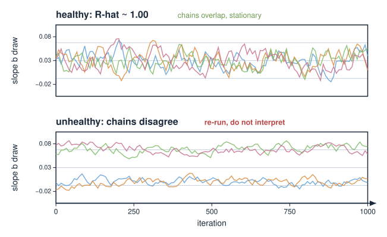{width="60%" fig-align="center"}

::: notes
Instil the discipline that sampling diagnostics come before interpretation, analogous to checking residuals before trusting an lm. Give the two headline numbers: Rhat near 1 means the independent chains have mixed to the same distribution; effective sample size tells you how many near-independent draws you effectively have. Trace plots that look like fuzzy caterpillars with overlapping chains are healthy; drifting or separated chains mean non-convergence. The rule: never read coefficients off a fit that failed diagnostics. This is a common "what would you check?" question. The next slide shows healthy and unhealthy chains live.
:::

## Try it: inside the sampler {.smaller}

```{=html}
<link rel="stylesheet" href="../demos/dist/demo.css">
<div data-demo="mcmc" data-step="0.4" data-iter="1000" data-chains="4"></div>
<script src="../demos/dist/mcmc.js"></script>
```

::: notes
The same 12 donors as the "many plausible lines" demo; intercept a and slope b, noise fixed so there are only two parameters. The orange ellipses are the true posterior (a real problem would not show us). The sampler is the simplest MCMC, random-walk Metropolis: propose a random jump of about "step size"; always accept if the posterior is higher there, sometimes if lower; if rejected, stay and record the same point again. brms uses Stan's smarter sampler, but the output is read the same way. Press Run: four chains start in the corners, walk in (warm-up, shaded on the traces), then wander around the ellipses; the histograms fill with draws and match the orange curves — the cloud of draws from the posterior slide. Then the presets: "tiny steps" crawls, the chains have not met and R-hat is far above 1; "huge steps" rejects almost every jump, the traces become flat staircases and R-hat is again poor; "good steps" gives about 30% acceptance, overlapping fuzzy-caterpillar traces and R-hat close to 1. The point for today: only read the numbers after the chains agree. The rstan unit goes inside the sampler in more detail.
:::

## Reading the posterior: coefficients are distributions {.smaller}

```r
posterior_summary(fit)     # mean, SE, and 95% credible interval per parameter
```

| Parameter | Estimate | 95% credible interval |
|---|---|---|
| Intercept $a$ (at age 0) | 4.71 | [2.93, 6.49] |
| slope $b$ (per year) | 0.030 | [−0.003, 0.064] |
| $\sigma$ | 0.91 | [0.59, 1.45] |

- Each row is a **summary of that parameter's marginal posterior** — the shape of the whole distribution, boiled down.
- The slope's 95% **credible interval** $[-0.003, 0.064]$ means: *given the data and priors, there is a 95% probability the true per-year change lies in this range.*
- That is the plain-English reading people **wrongly** attach to a frequentist CI — here it is actually correct.

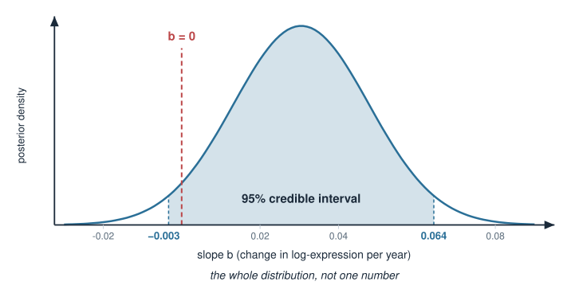{width="55%" fig-align="center"}

::: notes
The numbers are for the same 12 donors as the demos. Intercept and slope come from the demos' model (noise fixed at 1, slope prior normal(0, 0.1) per year): slope 0.030 per year is the demo's 0.30 per 10 years, and the interval is the demo's −0.03 to 0.64 per 10 years. A full brms fit that also estimates sigma gives nearly the same slope (0.031 per year, interval −0.002 to 0.062, P(slope > 0) about 0.97); the sigma row is from that fit. The intercept is the expression at age 0, far outside the data, hence its wide interval; at age 50 the line sits at 6.2 (5.7 to 6.8). The teaching point: every coefficient now has a full distribution, summarised by a posterior mean and a credible interval. Hammer the interpretation contrast from earlier - the credible interval is a direct probability statement about the parameter, which is exactly the (incorrect) intuition students bring to confidence intervals. So Bayes legitimises the intuition. Point out that the slope interval reaches just below zero, yet the next slide gives a 96% probability that the slope is positive: an interval that touches 0 is not the same as "no effect". Note sigma also has a posterior; uncertainty about the noise scale feeds into prediction uncertainty.
:::

## Interpreting a coefficient as a probability {.smaller}

Because the slope is a full distribution of draws, we can ask direct biological questions by **counting draws**:

```r
draws <- as_draws_df(fit)

mean(draws$b_age > 0)          # P(slope > 0 | data)  e.g. 0.96
quantile(draws$b_age, c(0.025, 0.975))   # 95% credible interval
```

- `mean(draws$b_age > 0)` is just *the fraction of posterior draws with a positive slope* — a genuine probability that the gene's expression **increases** with age.
- No null hypothesis, no p-value: a probability you can report and act on.
- Want the chance the effect exceeds a **biologically meaningful** size? `mean(draws$b_age > 0.01)`.

This is the payoff: coefficients you can **reason about probabilistically**.

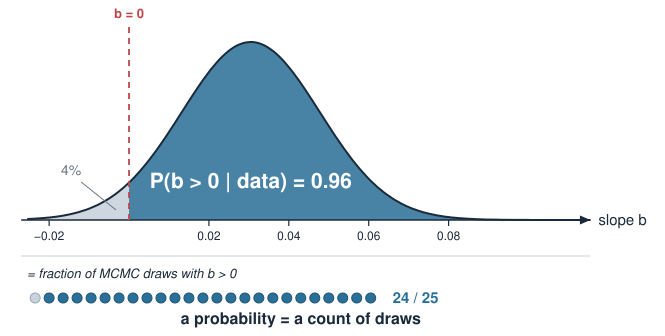{width="55%" fig-align="center"}

::: notes
Show how trivially the posterior answers real questions: a probability is just a proportion of draws. For the 12 donors P(slope > 0) is 0.96 (as in the demo: 48 of 50 lines rise; the figure shows 24 of 25 draws), and P(slope > 0.01 per year) is about 0.88. P(slope > 0) is the fraction of the MCMC table with positive slope - report it directly as the probability the gene goes up with age. Contrast with the frequentist detour through a null hypothesis and p-value. Emphasise the flexibility: you can ask about any threshold, including a minimum biologically relevant effect size (a ROPE-style question), which a p-value cannot address. This is the slide that makes Bayesian regression feel useful rather than philosophical.
:::

## Prediction with uncertainty: two questions {.smaller}

For a new donor aged 70, "predict the expression" is really **two** questions:

- **Where is the average line?** Uncertainty in $a$ and $b$ only → a **credible interval for the mean** expression at age 70. Narrow.
- **Where will one new donor land?** Adds the noise $\sigma$ on top → a wider **prediction interval** for a single observation.

```r
newdata <- data.frame(age = 70)

# uncertainty in the regression line (mean response)
fitted(fit, newdata = newdata)          # estimate + 95% credible interval

# uncertainty for a brand-new individual (adds sigma)
predict(fit, newdata = newdata)         # estimate + 95% prediction interval

conditional_effects(fit)                # mean band across all ages
```

Confusing these two is a classic error: the second band is always **wider** because it includes donor-to-donor scatter, not just uncertainty about the line.

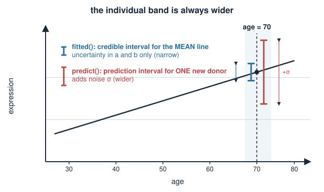{width="55%" fig-align="center"}

::: notes
This is the single most useful practical distinction and a frequent trap. Two sources of uncertainty: (1) we do not know the true line (parameter uncertainty in a and b), giving a credible band for the mean; (2) even if we knew the line exactly, a new donor scatters around it by sigma, giving a wider prediction band for an individual. fitted() gives the first, predict() gives the second; conditional_effects(fit) draws the first across all ages, and conditional_effects(fit, method = "posterior_predict") the second. Show both bands in the demo on the next slide: the mean band hugs the line, the prediction band is fatter and roughly parallel. Stress that reporting the narrow band when you meant an individual prediction badly understates uncertainty.
:::

## Try it: two kinds of band {.smaller}

```{=html}
<link rel="stylesheet" href="../demos/dist/demo.css">
<div data-demo="bayesline" data-lines="on" data-bands="both"></div>
<script src="../demos/dist/bayesline.js"></script>
```

::: notes
Same demo, now opened on panel (b) with the 50 posterior lines and both 95% bands. The blue mean band is where the average line is (what fitted() and conditional_effects(fit) give); the grey prediction band is where one new donor lands (what predict() and conditional_effects(fit, method = "posterior_predict") give). At age 70 the mean band is about 6.0 to 7.7, the prediction band about 4.7 to 9.0: the prediction band is always wider because it adds the donor-to-donor scatter sigma. Point out that the mean band is narrowest near age 50, the middle of the donors, and flares out towards the extremes — extrapolation is less certain. Press "draw again" or "hide the 50 lines" to show that the mean band is just a summary of where the lines go. Move the donors slider down to 3: both bands widen.
:::

## Bayesian vs least squares, side by side {.smaller}

| Aspect | Least squares (`lm`) | Bayesian (`brms`) |
|---|---|---|
| Output per coefficient | one number + CI | full **posterior distribution** |
| Slope reading | estimate + p-value | $P(b>0\mid\text{data})$ directly |
| Interval meaning | long-run procedure | **probability about this parameter** |
| Prior knowledge | hard to include | built in as the **prior** |
| Small samples | can look over-precise | prior **regularises** honestly |
| Prediction | interval formulae | **posterior-predictive** draws |
| Cost / speed | instant | MCMC, slower; needs diagnostics |
| When the priors are flat | — | posterior **peak = least-squares fit** |

Same line, same likelihood — Bayes keeps the **whole distribution** where least squares keeps only its **peak**.

::: notes
The consolidation slide. Walk each row as a contrast, but keep returning to the unifying fact in the last row: with flat priors the posterior mode is exactly the least-squares estimate, so Bayes is a strict generalisation, not a competitor. The costs are real and worth stating honestly - MCMC is slower and demands convergence checks, so for a quick look lm is fine; you reach for brms when uncertainty, priors, or principled prediction bands matter. Encourage students to see the two as the same regression with different amounts of information retained.
:::

## Summary {.smaller}

| Idea | Key fact |
|---|---|
| Model | $y = a + b\,x + \varepsilon$, $\varepsilon\sim\mathcal N(0,\sigma^2)$ — same as ordinary regression |
| Bayesian shift | parameters $a,b,\sigma$ get **distributions**, not single numbers |
| Bayes' theorem | posterior $\propto$ likelihood $\times$ prior |
| Prior | weakly-informative; slope centred at 0 = sceptical, regularising |
| Likelihood | points far from a line make it less believable; the most believable line is the **least-squares** line |
| Posterior | sampled by **MCMC**; draws = a cloud of plausible $(a,b,\sigma)$ |
| Coefficient reading | $P(b>0\mid\text{data})$ = fraction of draws with $b>0$ |
| Credible interval | direct probability the parameter lies in the range |
| Prediction | **mean** band (narrow) vs **individual** band (wider, adds $\sigma$) |
| Diagnostics | check `Rhat` $\approx 1$ and trace plots **before** interpreting |

**Builds on:** least-squares fitting (*Least squares as projection*, week 3); prior / likelihood / posterior (Bayes' theorem). **Generalises to:** other kinds of data, e.g. counts, by swapping `family = gaussian()` for a count family (*Error models*, next unit).

::: notes
The summary is the revision sheet. Drill the through-line one more time: identical model, priors turn parameters into distributions, Bayes combines prior and likelihood, MCMC samples the posterior, and every question - is the slope positive, predict a new donor - is answered by summarising draws. Remind them least squares is the flat-prior peak, so nothing they learned earlier is discarded. Point forward: the same brms machinery with a different family can also handle count data, which Error models (next unit) introduces. And repeat: diagnostics before interpretation, always.
:::

## Optional: the maths behind the fit {.smaller}

**Least squares in matrix form.** Stack the data into a design matrix $X$ (a column of 1s for $a$, a column of ages for $b$). The least-squares coefficients solve the normal equations: $\hat{\boldsymbol\beta} = (X^\top X)^{-1} X^\top \mathbf{y}$.

**Likelihood.** Each donor contributes a Normal density, $p(y_i \mid a, b, \sigma) = \mathcal{N}(y_i \mid a + b\,x_i,\ \sigma^2)$; independence makes the full likelihood the product $\prod_{i=1}^{n} \mathcal{N}(y_i \mid a + b\,x_i,\ \sigma^2)$. For fixed $\sigma$ this is proportional to $\exp\!\big(-\text{SSR}/2\sigma^2\big)$ with $\text{SSR}=\sum_i (y_i - a - b x_i)^2$, so maximising the likelihood is minimising the sum of squared residuals.

**Posterior.** $p(a, b, \sigma \mid \text{data}) \propto \left[\prod_{i} \mathcal{N}(y_i \mid a + b x_i,\ \sigma^2)\right] p(a)\,p(b)\,p(\sigma)$, with priors $a \sim \mathcal{N}(0, 5)$, $b \sim \mathcal{N}(0, 0.1)$, $\sigma \sim \text{Exponential}(1)$.

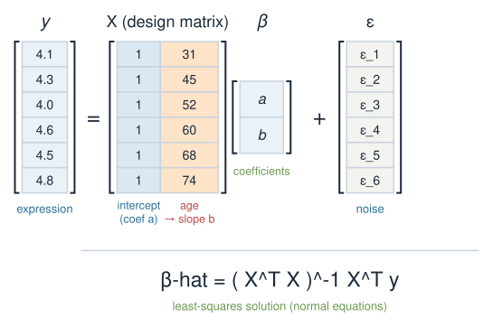{width="45%" fig-align="center"}

::: notes
Optional, for students who want the formulas behind the words. Nothing in the lecture or exercises needs them. The design-matrix picture links back to the linear algebra block; the exp(-SSR/2 sigma^2) line is the one-line reason why "smaller total squared miss" means "more believable".
:::
