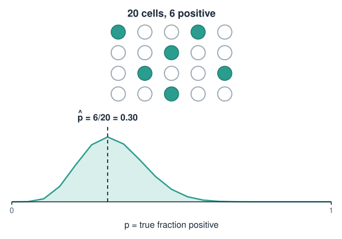
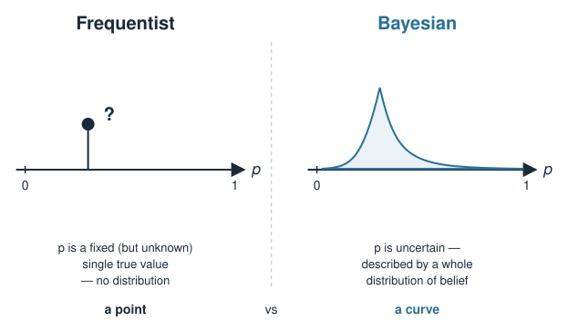
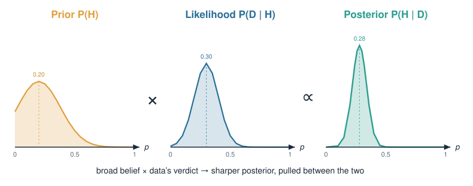
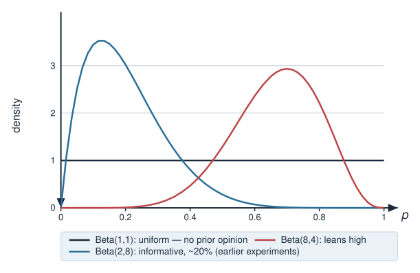
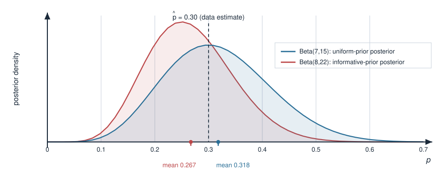
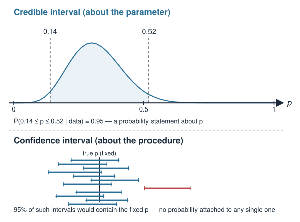
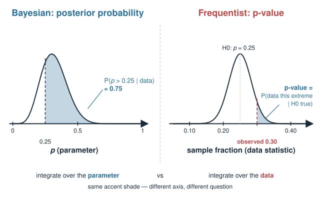

## About this lecture

Your earlier statistics was almost certainly **frequentist**: fixed (but unknown) parameters, p-values, confidence intervals. Today we meet the other big framework — **Bayesian** reasoning — and see how they differ.

- Probability as a **degree of belief**, updated by data — not just a long-run frequency.
- **Bayes' rule** in one line: $\text{posterior} \propto \text{prior} \times \text{likelihood}$.
- Frequentist vs Bayesian: **fixed parameters + p-values** vs **distributions of belief + credible intervals**.
- One worked biology example: estimating a **proportion** (fraction of cells expressing a marker) with a prior.
- Why a biologist might want this: **honest uncertainty**, using **prior knowledge**, and a natural fit for **hierarchy**.

This is a **concept and intuition** day. The maths stays light; the goal is to think in the Bayesian way and read a posterior.

::: notes
The one message for today: there are two coherent ways to do statistics, and the students have only seen one of them. Frequentist statistics treats the parameter as a fixed unknown and asks "how surprising is my data?"; Bayesian statistics treats the parameter as uncertain and asks "what should I now believe about it?". Everything else — Bayes' rule, priors, posteriors, credible intervals — hangs off that shift in what "probability" means. Keep it conceptual; the algebra is deliberately kept to one conjugate example so nobody drowns in integrals. Tell them the exam-relevant skill is computing a small posterior by hand and reading a credible interval, not deriving anything.
:::

## A note on this block {.smaller}

::: {.callout-warning title="Provisional block"}
This **Bayesian statistics** block is provisional. It may be moved to a later, dedicated **statistics / machine-learning** course rather than staying in this linear-algebra-and-stats course. Treat it as a self-contained introduction: nothing later in *this* course hard-depends on it.
:::

We still include it here because Bayesian thinking underlies a lot of modern omics analysis (differential expression, variant calling, hierarchical models), and the contrast with frequentist reasoning sharpens both.

::: notes
Be upfront that this block might migrate to the ML course. It is not load-bearing for the rest of the linear-algebra material, so students who find it hard should not panic — it will not block later units. Still worth teaching because so many Bioconductor tools (limma/DESeq2 shrinkage, variant callers, phylogenetics) are quietly Bayesian, and understanding the vocabulary pays off when reading methods sections.
:::

## A biology picture first {.smaller}

You stain a population of cells for a marker and count, under the microscope, how many are **positive**. Out of **20** cells, **6** are positive.

- Your instinct (frequentist): the fraction is $\hat p = 6/20 = 0.30$. Done.
- But you have only 20 cells. How sure are you? Could the true fraction be 0.2? 0.45?
- And you are **not** starting from nothing: in three previous experiments this marker sat around **20%**. Should that count?

Frequentist analysis gives you a single number plus a confidence interval and **ignores** the earlier experiments. Bayesian analysis gives you a full **distribution of belief** over $p$ and lets you **fold in** what you already knew.

{width="70%" fig-align="center"}

::: notes
Anchor everything in this one scene: counting positive cells. The frequentist reflex is p-hat = 6/20 = 0.3, full stop. Push on two discomforts a biologist actually feels: (1) 20 cells is a small sample, so how confident are we, and (2) we ran this before and have prior knowledge — throwing it away feels wasteful. Those two discomforts are exactly what the Bayesian machinery addresses: a whole posterior distribution instead of a point, and a principled way to include the prior. Do not write any formulas yet; just seed the motivation.
:::

## Two meanings of "probability" {.smaller}

The split between the two schools comes from what the word **probability** even means.

| | **Frequentist** | **Bayesian** |
|---|---|---|
| Probability is… | a long-run **frequency** | a **degree of belief** |
| The parameter $p$ is… | **fixed**, just unknown | **uncertain** — described by a distribution |
| Data is… | random (repeatable) | the fixed thing you actually saw |
| A result is… | a point estimate + CI, a p-value | a **posterior distribution** |

Frequentist question: *"If $p$ were really 0.2, how surprising is my data?"*
Bayesian question: *"Given my data, what should I now believe about $p$?"*

{width="75%" fig-align="center"}

::: notes
This is the philosophical fork, and it is worth stating slowly. Frequentists reserve "probability" for things that can be repeated — coin flips, cells sampled — so they will never write P(p = 0.3): the parameter is fixed, not random, so it has no probability distribution. Bayesians allow "probability" to describe uncertainty/belief about anything, including a fixed-but-unknown parameter, so P(p) is perfectly meaningful. That single move is what lets Bayesians put a distribution on the parameter and update it. Everything downstream (priors, posteriors, credible intervals) follows. Emphasise the two contrasting questions at the bottom — they are the cleanest one-line summary.
:::

## Bayes' rule {.smaller}

Bayes' rule is just the definition of conditional probability, rearranged. For a hypothesis $H$ (a value of $p$) and observed data $D$:

$$P(H \mid D) = \frac{P(D \mid H)\,P(H)}{P(D)}$$

Read left to right:

- $P(H)$ — the **prior**: what you believed about $H$ *before* the data.
- $P(D \mid H)$ — the **likelihood**: how probable the data is *if* $H$ were true.
- $P(H \mid D)$ — the **posterior**: your updated belief *after* seeing the data.
- $P(D)$ — the **evidence**: a normalising constant so the posterior sums to 1.

::: notes
Reassure them this is not exotic: Bayes' rule is a one-line consequence of P(A and B) = P(A|B)P(B) = P(B|A)P(A), which they have seen. The novelty is not the algebra, it is applying it with H = "a value of the parameter" and D = "the data" — that is the conceptual leap. Name each of the four pieces slowly and in plain English. The denominator P(D) is just whatever number makes the posterior a proper distribution (integrate the numerator over all H); for our purposes it is a normaliser we can often ignore, which is the next slide.
:::

## Posterior $\propto$ prior $\times$ likelihood {.smaller}

The denominator $P(D)$ does not depend on $H$ — it is the same for every hypothesis. So the *shape* of the posterior is fixed entirely by the numerator:

$$\underbrace{P(H \mid D)}_{\text{posterior}} \ \propto\ \underbrace{P(D \mid H)}_{\text{likelihood}} \times \underbrace{P(H)}_{\text{prior}}$$

("$\propto$" means "proportional to" — equal up to a constant that we fix at the end so the total probability is 1.)

This is the sentence to memorise:

> **Posterior belief = prior belief, reweighted by how well each hypothesis explains the data.**

Where the data is strong, the likelihood dominates and the prior barely matters. Where the data is weak (few cells!), the prior still has a say.

{width="80%" fig-align="center"}

::: notes
This is the single most useful line in the lecture — put it on a card. The proportionality trick matters because it lets you reason about the posterior's shape without computing the ugly normalising integral P(D). Stress the interpretation at the bottom: the prior is your starting belief, the likelihood is the data's verdict on each hypothesis, and multiplying them reweights the prior toward hypotheses that explain the data well. Then the crucial practical point for biologists: with lots of data the likelihood swamps the prior (Bayesian and frequentist answers converge), but with little data (our 20 cells) the prior genuinely influences the answer — which is a feature, not a bug, if the prior is honest.
:::

## Our example, set up {.smaller}

Estimate $p$ = the true fraction of marker-positive cells. Data: $k = 6$ positive out of $n = 20$.

**Likelihood** — counting positives out of a fixed number of cells is a **binomial** experiment:

$$P(k \mid p) = \binom{n}{k}\, p^{k}\,(1-p)^{\,n-k} \ \propto\ p^{6}(1-p)^{14}$$

As a function of $p$, this is peaked at the frequentist estimate $\hat p = k/n = 0.30$.

**Prior** — we need a distribution over $p \in [0,1]$. The natural choice is a **Beta** distribution:

$$p \sim \text{Beta}(\alpha, \beta), \qquad P(p) \propto p^{\alpha-1}(1-p)^{\beta-1}$$

{width="65%" fig-align="center"}

::: notes
Set up the two ingredients concretely. The likelihood is binomial because we count k positives in n independent cells with the same probability p — exactly the binomial story they met in earlier statistics. Drop the binomial coefficient when we write the proportionality, since it does not involve p. The prior needs to live on [0,1] because p is a proportion, and the Beta family is the standard flexible choice there. Show that alpha and beta act like "prior counts": Beta(1,1) is flat/uniform (no prior opinion), Beta(2,8) leans toward small p (our previous ~20% experiments), Beta(8,4) leans large. Do not derive the Beta; treat it as the go-to distribution for a probability, analogous to how the Gaussian is the go-to for an unbounded quantity.
:::

## Why Beta? It multiplies cleanly {.smaller}

Look at the shapes: prior $\propto p^{\alpha-1}(1-p)^{\beta-1}$ and likelihood $\propto p^{k}(1-p)^{n-k}$. Multiply them:

$$\text{posterior} \propto p^{\alpha-1}(1-p)^{\beta-1}\cdot p^{k}(1-p)^{n-k} = p^{(\alpha+k)-1}(1-p)^{(\beta+n-k)-1}$$

That is **another Beta** distribution:

$$p \mid \text{data} \ \sim\ \text{Beta}(\alpha + k,\ \beta + n - k)$$

The prior and posterior are the same *family* — the Beta is the **conjugate** prior for the binomial. The update rule is beautifully simple:

$$\alpha \to \alpha + (\text{successes}), \qquad \beta \to \beta + (\text{failures}).$$

You can read $\alpha, \beta$ as **pseudo-counts**: prior "imagined" successes and failures, to which the real data adds.

::: notes
This is the one piece of algebra worth doing on the board, because it is genuinely satisfying and requires only adding exponents. Multiplying prior by likelihood keeps the p^(...)(1-p)^(...) form, so the posterior is Beta with updated parameters. Define "conjugate prior": a prior that yields a posterior in the same family, which makes the update pure arithmetic (no integrals). Then the intuition that makes it stick: alpha and beta are pseudo-counts of prior successes and failures; the data just adds its real successes and failures on top. Beta(1,1) = 1 pseudo-success + 1 pseudo-failure = barely any prior weight, so the data dominates. Conjugacy is special to nice pairings; in general the posterior has no closed form and we sample it (MCMC) — mention only as a pointer, do not teach it.
:::

## Turning the crank, two priors {.smaller}

Data: $k = 6$, $n - k = 14$.

**Uniform prior** Beta(1,1) — "no opinion":
$$\text{posterior} = \text{Beta}(1+6,\ 1+14) = \text{Beta}(7, 15), \quad \text{mean } \tfrac{7}{22} \approx 0.318$$

**Informative prior** Beta(2,8) — centred near the earlier $\sim 20\%$:
$$\text{posterior} = \text{Beta}(2+6,\ 8+14) = \text{Beta}(8, 22), \quad \text{mean } \tfrac{8}{30} \approx 0.267$$

(The mean of $\text{Beta}(\alpha,\beta)$ is $\alpha/(\alpha+\beta)$.)

The informative prior pulls the estimate **down** toward the earlier experiments — and with only 20 cells, that pull is real. Collect 200 cells and both posteriors would sit almost on top of the data.

{width="65%" fig-align="center"}

::: notes
Now make it numeric and concrete. Two priors, same data, worked in one line each thanks to conjugacy. The uniform-prior posterior mean 0.318 is basically the data estimate 0.30 (nudged slightly by the +1,+1 pseudo-counts). The informative-prior posterior mean 0.267 sits between the prior's 0.2 and the data's 0.3 — a compromise weighted by how much information each carries. Hammer the small-sample point: with n=20 the prior's few pseudo-counts are a meaningful fraction of the total, so they move the answer; with n=200 the data's 200 counts swamp the prior and both posteriors collapse onto ~0.30. This is the honest behaviour we want: priors matter exactly when data is scarce, and fade away when data is plentiful.
:::

## Credible interval vs confidence interval {.smaller}

Bayesian uncertainty comes straight from the posterior. A **95% credible interval** is any interval holding 95% of the posterior probability:

$$P(\,0.14 \le p \le 0.52 \mid \text{data}\,) = 0.95 \quad (\text{for Beta}(7,15))$$

You are allowed to say the honest sentence: *"there is a 95% probability that $p$ lies in this interval."*

A frequentist **95% confidence interval** does **not** mean that. It means: *if you repeated the whole experiment many times, 95% of the intervals so constructed would contain the true fixed $p$.* Any single interval either contains $p$ or does not — no probability attached.

| | Credible interval | Confidence interval |
|---|---|---|
| Statement about | the **parameter** | the **procedure** |
| "95% probability $p$ is inside" | ✓ allowed | ✗ not allowed |

{width="60%" fig-align="center"}

::: notes
This is the contrast students most often get wrong, so slow down. The credible interval is a direct probability statement about the parameter — legal for a Bayesian because p has a distribution. The confidence interval is a statement about the long-run behaviour of the interval-construction procedure, NOT about any single interval; strictly, a given 95% CI has already either caught p or missed it, with no probability. Most scientists secretly interpret their confidence intervals as credible intervals — the Bayesian version is the interpretation people actually want, made legitimate. Note the numbers here are illustrative (from qbeta on Beta(7,15)); the exact endpoints come from the R on the next slide.
:::

## Try it: updating a prior with cells {.smaller}

```{=html}
<link rel="stylesheet" href="../demos/dist/demo.css">
<div data-demo="betabinom" data-a="1" data-b="1" data-k="6" data-n="20" data-truep="0.3"></div>
<script src="../demos/dist/betabinom.js"></script>
```

::: notes
Live version of the last three slides. Start on the preset "6/20 flat": the posterior (solid red) sits almost on the scaled likelihood (dotted orange), and the Bayesian and frequentist bars below are close, matching the Beta(7,15) numbers from before. Click "6/20 Beta(2,8)": the blue dashed prior appears near 0.2 and the posterior moves down to about 0.27, while the frequentist bar does not move at all, because it ignores the prior. Then "60/200 Beta(2,8)": same fraction, ten times the cells, and the prior hardly matters any more; both bars are narrow and nearly agree. Show the danger case with "6/20 wrong prior" (Beta(40,10), 50 pseudo-counts centred at 0.8): the posterior lands between prior and data, far from 0.3; even "60/200 wrong prior" is still pulled visibly. Point at the readout line "prior share of counts" as the one-number summary of how much the prior weighs. If time allows, press "no data" and then "+10 random cells" a few times to watch the posterior narrow as cells accumulate (tick "show true p" to reveal the 0.3 used for the simulation).
:::

## p-value vs posterior probability {.smaller}

Suppose you care whether the true fraction exceeds 25%.

- **Frequentist:** set up $H_0: p = 0.25$, compute a **p-value** = probability of data *at least this extreme* **if $H_0$ were true**. A small p-value means "the data would be surprising under $H_0$." It does **not** tell you $P(H_0)$.
- **Bayesian:** just read it off the posterior:
$$P(p > 0.25 \mid \text{data}) = \int_{0.25}^{1} \text{Beta}(p;\,7,15)\, dp$$
a direct probability that the hypothesis is true, given your data.

The Bayesian answers the question people *think* a p-value answers.

{width="75%" fig-align="center"}

::: notes
Reinforce the deepest and most common misreading in all of applied statistics: a p-value is P(data this extreme | H0), NOT P(H0 | data). It measures surprise under the null, not the probability the null is true. The Bayesian posterior gives you exactly P(hypothesis | data), the quantity everyone actually wants. Show that once you have the posterior Beta(7,15), a hypothesis like "p > 0.25" is just an area under the curve — one pbeta call. Do not turn this into a p-value-bashing rant; the point is that the two frameworks answer genuinely different questions, and the Bayesian question is often the scientifically natural one.
:::

## The same computation in R {.smaller}

Everything above is a couple of built-in functions. (Static examples — nothing to install.)

```r
k <- 6; n <- 20

# Frequentist point estimate
p_hat <- k / n                     # 0.30

# Bayesian update with a uniform prior Beta(1, 1)
a0 <- 1; b0 <- 1
a  <- a0 + k                       # 7   (prior successes + observed)
b  <- b0 + (n - k)                 # 15  (prior failures  + observed)

a / (a + b)                        # posterior mean            -> 0.318
qbeta(c(0.025, 0.975), a, b)       # 95% credible interval     -> ~0.14 .. 0.52
1 - pbeta(0.25, a, b)              # P(p > 0.25 | data)        -> ~0.75
```

```r
# An informative prior Beta(2, 8) (earlier experiments, ~20% positive)
a0 <- 2; b0 <- 8
a  <- a0 + k                       # 8
b  <- b0 + (n - k)                 # 22
a / (a + b)                        # posterior mean            -> 0.267
```

::: notes
Show that the whole lecture reduces to arithmetic plus qbeta/pbeta — no special package, no MCMC, because conjugacy gives a closed form. Walk the first block: a and b are the updated Beta parameters, a/(a+b) is the posterior mean, qbeta gives credible-interval endpoints (the quantiles), and 1 - pbeta(0.25, a, b) is the posterior probability that p exceeds 0.25. The second block just swaps the prior and re-runs the same two lines. Emphasise these are static illustrations (no packages are installed at render time); students run them in their own session. The exercise has them reproduce these numbers and vary the prior.
:::

## Why a biologist might go Bayesian {.smaller}

- **Honest uncertainty.** You get a full posterior, not a lone point estimate — and a credible interval you are actually allowed to interpret as "where the parameter probably is."
- **Use what you already know.** Prior experiments, known biology, or literature values enter *formally* through the prior instead of being ignored or hand-waved.
- **Small samples behave sensibly.** With few cells the prior gently regularises the estimate; with many cells the data takes over automatically.
- **Natural hierarchy.** Genes within pathways, cells within patients, patients within cohorts — Bayesian **hierarchical models** let lower levels "borrow strength" from the group, which is exactly how modern tools shrink noisy per-gene estimates in differential expression.

::: notes
Sell the practical upside, tied to omics. Honest uncertainty: the posterior and credible interval say what scientists actually mean. Prior knowledge: biology is rarely a blank slate, and the prior is the formal slot for what you already know (used carefully). Small samples: the prior acts as principled regularisation, so a gene seen in three cells does not get a wild estimate. Hierarchy is the big one for genomics: hierarchical/partial-pooling models let a noisy per-gene estimate borrow strength from the distribution of all genes — this is exactly the empirical-Bayes shrinkage inside tools like limma and DESeq2, even if those are not taught here. Keep it as motivation, not a how-to.
:::

## Being fair to the frequentist {.smaller}

Bayesian is not automatically "better." Trade-offs:

- **The prior is a choice**, and a bad or overconfident prior biases the answer. You must be able to defend it — and check how much it matters (**sensitivity analysis**).
- **Frequentist methods are fast, standard, and prior-free** — for a large, clean dataset the two usually **agree**, and a t-test is simpler than a model.
- **Computation.** Only lucky (conjugate) cases give a formula; realistic models need **MCMC** sampling — more machinery, more that can go wrong.
- **Reproducibility.** A frequentist pipeline has fewer subjective knobs, which some fields prefer.

Rule of thumb: **lots of clean data → they agree**; **little data, strong prior knowledge, or nested structure → Bayesian earns its keep.**

::: notes
Guard against the common student overcorrection ("Bayesian is just correct and p-values are wrong"). Both frameworks are coherent and useful. The prior is a real responsibility: a sharp prior in the wrong place will drag the answer, so honesty demands reporting it and doing a sensitivity check (does the conclusion survive a weaker prior?). Frequentist tools are prior-free, fast, and standard, and with abundant data the posterior is dominated by the likelihood so both schools converge anyway. The cost of going Bayesian in realistic models is computational — MCMC and its diagnostics. Give them the practical rule of thumb at the bottom as the decision heuristic. This mirrors the course's "honest about what we defer/assume" principle.
:::

## Summary {.smaller}

| Concept | Key fact |
|---|---|
| Probability | frequentist = frequency; Bayesian = degree of belief |
| Parameter $p$ | frequentist: fixed unknown; Bayesian: has a distribution |
| Bayes' rule | $P(H\mid D) = P(D\mid H)P(H)/P(D)$ |
| Working form | posterior $\propto$ likelihood $\times$ prior |
| Prior/likelihood | Beta$(\alpha,\beta)$ prior, binomial likelihood |
| Update (conjugate) | Beta$(\alpha+k,\ \beta+n-k)$ — add successes/failures |
| Posterior mean | $\alpha/(\alpha+\beta)$ |
| Credible interval | "95% probability $p$ is inside" — **allowed** |
| Confidence interval | statement about the **procedure**, not the parameter |
| p-value | $P(\text{data}\mid H_0)$, **not** $P(H_0\mid\text{data})$ |
| When it matters | small data / strong prior / hierarchy |

**Next:** work the cell-counting posterior by hand and in R in the exercise, then the quiz.

::: notes
The summary is the revision card. Drill the pipeline verbally one more time: pick a prior Beta(alpha,beta), count successes k and failures n-k, add them to get the posterior Beta(alpha+k, beta+n-k), read the mean alpha/(alpha+beta), and get intervals/tail probabilities from qbeta/pbeta. Re-state the two interpretation traps (credible vs confidence, p-value vs posterior) because those are the conceptual exam questions. Close on the decision rule: Bayesian pays off with little data, real prior knowledge, or hierarchical structure; otherwise the frameworks largely agree. Remind them this block is provisional and self-contained.
:::
