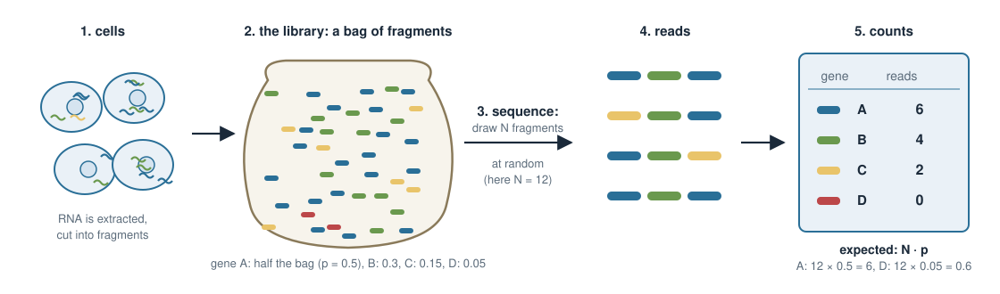
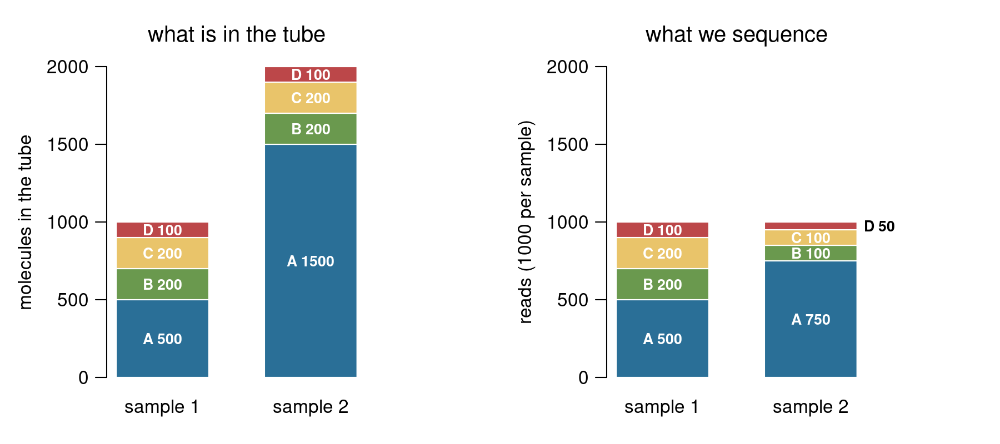
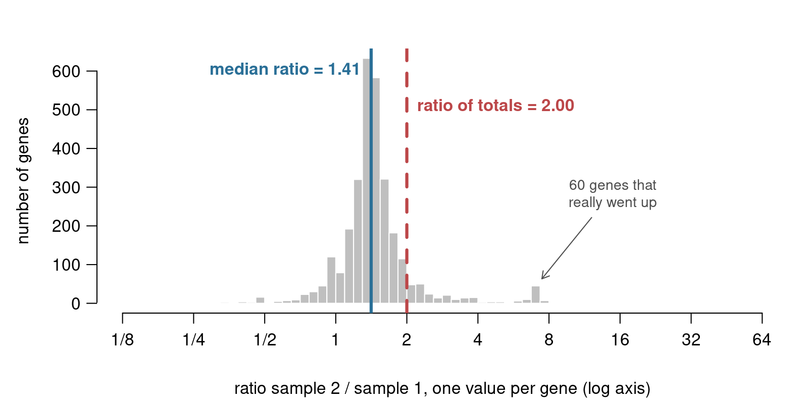
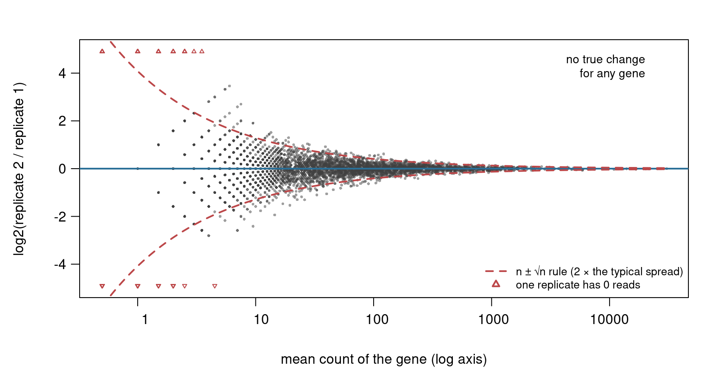
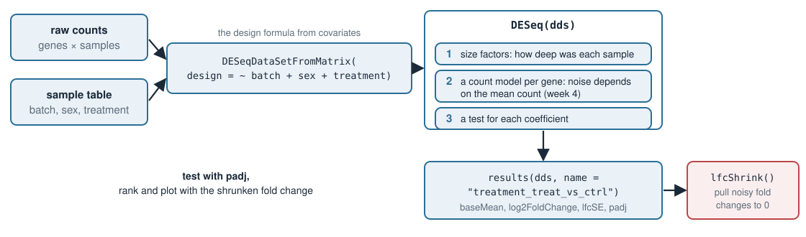
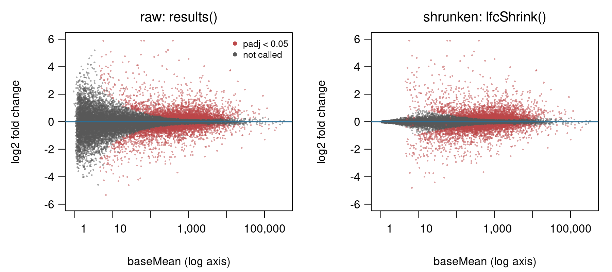

## About this lecture

In *Design matrices in R: limma* we started from log2 values. Today we start one step earlier, from the **table of raw counts** (genes × samples), and run the standard tool for it, [DESeq2](https://bioconductor.org/packages/release/bioc/vignettes/DESeq2/inst/doc/DESeq2.html). The design formula is the same as before. Three ideas are new:

- **RNA-seq is counting.** A read count is a random draw; what we want per gene is its **share** of the RNA.
- **Size factors.** How deep each sample was sequenced, estimated so that a few big changes cannot fool us (the **median of ratios**).
- **Ratios of small counts are noisy.** 3 reads versus 0 says much less than 3000 versus 1000. This is why we need a count model and why we **shrink** fold changes. Both get their maths in week 4.

::: notes
This is the last unit of week 3 and it closes the design-matrix section with the tool most students will actually use on their own RNA-seq data. Nothing about the design matrix is new: ~ batch + sex + treatment means exactly what it meant in covariates and covariates-r. The new content is about the data type. Counts come from sampling molecules, so they have to be put on a common scale (size factors), and their noise depends on how many molecules were counted. The noise idea is the centre of the day: it is the reason DESeq2 uses a count model instead of a plain linear model on logs, and the reason for lfcShrink. Poisson and negative binomial may be named, but their maths is in Error models in week 4; shrinkage is explained in Why penalize?, Bayesian vs frequentist and Hierarchical models. Today we only need the picture.
:::

## RNA-seq is counting {.smaller}

{width="100%" fig-align="center"}

- The library is a **bag of RNA fragments**. Gene A makes up a share $p$ of the bag.
- Sequencing draws $N$ fragments **at random**. Gene A gets about $N \cdot p$ reads, but not exactly: here 6, next time maybe 5 or 8.
- So a count says nothing on its own: 512 reads out of 10 million is **not** the same as 512 out of 40 million. What we want per gene is $p$, the **share of the RNA**.

::: notes
Walk the picture left to right. Cells, RNA extracted and cut into fragments, the fragments form a library, and the sequencer reads a random subset of them. Real libraries have billions of fragments and we read tens of millions, so it really is a random sample. Two consequences follow, and they are the two halves of today. First, the count depends on N, the depth, which is a technical choice; to compare samples we must undo it (size factors). Second, even with the same bag and the same N, a repeat gives a slightly different count, because the draw is random (counting noise). Ask: in a library of 10 million reads, gene G has 512 reads; in a library of 40 million, also 512. Is it the same? No: 51.2 per million versus 12.8 per million, a factor of 4.
:::

## A count needs its depth: size factors {.smaller}

Sample 2 is the same RNA as sample 1, sequenced **twice as deep**:

| gene | sample 1 | sample 2 | share 1 | share 2 |
|---|---|---|---|---|
| A | 400 | 800 | 0.4 | 0.4 |
| B | 300 | 600 | 0.3 | 0.3 |
| C | 200 | 400 | 0.2 | 0.2 |
| D | 100 | 200 | 0.1 | 0.1 |
| **total** | **1000** | **2000** | 1 | 1 |

- Raw counts say every gene is "2× up". Divide by the total and the shares agree: nothing changed.
- The number we divide by is the sample's **size factor**. The simplest one is the total read count. **Counts per million** (CPM) is the same thing, times $10^6$.

```r
cpm <- t(t(counts) / colSums(counts)) * 1e6    # divide each column by its total
```

::: notes
The by-hand version of normalization. The size factor is "how much did we sequence this sample", relative to the others. Dividing by the total is what CPM does, and what voom did internally in covariates-r. The R line: counts is genes by samples, colSums gives one total per sample; t() twice is the usual trick to divide each column by its own number. Next slide: why the total is not good enough.
:::

## The composition trap {.smaller}

{width="80%" fig-align="center"}

- Only gene A changed: 3 times more molecules in sample 2. B, C and D are **exactly the same** in the tube.
- After dividing by the total, B, C and D look **halved**, and A looks only 1.5× up.
- The share of the RNA is a **zero-sum game**: if one gene takes more of the reads, all others get fewer. A few very abundant genes that change can fake changes in thousands of others.

::: notes
This is the reason DESeq2 does not use the total count. Read the left panel: the tube has 1000 molecules in sample 1 and 2000 in sample 2, all of the extra from gene A. The sequencer does not know how many molecules were in the tube; it reads 1000 from each. In the right panel A has 750 of 1000, so B, C and D are squeezed to half. Real examples: a tissue where a few secreted proteins dominate (pancreas, liver), or a treatment that switches on a very abundant gene. Ask: what should the size factor of sample 2 be, so that B, C and D come out unchanged? 0.5 relative to sample 1, not 1. The next slide gets that number without knowing in advance which genes changed.
:::

## The fix: the median of ratios {.smaller}

:::: {.columns}
::: {.column width="44%"}
| gene | s1 | s2 | s2 / s1 |
|---|---|---|---|
| A | 100 | 210 | 2.1 |
| B | 50 | 100 | 2.0 |
| C | 40 | 76 | 1.9 |
| D | 20 | 160 | **8.0** |
| E | 10 | 22 | 2.2 |
| total | 220 | 568 | 2.58 |

- Median of 1.9, 2.0, 2.1, 2.2, 8.0 is **2.1**. Gene D, which really changed, does not move it.
- The ratio of totals, 2.58, is pulled up by D.
:::
::: {.column width="56%"}
{width="100%"}

Simulated, 3000 genes: most genes did not change, so most ratios pile up at the true depth ratio.
:::
::::

- DESeq2 compares each sample with a "typical sample" (for each gene, the geometric mean over all samples) and takes the **median** ratio. Genes with a **0** in any sample are left out: a ratio with 0 is useless.

```r
dds <- estimateSizeFactors(dds);  sizeFactors(dds);  counts(dds, normalized = TRUE)
```

::: notes
The idea: if most genes did not change, then for most genes the ratio sample 2 over sample 1 is just the depth ratio. A median ignores the few genes that really changed, as long as they are fewer than half. Do the table by hand: the five ratios, sorted 1.9, 2.0, 2.1, 2.2, 8.0, median 2.1. Compare with the totals: 568 over 220 is 2.58, too high, because gene D grabbed reads. The histogram shows the same with 3000 genes: 60 well-expressed genes went up 5-fold, the median ratio is 1.41 while the ratio of totals is 2.00. With more than two samples DESeq2 builds a reference sample, the geometric mean of each gene over all samples (on the log scale, the ordinary mean), and computes each sample's median ratio against it; the exercise does that by hand on a 5 by 3 table. The rule "leave out genes with a 0" is the first sign of today's main theme: small counts carry little information.
:::

## Same truth, different ratios {.smaller}

Two replicates: same RNA, same depth. Every difference below is **pure counting noise**.

| gene | expected reads | replicate 1 | replicate 2 | ratio |
|---|---|---|---|---|
| big | 1000 | 1012 | 987 | 0.98 |
| small | 2 | 0 | 3 | $\infty$ |
| small | 2 | 1 | 4 | 4 |
| small | 2 | 3 | 0 | 0 |

**Rule of thumb** (from simulation, and next week from a formula): if you expect about $n$ molecules, you get $n \pm \sqrt{n}$.

| expected $n$ | 2 | 100 | 1000 |
|---|---|---|---|
| typical spread $\sqrt{n}$ | 1.4 | 10 | 32 |
| relative noise $\sqrt{n}/n = 1/\sqrt{n}$ | 70% | 10% | 3% |

::: notes
This is the core idea of the day. The same true share, the same depth, and the small gene gives fold changes of 0, 4 and infinity, while the big gene gives 0.98. Nothing biological happened. The rule of thumb n plus or minus root n is what students see in the R part of the exercise when they repeat the draw many times; in Error models (week 4) it gets its name: this counting noise is the Poisson distribution, whose variance equals its mean. For now, use the rule: relative noise is 1 over root n, so 3% at 1000 reads, 10% at 100, 70% at 2. A fold change built from two such counts is noisier still, because both counts wobble.
:::

## The fan: counting noise in one picture {.smaller}

{width="74%" fig-align="center"}

- An **MA plot**: log2 fold change against the gene's mean count. Two replicates, **no true change** for any of 5000 genes.
- Wide at low counts, narrow at high counts. The dashed lines are the $n \pm \sqrt{n}$ rule.
- **Ranking by fold change picks the low-count genes:** the 10 largest fold changes here are all genes with fewer than 15 reads, and all are noise.
- A test must know that 3 vs 0 carries less information than 3000 vs 1000. One $\sigma$ for all genes, as in plain least squares, cannot. A **count model** can (week 4). voom's weights in covariates-r were a patch for the same problem.

::: notes
The picture to remember. Each dot is a gene, x is its mean count on a log axis, y is log2 of replicate 2 over replicate 1. Because nothing changed, every dot should be at 0; the spread is counting noise, and it shrinks as the count grows, like 1 over root n. Genes with a 0 in one replicate have an infinite log ratio; they are the triangles at the edge. The ten largest fold changes have between 1 and 13 reads. Real replicates spread more than this, because the biology also varies between replicates (different mice, different cultures); Error models adds that extra spread with the negative binomial. Link back: voom in covariates-r computed a weight per value exactly because low counts are noisier on the log scale. DESeq2 instead models the counts directly.
:::

## Try it: noise in a ratio of counts

```{=html}
<link rel="stylesheet" href="../demos/dist/demo.css">
<div data-demo="countratio" data-mean="2"></div>
<script src="../demos/dist/countratio.js"></script>
```

::: notes
Interactive demo. The buttons set the expected count n for both replicates (1 to 1000). Panel (a) is a histogram of log2(x/y) for 2000 replicate pairs; pairs with a zero get their own bars (0, infinity, 0/0), and pairs at least 2-fold apart are red. Point at the header number "% of pairs at least 2-fold apart", not the SD (the SD only uses pairs without a zero, so it is misleading at n = 1 and 2). At the defaults it is 77% at n = 1, 65% at n = 2, 37% at 5, 17% at 10, 1.3% at 30 and 0% at 100: same truth, and at low counts most pairs look like a 2-fold change. Panel (b) is the fan for 2000 genes with averages from 0.5 to 5000: 56% of genes with average below 10 are at least 2-fold apart, 0% above 100, and the red circles (top 10 by fold change) are all genes with averages of about 3 to 5.5. Finally tick "add biological variation": even at n = 1000 the SD stays around 0.47 and about 3% of pairs are 2-fold apart. That extra spread is what the negative binomial adds in Error models.
:::

## DESeq2 in four calls {.smaller}

{width="88%" fig-align="center"}

```r
library(DESeq2)
dds <- DESeqDataSetFromMatrix(countData = counts, colData = samples,
                              design = ~ batch + sex + treatment)
dds <- DESeq(dds)              # size factors -> count model per gene -> tests
resultsNames(dds)              # "Intercept" "batch_B_vs_A" "sex_M_vs_F" "treatment_treat_vs_ctrl"
res <- results(dds, name = "treatment_treat_vs_ctrl")
```

- Input: **raw integer counts**, not CPM and not logs. DESeq2 does the dividing itself.
- The design is the one from covariates. Same $X$, same rank check: a confounded design stops with "the model matrix is not full rank".

::: notes
The workflow. The counts and the sample table go in together with the design formula. DESeq() does three things in order: the size factors from the median-of-ratios slide; one count model per gene, where the noise is allowed to depend on the mean count (named in Error models: negative binomial, which is the counting noise plus the extra spread between biological replicates); and a test of each coefficient. The coefficient names are variable, level, vs, reference. Always ask for one by name: results(dds) without a name gives the last variable of the formula, which is easy to get wrong. The counts and samples objects are the simulated experiment from covariates-r, so the exercise can compare with limma.
:::

## Reading the results {.smaller}

| column | meaning |
|---|---|
| `baseMean` | mean of the normalized counts (divided by the size factors) over all samples |
| `log2FoldChange` | the treatment coefficient: treat vs ctrl, holding batch and sex fixed |
| `lfcSE` | its standard error: how uncertain the fold change is. **Large when `baseMean` is small** |
| `pvalue`, `padj` | the test of "coefficient = 0", and adjusted for testing all genes; `NA` for genes with too few reads to test |

- On the simulated experiment from covariates-r (200 truly changed genes): DESeq2 calls **195** genes at `padj < 0.05`, **181** of them true. limma with voom called 188, 177 true. Same design, same answer.
- `plotMA(res)` draws the fan again, now for a real comparison (next slide, left): called genes stand out from the fan; at low counts even large fold changes are not called.

::: notes
Read the columns. baseMean is the gene's x position in the fan, log2FoldChange its y position. lfcSE is the new column to look at: plot it against baseMean and it is large exactly where the fan is wide. That is how DESeq2 knows that 3 versus 0 is weak evidence: the standard error is large, so the test is not significant even though the fold change is huge. padj is NA for genes DESeq2 does not test because their counts are too low to say anything (independent filtering). The numbers: DESeq2 1.52 on the covariates-r simulation gave 195 calls, 181 true and 14 false, close to limma's 188 with 177 true and 11 false. On the real airway dataset in the exercise, 4000 genes are called with ~ cell + dex.
:::

## Shrink the noisy fold changes {.smaller}

{width="80%" fig-align="center"}

*airway, dexamethasone vs untreated (exercise R4). Red: `padj < 0.05`.*

```r
res_shr <- lfcShrink(dds, coef = "dex_trt_vs_untrt", type = "apeglm")
```

- **When the data are weak, believe less extreme values.** Low-count fold changes are pulled towards 0; high-count ones barely move.
- Genes with `baseMean` ≤ 10: **465** have a raw fold change above 4× (|LFC| > 2), **33** after shrinking. Above 100: 102 and 98.
- Practical rule: **test with `padj`, rank and plot with the shrunken fold change.**
- *How* this works is week 4: it is a **penalty** (*Why penalize?*), a **prior** (*Bayesian vs frequentist*), and sharing across genes (*Hierarchical models*).

::: notes
The segue to week 4. lfcShrink with apeglm returns new fold changes: the same as before for genes with many reads, pulled towards zero for genes with few. Left is plotMA of the raw results on airway, the fan at low counts; right the same genes after lfcShrink: the grey fan collapses onto 0, the red called genes keep their fold changes. Below 10 reads, 465 genes have a raw |LFC| above 2 and only 33 after shrinking; above 100 reads hardly anything changes (102 to 98). The sentence to remember: when the data are weak, believe less extreme values. Shrinking is not a filter: a low-count gene that changes consistently in all four cell lines keeps a large fold change (GUCY2D and MCHR1, about 6 reads, stay in the top 10). In week 4 this is ridge regression (a penalty on large coefficients), a prior in Bayesian language, and in Hierarchical models the information shared across genes that decides how much to shrink. Do not explain how; promise it. The p-values do not change with lfcShrink; it only changes the fold changes you use for ranking and plotting. Figure and numbers: make-airway-figs.R.
:::

## Summary {.smaller}

| idea | key fact |
|---|---|
| RNA-seq is counting | reads are random draws from a bag of fragments; gene with share $p$ gets about $N \cdot p$ |
| size factor | how deep a sample was sequenced; the total count is fooled by a few big genes (composition) |
| median of ratios | ratio of each gene to its typical value, median over genes; genes with a 0 are left out |
| counting noise | expect $n$, get $n \pm \sqrt{n}$; relative noise $1/\sqrt{n}$ |
| the fan | fold changes of low-count genes are mostly noise; never rank by raw fold change |
| DESeq2 | raw counts + design → `DESeq()` → `results(dds, name = ...)`: `log2FoldChange`, `lfcSE`, `padj` |
| `lfcShrink` | pulls weak fold changes towards 0: rank with it, test with `padj` |

**Where this leads (week 4):** *Error models* names the counting noise (Poisson) and the extra spread between replicates (negative binomial). *Why penalize?*, *Bayesian vs frequentist* and *Hierarchical models* explain the shrinkage.

::: notes
Recap the chain: counts, then shares via size factors, then the realisation that ratios of small counts are noisy, which needs a count model and shrinkage. Week 4 opens with the fan from today: this is the noise, now we name it. Students should leave able to compute a median-of-ratios size factor by hand, to explain why the top raw fold changes are low-count genes, and to run DESeq2 with a design formula and read log2FoldChange, lfcSE and padj.
:::
