## About this lecture

A **spectrum** is a curve: how much light a sample absorbs at each wavelength. Today we treat that curve as what it really is — a **vector of numbers** — and everything from the linear-algebra block suddenly applies to real chemistry.

- What a spectrum *is*, and why "intensity vs wavelength" is just a **high-dimensional vector**.
- The **Beer–Lambert law**: absorbance is *proportional* to concentration — the reason **linear** models are the natural language of spectroscopy.
- Why raw spectra are messy, and the standard **preprocessing** toolkit: baseline correction, smoothing, normalization, derivatives.
- **Multivariate calibration**: predicting a concentration from a whole spectrum, and why ordinary regression breaks — leading to **PLS**.

This is an **Applications** unit: it reuses **dot products**, **linear models**, and **principal component analysis** on data biologists and chemists actually collect.

::: notes
The single mental shift for today: a spectrum looks like a picture (a wiggly curve), but to a computer it is a list of a few hundred to a few thousand numbers — a point in a high-dimensional space. Once students accept that, every tool from the linear-algebra and stats blocks transfers. Beer–Lambert is the physical reason the maths is linear; preprocessing is the practical reality of real instruments; PLS is the destination. Keep an R session mental-model only — no packages render here, so all code is illustrative. This is "Chemometrics I"; a second unit will go deeper into the multivariate models.
:::

## A biology picture first {.smaller}

You have a bioreactor of cells and you want to know the **glucose concentration** in the medium — continuously, without pipetting out samples and running an assay every hour.

- Shine near-infrared (**NIR**) light through the medium and record how much is absorbed at each wavelength.
- Glucose, lactate, protein, water each absorb light in their own characteristic pattern.
- The measured spectrum is a **mixture** of all of these, weighted by how much of each is present.

The task: **read the concentration off the spectrum**. Cheap, fast, non-destructive, and it works on living cultures, food, tissue, blood, soil.

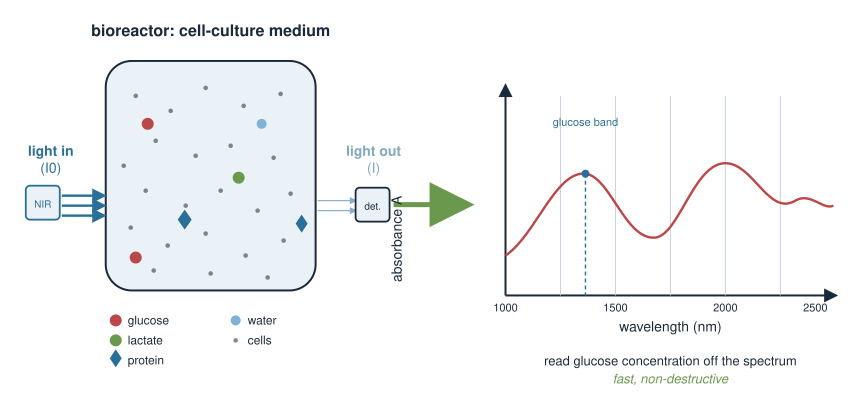{width="70%" fig-align="center"}

::: notes
Anchor the abstraction in a concrete measurement problem before any maths. Spectroscopy is attractive to biologists precisely because it is fast and non-destructive: you can monitor a fermentation, grade fruit ripeness, or screen blood without consuming the sample. The catch is that the signal is a superposition of every absorbing species, so you cannot just "read off" glucose — you need to model the mixture. That modelling problem is what makes this a linear-algebra topic. Emphasise the words mixture and weighted by concentration; those two ideas become Beer–Lambert and linear calibration.
:::

## What is a spectrum? {.smaller}

Pass light of many wavelengths through a sample and, for each wavelength $\lambda$, measure how much is absorbed.

- **Transmittance** $T = I / I_0$: fraction of light that gets through.
- **Absorbance** $A = -\log_{10}(T) = \log_{10}(I_0 / I)$: the quantity chemists model, because it behaves *linearly* (next slides).

A spectrum is the function $A(\lambda)$ — absorbance at each wavelength.

| Technique | Probes | Typical use |
|---|---|---|
| UV–Vis | electronic transitions | DNA/protein quantification |
| IR / NIR | molecular vibrations | composition, moisture, sugars |
| Raman | vibrational (scattering) | aqueous samples, live cells |

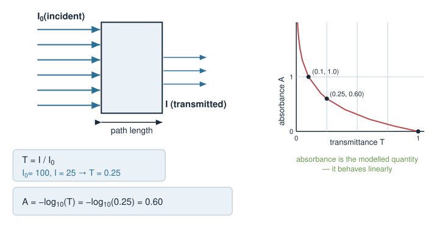{width="60%" fig-align="center"}

::: notes
Define the measurement cleanly. Transmittance is the raw fraction of light through; absorbance is its negative log, and the log is not cosmetic — it is exactly what makes the signal proportional to concentration (Beer–Lambert, next slide). Give students the landscape of techniques without going deep: UV–Vis for the nucleic-acid/protein quantification they already do on a NanoDrop, IR/NIR for bulk composition, Raman for watery and living samples. The common structure is identical: a number at each wavelength. That shared structure is why one set of maths serves them all.
:::

## A spectrum is a vector {.smaller}

The instrument does not record a smooth curve — it records absorbance at a **discrete grid** of wavelengths $\lambda_1, \lambda_2, \dots, \lambda_p$.

$$\mathbf{x} = (A(\lambda_1),\ A(\lambda_2),\ \dots,\ A(\lambda_p)) \in \mathbb{R}^p$$

- Each **wavelength is a coordinate**; a spectrum is one **point** in a $p$-dimensional space.
- $p$ is large — often **several hundred to a few thousand** wavelengths.
- Two similar samples give two nearby points; the **distance** between spectra is an ordinary vector distance.

Everything from **Vectors and dot products** applies: length, distance, angle, projection — now on chemical data.

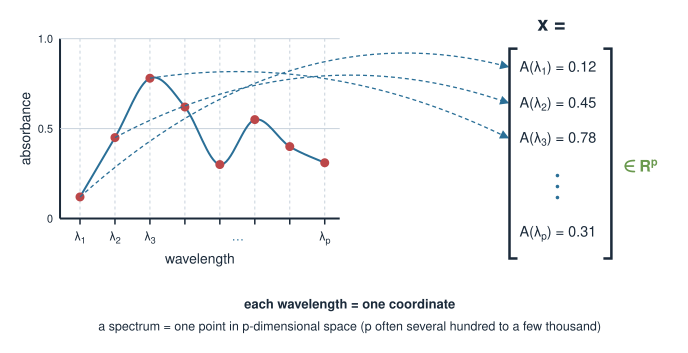{width="65%" fig-align="center"}

::: notes
This is the conceptual keystone of the unit. The curve the software draws is just a connect-the-dots of a numeric vector. Re-frame the plot: the horizontal axis (wavelength) indexes the vector's entries, the vertical axis is the entry's value. So a spectrum with 1000 wavelengths is a single point in 1000-dimensional space. This is exactly the high-dimensional setting where geometric intuition helps and where naive methods struggle. Point back to the dot-product unit: cosine similarity between spectra, Euclidean distance for "how different are these two samples" — the machinery is already in their hands.
:::

## The data matrix {.smaller}

Measure $n$ samples, each on the same grid of $p$ wavelengths. Stack the spectra as **rows**:

$$X = \begin{pmatrix} \text{— spectrum}_1 \text{ —} \\ \text{— spectrum}_2 \text{ —} \\ \vdots \\ \text{— spectrum}_n \text{ —} \end{pmatrix} \quad (n \times p)$$

- **Rows = samples**, **columns = wavelengths**. Same layout as an expression matrix (samples × features).
- Usually **wide**: far more wavelengths than samples, $p \gg n$.

```r
# X: 50 samples (rows) measured at 700 wavelengths (columns)
dim(X)              # 50 700
X[1, ]              # the first spectrum, as a length-700 vector
matplot(t(X), type = "l")   # overlay all spectra: wavelength on x, absorbance on y
```

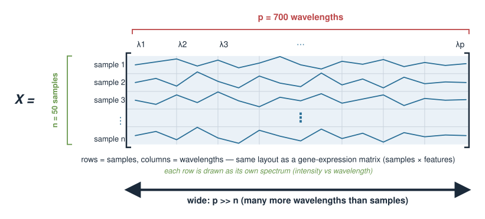{width="60%" fig-align="center"}

::: notes
Promote the single spectrum to a dataset. The samples-as-rows, features-as-columns convention is identical to the gene-expression tables they already know, which lowers the barrier. Stress $p \gg n$: this "short and wide" shape is the defining difficulty of chemometrics and the reason ordinary regression fails later. The matplot idiom (transpose so each spectrum is a line) is the standard first look at spectral data; note we transpose because matplot draws columns as lines. Keep the code illustrative — nothing runs at render time.
:::

## Beer–Lambert law {.smaller}

For a single absorbing substance, absorbance is **proportional to concentration**:

$$A = \varepsilon\, \ell\, c$$

- $c$ — **concentration** of the substance,
- $\ell$ — **path length** the light travels through the sample,
- $\varepsilon$ — **molar absorptivity**, a constant of the substance *at that wavelength*.

Double the concentration → double the absorbance. This is the **linear** relationship at the heart of quantitative spectroscopy.

At a fixed path length, at one wavelength, $A$ is just a **straight line through the origin** in $c$: $A = (\varepsilon\ell)\,c$.

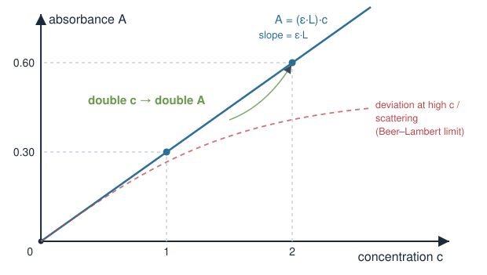{width="55%" fig-align="center"}

::: notes
This is the physical law that licenses everything linear we do. State it plainly: absorbance = molar absorptivity × path length × concentration. The proportionality to concentration is the crucial part — it means a calibration line (absorbance against known concentration) is straight, and its slope lets you invert an unknown absorbance back to a concentration. Mention the limits honestly but briefly: Beer–Lambert holds for dilute, non-scattering samples; at high concentration or with scattering it bends. That caveat motivates preprocessing later. Do not derive it from first principles; take it as the empirical law it is used as.
:::

## Mixtures add up {.smaller}

Real samples contain **many** absorbing species. At each wavelength, their absorbances simply **add**:

$$A(\lambda) = \varepsilon_1(\lambda)\,\ell\,c_1 + \varepsilon_2(\lambda)\,\ell\,c_2 + \dots + \varepsilon_k(\lambda)\,\ell\,c_k$$

Writing the whole spectrum at once, with $\mathbf{s}_i$ the **pure-component spectrum** of substance $i$:

$$\mathbf{x} = c_1\mathbf{s}_1 + c_2\mathbf{s}_2 + \dots + c_k\mathbf{s}_k$$

**A measured spectrum is a linear combination of pure-component spectra, weighted by concentrations.**

- This is exactly a **linear model** — the same object as in **Linear models**, now with spectra as the vectors.
- Recovering the $c_i$ from $\mathbf{x}$ is the calibration problem.

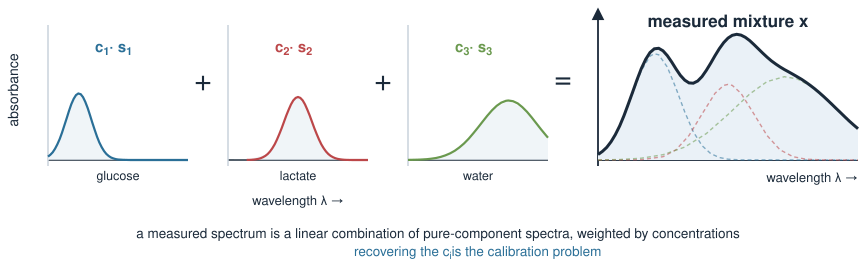{width="60%" fig-align="center"}

::: notes
This slide is the bridge from physics to linear algebra. Because absorbances are additive, a mixture spectrum is a weighted sum of the pure spectra — a linear combination, the central operation of the whole linear-algebra block. Read the vector equation aloud: the observed spectrum lives in the span of the pure-component spectra, and the concentrations are the coefficients. If you knew all pure spectra you could in principle solve for concentrations directly (a linear system). In practice you rarely know them all, which is why data-driven calibration (fit coefficients from samples with known concentrations) wins. This additivity is why linear methods dominate chemometrics.
:::

## Why raw spectra can't be used directly {.smaller}

Beer–Lambert is clean; real instruments and samples are not. Raw spectra carry artefacts unrelated to chemistry:

- **Baseline drift / offset** — the whole curve floats up or down (light scattering, instrument warm-up).
- **Multiplicative scaling** — path length and particle size scale the *whole* spectrum up or down.
- **Random noise** — detector noise wiggles on top of the signal.
- **Overlapping peaks** — chemically distinct bands blur into one broad hump.

If we feed these straight into a model, it will happily fit the **artefacts** instead of the **chemistry**.

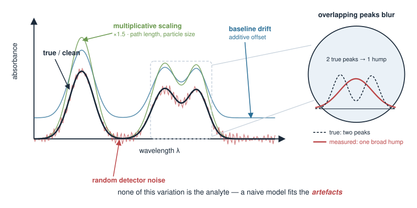{width="60%" fig-align="center"}

::: notes
Set up the need for preprocessing by being honest about real data. The same physical sample, measured twice, gives two visibly different curves: a vertical offset from scattering, an overall scaling from path-length differences, a fuzz of noise, and broad overlapping bands. None of that variation is the analyte of interest. A model that has not been told to ignore it will attribute variation to the wrong source. Preprocessing is the disciplined removal of these known nuisance effects so that what remains varies mainly with composition. The next four slides each target one artefact. Emphasise: preprocessing choices matter as much as the model, and are usually validated, not guessed.
:::

## Preprocessing 1 — baseline correction {.smaller}

An additive **baseline** shifts the whole spectrum: $A_\text{measured}(\lambda) = A_\text{true}(\lambda) + b(\lambda)$.

- Simplest case: a **constant offset** $b$ — subtract the minimum, or the value at a signal-free wavelength.
- General case: a slowly varying **curved baseline** — fit a smooth curve (polynomial, asymmetric least squares) and subtract it.

```r
# constant-offset removal: subtract each spectrum's own minimum
X_bc <- X - apply(X, 1, min)      # per-row (per-sample) baseline

# a signal-free anchor wavelength (say column 1) set to zero
X_bc <- X - X[, 1]
```

Goal: two samples with the same chemistry but different baselines should end up **on top of each other**.

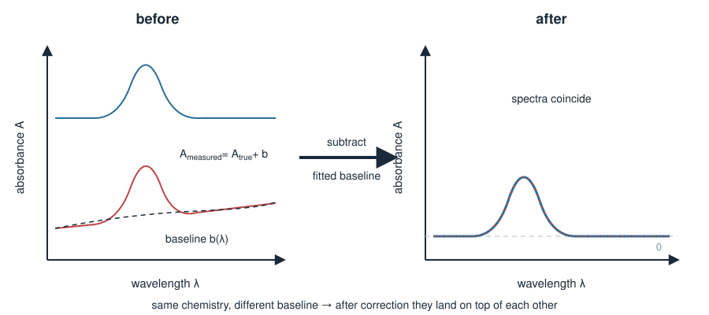{width="65%" fig-align="center"}

::: notes
Baseline correction removes additive, chemistry-free trends. Start with the trivial constant offset — subtract the minimum or the reading at a wavelength where nothing absorbs — because it makes the idea concrete. Then generalise to a curved baseline that drifts across the spectrum, handled by fitting a smooth function and subtracting it (asymmetric least squares is the workhorse but do not detail it). The R shown is base-R illustration of the constant case; note the per-row apply so each sample gets its own correction. The success criterion is invariance: same chemistry, same corrected spectrum, regardless of baseline.
:::

## Preprocessing 2 — smoothing {.smaller}

High-frequency **noise** rides on top of the real, smooth bands. Averaging neighbouring wavelengths suppresses it.

- **Moving average**: replace each point with the mean of a small window — simple, but blunts peaks.
- **Savitzky–Golay**: fit a low-order polynomial in a sliding window and take its value at the centre — smooths **while preserving peak shape**. The standard choice.

```r
# crude moving-average smoother (window of 5), illustrative only
smooth5 <- function(v) stats::filter(v, rep(1/5, 5))
X_sm <- t(apply(X, 1, smooth5))
```

**Trade-off:** too little smoothing leaves noise; too much erases real narrow peaks. Choose the window deliberately.

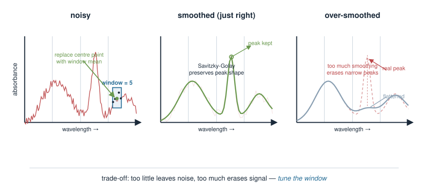{width="65%" fig-align="center"}

::: notes
Smoothing trades variance for a little bias. A moving average is the intuition — local averaging cancels zero-mean noise — but it flattens sharp peaks. Savitzky–Golay is the field standard because the local polynomial fit follows curvature, so peaks survive. Do not derive SG; name it and say why it is preferred. The key teaching point is the trade-off: the window width is a knob, and both extremes are harmful, so it is tuned, often by cross-validation together with the model. The R is a deliberately crude illustration; real work uses a package (prospectr, signal). Nothing runs here.
:::

## Preprocessing 3 — normalization {.smaller}

**Multiplicative** effects (path length, particle size, sample density) scale the *whole* spectrum by an unknown factor. Normalization removes that scale.

- **Vector normalization**: divide each spectrum by its own length $\lVert\mathbf{x}\rVert$ → all spectra have length 1.
- **Standard Normal Variate (SNV)**: per spectrum, subtract its mean and divide by its standard deviation (centre + scale each row).

```r
# vector (L2) normalization: each spectrum scaled to unit length
X_vn <- X / sqrt(rowSums(X^2))

# SNV: centre and scale each spectrum (row) on its own statistics
X_snv <- t(scale(t(X)))     # scale() works on columns, so transpose in/out
```

Now differences between spectra reflect **shape** (composition), not overall intensity.

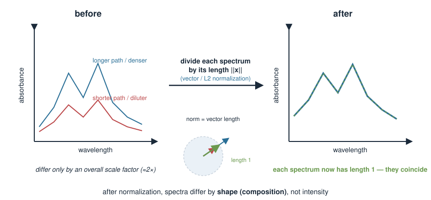{width="65%" fig-align="center"}

::: notes
Normalization targets multiplicative nuisance, the counterpart to baseline correction's additive nuisance. Physically, a longer light path or denser packing multiplies every absorbance by a common factor; that factor carries no compositional information, so we divide it out. Vector normalization (unit length) connects directly to the norm from the vectors unit — the same $\lVert\mathbf{x}\rVert$. SNV is the spectroscopist's default: row-centre and row-scale. Note the transpose trick because R's scale() operates on columns while we need per-row (per-spectrum) statistics. The payoff: after normalization, two spectra differ because their chemistry differs, not because one sample was thicker.
:::

## Preprocessing 4 — derivatives {.smaller}

Taking the **derivative** of the spectrum with respect to wavelength is a preprocessing step in its own right.

- **First derivative** removes a **constant** baseline offset (the derivative of a constant is zero).
- **Second derivative** removes a **linear (sloping)** baseline, and sharpens **overlapping peaks** into resolvable dips.

In practice the derivative is computed *and* smoothed together, usually by **Savitzky–Golay** (fit a polynomial, differentiate it).

```r
# crude first difference along wavelength: approximates the derivative
X_d1 <- t(apply(X, 1, diff))      # one column shorter than X
```

**Cost:** differentiation **amplifies noise**, which is why it is paired with smoothing.

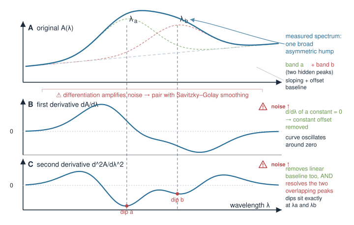{width="50%" fig-align="center"}

::: notes
Derivatives are a clever two-for-one: they attack baselines and resolve overlap at once. The differentiation logic is worth stating explicitly — d/dλ of a constant offset is zero, so a first derivative is blind to constant baselines; a second derivative additionally kills any linear slope. And because a broad hump made of two overlapping bands has structure in its curvature, the second derivative separates them into distinct features. The catch is noise amplification: differencing noisy data makes it noisier, so derivatives are always computed with a smoothing polynomial (Savitzky–Golay), never as a raw difference in serious work. The diff() line is the toy version. Emphasise: derivative order and smoothing window are joint choices.
:::

## The calibration problem {.smaller}

We have $n$ **calibration samples** with spectra (matrix $X$, $n \times p$) *and* known reference concentrations (vector $\mathbf{y}$, measured by a slow gold-standard assay).

**Goal:** learn a rule that turns a new spectrum into a predicted concentration — so future samples skip the slow assay.

A **linear** predictor (the natural choice, from Beer–Lambert) is a weighted sum of the absorbances:

$$\hat{y} = b_0 + b_1 x_1 + b_2 x_2 + \dots + b_p x_p = b_0 + \mathbf{b}\cdot\mathbf{x}$$

- The weights $\mathbf{b} = (b_1,\dots,b_p)$ are a **vector**, one weight per wavelength.
- Predicting is a single **dot product** between the coefficient vector and the spectrum.

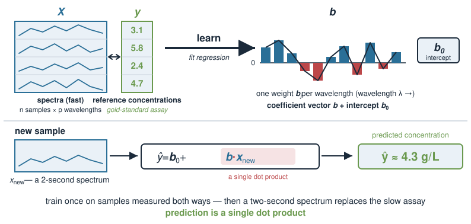{width="65%" fig-align="center"}

::: notes
Frame the supervised problem cleanly. You pay once for a set of samples measured both ways — fast spectrum and slow reference assay — and use them to learn a predictor, after which only the cheap spectrum is needed. Because Beer–Lambert makes concentration linear in absorbance, a linear predictor is principled, not just convenient. Highlight that the model is entirely a coefficient vector b plus an intercept, and that prediction is the dot product from the vectors unit. This connects the whole preprocessing pipeline to a familiar regression target. The next slide explains why we cannot just call lm() on this.
:::

## Why ordinary regression breaks {.smaller}

Ordinary least squares needs to invert $X^\top X$ (a $p\times p$ matrix). On spectra it fails on **two** counts:

- **$p \gg n$**: with more wavelengths than samples, $X^\top X$ is **singular** — no unique solution. Infinitely many coefficient vectors fit the calibration data perfectly and predict garbage on new samples (**overfitting**).
- **Collinearity**: adjacent wavelengths are **almost identical** (spectra are smooth), so columns of $X$ are highly correlated — even when $n > p$, $X^\top X$ is near-singular and the coefficients are wildly unstable.

We need a method that works when predictors are **many and correlated**. The idea: compress the spectrum into a **few good directions** first.

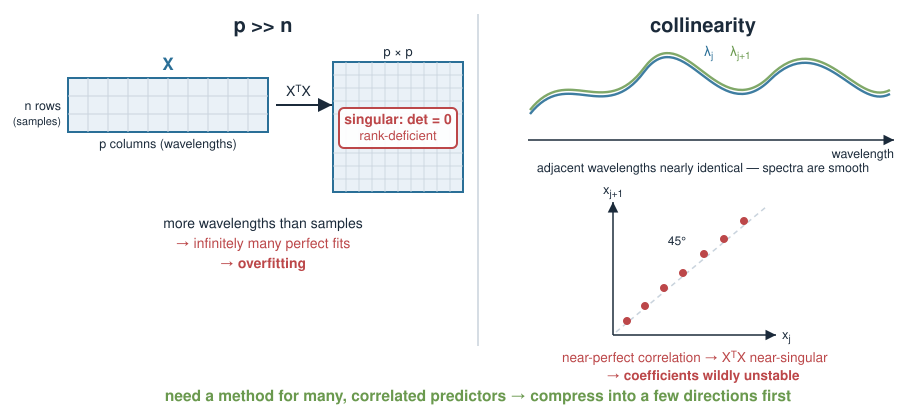{width="65%" fig-align="center"}

::: notes
Explain the failure concretely so PLS feels necessary, not arbitrary. Two distinct problems: dimensionality (more wavelengths than samples makes the normal equations singular — recall singular matrices from the linear-systems unit) and collinearity (neighbouring wavelengths carry nearly the same information, so the design matrix is ill-conditioned). Both make plain OLS coefficients meaningless — huge, unstable, over-fitted. The resolution is dimension reduction: instead of one weight per wavelength, first find a handful of informative combinations of wavelengths, then regress on those. This is exactly the principal-component idea, and it sets up PLS on the next slide.
:::

## From spectra to a few components {.smaller}

Reduce the $p$ correlated wavelengths to a few **latent variables** — weighted combinations of wavelengths — then regress on those.

- **Principal Component Regression (PCR):** run **principal component analysis** on $X$ (from the PCA unit), keep the top few components, regress $\mathbf{y}$ on their scores. Components are chosen to capture **variance in $X$** — but the biggest variance might be nuisance, not analyte.
- **Partial Least Squares (PLS):** choose components that capture variance in $X$ **and** correlate with $\mathbf{y}$. It uses the response while building the components.

PLS is the **workhorse of chemometric calibration** because it aims its components at the quantity you want to predict.

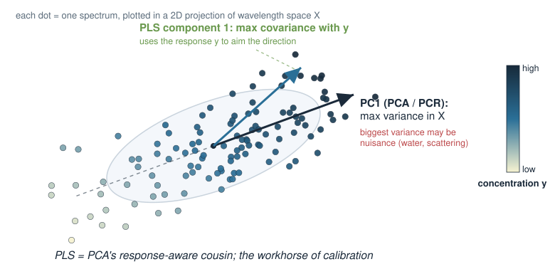{width="55%" fig-align="center"}

::: notes
Position both dimension-reduction regressions side by side. PCR is the honest first idea: compress with PCA, regress on the scores — it fixes the singularity and collinearity problems in one move. Its weakness is that PCA looks only at X, so its leading components maximise total spectral variance, which may be dominated by water or scattering rather than the analyte. PLS repairs this by letting the response y steer the components: each latent variable is chosen to have high covariance with y, not just high variance in X. That is the one-sentence distinction to drill. Reference the PCA unit explicitly since students meet PCA there; PLS is PCA's supervised cousin.
:::

## Partial Least Squares, in words {.smaller}

PLS builds a **small number of latent variables** (components), one at a time:

1. Find the direction in wavelength space $\mathbf{w}_1$ along which the spectra vary **and** that variation tracks $\mathbf{y}$ (maximal **covariance** with $\mathbf{y}$).
2. Project every spectrum onto it → a **score** $t_1$ (one number per sample).
3. Use $t_1$ to predict $\mathbf{y}$; **remove** what it explained from both $X$ and $\mathbf{y}$.
4. Repeat on the remainder for $\mathbf{w}_2, \mathbf{w}_3, \dots$

- Each component is a **linear combination of wavelengths** — a direction (a vector) in spectral space.
- The number of components is the one dial to tune — chosen by **cross-validation**.

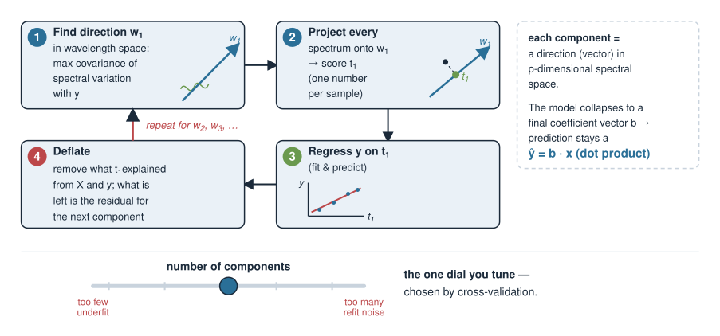{width="60%" fig-align="center"}

::: notes
Give the mechanism at an intuitive level without the NIPALS algebra. The core is covariance-maximising directions: unlike PCA's variance-only directions, each PLS weight vector is tilted toward the response. Walk the loop — find a direction, project to get scores, regress, deflate (subtract what has been explained), repeat — so students see it as greedy, one component at a time. Two anchors to prior units: each component is a direction/vector in the p-dimensional spectral space (vectors unit), and the whole thing collapses to a final coefficient vector b so prediction stays a dot product. The single hyperparameter is the number of components; too few underfits, too many refits noise, so it is set by cross-validation — the same validation logic used for smoothing windows.
:::

## PLS in R {.smaller}

The `pls` package fits PLS with built-in cross-validation. Illustrative workflow (not run here):

```r
library(pls)

# df has a response column `conc` and a spectral matrix column `X`
fit <- plsr(conc ~ X, data = df, ncomp = 10, validation = "CV")

# how many components? look for where CV error stops improving
validationplot(fit, val.type = "RMSEP")

# predict a new spectrum using, say, 4 components
predict(fit, newdata = new_df, ncomp = 4)
```

- `validation = "CV"` cross-validates over component counts.
- **RMSEP** (root-mean-square error of prediction) tells you the expected error on new samples — pick the smallest sensible `ncomp`.

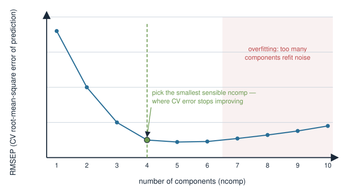{width="60%" fig-align="center"}

::: notes
Show the standard tooling so students know the real workflow exists, while keeping every line illustrative. The pls package's plsr() with validation = "CV" does the heavy lifting; validationplot with RMSEP is the canonical way to choose the number of components — you look for the elbow where adding components stops lowering cross-validated error and resist going further to avoid overfitting. Reinforce that preprocessing (the four earlier steps) happens before this and is itself part of what you validate. The biological payoff: once fit, predict() turns a two-second spectrum into a concentration, replacing a slow wet assay. Chemometrics II will treat the model and validation more carefully.
:::

## It was linear algebra all along {.smaller}

| Chemometrics idea | Course concept |
|---|---|
| Spectrum = intensity vs wavelength | a **vector** in $\mathbb{R}^p$ |
| Distance / similarity of spectra | **norm**, **dot product**, angle |
| Mixture spectrum | **linear combination** of pure spectra |
| Predict concentration | **linear model**, $\hat y = b_0 + \mathbf{b}\cdot\mathbf{x}$ |
| Compress correlated wavelengths | **principal component analysis** |
| Supervised compression | **PLS** (PCA's response-aware cousin) |

Beer–Lambert makes the chemistry **linear**; the linear-algebra block is precisely the toolkit for linear things.

::: notes
Zoom out and make the unifying claim explicit: nothing in this lecture is new machinery, only new data. Each chemometric step maps onto something already taught — spectra are vectors, similarity is dot products, mixtures are linear combinations, calibration is a linear model, and dimension reduction is PCA (supervised, in PLS). The reason it all lines up is physical: Beer–Lambert's proportionality is what makes concentration a linear function of absorbance, so the linear-algebra toolkit is the right one rather than a convenient approximation. This table is the slide to leave up while summarising.
:::

## Summary {.smaller}

- A **spectrum** is a high-dimensional **vector**: absorbance at each wavelength. A dataset is a wide matrix, **samples × wavelengths**, usually $p \gg n$.
- **Beer–Lambert** ($A = \varepsilon\ell c$) makes absorbance **proportional to concentration**, and mixture spectra are **linear combinations** of pure-component spectra — so **linear** models are the natural fit.
- Raw spectra need **preprocessing**: baseline correction (additive), normalization (multiplicative), smoothing (noise), derivatives (baseline + overlap). These are validated, not guessed.
- **Multivariate calibration** predicts concentration from a spectrum. Ordinary regression fails ($p\gg n$, collinearity); **PLS** compresses wavelengths into a few response-aware components, tuned by **cross-validation**.

**Next (Chemometrics II):** classification of spectra, model validation, and interpreting which wavelengths drive a prediction.

::: notes
The summary is the take-home. Drill the through-line one more time: spectrum → vector, Beer–Lambert → linear, artefacts → preprocessing, calibration → PLS. Stress that preprocessing and component count are choices validated on held-out data, not aesthetic decisions — this is the single most common beginner mistake. Remind students that everything rested on prior units (vectors, linear models, PCA), which is the point of the Applications block: the abstract machinery pays off on real chemical and biological measurements. Preview Chemometrics II: turning spectra into classes, honest validation, and reading the model to learn which wavelengths — and thus which chemistry — carry the signal.
:::
