## Draft skeleton — review before use {.smaller}

::: {.callout-warning title="This unit is a DRAFT SKELETON"}
This lecture is a **provisional outline** written to hold the slot for *Chemometrics II* while a **subject-matter contributor** is recruited. It sketches the standard applications at a general level only.

- Treat every claim as **provisional** and **subject to expert review**.
- No specific instrument, dataset, threshold, or performance number here is authoritative — where a concrete value would normally appear, the text says so rather than inventing one.
- Do **not** teach from this unit as-is. It must be reviewed, corrected, and fleshed out by someone with hands-on chemometrics experience before it is used in class.
:::

Reviewer checklist appears in the speaker notes throughout, tagged **[REVIEW]**.

::: notes
[REVIEW] This whole deck is a placeholder. The goal of this first pass is to get the *shape* of the topic right — the applications a biologist should recognise and the validation discipline that makes them trustworthy — without committing to specifics that need an expert. Please verify terminology, add real datasets and figures, and replace every "typically / often / commonly" with a defensible statement or a citation.
:::

## About this lecture {.smaller}

*Chemometrics I* introduced the setting: a **spectrum is a high-dimensional vector**, samples stack into a wide matrix, and PCA-style methods find structure in it. Today we turn to **what we do with such data** in practice.

By the end you should be able to:

- frame a spectroscopy problem as either **classification** (which group?) or **regression / calibration** (how much?),
- describe **multivariate calibration** and why spectra need it rather than plain `lm`,
- explain what **calibration transfer** is and why a model can fail on a second instrument,
- recognise **multivariate process / quality control** on scores and residuals,
- state why **variable selection** helps and name a couple of standard approaches,
- **validate** a model honestly with **cross-validation** and report **RMSEP**.

This is an **applications and vocabulary** day, built on the machinery from *PCA*, *The OPLS model*, and *Chemometrics I*.

::: notes
[REVIEW] Confirm this list. Keep learning objectives at the level of "can explain and set up", not "can derive"; the derivations live in PCA and the eigen units; this day is about applying and validating.
:::

## Why a biologist should care {.smaller}

Spectroscopy gives a **fast, cheap, often non-destructive** read-out that stands in for a slow wet-lab assay. Some recurring biological uses:

- **Near-infrared (NIR) / infrared (IR):** composition of grain, feed, tissue, or fermentation broth — e.g. protein, moisture, or metabolite content without a full chemical assay.
- **Raman:** label-free readout of cells and tissue; distinguishing cell states or identifying microbial isolates.
- **Mass spectrometry / NMR (metabolomics):** hundreds to thousands of features per sample, used to separate phenotypes or detect a metabolic shift.

In every case the raw signal is **many correlated numbers per sample**, and the biological answer — a concentration or a class label — is hidden in their *pattern*, not any single channel.

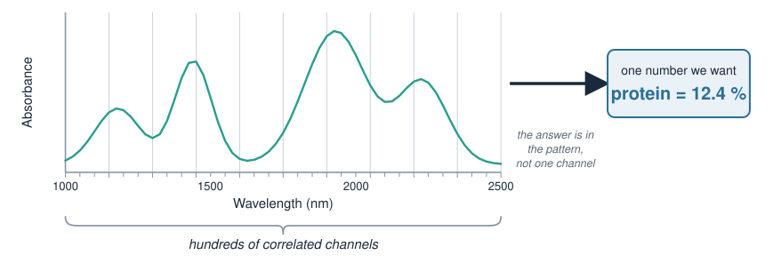{width="75%" fig-align="center"}

::: notes
[REVIEW] Replace these with the lab's actual application areas and one real example spectrum. Keep the framing: the measured object is a curve/vector, the biological target is a scalar or a label. This is the method-biology pairing for the whole unit.
:::

## The data shape: wide and collinear {.smaller}

Stack $n$ samples, each measured at $p$ wavelengths, into a matrix $X$ ($n \times p$), with a target $\mathbf{y}$ (a property to predict, or a class):

$$X = \begin{pmatrix} x_{11} & \cdots & x_{1p} \\ \vdots & & \vdots \\ x_{n1} & \cdots & x_{np} \end{pmatrix}, \qquad \mathbf{y} = \begin{pmatrix} y_1 \\ \vdots \\ y_n \end{pmatrix}$$

Two features dominate spectral data:

- **Wide:** often $p \gg n$ (far more wavelengths than samples).
- **Collinear:** neighbouring wavelengths are highly correlated — they carry nearly the same information.

Ordinary least squares (`lm`) **breaks** here: with $p \gg n$ and collinear columns, $X^\top X$ is not invertible and the fit is unstable. This is exactly the problem the *latent-variable* methods from *PCA* and *The OPLS model* were built to solve.

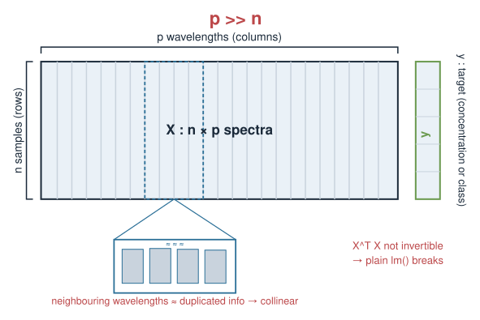{width="70%" fig-align="center"}

::: notes
[REVIEW] Tie back explicitly to the singular / non-invertible discussion in the Linear systems and PCA units — students met "no unique solution" there. The punchline: chemometrics is largely the art of regressing/classifying when the classical assumptions (n > p, independent predictors) fail. Verify the p >> n framing matches the datasets you plan to use; for some metabolomics setups n and p are closer.
:::

## Preprocessing comes first {.smaller}

Raw spectra carry nuisance variation — scatter, baseline drift, path-length differences — that has nothing to do with the biology. Standard **preprocessing** steps (named here for recognition; details belong to *Chemometrics I* / an expert pass):

- **Baseline / scatter correction:** e.g. Standard Normal Variate (SNV), Multiplicative Scatter Correction (MSC).
- **Derivatives (Savitzky–Golay):** sharpen overlapping peaks, remove slow baselines.
- **Centering / scaling:** mean-centre columns; sometimes autoscale (unit variance) so no channel dominates by magnitude alone.

::: {.callout-important}
Preprocessing choices are **part of the model**. They must be **decided on the training data and re-applied identically** to new data — never fit using information from the test set.
:::

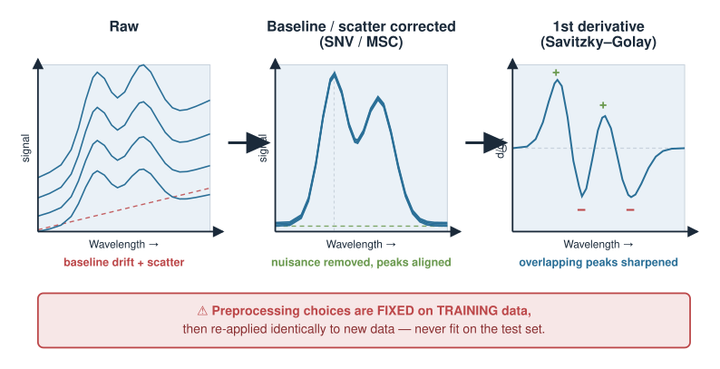{width="80%" fig-align="center"}

::: notes
[REVIEW] This slide is deliberately a checklist, not a tutorial. An expert should expand each item and, crucially, warn about the leakage trap: choosing preprocessing by peeking at validation performance inflates optimism. The centering/scaling point connects to mean-centering in PCA.
:::

## Two questions, two model families {.smaller}

Almost every spectral application is one of two supervised tasks:

| Question | Target $\mathbf{y}$ | "How much / which?" | Typical methods |
|---|---|---|---|
| **Regression (calibration)** | continuous | *How much analyte?* | PCR, **PLS regression** |
| **Classification** | categorical | *Which group / is it OK?* | PLS-DA, LDA, SIMCA, $k$-NN |

Both share the same trick learned earlier: **project the wide, collinear $X$ onto a few latent components first**, then model in that low-dimensional space.

- *Regression* fits a line/plane in latent space (property vs components).
- *Classification* separates groups in latent space.

We take them in turn.

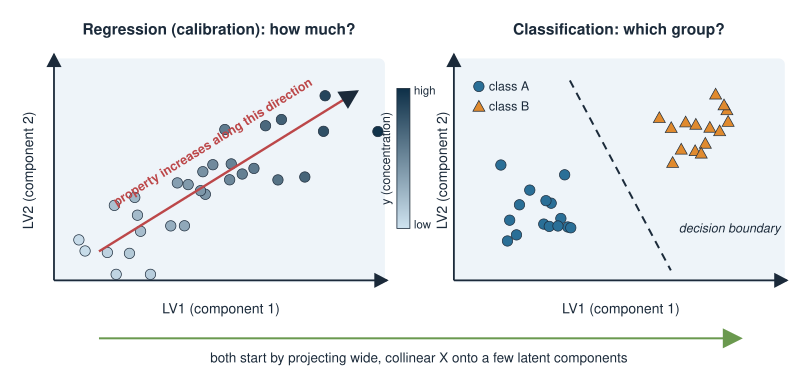{width="75%" fig-align="center"}

::: notes
[REVIEW] Confirm the method lists are the ones the course wants to name. PLS regression and PLS-DA are the workhorses; PCR, LDA, SIMCA, kNN are worth naming for recognition. Do not over-promise depth — these are named, not derived, in a draft. The shared idea (latent projection) is the throughline from PCA / OPLS.
:::

## Multivariate calibration (regression) {.smaller}

**Goal:** predict a continuous property $y$ (e.g. concentration) from a spectrum $\mathbf{x}$.

The physical motivation is roughly linear: by the **Beer–Lambert** idea, absorbance rises with concentration, so a linear model in the (preprocessed) spectrum is a sensible starting point:

$$\hat{y} = b_0 + \mathbf{x}^\top \mathbf{b}$$

But we cannot fit $\mathbf{b}$ directly by OLS ($p \gg p$, collinear). Instead:

- **PCR (Principal Component Regression):** run PCA on $X$, keep the top components, regress $y$ on the **scores**.
- **PLS regression:** like PCR, but the components are chosen to align with $y$ — they explain variation in $X$ **that is relevant to $y$**, not just the largest variation in $X$.

PLS is the standard chemometrics calibration tool for exactly this reason.

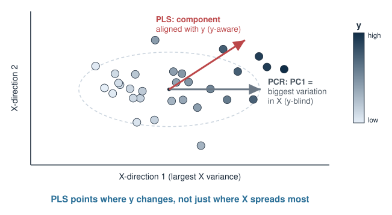{width="60%" fig-align="center"}

::: notes
[REVIEW] Verify the Beer-Lambert framing is stated carefully enough — it is a motivation for linearity, with real caveats (scattering, non-linearities). The PCR-vs-PLS contrast is the key concept: PCR's components are y-blind, PLS's are y-aware. This builds directly on The OPLS model unit. An expert should decide how much of the PLS algorithm (if any) to show.
:::

## Calibration in R (sketch) {.smaller}

Static illustration only — **no packages are installed at render time**, so nothing here is executed. The `pls` package provides `plsr()`.

```r
library(pls)

# X: n x p spectra (preprocessed), y: property to predict, in one data frame
fit <- plsr(y ~ ., data = train,
            ncomp = 10,           # try up to 10 latent components
            validation = "CV")    # built-in cross-validation

# how many components? read the cross-validated error, pick the elbow
validationplot(fit, val.type = "RMSEP")
summary(fit)

# predict a held-out set with the chosen number of components
yhat <- predict(fit, newdata = test, ncomp = 4)
```

The single most important decision is **how many components** to keep — too few underfits, too many overfits. That decision is made by **validation**, which is the rest of this lecture.

::: notes
[REVIEW] Keep this as a sketch; an expert should replace `train`/`test` with a real dataset and show a real RMSEP curve. Do not present the number 4 or 10 as meaningful — they are placeholders illustrating the workflow. Emphasise verbally that ncomp is the tuning knob everything hinges on.
:::

## Choosing model complexity {.smaller}

Every latent-variable model has a **complexity dial**: the number of components (latent variables) kept.

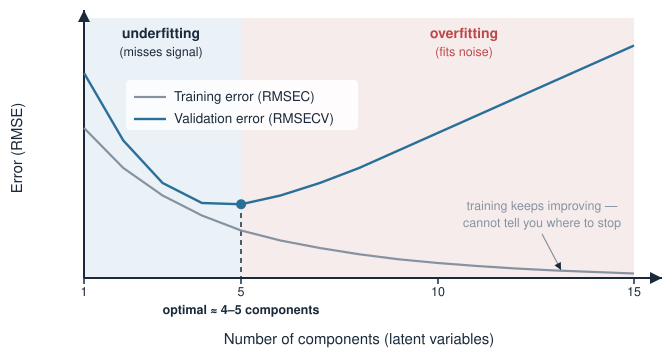{width="65%" fig-align="center"}

- **Too few components:** the model misses real signal — **underfitting** (high error everywhere).
- **Too many components:** the model starts fitting **noise** in the training spectra — **overfitting** (training error keeps dropping, but error on *new* samples rises).

The training-set error alone **cannot** tell you where to stop — it always improves with more components. You need an estimate of error on **unseen** data. That is what cross-validation provides.

::: notes
[REVIEW] This is the conceptual core of the day and should survive expert review largely intact. The bias-variance trade-off framed as "components dial". Students have seen overfitting informally; here it is tied to a concrete knob. The figure is the classic two-curve plot.
:::

## Validation: why a test set is non-negotiable {.smaller}

A model that has *seen* a sample can predict it well — that proves nothing about future samples.

- **Calibration (training) error, RMSEC:** error on the samples used to fit. **Optimistic** — always looks better than reality.
- **Prediction error, RMSEP:** error on an **independent** set the model never touched during fitting *or* tuning. This is the number you **report** and trust.

::: {.callout-important}
Anything fit on the data — preprocessing, scaling, component count, variable selection — must be decided **without** the test set. Otherwise the test set is contaminated and RMSEP is optimistic.
:::

The honest workflow: **train** to fit, **validate** to tune, **test** once to report.

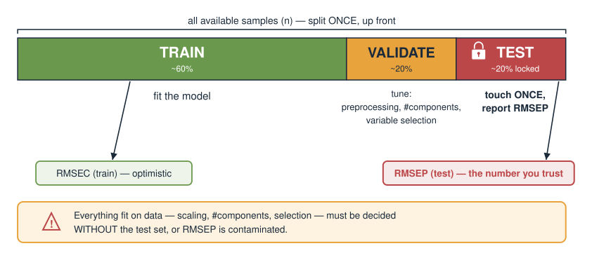{width="80%" fig-align="center"}

::: notes
[REVIEW] Hammer the leakage point; it is the most common real-world mistake. If the dataset is small, a single held-out test set is noisy — nested cross-validation is the rigorous answer, which an expert may want to add. Keep the three-way split language (train/validate/test) consistent with whatever the ML-adjacent units use.
:::

## Cross-validation {.smaller}

When data are scarce, holding out one fixed test set wastes samples. **$k$-fold cross-validation** reuses them:

1. Split the samples into $k$ roughly equal **folds**.
2. For each fold: **train** on the other $k-1$ folds, **predict** the held-out fold.
3. Every sample is predicted exactly once, by a model that **did not see it**.
4. Combine the held-out predictions into one error estimate.

- **Leave-one-out (LOO):** $k = n$ (each sample its own fold) — common for small spectral sets.
- In spectroscopy, samples measured together can be correlated; folds should respect that (e.g. **do not** split replicate scans of the same specimen across folds).

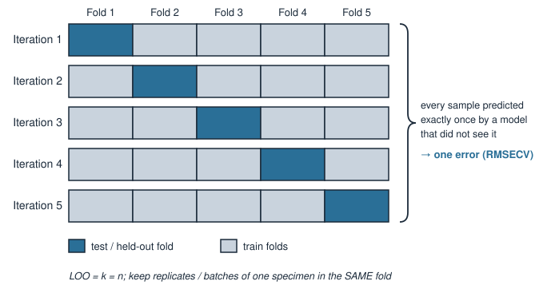{width="75%" fig-align="center"}

::: notes
[REVIEW] The correlated-samples warning matters a lot in practice (replicates, batches, time-adjacent scans) and an expert should sharpen it — naive random folds leak information and give too-rosy CV error. "Venetian blinds" and contiguous-block schemes are worth naming for someone who knows the field.
:::

## RMSEP and friends {.smaller}

The standard regression error is the **root-mean-square error of prediction**:

$$\mathrm{RMSEP} = \sqrt{\frac{1}{n}\sum_{i=1}^{n}\left(\hat{y}_i - y_i\right)^2}$$

- Same **units as $y$** (e.g. mg/mL) — directly interpretable.
- Computed on an **independent** set → **RMSEP**; from cross-validation → **RMSECV**; on the training set → **RMSEC** (optimistic).

Report alongside it:

- **Bias:** mean of $(\hat{y}_i - y_i)$ — a systematic offset (ideally $\approx 0$).
- **$R^2$ / explained variance:** fraction of variation in $y$ captured.

Pick the component count that **minimises RMSECV** (or the simplest model within noise of the minimum — the "one-standard-error" idea).

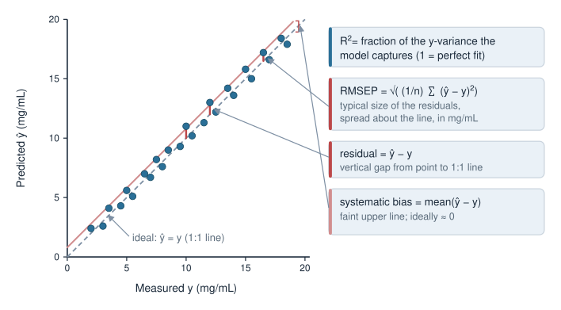{width="55%" fig-align="center"}

::: notes
[REVIEW] Formula is standard; confirm the department's preferred definition (some use n-1 or degrees-of-freedom corrections, some report SEP separately from bias). The "simplest model within one SE of the minimum" is a defensible default but an expert should confirm it is the convention taught elsewhere in the course. Units-of-y point is the intuition anchor.
:::

## Classification of spectra {.smaller}

**Goal:** assign each spectrum to a class — tissue type, disease vs control, species of a microbial isolate, pass/fail.

Same latent-projection idea, now separating groups:

- **PLS-DA:** encode the class as a numeric target and run PLS regression toward it; assign by the predicted value. The default chemometrics classifier.
- **LDA:** find the direction that best separates classes (often applied *after* PCA to tame $p \gg n$).
- **SIMCA:** build a separate PCA model per class; a new sample joins the class whose model it fits best (can also say *"none of them"*).
- **$k$-NN:** classify by the nearest training spectra in (latent) space.

Validate with the **same discipline**: cross-validated **misclassification rate**, sensitivity/specificity, or a confusion matrix on an **independent** test set — never the training accuracy.

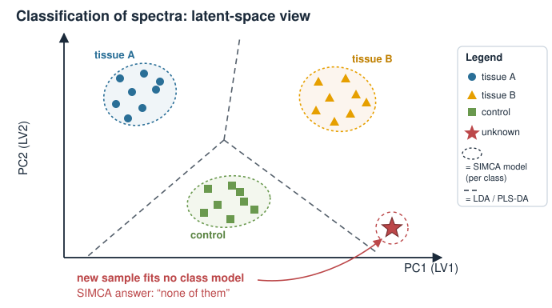{width="60%" fig-align="center"}

::: notes
[REVIEW] Method roster to confirm. SIMCA's "none of the above" ability is genuinely useful for biology (novel/contaminant samples) and worth keeping. For imbalanced classes, plain accuracy misleads — an expert should add the caveat and preferred metrics. Cross-validation caveats from the previous slides apply identically.
:::

## Calibration transfer {.smaller}

A model calibrated on **instrument A** often **fails on instrument B** — different detector, different day, different temperature — because the *same sample* produces a slightly *different spectrum*.

**Calibration transfer** adapts a model so it works across instruments/conditions **without** rebuilding it from scratch:

- Measure a small set of **transfer / standardisation samples** on both instruments.
- Learn a mapping that makes B's spectra look like A's (or adjust the model coefficients).
- Standard families (named for recognition): **Direct Standardization (DS)** and **Piecewise Direct Standardization (PDS)**, and other spectral-space corrections.

For a biologist this is the difference between a model that lives only in the lab that built it and one that **transfers** to a collaborator, a clinic, or next year's instrument.

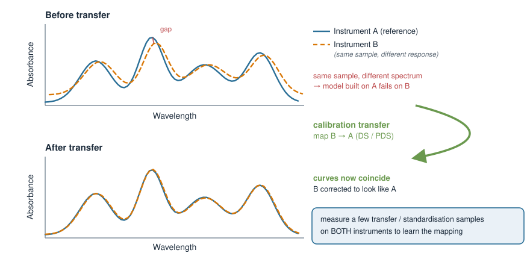{width="60%" fig-align="center"}

::: notes
[REVIEW] This is a genuine expert topic — DS/PDS details, robustness, and how many standardisation samples are needed all need a specialist. Keep the biological framing (portability of a model) as the motivation. Do not state specific sample counts or performance figures; none here are sourced.
:::

## Multivariate process / quality control {.smaller}

Once a good latent-variable model exists, use it to **monitor** a process or screen samples in real time — *multivariate statistical process control (MSPC)*.

Two complementary alarms per new sample:

- **Hotelling's $T^2$:** how far the sample sits from the centre **inside** the model's latent space — unusual but of a *known* type of variation.
- **$Q$ / SPE (squared prediction error):** how far the sample lies **off** the model subspace — variation the model has **never seen** (a new, possibly out-of-spec state).

Plot these on **control charts** with limits; a point past a limit flags a sample or batch for attention.

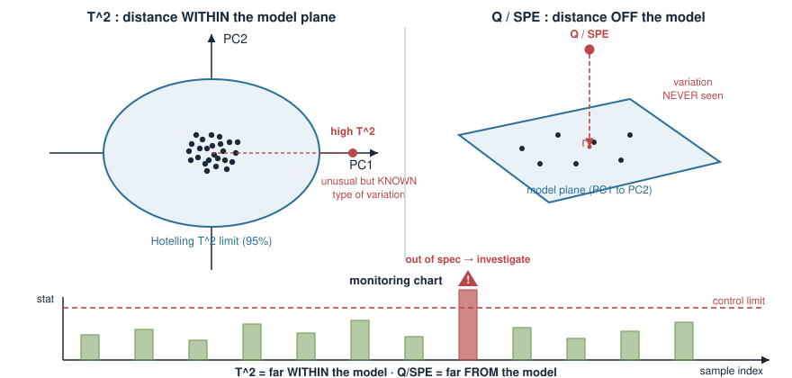{width="65%" fig-align="center"}

::: notes
[REVIEW] T^2-vs-Q is the standard MSPC pairing and maps cleanly onto "distance within the model" vs "distance to the model". Control-limit derivations (distributional assumptions) need an expert; state them only qualitatively here. Biology hook: fermentation/bioprocess monitoring, or QC screening of incoming samples.
:::

## Variable selection {.smaller}

Spectra have hundreds of channels, but often only some carry the relevant signal. **Selecting variables** (wavelengths) can:

- improve **interpretability** — *which* spectral regions drive the prediction (a chemically/biologically meaningful band),
- sometimes improve **robustness** by dropping noisy, uninformative channels,
- but risks **overfitting the selection itself** if not validated properly.

Standard approaches, named for recognition:

- **VIP (Variable Importance in Projection)** scores from a PLS model,
- **selectivity ratio**, interval methods (**iPLS**), or search-based selection.

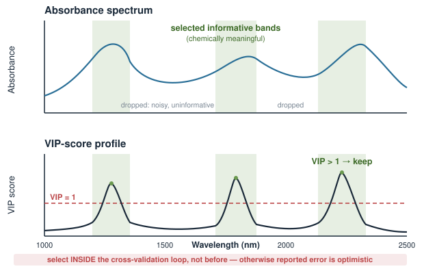{width="70%" fig-align="center"}

::: {.callout-important}
Variable selection is part of model fitting. Select **inside** the cross-validation loop, not before it — otherwise the reported error is optimistic.
:::

::: notes
[REVIEW] The leakage warning here is the subtle one that even practitioners get wrong: selecting variables on the full dataset before CV double-dips. An expert should decide how much detail (VIP threshold conventions, wrapper vs filter) to include. Keep it honest that selection is not free.
:::

## Good practice checklist {.smaller}

Independent of the specific method, a trustworthy spectral model:

- **preprocesses** consistently, with all choices fixed on training data only;
- keeps a **truly independent test set**, touched **once**, at the end;
- tunes complexity (components, variables) by **cross-validation**, respecting sample structure (replicates, batches);
- reports error in **interpretable units** (RMSEP) with **bias** and a class-appropriate metric;
- checks for **outliers** and **applicability** ($T^2$, $Q$) rather than blindly predicting;
- is **honest about transfer**: does it still work on a new instrument, day, or population?

If a result cannot survive this checklist, it is not yet a result.

::: notes
[REVIEW] This slide is the practical takeaway and could stand as the unit's summary of judgement. Confirm it matches the course's stance elsewhere. It intentionally contains no numbers to invent.
:::

## Summary {.smaller}

| Idea | Key point |
|---|---|
| Data shape | wide ($p \gg n$), collinear → OLS fails, use latent variables |
| Preprocessing | scatter/baseline/derivative + scaling; fix on training data only |
| Regression | **calibration**: predict a quantity; **PLS** (y-aware) over PCR (y-blind) |
| Classification | which group?: **PLS-DA**, LDA, SIMCA, $k$-NN |
| Complexity | # components is the dial; too few underfit, too many overfit |
| Validation | tune by **cross-validation**; report **RMSEP** on an untouched test set |
| Transfer | models can fail across instruments; **DS/PDS** adapt them |
| Monitoring | **MSPC**: $T^2$ (in-model) and $Q$/SPE (off-model) control charts |
| Variable selection | fewer wavelengths, more interpretable — but select inside CV |

Built on *PCA*, *The OPLS model*, and *Chemometrics I*; the discipline (validate honestly, report RMSEP) carries into every later data-analysis unit.

::: {.callout-warning}
Reminder: **draft skeleton** — verify all terminology and add worked examples, figures, and a real dataset before teaching.
:::

::: notes
[REVIEW] The summary table is the shape the finished unit should fill in. Each row is a promise an expert must make good on with a real example. Close by reiterating the through-line: the maths (PCA/eigen/OPLS) was built earlier; today's contribution is applying it and — above all — validating it honestly.
:::
