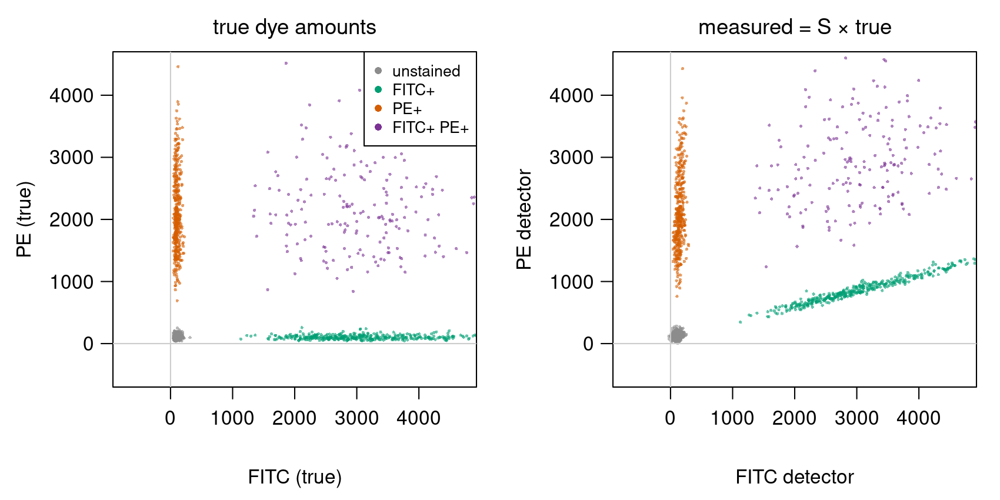
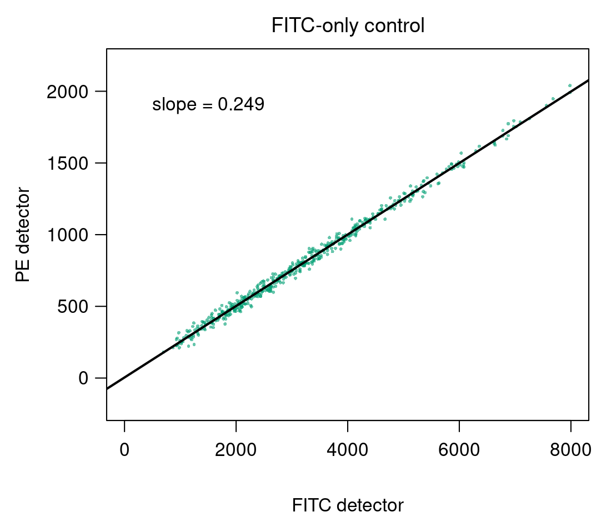
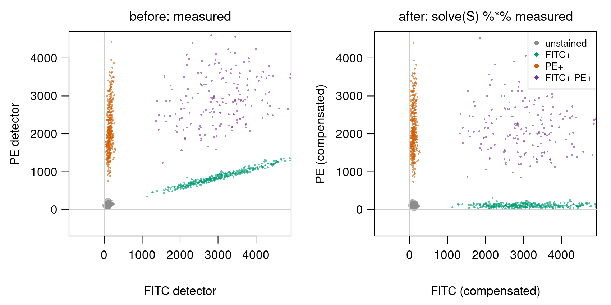
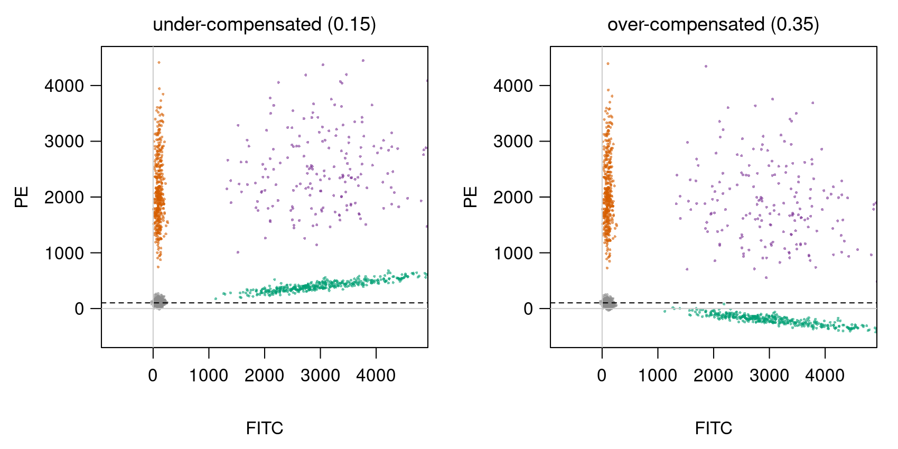
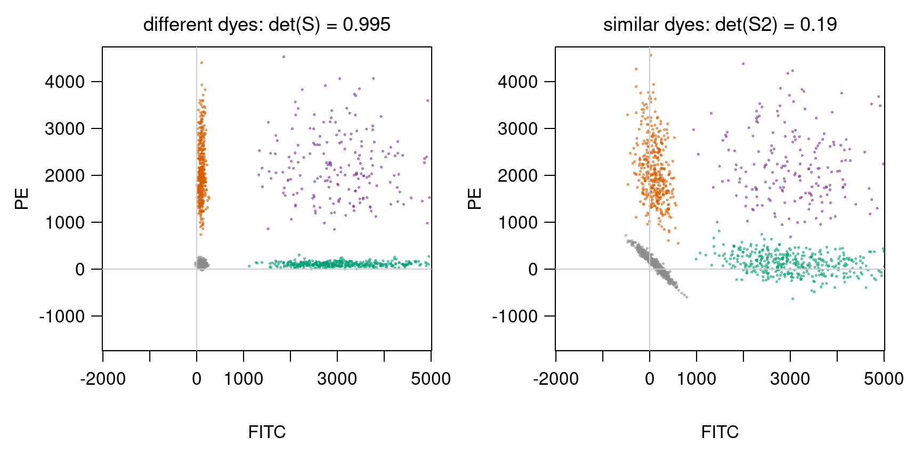

## Goal

By the end of this exercise you should be able to:

- write the spillover between fluorescent dyes as a $2 \times 2$ matrix $S$ and read its columns,
- estimate $S$ from single-stained controls with [`lm`](https://rdrr.io/r/stats/lm.html),
- compensate (unmix) measurements with [`solve`](https://rdrr.io/r/base/solve.html), and invert a $2 \times 2$ matrix by hand,
- recognise under- and over-compensation in a plot,
- explain, with the determinant, why dyes with similar spectra are hard to separate.

This builds on Matrices as transformations (columns are where the axes land) and Transforming images with matrices (undoing a known matrix with `solve`).

## Background

In a flow cytometer each detector collects one band of colours, but a dye's light also reaches the other detectors (**spillover**). With two dyes, FITC and PE, and two detectors:

$$\begin{pmatrix} \text{FITC detector} \\ \text{PE detector} \end{pmatrix} = S \begin{pmatrix} \text{FITC} \\ \text{PE} \end{pmatrix}, \qquad S = \begin{pmatrix} 1 & s_{12} \\ s_{21} & 1 \end{pmatrix}$$

Column $j$ of $S$ is where one unit of dye $j$'s light lands: $s_{21}$ is the fraction of FITC light seen by the PE detector, $s_{12}$ the fraction of PE light seen by the FITC detector. **Compensation** recovers the dye amounts with the inverse: true $= S^{-1}$ measured. For a $2 \times 2$ matrix,

$$\begin{pmatrix} a & b \\ c & d \end{pmatrix}^{-1} = \frac{1}{ad - bc}\begin{pmatrix} d & -b \\ -c & a \end{pmatrix}.$$

The number $ad - bc$ is the determinant $\det S$: near 0 means the columns are nearly parallel and the inverse has large entries. Bonus material: you do not need to memorise determinants for the exam.

**Spectral unmixing** is the same equation, with $S$ built from each dye's measured reference spectrum (one column per dye, one row per detector).

## By hand

Use $S = \begin{pmatrix} 1 & 0.1 \\ 0.2 & 1 \end{pmatrix}$ in B1–B3.

**B1.** What do the detectors measure for a cell with (FITC, PE) $= (2000, 0)$? For $(0, 1000)$? For $(2000, 1000)$? Which column of $S$ did you use for the first two?

**B2.** Compute $\det S$ and $S^{-1}$. Check that $S^{-1}S = I$.

**B3.** A cell is measured as $(2100, 1400)$. Compensate it by hand: how much FITC and PE does it carry? Is it double positive?

**B4.** Two dyes with similar spectra give $S_2 = \begin{pmatrix} 1 & 0.9 \\ 0.9 & 1 \end{pmatrix}$. Compute $\det S_2$ and $S_2^{-1}$. A cell measured as $(1000, 900)$ compensates to $(1000, 0)$. Now the PE detector reads 10 units too high, $(1000, 910)$: compensate again. How large is the error in each dye? Compare with the same 10-unit error under the $S$ of B1–B3.

## Explore {#explore}

The demo below simulates a **new sample** with the same four populations but an unknown spillover. Left: what the detectors measure. Right: the cells after compensation with your guess, $S^{-1} \times$ measured, where $S = \begin{pmatrix} 1 & s_{12} \\ s_{21} & 1 \end{pmatrix}$ is set with the sliders. The thick lines are least-squares lines through the FITC+ cells (green) and the PE+ cells (orange); the dashed lines are the medians of the unstained cells.

```{=html}
<link rel="stylesheet" href="../demos/dist/demo.css">
<div data-demo="compensation" data-s21="0.32" data-s12="0.08" data-seed="2"></div>
<script src="../demos/dist/compensation.js"></script>
```

**E1.** Click *No compensation*. Which population is tilted the most, and in which direction? Read off the slope of the green line: what does it tell you about $S$?

**E2.** Find $s_{21}$ and $s_{12}$ by making both single-positive populations lie flat, at the same level as the unstained cells. Then click *Reveal true S* to check.

**E3.** Set $s_{21} = 0.20$, then $0.45$ (keep your $s_{12}$). Describe the FITC+ population each time. Which of the two produces cells with negative PE, and why is that a sign of a mistake?

**E4.** With your answer from E2, multiply the $S^{-1}$ shown in the readout by $S$ (first row only, by hand). Do you get the first row of the identity?

::: {.callout-note collapse="true" title="Solutions"}

**E1.** The FITC+ population (green) tilts upwards: the brighter its FITC, the more false PE. Its slope is about $0.32$: without compensation the slope of a FITC-only population estimates $s_{21}$, as with the single-stained control in the lecture. The PE+ population (orange) leans slightly to the right, with slope about $0.08$: that estimates $s_{12}$.

**E2.** $s_{21} = 0.32$ and $s_{12} = 0.08$. At these values both lines are flat (slopes within about $\pm 0.01$ of 0), the FITC+ cells have median PE about 100, like the unstained cells, and the PE+ cells have median FITC about 100. One step (0.01) away the slope hardly changes, but the median moves by about 30, so the median is a sensitive check too.

**E3.** With $0.20$ (under-compensated) too little FITC light is subtracted from the PE detector: the FITC+ cells still tilt up, median PE about 480. With $0.45$ (over-compensated) too much is subtracted: they tilt down, median PE about −300, and almost all of them have negative PE. A cell cannot emit negative light, so a population pushed clearly below the unstained cells means the spillover was set too high.

**E4.** The readout shows $S^{-1} \approx \begin{pmatrix} 1.026 & -0.082 \\ -0.328 & 1.026 \end{pmatrix}$. First row times the columns of $S$: $1.026 \cdot 1 + (-0.082) \cdot 0.32 = 1.026 - 0.026 = 1.000$ and $1.026 \cdot 0.08 + (-0.082) \cdot 1 = 0.082 - 0.082 = 0$. So $(1, 0)$, the first row of $I$ (up to rounding).
:::

## In R

All data are simulated: four populations of cells, with one cell per **column** (as the pixels in Transforming images with matrices).

```r
set.seed(1)
make_pop <- function(n, fitc, pe) {               # true dye amounts, one cell per COLUMN
  rbind(FITC = rlnorm(n, log(fitc), 0.3), PE = rlnorm(n, log(pe), 0.3))
}
true <- cbind(make_pop(600,  100,  100),          # unstained
              make_pop(400, 3000,  100),          # FITC+
              make_pop(400,  100, 2000),          # PE+
              make_pop(200, 3000, 2000))          # FITC+ PE+
group <- rep(c("unstained", "FITC+", "PE+", "FITC+ PE+"), c(600, 400, 400, 200))

S <- matrix(c(1,    0.02,                         # rows = detectors, columns = dyes
              0.25, 1   ), nrow = 2, byrow = TRUE,
            dimnames = list(c("FITC det", "PE det"), c("FITC", "PE")))
noise <- function(n) matrix(rnorm(2 * n, 0, 30), nrow = 2)   # detector noise
measured <- S %*% true + noise(ncol(true))

cols <- c("unstained" = "grey55", "FITC+" = "#009E73", "PE+" = "#D55E00", "FITC+ PE+" = "#7B3294")
plot(t(measured), col = cols[group], pch = 16, cex = 0.4, asp = 1)
```

Run the tasks **in order**: each uses random numbers, so the numbers in the solutions match only if you do.

**R1.** Plot `true` and `measured` side by side, coloured by `group`. Which population moves most, and in which direction? Compute the median of each detector per population with `apply(measured, 1, function(v) tapply(v, group, median))`. How much PE signal does the FITC+ population seem to have?

**R2.** In practice $S$ is unknown. Simulate two single-stained controls and estimate it:
```r
ctrl_fitc <- S %*% rbind(FITC = rlnorm(500, log(3000), 0.5), PE = 0) + noise(500)
ctrl_pe   <- S %*% rbind(FITC = 0, PE = rlnorm(500, log(2000), 0.5)) + noise(500)
```
Use `lm` to estimate $s_{21}$ (PE detector against FITC detector in the FITC-only control) and $s_{12}$ (the other way round in the PE-only control). Build `S_hat` and compare it with `S`.

**R3.** Compensate with `comp <- solve(S_hat) %*% measured`. Plot before and after. Compute the population medians again: does the FITC+ population now have the same PE level as the unstained cells? Check that `solve(S_hat) %*% S_hat` is the identity.

**R4.** Compensate with a **wrong** spillover: $s_{21} = 0.15$ (too small), then $0.35$ (too large), keeping $s_{12}$ from R2. Plot both. What does the FITC+ population look like in each case, and how could you spot the mistake in real data, where you do not know the truth?

**R5.** Similar dyes. Simulate with $S_2 = \begin{pmatrix} 1 & 0.9 \\ 0.9 & 1 \end{pmatrix}$: `measured2 <- S2 %*% true + noise(ncol(true))`, compensate with `solve(S2)`, and plot. Compare the standard deviation of the unstained cells in `true`, in `comp` (R3) and in `comp2`. Relate the result to `det(S2)` and to your answer in B4.

**R6.** Spectral unmixing with four detectors. Each dye's reference spectrum is a column of the $4 \times 2$ matrix
```r
S4 <- cbind(FITC = c(1,    0.45, 0.10, 0.02),
            PE   = c(0.02, 0.30, 1,    0.40))
measured4 <- S4 %*% true + matrix(rnorm(4 * ncol(true), 0, 30), nrow = 4)
```
Why does `solve(S4)` fail? Unmix all cells at once with `qr.solve(S4, measured4)` (least squares) and compare the population medians with the truth.

## Hints

::: {.callout-tip collapse="true" title="Hint 1 — estimating a spillover coefficient"}
In the FITC-only control, every signal in the PE detector comes from FITC, so PE detector $\approx s_{21} \times$ FITC detector. `lm(ctrl_fitc[2, ] ~ ctrl_fitc[1, ])` fits that straight line; `coef(...)[2]` is the slope, i.e. $s_{21}$. Row 1 of a detector matrix is the FITC detector, row 2 the PE detector.
:::

::: {.callout-tip collapse="true" title="Hint 2 — spotting wrong compensation"}
Compare the PE level of the FITC+ cells with that of the unstained cells after compensation. If FITC carries no PE, the two should be the same, and the FITC+ population should lie flat (no tilt) however bright the FITC is.
:::

::: {.callout-tip collapse="true" title="Hint 3 — more detectors than dyes"}
`solve()` needs a square matrix: as many equations as unknowns. With 4 detectors and 2 dyes there are 4 equations for 2 unknowns per cell, and with noise they cannot all hold exactly. `qr.solve(A, B)` finds, for every column of `B`, the dye amounts whose predicted spectrum is closest to the measured one (least squares).
:::

## Solutions

::: {.callout-note collapse="true" title="Solution"}

**B1.** $S\binom{2000}{0} = \binom{2000}{400}$ (column 1 times 2000), $S\binom{0}{1000} = \binom{100}{1000}$ (column 2 times 1000), and $S\binom{2000}{1000} = \binom{2000 + 100}{400 + 1000} = \binom{2100}{1400}$, the sum of the two.

**B2.** $\det S = 1 \cdot 1 - 0.1 \cdot 0.2 = 0.98$ and
$$S^{-1} = \frac{1}{0.98}\begin{pmatrix} 1 & -0.1 \\ -0.2 & 1 \end{pmatrix} \approx \begin{pmatrix} 1.020 & -0.102 \\ -0.204 & 1.020 \end{pmatrix}.$$
Check, first entry: $\frac{1}{0.98}(1 \cdot 1 + (-0.1)(0.2)) = \frac{0.98}{0.98} = 1$; the others work the same way.

**B3.** $S^{-1}\binom{2100}{1400} = \frac{1}{0.98}\binom{2100 - 140}{-420 + 1400} = \frac{1}{0.98}\binom{1960}{980} = \binom{2000}{1000}$. The cell carries FITC 2000 and PE 1000: yes, double positive (it is the third cell of B1).

**B4.** $\det S_2 = 1 - 0.81 = 0.19$, $S_2^{-1} = \frac{1}{0.19}\begin{pmatrix} 1 & -0.9 \\ -0.9 & 1 \end{pmatrix} \approx \begin{pmatrix} 5.26 & -4.74 \\ -4.74 & 5.26 \end{pmatrix}$.
$S_2^{-1}\binom{1000}{910} = \frac{1}{0.19}\binom{1000 - 819}{-900 + 910} \approx \binom{953}{53}$. A 10-unit error in one detector became errors of about 47 and 53 in the dyes: the 10 is multiplied by the large entries of $S_2^{-1}$. Under the $S$ of B1–B3, $S^{-1}\binom{0}{10} = \frac{1}{0.98}\binom{-1}{10} \approx \binom{-1}{10.2}$: the error stays about 10. Similar spectra mean nearly parallel columns, a small determinant, and a large inverse that amplifies noise.

**R1.**

```r
par(mfrow = c(1, 2))
plot(t(true),     col = cols[group], pch = 16, cex = 0.4, asp = 1, main = "true")
plot(t(measured), col = cols[group], pch = 16, cex = 0.4, asp = 1, main = "measured")
round(apply(measured, 1, function(v) tapply(v, group, median)))
#           FITC det PE det
# FITC+         3007    850
# FITC+ PE+     3174   2901
# PE+            142   2014
# unstained      104    127
```

{width="90%" fig-align="center"}

The FITC+ population moves most: it is tilted upwards along the direction of column 1, $(1, 0.25)$, so the brighter a cell's FITC, the more false PE it shows. It seems to have a median PE of 850, although its true PE is about 100, like unstained cells. The PE+ population barely moves (2 % spillover back). The double-positive cells move up too.

**R2.**

```r
s21 <- coef(lm(ctrl_fitc[2, ] ~ ctrl_fitc[1, ]))[2]
s12 <- coef(lm(ctrl_pe[1, ] ~ ctrl_pe[2, ]))[2]
S_hat <- matrix(c(1,   s12,
                  s21, 1  ), nrow = 2, byrow = TRUE)
round(S_hat, 3)               # [1, 0.021; 0.249, 1]
```

{width="55%" fig-align="center"}

The estimates, 0.249 and 0.021, are close to the true 0.25 and 0.02. They are not exact because of the detector noise in the controls.

**R3.**

```r
comp <- solve(S_hat) %*% measured
par(mfrow = c(1, 2))
plot(t(measured), col = cols[group], pch = 16, cex = 0.4, asp = 1, main = "before")
plot(t(comp),     col = cols[group], pch = 16, cex = 0.4, asp = 1, main = "after")
round(apply(comp, 1, function(v) tapply(v, group, median)))
#           FITC   PE
# FITC+     3005  105
# FITC+ PE+ 3122 2063
# PE+         97 1989
# unstained  102  103
round(solve(S_hat) %*% S_hat, 10)     # the 2 x 2 identity
```

{width="90%" fig-align="center"}

After compensation the FITC+ population lies flat, with a median PE of 105, the same as the unstained cells (103). All four populations are aligned with the axes again.

**R4.**

```r
for (k in c(0.15, 0.35)) {
  Sk <- matrix(c(1, s12,
                 k, 1  ), nrow = 2, byrow = TRUE)
  ck <- solve(Sk) %*% measured
  plot(t(ck), col = cols[group], pch = 16, cex = 0.4, asp = 1, main = paste("s21 =", k))
  print(round(tapply(ck[2, ], group, median)))
}
```

{width="90%" fig-align="center"}

With 0.15 (**under**-compensated) too little is subtracted: the FITC+ population still tilts **up**, with a median PE of 407. With 0.35 (**over**-compensated) too much is subtracted: it tilts **down**, to a median PE of −194, below the unstained cells (negative light is impossible). Without knowing the truth, the tell-tale sign is a **tilt**: a single-positive population should be flat, at the same PE level as the unstained cells, whatever its FITC brightness. A population that rises or falls along FITC means the spillover is wrong.

**R5.**

```r
S2 <- matrix(c(1,   0.9,
               0.9, 1  ), nrow = 2, byrow = TRUE)
measured2 <- S2 %*% true + noise(ncol(true))
comp2 <- solve(S2) %*% measured2
plot(t(comp2), col = cols[group], pch = 16, cex = 0.4, asp = 1)
sd_un <- function(m) round(apply(m[, group == "unstained"], 1, sd))
sd_un(true); sd_un(comp); sd_un(comp2)   # 33 33; 45 45; 206 208
det(S2)                                  # 0.19
```

{width="90%" fig-align="center"}

The true spread of the unstained cells is 33; with well-separated dyes it is 45 after compensation (the detector noise of 30 adds to it). With similar dyes it is about 207: the populations smear out, and the unstained cells form a diagonal streak. The medians are still about right, but individual cells are not. As in B4, $\det(S_2) = 0.19$ makes the inverse large (entries around 5), and the inverse multiplies the detector noise as well as the signal.

**R6.** `solve(S4)` fails because `S4` is $4 \times 2$, not square: it has no inverse.

```r
unmixed <- qr.solve(S4, measured4)       # 2 x 1600: one column per cell
round(apply(unmixed, 1, function(v) tapply(v, group, median)))
#           FITC   PE
# FITC+     3009  100
# FITC+ PE+ 3113 2071
# PE+        104 1996
# unstained   99   99
```
The medians match the true populations (FITC about 3000 or 100, PE about 2000 or 100). Each cell's four detector values are explained as well as possible by a mix of the two reference spectra. Using four detectors instead of two also averages out some of the noise.
:::

## Where this leads

- **Linear systems:** compensation is solving $S\mathbf{x} = \mathbf{b}$ for every cell; a singular $S$ (identical spectra) has no unique solution.
- **Least squares and regression:** R6 is the same least squares used to fit regression models later in the course; with many detectors, spectral cytometers unmix 20 or more dyes this way.
- **Eigenvalues & eigenvectors:** how much a matrix can stretch noise is measured more precisely by its eigenvalues (for symmetric $S_2$: 1.9 and 0.1; the inverse stretches by $1/0.1 = 10$).
- **Real data:** the Bioconductor package [flowCore](https://bioconductor.org/packages/flowCore/) reads cytometry files (`read.FCS`), estimates spillover (`spillover`) and compensates (`compensate`); `data(GvHD)` is an example data set shipped with it.
