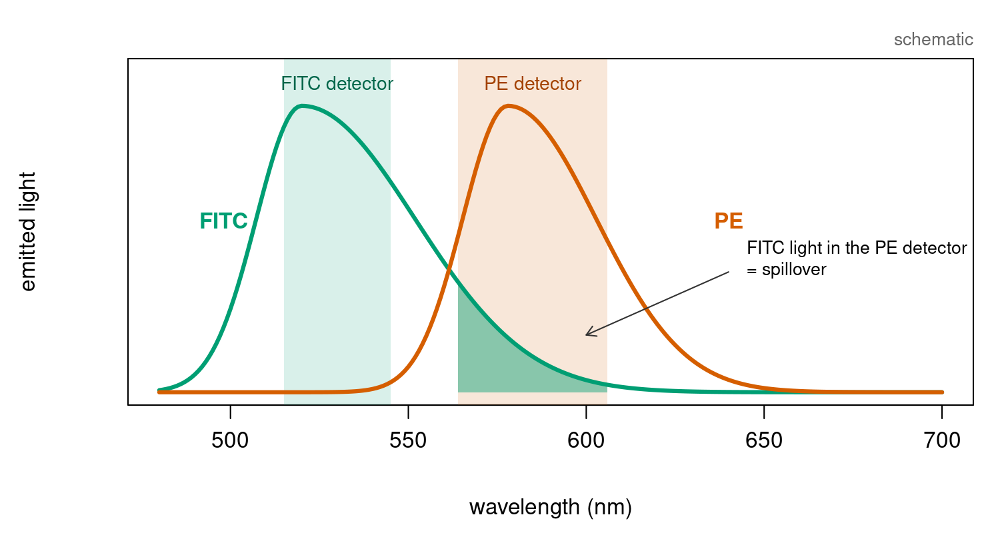

## About this lecture

A flow cytometer measures thousands of cells per second, each stained with several fluorescent dyes. The detectors do not see one dye each: the colours **leak into each other's detectors**.

- The leak is a **2 × 2 matrix** $S$: measured = $S$ × true.
- **Compensation** undoes it with the inverse, `solve(S)`, just like undoing a misaligned image.
- **Spectral unmixing** is the same equation, with $S$ built from reference spectra.
- When two dyes look too alike, $\det(S)$ is close to 0, and unmixing **amplifies noise**.

All data today are simulated in base R; no packages needed.

::: notes
This unit is a second biological use of "undo a known matrix with its inverse", after the misalignment slide in Transforming images with matrices. It needs only matrix-vector products, solve(), and the idea that the columns of a matrix are where the axes land. Flow cytometry is used in immunology and haematology every day (immunophenotyping, sorting); compensation is a step every user meets.
:::

## Biology: two dyes, two detectors {.smaller}

{width="78%" fig-align="center"}

- Cells are labelled with antibodies carrying dyes, e.g. **FITC** (green) and **PE** (orange). Each dye marks one protein.
- Each detector collects one band of colours. But FITC's emission has a long tail that reaches the **PE detector**.
- A cell with only FITC therefore shows a **false PE signal**: this is **spillover**.

::: notes
Emission spectra are broad, so filters cannot fully separate them. FITC into the PE detector is the classic case, typically around 10 to 30 percent depending on the instrument; PE leaks only slightly back into the FITC detector. The curves here are schematic shapes, not measured spectra. Without correction, FITC-positive cells look partly PE-positive, and a researcher would report a double-positive population that does not exist.
:::

## The spillover matrix {.smaller}

Each detector sees a **mix** of the two dyes:

$$\underbrace{\begin{pmatrix} \text{FITC detector} \\ \text{PE detector} \end{pmatrix}}_{\text{measured}} = \underbrace{\begin{pmatrix} 1 & 0.02 \\ 0.25 & 1 \end{pmatrix}}_{S} \underbrace{\begin{pmatrix} \text{FITC} \\ \text{PE} \end{pmatrix}}_{\text{true}}$$

- **Column 1** = where FITC's light lands: all in the FITC detector, plus 25 % of that in the PE detector.
- **Column 2** = where PE's light lands: 2 % in the FITC detector.
- By hand: a cell with FITC = 1000, PE = 0 is **measured** as $(1000,\ 250)$. A cell with PE = 1000 only: $(20,\ 1000)$.

```r
S <- matrix(c(1,    0.02,                         # rows = detectors, columns = dyes
              0.25, 1   ), nrow = 2, byrow = TRUE,
            dimnames = list(c("FITC det", "PE det"), c("FITC", "PE")))
S %*% c(1000, 0)                                  # 1000, 250
```

::: notes
Same reading as in Matrices as transformations: the columns of a matrix are where the axes land. Here the "axes" are the pure dyes: one unit of pure FITC lands at column 1, one unit of pure PE at column 2. Each column is scaled so that the dye's own (main) detector is 1. Each row is one detector, adding up its share of every dye. This is a linear model: double the dye, double every detector signal.
:::

## Before: what the cytometer records {.smaller}

Four simulated populations, 1600 cells, one cell per **column** (like the pixels in Transforming images with matrices):

```r
set.seed(1)
make_pop <- function(n, fitc, pe) {               # true dye amounts, one cell per COLUMN
  rbind(FITC = rlnorm(n, log(fitc), 0.3), PE = rlnorm(n, log(pe), 0.3))
}
true <- cbind(make_pop(600,  100,  100),          # unstained
              make_pop(400, 3000,  100),          # FITC+
              make_pop(400,  100, 2000),          # PE+
              make_pop(200, 3000, 2000))          # FITC+ PE+
group <- rep(c("unstained", "FITC+", "PE+", "FITC+ PE+"), c(600, 400, 400, 200))
noise <- function(n) matrix(rnorm(2 * n, 0, 30), nrow = 2)   # detector noise
measured <- S %*% true + noise(ncol(true))
```

{width="62%" fig-align="center"}

::: notes
One %*% applies the spillover to all 1600 cells. The FITC+ population (green) should lie flat along the x-axis, but in the measured data it is tilted: the brighter the FITC, the more false PE. That tilt has slope 0.25, column 1 of S. The PE+ population hardly moves, because PE leaks only 2 percent back. Real cytometry data are usually shown on log-like axes; we use linear axes so the matrix action is a straight-line tilt.
:::

## Estimating the spillover from a control {.smaller}

:::: {.columns}
::: {.column width="52%"}
How do we know the 0.25? Run a **single-stained control**: cells (or beads) carrying **only FITC**. Every PE-detector signal is then spillover.

```r
ctrl <- S %*% rbind(FITC = rlnorm(500, log(3000), 0.5), PE = 0) +
        noise(500)
fit <- lm(ctrl[2, ] ~ ctrl[1, ])                  # PE detector vs FITC detector
coef(fit)[2]                                      # slope 0.249: about 0.25
```

- The slope is the spillover coefficient: column 1 of $S$, measured.
- A PE-only control gives column 2 the same way.
:::
::: {.column width="48%"}
{width="100%"}
:::
::::

::: notes
This is how instruments and software build S in practice: one single-stained control per dye, and a regression (or a ratio of medians) between the dye's own detector and every other detector. In real life we do not know the true S; the slope recovers 0.249, close to the 0.25 used in the simulation. A control that is too dim gives a poor estimate, which is why controls should be at least as bright as the samples.
:::

## Compensation: undo the matrix {.smaller}

If measured $= S\,\text{true}$, then true $= S^{-1}\,\text{measured}$: the same `solve()` as in Linear systems in R.

```r
solve(S)                          # [1.005 -0.020; -0.251 1.005]
comp <- solve(S) %*% measured     # compensated: one %*% for all cells
```

{width="80%" fig-align="center"}

The FITC+ cells: median PE **850** before, **102** after (unstained cells: about 100).

::: notes
Compensation literally means multiplying by the inverse of the spillover matrix. Its off-diagonal entries are negative: subtract 25 percent of the FITC detector from the PE detector (and a little the other way). After compensation every population is aligned with the axes, and the FITC+ population has the same PE level as unstained cells, as it should. The double-positive population (purple) moves down too: its true PE was 2000, but it was measured at about 2750 because of its FITC. Compare with the image misalignment in Transforming images with matrices: there solve(A) put every pixel back; here solve(S) puts every cell back.
:::

## Try it: guess the spillover {.smaller}

```{=html}
<link rel="stylesheet" href="../demos/dist/demo.css">
<div data-demo="compensation" data-s21="0.25" data-s12="0.02"></div>
<script src="../demos/dist/compensation.js"></script>
```

::: notes
Same simulated cells as on the previous slides (true spillover 0.25 and 0.02). Left: what the cytometer records. Right: the cells after multiplying by the inverse of the spillover we guess with the sliders. Start at "No compensation": both plots are the same and the green FITC+ population tilts up, slope about 0.25. Drag s21 slowly up and ask the class when to stop: the dark green line through the FITC+ cells flattens, and its median PE comes down to that of the unstained cells (dashed line). Go past it, to "Over": the line tilts down and FITC+ cells get negative PE, which no real cell can have. The orange PE+ population only tilts slightly, so s12 is small; set it the same way. Point out the readout: S has the guesses off the diagonal, and its inverse has negative entries of about the same size, the "subtract 25 percent" of the previous slide. "Reveal true S" shows the values used to simulate. In real data the truth is unknown; the flat single-positive population is the check.
:::

## Why it works: columns and the inverse {.smaller}

- $S^{-1}S = I$: undoing after doing changes nothing. Check: `solve(S) %*% S` is the identity.
- In pictures: $S$ **tilts** the FITC axis (column 1 points along $(1, 0.25)$); $S^{-1}$ tilts it back to $(1, 0)$.
- For a 2 × 2 matrix the inverse has a formula:

$$\begin{pmatrix} a & b \\ c & d \end{pmatrix}^{-1} = \frac{1}{ad - bc}\begin{pmatrix} d & -b \\ -c & a \end{pmatrix}, \qquad \det S = 1 \cdot 1 - 0.02 \cdot 0.25 = 0.995$$

- Noise is not removed: compensated values still carry the detector noise, mixed through $S^{-1}$. Here that costs little (unstained cells: sd 45 after compensation, 33 in the true amounts, the rest is detector noise). Next slide: when it costs a lot.

::: notes
The 2 x 2 inverse formula is worth knowing by heart: swap the diagonal, negate the off-diagonal, divide by the determinant. With det close to 1 (dyes well separated) the inverse is close to the identity with small corrections. The last bullet sets up the problem slide: the inverse also acts on the noise. With det(S) near 1 the inverse barely changes the noise, so the compensated spread (sd 45) is just the true spread (33) plus detector noise (30).
:::

## Spectral unmixing: the same equation {.smaller}

A **spectral cytometer** records each cell's light in many detectors (often 30 or more). Each dye has a **reference spectrum**: how its light spreads over the detectors, measured from a single-stained control.

- Put the reference spectra as **columns** of $S$: measured = $S$ × true, exactly as before.
- With 2 dyes and 2 detectors, $S$ is square, and unmixing **is** compensation: `solve(S)`.
- With more detectors than dyes, $S$ is **tall**. No inverse exists, but least squares finds the best fit:

```r
S4 <- cbind(FITC = c(1,    0.45, 0.10, 0.02),     # reference spectra over 4 detectors
            PE   = c(0.02, 0.30, 1,    0.40))
cell <- S4 %*% c(3000, 2000)                      # one FITC+ PE+ cell, no noise
qr.solve(S4, cell)                                # least squares: 3000, 2000
```

::: notes
Preview only. Spectral unmixing is the modern version: instead of one filter per dye, the full emission spectrum is recorded, and every cell is written as a combination of the reference spectra (columns). Extra detectors give more equations than unknowns; qr.solve (or lm without intercept) finds the dye amounts that best explain the measured spectrum. This is the same least squares as regression in the Bayesian and penalized blocks. Autofluorescence can be added as one more column, an extra "dye".
:::

## When unmixing fails: similar dyes {.smaller}

If two dyes have **similar** spectra, the columns of $S$ point almost the same way and $\det(S)$ is near 0:

```r
S2 <- matrix(c(1,   0.9,
               0.9, 1  ), nrow = 2, byrow = TRUE)  # det(S2) = 0.19
solve(S2)                                          # [5.26 -4.74; -4.74 5.26]: large entries
comp2 <- solve(S2) %*% (S2 %*% true + noise(ncol(true)))
```

{width="72%" fig-align="center"}

The inverse multiplies the noise by about 5: unstained cells spread from sd 45 to **209**, and populations smear.

[Bonus material: you do not need to memorise determinants for the exam.]{style="font-size: 0.7em; color: #bc4749;"}

::: notes
This is the panel-design rule of thumb in flow cytometry, explained with linear algebra: avoid pairs of dyes with overlapping spectra on the same cells, or at least on markers that are co-expressed. Geometrically, the two columns of S2 are almost parallel, so the parallelogram they span is thin (small determinant), and the inverse has to stretch a lot to undo it. The singular case (det = 0, identical spectra) cannot be undone at all, as in the gallery of Transforming images with matrices. The true values are still recovered on average; it is the spread that grows.
:::

## Real data in R (optional) {.smaller}

For those who want to try real cytometry files:

- Bioconductor package [**flowCore**](https://bioconductor.org/packages/flowCore/): `read.FCS()` reads a measurement file, `exprs()` gives the cells × channels matrix.
- `spillover()` estimates $S$ from single-stained controls; `compensate()` applies $S^{-1}$ to every cell, exactly our `solve(S) %*% measured`.
- Example data: `data(GvHD)` in flowCore, an extract of a graft-versus-host disease monitoring experiment. Many public experiments are in [FlowRepository](https://flowrepository.org).

```r
# install.packages("BiocManager"); BiocManager::install("flowCore")   # optional
library(flowCore)
data(GvHD)
head(exprs(GvHD[[1]]))            # one sample: cells as ROWS, channels as columns
```

::: notes
Not required for the exercises. Note that flowCore stores cells as rows (the usual data-frame layout), so in real code the multiplication is measured %*% solve(t(S)) or similar; compensate() handles that for you. FCS files usually carry the instrument's own spillover matrix in their metadata (keyword SPILL or $SPILLOVER), which is what compensate() typically uses.
:::

## Summary {.smaller}

| Concept | Key fact | R |
|---|---|---|
| Spillover | measured = $S$ × true; column $j$ = where dye $j$'s light lands | `S %*% true` |
| Estimating $S$ | single-stained control: slope of other detector vs own detector | `lm(ctrl[2, ] ~ ctrl[1, ])` |
| Compensation | true = $S^{-1}$ × measured | `solve(S) %*% measured` |
| 2 × 2 inverse | swap diagonal, negate off-diagonal, divide by $\det$ | `solve(S)` |
| Spectral unmixing | reference spectra as columns; tall $S$ → least squares | `qr.solve(S4, cell)` |
| Similar dyes | $\det(S) \approx 0$ → large inverse → noise amplified | `det(S2)` |

**Next (Eigenvalues & eigenvectors):** directions that a matrix only *scales*.

::: notes
The one-line takeaway: if a measurement mixes signals linearly, and you know the mixing matrix, its inverse unmixes them; how well depends on how different the columns are (the determinant). The same idea returns in spectroscopy (Chemometrics), in mixed cell-type signals (deconvolution of bulk RNA-seq), and in Fourier and PCA, where a change of basis separates signals.
:::
