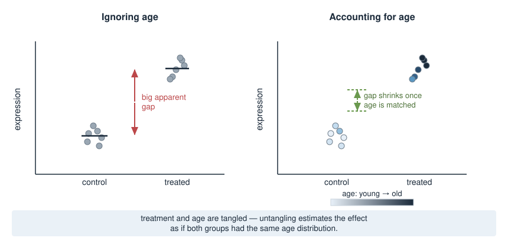
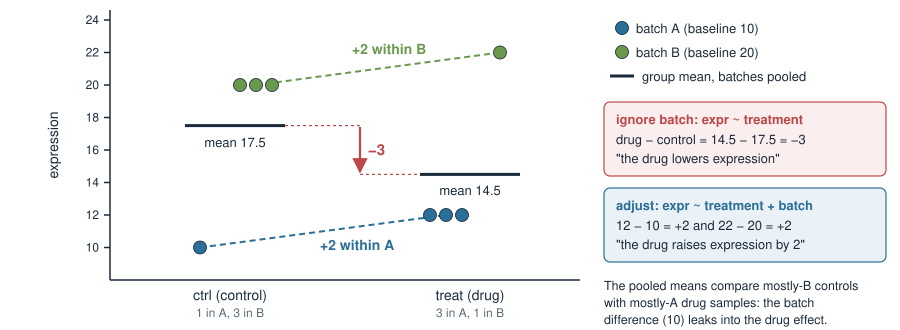
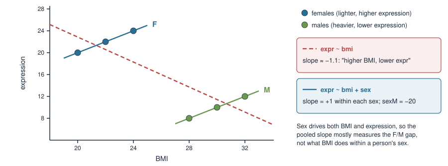
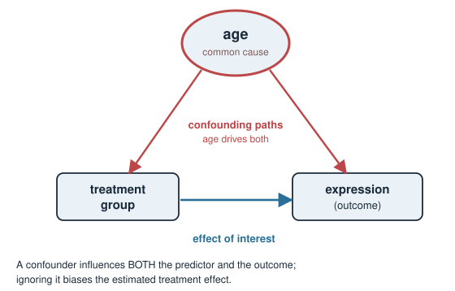
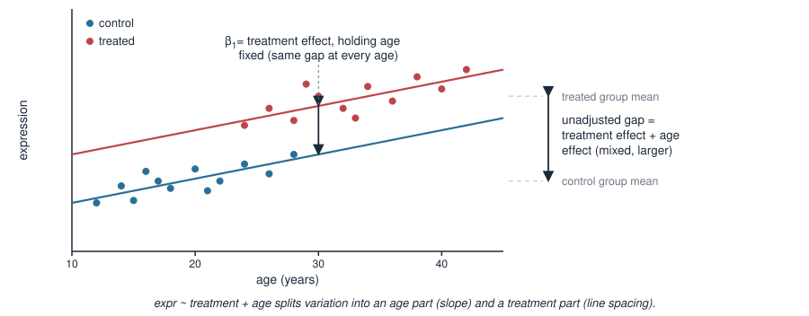
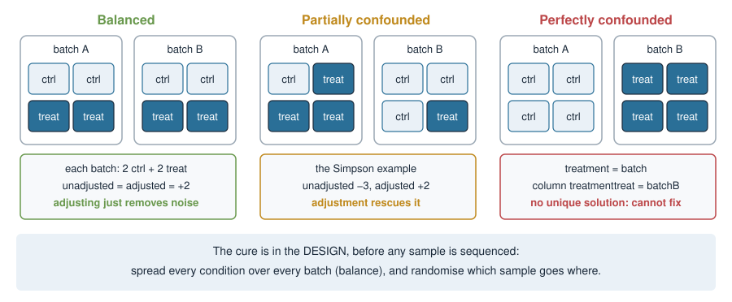
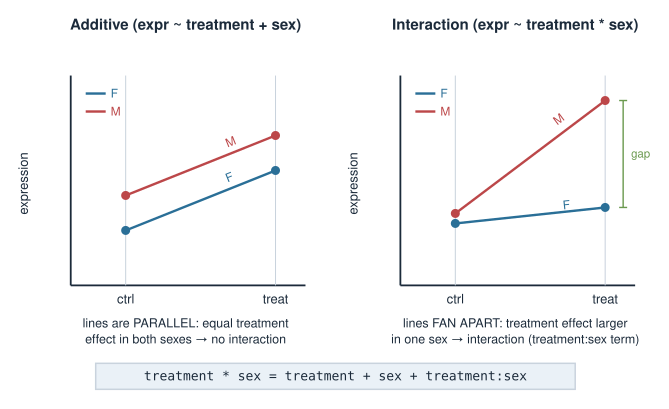
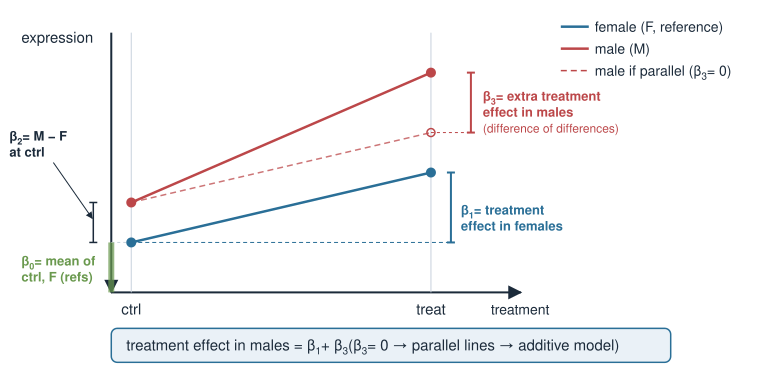
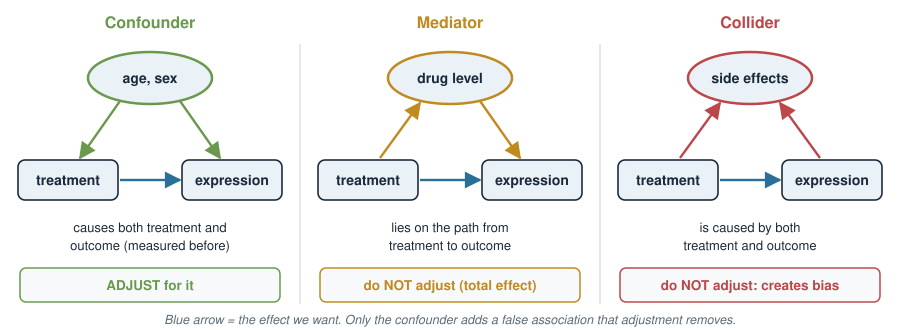
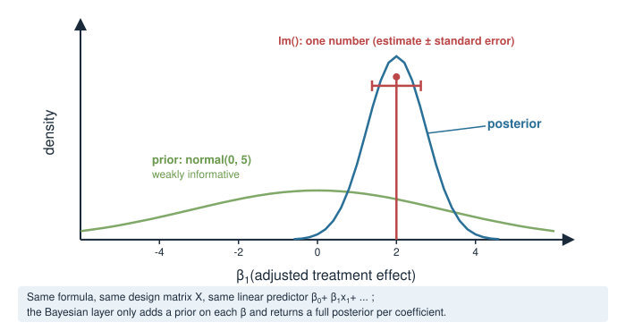

## About this lecture

In [Design matrices for covariates](../covariates/lec.qmd) you learned how a formula becomes a design matrix $X$, and that $\boldsymbol\beta$ has no unique solution when two columns of $X$ are identical. Today we ask **which columns to put in**, and what happens to the effect you care about when you leave one out.

- **Simpson's paradox**: a drug that *lowers* expression overall but *raises* it in every batch. Worked by hand.
- **Confounders**, and what **adjustment** ("holding the others constant") does.
- **Partial vs perfect confounding**, and why the cure for the perfect case is the **experimental design**.
- Covariates you will meet: **age, sex, BMI, batch, time**.
- **Interactions**: when the effect itself differs between groups.
- **What not to adjust for**: mediators, colliders, collinear pairs.

::: notes
Position this deck right after the design-matrix deck. Students already know how to build X by hand, how to read a main-effect coefficient as a difference from the reference, and that identical columns give infinitely many solutions. Today is about the consequences of choosing the columns. The headline is Simpson's paradox with real (tiny) numbers that they will reproduce by hand in the exercise. Everything here is plain linear-model machinery; the Bayesian connection is one slide at the end.
:::

## A biology picture first {.smaller}

You run an RNA-seq experiment: **treated** vs **control** mice, measuring one gene. Treated mice show **higher** expression. Success?

- But the treated mice were, by accident, mostly **old**, and the controls mostly **young**.
- This gene also rises naturally with **age**.
- So is the difference due to the **treatment**, or due to **age**?

With the data as they are you **cannot tell by eye** — treatment and age are tangled. A model with age in it can **untangle** them: estimate the treatment effect *as if both groups had the same age*.

{width="72%" fig-align="center"}

::: notes
Plant the tangle. One gene, two groups, an accidental age imbalance. The naive comparison (mean treated minus mean control) mixes a treatment effect with an age effect, because age differs between the groups. Do not yet say confounder; just set up the question. In this picture the tangle only inflates the effect. Next we see a case where it flips the sign.
:::

## Simpson's paradox: the data {.smaller}

One gene, **drug vs control**, 8 samples sequenced in **two batches**. Batch B reads 10 units higher than batch A for every sample (a batch effect).

:::: {.columns}
::: {.column width="45%"}
| sample | treatment | batch | expr |
|:--:|:--:|:--:|:--:|
| 1 | ctrl  | A | 10 |
| 2 | ctrl  | B | 20 |
| 3 | ctrl  | B | 20 |
| 4 | ctrl  | B | 20 |
| 5 | treat | A | 12 |
| 6 | treat | A | 12 |
| 7 | treat | A | 12 |
| 8 | treat | B | 22 |
:::
::: {.column width="55%"}
**Ignore batch** — compare the group means:

$$
\bar y_\text{ctrl} = \frac{10+20+20+20}{4} = 17.5,\qquad
\bar y_\text{treat} = \frac{12+12+12+22}{4} = 14.5
$$

$$
\text{treat} - \text{ctrl} = -3 \quad\text{(the drug lowers expression?)}
$$

**Within each batch:**

$$
\text{batch A: } 12 - 10 = +2,\qquad \text{batch B: } 22 - 20 = +2
$$

The drug **raises** expression by 2 in **every** batch, yet the overall comparison says it **lowers** it.
:::
::::

::: notes
This is the canonical example of the unit; the numbers are deliberately clean so students can do every step by hand. Walk through the arithmetic slowly. The point of the paradox is that both computations are correct arithmetic. The unbalanced layout (controls mostly in B, treated mostly in A) is what makes them disagree. Ask the room before showing the within-batch line: which answer do you believe?
:::

## Simpson's paradox: the picture {.smaller}

{width="92%" fig-align="center"}

The controls sit mostly in the **high** batch (B), the drug samples mostly in the **low** batch (A). The group means compare *batches* as much as they compare *treatments*.

::: notes
Point at the dashed within-batch lines: both rise by 2. Then point at the black pooled means: they fall by 3. The batch difference of 10 is the culprit; because the two groups have very different batch compositions, part of that 10 is credited to the drug. Ask: if the batches had been balanced (2 and 2), what would the pooled comparison give? Answer: +2, which we show later.
:::

## The same thing as a linear model {.smaller}

```r
lm(expr ~ treatment)            # ignore batch
# (Intercept) treatmenttreat
#        17.5           -3.0

lm(expr ~ treatment + batch)    # adjust for batch
# (Intercept) treatmenttreat         batchB
#          10              2             10
```

Read the adjusted fit like any design-matrix model, $\hat y = \beta_0 + \beta_1\,\text{treat} + \beta_2\,\text{B}$:

| group | $\hat y$ | data |
|---|---|---|
| ctrl, batch A | $\beta_0 = 10$ | 10 |
| treat, batch A | $\beta_0 + \beta_1 = 12$ | 12 |
| ctrl, batch B | $\beta_0 + \beta_2 = 20$ | 20 |
| treat, batch B | $\beta_0 + \beta_1 + \beta_2 = 22$ | 22 |

`treatmenttreat` $= 2$ is the drug effect **within a batch**; `batchB` $= 10$ is the batch effect **within a treatment group**.

::: notes
These outputs are real (R 4.x, the 8-sample table). With no noise the adjusted model fits every sample exactly, which makes the reading easy: compute X beta for each of the four cells and compare with the data. The unadjusted intercept 17.5 is the control mean and the unadjusted slope -3 is the difference of means: the dummy-coding rules from the previous unit, nothing new. The new thing is that adding a column changed the treatment coefficient from -3 to +2.
:::

## Why the sign flips: weighted averages

Each group mean is a **weighted average of its batches**, with weights = the share of the group in each batch:

$$
\bar y_\text{ctrl} = \tfrac14\cdot 10 + \tfrac34\cdot 20 = 17.5, \qquad
\bar y_\text{treat} = \tfrac34\cdot 12 + \tfrac14\cdot 22 = 14.5
$$

So the unadjusted difference splits into two parts:

$$
\underbrace{-3}_{\text{unadjusted}} \;=\; \underbrace{2}_{\text{drug effect}} \;+\; \underbrace{10}_{\text{batch effect}} \times \underbrace{\left(\tfrac14 - \tfrac34\right)}_{\substack{\text{share in B: treated}\\ \text{minus controls}}} \;=\; 2 - 5
$$

- **Bias = (effect of the confounder on the outcome) × (how unequal it is between groups).**
- Either factor zero → no bias: a batch with no effect, or a batch that is **balanced** across groups.

::: notes
This decomposition is exact for an additive model with no noise, and it is the most useful by-hand tool in the unit: students can predict the unadjusted answer from the adjusted coefficients and the table of counts. It also tells you the two ways out: the confounder does not affect the outcome, or it is equally distributed in both groups. Randomisation and balancing aim at the second. Students may check: if batch effect were 10 and both groups were 50 percent B, the bias term vanishes.
:::

## Not wrong arithmetic — a different question

Both numbers are **correct**. They answer **different questions**:

| model | question it answers | answer |
|---|---|---|
| `expr ~ treatment` | How do the drug samples **in this dataset** compare with the controls **in this dataset**? | $-3$ |
| `expr ~ treatment + batch` | **Within the same batch**, how much does the drug change expression? | $+2$ |

- The first mixes the drug with *who ended up in which batch* — an accident of the lab schedule.
- The second is the **biological** question we usually mean by "the drug effect".
- Neither model is "the truth" by itself: you pick the question, and the question picks the columns of $X$.

::: notes
This is the message the teacher wants made explicit. The unadjusted model is not a calculation error; it is a valid summary of a confounded sample. The danger is reading it as a causal drug effect. Sometimes the marginal comparison is actually what you want (e.g. a description of two populations as they are), but in a designed experiment the conditional, within-batch effect is the scientific target. Drill the phrase "the question picks the columns".
:::

## A continuous Simpson's paradox {.smaller}

Same story with a **continuous** covariate. Expression vs **BMI** in six people:

{width="88%" fig-align="center"}

```r
lm(expr ~ bmi)          # bmi -1.14   "higher BMI, lower expression"
lm(expr ~ bmi + sex)    # bmi  1.00, sexM -20   "+1 per BMI unit, within each sex"
```

::: notes
Data: females BMI 20, 22, 24 with expression 20, 22, 24; males BMI 28, 30, 32 with expression 8, 10, 12. Within each sex expression rises 1 per BMI unit; overall the trend is negative (slope -8/7, about -1.14) because males are both heavier and lower-expressing. Adding sex as a column gives two parallel lines with common slope +1 and a vertical offset sexM = -20. Students can read the adjusted slope off the plot by hand. The same can happen with age (old animals in one cohort) or with batch as the grouping.
:::

## Confounders {.smaller}

:::: {.columns}
::: {.column width="52%"}
A **confounder** is a variable that influences **both** the predictor of interest **and** the outcome — and is *not* itself caused by the predictor.

- Batch in the Simpson example: the lab schedule put controls in B, and B reads higher.
- Sex in the BMI example: sex affects BMI and expression.
- Age in the mouse example.

Leave a confounder out of $X$ and the coefficient you report is **biased**: it carries part of the confounder's effect (the "bias = effect × imbalance" term).
:::
::: {.column width="48%"}
{width="100%"}
:::
::::

::: notes
Define precisely: associated with exposure and outcome, and not on the causal path from exposure to outcome. The diagram is a DAG (directed acyclic graph); students do not need the formal theory, only the picture: arrows mean "causes". Two arrows out of the same node into treatment and outcome are the signature of confounding. Point out that in a randomised experiment the arrow into treatment is cut by design, which is why randomisation works.
:::

## Adjustment: "holding the others constant" {.smaller}

Adding a covariate gives it its own column in $X$ and its own coefficient. The treatment coefficient then answers:

> How much does treatment change expression **among samples with the same value of the covariate**?

{width="78%" fig-align="center"}

`expr ~ treatment + age` fits **two parallel lines**: the shared slope is the age effect, the **constant gap** between them is the treatment effect at any fixed age.

::: notes
Geometric reading of adjustment. Each group gets its own line, the lines share a slope (age effect, estimated from within-group variation), and the vertical distance between them is beta_1. The unadjusted gap between raw group means is larger because the treated animals are older; part of that gap is the age slope times the age difference. Same decomposition as the weighted-average slide, now with a continuous covariate.
:::

## Interpreting adjusted effects {.smaller}

In `expr ~ treatment + age` with fitted coefficients

$$
\hat{y} = \underbrace{\beta_0}_{\text{ctrl, age }0} + \underbrace{\beta_1}_{\text{treat vs ctrl}}\cdot\text{treat} + \underbrace{\beta_2}_{\text{per year}}\cdot\text{age}
$$

- $\beta_1$ — treatment effect **at any fixed age** (the model assumes it is the **same** at every age — the *no-interaction* assumption).
- $\beta_2$ — age effect **within each treatment group**.

Every coefficient in a multi-predictor model is read **"holding the other predictors constant."** That single phrase is the whole skill of interpreting adjusted models.

Example: $\beta_0 = 5$, $\beta_1 = 3$, $\beta_2 = 0.1$. A treated mouse aged 30: $\hat y = 5 + 3 + 0.1\cdot 30 = 11$; an untreated mouse of the same age: $8$. Difference $= \beta_1 = 3$, at every age.

::: notes
Hammer "holding the others constant" — it is the exam-worthy sentence. The hidden assumption in the additive model is that beta_1 is a single treatment effect, identical at every age, and beta_2 a single age slope, identical in both groups. That is what interactions relax, later in the deck. The worked numbers show why beta_1 is the difference at any fixed age: the age term cancels.
:::

## Covariates you will adjust for {.smaller}

| covariate | type → columns of $X$ | how it can confound |
|---|---|---|
| **age** | continuous → `age` (one slope) | treated animals older; many genes drift with age |
| **sex** | factor F/M → `sexM` | more males in one arm; sex-linked and hormone-driven genes |
| **BMI** | continuous → `bmi` | cases heavier than controls; metabolic and inflammation genes |
| **batch** | factor A/B/C → `batchB`, `batchC` | conditions processed on different days, lanes or kits |
| **time** | factor `0h`/`6h`/`24h` → `time6h`, `time24h` (or a slope) | one arm sampled later, stored longer, or at another time of day |

Rule of thumb: **adjust for a variable that (1) plausibly affects the outcome and (2) is unequal between the groups you compare**, and that is measured **before** (or independently of) the treatment.

Even when it is balanced, adjusting for a strong batch or sex effect removes noise and sharpens the treatment estimate.

::: notes
These are the covariates students meet in real omics tables. Remind them of column naming from the previous unit (F is the reference for sex, A for batch, 0h for time, which must be set with factor levels because R's alphabetical order would put 0h, 24h, 6h). The rule of thumb is the practical version of the confounder definition: an effect on the outcome times an imbalance between groups is exactly the bias term. The "measured before" clause guards against mediators and colliders, which come later. Also mention RIN and sequencing depth as omics-specific technical covariates.
:::

## Partial vs perfect confounding {.smaller}

{width="92%" fig-align="center"}

- **Partial** confounding (Simpson): the groups are *unequally* spread over batches, but every treatment–batch combination is present. The columns `treatmenttreat` and `batchB` differ, so $\boldsymbol\beta$ is unique and **adjustment works**.
- **Perfect** confounding: every control in A, every treated sample in B. Now treatment and batch carry **exactly the same information**.

::: notes
Contrast the three layouts. Balanced: no bias even without adjustment. Partial: the Simpson case, biased if you ignore batch, rescued by adjusting. Perfect: nothing can be done after the fact. Students should be able to look at a two-way count table (treatment by batch) and say which case they are in: a zero cell in a 2 by 2 table with all samples on the diagonal means perfect confounding.
:::

## Perfect confounding = no unique solution {.smaller}

All 4 controls in batch A (expr 10), all 4 treated in batch B (expr 22):

$$
X = \begin{pmatrix}
1 & 0 & 0\\ 1 & 0 & 0\\ 1 & 0 & 0\\ 1 & 0 & 0\\
1 & 1 & 1\\ 1 & 1 & 1\\ 1 & 1 & 1\\ 1 & 1 & 1
\end{pmatrix}
\quad
\begin{array}{l}
\text{col 2: treatmenttreat}\\ \text{col 3: batchB}\\ \text{identical columns}
\end{array}
$$

The data only fix $\beta_1 + \beta_2 = 12$. Drug 2 + batch 10, drug 12 + batch 0, drug −3 + batch 15 … all fit equally well: **infinitely many solutions** ([Solving systems in R](../solving-systems-r/lec.qmd), case 3).

```r
coef(lm(expr ~ treatment + batch, data = p))
#    (Intercept) treatmenttreat         batchB
#             10             12             NA
qr(model.matrix(~ treatment + batch, data = p))$rank   # 2, not 3
```

`lm` reports `NA` and silently gives the whole 12 to treatment; DESeq2 refuses with "model matrix is not full rank" ([Design matrices in R](../covariates-r/lec.qmd)).

::: notes
This is the link back to existence of solutions. Two identical columns mean X has rank 2 with 3 columns, so beta is not unique. lm drops the later column (batchB -> NA) and the treatmenttreat coefficient becomes "treatment plus batch", which is meaningless as a drug effect. No statistics can fix this after the fact: the information is not in the data. Contrast with the partial case, where the columns differ in two samples and that is enough.
:::

## The cure is in the design {.smaller}

You cannot adjust your way out of perfect confounding. Prevent it **before** the experiment:

- **Balance (block)**: put every condition in every batch, ideally in equal numbers. 8 samples, 2 runs → 2 ctrl + 2 treat in each run.
- **Randomise** which sample goes into which run, which lane, which day — so no hidden factor lines up with treatment.
- Balance the other covariates too: with 4 F and 4 M, each run gets one ctrl-F, one ctrl-M, one treat-F, one treat-M.

In a balanced design adjusted and unadjusted estimates agree:

| | batch A | batch B | group mean |
|---|---|---|---|
| ctrl | 10, 10 | 20, 20 | 15 |
| treat | 12, 12 | 22, 22 | 17 |

`lm(expr ~ treatment)` → **2**; `lm(expr ~ treatment + batch)` → **2** (batch effect × imbalance $= 10 \times 0 = 0$).

::: notes
The design lesson. Balancing makes the treatment and batch columns orthogonal after centring, so including batch no longer changes the treatment estimate; it only removes the batch variance from the residuals, making the estimate more precise. Randomisation protects against confounders you did not measure or did not think of. Mention that sequencing cores often run all samples of one condition together for convenience: ask them to split. Real-world example worth mentioning: early large studies where cases and controls were run on different plates.
:::

## Interactions: effects that depend on group {.smaller}

Sometimes the treatment works **differently** in different subgroups — the treatment effect **depends on** sex. That is an **interaction** (effect modification).

```r
expr ~ treatment + sex             # additive: same treatment effect in both sexes
expr ~ treatment * sex             # interaction: treatment effect may differ by sex
```

`treatment * sex` expands to `treatment + sex + treatment:sex`; the extra column `treatmenttreat:sexM` is the **product** of the two dummies (1 only for treated males).

{width="62%" fig-align="center"}

::: notes
Interaction = the effect of one predictor changes with the level of another. Parallel lines: no interaction; non-parallel lines: interaction. The star syntax includes both main effects and the product term; a common mistake is writing only treatment:sex. The product column was built by hand in the design-matrix unit. Biologically, sex-specific drug responses are common, so this is not an edge case.
:::

## Reading interaction coefficients {.smaller}

For `expr ~ treatment * sex` with reference levels `ctrl` and `F`:

$$
\hat y = \beta_0 + \beta_1\,\text{treat} + \beta_2\,\text{M} + \beta_3\,(\text{treat}\times\text{M})
$$

:::: {.columns}
::: {.column width="48%"}
| Coefficient | Meaning |
|---|---|
| $\beta_0$ | mean of `ctrl`, `F` (both references) |
| $\beta_1$ | treatment effect **in females** |
| $\beta_2$ | female → male difference **in controls** |
| $\beta_3$ | **extra** treatment effect in males |

Treatment effect in males $= \beta_1 + \beta_3$. If $\beta_3 = 0$: same effect in both sexes, back to the additive model.
:::
::: {.column width="52%"}
{width="100%"}
:::
::::

::: notes
The deliverable of the interaction pair. The trap: beta_1 is NOT "the treatment effect" in an interaction model, it is the treatment effect in the reference sex only. beta_3 is a difference of differences. Male effect = beta_1 + beta_3. Testing beta_3 = 0 is the formal test of "does the treatment act differently by sex". Quick oral check: beta_1 = 2, beta_3 = 4, what is the effect in males? 6.
:::

## Confounding is not interaction

Two different things a covariate can do:

| | **confounder** | **effect modifier** (interaction) |
|---|---|---|
| what it does | distorts the treatment estimate if left out | makes the treatment effect **differ** between its levels |
| symptom | coefficient changes when you **add** the covariate | lines **not parallel**; $\beta_3 \neq 0$ |
| fix | adjust: `~ treatment + batch` | model it: `~ treatment * sex`, report effect per group |
| Simpson example | batch: yes (−3 → +2) | batch: no (+2 in both batches) |

A variable can be either, both, or neither. A **balanced** sex ratio removes confounding by sex, but not a sex-specific drug effect.

::: notes
Students often merge these two ideas. In the Simpson data batch is a pure confounder: the within-batch effects are identical (+2 and +2), so there is no interaction. Conversely, in a perfectly balanced study sex cannot confound, but the drug can still work only in males; adding a treatment:sex column is the way to see that. An interaction is a property of the biology; confounding is a property of the design.
:::

## What not to adjust for {.smaller}

{width="90%" fig-align="center"}

- **Mediator** — on the path treatment → *it* → outcome (e.g. drug concentration in blood). Adjusting removes part of the very effect you want.
- **Collider** — caused by **both** treatment and outcome (e.g. a side-effect score at week 4). Adjusting **creates** an association that is not there.
- Practical test: was it measured **before** treatment, and could the treatment have changed it? If it could, do not adjust.

::: notes
Over-adjustment. The mediator case: if you want the total drug effect, holding the drug's own intermediate step constant removes it. The collider case is the counter-intuitive one: two independent causes become associated once you condition on their common effect (among patients with strong side effects, those with low expression must have had the drug, etc.). Keep it intuitive, no formal d-separation. The before/after test catches most mistakes in practice.
:::

## Pitfalls

- **Adjust for confounders, not everything.** Each column costs a degree of freedom; a factor with $k$ levels costs $k-1$. With 8 samples you cannot adjust for 6 things.
- **Collinearity** — two covariates that carry nearly the same information, e.g. **weight and BMI** (BMI = weight / height²; with similar heights the columns are almost proportional). $X$ is *nearly* rank-deficient: the combined prediction is fine, but the split between the two coefficients is unstable and their uncertainty huge. Keep one. (Exactly proportional → no unique solution, as with perfect confounding.)
- **Mediators and colliders** — see the previous slide.
- **Wrong reference level** — check `levels()`; a silently wrong baseline flips the sign of what a coefficient compares.
- **Perfect confounding in disguise** — every sample from one donor in one condition, or one time point per batch: check the counts table *before* sequencing.

::: notes
A short checklist. Collinearity links to rank and to the penalized-model block, where ridge regression handles it. Weight and BMI is the example students recognise: the model cannot tell which of two near-identical columns deserves the credit, so the coefficients seesaw between fits. The counts-table check is cheap: table(treatment, batch) in R, look for zeros.
:::

## Same $X$ in a Bayesian model {.smaller}

Everything today lives in the design matrix, so it carries over unchanged to a Bayesian fit: same formula, same $X$, same "holding the others constant". The only addition is a **prior on each $\beta$**, and the result is a **posterior distribution** per coefficient.

```r
rstanarm::stan_glm(expr ~ treatment + batch, data = d,
                   prior = rstanarm::normal(0, 5))   # prior on each beta
```

{width="56%" fig-align="center"}

A prior does **not** rescue a confounded design: with identical columns the data still only fix $\beta_1 + \beta_2$, and how that sum is split between $\beta_1$ and $\beta_2$ is decided by the priors, not by the data.

::: notes
One-slide connection to the Bayesian block. Same X, priors on beta, posterior per coefficient. The last point is worth making: with perfect confounding a Bayesian fit runs without an error because the prior makes the problem well-posed, but the answer for the treatment effect is driven by the prior, not by the data. The design lesson still holds.
:::

## Summary {.smaller}

| Concept | Key fact |
|---|---|
| Adjustment | `+ covariate` → each coefficient read "**holding the others constant**" |
| Confounder | affects treatment **and** outcome; leaving it out **biases** the effect |
| Bias | $\approx$ (confounder's effect on outcome) × (its imbalance between groups) |
| Simpson's paradox | unadjusted −3, adjusted +2: **different questions**, both correct arithmetic |
| Partial confounding | unequal but all combinations present → adjust, $\boldsymbol\beta$ unique |
| Perfect confounding | identical columns → **no unique solution**; fix it in the **design** |
| Design | **balance** conditions across batches, **randomise** |
| Interaction | `a * b`; effect in non-reference group $= \beta_1 + \beta_3$ |
| Don't adjust | mediators, colliders, one of two collinear covariates |

**Next:** [Design matrices in R: DESeq2 & limma](../covariates-r/lec.qmd) — the same designs on real count and mass-spec data.

::: notes
Revision sheet. The exam wants: compute the Simpson numbers by hand from a small table, explain why adjusted and unadjusted differ, recognise perfect confounding from a table or a design matrix, propose a balanced design, read interaction coefficients, and pick sensible covariates (not mediators or colliders).
:::
