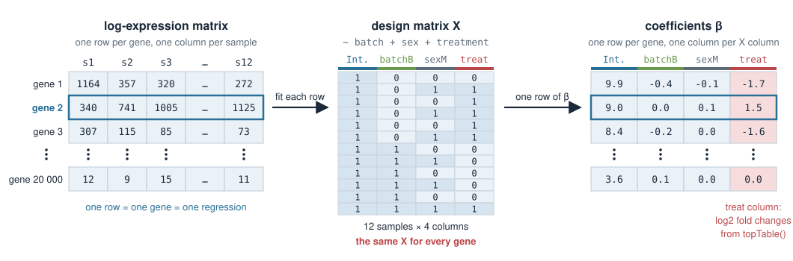
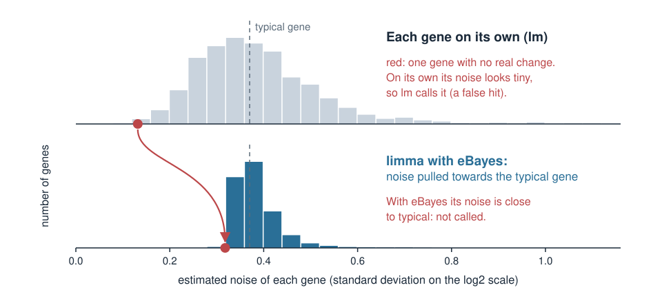
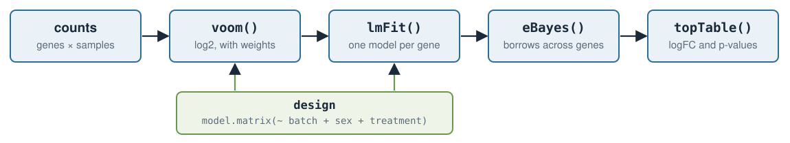
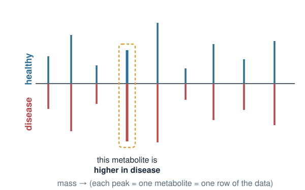

## Problem: which of 20 000 genes respond to the treatment? {.smaller}

{width="95%" fig-align="center"}

- An omics experiment gives a table: one row per gene (or protein, metabolite), one column per sample, on a **log2 scale**. Plus a sample sheet: batch, sex, treatment.
- For **one** gene you already know what to do: fit `lm(expr ~ batch + sex + treatment)` and read the treatment coefficient. On the log2 scale it is a **log2 fold change** (logFC): 1 = doubled, $-1$ = halved.
- Now we need that answer for **every** gene, and a list of genes we can trust.

::: notes
Start from the problem, not the tool. Everything about the design matrix is from Design matrices for covariates and Confounding: the same X serves every gene, since the samples are the same; only y changes from row to row. The question of the day is what goes wrong when we simply repeat the one-gene analysis 20 000 times, and how limma fixes it. The data in the next slides are simulated (2000 genes, 12 samples, 200 genes truly respond), the same data as in the exercise, so we know the right answer.
:::

## A loop of `lm` over the genes runs, but gives poor answers {.smaller}

Simulated RNA-seq: 2000 genes, 12 samples, and we know that **200 genes truly respond** to treatment.

```r
y <- log2(counts + 1)                       # genes x samples, log2 scale
coef(summary(lm(y["g5", ] ~ batch + sex + treatment, data = samples)))["treatmenttreat", ]
#   Estimate Std. Error    t value   Pr(>|t|)
#       2.27       0.20      11.27    3.5e-06       # one gene: clearly up

p <- apply(y, 1, function(yg)               # the same fit for every row
  coef(summary(lm(yg ~ batch + sex + treatment, data = samples)))["treatmenttreat", 4])
sum(p < 0.05)
# [1] 277
```

277 genes with $p < 0.05$, but only 200 genes respond. Two problems:

1. **Many false hits**: testing many genes lets chance through.
2. **Each gene's noise is badly estimated**: 12 samples is too few to know how noisy one gene is.

::: notes
The loop is correct code and students could write it themselves; apply runs the function on every row. The numbers: of the 277, 186 truly respond and 91 do not. Both problems have nothing to do with the design matrix, which is fine here (full rank, batch included). They come from doing 2000 tests with few samples each. The next two slides take one problem each. limma's three functions are exactly this loop plus the two fixes.
:::

## Testing many genes at once gives many false hits {.smaller}

- $p < 0.05$ means: a gene with **no real change** still passes 5% of the time.
- 1800 genes do not respond, so about $1800 \times 0.05 = 90$ pass by chance. We got 91. With 20 000 genes it would be about 1000.
- Fix: **adjust** the p-values for the number of tests, `p.adjust(p, "BH")`. Then among the genes called at `< 0.05`, only about 5% are false. limma reports this as `adj.P.Val`.

| cut-off | genes called | truly respond | false |
|---|---|---|---|
| `p < 0.05` | 277 | 186 | 91 |
| adjusted `< 0.05` | 131 | 124 | 7 |

- The list is now trustworthy, but only 124 of the 200 responding genes are found. Can we find more?

::: notes
One idea, no formula: 5% of a big number is a big number. BH (Benjamini–Hochberg) is the adjustment limma uses; students do not need its rule, only what the cut-off promises: about 5% of the list is wrong, not 5% of all genes. 7 of 131 is 5%. The price is that weaker true genes fall below the line, which motivates the next slide.
:::

## With few samples, each gene's noise is badly estimated {.smaller}

{width="68%" fig-align="center"}

- Each gene's noise comes from only 12 samples. By chance some genes look **far too quiet** (false hits) or **too noisy** (real changes missed).
- limma's `eBayes` uses that most genes are about equally noisy: each gene's noise is **pulled towards the typical gene**. Each gene borrows information from all the others.
- With adjusted p-values: the `lm` loop finds **124** of the 200 genes (7 false), limma finds **181** (10 false).

::: notes
The top histogram is the noise (residual standard deviation) of each of the 2000 genes, each estimated on its own from 12 samples with 4 coefficients, so only 8 values left over to judge the noise. The spread is mostly chance. The bottom histogram is the same genes after eBayes: each estimate is a weighted average of the gene's own value and the typical value. The red gene, g1034, does not respond at all; its own noise estimate is 0.13 against a typical 0.37, so its small difference of 0.6 looks significant (lm p = 0.0005, called even after adjustment). With the shared noise it is not called. The same pull helps true genes whose noise was overestimated, which is where the extra 57 true calls come from. Both comparisons use log2(counts + 1) and the same design; the name empirical Bayes and the idea of shrinkage come back in week 4 (Hierarchical models). No formula needed here.
:::

## `model.matrix()` builds the design limma needs {.smaller}

```r
d <- data.frame(
  treatment = c("ctrl", "ctrl", "ctrl", "treat", "treat", "treat"),
  sex       = c("F", "M", "F", "M", "F", "M"),
  bmi       = c(22, 25, 28, 24, 27, 30))

X <- model.matrix(~ treatment + sex, data = d)
```

:::: {.columns}
::: {.column width="40%"}
**Input:** the table `d`

| | treatment | sex | bmi |
|---|---|---|---|
| 1 | ctrl  | F | 22 |
| 2 | ctrl  | M | 25 |
| 3 | ctrl  | F | 28 |
| 4 | treat | M | 24 |
| 5 | treat | F | 27 |
| 6 | treat | M | 30 |
:::
::: {.column width="10%"}
<p style="font-size: 2.5em; text-align: center; margin-top: 2.2em;">→</p>
:::
::: {.column width="50%"}
**Output:** `X`, one row per sample

| | (Intercept) | treatmenttreat | sexM |
|---|---|---|---|
| 1 | 1 | 0 | 0 |
| 2 | 1 | 0 | 1 |
| 3 | 1 | 0 | 0 |
| 4 | 1 | 1 | 1 |
| 5 | 1 | 1 | 0 |
| 6 | 1 | 1 | 1 |
:::
::::

- Column names are the variable name glued to the level: `treatmenttreat`, `sexM`. limma asks for a coefficient by this name.
- The **reference** levels (`ctrl`, `F`) get no column. Check `levels()` first: real data often has `trt` and `untrt`, and `trt` sorts first. Fix with `relevel(x, ref = "untrt")`.

::: notes
Same rules as in Design matrices for covariates; this slide only shows R doing it. model.matrix is exactly what lm and limma use; limma takes its output directly as the design. Read the column names aloud, because students will need them later to pick coefficients: treatmenttreat is "treatment, level treat". The reference is the alphabetically first level, ctrl and F here. Ask: which sample is the reference group? Sample 1 and 3 are ctrl and F, so their row is just 1, 0, 0 and their predicted mean is beta 0. The relevel bullet matters in practice: in the airway dataset of the next unit the alphabetical order makes the treated group the reference, so every fold change gets the wrong sign.
:::

## Check the rank before you fit {.smaller}

Now suppose all controls were sequenced in batch A and all treated samples in batch B.

```r
d$batch <- c("A", "A", "A", "B", "B", "B")
X <- model.matrix(~ batch + treatment, data = d)
X[, ]
#   (Intercept) batchB treatmenttreat
# 1           1      0              0
# 2           1      0              0
# 3           1      0              0
# 4           1      1              1
# 5           1      1              1
# 6           1      1              1

ncol(X)                 # 3 coefficients to estimate

# the rank: how many columns are independent? Three ways, same answer
qr(X)$rank              # 2   (base R, as in Linear systems in R)
Matrix::rankMatrix(X)   # 2   (Matrix package, comes with R)
limma::is.fullrank(X)   # FALSE  -> rank < ncol(X): no unique solution
```

- `batchB` and `treatmenttreat` are **identical** columns: perfect confounding (*Confounding & Simpson's paradox*).
- limma then warns `Coefficients not estimable: treatmenttreat` and gives `NA`. Dropping batch silences it but does not fix it: only a new **experiment** with both conditions in every batch can.
- Rank $<$ `ncol(X)` means infinitely many $\boldsymbol\beta$ fit equally well, as in *Linear systems in R*. Use whichever function you like: [`qr`](https://rdrr.io/r/base/qr.html)`(X)$rank`, [`Matrix::rankMatrix`](https://rdrr.io/cran/Matrix/man/rankMatrix.html), or limma's yes/no version [`is.fullrank`](https://rdrr.io/bioc/limma/man/is.fullrank.html).

::: notes
This is the rank check from Linear systems in R applied to a design matrix. The rule to remember: rank equal to the number of columns means a unique beta, rank smaller means infinitely many. Here batch and treatment carry exactly the same information, so any split of the difference between the two coefficients fits equally well. X[, ] just prints the matrix without the attr lines. The three rank functions agree; students only need one. qr is just the name of the base-R function, there is no need to explain the QR decomposition. rankMatrix also prints a few attr lines (method, tol) below the number; they can be ignored. is.fullrank answers the question directly: TRUE means a unique beta. The limma message is what students will see in practice; voom prints it too because it fits the model once internally. The exercise (R5) runs this case on the simulated counts.
:::

## Limma fits all genes with one design in three calls {.smaller}

```r
library(limma)
# counts: 2000 genes x 12 samples; samples: one row per sample (batch, sex, treatment)
design <- model.matrix(~ batch + sex + treatment, data = samples)
v   <- voom(counts, design)       # RNA-seq counts -> log2 scale, with weights
fit <- lmFit(v, design)           # one linear model per gene
fit <- eBayes(fit)                # share noise information across genes
topTable(fit, coef = "treatmenttreat", number = 3)
#      logFC AveExpr     t  P.Value adj.P.Val
# g5    2.20   10.83  8.05  1.0e-12   2.0e-09
# g188 -1.97   10.02 -6.88  3.8e-10   2.2e-07
# g145 -1.87   11.57 -6.86  4.2e-10   2.2e-07
```

- `lmFit` is the loop, `eBayes` the shared noise, `topTable` the adjusted list. `coef =` is a **column name of $X$**: `treatmenttreat`.
- [`voom`](https://rdrr.io/bioc/limma/man/voom.html) is only needed for RNA-seq counts: it takes the log2 and records how noisy each value is. Data that are already log2 intensities (proteomics, metabolomics) go straight into `lmFit`.

{.nostretch width="85%" fig-align="center"}

::: notes
The workflow in three calls, four with voom. voom computes log2 counts per million and a weight per value, because low counts are noisier on the log scale; students do not need the details. The next unit, Bulk RNA-seq with DESeq2, shows why small counts are noisy. eBayes is the shared-noise step from the previous slides; the name (empirical Bayes) and the idea of shrinkage come back in week 4, Hierarchical models. With voom, limma calls 188 genes, 177 true; on log2(counts + 1) without voom (the earlier slides) 191, 181 true. On this simulation voom changes little; it matters most for genes with low counts. Column B (log-odds) is left out of the printout.
:::

## Reading the results table {.smaller}

```r
tt <- topTable(fit, coef = "treatmenttreat", number = Inf)   # all genes, best first
head(tt, 5)
#      logFC AveExpr     t  P.Value adj.P.Val
# g5    2.20   10.83  8.05 1.01e-12  2.03e-09
# g188 -1.97   10.02 -6.88 3.84e-10  2.19e-07
# g145 -1.87   11.57 -6.86 4.19e-10  2.19e-07
# g144  1.94    9.82  6.83 4.90e-10  2.19e-07
# g17   1.96    9.64  6.80 5.51e-10  2.19e-07
sum(tt$adj.P.Val < 0.05)
# [1] 188
```

| column | meaning |
|---|---|
| `logFC` | the treatment coefficient: treat vs ctrl, holding batch and sex fixed |
| `AveExpr` | the gene's average log2 expression |
| `t`, `P.Value` | the test of "coefficient = 0" for this gene |
| `adj.P.Val` | adjusted for testing 2000 genes: about 5% of the genes called at `< 0.05` are false |

- g188: logFC $-1.97$, so about **four times lower** in treated samples ($2^{-2} = 1/4$).
- This is simulated data with a known truth: 200 genes respond. The 188 calls are **177 true** and 11 false.

::: notes
The top of the table: genes are sorted by p-value, smallest first (column B, the log-odds, is left out of the printout). Read one row aloud. g5 has logFC 2.2, about 4.6 times higher with treatment, and a tiny adjusted p-value. adj.P.Val was introduced on the false-hits slide; here just check the promise: 11 of 188 is 6%, close to 5%.
:::

## Do not add more covariates than you need to the model {.smaller}

One gene in 8 mice. The sample sheet has sex, BMI and sequencing batch. Should batch go in the model?

:::: {.columns}
::: {.column width="42%"}
| treatment | sex | bmi | batch | expr |
|---|---|---|---|---|
| ctrl  | F | 26 | A | 8.9 |
| ctrl  | M | 23 | B | 9.5 |
| ctrl  | F | 28 | C | 8.5 |
| ctrl  | M | 27 | A | 9.2 |
| treat | F | 30 | B | 10.2 |
| treat | M | 27 | C | 10.7 |
| treat | F | 21 | A | 9.1 |
| treat | M | 24 | B | 10.5 |

```r
fit1 <- lm(expr ~ treatment + sex + bmi + batch, data = d)
fit2 <- lm(expr ~ treatment + sex + bmi, data = d)
confint(fit1); confint(fit2)   # 95% intervals
```
:::
::: {.column width="58%"}
{.nostretch width="100%"}
:::
::::

- `batchB` and `batchC` are close to 0, with intervals on both sides of 0: batch **explains nothing** here.
- Yet its two columns use up 2 of the 8 samples. The **confidence interval** (the range of values that fit the data) for treatment gets wider and now covers 0. Without batch, the treatment effect is clear. If batch explains nothing, leave it out.

::: notes
Contrast with Confounding & Simpson's paradox: there, batch explained a lot and was unbalanced, so leaving it out was the mistake. Here batch does nothing for this gene, but it still costs. Each column uses up one sample; with 8 mice and 6 columns only 2 are left to judge how noisy the gene is, so every interval gets wide. The treatment interval goes from 0.49 to 1.79 (clear effect) to -0.17 to 2.29 (could be nothing). This is one simulated dataset (true treatment effect 1.5, sex 1, BMI 0.1 per unit, batch 0, noise sd 0.4); across 500 such datasets the interval without batch was narrower in 83% of them, median width 1.5 vs 2.4. The intervals come from confint() on an lm fit; limma reports the same with topTable(..., confint = TRUE). A practical caveat: decide which covariates to keep from what they explain and from how the experiment was run, not by trying models until the treatment p-value looks good. No formula for the interval is needed: wider = less certain, covering 0 = no evidence of a change.
:::

## Limma also works for metabolomics, and beyond {.smaller}

:::: {.columns}
::: {.column width="60%"}
Mass spectrometry gives **log2 intensities** directly, so there is no `voom`. In the exercise, 150 metabolites in 8 healthy and 8 disease samples; the patients have a **higher BMI**, and 20 metabolites truly change with disease.

```r
design <- model.matrix(~ group + sex + bmi + day, data = meta)
fit <- eBayes(lmFit(logint, design))
topTable(fit, coef = "groupdisease")
```

| design | called | true | false |
|---|---|---|---|
| `~ group` | 28 | 15 | 13 |
| `~ group + sex + bmi + day` | 12 | 12 | 0 |

- `bmi` is a **continuous** covariate: one column of numbers. `day` is the MS run day, a batch.
- Without `bmi`, metabolites that only follow BMI look like disease markers.

{.nostretch width="58%" fig-align="center"}
:::
::: {.column width="40%"}
{.nostretch width="100%"}

[Photo: Nick Birse, [CC BY-SA 4.0](https://creativecommons.org/licenses/by-sa/4.0), via [Wikimedia Commons](https://commons.wikimedia.org/wiki/File:Agilent_LC-MS.jpg).]{style="font-size: 0.6em; color: #666;"}
:::
::::

::: notes
The pictures: a liquid chromatography / mass spectrometry setup, and two spectra drawn as a mirror image. Each peak is one metabolite; its height is how much there is. Comparing one peak between healthy and disease samples is exactly one row of the data table, and limma does that for every peak at once. Same design-matrix idea, a different omics layer: switching tools or data types is a matter of syntax once you understand X. The false calls without BMI are mostly the BMI-driven metabolites. The full design also loses some true metabolites, because BMI and disease are correlated; the exercise discusses why, and the cure is again in the design of the study.
:::

## Summary {.smaller}

- An omics table is many genes with **one design**: the same $X$ for every row, built with [`model.matrix`](https://rdrr.io/r/stats/model.matrix.html)`(~ ...)`.
- A plain loop of `lm` has two problems: **many false hits** and **badly estimated noise** per gene.
- limma: log2 data (`voom` for counts) + `design` → `lmFit()` (the loop) → `eBayes()` (shared noise) → `topTable(coef = ...)` (adjusted list).
- Read `logFC` (1 = doubled) and `adj.P.Val` (about 5% of the calls at `< 0.05` are false).
- Before fitting: check `levels()` and the rank of $X$. "Coefficients not estimable" can only be fixed by the **experiment**.
- Include the covariates that explain the data; each extra one costs precision.

**Next:** *Bulk RNA-seq with DESeq2*: the same design, but starting from the raw counts.

::: notes
Recap the problem and the three steps that fix it, plus the two checks students should always do: levels and rank. The forward link: the next unit keeps the same design formula and starts from the raw counts instead of log2 values.
:::
