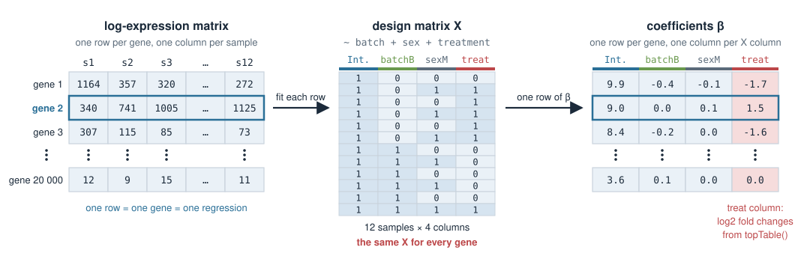

## About this lecture

In *Design matrices for covariates* you built $X$ by hand, and in *Confounding & Simpson's paradox* you saw why the columns you put in decide the answer. Today R builds $X$ for us, and we hand the same $X$ to the tools used for real omics data. You will be able to:

- Turn a formula into $X$ with [`model.matrix`](https://rdrr.io/r/stats/model.matrix.html), and control the reference level with [`relevel`](https://rdrr.io/r/stats/relevel.html) and [`factor`](https://rdrr.io/r/base/factor.html).
- **Check the rank** of $X$ before fitting, and recognise the `NA` that [`lm`](https://rdrr.io/r/stats/lm.html) returns for a column it cannot estimate.
- Run **limma** on a whole omics table with `design = ~ batch + sex + treatment`, and read log2 fold changes and adjusted p-values.
- Recognise "coefficients not estimable", and know that only the **experiment** can fix it.
- Know that the next unit, *Bulk RNA-seq with DESeq2*, starts one step earlier: from the raw counts.

::: notes
This is the R day for the covariates section. Nothing conceptually new: the design matrix, the dummy columns, the reference level and the rank condition are all from the two previous units. What is new is the tooling. First base R (model.matrix, lm), then limma, which fits the same linear model to every gene of a log-scale omics table. limma works for RNA-seq (after voom), proteomics, metabolomics and microarrays, and it needs nothing beyond the Gaussian linear model they already know. DESeq2, which works on the raw counts, is the next unit (Bulk RNA-seq with DESeq2); here it is only a forward pointer. Keep it practical: the students should leave knowing how to write the design, how to check it, and which coefficient to ask for.
:::

## Recap: a formula is a recipe for $X$ {.smaller}

$$
\mathbf{y} = X\boldsymbol\beta + \boldsymbol\varepsilon
$$

- One **row** of $X$ per sample, one **column** per coefficient.
- `(Intercept)` is a column of 1s; it holds $\beta_0$, the mean of the **reference** group.
- A factor with $k$ levels gives $k-1$ dummy columns: "difference from the reference".
- A continuous covariate (age, BMI) gives one column of numbers: a slope.
- $\boldsymbol\beta$ is unique only if the columns of $X$ are **linearly independent** (full column rank).

In R you never type $X$ yourself. You write the formula and R builds $X$, with the same rules you used by hand.

::: notes
One slide of recap so that the code that follows has something to hang on. The last bullet is the existence-of-solutions result from Design matrices for covariates and ties back to the zero, one or infinitely many solutions of Linear systems in R. Today we will see what each tool does when that condition fails.
:::

## `model.matrix()` builds $X$ {.smaller}

```r
d <- data.frame(
  treatment = c("ctrl", "ctrl", "ctrl", "treat", "treat", "treat"),
  sex       = c("F", "M", "F", "M", "F", "M"),
  bmi       = c(22, 25, 28, 24, 27, 30))

model.matrix(~ treatment + sex, data = d)
#   (Intercept) treatmenttreat sexM
# 1           1              0    0
# 2           1              0    1
# 3           1              0    0
# 4           1              1    1
# 5           1              1    0
# 6           1              1    1
```

- Column names are the variable name glued to the level: `treatmenttreat`, `sexM`.
- The **reference** levels (`ctrl`, `F`) get no column: they are in the intercept.
- R also prints two `attr(...)` lines below the matrix; you can ignore them.

::: notes
model.matrix is exactly what lm and limma use; limma even takes its output directly. Read the column names aloud, because students will need them later to pick coefficients: treatmenttreat is "treatment, level treat". The reference is the alphabetically first level, ctrl and F here. Ask: which sample is the reference group? Sample 1 and 3 are ctrl and F, so their row is just 1, 0, 0 and their predicted mean is beta 0.
:::

## A continuous covariate: one column of numbers {.smaller}

```r
model.matrix(~ treatment + bmi, data = d)
#   (Intercept) treatmenttreat bmi
# 1           1              0  22
# 2           1              0  25
# 3           1              0  28
# 4           1              1  24
# 5           1              1  27
# 6           1              1  30
```

- `bmi` is copied in as it is. Its coefficient is the change in $y$ **per BMI unit**, holding treatment fixed.
- The intercept is now "control at BMI 0". To make it readable, centre: `~ treatment + I(bmi - mean(bmi))`. The slope does not change.
- Age works the same way.

::: notes
Continuous covariates are the easy case in R. Point at the BMI column: the numbers go straight in. Remind them of centring from Design matrices for covariates; in R the I() wrapper means "compute this and use it as a column". In omics tools people often centre or scale continuous covariates before fitting, for the same readability reason.
:::

## Choosing the reference with `relevel()` {.smaller}

R sorts the levels of a factor **alphabetically**, and the first one becomes the reference.

```r
d$treatment <- factor(d$treatment)
levels(d$treatment)
# [1] "ctrl"  "treat"          # ctrl is the reference: good

d$treatment <- relevel(d$treatment, ref = "treat")
colnames(model.matrix(~ treatment, data = d))
# [1] "(Intercept)"   "treatmentctrl"   # now the column is "ctrl vs treat"
```

- Changing the reference does **not** change the fit or the predictions. It changes what each coefficient **means**: the sign of the treatment effect flips.
- Real data often has levels like `trt` and `untrt`. Alphabetically `trt` comes first, so `untrt` vs `trt` is what you get unless you relevel.

::: notes
The relevel point matters most in practice. Many public datasets, including the airway dataset in the exercise, have treatment levels where the alphabetical first one is the treated group, so every fold change comes out with the wrong sign. Always check levels() before fitting. Rule: set the reference to the control or baseline condition.
:::

## The time trap: 0 h, 6 h, 24 h {.smaller}

```r
d$time <- c("0h", "6h", "24h", "0h", "6h", "24h")
colnames(model.matrix(~ time, data = d))
# [1] "(Intercept)" "time24h"     "time6h"      # alphabetical: "24h" < "6h"

d$time <- factor(d$time, levels = c("0h", "6h", "24h"))
colnames(model.matrix(~ time, data = d))
# [1] "(Intercept)" "time6h"      "time24h"     # the order you meant
```

- Text is sorted character by character: `"2"` comes before `"6"`, so `24h` comes before `6h`.
- Here the reference `0h` happens to stay first, but the columns are in a confusing order. With `day3`, `day7`, `day14` the reference itself goes wrong: R picks `day14`.
- Fix: give the levels explicitly with `factor(x, levels = ...)`.

::: notes
This bites everyone once. R sorts strings as text, not as numbers. The output here is still a valid model, but plots and tables come out in the order 0, 24, 6, and it is easy to read the wrong column. Always set the levels by hand for anything ordered: time points, doses, stages. With day3, day7, day14 the levels sort as day14, day3, day7, so day14 silently becomes the reference and every coefficient is "compared with day 14".
:::

## Time as a factor or as a number {.smaller}

```r
d$time_h <- c(0, 6, 24, 0, 6, 24)
colnames(model.matrix(~ time_h, data = d))
# [1] "(Intercept)" "time_h"        # one slope per hour
```

| formula | columns for time | what it assumes |
|---|---|---|
| `~ time` (factor) | `time6h`, `time24h` | any shape: each time point has its own mean |
| `~ time_h` (number) | `time_h` | a straight line in time |

- The factor version costs one column more, but makes no assumption about the shape.
- With only a few time points, the factor version is the usual choice in omics.

::: notes
Same data, two designs. As a factor, time gets k minus 1 dummy columns and each time point is free. As a number, time is a single slope, which assumes the response grows linearly with hours: from 6 h to 24 h it would have to grow three times as much as from 0 h to 6 h. With three time points that is rarely what you believe, so the factor is the safer default. This matches the time slide in Design matrices for covariates.
:::

## Check the rank before you fit {.smaller}

Now suppose all controls were sequenced in batch A and all treated samples in batch B.

```r
d$batch <- c("A", "A", "A", "B", "B", "B")
X <- model.matrix(~ batch + treatment, data = d)
X[, ]
#   (Intercept) batchB treatmenttreat
# 1           1      0              0
# 2           1      0              0
# 3           1      0              0
# 4           1      1              1
# 5           1      1              1
# 6           1      1              1

ncol(X)          # 3 coefficients to estimate
qr(X)$rank       # 2  -> only 2 independent columns: no unique solution
```

- `batchB` and `treatmenttreat` are **identical** columns: perfect confounding.
- [`qr`](https://rdrr.io/r/base/qr.html)`(X)$rank` $<$ `ncol(X)` means infinitely many $\boldsymbol\beta$ fit equally well, as in *Linear systems in R*.

::: notes
This is the rank check from Linear systems in R applied to a design matrix. The rule to remember: rank equal to the number of columns means a unique beta, rank smaller means infinitely many. Here batch and treatment carry exactly the same information, so any split of the difference between the two coefficients fits equally well. X[, ] just prints the matrix without the attr lines.
:::

## What `lm` does with an aliased column {.smaller}

```r
d$y <- c(10, 11, 12, 14, 15, 16)
coef(lm(y ~ batch + treatment, data = d))
#  (Intercept)         batchB treatmenttreat
#           11              4             NA
```

- `lm` does not stop. It keeps the columns in order, and the first one that is a combination of the earlier ones gets `NA` ("aliased").
- The 4 is **batch and treatment together**. Swap the order (`~ treatment + batch`) and the 4 moves to `treatmenttreat`.
- An `NA` coefficient is a warning sign: your design cannot separate these effects.

::: notes
lm is forgiving: it drops the redundant column and carries on. Students must not read the 4 as a batch effect. It is the combined difference between the two groups, and we cannot say how much is batch and how much is treatment. Show that changing the order of the formula moves the NA, which proves that the split is arbitrary. limma behaves the same way, as we will see.
:::

## One gene with `lm`: the Simpson example {.smaller}

The batch example from *Confounding & Simpson's paradox*: drug vs control in two batches, with the drug mostly in batch A.

```r
g <- data.frame(
  batch     = c("A", "A", "A", "A", "B", "B", "B", "B"),
  treatment = c("ctrl", "treat", "treat", "treat", "ctrl", "ctrl", "ctrl", "treat"),
  expr      = c(10, 12, 12, 12, 20, 20, 20, 22))

coef(lm(expr ~ treatment, data = g))
#    (Intercept) treatmenttreat
#           17.5           -3.0           # drug looks harmful

coef(lm(expr ~ batch + treatment, data = g))
#    (Intercept)         batchB treatmenttreat
#             10             10              2     # +2 within each batch
```

- Adding the `batchB` column turns $-3$ into $+2$. The rank is 3 = number of columns, so $\boldsymbol\beta$ is unique: batch is **partly** confounded, not perfectly.
- Check one prediction: treated in batch B $= 10 + 10 + 2 = 22$. ✓

::: notes
These are exactly the numbers students computed by hand in the confounding unit, so they can check that R agrees. The data fit the adjusted model exactly, which is why the coefficients are round numbers. The important contrast with the previous slide: here every batch contains both conditions, so the design matrix has full rank and adjustment works. Next: do this for 20 000 genes at once.
:::

## From one gene to 20 000: limma {.smaller}

{width="95%" fig-align="center"}

- An omics experiment gives a table: one row per gene (or protein, metabolite), one column per sample, on a **log2 scale**.
- [limma](https://bioconductor.org/packages/release/bioc/html/limma.html) fits every row with the **same design matrix** $X$: 20 000 ordinary linear models.
- On the log2 scale a coefficient is a **log2 fold change** (logFC): 1 = doubled, $-1$ = halved, 0 = no change.

::: notes
The key picture of the day. The samples are the same for every gene, so the design matrix is the same; only y changes from row to row. limma is in effect 20 000 lm calls with one shared X. Because the data are on the log2 scale, differences of log2 values are log2 fold changes, which is why we spent a unit on the log. limma adds one important trick, eBayes, on the next slide.
:::

## `lmFit`, `eBayes`, `topTable` {.smaller}

```r
library(limma)
# counts: 2000 genes x 12 samples; samples: one row per sample (batch, sex, treatment)
design <- model.matrix(~ batch + sex + treatment, data = samples)
v   <- voom(counts, design)       # RNA-seq counts -> log2 scale, with weights
fit <- lmFit(v, design)           # one linear model per gene
fit <- eBayes(fit)                # share variance information across genes
topTable(fit, coef = "treatmenttreat", number = 3)
#      logFC AveExpr     t  P.Value adj.P.Val
# g5    2.20   10.83  8.05  1.0e-12   2.0e-09
# g188 -1.97   10.02 -6.88  3.8e-10   2.2e-07
# g145 -1.87   11.57 -6.86  4.2e-10   2.2e-07
```

- limma takes $X$ itself, and `coef =` is a **column name of $X$**: `treatmenttreat`.
- [`voom`](https://rdrr.io/bioc/limma/man/voom.html) is only needed for RNA-seq counts: it takes the log2 and records how noisy each value is. Data that are already log2 intensities (proteomics, metabolomics) go straight into `lmFit`.

::: notes
The workflow in three calls, four with voom. voom computes log2 counts per million and a weight per value, because low counts are noisier on the log scale; students do not need the details. The next unit, Bulk RNA-seq with DESeq2, shows why small counts are noisy. eBayes is an empirical Bayes step: with 12 samples each gene's variance is poorly estimated, so it is pulled towards a common value across genes. That is the shrinkage idea from Hierarchical models, met again in week 4. Column B (log-odds) is left out of the printout.
:::

## Reading the results table {.smaller}

```r
tt <- topTable(fit, coef = "treatmenttreat", number = Inf)
sum(tt$adj.P.Val < 0.05)
# [1] 188
```

| column | meaning |
|---|---|
| `logFC` | the treatment coefficient: treat vs ctrl, holding batch and sex fixed |
| `AveExpr` | the gene's average log2 expression |
| `t`, `P.Value` | the test of "coefficient = 0" for this gene |
| `adj.P.Val` | p-value adjusted for testing 2000 genes: among genes called at `adj.P.Val < 0.05`, about 5% are expected to be false |

- g188: logFC $-1.97$, so about **four times lower** in treated samples ($2^{-2} = 1/4$).
- This is simulated data with a known truth: 200 genes respond. The 188 calls are **177 true** and 11 false.

::: notes
Read one row aloud. g5 has logFC 2.2, about 4.6 times higher with treatment, and a tiny adjusted p-value. Explain adj.P.Val in one sentence: with 2000 tests, raw p-values below 0.05 would give about 100 false hits by chance alone, so limma adjusts them (Benjamini–Hochberg) so that the cut-off controls the fraction of false calls instead. 11 of 188 is 6%, close to the promised 5%.
:::

## Why the design matters {.smaller}

In this experiment the treatment is **unbalanced** across batches. Gene g138 truly goes up (logFC 1.5) and is also higher in batch B.

```r
table(samples$batch, samples$treatment)
#     ctrl treat
#   A    1     5
#   B    5     1
```

| design | g138 logFC | g138 adj.P.Val | genes called | false calls |
|---|---|---|---|---|
| `~ treatment` | $-0.16$ | 0.90 | 304 | 154 |
| `~ batch + sex + treatment` | $1.34$ | 0.001 | 188 | 11 |

- Without batch, g138's up-regulation is hidden: Simpson's paradox in a real-sized dataset.
- And 151 of the 154 false calls are genes that only differ **between batches**.

::: notes
The same story as the 8-sample lm example, now for 2000 genes. Because batch is unbalanced but not perfectly confounded, X has full rank and the adjusted model can separate batch and treatment. Without batch, half the list is wrong. The exercise has students reproduce this table.
:::

## "Coefficients not estimable" {.smaller}

If every control is in batch A and every treated sample in batch B:

```r
design_conf <- model.matrix(~ batch + treatment, data = samples_conf)
fit <- lmFit(voom(counts, design_conf), design_conf)
# Coefficients not estimable: treatmenttreat
head(fit$coefficients, 2)
#    (Intercept) batchB treatmenttreat
# g1        8.94   0.50             NA
# g2       10.16  -1.17             NA
```

- This is the identical-columns case: `qr(X)$rank` is 2 for 3 columns. limma, like `lm`, gives `NA`.
- Dropping `batch` makes the message go away, but the treatment estimate then **includes** the batch effect.
- The only real fix is in the **experiment**: put both conditions in every batch, ideally balanced. No code can recover what the design did not measure.

::: notes
Stress the honest message: removing batch silences the message but does not remove the problem; you get a number you cannot interpret. Planning the batches before sequencing is the fix. If a confounded dataset has already been produced, all you can do is report that treatment and batch cannot be separated. DESeq2 refuses outright with "the model matrix is not full rank", which students will meet on forums.
:::

## The same code for metabolomics {.smaller}

Mass spectrometry gives **log2 intensities** directly, so there is no `voom`. In the exercise, 150 metabolites in 8 healthy and 8 disease samples; the patients have a **higher BMI**, and 20 metabolites truly change with disease.

```r
design <- model.matrix(~ group + sex + bmi + day, data = meta)
fit <- eBayes(lmFit(logint, design))
topTable(fit, coef = "groupdisease")
```

| design | called | true | false |
|---|---|---|---|
| `~ group` | 28 | 15 | 13 |
| `~ group + sex + bmi + day` | 12 | 12 | 0 |

- `bmi` is a **continuous** covariate: one column of numbers. `day` is the MS run day, a batch.
- Without `bmi`, metabolites that only follow BMI look like disease markers.

::: notes
Same design-matrix idea, a different omics layer: switching tools or data types is a matter of syntax once you understand X. The false calls without BMI are mostly the BMI-driven metabolites. The full design also loses some true metabolites, because BMI and disease are correlated; the exercise discusses why, and the cure is again in the design of the study.
:::

## Summary {.smaller}

- [`model.matrix`](https://rdrr.io/r/stats/model.matrix.html)`(~ ...)` builds $X$; column names are variable + level (`treatmenttreat`, `sexM`, `batchB`, `bmi`).
- The reference is the alphabetically first level: check `levels()`, use [`relevel`](https://rdrr.io/r/stats/relevel.html) or `factor(x, levels = ...)` (0 h / 6 h / 24 h!).
- Check `qr(X)$rank == ncol(X)`. If not: `lm` and limma give `NA`. Fix the **design of the experiment**.
- limma: log2 data (`voom` for counts) + `design` → `lmFit()` → `eBayes()` → `topTable(coef = ...)`.
- Read `logFC` (1 = doubled) and `adj.P.Val` (adjusted for testing many genes).
- Leaving out a covariate that is unbalanced across groups gives false and missed calls: Simpson's paradox at genome scale.

**Next:** *Bulk RNA-seq with DESeq2*: the same design, but starting from the raw counts.

::: notes
Recap the workflow and the two checks students should always do: levels and rank. The forward link: the next unit keeps the same design formula and starts from the raw counts instead of log2 values.
:::
