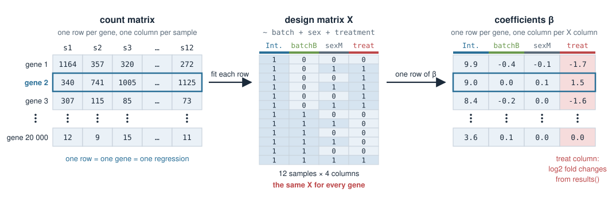
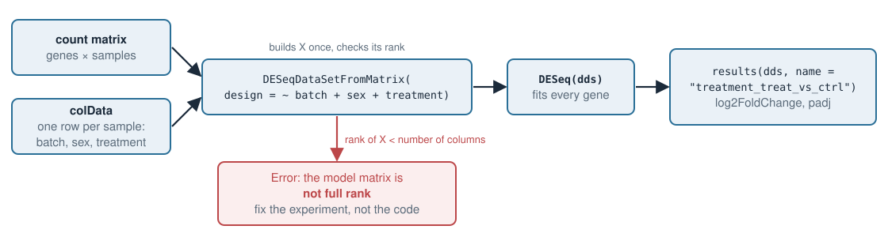

## About this lecture

In *Design matrices for covariates* you built $X$ by hand, and in *Confounding & Simpson's paradox* you saw why the columns you put in decide the answer. Today R builds $X$ for us, and we hand the same $X$ to the tools used for real omics data. You will be able to:

- Turn a formula into $X$ with [`model.matrix`](https://rdrr.io/r/stats/model.matrix.html), and control the reference level with [`relevel`](https://rdrr.io/r/stats/relevel.html) and [`factor`](https://rdrr.io/r/base/factor.html).
- **Check the rank** of $X$ before fitting, and recognise the `NA` that [`lm`](https://rdrr.io/r/stats/lm.html) returns for a column it cannot estimate.
- Run **DESeq2** on a bulk RNA-seq count matrix with `design = ~ batch + sex + treatment`, and read log2 fold changes and adjusted p-values.
- Recognise the "model matrix is not full rank" error, and know that only the **experiment** can fix it.
- (Extra material) Do the same with **limma** for log2 intensities from mass spectrometry.

::: notes
This is the R day for the covariates section. Nothing conceptually new: the design matrix, the dummy columns, the reference level and the rank condition are all from the two previous units. What is new is the tooling. First base R (model.matrix, lm), then DESeq2 for counts. limma is extra material at the end, but it is the same idea and many students will meet it for proteomics and metabolomics. Keep it practical: the students should leave knowing how to write the design, how to check it, and which coefficient to ask for.
:::

## Recap: a formula is a recipe for $X$ {.smaller}

$$
\mathbf{y} = X\boldsymbol\beta + \boldsymbol\varepsilon
$$

- One **row** of $X$ per sample, one **column** per coefficient.
- `(Intercept)` is a column of 1s; it holds $\beta_0$, the mean of the **reference** group.
- A factor with $k$ levels gives $k-1$ dummy columns: "difference from the reference".
- A continuous covariate (age, BMI) gives one column of numbers: a slope.
- $\boldsymbol\beta$ is unique only if the columns of $X$ are **linearly independent** (full column rank).

In R you never type $X$ yourself. You write the formula and R builds $X$, with the same rules you used by hand.

::: notes
One slide of recap so that the code that follows has something to hang on. The last bullet is the existence-of-solutions result from Design matrices for covariates and ties back to the zero, one or infinitely many solutions of Linear systems in R. Today we will see what each tool does when that condition fails.
:::

## `model.matrix()` builds $X$ {.smaller}

```r
d <- data.frame(
  treatment = c("ctrl", "ctrl", "ctrl", "treat", "treat", "treat"),
  sex       = c("F", "M", "F", "M", "F", "M"),
  bmi       = c(22, 25, 28, 24, 27, 30))

model.matrix(~ treatment + sex, data = d)
#   (Intercept) treatmenttreat sexM
# 1           1              0    0
# 2           1              0    1
# 3           1              0    0
# 4           1              1    1
# 5           1              1    0
# 6           1              1    1
```

- Column names are the variable name glued to the level: `treatmenttreat`, `sexM`.
- The **reference** levels (`ctrl`, `F`) get no column: they are in the intercept.
- R also prints two `attr(...)` lines below the matrix; you can ignore them.

::: notes
model.matrix is exactly what lm, DESeq2 and limma call internally. Read the column names aloud, because students will need them later to pick coefficients: treatmenttreat is "treatment, level treat". The reference is the alphabetically first level, ctrl and F here. Ask: which sample is the reference group? Sample 1 and 3 are ctrl and F, so their row is just 1, 0, 0 and their predicted mean is beta 0.
:::

## A continuous covariate: one column of numbers {.smaller}

```r
model.matrix(~ treatment + bmi, data = d)
#   (Intercept) treatmenttreat bmi
# 1           1              0  22
# 2           1              0  25
# 3           1              0  28
# 4           1              1  24
# 5           1              1  27
# 6           1              1  30
```

- `bmi` is copied in as it is. Its coefficient is the change in $y$ **per BMI unit**, holding treatment fixed.
- The intercept is now "control at BMI 0". To make it readable, centre: `~ treatment + I(bmi - mean(bmi))`. The slope does not change.
- Age works the same way.

::: notes
Continuous covariates are the easy case in R. Point at the BMI column: the numbers go straight in. Remind them of centring from Design matrices for covariates; in R the I() wrapper means "compute this and use it as a column". In omics tools people often centre or scale continuous covariates before fitting, for the same readability reason.
:::

## Choosing the reference with `relevel()` {.smaller}

R sorts the levels of a factor **alphabetically**, and the first one becomes the reference.

```r
d$treatment <- factor(d$treatment)
levels(d$treatment)
# [1] "ctrl"  "treat"          # ctrl is the reference: good

d$treatment <- relevel(d$treatment, ref = "treat")
colnames(model.matrix(~ treatment, data = d))
# [1] "(Intercept)"   "treatmentctrl"   # now the column is "ctrl vs treat"
```

- Changing the reference does **not** change the fit or the predictions. It changes what each coefficient **means**: the sign of the treatment effect flips.
- Real data often has levels like `trt` and `untrt`. Alphabetically `trt` comes first, so `untrt` vs `trt` is what you get unless you relevel.

::: notes
The relevel point matters most in practice. Many public datasets, including the airway dataset in the exercise, have treatment levels where the alphabetical first one is the treated group, so every fold change comes out with the wrong sign. Always check levels() before fitting. Rule: set the reference to the control or baseline condition.
:::

## The time trap: 0 h, 6 h, 24 h {.smaller}

```r
d$time <- c("0h", "6h", "24h", "0h", "6h", "24h")
colnames(model.matrix(~ time, data = d))
# [1] "(Intercept)" "time24h"     "time6h"      # alphabetical: "24h" < "6h"

d$time <- factor(d$time, levels = c("0h", "6h", "24h"))
colnames(model.matrix(~ time, data = d))
# [1] "(Intercept)" "time6h"      "time24h"     # the order you meant
```

- Text is sorted character by character: `"2"` comes before `"6"`, so `24h` comes before `6h`.
- Here the reference `0h` happens to stay first, but the columns are in a confusing order. With `day3`, `day7`, `day14` the reference itself goes wrong: R picks `day14`.
- Fix: give the levels explicitly with `factor(x, levels = ...)`.

::: notes
This bites everyone once. R sorts strings as text, not as numbers. The output here is still a valid model, but plots and tables come out in the order 0, 24, 6, and it is easy to read the wrong column. Always set the levels by hand for anything ordered: time points, doses, stages. With day3, day7, day14 the levels sort as day14, day3, day7, so day14 silently becomes the reference and every coefficient is "compared with day 14".
:::

## Time as a factor or as a number {.smaller}

```r
d$time_h <- c(0, 6, 24, 0, 6, 24)
colnames(model.matrix(~ time_h, data = d))
# [1] "(Intercept)" "time_h"        # one slope per hour
```

| formula | columns for time | what it assumes |
|---|---|---|
| `~ time` (factor) | `time6h`, `time24h` | any shape: each time point has its own mean |
| `~ time_h` (number) | `time_h` | a straight line in time |

- The factor version costs one column more, but makes no assumption about the shape.
- With only a few time points, the factor version is the usual choice in omics.

::: notes
Same data, two designs. As a factor, time gets k minus 1 dummy columns and each time point is free. As a number, time is a single slope, which assumes the response grows linearly with hours: from 6 h to 24 h it would have to grow three times as much as from 0 h to 6 h. With three time points that is rarely what you believe, so the factor is the safer default. This matches the time slide in Design matrices for covariates.
:::

## Check the rank before you fit {.smaller}

Now suppose all controls were sequenced in batch A and all treated samples in batch B.

```r
d$batch <- c("A", "A", "A", "B", "B", "B")
X <- model.matrix(~ batch + treatment, data = d)
X[, ]
#   (Intercept) batchB treatmenttreat
# 1           1      0              0
# 2           1      0              0
# 3           1      0              0
# 4           1      1              1
# 5           1      1              1
# 6           1      1              1

ncol(X)          # 3 coefficients to estimate
qr(X)$rank       # 2  -> only 2 independent columns: no unique solution
```

- `batchB` and `treatmenttreat` are **identical** columns: perfect confounding.
- [`qr`](https://rdrr.io/r/base/qr.html)`(X)$rank` $<$ `ncol(X)` means infinitely many $\boldsymbol\beta$ fit equally well, as in *Linear systems in R*.

::: notes
This is the rank check from Linear systems in R applied to a design matrix. The rule to remember: rank equal to the number of columns means a unique beta, rank smaller means infinitely many. Here batch and treatment carry exactly the same information, so any split of the difference between the two coefficients fits equally well. X[, ] just prints the matrix without the attr lines.
:::

## What `lm` does with an aliased column {.smaller}

```r
d$y <- c(10, 11, 12, 14, 15, 16)
coef(lm(y ~ batch + treatment, data = d))
#  (Intercept)         batchB treatmenttreat
#           11              4             NA
```

- `lm` does not stop. It keeps the columns in order, and the first one that is a combination of the earlier ones gets `NA` ("aliased").
- The 4 is **batch and treatment together**. Swap the order (`~ treatment + batch`) and the 4 moves to `treatmenttreat`.
- An `NA` coefficient is a warning sign: your design cannot separate these effects.

::: notes
lm is forgiving: it drops the redundant column and carries on. Students must not read the 4 as a batch effect. It is the combined difference between the two groups, and we cannot say how much is batch and how much is treatment. Show that changing the order of the formula moves the NA, which proves that the split is arbitrary. DESeq2, on the next slides, refuses outright instead.
:::

## One gene with `lm`: the Simpson example {.smaller}

The batch example from *Confounding & Simpson's paradox*: drug vs control in two batches, with the drug mostly in batch A.

```r
g <- data.frame(
  batch     = c("A", "A", "A", "A", "B", "B", "B", "B"),
  treatment = c("ctrl", "treat", "treat", "treat", "ctrl", "ctrl", "ctrl", "treat"),
  expr      = c(10, 12, 12, 12, 20, 20, 20, 22))

coef(lm(expr ~ treatment, data = g))
#    (Intercept) treatmenttreat
#           17.5           -3.0           # drug looks harmful

coef(lm(expr ~ batch + treatment, data = g))
#    (Intercept)         batchB treatmenttreat
#             10             10              2     # +2 within each batch
```

- Adding the `batchB` column turns $-3$ into $+2$. The rank is 3 = number of columns, so $\boldsymbol\beta$ is unique: batch is **partly** confounded, not perfectly.
- Check one prediction: treated in batch B $= 10 + 10 + 2 = 22$. ✓

::: notes
These are exactly the numbers students computed by hand in the confounding unit, so they can check that R agrees. The data fit the adjusted model exactly, which is why the coefficients are round numbers. The important contrast with the previous slide: here every batch contains both conditions, so the design matrix has full rank and adjustment works. Next: do this for 20 000 genes at once.
:::

## From one gene to 20 000: DESeq2 {.smaller}

{width="95%" fig-align="center"}

- An RNA-seq experiment gives a **count matrix**: one row per gene, one column per sample.
- [DESeq2](https://bioconductor.org/packages/release/bioc/vignettes/DESeq2/inst/doc/DESeq2.html) fits every gene with the **same design matrix** $X$, with a negative-binomial error model for the counts (see *Error models*).
- It reports each coefficient as a **log2 fold change** (LFC): LFC 1 = doubled, LFC $-1$ = halved, LFC 0 = no change.

::: notes
The key picture of the day. The samples are the same for every gene, so the design matrix is the same; only y changes from row to row. DESeq2 is in effect 20 000 regressions with one shared X. The negative binomial is the error model from the Error models unit; we do not go into how the counts are linked to X beyond saying that coefficients come out as log2 fold changes. DESeq2 also borrows information about the dispersion across genes, which is why it works with few replicates.
:::

## The inputs: counts + sample table + design {.smaller}

```r
library(DESeq2)
# counts : genes x samples matrix of integers (2000 x 12)
# samples: one row per sample, same order as the columns of counts
head(samples, 3)
#    batch sex treatment
# s1     A   F      ctrl
# s2     A   M     treat
# s3     A   F     treat

dds <- DESeqDataSetFromMatrix(countData = counts,
                              colData   = samples,
                              design    = ~ batch + sex + treatment)
```

- `colData` is the sample table; the design formula refers to its columns.
- By convention the **variable of interest goes last**; nuisance covariates (batch, sex, age) go before it.
- The order does not change the fit, but `results(dds)` without arguments reports the **last** variable.

{width="80%" fig-align="center"}

::: notes
The three ingredients. The rows of colData must match the columns of the count matrix; DESeq2 checks that the names agree. The convention to put the variable of interest last is only a convention for the fit, but it matters for the default results() call, which reports the last variable. If you wrote ~ treatment + batch, results(dds) would silently give you the batch effect. The figure shows the flow and where the rank check happens.
:::

## `DESeq()` and `resultsNames()` {.smaller}

```r
dds <- DESeq(dds)          # normalises, estimates dispersions, fits every gene

resultsNames(dds)
# [1] "Intercept"               "batch_B_vs_A"
# [3] "sex_M_vs_F"              "treatment_treat_vs_ctrl"
```

- One name per column of $X$. DESeq2 writes `treatmenttreat` as `treatment_treat_vs_ctrl`: "treat compared with the reference ctrl".
- A factor with three levels, e.g. batch A/B/C, gives `batch_B_vs_A` and `batch_C_vs_A`.

```r
res <- results(dds, name = "treatment_treat_vs_ctrl")
```

- Always ask for the coefficient **by name**. Then the answer does not depend on the order of the formula.

::: notes
DESeq does the work: size factors for library size, a dispersion per gene shared across genes, then the fit. resultsNames is the list of coefficients you can ask for, and it is just the column names of X in DESeq2's spelling. Insist on name = ... in results, which makes the script robust to someone reordering the formula.
:::

## Reading the results table {.smaller}

```r
head(res[order(res$padj), ], 4)
#       baseMean log2FoldChange  lfcSE  stat   pvalue     padj
# g5      1975.7           2.27   0.24  9.36  8.1e-21  1.6e-17
# g144     891.0           1.97   0.24  8.37  5.6e-17  5.5e-14
# g17      816.8           2.02   0.26  7.67  1.7e-14  1.1e-11
# g130     336.3          -2.00   0.28 -7.16  8.2e-13  4.0e-10

sum(res$padj < 0.05, na.rm = TRUE)
# [1] 195
```

| column | meaning |
|---|---|
| `log2FoldChange` | the treatment coefficient: treat vs ctrl, holding batch and sex fixed |
| `lfcSE` | its standard error |
| `padj` | p-value adjusted for testing 2000 genes: among genes called at `padj < 0.05`, about 5% are expected to be false |

- g130: LFC $-2$, so about **four times lower** in treated samples ($2^{-2} = 1/4$).
- `padj` is `NA` for genes with very low counts, which DESeq2 leaves out before adjusting (use `na.rm = TRUE` when counting).

::: notes
Read one row aloud. g5 has an LFC of about 2.3, about five times higher with treatment, and a tiny padj. Explain padj in one sentence: with 2000 tests, raw p-values below 0.05 would give about 100 false hits by chance alone, so DESeq2 adjusts them (Benjamini–Hochberg) so that the cut-off controls the fraction of false calls instead. This is the dataset from the exercise, where we know the truth: 200 genes were simulated as differentially expressed.
:::

## Why the design matters: one gene {.smaller}

In this experiment the treatment is **unbalanced** across batches: batch A has 1 control and 5 treated, batch B has 5 controls and 1 treated. Gene g138 is truly up (LFC 1.5) and is also higher in batch B.

```r
table(samples$batch, samples$treatment)
#     ctrl treat
#   A    1     5
#   B    5     1
```

| design | LFC for treatment | padj |
|---|---|---|
| `~ treatment` | $-0.19$ | 0.88 |
| `~ batch + sex + treatment` | $1.37$ | 0.0006 |

- Without batch, the treated samples are mostly from the low batch A, so the up-regulation is hidden: Simpson's paradox in a real-sized dataset.
- Genes that only differ between batches go the other way: `~ treatment` calls them as treatment effects. You count them in the exercise.

::: notes
The same story as the 8-sample lm example, now inside DESeq2. Because batch is unbalanced but not perfectly confounded, X has full rank and the adjusted model can separate batch and treatment. The unadjusted model mixes them. The exercise asks students to count how many false calls ~ treatment makes compared with the full design, using the known truth from the simulation.
:::

## The "not full rank" error {.smaller}

If every control is in batch A and every treated sample in batch B:

```r
dds <- DESeqDataSetFromMatrix(counts, samples_conf, design = ~ batch + treatment)
# Error in checkFullRank(modelMatrix) :
#   the model matrix is not full rank, so the model cannot be fit as specified.
#   One or more variables or interaction terms in the design formula are linear
#   combinations of the others and must be removed.
```

- This is the identical-columns case: `qr(X)$rank` is 2 for 3 columns.
- DESeq2 stops, where `lm` would return `NA`. Both mean the same thing: the data **cannot** tell batch from treatment.
- Dropping `batch` from the formula makes the error go away, but the treatment estimate then **includes** the batch effect.
- The only real fix is in the **experiment**: put both conditions in every batch, ideally balanced. No code can recover what the design did not measure.

::: notes
This error message is the one students will see most often in practice, also for interactions with empty cells and for nested designs. Stress the honest message: removing batch silences the error but does not remove the problem; you get a number you cannot interpret. Planning the batches before sequencing is the fix. If a confounded dataset has already been produced, all you can do is report that treatment and batch cannot be separated.
:::

## Extra material: limma for continuous omics data {.smaller}

::: {.callout-note}
## Extra material — not examined
limma is shown here because proteomics, metabolomics and microarray data are usually analysed with it. The design matrix is exactly the same.
:::

- Mass-spectrometry metabolomics gives **log2 intensities**: continuous numbers, not counts.
- [limma](https://bioconductor.org/packages/release/bioc/html/limma.html) fits an ordinary linear model to each metabolite (one row) with the same $X$, and shares variance information across metabolites (`eBayes`), which helps with few samples.
- The data are already on the log2 scale, so the coefficients are **log2 differences** directly: `logFC` 1 = twice the intensity.
- Unlike DESeq2, limma takes $X$ itself: you build it with `model.matrix`.

::: notes
Extra material. The point is that once you understand the design matrix, switching tools is a matter of syntax. limma predates DESeq2 and came from microarrays; today it is the standard for many continuous omics measurements. eBayes is an empirical Bayes step, which connects back to shrinkage in Hierarchical models: each metabolite's variance is pulled towards a common value.
:::

## Extra material: `lmFit`, `eBayes`, `topTable` {.smaller}

```r
library(limma)
# logint: 150 metabolites x 16 samples (log2 intensity); meta: one row per sample
design <- model.matrix(~ group + sex + bmi + day, data = meta)
colnames(design)
# [1] "(Intercept)"  "groupdisease" "sexM"  "bmi"  "day2"

fit <- lmFit(logint, design)      # one linear model per metabolite
fit <- eBayes(fit)                # share variance information across metabolites
topTable(fit, coef = "groupdisease", number = 3)
#       logFC AveExpr     t  P.Value adj.P.Val
# met4   1.69   15.34  5.05  2.0e-06   0.00030
# met15  1.55   15.91  4.62  1.1e-05   0.00086
# met3   1.45   20.51  4.17  6.5e-05   0.00275
```

- `coef =` takes a **column name of the design matrix**, here `groupdisease` (reference level `healthy`).
- `day` is the MS run day: a batch covariate. `bmi` is continuous.
- `adj.P.Val` plays the role of DESeq2's `padj`.

::: notes
The workflow in three calls. Point out that coef uses the model.matrix column name directly, not a DESeq2-style name. In the exercise the BMI of the disease group is higher, so leaving BMI out produces false hits among metabolites that only depend on BMI. Columns B (log-odds) are omitted from the printout.
:::

## Summary {.smaller}

- [`model.matrix`](https://rdrr.io/r/stats/model.matrix.html)`(~ ...)` builds $X$; column names are variable + level (`treatmenttreat`, `sexM`, `batchB`, `bmi`).
- The reference is the alphabetically first level: check `levels()`, use [`relevel`](https://rdrr.io/r/stats/relevel.html) or `factor(x, levels = ...)` (0 h / 6 h / 24 h!).
- Check `qr(X)$rank == ncol(X)`. If not: `lm` gives `NA`, DESeq2 says "not full rank". Fix the **design of the experiment**.
- DESeq2: counts + `colData` + `design = ~ batch + sex + treatment` → `DESeq()` → `resultsNames()` → `results(name = ...)`.
- Read `log2FoldChange` (1 = doubled) and `padj` (adjusted for testing many genes).
- Leaving out a covariate that is unbalanced across groups gives false and missed calls: Simpson's paradox at genome scale.
- Extra: limma does the same for log2 intensities with `lmFit`, `eBayes`, `topTable(coef = ...)`.

**Next:** *Why penalize?* What to do when $X$ has more columns than samples.

::: notes
Recap the workflow and the two checks students should always do: levels and rank. The forward link: with more columns than samples the rank condition fails by shape, and penalized models are one way out.
:::
