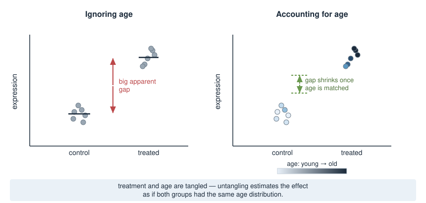
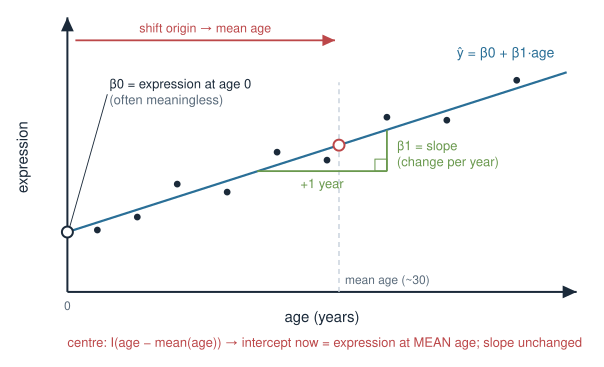
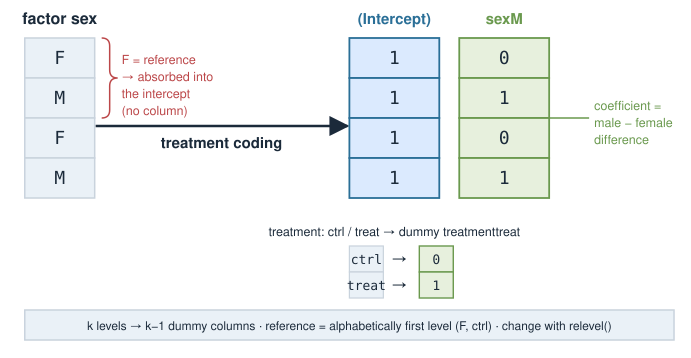
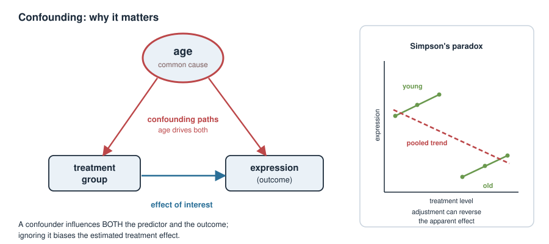
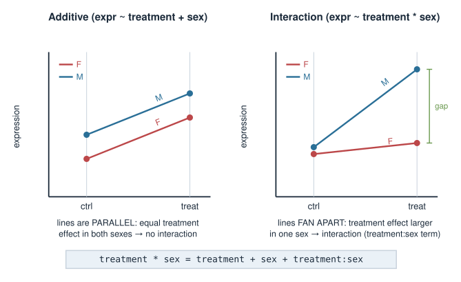
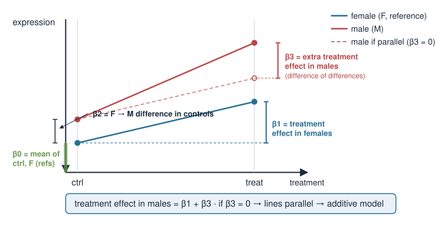
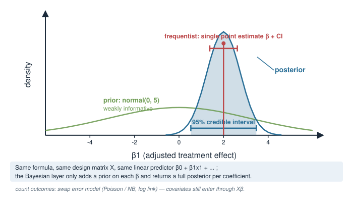

## About this lecture

Real experiments are never clean. Your samples differ in **age**, **sex**, **BMI**, **batch**, and **treatment** all at once. Today we learn how to put those extra variables — **covariates** — into a model, so the effect you care about is not corrupted by the ones you don't.

- What a **covariate** is, and the difference between a variable of **interest** and a **nuisance** variable.
- How a **model formula** (`y ~ treatment + age`) becomes a **design matrix** $X$ — the bridge back to Matrices as transformations.
- **Continuous** vs **categorical** predictors, and what each **coefficient** means.
- **Confounding**: why leaving a covariate out can flip your conclusion, and how **adjustment** fixes it.
- **Interactions**: when a treatment works differently in different groups.

::: {.callout-warning}
## Provisional block
This *Bayesian statistics* block is **provisional** and may move to a later statistics / machine-learning course. The ideas here (design matrices, adjustment, interactions) are core to **any** linear model — Bayesian or frequentist — so they are worth your time regardless of where the block finally lands.
:::

::: notes
The single message of today: an effect estimate is only meaningful relative to what you did and did not account for. "Treatment raised expression by 2 units" is incomplete — raised it compared to what, holding what fixed? Covariates are how we make that precise. Emphasise that although this sits in the Bayesian block, everything today is identical machinery in a plain lm(); the Bayesian layer (priors on the coefficients) comes at the very end. Tell them the design-matrix idea is the same X they met in Matrices as transformations and in the linear-systems units — a formula is just a recipe for building X.
:::

## A biology picture first {.smaller}

You run an RNA-seq experiment: **treated** vs **control** mice, measuring one gene. Treated mice show **higher** expression. Success?

- But the treated mice were, by accident, mostly **old**, and the controls mostly **young**.
- This gene also rises naturally with **age**.
- So is the difference due to the **treatment**, or due to **age**?

With the data as-is you **cannot tell** — treatment and age are tangled. The whole point of covariates is to **untangle** them: estimate the treatment effect *as if the two groups had the same age distribution*.

{width="80%" fig-align="center"}

::: notes
This is the confounding story that motivates everything. Keep it concrete: one gene, two groups, an accidental age imbalance. The naive comparison (mean treated minus mean control) mixes a treatment effect with an age effect because age differs between the groups. Do not yet say the word confounder or draw the DAG — just plant the tangle and the promise that a model with age in it can separate the two contributions. We return to this exact example on the confounding slide.
:::

## What is a covariate? {.smaller}

A **covariate** is any measured variable you put into the model alongside your predictor of interest.

Two roles, same machinery:

- **Variable of interest** — the effect you actually want to estimate (e.g. **treatment**).
- **Nuisance / adjustment variable** — something that also affects the outcome and that you want to *control for* so it doesn't distort the effect of interest (e.g. **age**, **sex**, **batch**).

The model does not know which is which — *you* decide by how you interpret the coefficients. Mechanically, every covariate is just another column in the design matrix.

::: notes
The interest-vs-nuisance distinction is conceptual, not mathematical: the fitting procedure treats all predictors symmetrically. What differs is which coefficient you report and which you treat as "just cleaning up". Batch is the archetypal nuisance covariate in omics — students have all seen batch effects. Stress that "covariate" is an umbrella term; in some fields people reserve it for continuous nuisance variables, but here we use it for anything extra we add to the model.
:::

## The model formula {.smaller}

R (and Bayesian tools built on the same syntax) describes a model with a **formula**: outcome on the left, predictors on the right.

```r
# outcome ~ predictor(s)
expr ~ treatment                 # effect of treatment only
expr ~ treatment + age           # treatment, adjusting for age
expr ~ treatment + age + sex     # adjust for age and sex
```

Behind every formula sits a **linear predictor** — a weighted sum of the predictors:

$$
\hat{y}_i = \beta_0 + \beta_1 x_{i1} + \beta_2 x_{i2} + \dots
$$

Each $\beta$ is a **coefficient**: how much $\hat y$ changes per unit of that predictor, holding the others fixed. Fitting the model = finding the $\beta$'s.

::: notes
Formulas are the interface students will actually type, so anchor here. The `+` means "also include this term", not arithmetic addition of the columns. Read each example aloud in words. The linear predictor is the same beta-dot-x you have seen throughout the course; a formula is a compact way to specify it. Note that lm(), glm(), and the Bayesian packages rstanarm/brms all accept this identical syntax — learn it once. Defer the meaning of "holding the others fixed" to the adjustment slide, but flag it now.
:::

## Continuous predictors: age, BMI {.smaller}

A **continuous** covariate enters as a single column of numbers. Its coefficient is a **slope**.

```r
expr ~ age            #  y_hat = b0 + b1 * age
```

- $\beta_1$ = the change in expression for **each additional year** of age.
- $\beta_0$ (intercept) = predicted expression at **age 0** — often meaningless, so we frequently **centre** the predictor.

```r
expr ~ I(age - mean(age))   # now the intercept = expression at the MEAN age
```

Centring doesn't change the slope; it just makes the intercept interpretable and helps the fit behave.

{width="65%" fig-align="center"}

::: notes
Continuous predictors are the easy case: one column, one slope, ordinary "rise over run". The interpretation trap is the intercept — age 0 (a newborn, or worse, extrapolated nonsense) is rarely of interest, and for something like BMI, BMI 0 is impossible. Centring moves the intercept to the mean, which is both interpretable and numerically nicer. Mention that in Bayesian models centring/scaling predictors also makes default priors sensible, which we hit at the end. Do not overteach I(); just show it means "compute this expression as a literal predictor".
:::

## Categorical predictors: sex, treatment {.smaller}

A **categorical** covariate (a **factor**) is not a number — it's a label. R turns each factor into **indicator (dummy) columns**.

```r
sex <- factor(c("F","M","F","M"))   # two levels: F, M
treatment <- factor(c("ctrl","treat","ctrl","treat"))
```

With the default **treatment coding**, one level is the **reference** (baseline), and each other level gets a 0/1 column:

- `sexM` = 1 for males, 0 for females → its coefficient is the **male − female** difference.
- The reference level (**F**) is absorbed into the **intercept**.

By default R picks the reference level **alphabetically** (`F` before `M`, `ctrl` before `treat`). Set it deliberately with `relevel()`.

{width="70%" fig-align="center"}

::: notes
This is where most confusion lives. A factor with k levels becomes k-1 dummy columns plus the intercept; you never get a column for the reference level because it is the baseline the others are measured against. The coefficient sexM is not "the effect of being male in absolute terms" — it is the difference from the reference (female). The alphabetical default silently makes "ctrl" the reference for treatment, which is usually what you want, but warn them to check: if levels were "drug" and "placebo", placebo would NOT be the reference. relevel() or factor(levels=...) fixes it. This dummy-coding scheme is exactly the contrast matrix, next.
:::

## From formula to design matrix $X$ {.smaller}

A formula is a **recipe for building a matrix**. The outcome is $\mathbf{y}$; the predictors become the columns of the **design matrix** $X$, and the model is

$$
\mathbf{y} = X\boldsymbol{\beta} + \boldsymbol{\varepsilon}.
$$

`model.matrix()` shows you exactly what R built:

```r
model.matrix(~ treatment + age)
#   (Intercept) treatmenttreat age
# 1           1              0  10
# 2           1              1  40
# 3           1              0  22
# 4           1              1  35
```

Column 1 is all 1's (the intercept), column 2 is the 0/1 treatment dummy, column 3 is age. **This is the same $X$** from Matrices as transformations and the linear-systems units — the covariates just decide its columns.

<!-- FIGURE: a small table y = X beta, colouring the intercept column, the dummy column, and the continuous column differently -->

::: notes
This is the conceptual keystone and the tie-back the brief asks for. Everything abstract collapses here: fitting a model with covariates is solving y = X beta for beta, the same X they built columns for when we did linear systems and transformations. model.matrix() is the reveal — run it (statically here) so they SEE the intercept column of ones, the dummy column, and the raw continuous column side by side. Stress that choosing covariates literally means choosing columns of X. The least-squares / posterior machinery on top is unchanged; covariates are entirely about how X is constructed.
:::

## Contrasts: what the coefficients mean {.smaller}

The **coding scheme** for a factor is called its **contrasts** — it decides what each dummy column, and therefore each coefficient, *compares*.

Default **treatment contrasts** (`contr.treatment`) answer: *"each level vs the reference."*

```r
contrasts(treatment)
#       treat
# ctrl      0
# treat     1
```

So in `expr ~ treatment`:

- **Intercept** = mean expression in the reference group (`ctrl`).
- **`treatmenttreat`** = mean(`treat`) − mean(`ctrl`), the quantity you care about.

Other schemes exist (sum-to-zero `contr.sum`, etc.); they change what the numbers *mean*, not the model's fit or predictions.

::: notes
Contrasts are the same design/contrast-matrix idea used throughout omics differential-expression tools (limma, DESeq2 all revolve around a design and a contrast). Keep it light: the default treatment coding gives "difference from reference", which is what people usually want and matches the categorical-predictor slide. The key insight is that the coefficient's meaning is a CHOICE encoded in the contrast matrix, not a fact of nature — change the coding and the same data yields differently-defined coefficients with identical predictions. Don't derive contr.sum; just name that alternatives exist so they aren't thrown when they meet them.
:::

## Adjustment: adding a covariate {.smaller}

Return to the tangled experiment. Fit treatment **alone**, then **adjusting for age**:

```r
lm(expr ~ treatment)          # unadjusted: treatment effect mixes in age
lm(expr ~ treatment + age)    # adjusted:  treatment effect "holding age fixed"
```

Adding `+ age` gives age its own column in $X$ and its own coefficient. The treatment coefficient now answers a **different, cleaner question**:

> How much does treatment change expression **among animals of the same age**?

The model splits the observed variation into an age part and a treatment part, instead of blaming it all on treatment.

::: notes
This is the operational heart. Emphasise that the unadjusted and adjusted treatment coefficients answer genuinely different questions, and only the second controls for age. "Holding age fixed" / "among animals of the same age" is the phrase to drill. Geometrically (optional): adjustment projects out the age direction before measuring the treatment effect — connects to projection/orthogonality from the vectors unit, but keep it a one-liner. The next slide shows how dramatic the difference can be.
:::

## Confounding: why it matters {.smaller}

A **confounder** is a variable that influences **both** the predictor of interest **and** the outcome. Ignore it and the effect you report is **biased**.

{width="70%" fig-align="center"}

In the extreme, adjusting can **reverse** an apparent effect (**Simpson's paradox**): a treatment that looks *harmful* overall can be *helpful* within every age group, once age is accounted for.

- **Rule of thumb:** adjust for variables that plausibly affect the outcome and differ between your groups (age, sex, batch, RIN, sequencing depth).
- **Not** everything, though — see the pitfalls slide (adjusting for the *wrong* variable can *add* bias).

::: notes
Define confounder precisely: associated with both exposure and outcome, and not on the causal path from exposure to outcome. The age->group and age->expression arrows are why the naive comparison fails. Mention Simpson's paradox as the vivid extreme — the direction of an effect flips after adjustment — so they respect the stakes. Give the practical heuristic (adjust for plausible common causes that are imbalanced across groups) but immediately caveat that more covariates is not always better; colliders and over-adjustment come on the pitfalls slide. Batch, RIN, library size are the omics-flavoured confounders they will actually meet.
:::

## Interpreting adjusted effects {.smaller}

In `expr ~ treatment + age` with fitted coefficients

$$
\hat{y} = \underbrace{\beta_0}_{\text{ctrl, age }0} + \underbrace{\beta_1}_{\text{treat vs ctrl}}\cdot\text{treat} + \underbrace{\beta_2}_{\text{per year}}\cdot\text{age}
$$

- $\beta_1$ — treatment effect **at any fixed age** (the model assumes it's the **same** at every age — that's the *no-interaction* assumption).
- $\beta_2$ — age effect **within each treatment group**.

Every coefficient in a multi-predictor model is read **"holding the other predictors constant."** That single phrase is the whole skill of interpreting adjusted models.

::: notes
Hammer the "holding the others constant" reading — it is THE exam-worthy sentence. Point out the hidden assumption in the additive model: beta_1 is a single treatment effect assumed identical across ages, and beta_2 a single age slope assumed identical across treatment groups. That assumption is exactly what interactions relax, which is the natural cue for the next slide. Make sure they can state, for a given fitted equation, what each beta means in words — that is what we assess.
:::

## Interactions: effects that depend on group {.smaller}

Sometimes a treatment works **differently** in different subgroups — the treatment effect **depends on** sex. That is an **interaction**.

```r
expr ~ treatment + sex             # additive: same treatment effect in both sexes
expr ~ treatment * sex             # interaction: treatment effect may differ by sex
```

`treatment * sex` expands to `treatment + sex + treatment:sex`. The extra `treatment:sex` term lets the treatment effect be **larger in one sex than the other**.

{width="75%" fig-align="center"}

::: notes
Interaction = the effect of one predictor changes with the level of another. The picture is two lines: parallel lines mean no interaction (the additive model is fine); non-parallel lines mean an interaction (the gap between treated and control differs by sex). The star syntax is a shorthand that automatically includes both main effects and the product term — a very common student mistake is to write only treatment:sex and forget the main effects. Biologically, sex-specific or genotype-specific drug responses are everywhere, so this is not an edge case.
:::

## Reading interaction coefficients {.smaller}

For `expr ~ treatment * sex` with reference levels `ctrl` and `F`:

$$
\hat y = \beta_0 + \beta_1\,\text{treat} + \beta_2\,\text{M} + \beta_3\,(\text{treat}\times\text{M})
$$

| Coefficient | Meaning |
|---|---|
| $\beta_0$ | mean of `ctrl`, `F` (both references) |
| $\beta_1$ | treatment effect **in females** |
| $\beta_2$ | female → male difference **in controls** |
| $\beta_3$ | **extra** treatment effect in males (how much the treatment effect *differs* between sexes) |

Treatment effect in males $= \beta_1 + \beta_3$. If $\beta_3 = 0$, the effect is the same in both sexes and you're back to the additive model.

{width="65%" fig-align="center"}

::: notes
This table is the deliverable of the interaction pair. The trap: beta_1 is NOT "the treatment effect" — it is the treatment effect in the reference sex only. beta_3 is a difference-in-differences: how much the treatment effect changes when you switch sex. To get the male treatment effect you add beta_1 + beta_3. Testing beta_3 = 0 is the formal test of "does the treatment act differently by sex". Have them practise reading each row aloud. This is directly examinable and directly what they will do with real differential-expression designs.
:::

## Covariates in a Bayesian model {.smaller}

The design matrix $X$ is **identical** in a Bayesian fit. What changes is that we place **priors** on the coefficients and get a **posterior distribution** for each, rather than a single point estimate.

```r
# same formula, Bayesian engine (rstanarm / brms, built on Stan)
rstanarm::stan_glm(expr ~ treatment + age, data = d,
                   prior = rstanarm::normal(0, 5)) # weakly informative betas
```

- The linear predictor $\beta_0 + \beta_1 x_1 + \dots$ and the design matrix are **unchanged**.
- Each $\beta$ now has a **posterior** — a full distribution, so "adjusted treatment effect" comes with an honest credible interval.
- For **count** outcomes you swap the error model (Poisson/negative binomial via a log link) — see the error-models unit — but the covariates still enter through $X\boldsymbol\beta$.

{width="60%" fig-align="center"}

::: notes
Bring it home to the block. The covariate machinery is completely orthogonal to the frequentist/Bayesian choice: same formula, same X, same "holding others constant" interpretation. The Bayesian additions are priors on the betas (weakly informative normals are a fine default, especially after centring/scaling predictors) and a posterior per coefficient instead of a point estimate plus a CI. Connect to the neighbouring units: the error-models unit supplies the Poisson/NB likelihood for counts, where covariates sit inside a log link (log mu = X beta); the hierarchical-models unit will let coefficients vary across biological/technical replicates. Keep the Stan code illustrative, not something they run today.
:::

## Pitfalls {.smaller}

- **Collinearity** — two covariates that move together (e.g. weight and BMI) make their individual coefficients unstable and hard to interpret. The *combined* prediction is fine; the split between them is not.
- **Over-adjustment / colliders** — adjusting for a variable that is a *consequence* of the treatment (or a common effect of treatment and outcome) can **create** bias, not remove it. More covariates is **not** always better.
- **Categorical with many levels** — a factor with $k$ levels costs $k-1$ columns; with small $n$ you run out of data.
- **Wrong reference level** — check `levels()`; a silently-wrong baseline flips the sign of your comparison's meaning.
- **Extrapolating the intercept** — "expression at age 0"; centre instead.

::: notes
A short defensive-driving tour. Collinearity: the model can't tell apart two predictors that carry the same information, so their individual betas seesaw — mention this connects to identifiability, which the penalized-linear-models block addresses with regularization. Colliders/over-adjustment is the subtle one: adjusting is not free, and conditioning on a downstream variable opens a spurious path — so the rule is not "adjust for everything" but "adjust for confounders". Many-level factors eat degrees of freedom. Reference-level and intercept traps recap earlier slides. Keep each to a sentence; this is a checklist to revisit, not new theory.
:::

## Summary {.smaller}

| Concept | Key fact |
|---|---|
| Covariate | any extra predictor; interest **or** nuisance — same machinery |
| Formula | `y ~ a + b` builds the design matrix $X$; model is $y = X\beta + \varepsilon$ |
| Continuous predictor | one column; coefficient = **slope** (per unit) |
| Categorical predictor | factor → $k-1$ **dummy** columns; coefficient = **difference from reference** |
| Contrasts | the coding scheme; decides what each coefficient **compares** |
| Adjustment | `+ covariate` → effect "**holding the others constant**" |
| Confounding | a common cause of predictor & outcome; ignoring it **biases** the effect |
| Interaction | `a * b` → effect of `a` **depends on** `b`; product term $\beta$ |
| Bayesian | same $X$, plus **priors** on $\beta$ and a **posterior** per coefficient |

**Next:** the error-models unit (Poisson/NB likelihoods for counts) and hierarchical models (covariates that vary across biological vs technical replicates).

::: notes
The summary is the revision sheet. Drill the pipeline once more: a formula builds X, continuous predictors give slopes, factors give differences-from-reference via dummy columns, adding a covariate changes the question the coefficient answers to "holding others constant", confounders must be adjusted for, interactions let effects depend on subgroup, and the Bayesian layer only adds priors and posteriors on the same betas. Point forward to error models (counts) and hierarchical models (replicate structure) as the natural continuations in this block. Remind them the exam wants them to READ a fitted equation and say what each coefficient means.
:::
