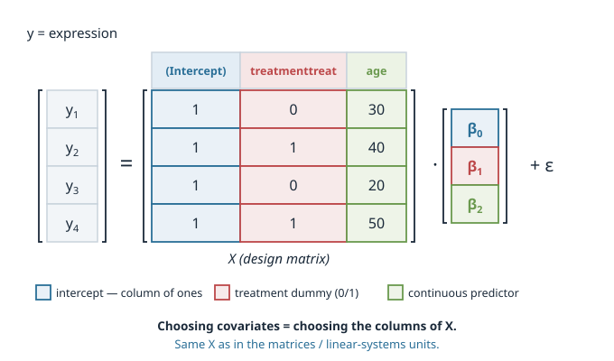
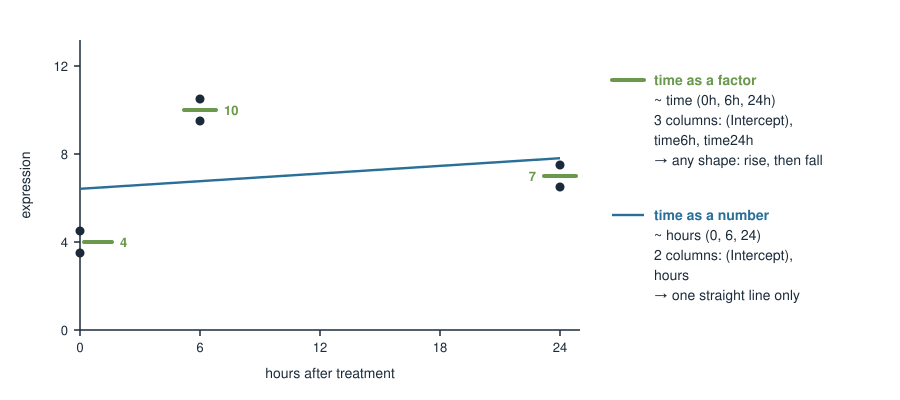
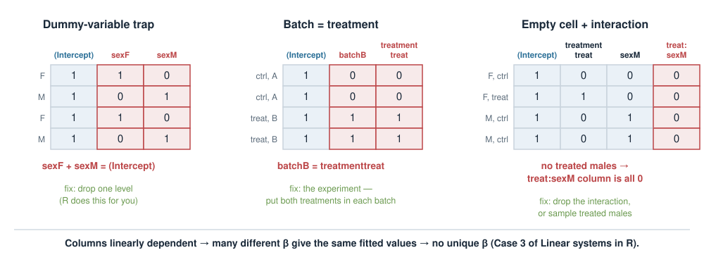
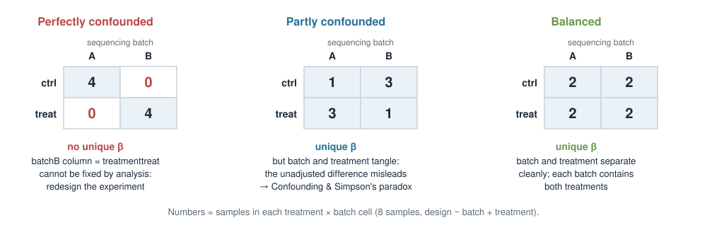

## About this lecture

Real experiments are never clean. Your samples differ in **treatment**, but also in **sex**, **age**, **BMI**, **sequencing batch** and **time point**. Today: how all of these become columns of one matrix, the **design matrix** $X$.

- What a **covariate** is: variable of **interest** vs **nuisance** variable.
- How a **model formula** (`y ~ treatment + age`) becomes $X$, and how $X\boldsymbol\beta$ gives each sample's **predicted mean**.
- **Continuous** (age, BMI) and **categorical** (sex, treatment, batch, time) predictors, and what each **coefficient** means.
- Building $X$ by hand for the **common cases**, including an **interaction** column.
- **Existence of solutions**: when does $\boldsymbol\beta$ have a unique answer, and what to do when it does not.

::: notes
This deck is about one object: the design matrix. Everything students will later do in DESeq2 or limma starts with a design formula, and the formula is nothing more than a recipe for X. The skills to leave with are all by hand: build X for a small experiment, multiply X by beta to get predicted group means, read a coefficient as "difference from the reference" or "slope per unit", and spot when the columns of X are dependent so that beta has no unique answer. What it means to "adjust" for a covariate, confounding and Simpson's paradox come in the next deck, Confounding & Simpson's paradox. The R side (model.matrix, DESeq2, limma) is in Design matrices in R.
:::

## One gene, a whole sample sheet {.smaller}

A typical bulk RNA-seq sample sheet. We measure one gene's expression $y$ in each sample:

| sample | treatment | sex | age | BMI | batch | time |
|---|---|---|---|---|---|---|
| 1 | ctrl  | F | 34 | 22 | A | 0h |
| 2 | treat | M | 51 | 27 | A | 6h |
| 3 | ctrl  | M | 45 | 31 | B | 24h |
| 4 | treat | F | 29 | 24 | B | 6h |
| … | … | … | … | … | … | … |

- **treatment** is what we want to study.
- **sex, age, BMI, batch** also move expression, so we want them in the model too.
- Some columns are **numbers** (age, BMI), some are **labels** (sex, batch). **time** can be either.

The question for today: *how does this table become a matrix that a linear model can use?*

::: notes
Start from something they have all seen: a sample sheet with metadata columns. Every column on the right is a possible covariate. Point out the two kinds: numeric (age, BMI) and categorical (treatment, sex, batch). Time is the interesting in-between case we come back to. The rest of the deck turns this table into X, one column type at a time.
:::

## What is a covariate? {.smaller}

A **covariate** is any measured variable you put into the model alongside your predictor of interest.

Two roles, same machinery:

- **Variable of interest** — the effect you actually want to estimate (e.g. **treatment**).
- **Nuisance / adjustment variable** — something that also affects the outcome and that you want to *control for* so it doesn't distort the effect of interest (e.g. **age**, **sex**, **batch**).

The model does not know which is which — *you* decide by how you interpret the coefficients. Mechanically, every covariate is just another column in the design matrix.

::: notes
The interest-vs-nuisance distinction is conceptual, not mathematical: the fitting procedure treats all predictors symmetrically. What differs is which coefficient you report and which you treat as "just cleaning up". Batch is the archetypal nuisance covariate in omics — students have all seen batch effects. Stress that "covariate" is an umbrella term; in some fields people reserve it for continuous nuisance variables, but here we use it for anything extra we add to the model.
:::

## The model formula {.smaller}

R describes a model with a **formula**: outcome on the left, predictors on the right.

```r
# outcome ~ predictor(s)
expr ~ treatment                 # effect of treatment only
expr ~ treatment + age           # treatment, and age
expr ~ treatment + age + sex     # treatment, age and sex
```

Behind every formula sits a **linear predictor** — a weighted sum of the predictors:

$$
\hat{y}_i = \beta_0 + \beta_1 x_{i1} + \beta_2 x_{i2} + \dots
$$

Each $\beta$ is a **coefficient**: how much $\hat y$ changes per unit of that predictor, holding the others fixed. Fitting the model = finding the $\beta$'s.

With one predictor this is the line $y = a + bx$ from Fitting equations: $\beta_0$ is $a$ (the intercept) and $\beta_1$ is $b$ (the slope). We switch to numbered $\beta$'s because there can now be many predictors, and R names the coefficients the same way.

::: notes
Formulas are the interface students will actually type, so anchor here. The `+` means "also include this term", not arithmetic addition of the columns. Read each example aloud in words. The linear predictor is the same beta-dot-x you have seen throughout the course; a formula is a compact way to specify it. lm(), DESeq2 and limma all take this same syntax — learn it once. "Holding the others fixed" is unpacked properly in the Confounding deck; flag it now.
:::

## From formula to design matrix $X$ {.smaller}

A formula is a **recipe for building a matrix**. The outcome is $\mathbf{y}$; the predictors become the columns of the **design matrix** $X$:

$$
\mathbf{y} = X\boldsymbol{\beta} + \boldsymbol{\varepsilon}.
$$

One **row per sample**, one **column per coefficient**. Here, `expr ~ treatment + age` for four mice:

{width="62%" fig-align="center"}

Column 1 is all 1's (the intercept), column 2 is the 0/1 treatment dummy, column 3 is age. **This is the same $X$** as in Matrices as transformations and Linear systems in R — the covariates just decide its columns.

::: notes
This is the conceptual keystone. Fitting a model with covariates is solving y = X beta for beta, the same X they built when we did linear systems. The number of rows is the number of samples; the number of columns is the number of coefficients, p. Stress that choosing covariates literally means choosing columns of X. Least squares on top is unchanged; covariates are entirely about how X is constructed. In R, model.matrix(~ treatment + age) prints exactly this table; we confirm it in the exercise.
:::

## $X\boldsymbol\beta$ = each sample's predicted mean {.smaller}

Given coefficients $\boldsymbol\beta$, the **fitted values** are a matrix times a vector — one row at a time, as in the matrix × vector drills:

$$
X\boldsymbol\beta =
\begin{pmatrix}
1 & 0 & 30\\
1 & 1 & 40\\
1 & 0 & 20\\
1 & 1 & 50
\end{pmatrix}
\begin{pmatrix} 2 \\ 3 \\ 0.1 \end{pmatrix}
=
\begin{pmatrix}
2 + 0 + 3\\
2 + 3 + 4\\
2 + 0 + 2\\
2 + 3 + 5
\end{pmatrix}
=
\begin{pmatrix} 5 \\ 9 \\ 4 \\ 10 \end{pmatrix}.
$$

- Row $i$ of $X$ **is** sample $i$'s description; row $i$ of $X\boldsymbol\beta$ is its **predicted expression** $\hat y_i$.
- Samples with **identical rows** get **identical predictions** — this is why, with only factors, $X\boldsymbol\beta$ gives one **predicted mean per group**.
- The leftover $y_i - \hat y_i$ is the residual $\varepsilon_i$.

::: notes
This is the second by-hand skill: multiply X by beta. Each row is a dot product, exactly the matrix-times-vector warm-up. Read row 2 aloud: intercept 2, plus 3 because it is treated, plus 0.1 times 40 years. The point about identical rows is the bridge to the factor-only designs on the next slides: if X only has dummy columns, all samples in a group share a row, so X beta is a list of group means. Exam questions will hand them X (or the sample sheet) and beta and ask for a predicted value or a group mean.
:::

## Continuous predictors: age, BMI {.smaller}

A **continuous** covariate enters as a single column of numbers. Its coefficient is a **slope**.

```r
expr ~ age            #  y_hat = b0 + b1 * age
expr ~ bmi            #  y_hat = b0 + b1 * bmi
```

- $\beta_1$ = change in expression for **each additional unit** (one year; one BMI unit). With $\beta_\text{bmi} = 0.5$, a patient with BMI 30 is predicted $0.5 \times 8 = 4$ units above one with BMI 22.
- $\beta_0$ (intercept) = predicted expression at **age 0** or **BMI 0** — meaningless, so we often **centre** the predictor:

```r
expr ~ I(age - mean(age))   # now the intercept = expression at the MEAN age
```

Centring doesn't change the slope; it just makes the intercept interpretable.

{width="52%" fig-align="center"}

::: notes
Continuous predictors are the easy case: one column, one slope, ordinary rise over run, exactly the b in y = a + bx. The interpretation trap is the intercept — age 0 is a newborn and BMI 0 is impossible. Centring moves the intercept to the mean, which is both interpretable and numerically nicer. Centring subtracts the same number from every entry of the column; the slope does not change, only beta_0 does. Do not overteach I(); just show it means "compute this expression as a literal predictor".
:::

## Categorical predictors: sex, treatment {.smaller}

A **categorical** covariate (a **factor**) is not a number — it's a label. R turns each factor into **indicator (dummy) columns**.

```r
sex <- factor(c("F","M","F","M"))   # two levels: F, M
treatment <- factor(c("ctrl","treat","ctrl","treat"))
```

With the default **treatment coding**, one level is the **reference** (baseline), and each other level gets a 0/1 column:

- `sexM` = 1 for males, 0 for females → its coefficient is the **male − female** difference.
- The reference level (**F**) is absorbed into the **intercept**.

By default R picks the reference level **alphabetically** (`F` before `M`, `ctrl` before `treat`). Set it deliberately with `relevel()`.

{width="62%" fig-align="center"}

::: notes
This is where most confusion lives. A factor with k levels becomes k-1 dummy columns plus the intercept; you never get a column for the reference level because it is the baseline the others are measured against. The coefficient sexM is not "the effect of being male in absolute terms" — it is the difference from the reference (female). The alphabetical default silently makes "ctrl" the reference for treatment, which is usually what you want, but warn them to check: if levels were "drug" and "placebo", placebo would NOT be the reference. relevel() or factor(levels=...) fixes it. Why no column for F as well? That is the dummy-variable trap, later today.
:::

## One factor: coefficients are group means {.smaller}

`expr ~ treatment` with 2 controls and 2 treated mice. Only **two distinct rows** exist:

$$
X = \begin{pmatrix} 1 & 0\\ 1 & 1\\ 1 & 0\\ 1 & 1 \end{pmatrix}
\quad
\begin{array}{l} \leftarrow \text{ctrl} \\ \leftarrow \text{treat} \\ \leftarrow \text{ctrl} \\ \leftarrow \text{treat} \end{array}
\qquad
\text{ctrl: } \hat y = \beta_0, \qquad \text{treat: } \hat y = \beta_0 + \beta_1 .
$$

If the control mean is 6 and the treated mean is 9, then $\beta_0 = 6$ and $\beta_1 = 9 - 6 = 3$.

| Coefficient | Meaning |
|---|---|
| `(Intercept)` $\beta_0$ | mean of the **reference** group (`ctrl`) |
| `treatmenttreat` $\beta_1$ | **treat − ctrl**, the difference you care about |

This coding scheme is called the factor's **contrasts**; `contrasts(treatment)` prints the 0/1 table. Other schemes (e.g. `contr.sum`) change what the coefficients *mean*, never the fitted values.

::: notes
The cleanest case and the template for everything else: with one factor, the least-squares fit just reproduces the group means, and the coefficients are the reference mean and the difference. Students should be able to go both ways — from beta to group means, and from group means to beta. Contrasts get exactly one sentence: the default treatment contrasts give "difference from reference"; other codings exist and give the same predictions with differently defined coefficients. Do not derive contr.sum.
:::

## Factor + continuous: sex and BMI {.smaller}

`expr ~ sex + bmi`: one dummy column, one number column.

| sample | sex | BMI | | (Intercept) | sexM | bmi | | $\hat y$ for $\boldsymbol\beta = (1,\ 2,\ 0.5)$ |
|---|---|---|---|---|---|---|---|---|
| 1 | F | 22 | | 1 | 0 | 22 | | $1 + 0 + 11 = 12$ |
| 2 | M | 24 | | 1 | 1 | 24 | | $1 + 2 + 12 = 15$ |
| 3 | F | 30 | | 1 | 0 | 30 | | $1 + 0 + 15 = 16$ |
| 4 | M | 28 | | 1 | 1 | 28 | | $1 + 2 + 14 = 17$ |

- `bmi` $= 0.5$: expression rises 0.5 per BMI unit, **the same slope in both sexes**.
- `sexM` $= 2$: males are 2 units above females **of the same BMI**.
- `(Intercept)` $= 1$: a female with BMI 0 — not meaningful (centre BMI to fix it).

::: notes
Now mix the two column types. The design matrix is just the dummy and the raw BMI side by side. Work row 2 aloud. Interpretation: one slope shared by both sexes, and a vertical gap of 2 between the female line and the male line — two parallel lines. The phrase "of the same BMI" is what adjustment means; the Confounding deck explains why that can differ from the raw male-minus-female difference. Here we only need to read the numbers.
:::

## Two factors: treatment and sex {.smaller}

`expr ~ treatment + sex`: the intercept plus **one dummy per factor**. Four groups, four distinct rows:

| group | (Intercept) | treatmenttreat | sexM | $\hat y$ for $\boldsymbol\beta = (5,\ 2,\ 1)$ |
|---|---|---|---|---|
| F, ctrl  | 1 | 0 | 0 | $5$ |
| F, treat | 1 | 1 | 0 | $5 + 2 = 7$ |
| M, ctrl  | 1 | 0 | 1 | $5 + 1 = 6$ |
| M, treat | 1 | 1 | 1 | $5 + 2 + 1 = 8$ |

- The **reference group** is the one with all dummies 0: female controls, $\hat y = \beta_0$.
- `treatmenttreat` $= 2$ is the treat − ctrl difference **in both sexes** ($7-5 = 8-6 = 2$).
- 4 groups but only 3 coefficients: this **additive** model forces the treatment effect to be the same for F and M.

The same pattern works for `~ batch + treatment` (sequencing batch A/B as the second factor).

::: notes
Two factors: still one column per non-reference level, nothing new to learn. The key observation is the count: four groups, three numbers, so the model cannot describe every possible set of four group means. It imposes "same treatment effect in each sex". If you want the treatment effect to differ, you need one more column: the interaction, in two slides. Treatment plus batch is the most common design in omics and builds X the same way.
:::

## A factor with three levels: batch A / B / C {.smaller}

A factor with $k$ levels gives $k - 1$ dummy columns. Batch A is the reference:

| batch | (Intercept) | batchB | batchC | $\hat y$ for $\boldsymbol\beta = (10,\ 2,\ -3)$ |
|---|---|---|---|---|
| A | 1 | 0 | 0 | $10$ |
| B | 1 | 1 | 0 | $10 + 2 = 12$ |
| C | 1 | 0 | 1 | $10 - 3 = 7$ |

- `batchB` = B − A, `batchC` = C − A. Both compare **to the reference**, not to each other.
- C − B is not a coefficient, but it is easy: $\beta_\text{C} - \beta_\text{B} = -3 - 2 = -5$.
- Backwards works too: batch means 10, 12, 7 $\Rightarrow$ $\boldsymbol\beta = (10,\ 12-10,\ 7-10) = (10,\ 2,\ -3)$.

::: notes
Three levels, two dummies. The typical student slip is to read batchC as "C compared to B" — it is always compared to the reference. Comparisons between two non-reference levels are differences of coefficients. Going from group means to beta and back is a reliable exam item, and it is just X beta on three distinct rows.
:::

## Time points as a factor: watch the level order {.smaller}

Samples at **0 h, 6 h and 24 h** after treatment. As a factor, time gives two dummies, `time6h` and `time24h`, with **0 h** as the reference.

But R sorts levels **alphabetically, as text**:

```r
levels(factor(c("0h", "6h", "24h")))
# [1] "0h"  "24h" "6h"
levels(factor(c("6h", "24h", "48h")))
# [1] "24h" "48h" "6h"       # reference would be 24h!
```

Always give the order yourself:

```r
time <- factor(time, levels = c("0h", "6h", "24h"))
```

Then the columns are `time6h` (6 h − 0 h) and `time24h` (24 h − 0 h), and 0 h is the baseline.

::: notes
A practical trap that bites in every time-course experiment. "24h" sorts before "6h" because the character "2" comes before "6". With 0h present the reference happens to stay 0h, but the columns come out in a confusing order; with no 0h the reference silently becomes the wrong time point. The fix is one line: set levels explicitly. Same for doses like "10mg" and "5mg".
:::

## Time as a factor, or as a number? {.smaller}

{width="72%" fig-align="center"}

- **Factor** `~ time`: 3 columns, one mean per time point (4, 10, 7). Any shape — expression can **rise then fall**.
- **Number** `~ hours`: 2 columns (intercept, slope). Forces a **straight line**, which misses the peak at 6 h.
- Rule of thumb: few time points and an unknown shape → **factor**; many time points and a steady trend (or age, BMI) → **number**.

::: notes
The same covariate can be coded two ways, and the choice changes X. As a factor it costs one column per extra time point but makes no assumption about shape. As a number it costs one column but assumes a constant rate of change per hour. In the figure the truth rises and falls, so the slope model averages it away. For age and BMI, a slope is usually the sensible choice; for 3 to 4 time points after a stimulus, a factor usually is.
:::

## An interaction column: product of dummies {.smaller}

`expr ~ treatment * sex` expands to `treatment + sex + treatment:sex`. The new column is the **product** of the two dummies — it is 1 only for treated males:

| group | (Intercept) | treatmenttreat | sexM | treatmenttreat:sexM | $\hat y$ for $\boldsymbol\beta = (5,\ 2,\ 1,\ 3)$ |
|---|---|---|---|---|---|
| F, ctrl  | 1 | 0 | 0 | $0 \times 0 = 0$ | $5$ |
| F, treat | 1 | 1 | 0 | $1 \times 0 = 0$ | $5 + 2 = 7$ |
| M, ctrl  | 1 | 0 | 1 | $0 \times 1 = 0$ | $5 + 1 = 6$ |
| M, treat | 1 | 1 | 1 | $1 \times 1 = 1$ | $5 + 2 + 1 + 3 = 11$ |

- Now 4 groups and 4 coefficients: each group can have its **own mean**.
- Treatment effect in females $7 - 5 = 2$; in males $11 - 6 = 5$. The interaction coefficient $3$ is the **difference** between the two.

Interpreting interactions in depth is in *Confounding & Simpson's paradox*.

::: notes
Mechanically, an interaction is one more column of X, built by multiplying two dummy columns entry by entry. Have them fill in the product column themselves. With the interaction the model has as many coefficients as groups, so it reproduces the four group means exactly. Reading beta_1, beta_3 and beta_1 + beta_3 as effects in each sex is covered in the next deck; here the skill is to build the column and compute X beta. A common slip is writing only treatment:sex and forgetting the main effects; the star does it for you.
:::

## Recipe: building $X$ by hand {.smaller}

1. **Intercept**: a column of 1's.
2. **Each number** (age, BMI, hours): its raw values, one column.
3. **Each factor** with $k$ levels: $k - 1$ dummy columns, one per non-reference level (1 if the sample has that level, else 0).
4. **Each interaction** `a:b`: multiply the columns of `a` and `b` entry by entry.

Counting columns $p$ for `~ sex + batch + age + treatment` with batch A/B/C:

$$
p = \underbrace{1}_{\text{intercept}} + \underbrace{1}_{\text{sexM}} + \underbrace{2}_{\text{batchB, batchC}} + \underbrace{1}_{\text{age}} + \underbrace{1}_{\text{treatmenttreat}} = 6 .
$$

A treated male aged 40 in batch C has the row $(1,\ 1,\ 0,\ 1,\ 40,\ 1)$.

::: notes
This is the checklist to memorise, and the exact procedure for the exam. Counting columns matters because the number of columns p has to be compared with the number of samples n, and because each column costs data. Writing the row for one described sample is a quick exam item: walk through the columns in order. Remind them that the column order follows the formula order.
:::

## Does $\boldsymbol\beta$ have a unique answer? {.smaller}

Fitting = solving $\mathbf y \approx X\boldsymbol\beta$ for $\boldsymbol\beta$ — a linear system, so the trichotomy from **Linear systems in R** applies: **one**, **none**, or **infinitely many**.

- With real, noisy data no $\boldsymbol\beta$ fits exactly (Case 2: more samples than columns), so we take the **least-squares** best fit, as `lm` does.
- That best fit is **unique** exactly when the columns of $X$ are **linearly independent**: no column is a sum or multiple of others (full column rank, `qr(X)$rank` $= p$).
- This needs at least as many samples as columns: $n \ge p$.

If some columns are dependent, we are in **Case 3**: **infinitely many** $\boldsymbol\beta$ give the **same** fitted values $X\boldsymbol\beta$. The predictions are fine; the **split** between coefficients is not determined.

::: notes
This is the link back to Linear systems in R: rank, singular systems, zero/one/infinitely many solutions. The new twist is that we use least squares, so "no exact solution" is normal and harmless. What matters is whether the best fit is unique, and that is decided by the columns of X alone, before any data are measured. Stress the last sentence: dependent columns do not break the predictions, they make individual coefficients meaningless, and the coefficients are what we want to report.
:::

## Three ways to get dependent columns {.smaller}

{width="88%" fig-align="center"}

- **Dummy-variable trap**: a column for every level *and* an intercept. `sexF + sexM` equals the intercept column.
- **Batch = treatment**: every control in batch A, every treated sample in batch B. Two identical columns.
- **Empty cell**: an interaction, but no treated males. The product column is all zeros.

::: notes
Three patterns cover almost every real case. The dummy trap is why R drops the reference level: k levels plus an intercept would be k + 1 columns carrying only k pieces of information. The batch case is the one that ruins real experiments: if batch and treatment are identical, no software can tell a batch effect from a drug effect. The empty cell is subtle: the interaction asks "how does the treatment effect differ in males?", but there is no treated male to answer it, so the column carries nothing. To spot a dependence, look for a column equal to another column, a sum of others, or all zeros.
:::

## Why "infinitely many": batch = treatment {.smaller}

Controls all in batch A (mean 10), treated all in batch B (mean 14). Columns: (Intercept), `batchB`, `treatmenttreat` — the last two are **identical**.

Every group mean only involves $\beta_\text{batchB} + \beta_\text{treat}$:

$$
\text{A, ctrl: } \beta_0 = 10, \qquad \text{B, treat: } \beta_0 + \beta_\text{batchB} + \beta_\text{treat} = 14 .
$$

| $\beta_0$ | $\beta_\text{batchB}$ | $\beta_\text{treat}$ | fitted A, B |
|---|---|---|---|
| 10 | 4 | 0 | 10, 14 |
| 10 | 0 | 4 | 10, 14 |
| 10 | 2 | 2 | 10, 14 |
| 10 | −6 | 10 | 10, 14 |

Same fit every time. "All batch", "all drug", or anything in between — the data **cannot** decide.

::: notes
Make the abstract statement concrete. Two equations, three unknowns: a whole line of solutions, just as in Case 3 of Linear systems in R. Ask the room for another row of the table. The biological message is the important one: the difference of 4 between the groups is real, but whether it is caused by the drug or by the sequencing run is not identifiable from these data, by any method. The same thing happens for the dummy trap: means F 6, M 9 fit with (6, 0, 3), (9, -3, 0), (0, 6, 9) and so on.
:::

## Fix it in the design, not the analysis {.smaller}

{width="76%" fig-align="center"}

- **Perfectly confounded**: dependent columns, no unique $\boldsymbol\beta$. No analysis can rescue it.
- **Partly confounded**: columns independent, $\boldsymbol\beta$ unique — but the unadjusted comparison can mislead. That is the topic of *Confounding & Simpson's paradox*.
- **Balanced**: every batch contains both treatments. Plan this **before** sequencing.

What to change when $\boldsymbol\beta$ is not unique:

- dummy trap → **drop a column** (keep $k - 1$ dummies);
- empty cell → **drop the interaction**, or collect the missing group;
- batch = treatment → **redesign**: spread each condition over every batch.

::: notes
Two kinds of fixes. Some dependencies are a coding mistake and are fixed by removing a column — R already does this for the dummy trap. Others are a design mistake and cannot be fixed afterwards: if all treated samples went into one sequencing run, the experiment has to be redone with a balanced layout. The partly confounded middle panel uses the same counts as the Simpson's paradox example in the next deck, which is the cue to go there.
:::

## More columns than samples: $p > n$ {.smaller}

$X$ has $n$ rows. With $n$ rows, at most $n$ columns can be independent, so if $p > n$ the columns **must** be dependent.

- 4 mice, `~ treatment + sex + batch + age + bmi` (batch A/B) → $p = 6 > n = 4$ → no unique $\boldsymbol\beta$.
- Every factor level costs a column: a 10-level batch factor alone needs 9 dummies.
- $p = n$ (with independent columns) fits every sample **exactly**: no residuals left, nothing to estimate the noise from.

Rule: count $p$ before you collect data, and keep $n$ well above it. When you really have more predictors than samples (thousands of genes as predictors), you need a different tool: **Penalized linear models**.

::: notes
The fourth way to lose uniqueness, and the quickest to check: count columns, count samples. With n = p the fit is perfect but useless for inference, because nothing is left over to estimate the noise. Many-level factors eat columns fast. The forward link is to the penalized block, where ridge and lasso give a unique answer even when p > n by adding a penalty.
:::

## What R tells you {.smaller}

```r
batch     <- factor(rep(c("A", "B"), each = 4))
treatment <- factor(rep(c("ctrl", "treat"), each = 4))  # same split as batch!
y <- c(10, 11, 9, 10, 14, 13, 15, 14)
X <- model.matrix(~ batch + treatment)
qr(X)$rank          # 2, but ncol(X) is 3  -> dependent columns
coef(lm(y ~ batch + treatment))
#   (Intercept)         batchB treatmenttreat
#            10              4             NA
```

- `lm` keeps the first column of a dependent set and reports **`NA`** for the rest. The `4` is *not* a batch effect — it is batch and treatment together.
- **DESeq2** refuses outright: *"the model matrix is not full rank, so the model cannot be fit as specified."*

More in *Design matrices in R: DESeq2 & limma*.

::: notes
Show what the problem looks like in practice. lm does not error; it silently drops the redundant column and prints NA, and the remaining coefficient absorbs both effects. That is easy to misread, so an NA coefficient should always prompt a look at the design. DESeq2 checks the rank up front and stops with the "not full rank" error. The rank check qr(X)$rank is the same one from Linear systems in R. The full DESeq2 workflow is in the R deck.
:::

## Summary {.smaller}

| Concept | Key fact |
|---|---|
| Covariate | any extra predictor; interest **or** nuisance — same machinery |
| Formula → $X$ | one row per sample, one column per coefficient; $\mathbf y = X\boldsymbol\beta + \boldsymbol\varepsilon$ |
| $X\boldsymbol\beta$ | each sample's **predicted mean**; identical rows → one mean per group |
| Continuous (age, BMI) | one column; coefficient = **slope** per unit; centre for a useful intercept |
| Factor, $k$ levels | $k - 1$ dummies; coefficient = **difference from the reference** |
| Time | factor (any shape) or number (one slope); set the level order yourself |
| Interaction | product of dummy columns; lets each group have its own mean |
| Unique $\boldsymbol\beta$ | iff columns of $X$ are **linearly independent** (needs $n \ge p$) |
| Not unique | dummy trap, batch = treatment, empty cell, $p > n$ → drop a column or **fix the design** |

**Next:** *Confounding & Simpson's paradox* — what "holding the others constant" buys you; then *Design matrices in R* (DESeq2, limma).

::: notes
The summary is the revision sheet. The exam wants four things: build X for a described experiment, compute X beta for a sample or group, say what a coefficient means, and decide whether beta is unique — and if not, why and what to change. Point forward to the confounding deck for adjustment and interactions, and to the R deck for doing all this on real RNA-seq and metabolomics data.
:::
