## About this lecture

::: {.callout-warning title="Provisional block"}
This block (**Penalized linear models**) is *provisional*. It may move to a later statistics / machine-learning course. The material stands on its own, but treat the ordering as a working draft, not a contract.
:::

In the penalty units (**L1, L2 and elastic-net penalties**) we met a knob $\lambda$ that controls how hard a model is shrunk. This lecture answers two honest questions:

- **How do we choose $\lambda$** without just eyeballing it?
- **How do we report a performance number** we can actually trust on new samples?

The single tool for both is **cross-validation (CV)**.

::: notes
The whole point today is honesty. In the penalty units students learned that $\lambda$ trades fit against simplicity, but we deliberately left "so what value do I use?" open. Today closes it. Frame CV as doing two distinct jobs — tuning (pick $\lambda$) and estimation (how good is the final model) — and stress that muddling these two jobs is the most common mistake in applied omics. This is a methods day: the exam-relevant skills are the by-hand fold arithmetic, computing MSE on held-out points, reading a CV curve, and spotting information leakage.
:::

## Learning objectives {.smaller}

By the end you should be able to:

- explain **why training error is optimistic** and what overfitting looks like,
- describe **k-fold cross-validation** and what each fold is for,
- use **`cv.glmnet`** to choose $\lambda$, and read `lambda.min` vs `lambda.1se`,
- separate the three roles **train / validation / test**,
- recognise **information leakage** and know why feature selection must live *inside* the CV loop,
- pick a sensible **metric** (MSE, deviance, AUC) for a given biological question.

::: notes
Read these out; they map one-to-one onto the exercise and quiz. Emphasise the leakage objective — it is the one that most often bites real papers, and it is subtle enough that even experienced people get it wrong.
:::

## A biology problem: a disease signature {.smaller}

You have expression of **20,000 genes** in **80 patients** (40 disease, 40 healthy). You want a **signature** — a small set of genes that predicts disease — and a claim like *"our classifier is 92% accurate."*

- You fit a **lasso** logistic model. On your 80 patients it separates the groups almost perfectly.
- A collaborator runs it on a **new cohort**. Accuracy collapses to barely better than a coin flip.

What went wrong? The model learned the **noise** of these 80 patients, not the biology. And the "92%" was measured on the very data used to fit it — so it was never a real prediction.

This lecture is the machinery that would have caught both problems *before* publication.

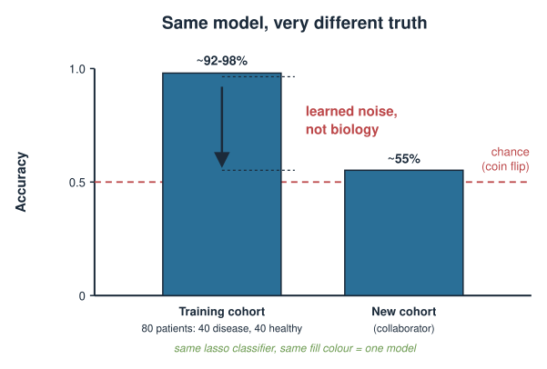{width="60%" fig-align="center"}

::: notes
This $p \gg n$ setting (20,000 features, 80 samples) is the canonical omics trap and exactly where penalties matter. With far more genes than patients you can *always* fit the training data perfectly, so a good-looking fit means nothing on its own. Two failures are bundled here: (1) $\lambda$ chosen to look good on the training data, and (2) performance reported on training data. CV fixes the first; a held-out test set fixes the second. Keep coming back to this 80-patient example through the lecture.
:::

## Training error always lies {.smaller}

Fit flexibility (here: *less* shrinkage, smaller $\lambda$) against error:

- **Training error** keeps dropping as the model grows more flexible — it can memorise.
- **Error on new data** drops, bottoms out, then **rises again** as the model starts fitting noise.

The gap between the two curves is **overfitting**. Training error is a biased, optimistic estimate of real performance, and the bias is worst exactly when $p \gg n$.

$$\text{test error} \;=\; \underbrace{\text{bias}^2}_{\text{too rigid}} \;+\; \underbrace{\text{variance}}_{\text{too flexible}} \;+\; \text{irreducible noise}$$

We cannot see the "new data" curve directly — so we **simulate having new data** by holding some out. That is cross-validation.

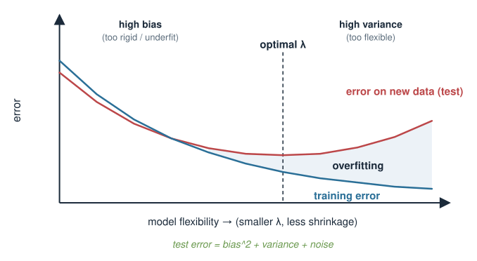{width="60%" fig-align="center"}

::: notes
The bias–variance decomposition is the theoretical backbone; keep it light — one line, one picture. The message students must leave with: a number computed on the data you fit on is not evidence. The U-shape of test error is why there is an optimal $\lambda$ in the middle — too much shrinkage underfits (high bias), too little overfits (high variance). CV is literally a way to draw that U-shaped curve using only the data you have.
:::

## The one honest idea: hold data out {.smaller}

If you want to know how a model does on data it has **never seen**, then evaluate it on data it has never seen.

1. **Split** your samples into a part you fit on and a part you keep hidden.
2. **Fit** on the first part only.
3. **Predict** the hidden part and measure the error there.

The hidden part stands in for "future patients." Everything today is a refinement of this one move.

**The rule that is never broken:** anything the model is scored on must have been **invisible during fitting** — including during any tuning, scaling, or feature selection.

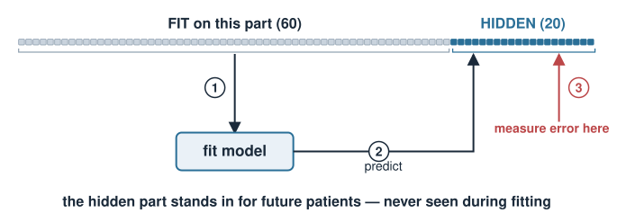{width="70%" fig-align="center"}

::: notes
State the golden rule now and repeat it every slide: the evaluation data must be untouched by fitting. Students nod at this and then violate it by scaling or gene-filtering on the full dataset first. Foreshadow that "fitting" is broader than calling glmnet — it includes every data-dependent choice, which is the crux of the leakage slide later.
:::

## One split is wasteful and noisy {.smaller}

A single train/test split has two problems:

- **Wasteful:** with only 80 patients, setting aside 20 for testing means fitting on just 60. In omics, samples are precious.
- **Noisy:** your performance estimate depends on *which* 20 landed in the test set. A lucky or unlucky split can move the number by a lot.

**Fix:** rotate the held-out part so **every sample is tested exactly once**, and average. That is **k-fold cross-validation**.

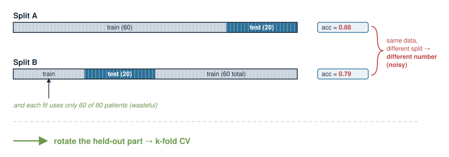{width="65%" fig-align="center"}

::: notes
Motivate k-fold as the cure for the two weaknesses of a single split. The small-$n$ point is deeply biological: recruiting 80 patients is expensive, so throwing away a quarter of them for one test is painful. Rotating the fold means every patient contributes to both training and testing (never simultaneously), so we use the data efficiently and average away the "unlucky split" noise.
:::

## k-fold cross-validation {.smaller}

Split the samples into $k$ equal **folds** (typically $k = 5$ or $10$). Then, $k$ times:

- hold out **one** fold as the validation set,
- fit the model on the **other $k-1$** folds,
- record the error on the held-out fold.

Average the $k$ errors → the **cross-validated error**. Every sample is held out **exactly once**; every model is trained on a fraction $\frac{k-1}{k}$ of the data.

$$\text{CV error} = \frac{1}{k}\sum_{f=1}^{k} \text{error on fold } f$$

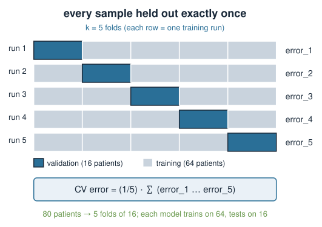{width="60%" fig-align="center"}

::: notes
Draw the classic k-fold grid on the board even though a figure is coming. Key numbers to make concrete with the 80-patient example: 10-fold means 10 folds of 8 patients; each model trains on 72, tests on 8; you fit 10 models and average 10 error estimates. Trade-off: larger $k$ = more data per fit (less bias) but more computation and higher variance between folds; $k=10$ is the standard compromise. $k=n$ is a special case (next mention: LOOCV in the exercise).
:::

## Using CV to choose $\lambda$ {.smaller}

CV turns "pick $\lambda$" into an experiment. Over a grid of candidate $\lambda$ values:

- run k-fold CV at **each** $\lambda$,
- plot **CV error vs $\lambda$** — it is the U-shaped curve, now *measured*.

Two standard choices come out:

- **`lambda.min`** — the $\lambda$ with the lowest CV error (best raw performance).
- **`lambda.1se`** — the **largest** $\lambda$ (simplest, most-shrunk model) whose CV error is within **one standard error** of the minimum.

`lambda.1se` deliberately trades a hair of accuracy for a **simpler, more reproducible** signature — often the better scientific choice.

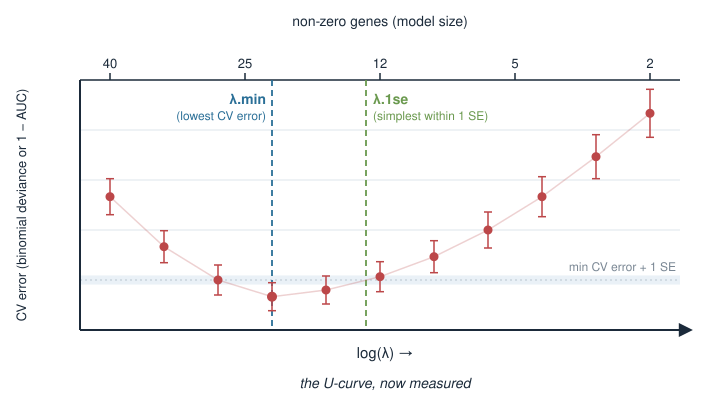{width="55%" fig-align="center"}

::: notes
This is where penalties and CV meet. The 1se rule is worth dwelling on: the CV error has uncertainty (the error bars = standard error across folds), so many $\lambda$ values are statistically indistinguishable from the best. Among those, pick the simplest (largest $\lambda$, fewest genes). Biologically this gives a shorter, more robust gene list that is likelier to replicate — which is usually what a biomarker paper actually wants. lambda.min is fine when raw predictive accuracy is the only goal.
:::

## `cv.glmnet` in R {.smaller}

`cv.glmnet` does the whole loop for you: it builds the $\lambda$ grid, runs k-fold CV, and stores both choices.

```r
library(glmnet)

x <- as.matrix(expr)     # 80 patients x 20000 genes
y <- pheno$disease        # 0/1 label, length 80

set.seed(1)               # folds are random -> set a seed for reproducibility
cvfit <- cv.glmnet(
  x, y,
  family       = "binomial",  # logistic model for a 0/1 outcome
  alpha        = 1,           # 1 = lasso, 0 = ridge, in between = elastic net
  nfolds       = 10,          # 10-fold CV
  type.measure = "auc"        # score folds by AUC (see metrics slide)
)

cvfit$lambda.min   # best-CV lambda
cvfit$lambda.1se   # simplest lambda within 1 SE of the best
plot(cvfit)        # the CV curve with error bars
```

::: notes
This is static code — nothing runs at render time. Walk the arguments: `family` selects the error model (gaussian / binomial / poisson), `alpha` selects the penalty type from the earlier units, `nfolds` sets $k$, `type.measure` picks the scoring metric. Stress `set.seed`: the folds are assigned at random, so results shift run to run without a seed — a reproducibility gotcha. Note glmnet standardises the predictors internally on each training fold, so you do not standardise by hand (and standardising by hand on the full data would itself leak).
:::

## Extracting the chosen model {.smaller}

Once CV has picked a $\lambda$, read off the coefficients and predict:

```r
# sparse coefficient vector at the simpler lambda
coef(cvfit, s = "lambda.1se")     # most genes are exactly 0 (lasso)

# predicted probabilities for new patients
p_new <- predict(cvfit, newx = x_new,
                 s = "lambda.1se", type = "response")
```

- The non-zero coefficients **are** your signature — the selected genes.
- `s = "lambda.1se"` tells `predict`/`coef` which $\lambda$ to use.
- `x_new` must have the **same genes, in the same order** as the training `x`.

::: notes
Tie back to the disease-signature story: the lasso zeroes out almost every gene, and the survivors are the candidate biomarkers. This is where penalized regression doubles as feature selection. Remind them that `x_new` must be matched columns — a silent reordering of genes is a common and disastrous bug. But note this predicted performance is still not an honest estimate if $\lambda$ was tuned by CV on the same data — which motivates the next slide.
:::

## Train / validation / test: three jobs {.smaller}

CV that chooses $\lambda$ has already *used up* the held-out folds to make a decision. So its error is a mildly **optimistic** estimate of the final model. Three distinct roles:

| Role | Job | Touched by tuning? |
|---|---|---|
| **Training** | fit coefficients for a given $\lambda$ | yes |
| **Validation** (the CV folds) | choose $\lambda$ | yes |
| **Test** | final, honest performance estimate | **no — used once** |

The **test set** is locked away until the very end and used **exactly once**. If you peek at it to make any choice, it stops being a test set.

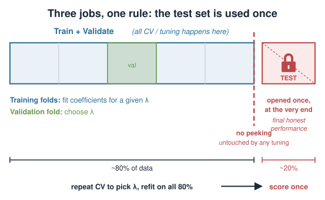{width="70%" fig-align="center"}

::: notes
The subtlety: because CV picked $\lambda$ to minimise the CV error, that minimum is slightly better than reality — you optimised against it. For a truly honest headline number you need data that took part in *no* decision. Practical recipe: hold out a test set first; do all CV/tuning on the rest; report the test-set number once. The gold-standard alternative is nested CV (outer loop for estimation, inner loop for tuning) — name it, and the exercise sketches it. With only 80 patients an external validation cohort is ideal but rarely available.
:::

## Information leakage: the cardinal sin {.smaller}

**Leakage** = letting information from the held-out data influence the model. The result is a performance number that is too good and does not replicate.

The classic omics blunder:

> Filter 20,000 genes down to the 50 most correlated with the outcome **using all 80 patients**, *then* cross-validate on those 50 genes.

The gene filter already **looked at the outcome of every patient**, including those later "held out." The folds are no longer naive. Reported accuracy can look great and be **completely spurious**.

**Rule:** feature selection is part of the model. It must happen **inside** each CV fold, on the training portion only.

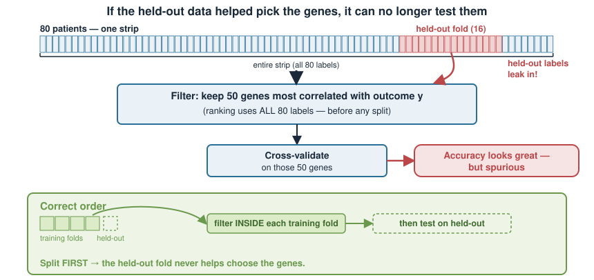{width="65%" fig-align="center"}

::: notes
This is the most important slide of the day (Ambroise & McLachlan 2002 documented exactly this selection bias in microarray classifiers). The trap is seductive because prefiltering genes feels like harmless preprocessing, not modelling. But any step that uses $y$ — supervised filtering, choosing a threshold, even scaling using the outcome — is part of fitting and must be redone inside every fold. Give the intuition: if the held-out fold helped choose the genes, it already "leaked" into the model and can no longer test it.
:::

## Leakage: wrong vs right {.smaller}

```r
## WRONG — filter uses y from ALL samples, then CV
gene_cor <- abs(cor(x, y))               # uses every patient's label
keep     <- order(gene_cor, decreasing = TRUE)[1:50]
cv.glmnet(x[, keep], y, family = "binomial")   # optimistic, leaked
```

```r
## RIGHT — the WHOLE pipeline (filter + fit) sits inside CV
folds <- sample(rep(1:10, length.out = nrow(x)))
err   <- numeric(10)
for (f in 1:10) {
  tr <- folds != f;  te <- folds == f          # split first
  gc   <- abs(cor(x[tr, ], y[tr]))              # filter on TRAIN only
  keep <- order(gc, decreasing = TRUE)[1:50]
  fit  <- glmnet(x[tr, keep], y[tr], family = "binomial")
  p <- drop(predict(fit, newx = x[te, keep], type = "response"))
  err[f] <- mean((p - y[te])^2)                 # held-out Brier score
}
mean(err)                                        # honest mean CV Brier score
```

::: notes
Contrast the two blocks line by line. The only real difference is *where the split happens*: in the wrong version the split comes after the filter; in the right version it comes first, and everything data-dependent is recomputed per fold. Note that `cv.glmnet` handles the glmnet fitting honestly per fold on its own, but it cannot know about a filtering step you did beforehand — so any supervised preprocessing you add must be wrapped in your own outer loop (or a pipeline tool). This is why leakage is an easy accident even for careful people.
:::

## Choosing a metric {.smaller}

"Error" means different things for different outcomes. Match the metric to the biology and the model's error family:

| Outcome | Example | Metric |
|---|---|---|
| Continuous | predict age from methylation | **MSE / RMSE**, $R^2$ |
| Count | predict read counts | **deviance** (Poisson) |
| Binary | disease vs healthy | **AUC**, deviance (log-loss), misclassification |

- **MSE** $= \frac{1}{n}\sum (y_i - \hat y_i)^2$ — average squared error; **RMSE** $= \sqrt{\text{MSE}}$ is back in the original units.
- **Deviance** generalises MSE to GLMs — the natural loss when the error model is Poisson or binomial.
- **AUC** measures **ranking** (does the model score sick patients above healthy ones?) and is robust to class imbalance and threshold choice.

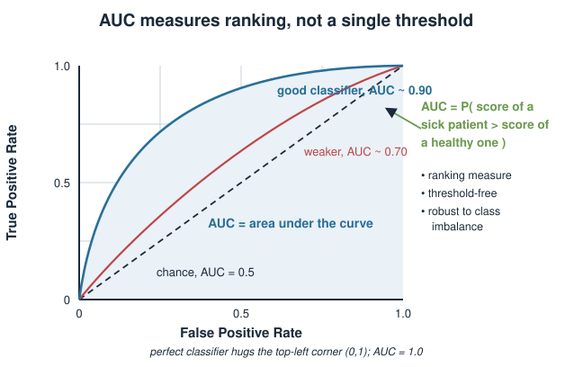{width="50%" fig-align="center"}

::: notes
The metric is a modelling decision, not an afterthought. For the disease classifier, plain accuracy is misleading when classes are imbalanced (95% healthy → predict "healthy" always scores 95%). AUC sidesteps this by scoring the ranking, and it needs no threshold. Deviance is the honest loss when you fit a GLM because it is the very quantity the model optimises — tie this back to the Poisson/negative-binomial error-model units. Set `type.measure` in cv.glmnet to whatever you will ultimately be judged on.
:::

## Detecting overfitting in practice {.smaller}

Two cheap diagnostics:

- **Train vs CV gap.** Near-perfect training error with much worse CV error = overfitting. A healthy model has a *small* gap.
- **Fold-to-fold spread.** If CV error swings wildly between folds, the estimate is unstable — often too few samples, or correlated/grouped samples split across folds.

Responses: **increase $\lambda$** (shrink harder), reduce the feature set honestly, or get more samples.

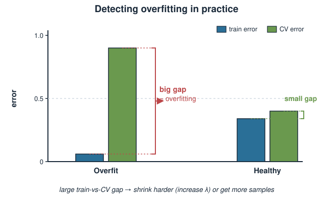{width="60%" fig-align="center"}

::: notes
Give them a reflex: always compare training error to CV error. A large gap is the fingerprint of overfitting and the direct signal to turn $\lambda$ up. Unstable folds point to a data problem — most often that related samples (technical replicates, multiple cells from one patient, batches) are split across the train/test boundary, which leaks and inflates performance. That motivates the grouping pitfall next.
:::

## Pitfalls in real omics data {.smaller}

- **Grouped samples.** Cells from the same patient, technical replicates, or batches must stay **together** in one fold (grouped CV). Splitting them leaks and inflates performance.
- **Class imbalance.** With few cases, use **stratified** folds so each fold has both classes; prefer AUC over accuracy.
- **Small $n$.** CV estimates are themselves noisy when $n$ is small — report them with their spread, do not over-interpret the third decimal.
- **Batch effects.** A model can "predict" disease by detecting the batch it was run in. CV will not catch this if batch is confounded with outcome.

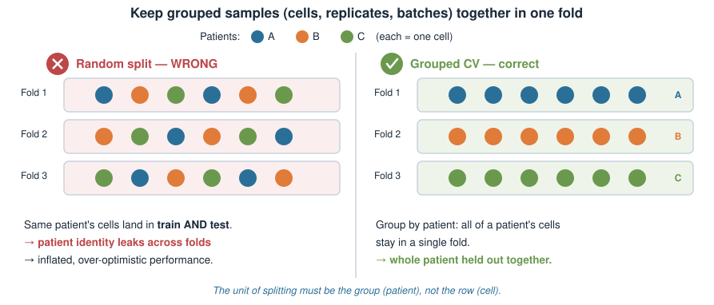{width="65%" fig-align="center"}

::: notes
These are the failure modes that turn a technically correct CV into a misleading one. The grouping point is the most common in single-cell and repeated-measures designs: thousands of cells from one patient are not independent samples, so splitting them across folds leaks patient identity. Stratification matters whenever cases are rare. And batch confounding is a study-design problem CV cannot rescue — the fix is upstream (randomised batches), connecting to the covariate-handling ideas in the regression units.
:::

## Summary {.smaller}

| Idea | Key point |
|---|---|
| Training error | optimistic — never report it as performance |
| Hold-out | evaluate only on data unseen during fitting |
| k-fold CV | rotate folds; every sample tested once; average |
| Choosing $\lambda$ | CV error vs $\lambda$; `lambda.min` vs `lambda.1se` |
| `cv.glmnet` | `family`, `alpha`, `nfolds`, `type.measure`; `set.seed` |
| Train/val/test | three jobs; the test set is opened **once** |
| Leakage | any $y$-using step goes **inside** the CV loop |
| Metric | MSE/RMSE, deviance, AUC — match to the outcome |

**Where this leads:** these same folds are how one compares **lasso vs ridge vs elastic net**, and how chemometrics models (**PLS / OPLS**) are validated. Cross-validation is the common ruler for every penalized and latent-variable model in the course.

::: notes
The one-line exam summary: CV is how we choose $\lambda$ honestly and estimate performance honestly, and the two jobs must not contaminate each other. Drill the leakage rule and the fold arithmetic — those are the examinable pieces. Preview that the same machinery generalises: comparing penalty types (the elastic-net unit) and validating chemometrics/PLS models all rest on exactly this cross-validation scaffolding.
:::
