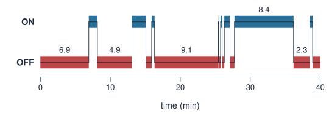
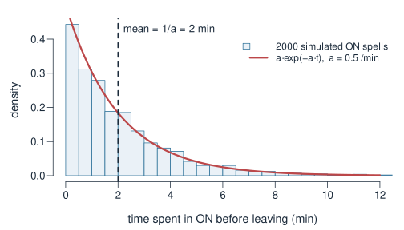
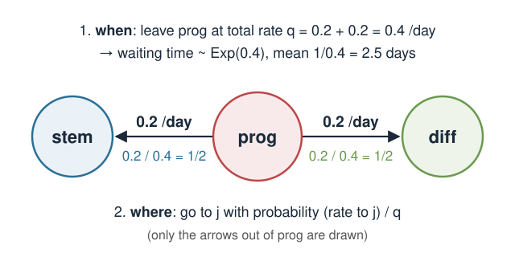
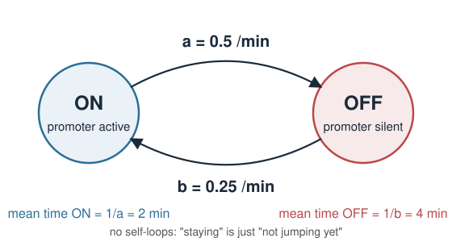
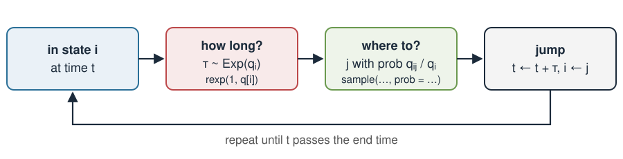
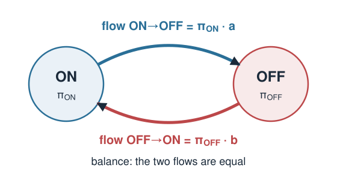
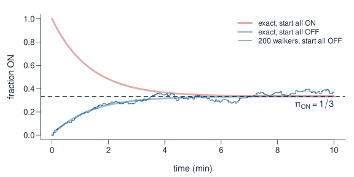
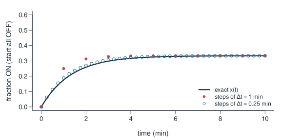
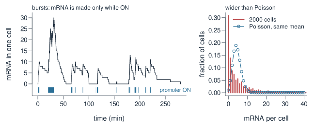

## About this lecture

In Markov chains, time moved in **steps**: $\mathbf{x}_{t+1} = \mathbf{x}_t P$. Real cells do not wait for a clock tick. A promoter can switch on at 10:03:17, and an ion channel can open after 2.4 ms.

This lecture builds the **continuous-time** version of the same idea:

- **Rates** instead of per-step probabilities.
- The time spent in a state is **exponential** (from Error models).
- The **rate matrix** $Q$, whose rows sum to **0**.
- **Simulating** a chain: draw a waiting time, then pick a jump.
- The **stationary distribution** from $\boldsymbol\pi Q = \mathbf{0}$, found by balancing flows.
- How $Q$ links back to the step matrix $P$.

::: notes
This is extra material that builds directly on Markov chains and Markov chains in R, and borrows one result from Error models: waiting times between random events are exponential. Same notation as before: row vectors, rows are "from", columns are "to". The one genuinely new object is the rate matrix Q. Everything else is a translation of what students already know about P. Keep the maths at the level of "rate = expected number of events per unit time".
:::

## Biology happens in continuous time {.smaller}

Many biological switches flip at random moments, not on a schedule:

- **Gene promoter ON/OFF** (the *telegraph model*): a promoter switches between an active and a silent state, and mRNA is made only while it is ON.
- **Ion channels** open and close; the current through a single channel jumps between levels.
- **Cell states** such as stem ↔ progenitor → differentiated, observed in time-lapse.
- **Mutations**: a DNA site changes base now and then, over millions of years.

One promoter, simulated over 40 minutes (numbers = how long each period lasted):

{width="78%" fig-align="center"}

::: notes
Start with pictures, not equations. The trace is one simulated promoter that switches ON to OFF at rate 0.5 per minute and OFF to ON at 0.25 per minute; these numbers are the running example of the whole lecture. Point out the two things a step-based chain cannot show: switches happen at arbitrary times, and the periods have very different lengths, some a few seconds, some 9 minutes. Asking "what is the probability of switching in the next step?" depends on how long a step is. We need a description that does not depend on a step size: rates.
:::

## From per-step probabilities to rates {.smaller}

A **rate** is "expected number of events per unit of time", for example $0.5$ per minute.

| | Discrete time (Markov chains) | Continuous time (today) |
|---|---|---|
| Time | steps $t = 0, 1, 2, \dots$ | any time $t \ge 0$ |
| Arrow $i \to j$ carries | probability $p_{ij}$ per step | **rate** $q_{ij}$, e.g. 0.5 /min |
| Staying put | self-loop $p_{ii}$ | no self-loop: just "not jumped yet" |
| Collected in | $P$, rows sum to **1** | $Q$, rows sum to **0** |

For a **short** time $\Delta t$, a rate turns into a small probability:

$$P(\text{jump } i \to j \text{ within } \Delta t) \;\approx\; q_{ij}\,\Delta t .$$

With $q_{\text{ON}\to\text{OFF}} = 0.5$ /min: in 6 seconds ($\Delta t = 0.1$ min) the chance to switch off is about $0.05$.

::: notes
The table is the map for the whole lecture; come back to it at the end. The key sentence: a rate is not a probability. A rate can be larger than 1 (2 per minute is fine), and it has units. The approximation q times delta-t only holds for short intervals, where the product is small; for long intervals it would exceed 1. We will return to this approximation near the end, where it gives P ≈ I + QΔt. The "no self-loop" row often surprises students: in continuous time staying is not an event; it is simply time passing without a jump.
:::

## How long do you stay? Exponential waiting times {.smaller}

Let $q_i$ be the **total rate of leaving** state $i$ (the sum of the rates on all arrows out of $i$). Then the time $T$ spent in $i$ before the next jump is **exponential** (see the exponential distribution in Error models):

$$T \sim \text{Exp}(q_i), \qquad \text{mean time in } i = \frac{1}{q_i}.$$

Promoter: ON is left at $a = 0.5$ /min, so an ON period lasts on average $1/0.5 = 2$ minutes.

:::: {.columns}
::: {.column width="52%"}
- Short periods are the most common; long ones are rare but do happen.
- **Memoryless**: a promoter that has been ON for 5 minutes is no more likely to switch off in the next second than one that just switched on.
- Same maths as gaps between random events, for example $P(T > 4) = e^{-0.5\cdot 4} \approx 0.135$.
:::
::: {.column width="48%"}
{width="100%"}
:::
::::

::: notes
Link to Error models: there, the gaps between events in a stream of random events at rate lambda were exponential with mean 1/lambda. Here the "event" is leaving the current state, and the rate is the total leaving rate q_i. The histogram shows 2000 simulated ON periods with the curve a·exp(−a·t) on top; the dashed line is the mean of 2 minutes. Memorylessness is what makes the chain Markov: the future depends on the current state only, not on how long you have been there. This is also the main assumption that can fail, which we come back to on the last slides.
:::

## Where to jump next: the jump chain {.smaller}

When a state has **several** arrows out, two questions are answered separately:

1. **When** do you leave? After an $\text{Exp}(q_i)$ time, where $q_i = \sum_{j \ne i} q_{ij}$.
2. **Where** do you go? To $j$ with probability
$$\frac{q_{ij}}{q_i} = \frac{\text{rate to } j}{\text{total leaving rate}}.$$

{width="58%" fig-align="center"}

The list of states visited, ignoring the times, is an ordinary discrete Markov chain (the **jump chain**), with no self-loops.

::: notes
Example: a progenitor cell can go back to stem at 0.2 per day or forward to differentiated at 0.2 per day. It leaves at total rate 0.4 per day, so on average after 2.5 days, and then each direction is equally likely. If the rates were 0.1 and 0.3, it would still leave at 0.4 per day, but go forward 3 times out of 4. A useful picture: every arrow is its own exponential alarm clock; the first one to ring decides where you go. The fastest clock wins most often, in proportion to its rate. The jump chain connects to Markov chains: its rows sum to 1, but its diagonal is 0.
:::

## The rate matrix $Q$ {.smaller}

Collect the rates in a matrix, in the same **row = from, column = to** convention as $P$:

- **Off the diagonal:** $q_{ij}$ = rate from $i$ to $j$ (zero if there is no arrow).
- **On the diagonal:** $q_{ii} = -q_i$, minus the total rate of leaving $i$.

So **every row of $Q$ sums to 0**. For 3 cell states (rates per day):

$$
Q = \begin{array}{c c}
 & \begin{array}{ccc}\ \text{stem} & \ \ \text{prog} & \ \ \text{diff}\end{array}\\
\begin{array}{c}\text{stem}\\ \text{prog}\\ \text{diff}\end{array} &
\left(\begin{array}{ccc}
-0.4 & 0.4 & 0\\
0.2 & -0.4 & 0.2\\
0 & 0.1 & -0.1
\end{array}\right)
\end{array}
\qquad \begin{array}{l} \leftarrow -0.4 + 0.4 + 0 = 0\\ \leftarrow 0.2 - 0.4 + 0.2 = 0\\ \leftarrow 0 + 0.1 - 0.1 = 0\end{array}
$$

| Check for $P$ (discrete) | Check for $Q$ (continuous) |
|---|---|
| entries between 0 and 1 | off-diagonal entries $\ge 0$ (any size) |
| rows sum to **1** | diagonal $\le 0$, rows sum to **0** |

::: notes
This is the central object of the unit. Why the funny diagonal? Think of the fraction of cells in each state. Probability flows out of stem at rate 0.4 times the fraction in stem; that loss is the −0.4. Probability flows into prog from stem and from diff; those gains are the positive entries in the prog column. Gains and losses cancel overall, so the total stays 1; that is exactly what "rows sum to 0" guarantees. The checklist mirrors the one students used for P: a quick way to spot an invalid Q is a row that does not sum to 0 or a negative off-diagonal entry.
:::

## A 2-state example by hand {.smaller}

:::: {.columns}
::: {.column width="50%"}
{width="100%"}
:::
::: {.column width="50%"}
States ordered $(\text{ON}, \text{OFF})$; $a$ = rate ON→OFF, $b$ = rate OFF→ON.

$$Q = \begin{pmatrix} -a & a\\ b & -b \end{pmatrix} = \begin{pmatrix} -0.5 & 0.5\\ 0.25 & -0.25 \end{pmatrix}$$

- Rows: $-0.5 + 0.5 = 0$ ✓, $\ 0.25 - 0.25 = 0$ ✓
- Leaving rates: $q_{\text{ON}} = 0.5$, $q_{\text{OFF}} = 0.25$ /min
- Mean times: ON $1/0.5 = 2$ min, OFF $1/0.25 = 4$ min
- With only one arrow out, the jump chain is "always switch".
:::
::::

How does a population change? Like $\mathbf{x}_{t+1} - \mathbf{x}_t = \mathbf{x}_t(P - I)$ in discrete time, here **change per minute** $= \mathbf{x}(t)\,Q$:

$$\text{change in } x_{\text{ON}} \text{ per minute} = \underbrace{-a\,x_{\text{ON}}}_{\text{leaving ON}} + \underbrace{b\,x_{\text{OFF}}}_{\text{arriving from OFF}}.$$

::: notes
Work through this on the board. Read Q off the diagram row by row: the ON row has the ON→OFF rate in the OFF column, and minus that on the diagonal. Then the OFF row. Check both row sums. The bottom line is the only "differential equation" in the lecture, and we keep it in words: the fraction ON goes down because ON cells leave at rate a, and up because OFF cells arrive at rate b. In symbols dx/dt = xQ, but students do not need calculus here: "change per minute" is enough. If all start OFF, the fraction ON initially grows at 0.25 per minute.
:::

## Simulating a chain: the Gillespie idea {.smaller}

To simulate one cell, alternate **how long** and **where to**:

{width="82%" fig-align="center"}

```r
a <- 0.5; b <- 0.25                      # rates per minute
t <- 0; state <- "OFF"; times <- 0; states <- state
while (t < 60) {
  rate  <- if (state == "ON") a else b   # total leaving rate
  t     <- t + rexp(1, rate)             # how long?  Exp(rate)
  state <- if (state == "ON") "OFF" else "ON"   # where to? (only one choice here)
  times <- c(times, t); states <- c(states, state)
}
```

This is the **Gillespie algorithm** (Gillespie 1977), used for simulating chemical reactions in cells.

::: notes
The algorithm is exactly the two questions of the jump-chain slide put in a loop. With two states the "where to" is trivial; with more states it is a sample() with probabilities q_ij / q_i. No time step is needed and no approximation is made: each simulated path is an exact draw from the chain. That is why it is the standard tool for stochastic gene expression, where molecule numbers are small and randomness matters. The exercise asks students to write this loop and measure the fraction of time ON. Reference: D. T. Gillespie (1977), Exact stochastic simulation of coupled chemical reactions, Journal of Physical Chemistry 81(25), 2340–2361.
:::

## Try it: 200 promoters in continuous time

```{=html}
<link rel="stylesheet" href="../demos/dist/demo.css">
<div data-demo="ctmcwalkers" data-q="0 0.5 0.25 0" data-states="ON OFF" data-label="Promoter ON/OFF" data-unit="/min" data-start="1" data-speed="1" data-view="10" data-follow="1" data-presets="fast slow cell3 absorbing"></div>
<script src="../demos/dist/ctmcwalkers.js"></script>
```

::: notes
200 promoters, all starting OFF. Press Run. Unlike the discrete demo, there is no Step button: each walker jumps at its own random moment, so they leave one by one while the clock runs. The arrows show rates, not probabilities, and there are no self-loops. The ringed walker's timeline below the diagram is the most important picture: bars of random length, mostly short, a few long. These are exponential waiting times, mean 4 min in OFF and 2 min in ON. The bars: walker fractions next to the exact x(t); the dashed line is π = (1/3, 2/3), which we derive on the next slide. "Fast switching" (rates ×4) and "Slow switching" (rates ÷5) have the same π but reach it at very different speeds, and the timeline of the ringed walker looks completely different. "Absorbing" has a dead state with no way out, so in the end every walker is dead. Speed changes only how fast the clock runs on screen, not the chain.
:::

## Stationary distribution: balance the flows {.smaller}

The distribution stops changing when the change per unit time is zero:

$$\boldsymbol\pi Q = \mathbf{0}, \qquad \textstyle\sum_k \pi_k = 1 \qquad \text{(compare } \boldsymbol\pi P = \boldsymbol\pi \text{ in discrete time).}$$

:::: {.columns}
::: {.column width="50%"}
{width="100%"}
:::
::: {.column width="50%"}
For 2 states this is **flow in = flow out**:

$$\pi_{\text{ON}}\, a = \pi_{\text{OFF}}\, b .$$

Add $\pi_{\text{ON}} + \pi_{\text{OFF}} = 1$:

$$\boldsymbol\pi = \frac{(b,\ a)}{a+b}.$$

Promoter: $\boldsymbol\pi = (0.25, 0.5)/0.75 = (1/3,\ 2/3)$. ON one third of the time.
:::
::::

Same answer from the waiting times: mean ON 2 min, mean OFF 4 min, so ON a fraction $2/(2+4) = 1/3$ of the time.

::: notes
Flow balance is the intuitive route and avoids any matrix algebra. Picture many cells. Cells leave ON at rate a each, so the flow ON→OFF is π_ON times a cells per minute. The flow OFF→ON is π_OFF times b. At equilibrium these must be equal, otherwise one state would keep filling up. Writing out πQ = 0 gives exactly this equation twice (the two equations are the same, as in Markov chains in R), so we need the sum-to-1 constraint as well. The check with mean waiting times is a nice second view: in the long run the time is split in proportion to the mean lengths of the periods. For more than 2 states, πQ = 0 is a set of linear equations solved like any other; for a chain in a line (stem ↔ prog ↔ diff) balancing each pair of neighbours still works.
:::

## Relaxation: how fast is equilibrium reached? {.smaller}

For 2 states, the distance to $\boldsymbol\pi$ shrinks exponentially, with rate $a + b$:

$$x_{\text{ON}}(t) = \pi_{\text{ON}} + \big(x_{\text{ON}}(0) - \pi_{\text{ON}}\big)\, e^{-(a+b)t}.$$

{width="62%" fig-align="center"}

Promoter: $a + b = 0.75$ /min, so the gap halves every $\ln 2 / 0.75 \approx 0.9$ min. Both rates speed this up, even though only their **ratio** sets $\boldsymbol\pi$.

::: notes
We state this result without derivation; it is the continuous-time version of "the distance to π shrinks by the same factor every step". Check two values: at t = 0 the formula gives x(0); for large t the exponential vanishes and we are left with π. The thin line is 200 simulated walkers starting all OFF: it follows the exact curve with random wobble. Key message: the ratio a:b decides where the chain ends up, the sum a+b decides how fast it gets there. That is why "Fast switching" and "Slow switching" in the demo have the same dashed line but very different curves. For larger chains there are several such rates (they are eigenvalues of Q), and the slowest one dominates.
:::

## Back to discrete time: $P \approx I + Q\,\Delta t$ {.smaller}

Look at the chain only every $\Delta t$ minutes. For small $\Delta t$, using $q_{ij}\Delta t$ for the chance of a jump:

$$P \approx I + Q\,\Delta t, \qquad \Delta t = 0.25:\quad P = \begin{pmatrix} 1 - 0.125 & 0.125\\ 0.0625 & 1 - 0.0625 \end{pmatrix} = \begin{pmatrix} 0.875 & 0.125\\ 0.0625 & 0.9375 \end{pmatrix}.$$

:::: {.columns}
::: {.column width="48%"}
- Rows of $P$ sum to 1, because rows of $Q$ sum to 0.
- Same $\boldsymbol\pi$: $\boldsymbol\pi P = \boldsymbol\pi + \Delta t\,\boldsymbol\pi Q = \boldsymbol\pi$.
- Small $\Delta t$ follows the exact curve; large $\Delta t$ does not.
- *Aside:* the exact step matrix is $P(t) = e^{Qt}$, the "matrix exponential" (`expm` package). Not needed here.
:::
::: {.column width="52%"}
{width="100%"}
:::
::::

::: notes
This slide ties the two halves of the Markov material together. The step matrix of Markov chains is what you get when you watch a continuous chain through a stroboscope. The approximation P ≈ I + QΔt is the matrix version of "probability ≈ rate × time". Two quick checks students can do: the rows sum to 1, and π is unchanged. The figure shows the price of a coarse step: with Δt = 1 min the steps overshoot early on (0.31 instead of 0.26 at 2 minutes), with Δt = 0.25 they are close. If Δt is so large that a diagonal entry of I + QΔt becomes negative, it is not a valid P at all. The exact P(t) = exp(Qt) is mentioned only so students recognise it in the literature; nothing in the course uses it.
:::

## Where this shows up: transcriptional bursting {.smaller}

Add mRNA to the telegraph model: while ON, mRNA is made at rate $s$; each mRNA is degraded at rate $g$. It is still a continuous-time Markov chain, now with many states (promoter, number of mRNA), simulated with Gillespie.

{width="82%" fig-align="center"}

Short, rare ON periods give **bursts**. Across 2000 simulated cells: mean $4.5$ mRNA, variance $39$, and $31\%$ zeros where a Poisson with that mean would give $1\%$. These are the **overdispersed** counts of Error models; with bursty promoters, counts are close to **negative binomial**.

::: notes
Parameters for the figure: OFF to ON at 0.05 per minute, ON to OFF at 0.5 per minute, 5 mRNA per minute while ON, mRNA lifetime 10 minutes. The left panel is one cell: the count jumps up during each short ON period (the blue ticks) and decays in between. The right panel is a snapshot of 2000 independent cells. Compared with a Poisson of the same mean (open circles), there are far more zeros and a long right tail. This is one mechanistic explanation for overdispersion in single-cell counts and links the negative binomial of Error models to a physical model; other sources of cell-to-cell variation add to it. The telegraph model goes back to Peccoud & Ycart (1995, Theoretical Population Biology 48: 222–234); transcriptional bursts were counted molecule by molecule in mammalian cells by Raj et al. (2006, PLoS Biology 4: e309).
:::

## Where this shows up: DNA substitution models {.smaller}

At one DNA site, bases change by mutation over long times: a 4-state chain on $\{\mathtt{A},\mathtt{C},\mathtt{G},\mathtt{T}\}$.

The simplest model, **Jukes–Cantor**: every change happens at the same rate $\alpha$.

$$Q = \begin{pmatrix} -3\alpha & \alpha & \alpha & \alpha\\ \alpha & -3\alpha & \alpha & \alpha\\ \alpha & \alpha & -3\alpha & \alpha\\ \alpha & \alpha & \alpha & -3\alpha \end{pmatrix}, \qquad \boldsymbol\pi = \left(\tfrac14, \tfrac14, \tfrac14, \tfrac14\right).$$

- With $3\alpha = 1$, time is measured in expected substitutions per site, and the chance that a site still shows its original base after time $t$ is $\tfrac14 + \tfrac34 e^{-4t/3}$.
- So two sequences can never differ at more than about $3/4$ of their sites: changes on top of changes are hidden. Distances between species are corrected for this.
- Richer models give transitions and transversions different rates, or unequal base frequencies. Phylogenetics software fits such $Q$ matrices.

::: notes
This is the second big application, kept brief. Each site of an alignment is one walker; the tree tells you how long each walker had to change. Jukes and Cantor (1969) is the classical starting point. The formula 1/4 + 3/4 e^{−4t/3} is the relaxation formula of two slides ago for this chain; we only state it. The saturation at 3/4 is why the raw fraction of differing sites underestimates evolutionary distance for distantly related sequences. The demo has a Jukes–Cantor preset in the exercise page. Models such as Kimura's two-parameter model, HKY and GTR are the same idea with more rates.
:::

## Assumptions, and when they break {.smaller}

| Assumption | What it means | When it breaks |
|---|---|---|
| **Memoryless** | waiting times are exponential; time already spent does not matter | a cell-cycle phase has a minimum length; a promoter has a refractory period after switching off |
| **Constant rates** | $q_{ij}$ do not change over time | circadian rhythms, a drug added at a fixed time, cells that age |
| **Few, well-defined states** | the state says everything about the future | a "state" hides sub-states (chromatin, signalling) |
| **Independent walkers** | cells do not influence each other | quorum sensing, competition for resources |

A common fix for non-exponential times: split one visible state into several hidden **stages** in a row. The total time then has a peak instead of a maximum at zero, while the chain stays Markov on the larger state space.

::: notes
Be honest: the exponential waiting time is a strong assumption. A quick test on data is the histogram of dwell times: exponential means the most common dwell time is very short. Many biological dwell times instead have a clear peak; an OFF state with a refractory period is a known example for some genes. The stage trick connects back to Hidden Markov models: the observed ON/OFF is then a function of a hidden chain. Time-varying rates are fine to simulate (the Gillespie loop must then be adapted) but the simple formulas for π and relaxation no longer hold.
:::

## Summary {.smaller}

| Concept | Discrete time | Continuous time |
|---|---|---|
| Arrow $i \to j$ | probability $p_{ij}$ | rate $q_{ij}$ (per time unit) |
| Matrix | $P$, rows sum to 1 | $Q$, $q_{ii} = -q_i$, rows sum to **0** |
| Time in state $i$ | geometric (in steps) | **exponential**, mean $1/q_i$ |
| Next state | row $i$ of $P$ | $j$ with probability $q_{ij}/q_i$ |
| Evolution | $\mathbf{x}_{t+1} = \mathbf{x}_t P$ | change per time $= \mathbf{x}(t)\,Q$ |
| Stationary | $\boldsymbol\pi P = \boldsymbol\pi$ | $\boldsymbol\pi Q = \mathbf{0}$; 2 states: $(b, a)/(a+b)$ |
| Link | $P \approx I + Q\,\Delta t$ for small $\Delta t$ | |

Simulate with Gillespie: **how long** (exponential), then **where to** (rate / total rate).

::: notes
Return to the table from the start of the lecture. Every row of the discrete-time story has a continuous-time partner. The things to remember: rates are not probabilities; the time in a state is exponential with mean one over the total leaving rate; Q has rows summing to zero; the stationary distribution balances flows; and for small time steps P is approximately I + QΔt. The exercise practises all of these by hand, with the demo, and in base R with a Gillespie loop.
:::
