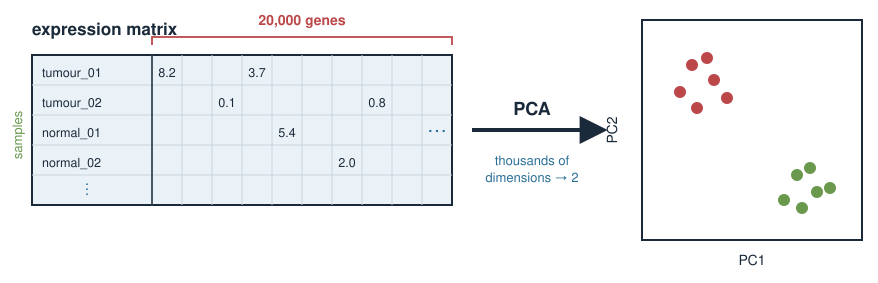
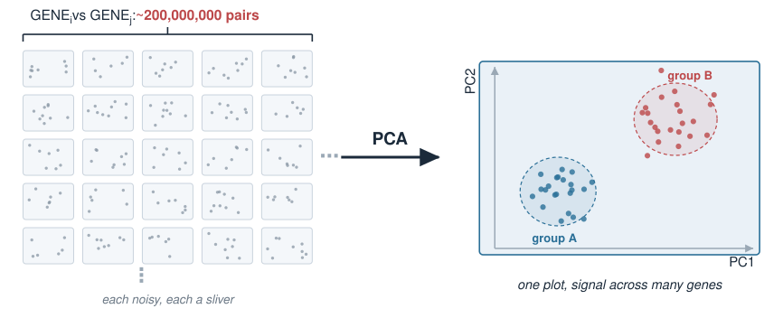
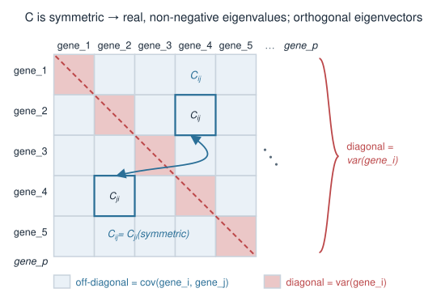
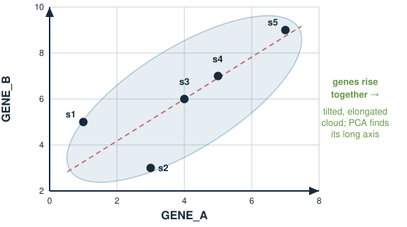
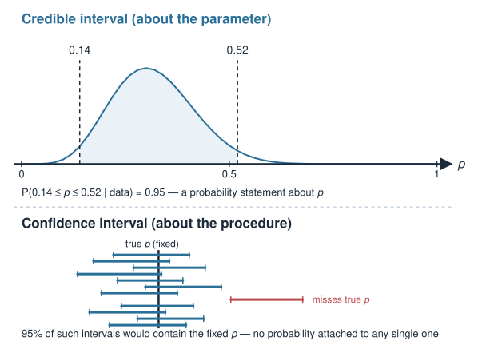
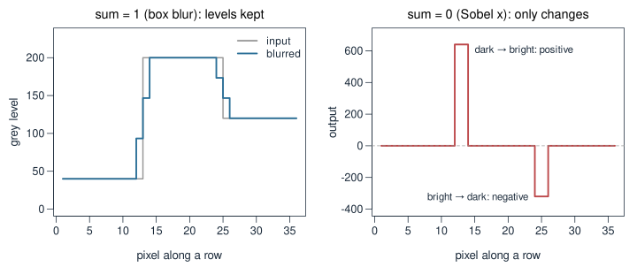

## How to use this sandbox

- Start the editor: `make edit-slides` (or `node tools/slide-editor/server.mjs`) and open the printed URL.
- **✎ Edit** (top left, orange when on): click any text in a figure, type, press **Enter** to save or **Esc** to cancel. Click other text to open its source.
- **Slide source**: edit this slide's markdown, then **Save & render** (or Ctrl+S). The page reloads on the same slide.
- Figures produced by an R script cannot be edited here (dashed outline); see the last slide.
- Everything is saved into the repo files, so `git diff` shows exactly what changed.

::: notes
Speaker notes are part of the slide source too, so they can be edited in the same panel.
:::

## The biology problem {.smaller}

A typical RNA-seq experiment gives an expression matrix: **samples (rows) × genes (columns)**.

| sample | *GENE1* | *GENE2* | *GENE3* | ... | *GENE20000* |
|---|---|---|---|---|---|
| tumour_01 | 8.2 | 0.1 | 5.4 | ... | 2.0 |
| tumour_02 | 7.9 | 0.0 | 5.1 | ... | 2.3 |
| normal_01 | 2.1 | 6.7 | 5.3 | ... | 1.9 |
| ... | | | | | |

- Each sample is a point in **20,000-dimensional** space. We cannot look at it.
- But the genes are **not independent** — they are co-regulated in **programmes** (cell-cycle genes rise together, immune genes rise together...).
- So the real structure lives in **far fewer** dimensions than 20,000. **PCA finds them.**

{width="75%" fig-align="center"}

::: notes
Ground the abstraction in the data format they actually meet: a wide expression matrix, samples as rows, genes as columns, tens of thousands of columns. The key biological fact that makes dimension reduction possible is co-regulation: genes move together in programmes, so the effective number of independent directions is small. PCA is the tool that discovers those directions from the data alone, without being told the sample labels. Emphasise "unsupervised": we do not tell PCA which are tumours; we ask whether structure falls out on its own. That is exactly what makes a PCA plot a good first look at any omics dataset.
:::

## Why not just look at genes one at a time? {.smaller}

You could plot *GENE1* against *GENE2*, then *GENE1* against *GENE3*, ...

- With 20,000 genes there are about **200 million** pairwise scatter plots. Hopeless.
- Any single gene is **noisy** and captures only a sliver of the biology.
- The interesting signal — "these samples separate into two groups" — is usually spread **across many genes at once**, not visible in any single pair.

PCA builds **new composite variables** (mixtures of many genes) chosen so that the **first few show the most variation**. We look at those instead.

{width="70%" fig-align="center"}

::: notes
Motivate why marginal, one-gene-at-a-time thinking fails: too many pairs, each gene noisy, and the signal is distributed. This is the conceptual jump — from "measured variables" (genes) to "derived variables" (principal components) that are weighted combinations of all genes. Reassure them a PC is not mysterious: it is just a weighted sum of the genes, with weights (the loadings) chosen by the eigenvector. The choice criterion is "maximise variance", which is where the covariance matrix and its leading eigenvector enter.
:::

## Recall: the covariance matrix {.smaller}

Variance measures spread of one variable; **covariance** measures how two vary **together**.

For $p$ genes, the covariance matrix $C$ is $p \times p$:

$$C_{ij} = \text{cov}(\text{gene}_i, \text{gene}_j), \qquad C_{ii} = \text{var}(\text{gene}_i)$$

- **Diagonal** = each gene's own variance. **Off-diagonal** = co-variation between gene pairs.
- $C$ is **symmetric** because $\text{cov}(g_i, g_j) = \text{cov}(g_j, g_i)$.

From Eigenvalues & eigenvectors, a symmetric matrix has:

- **real, non-negative** eigenvalues (they are variances — they cannot be negative), and
- **orthogonal** eigenvectors — a clean set of perpendicular axes.

**Those eigenvectors are the principal components.**

{width="55%" fig-align="center"}

::: notes
This is the load-bearing recall slide. Covariance generalises variance to pairs; stacking all pairwise covariances gives the symmetric p-by-p covariance matrix, diagonal = variances, off-diagonal = covariances. The symmetry is not a lucky accident — it is guaranteed because cov is symmetric in its two arguments. Then invoke the spectral theorem result they already proved: symmetric implies real eigenvalues and orthogonal eigenvectors. Add the biological reason eigenvalues are non-negative here: they equal variances along the eigen-directions, and variance cannot be negative. Land the punchline plainly: the eigenvectors of C are the principal components. The rest of the lecture unpacks that sentence on a tiny example.
:::

## A tiny worked example: two genes {.smaller}

Keep it to **2 genes and 5 samples** so we can see everything by hand.

| sample | *GENE_A* | *GENE_B* |
|---|---|---|
| s1 | 1 | 5 |
| s2 | 3 | 3 |
| s3 | 4 | 6 |
| s4 | 5 | 7 |
| s5 | 7 | 9 |

- Plot the 5 points with *GENE_A* on the x-axis, *GENE_B* on the y-axis.
- The cloud is a **tilted, elongated sausage** — the two genes rise together (positive covariance).
- PCA will find the **long axis** of that sausage.

{width="50%" fig-align="center"}

::: notes
Deliberately choose tiny round-ish numbers so every step is doable on the board. Two genes means the data cloud lives in the plane and the "long axis" is literally visible. Have students sketch the five points; they will see a diagonal, elongated cloud because gene A and gene B increase together. That visible long axis is PC1; the perpendicular short axis is PC2. Everything from here — centring, covariance, eigenvectors, scores — is making that visual intuition precise and numerical.
:::

## Credible interval vs confidence interval {.smaller}

Bayesian uncertainty comes straight from the posterior. A **95% credible interval** is any interval holding 95% of the posterior probability:

$$P(\,0.14 \le p \le 0.52 \mid \text{data}\,) = 0.95 \quad (\text{for Beta}(7,15))$$

You are allowed to say the honest sentence: *"there is a 95% probability that $p$ lies in this interval."*

A frequentist **95% confidence interval** does **not** mean that. It means: *if you repeated the whole experiment many times, 95% of the intervals so constructed would contain the true fixed $p$.* Any single interval either contains $p$ or does not — no probability attached.

| | Credible interval | Confidence interval |
|---|---|---|
| Statement about | the **parameter** | the **procedure** |
| "95% probability $p$ is inside" | ✓ allowed | ✗ not allowed |

{width="60%" fig-align="center"}

::: notes
This is the contrast students most often get wrong, so slow down. The credible interval is a direct probability statement about the parameter — legal for a Bayesian because p has a distribution. The confidence interval is a statement about the long-run behaviour of the interval-construction procedure, NOT about any single interval; strictly, a given 95% CI has already either caught p or missed it, with no probability. Most scientists secretly interpret their confidence intervals as credible intervals — the Bayesian version is the interpretation people actually want, made legitimate. Note the numbers here are illustrative (from qbeta on Beta(7,15)); the exact endpoints come from the R on the next slide.
:::

## A figure made by an R script

This figure is drawn by `kernels/make-kernel-figs.R`. Its labels are locked (dashed outline when label editing is on), because the next run of the script would overwrite any edit. Change the script instead.

{width="72%" fig-align="center"}

::: notes
The editor checks each unit folder's .R files for the figure's file name.
:::
