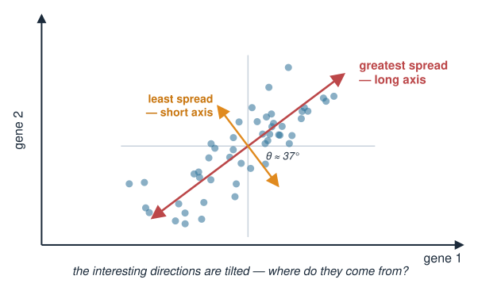
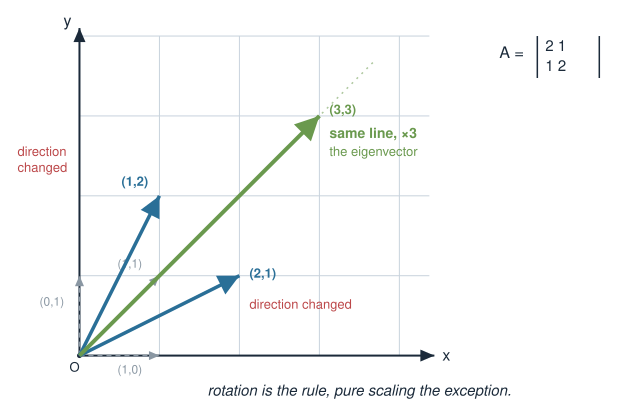
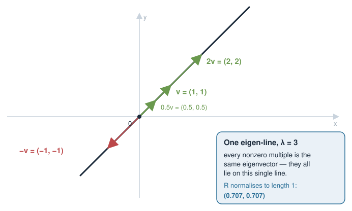
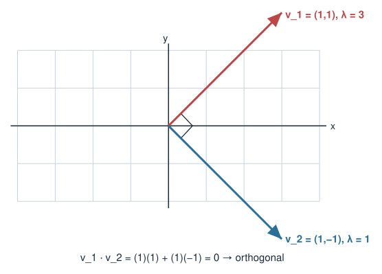
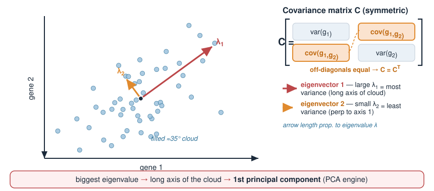
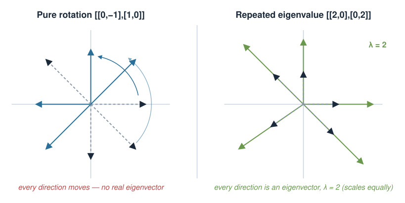
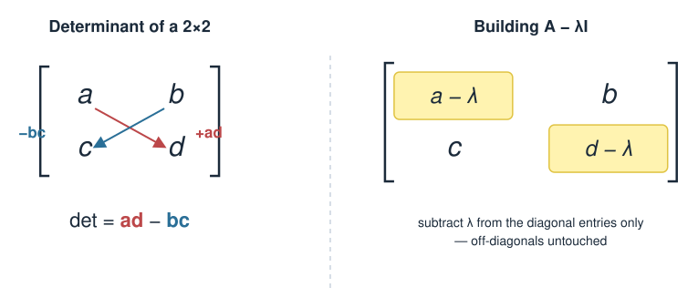

## About this lecture

In Matrices as transformations, a matrix is a **function** that moves vectors around — it stretches, rotates, mixes the axes. Today we hunt for the **special directions** a matrix leaves alone.

- Most vectors get **rotated** by a matrix. A few special ones only get **scaled** — those are **eigenvectors**.
- The amount of scaling is the **eigenvalue** $\lambda$, and the whole idea is one equation: $A\mathbf{v} = \lambda\mathbf{v}$.
- How to find them **by hand** in the cases that matter: **check** a candidate, **read** a diagonal or triangular matrix, the **symmetric** $2\times2$ pattern, and **geometry**. Everything else: `eigen()` in R.
- Why **symmetric** matrices (like a covariance matrix) are special: **real** eigenvalues, **orthogonal** eigenvectors.
- Biology: the eigenvectors of a covariance matrix point along the **main axes of variation** in a dataset — the seed of PCA (in the Applications block).

This is a **concept** day. The exam asks you to check and find eigenvectors by hand in these simple cases, so practise them on paper. No determinants are needed (the classic determinant recipe is a bonus at the end).

::: notes
The single mental image for today: a transformation grabs the plane and distorts it, but a couple of special directions don't get knocked off their line — they only get longer or shorter. Those are eigenvectors. (Students have seen this literally in Transforming images with matrices: the gallery slide where 2 × 2 matrices stretch, shear and rotate a micrograph of a cell — e.g. under the shear, the x-axis is such a special direction.) Everything else (the by-hand checks, symmetric matrices, the PCA preview) hangs off that one picture. The examinable skills are deliberately determinant-free: multiply A by a candidate and see whether it only scales, read eigenvalues off diagonal and triangular matrices, use the symmetric [[a, b], [b, a]] pattern, and reason geometrically. The characteristic equation det(A - lambda I) = 0 is kept as bonus slides after the Summary, for those who want to see where eigenvalues come from in general. Keep an R session open for the demos but emphasise this is concept day, R fluency comes in Eigenvalues in R.
:::

## A biology picture first {.smaller}

Measure two genes across many cells and plot each cell as a point (gene 1 on x, gene 2 on y).

- The two genes are **co-regulated**, so the cloud is a tilted, elongated ellipse.
- There is one direction along which the cells **spread the most** — the long axis of the cloud.
- And a perpendicular direction with the **least** spread — the short axis.

These two axes are not the x- and y-axes. They are tilted. **Where do they come from?**

They are the **eigenvectors** of the data's **covariance matrix**. Today we learn what that sentence means.

{width="55%" fig-align="center"}

::: notes
Anchor the whole abstraction in a concrete scatter before any algebra. Two co-regulated genes produce a diagonal sausage-shaped cloud. The intuitive "long axis" and "short axis" of that cloud are exactly the eigenvectors of the covariance matrix, and their lengths (how stretched the cloud is along each) are the eigenvalues. Don't define covariance formally yet — just plant the idea that the interesting directions of a dataset are tilted, and matrices know how to find them. PCA comes in the Applications block; today is only the mathematical machinery.
:::

## Most vectors get rotated {.smaller}

Take a matrix $A$ and feed it different input vectors. Watch the **direction** of the output.

$$A = \begin{pmatrix} 2 & 1 \\ 1 & 2 \end{pmatrix}$$

- $A\begin{pmatrix}1\\0\end{pmatrix} = \begin{pmatrix}2\\1\end{pmatrix}$ — pointed along x, came out tilted **up**. Direction changed.
- $A\begin{pmatrix}0\\1\end{pmatrix} = \begin{pmatrix}1\\2\end{pmatrix}$ — pointed along y, came out tilted. Direction changed.
- $A\begin{pmatrix}1\\1\end{pmatrix} = \begin{pmatrix}3\\3\end{pmatrix}$ — pointed along the diagonal, came out **on the same line**, just longer!

That last one is special: $A$ only **scaled** it (by 3), without rotating it.

{width="55%" fig-align="center"}

::: notes
This is the heart of the lecture. Pick a symmetric matrix so the special directions are clean. Show that generic inputs (the x-axis, the y-axis) get tilted, but the diagonal direction (1,1) comes out as (3,3) — exactly 3 times itself, no rotation. Make students feel the contrast: rotation is the rule, pure scaling is the exception, and the exceptional directions are what we care about. The number 3 here is the eigenvalue; (1,1) is the eigenvector. We will also find the other special direction, (1,-1).
:::

## The definition: $A\mathbf{v} = \lambda\mathbf{v}$ {.smaller}

A nonzero vector $\mathbf{v}$ is an **eigenvector** of $A$ if $A$ only **scales** it:

$$A\mathbf{v} = \lambda\mathbf{v}$$

- $\lambda$ (a scalar) is the **eigenvalue** — the stretch factor for that direction.
- "Eigen" is German for *own / characteristic*: these are the matrix's own special directions.

Reading the equation: *transforming $\mathbf{v}$ with $A$ gives the same thing as just multiplying $\mathbf{v}$ by the number $\lambda$.* The matrix acts like a plain number **on that direction**.

From the previous slide: $A\begin{pmatrix}1\\1\end{pmatrix} = \begin{pmatrix}3\\3\end{pmatrix} = 3\begin{pmatrix}1\\1\end{pmatrix}$, so $\mathbf{v}=(1,1)$ is an eigenvector with eigenvalue $\lambda = 3$.

::: notes
Write the defining equation and read it aloud in words several times: applying the matrix equals multiplying by a number, but only for these special vectors. Stress nonzero: the zero vector trivially satisfies it and is excluded by definition. Connect straight back to the (1,1) -> (3,3) example so the equation is not abstract. Mention the etymology — eigen = own — because it demystifies the intimidating word. Note that any nonzero multiple of an eigenvector is also an eigenvector with the same eigenvalue (the whole line is special).
:::

## The whole line is special {.smaller}

If $\mathbf{v}$ is an eigenvector, so is $2\mathbf{v}$, $-\mathbf{v}$, $0.5\mathbf{v}$ — any nonzero multiple:

$$A(2\mathbf{v}) = 2(A\mathbf{v}) = 2(\lambda\mathbf{v}) = \lambda(2\mathbf{v})$$

- An eigenvector defines a **direction (a line through the origin)**, not one specific arrow.
- So we are free to pick a convenient representative — usually the simplest integers, or a **unit** vector (length 1).
- R will hand you the **unit** version by default; on paper we keep nice whole numbers like $(1,1)$.

{width="55%" fig-align="center"}

::: notes
A frequent source of confusion: students compute (2,2) and panic because R reported (0.707, 0.707). They are the SAME eigenvector — the same direction, different length. Make this explicit now so it doesn't bite in Eigenvalues in R. The takeaway: an eigenvector is really an eigen-line; we scale it to whatever length is convenient. By hand, pick small integers; R normalises to length 1. Both are correct.
:::

## Test a candidate: just multiply {.smaller}

To check whether a given $\mathbf v$ is an eigenvector, compute $A\mathbf v$ and ask: **is the output a multiple of the input?**

With $A = \begin{pmatrix} 2 & 1 \\ 1 & 2 \end{pmatrix}$:

- $\mathbf v = (1, -1)$: $\ A\mathbf v = (2-1,\ 1-2) = (1, -1) = 1\cdot\mathbf v$. **Yes**, eigenvector with $\lambda = 1$.
- $\mathbf v = (1, 2)$: $\ A\mathbf v = (2+2,\ 1+4) = (4, 5)$. Is $(4, 5) = \lambda(1, 2)$? It would need $\lambda = 4$ **and** $\lambda = 2.5$. **No.**

The eigenvalue is read off by comparing entries: divide each entry of $A\mathbf v$ by the matching entry of $\mathbf v$. Both ratios must agree, and they equal $\lambda$.

::: notes
This is the most basic and most useful by-hand skill: no formulas, only one matrix-vector product. The test is "same ratio in every entry". Watch out for zero entries in v: if an entry of v is 0, the matching entry of Av must also be 0. In R this is A %*% v compared with lambda * v.
:::

## Eigenvalues you can read off {.smaller}

**Diagonal** matrix: each axis is only scaled, so the axes are the eigenvectors and the diagonal entries are the eigenvalues.

$$\begin{pmatrix} 4 & 0 \\ 0 & 2 \end{pmatrix}: \quad \lambda = 4 \text{ for } (1,0), \qquad \lambda = 2 \text{ for } (0,1)$$

**Triangular** matrix (zeros below **or** above the diagonal): the eigenvalues are still the **diagonal entries**.

$$A = \begin{pmatrix} 3 & 1 \\ 0 & 2 \end{pmatrix}: \quad \lambda = 3 \text{ and } \lambda = 2$$

- One eigenvector comes for free: $A(1, 0) = (3, 0) = 3\,(1, 0)$.
- The other is found on the next slide.

::: notes
Why the diagonal works for triangular matrices: A(1,0) is the first column, (3, 0), which is a multiple of (1,0), so the x-axis is an eigenvector with the top-left entry as eigenvalue. The other diagonal entry is also an eigenvalue (we take that as a rule here; the bonus slides show why). The shear from Transforming images with matrices, [[1, 0.5], [0, 1]], is triangular: its eigenvalue is 1 (twice), and the x-axis is its only eigen-direction.
:::

## Finding the eigenvector for a known $\lambda$ {.smaller}

Once you know $\lambda$, the eigenvector is a small linear system. Start from $A\mathbf{v} = \lambda\mathbf{v}$ and move everything to one side (write $\lambda\mathbf{v} = \lambda I\mathbf{v}$ so the shapes match):

$$(A - \lambda I)\mathbf{v} = \mathbf{0}, \qquad A - \lambda I = \text{$A$ with $\lambda$ subtracted from each diagonal entry.}$$

For $A = \begin{pmatrix} 3 & 1 \\ 0 & 2 \end{pmatrix}$ and $\lambda = 2$:

$$A - 2I = \begin{pmatrix} 1 & 1 \\ 0 & 0 \end{pmatrix}$$

Write $\mathbf v = (x, y)$. Row 1 says $x + y = 0$, i.e. $y = -x$. Pick $x = 1$: $\ \mathbf v = (1, -1)$.

**Verify:** $A(1,-1) = (3-1,\ 0-2) = (2, -2) = 2\,(1,-1)$. ✓

::: notes
Subtract lambda from the diagonal only, off-diagonals untouched. For an eigenvalue the two rows of A - lambda I always say the same thing (or one of them is all zeros), so one row gives the relation between x and y. There is a free choice of scale (the whole line is special); pick the simplest integers. Always verify by multiplying: it is the cheapest check there is. This is the same row reasoning as in Linear systems by hand.
:::

## The symmetric $2\times2$ pattern {.smaller}

For a symmetric matrix with **equal diagonal entries**, the eigenvectors are always the two diagonals of the plane:

$$A = \begin{pmatrix} a & b \\ b & a \end{pmatrix}: \qquad A\begin{pmatrix}1\\1\end{pmatrix} = (a+b)\begin{pmatrix}1\\1\end{pmatrix}, \qquad A\begin{pmatrix}1\\-1\end{pmatrix} = (a-b)\begin{pmatrix}1\\-1\end{pmatrix}$$

For our $A = \begin{pmatrix} 2 & 1 \\ 1 & 2 \end{pmatrix}$: $\lambda_1 = 2 + 1 = 3$ for $(1,1)$ and $\lambda_2 = 2 - 1 = 1$ for $(1,-1)$.

Notice: $\mathbf{v}_1\cdot\mathbf{v}_2 = (1)(1) + (1)(-1) = 0$ — the two eigenvectors are **orthogonal**!

{width="45%" fig-align="center"}

::: notes
Prove the pattern on the board by multiplying: A(1,1) = (a+b, b+a) and A(1,-1) = (a-b, b-a) = (a-b)(1,-1). Nothing to memorise beyond "the diagonals of the plane". Many covariance matrices of two equally variable, correlated variables have exactly this form, so it covers a lot of exam-style examples. Then highlight the punchline: the dot product is zero, so the eigenvectors are perpendicular. This is not a coincidence; it happens because A is symmetric (next slides).
:::

## Eigenvectors you can see {.smaller}

Think about what the matrix **does**; the directions it leaves on their own line are the eigenvectors.

| Matrix | What it does | Eigenvectors and eigenvalues |
|---|---|---|
| $\begin{pmatrix} 1 & 0 \\ 0 & 0 \end{pmatrix}$ | projects onto the x-axis | $(1,0)$: $\lambda = 1$ (kept); $\ (0,1)$: $\lambda = 0$ (squashed) |
| $\begin{pmatrix} 0 & 1 \\ 1 & 0 \end{pmatrix}$ | mirrors in the line $y = x$ | $(1,1)$: $\lambda = 1$ (on the mirror); $\ (1,-1)$: $\lambda = -1$ (flipped) |
| $\begin{pmatrix} 1 & 0.5 \\ 0 & 1 \end{pmatrix}$ | shear | $(1,0)$: $\lambda = 1$; no other direction |
| $\begin{pmatrix} 0 & -1 \\ 1 & 0 \end{pmatrix}$ | rotates $90^\circ$ | **none**: every direction is turned |

**Check your answer:** the eigenvalues always **add up to the trace** (sum of the diagonal). For $\begin{pmatrix} 2 & 1 \\ 1 & 2 \end{pmatrix}$: $3 + 1 = 4 = 2 + 2$. ✓

For any other matrix: let R do it with `eigen()` (Eigenvalues in R).

::: notes
Geometry first, algebra second: a projection keeps the line it projects onto (lambda 1) and kills the perpendicular direction (lambda 0); a mirror keeps the mirror line (1) and flips the perpendicular one (-1); a shear keeps only the x-axis; a rotation keeps nothing. Each can be verified by one multiplication. The trace check catches arithmetic slips for free: projection 1 + 0 = 1 = trace, mirror 1 + (-1) = 0 = trace. The examinable toolbox is now complete; general matrices are for eigen() in R. The determinant recipe is in the bonus slides at the end.
:::

## Try it: hunt for eigen-directions

```{=html}
<link rel="stylesheet" href="../demos/dist/demo.css">
<div data-demo="matrix2x2" data-mode="eigen" data-a="2 1 1 2" data-v="20"></div>
<script src="../demos/dist/matrix2x2.js"></script>
```

::: notes
Start with A = [[2, 1], [1, 2]] from the start of the lecture. Drag the black handle (v, length 1) round the circle, or use the "direction of v" slider: Av (orange) is usually turned away from the dotted line through v. When v reaches (0.71, 0.71), Av lands on that line and turns green: Av = 3v, so lambda = 3 (it snaps there when you are close). Find the second direction, (0.71, -0.71), with lambda = 1. Then press "Sweep v around": v turns once, the tip of Av traces an ellipse, and the demo pauses on each eigen-direction and marks it. Now repeat the table from the previous slide with the presets: Projection (lambda 1 and 0: Av shrinks to nothing), Mirror (lambda -1: Av points the opposite way, still on the line), Shear (only one direction), Rotate 90° (the sweep finds nothing), Scale ×2 (every direction). Ask before each sweep: how many directions will it find?
:::

## Symmetric matrices are special {.smaller}

A matrix is **symmetric** if $A = A^\top$ (it equals its own transpose — mirror across the diagonal). Our example $\begin{pmatrix} 2 & 1 \\ 1 & 2 \end{pmatrix}$ is symmetric ($b = c = 1$).

For symmetric matrices (a theorem — the **spectral theorem**):

- All eigenvalues are **real** (no awkward complex numbers).
- Eigenvectors for **different** eigenvalues are **orthogonal** (perpendicular).

This is exactly what we just saw: real eigenvalues $3, 1$ and perpendicular eigenvectors $(1,1) \perp (1,-1)$.

::: notes
This slide is the conceptual reward. Define symmetric (A = A transpose). State the spectral theorem in plain terms: symmetric matrices always have real eigenvalues and a full set of mutually perpendicular eigenvectors. No proof — just the fact and the reassurance that nothing weird (complex numbers, tilted non-orthogonal axes) can happen. Point back to the worked example as a live instance. The why-we-care comes next: covariance matrices are symmetric.
:::

## Why biologists care: covariance is symmetric {.smaller}

For a dataset (e.g. expression of 2 genes, $x$ and $y$, across many cells), the **covariance matrix** $C$ summarises spread:

$$C = \begin{pmatrix} \text{var}(x) & \text{cov}(x,y) \\ \text{cov}(x,y) & \text{var}(y) \end{pmatrix}$$

$C$ is **symmetric** (cov$(x,y)=$ cov$(y,x)$), so by the spectral theorem:

- its eigenvectors are **orthogonal** → they form clean perpendicular axes,
- its eigenvalues are **real and positive** → the **amount of variance** along each axis.

The eigenvector with the **largest** eigenvalue points along the **long axis** of the data cloud — the direction of greatest variation. **That is PCA** (taught in the Applications block). Today you built its engine.

{width="55%" fig-align="center"}

::: notes
Close the loop opened on slide 2. The covariance matrix is symmetric by construction, so it inherits all the nice properties: orthogonal eigenvectors and real, non-negative eigenvalues. Interpret eigenvalue = variance captured along that eigen-direction; biggest eigenvalue = the long axis of the cloud = first principal component. Be disciplined: name PCA as the destination but do NOT teach it (centring, projection, scores) — that is week 2. Today's deliverable is "eigen-decomposition of a covariance matrix finds the axes of variation."
:::

## Special cases & gotchas {.smaller}

- **Repeated eigenvalue:** $\begin{pmatrix} 2 & 0 \\ 0 & 2 \end{pmatrix}$ has $\lambda = 2$ twice. *Every* direction is an eigenvector (it scales everything equally).
- **Diagonal matrix:** eigenvalues are just the diagonal entries; eigenvectors are the axes.
- **Complex eigenvalues:** a pure rotation $\begin{pmatrix} 0 & -1 \\ 1 & 0 \end{pmatrix}$ has **no real** eigenvector — it rotates *everything*, leaving no direction fixed. (This can't happen for symmetric matrices.)
- **Scale freedom:** eigenvectors are only defined up to length and sign.

{width="78%" fig-align="center"}

::: notes
A short tour of the edge cases so they aren't surprised: a scalar multiple of the identity makes every direction an eigenvector; a diagonal matrix wears its eigenvalues on its diagonal; a pure rotation has complex eigenvalues because no real direction survives unrotated. The last one beautifully reinforces today's opening picture (rotation moves everything) and contrasts with symmetric matrices, which never go complex. Reiterate sign/scale freedom so R's output (which may flip signs) doesn't confuse them in Eigenvalues in R.
:::

## Summary {.smaller}

| Concept | Key fact |
|---|---|
| Eigenvector | direction $A$ only **scales**, never rotates |
| Eigen relation | $A\mathbf{v} = \lambda\mathbf{v}$ ($\mathbf{v}\neq\mathbf{0}$) |
| Eigenvalue | the scaling factor $\lambda$ |
| Test a candidate | compute $A\mathbf{v}$: a multiple of $\mathbf{v}$? |
| Diagonal / triangular | eigenvalues = diagonal entries |
| Symmetric $\begin{pmatrix} a & b \\ b & a \end{pmatrix}$ | $(1,1)$: $a+b$; $\ (1,-1)$: $a-b$ |
| Find $\mathbf{v}$ for known $\lambda$ | solve $(A-\lambda I)\mathbf{v}=\mathbf{0}$, pick nice scale |
| Check | $\sum\lambda$ = trace |
| Symmetric $A$ | real eigenvalues, **orthogonal** eigenvectors |
| Biology | eigenvectors of covariance = axes of variation (PCA engine) |

**Next (Eigenvalues in R):** compute all of this in R with [`eigen`](https://rdrr.io/r/base/eigen.html).

::: notes
The summary is the exam cheat-sheet. Drill the by-hand toolbox one more time verbally: test a candidate by multiplying, read diagonal/triangular matrices, use the symmetric pattern, reason geometrically, find v for a known lambda from (A - lambda I) v = 0, and check with the trace. No determinants needed; the bonus slides after this one show the general determinant recipe for those who want it. Remind them symmetric = real + orthogonal, and that covariance matrices are the biological payoff. Preview Eigenvalues in R: eigen() does all the arithmetic instantly, but they must still understand the output, which only makes sense if today's concepts are solid.
:::

## Bonus: the characteristic equation (not for exam) {.smaller}

Where do eigenvalues come from in general? From $(A - \lambda I)\mathbf{v} = \mathbf{0}$: we need a **nonzero** $\mathbf{v}$ that $A-\lambda I$ sends to zero. A matrix can only crush a nonzero vector to zero if it is **singular** — i.e. its determinant is zero:

$$\boxed{\ \det(A - \lambda I) = 0\ }$$

For a $2\times2$, $\det\begin{pmatrix} a & b \\ c & d \end{pmatrix} = ad - bc$, so

$$\det(A - \lambda I) = (a-\lambda)(d-\lambda) - bc = 0,$$

a **quadratic in $\lambda$**.

{width="62%" fig-align="center"}

[Bonus material: you do not need to memorise determinants for the exam.]{style="font-size: 0.8em; color: #bc4749;"}

::: notes
Bonus slide: not examined. It explains where eigenvalues come from for any matrix. Key logical step: (A - lambda I) v = 0 with v nonzero means A - lambda I is not invertible, which means det = 0 (see the bonus determinant slide in Matrices as transformations: det 0 means the plane collapses onto a line). It also explains why the triangular rule works: for a triangular matrix bc = 0, so the quadratic is (a - lambda)(d - lambda) = 0.
:::

## Bonus: a worked example (not for exam) {.smaller}

$$A = \begin{pmatrix} 2 & 1 \\ 1 & 2 \end{pmatrix}$$

$$\det(A - \lambda I) = (2-\lambda)(2-\lambda) - (1)(1) = \lambda^2 - 4\lambda + 3 = (\lambda - 3)(\lambda - 1) = 0$$

So $\lambda_1 = 3,\ \lambda_2 = 1$ — the same as the symmetric pattern gave.

Two checks:

- **Sum** of eigenvalues = **trace**: $3 + 1 = 4 = 2 + 2$. ✓
- **Product** of eigenvalues = **determinant** of $A$: $3 \times 1 = 3 = (2)(2) - (1)(1)$. ✓

The same method works for matrices without a pattern, e.g. $\begin{pmatrix} 2 & 1 \\ 1 & 0 \end{pmatrix}$ gives $\lambda^2 - 2\lambda - 1 = 0$, so $\lambda = 1 \pm \sqrt 2$. A rotation gives $\lambda^2 + 1 = 0$: no real solution.

[Bonus material: you do not need to memorise determinants for the exam.]{style="font-size: 0.8em; color: #bc4749;"}

::: notes
Bonus slide: not examined. Expand (2 - lambda)^2 - 1, factor, and land on 3 and 1, matching the symmetric pattern from earlier. The product = det check is only available with determinants; the sum = trace check is the examinable one. The last line shows the method's real strength: matrices with no pattern and the rotation's missing real eigenvalues. In practice, eigen() in R does this for any size.
:::
