## About this lecture

In *Bulk RNA-seq with DESeq2* you saw that ratios of small counts are noisy, and the fan in the MA plot. Now we name that noise: **Poisson** is the counting noise, the **negative binomial** adds the biological spread between replicates.

Every statistical analysis makes an assumption about **how the data scatter around the truth** — the *error model*, or *likelihood*. Choosing it well is most of the battle in genomics.

- What an **error model** is: the probability distribution you assume generated your data.
- **Gaussian** for continuous measurements; **Poisson** for counts; **exponential** for waiting times; **negative binomial** for *overdispersed* counts.
- The signature of Poisson counts: **mean = variance**.
- Why real RNA-seq counts break Poisson (**overdispersion**) and need the negative binomial.
- **Why the wrong error model misleads** — the practical cost is false discoveries.

::: notes
Open with the recall: in Bulk RNA-seq with DESeq2 students saw the noise (n plus or minus root n, the MA-plot fan) without a name, and DESeq2 fit a count model for them. Today names it. The one idea for today: before you fit anything, you commit to a story about how noise entered your data, and that story is a probability distribution. Pick the wrong one and every downstream number — p-values, confidence intervals, effect sizes — is quietly wrong. This is a concept day: no heavy algebra, just building the reflex "what kind of data is this, and which distribution matches it?" We will lean on distributions students have used before (Gaussian, Poisson) but re-derive *why* each fits a data type. The likelihood introduced here is the same likelihood that is the likelihood that multiplied the prior in Bayesian vs frequentist — flag that connection but do not teach Bayes today.
:::

## A biology picture first {.smaller}

You sequence RNA from two groups of cells and, for one gene, count how many reads map to it in each sample:

- Group A: `12, 9, 15, 11, 8`
- Group B: `41, 38, 52, 44, 47`

You want to know if the gene is **differentially expressed**. A first instinct from earlier stats courses: run a t-test, which assumes the data are **Gaussian** with **constant variance**.

But look: group B has a **much larger spread** than group A. That is not sloppy data — it is what **counts** do. A t-test's constant-variance assumption is already wrong here.

You met the same thing in *Bulk RNA-seq with DESeq2*: the noise depends on the count.

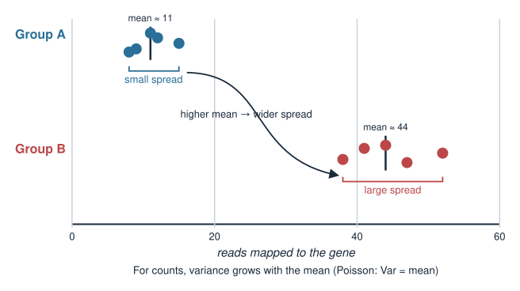{width="70%" fig-align="center"}

::: notes
Anchor everything in a concrete count table before any distribution theory. The key observation students should feel: the group with the higher mean also has the higher spread. For counts this is not a nuisance to be scrubbed away — it is a law (Poisson: variance equals mean). So the standard t-test / Gaussian assumption of one common variance is violated from the start. This motivates the whole lecture: count data has its own error model. Link back to the bulk day: there the same fact showed up as the MA-plot fan (low counts give noisy ratios). Do not resolve the example yet; the payoff (Poisson, then negative binomial, then why it matters for the test) comes over the next slides.
:::

## What is an error model? {.smaller}

A measurement is **signal + noise**. The error model is the probability distribution you assume for the noise — equivalently, the distribution the data are drawn from given the underlying truth.

$$\text{data} \sim \text{Distribution}(\text{parameters})$$

- It answers: *"If the true value were $\mu$, how likely is the number I actually observed?"*
- That "how likely" is the **likelihood** — the same likelihood that multiplied the prior in Bayes' theorem in *Bayesian vs frequentist*.
- Fitting a model (a t-test, a linear model with `lm`, a genomics tool) always assumes *some* error model, whether or not you named it.

**Choosing the error model = choosing the distribution that matches your data type.**

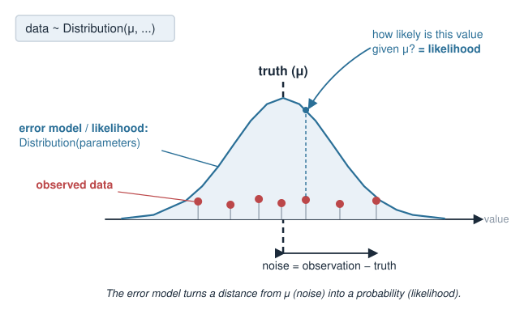{width="65%" fig-align="center"}

::: notes
Make the abstraction explicit: whenever you compute a p-value or fit a curve, a distribution is assumed in the background. `lm` assumes Gaussian residuals; a Poisson GLM assumes Poisson counts. The likelihood is just this distribution read as a function of the parameters for fixed data — the same thing that, times the prior, gave the posterior in Bayesian vs frequentist. Today we stay frequentist-flavoured and focus only on *picking* the distribution. The recurring question for the rest of the lecture: what does my data type look like — continuous? counts? waiting times? — and which named distribution has that shape?
:::

## Gaussian: continuous measurements {.smaller}

The **Gaussian** (normal) distribution fits measurements that are **continuous** and scatter **symmetrically** around a mean: the familiar bell.

- Two separate knobs: the mean $\mu$ and the spread (variance $\sigma^2$). **The spread does not depend on the mean.**
- Good for: protein concentration, cell diameter, $\log$-transformed intensities, height, temperature.
- The default assumption behind the **t-test**, **linear regression**, and `lm`.

It can take **any real value** — including negatives — which is exactly why it is wrong for counts.

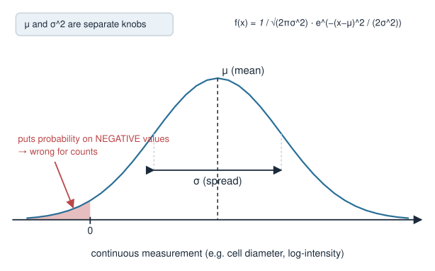{width="60%" fig-align="center"}

::: notes
Gaussian is the students' familiar ground, so use it to set up the contrast. Two independent knobs: you can have a large mean with a small variance or vice versa — nothing ties them together. That is fine for genuinely continuous quantities. The formula for the bell is not needed today (it is on the optional maths slide at the end); the picture and the two knobs are the point. The tell-tale weakness for count data is on the last line: a Gaussian puts probability on negative numbers and on fractional values, but you can never observe -3 reads or 4.5 reads. Log-transforming counts is a common patch that partly Gaussian-ises them, but for low counts it distorts things; the honest fix is a count distribution, which is where we go next.
:::

## Counts are not Gaussian {.smaller}

Sequencing gives **counts**: reads per gene, molecules per cell, variants per kilobase, colonies per plate. Counts have structure a Gaussian ignores:

- **Non-negative integers** — you cannot observe $-2$ or $3.7$ reads.
- **Discrete**, especially near zero (many genes have 0, 1, 2 reads).
- **Spread grows with the mean** — highly expressed genes vary more, in absolute terms, than lowly expressed ones (we saw this in the two groups).
- In **relative** terms it is the other way round: about $n \pm \sqrt{n}$, so small counts are the noisiest (the MA-plot fan).

A distribution built for counts should be discrete, non-negative, and let variance depend on the mean. That distribution is the **Poisson**.

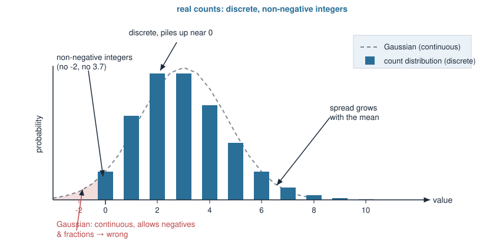{width="62%" fig-align="center"}

::: notes
List the three ways count data violates Gaussian assumptions so students can recognise count data in the wild. The third point is the deepest and the one earlier stats courses rarely stress: for counts the variance is not a free parameter, it is welded to the mean. This is why you cannot just pool a single variance across genes of very different expression, and why naive constant-variance methods misbehave. The new bullet reconciles this with the bulk day: absolute spread grows with the mean, but relative spread (root n over n) shrinks, which is why ratios of small counts were noisy there. The next slide introduces the distribution that has exactly these properties baked in.
:::

## Poisson: the count distribution {.smaller}

The **Poisson** distribution models the **number of independent events in a fixed window** (of time, of genome, of sequencing depth), when events happen at a constant average rate.

- **One** knob: the rate $\lambda$, the average count per window.
- Discrete and non-negative by construction: 0, 1, 2, 3, …
- That single knob sets both the centre **and** the spread:

$$\boxed{\text{mean} = \text{variance} = \lambda}$$

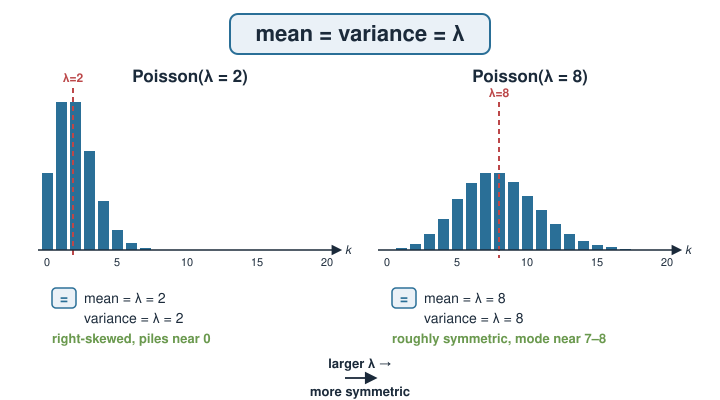{width="70%" fig-align="center"}

::: notes
Introduce Poisson as the natural law for "count of rare-ish independent events in a fixed window." Reads mapping to a gene fit this picture: each of millions of reads independently has a small probability of landing on this gene. The headline, worth repeating aloud, is mean equals variance — a single parameter controls both. This is a strong, testable claim about data: if counts are truly Poisson, their sample variance should roughly equal their sample mean. The formula for the bar heights (with a factorial) is on the optional maths slide at the end; in practice R's dpois gives the bar heights, and the next slide reads them off a simulation instead.
:::

## Poisson: a small example {.smaller}

```{=html}
<link rel="stylesheet" href="../demos/dist/demo.css">
<div data-demo="poissonprocess" data-rate="3" data-window="1" data-view="counts"></div>
<script src="../demos/dist/poissonprocess.js"></script>
```

A gene gets on average 3 reads per sample: read the bars. In R, `dpois(0:8, 3)` gives the red dots.

::: notes
Frame it as reads: each 1-Mb window is "one sample", and on average 3 events fall in it. The strip at the top shows the first 10 Mb with the count written over each window; the histogram collects all 2000 windows. Read two bars aloud: about 5% of windows have 0 events (5.2% in this draw; dpois says 0.050) and about 22% have exactly 3 (22.8%; dpois says 0.224). The red dots are the Poisson probabilities, the same numbers dpois(0:8, 3) prints, so nobody needs the formula. The header shows mean 3.01 and variance 3.01: mean = variance, the Poisson signature, checked on simulated data. Point at the shape: piled up near zero with a tail to the right, nothing like a symmetric bell. Then drag the rate to 0.5 (mostly zeros, very skewed) and to 10 (more symmetric, wider). "Draw again" shows the bars wobble around the dots. This mean = variance check is exactly the diagnostic students will apply to real data to decide whether Poisson is adequate. In R: rpois(1e5, 3) simulates such counts; mean and var of the result both land near 3.
:::

## Where Poisson comes from: rare events {.smaller}

Poisson is what you get from **many independent chances, each very unlikely**.

- A library has **millions of reads**; each one has a **tiny chance** of landing on our gene.
- Add up all those tiny chances and the number of reads on the gene is (close to) Poisson, with mean = expected reads.

So idealised counts of independent molecules are Poisson.

This same "stream of random events" also has a **waiting-time** description — which is where the **exponential** enters.

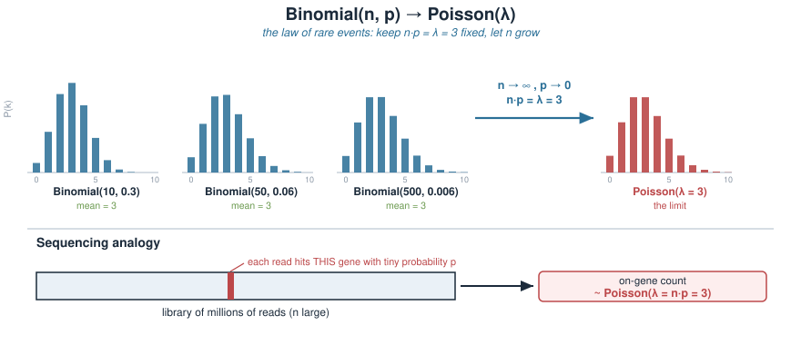{width="72%" fig-align="center"}

::: notes
Give the mechanistic justification so Poisson is not a distribution pulled from a hat: a huge number of chances, each unlikely, expected count fixed. Sequencing is the textbook instance — millions of reads, a minuscule chance per gene. (The formal statement, a binomial limit, is on the optional maths slide.) Under idealised independence, counts are therefore Poisson; the fact that real data exceed Poisson variance (overdispersion) is a signal that some assumption — usually the same rate in every sample — is violated, which we reach shortly. End by teeing up the dual view: the same event stream, described by the gaps between events instead of the count, gives the exponential distribution.
:::

## Exponential: waiting times {.smaller}

The **exponential** distribution models the **waiting time** (or distance) until the next event, in a stream of random events at rate $\lambda$.

- **Continuous** and non-negative (a time, a distance, a length).
- Short gaps are the most common, long gaps get steadily rarer.
- **Mean gap = 1 / rate:** mutations at 2 per Mb lie on average 1/2 = **0.5 Mb apart**.
- **Memoryless:** however long you have already waited, the wait still to come looks the same.

Biology: time between action-potential spikes, intervals between mutations along a genome, survival/dwell times, gaps between binding events.

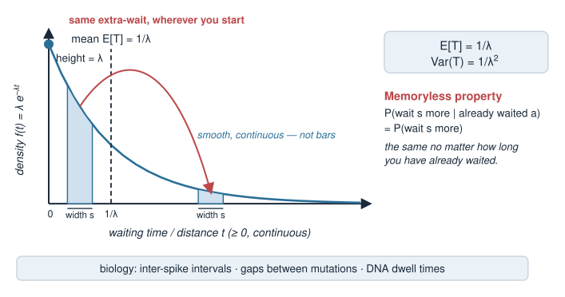{width="62%" fig-align="center"}

::: notes
Exponential is the continuous partner to Poisson: Poisson counts events, exponential measures the gaps between them. Stress it is continuous and non-negative — a duration or a distance, never a count. One number to remember: the mean gap is 1 over the rate (2 per Mb, so 0.5 Mb apart on average). The memoryless property is the striking feature: an exponential process has no ageing; two slides on, the demo shows it. Biological examples worth naming: inter-spike intervals in neurons, spacing of mutations along a chromosome, dwell times of a molecule bound to DNA. The density formula and a worked tail probability are on the optional maths slide. The rate is the same rate as in the Poisson when both describe one underlying process — the next slide shows that.
:::

## Two views of one process {.smaller}

```{=html}
<link rel="stylesheet" href="../demos/dist/demo.css">
<div data-demo="poissonprocess" data-rate="2" data-window="1" data-view="both"></div>
<script src="../demos/dist/poissonprocess.js"></script>
```

One stream of mutations: **count per window → Poisson** (mean = rate), **gap to the next → exponential** (mean = 1 / rate).

::: notes
This is the unifying slide. The strip is a 2000-Mb genome with mutations at 2 per Mb, first 10 Mb shown: ticks are mutations, the shaded windows carry their counts above, the coloured bars below are the gaps. Left: counts in 1-Mb windows, 4077 mutations in all, mean 2.04 and variance 2.00 — about equal, and the bars sit on the Poisson dots. Right: the gaps, mean 0.49 Mb, about 1/rate = 0.5; most gaps are short, long ones rarer, following the exponential curve. Same random events, two questions: if you tallied events per fixed interval you have counts and use Poisson; if you recorded the distance between consecutive events you have gaps and use exponential. Drag the rate up: counts move right, gaps get shorter (mean 1/rate). Change the window to 2 Mb: the counts double (Poisson with mean rate × window), the gaps do not change. The distinction is about the measurement, not the phenomenon — the same neuron gives Poisson spike counts per second or exponential inter-spike intervals depending on what you logged. Getting students to ask "did I measure a count or a gap?" is the transferable skill.
:::

## Memoryless: the wait does not age {.smaller}

```{=html}
<div data-demo="poissonprocess" data-rate="2" data-window="1" data-view="gaps" data-memoryless="on"></div>
```

Keep only gaps longer than 0.5 Mb and look at what is left after 0.5: it looks just like all gaps.

::: notes
Same 2000-Mb genome, gaps only, with "memoryless" ticked. The demo takes every gap longer than "already waited" (0.5 Mb) and plots how much of it is left beyond 0.5. Header: 35% of the gaps are longer than 0.5 Mb, and what is left has mean 0.50 Mb — the same as all gaps (0.49). The outline (all gaps) and the filled bars (wait left) match. In words: having already gone 0.5 Mb without a mutation tells you nothing about how much further you have to go. For a protein bound to DNA: having stayed 4 s does not make it more likely to let go now. Drag "already waited" up to 1 or 1.5: fewer gaps qualify, the leftover still looks the same. Contrast with a bus timetable or a cell cycle, where waiting longer does make the event closer — those are not exponential. The clumped switch, a few slides on, breaks this.
:::

## When events clump {.smaller}

```{=html}
<div data-demo="poissonprocess" data-rate="2" data-window="1" data-view="both" data-clumped="on"></div>
```

Same average rate, but events now come in bursts: the counts spread far more than the Poisson allows.

::: notes
Same genome and the same average of 2 per Mb, but "clumped" is ticked: mutations now arrive in small bursts. Left: variance 7.09, 3.45 times the mean — the header says "overdispersed", and the bars are wider than the red Poisson dots (zeros and big counts both too common). Right: the gaps no longer follow the exponential curve (many tiny gaps inside bursts, long ones between). Untick clumped to compare: back to variance about equal to the mean. If time allows, switch to gaps and tick memoryless with clumped on: the wait left is 1.42 Mb, not 0.5 — the process now remembers. So the simple Poisson promise, variance = mean, is fragile: anything that makes the rate uneven breaks it. Real RNA-seq counts break it too, for a reason we turn to next.
:::

## Real counts are overdispersed {.smaller}

Poisson makes a strict promise: **variance = mean**. Real RNA-seq counts break it — their **variance is larger than the mean**. This excess is called **overdispersion**.

Why? Poisson assumes every sample has the *identical* underlying rate. But biological replicates differ:

- genetically and environmentally variable individuals,
- cell-state and batch differences,
- the true rate $\lambda$ itself **varies from sample to sample**.

Extra variation in $\lambda$ adds variance **on top of** the Poisson counting noise. Technical replicates can look Poisson; **biological** replicates almost never do.

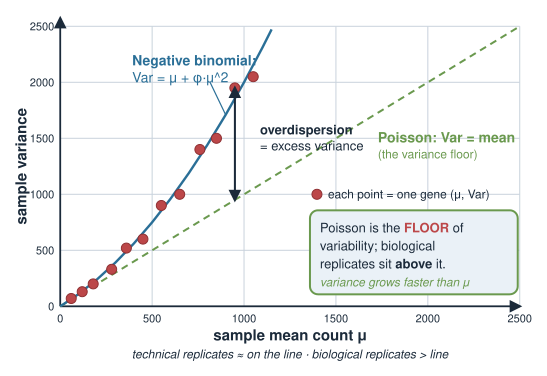{width="60%" fig-align="center"}

::: notes
This is the single most important practical fact for genomics count analysis. Poisson is the floor of variability — pure counting noise assuming a fixed rate. Real biological replicates carry additional variation because the rate itself fluctuates between samples (genetics, environment, cell state, batch). Letting the rate vary inflates the variance above the mean, just as the bursts did in the demo. The classic distinction: technical replicates (same sample resequenced) can be near-Poisson; biological replicates (different organisms/cultures) are overdispersed. Any method that assumes Poisson for biological replicates will understate the true variability — the consequence, quantified a few slides on, is too many false positives.
:::

## Negative binomial: overdispersed counts {.smaller}

The **negative binomial (NB)** is a count distribution with a **separate** dispersion knob, letting variance exceed the mean.

$$X \sim \text{NB}(\mu, \phi), \qquad \text{Var}(X) = \mu + \phi\,\mu^2$$

- $\mu$ = mean; $\phi \ge 0$ = **dispersion**.
- Example: $\mu = 50$, $\phi = 0.5$ gives variance $50 + 0.5 \cdot 2500 = 1300$, against 50 for a Poisson.
- $\phi = 0$ recovers **Poisson** (variance $= \mu$); larger $\phi$ = more overdispersion.
- The extra $\phi\mu^2$ term is why highly expressed genes vary *disproportionately* more.

It arises naturally as a **Poisson whose rate itself varies from sample to sample** (following a Gamma distribution) — exactly the "rate varies between replicates" story.

The workhorse error model of **`DESeq2`** and **`edgeR`** for RNA-seq differential expression: the count model DESeq2 fit for you in *Bulk RNA-seq with DESeq2*.

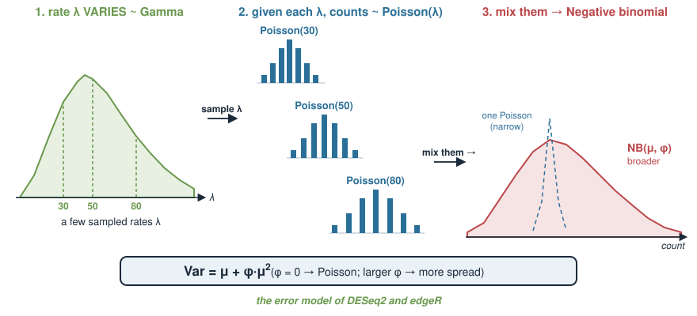{width="72%" fig-align="center"}

::: notes
NB is the fix for overdispersion: it is Poisson plus a dispersion parameter phi that decouples variance from mean. Variance = mu + phi*mu^2, so at phi = 0 it collapses back to Poisson, and the quadratic term means the variance gap widens for high-expression genes. Mechanistically it is a Gamma-Poisson mixture: draw a per-sample rate from a Gamma, then a Poisson count given that rate — precisely the "lambda varies between biological replicates" model from the previous slide. Students already ran DESeq2 in Bulk RNA-seq with DESeq2, and edgeR is the other standard tool; both are NB GLMs with clever dispersion estimation. Do the plug-in example aloud: 50 + 0.5 times 2500 = 1300, the number the demo on the next slide shows. R's own name for the dispersion knob (size) is on the optional maths slide; mention only if asked.
:::

## Try it: Poisson vs negative binomial {.smaller}

```{=html}
<link rel="stylesheet" href="../demos/dist/demo.css">
<div data-demo="nbdisp" data-param="phi" data-mu="50" data-disp="0.5" data-unit="cells"></div>
<script src="../demos/dist/nbdisp.js"></script>
```

::: notes
The histogram is 1000 simulated counts (think: reads of one gene in 1000 cells) from a negative binomial with mean mu and dispersion phi, in this lecture's convention Var = mu + phi mu^2; the red dots are the NB probabilities, the dashed blue outline the Poisson with the same mean. Start at mu = 50, phi = 0.5 (exercise B5): the counts spread from near 0 to several hundred while the Poisson is a narrow bump around 50; the table shows theory and sample side by side, variance 1300, var/mean 26. Click "Poisson": phi = 0, histogram and dashed outline coincide, var/mean = 1. Then "mild" and "strong (many zeros)": the histogram flattens, piles up at zero (watch the zero count in the corner; the Poisson would give none) and grows a long right tail, while the mean stays at 50. "Low mean" with strong overdispersion shows the zero spike most clearly. "Draw again" shows that the sample variance jumps around much more than the sample mean. If time allows, tick the mean–variance plot: the Poisson line var = mu and the NB curve bending away above it — overdispersion grows with the mean.
:::

## Why the wrong model misleads {.smaller}

Using an error model whose variance is **too small** makes you **overconfident** — you declare differences "significant" that are just noise.

- **Gaussian / t-test on counts:** assumes one shared variance and allows negative values; mis-estimates spread, especially for low counts and near zero.
- **Poisson on overdispersed RNA-seq:** variance assumed $= \mu$, but true variance is $\mu + \phi\mu^2$ (larger). The test **understates** noise $\Rightarrow$ p-values too small $\Rightarrow$ **inflated false positives**.

```r
# same mean (mu = 50), very different spread
mean(rpois(1e5, 50)); var(rpois(1e5, 50))          # ~50, ~50
mu <- 50; phi <- 0.5
x <- rnbinom(1e5, mu = mu, size = 1 / phi)         # R's knob is size = 1/phi
mean(x)                                             # ~50
var(x)                                              # ~1300 >> 50 (overdispersed)
```

Right shape, right conclusions. **The error model is not a technicality — it sets your false-discovery rate.**

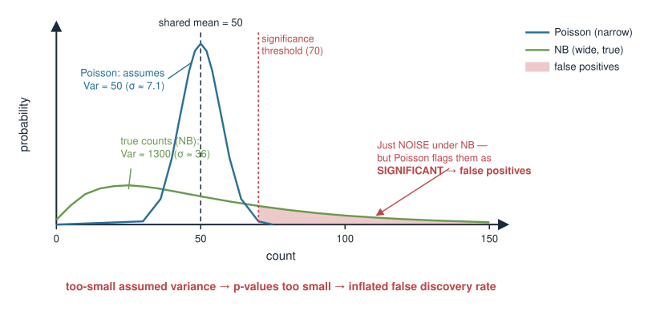{width="60%" fig-align="center"}

::: notes
This is the "so what". The direction of the error matters: assuming too little variance makes you anti-conservative — p-values shrink, and you call noise as signal. Poisson-on-biological-replicates is the canonical mistake, and it is why the field moved to negative binomial methods. The R makes it visceral: Poisson(50) has variance ~50; NB with the same mean and phi = 0.5 has variance about 1300, the number from the negative binomial slide and the demo. A Poisson test on the NB data would treat that huge spread as if it were only 50, and every borderline gene becomes a false positive. The size = 1/phi in the code is just R's spelling of the same knob; no need to dwell on it. Land the closing line: choosing the error model directly controls how many false discoveries you make.
:::

## Choosing the error model {.smaller}

Match the **data type** to the distribution:

| Your data | Distribution | Key feature |
|---|---|---|
| Continuous, symmetric spread | **Gaussian** $\mathcal{N}(\mu,\sigma^2)$ | mean and variance independent |
| Counts, idealised / technical | **Poisson**$(\lambda)$ | variance = mean |
| Counts, biological replicates | **Negative binomial**$(\mu,\phi)$ | variance = $\mu + \phi\mu^2$ |
| Waiting times / gaps (continuous, $\ge 0$) | **Exponential**$(\lambda)$ | memoryless, mean $1/\lambda$ |

**Diagnostic:** for counts, compare the sample variance to the sample mean. Variance $\approx$ mean $\to$ Poisson may do; variance $\gg$ mean $\to$ overdispersed, use NB.

::: notes
The decision table is the take-home cheat-sheet. Walk each row: what does the data look like, and what is the one feature that picks the distribution. The practical diagnostic is the mean-variance comparison for counts — cheap and decisive. If variance tracks the mean, Poisson is defensible (often only for technical replicates); if variance blows past the mean, you have overdispersion and need the negative binomial. Note that exponential is the odd one out here — continuous waiting times, not counts — included because it is the same Poisson process seen the other way. Students should leave able to look at a column of numbers and name the right error model.
:::

## Summary {.smaller}

| Idea | Key fact |
|---|---|
| Error model | the distribution you assume generated the data (the **likelihood**) |
| Gaussian | continuous, symmetric; mean and variance **independent** |
| Poisson | counts; **variance = mean = $\lambda$**; limit of many rare events |
| Exponential | waiting times/gaps; memoryless; mean $1/\lambda$ |
| Poisson process | one process: counts $\to$ Poisson, gaps $\to$ exponential |
| Overdispersion | real biological counts have **variance > mean** |
| Negative binomial | counts with dispersion; $\text{Var} = \mu + \phi\mu^2$; RNA-seq (`DESeq2`, `edgeR`) |
| Wrong model | too-small variance $\to$ overconfidence $\to$ **false positives** |

**Connects to:** **Bayesian vs frequentist** (this likelihood plugs into Bayes' theorem); **Hierarchical models** (stacking technical and biological variation); **Single-cell RNA-seq: data & QC** (the same counts, per cell, with many zeros).

::: notes
Recap as a cheat-sheet. Drill the reflex: name the data type, name the distribution, name its defining feature. The three claims most worth memorising: Poisson has variance = mean, real biological counts are overdispersed so need the negative binomial, and assuming too little variance inflates false positives. Close by pointing forward — the likelihood defined today is exactly what multiplies the prior in Bayesian vs frequentist; Hierarchical models makes the "variation stacks" idea (counting noise plus biological spread) explicit; and in Single-cell RNA-seq the same Poisson / negative binomial reasoning explains the many zeros per cell.
:::

## Optional: the maths behind these distributions {.smaller}

For those who want the formulas; nothing in the lecture needs them.

- **Gaussian density:** $f(x) = \dfrac{1}{\sqrt{2\pi\sigma^2}}\, e^{-(x-\mu)^2/(2\sigma^2)}$.
- **Poisson probabilities:** $P(X = k) = \dfrac{\lambda^k e^{-\lambda}}{k!}$. With $\lambda = 3$: $P(0) = e^{-3} \approx 0.050$, $P(3) = 27 e^{-3}/6 \approx 0.224$ (the bars in the demo).
- **Where Poisson comes from:** Binomial$(n, p)$ with $n \to \infty$, $p \to 0$, $np = \lambda$ fixed, becomes Poisson$(\lambda)$.
- **Exponential density:** $f(t) = \lambda e^{-\lambda t}$ for $t \ge 0$; mean $1/\lambda$, variance $1/\lambda^2$; tail $P(T > t) = e^{-\lambda t}$. At 2 per Mb: $P(T > 1) = e^{-2} \approx 0.135$, so about 13.5% of gaps are longer than 1 Mb (`pexp(1, 2, lower.tail = FALSE)`).
- **Memoryless:** $P(T > s + t \mid T > s) = P(T > t)$.
- **Negative binomial in R:** `dnbinom`/`rnbinom` use `size` $= 1/\phi$, so $\text{Var} = \mu + \mu^2/\text{size}$.

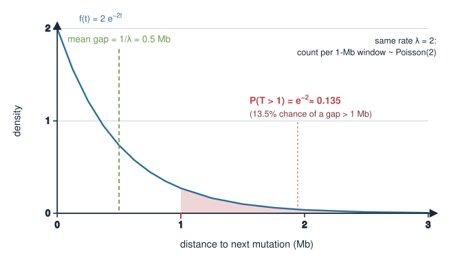{width="36%" fig-align="center"}

::: notes
Optional reference slide; skip in class unless someone asks. It collects the formulas that used to be on the main slides: the Gaussian and exponential densities, the Poisson probability with its factorial (the numbers match the bars of the lambda = 3 demo), the binomial-to-Poisson limit, the exponential tail with the worked e^-2 example, memorylessness as a conditional probability, and R's size = 1/phi convention for the negative binomial.
:::
