## About this lecture

Every statistical analysis makes an assumption about **how the data scatter around the truth** — the *error model*, or *likelihood*. Choosing it well is most of the battle in genomics.

- What an **error model** is: the probability distribution you assume generated your data.
- **Gaussian** for continuous measurements; **Poisson** for counts; **exponential** for waiting times; **negative binomial** for *overdispersed* counts.
- The signature of Poisson counts: **mean = variance**.
- Why real RNA-seq counts break Poisson (**overdispersion**) and need the negative binomial.
- **Why the wrong error model misleads** — the practical cost is false discoveries.

::: {.callout-warning title="Provisional block"}
This block ("Bayesian statistics") is **provisional** and may move to a later statistics / machine-learning course. Treat the placement as a working draft, not a contract.
:::

::: notes
The one idea for today: before you fit anything, you commit to a story about how noise entered your data, and that story is a probability distribution. Pick the wrong one and every downstream number — p-values, confidence intervals, effect sizes — is quietly wrong. This is a concept day: no heavy algebra, just building the reflex "what kind of data is this, and which distribution matches it?" We will lean on distributions students have used before (Gaussian, Poisson) but re-derive *why* each fits a data type. The likelihood introduced here is the same likelihood that plugs into Bayes' theorem in the prior, likelihood and posterior unit — flag that connection but do not teach Bayes today.
:::

## A biology picture first {.smaller}

You sequence RNA from two groups of cells and, for one gene, count how many reads map to it in each sample:

- Group A: `12, 9, 15, 11, 8`
- Group B: `41, 38, 52, 44, 47`

You want to know if the gene is **differentially expressed**. A first instinct from earlier stats courses: run a t-test, which assumes the data are **Gaussian** with **constant variance**.

But look: group B has a **much larger spread** than group A. That is not sloppy data — it is what **counts** do. A t-test's constant-variance assumption is already wrong here.

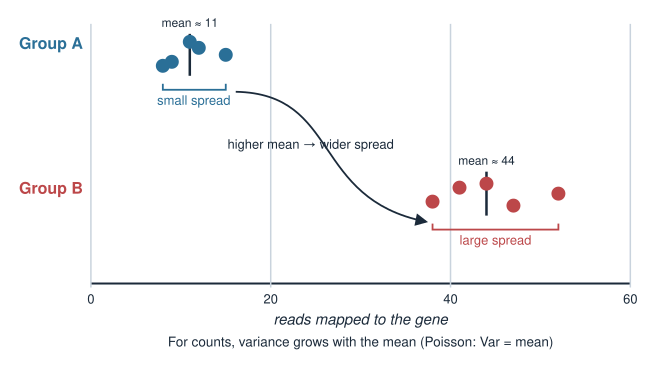{width="70%" fig-align="center"}

::: notes
Anchor everything in a concrete count table before any distribution theory. The key observation students should feel: the group with the higher mean also has the higher spread. For counts this is not a nuisance to be scrubbed away — it is a law (Poisson: variance equals mean). So the standard t-test / Gaussian assumption of one common variance is violated from the start. This motivates the whole lecture: count data has its own error model. Do not resolve the example yet; the payoff (Poisson, then negative binomial, then why it matters for the test) comes over the next slides.
:::

## What is an error model? {.smaller}

A measurement is **signal + noise**. The error model is the probability distribution you assume for the noise — equivalently, the distribution the data are drawn from given the underlying truth.

$$\text{data} \sim \text{Distribution}(\text{parameters})$$

- It answers: *"If the true value were $\mu$, how likely is the number I actually observed?"*
- That "how likely" is the **likelihood** — the same likelihood that feeds into Bayes' theorem in the **prior, likelihood and posterior** unit.
- Fitting a model (a t-test, a linear model with `lm`, a genomics tool) always assumes *some* error model, whether or not you named it.

**Choosing the error model = choosing the distribution that matches your data type.**

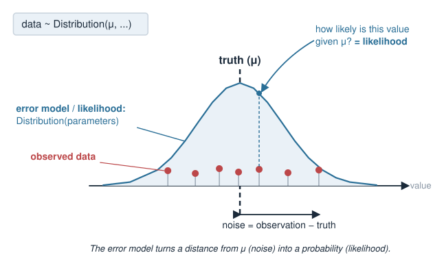{width="65%" fig-align="center"}

::: notes
Make the abstraction explicit: whenever you compute a p-value or fit a curve, a distribution is assumed in the background. `lm` assumes Gaussian residuals; a Poisson GLM assumes Poisson counts. The likelihood is just this distribution read as a function of the parameters for fixed data — the bridge to the Bayesian unit, where likelihood times prior gives the posterior. Today we stay frequentist-flavoured and focus only on *picking* the distribution. The recurring question for the rest of the lecture: what does my data type look like — continuous? counts? waiting times? — and which named distribution has that shape?
:::

## Gaussian: continuous measurements {.smaller}

The **Gaussian** (normal) distribution fits measurements that are **continuous** and scatter **symmetrically** around a mean.

$$X \sim \mathcal{N}(\mu, \sigma^2), \qquad f(x) = \frac{1}{\sqrt{2\pi\sigma^2}}\, e^{-\frac{(x-\mu)^2}{2\sigma^2}}$$

- Two separate parameters: mean $\mu$ and variance $\sigma^2$ (**spread is independent of the mean**).
- Good for: protein concentration, cell diameter, $\log$-transformed intensities, height, temperature.
- The default assumption behind the **t-test**, **linear regression**, and `lm`.

It can take **any real value** — including negatives — which is exactly why it is wrong for counts.

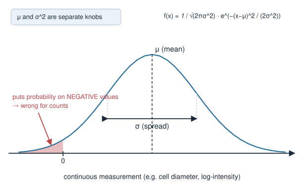{width="60%" fig-align="center"}

::: notes
Gaussian is the students' familiar ground, so use it to set up the contrast. Two independent knobs: you can have a large mean with a small variance or vice versa — nothing ties them together. That is fine for genuinely continuous quantities. The tell-tale weakness for count data is on the last line: a Gaussian puts probability on negative numbers and on fractional values, but you can never observe -3 reads or 4.5 reads. Log-transforming counts is a common patch that partly Gaussian-ises them, but for low counts it distorts things; the honest fix is a count distribution, which is where we go next.
:::

## Counts are not Gaussian {.smaller}

Sequencing gives **counts**: reads per gene, molecules per cell, variants per kilobase, colonies per plate. Counts have structure a Gaussian ignores:

- **Non-negative integers** — you cannot observe $-2$ or $3.7$ reads.
- **Discrete**, especially near zero (many genes have 0, 1, 2 reads).
- **Spread grows with the mean** — highly expressed genes vary more, in absolute terms, than lowly expressed ones (we saw this in the two groups).

A distribution built for counts should be discrete, non-negative, and let variance depend on the mean. That distribution is the **Poisson**.

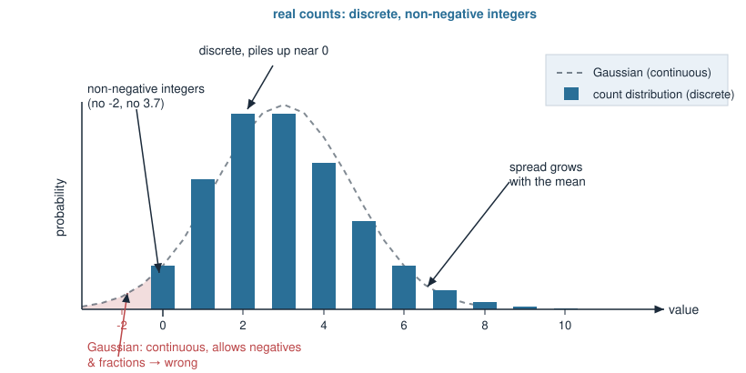{width="62%" fig-align="center"}

::: notes
List the three ways count data violates Gaussian assumptions so students can recognise count data in the wild. The third point is the deepest and the one earlier stats courses rarely stress: for counts the variance is not a free parameter, it is welded to the mean. This is why you cannot just pool a single variance across genes of very different expression, and why naive constant-variance methods misbehave. The next slide introduces the distribution that has exactly these properties baked in.
:::

## Poisson: the count distribution {.smaller}

The **Poisson** distribution models the number of independent events in a fixed interval (of time, space, or sequencing depth), occurring at constant average rate.

$$X \sim \text{Poisson}(\lambda), \qquad P(X = k) = \frac{\lambda^k e^{-\lambda}}{k!}, \quad k = 0, 1, 2, \dots$$

- **One** parameter $\lambda > 0$ — the average count (the rate).
- Discrete and non-negative by construction.
- **Defining property:** $\;\mathbb{E}[X] = \lambda \;$ and $\; \text{Var}(X) = \lambda$.

$$\boxed{\text{mean} = \text{variance} = \lambda}$$

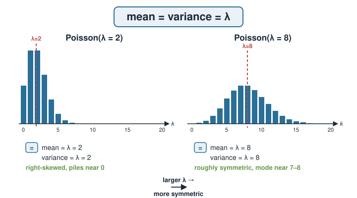{width="70%" fig-align="center"}

::: notes
Introduce Poisson as the natural law for "count of rare-ish independent events in a fixed window." Reads mapping to a gene fit this picture: each of millions of reads independently has a small probability of landing on this gene. The headline, worth repeating aloud, is mean equals variance — a single parameter controls both. This is a strong, testable claim about data: if counts are truly Poisson, their sample variance should roughly equal their sample mean. Keep the factorial formula on screen but do not dwell on it; the conceptual content is the mean = variance identity and the "events in a window" picture.
:::

## Poisson: a small example {.smaller}

A gene receives on average $\lambda = 3$ reads per sample. Then:

$$P(0) = \frac{3^0 e^{-3}}{0!} = e^{-3} \approx 0.050, \quad P(3) = \frac{3^3 e^{-3}}{3!} = \frac{27 e^{-3}}{6} \approx 0.224$$

The distribution is **right-skewed** for small $\lambda$ and piles up near zero; as $\lambda$ grows it becomes more symmetric.

```r
# probabilities for counts 0..8 when lambda = 3
lambda <- 3
k <- 0:8
dpois(k, lambda)         # P(X = k)

mean_sim <- mean(rpois(1e5, lambda))   # ~ 3
var_sim  <- var(rpois(1e5, lambda))    # ~ 3  -> mean = variance
```

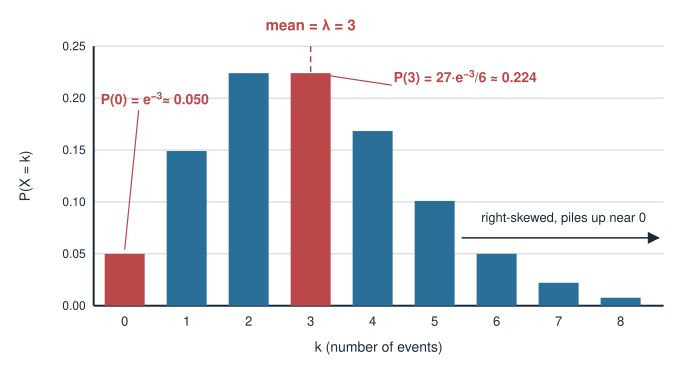{width="55%" fig-align="center"}

::: notes
Do the two hand calculations so the formula is not abstract: P(0) is just e^-lambda, P(3) plugs in and simplifies. Point out the shape: for small lambda the mass sits near zero and the tail stretches right — nothing like a symmetric bell. The static R shows the two functions they will use, dpois for exact probabilities and rpois to simulate; the simulated mean and variance both land near 3, confirming mean = variance empirically. Remind them these chunks are illustrative and not executed at render time. This mean = variance check is exactly the diagnostic they will apply to real data to decide whether Poisson is adequate.
:::

## Where Poisson comes from: rare events {.smaller}

Poisson is the limit of **many independent trials, each with tiny success probability**.

- $n$ reads in a library, each landing on our gene with small probability $p$.
- Total on-gene reads is $\text{Binomial}(n, p)$; as $n \to \infty$, $p \to 0$ with $np = \lambda$ fixed, this becomes $\text{Poisson}(\lambda)$.

That is precisely the sequencing picture: **millions of reads**, each with a **tiny** chance of hitting any one gene. So idealised counts of independent molecules are Poisson.

This same "stream of random events" also has a **waiting-time** description — which is where the **exponential** enters.

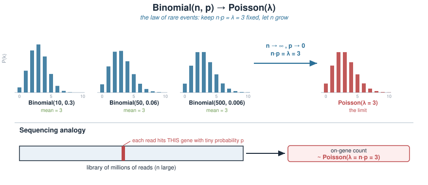{width="72%" fig-align="center"}

::: notes
Give the mechanistic justification so Poisson is not a distribution pulled from a hat. The binomial-to-Poisson limit is the law of rare events: huge number of chances, each unlikely, expected count fixed. Sequencing is the textbook instance — n in the millions, p per gene minuscule. Under idealised independence, counts are therefore Poisson; the fact that real data exceeds Poisson variance (overdispersion) is a signal that some assumption — usually independence / identical rate across samples — is violated, which we reach shortly. End by teeing up the dual view: the same event stream, described by the gaps between events instead of the count, gives the exponential distribution.
:::

## Exponential: waiting times {.smaller}

The **exponential** distribution models the **waiting time** until the next event in a stream of random events occurring at rate $\lambda$.

$$T \sim \text{Exp}(\lambda), \qquad f(t) = \lambda e^{-\lambda t}, \quad t \ge 0$$

- **Continuous** and non-negative (a time, a distance, a length).
- $\mathbb{E}[T] = \dfrac{1}{\lambda}, \qquad \text{Var}(T) = \dfrac{1}{\lambda^2}$.
- **Memoryless:** the chance of waiting another $s$ seconds does not depend on how long you have already waited.

Biology: time between action-potential spikes, intervals between mutations along a genome, survival/dwell times, gaps between binding events.

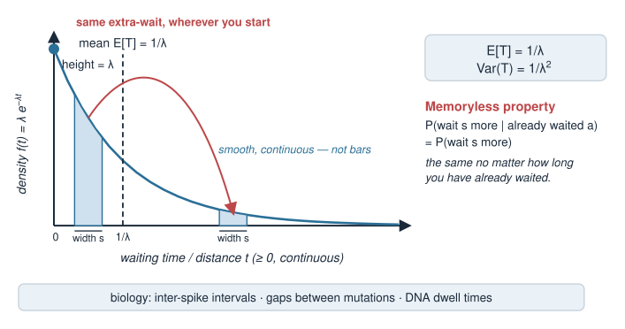{width="62%" fig-align="center"}

::: notes
Exponential is the continuous partner to Poisson: Poisson counts events, exponential times the gaps between them. Stress it is continuous and non-negative — a duration or a distance, never a count. The memoryless property is the striking feature: an exponential process has no aging, the wait resets at every instant. Biological examples worth naming: inter-spike intervals in neurons, spacing of mutations along a chromosome (events per base), dwell times of a molecule bound to DNA. The rate lambda is the same lambda as in Poisson when both describe one underlying process — the next slide makes that link explicit.
:::

## Exponential: a small example {.smaller}

Mutations fall along a genome at rate $\lambda = 2$ per megabase. The waiting **distance** to the next mutation is $\text{Exp}(2)$ (in Mb):

$$\mathbb{E}[T] = \frac{1}{2} = 0.5 \text{ Mb}, \qquad P(T > 1) = e^{-\lambda \cdot 1} = e^{-2} \approx 0.135$$

So there is a ~13.5% chance of a gap longer than 1 Mb.

```r
lambda <- 2
pexp(1, rate = lambda, lower.tail = FALSE) # P(T > 1) = e^{-2} ~ 0.135
mean(rexp(1e5, rate = lambda)) # ~ 0.5  = 1/lambda

# count of events in a 1-Mb window is Poisson(lambda) -- same process
mean(rpois(1e5, lambda))       # ~ 2
```

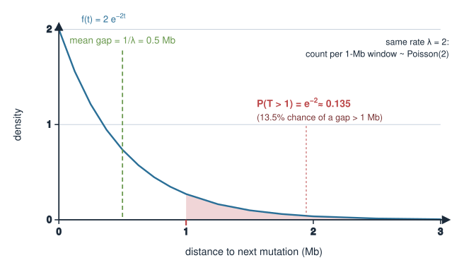{width="55%" fig-align="center"}

::: notes
Concrete numbers again. The mean gap is 1/lambda = 0.5 Mb, and the survival probability P(T > 1) is just e^{-lambda} — a clean hand calculation. The R uses `lower.tail = FALSE` to request the exponential tail probability and `rexp` to simulate gaps averaging 0.5. The final rpois line quietly makes the punchline of the next slide: the same rate lambda describes both the gaps (exponential, mean 1/lambda) and the count per window (Poisson, mean lambda). Keep it light; the goal is that students see waiting-time data and reach for exponential, and count-per-window data and reach for Poisson.
:::

## Two views of one process {.smaller}

The **Poisson process** is a single model of random events at rate $\lambda$, seen two ways:

| Question | Distribution | Parameter meaning |
|---|---|---|
| How **many** events in a fixed window? | $\text{Poisson}(\lambda)$ | mean count $= \lambda$ |
| How **long** until the next event? | $\text{Exp}(\lambda)$ | mean wait $= 1/\lambda$ |

- **Counts** in a window $\to$ Poisson.
- **Gaps** between events $\to$ exponential.

Same underlying randomness, different question. Which one you use is set by **what you measured**, not by the biology alone.

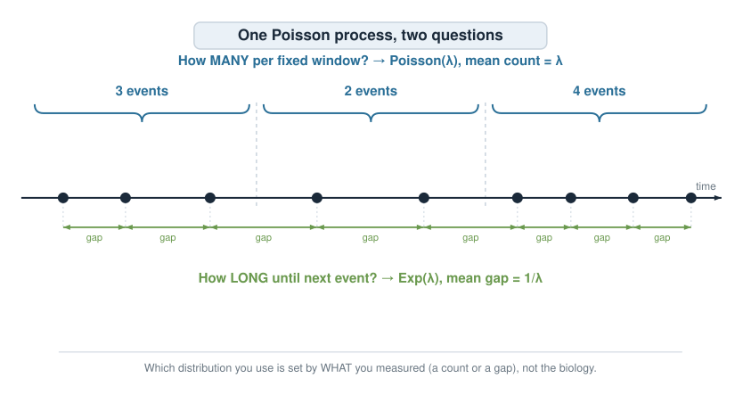{width="75%" fig-align="center"}

::: notes
This is the unifying slide. One process, two questions. If you tallied events per fixed interval you have counts and use Poisson; if you recorded the time or distance between consecutive events you have waiting times and use exponential. The distinction is about the measurement, not the phenomenon — the same neuron gives Poisson spike counts per second or exponential inter-spike intervals depending on what you logged. Getting students to ask "did I measure a count or a gap?" is the transferable skill. Next we return to counts and confront the fact that real genomics counts are wilder than Poisson allows.
:::

## Real counts are overdispersed {.smaller}

Poisson makes a strict promise: **variance = mean**. Real RNA-seq counts break it — their **variance is larger than the mean**. This excess is called **overdispersion**.

Why? Poisson assumes every sample has the *identical* underlying rate. But biological replicates differ:

- genetically and environmentally variable individuals,
- cell-state and batch differences,
- the true rate $\lambda$ itself **varies from sample to sample**.

Extra variation in $\lambda$ adds variance **on top of** the Poisson counting noise. Technical replicates can look Poisson; **biological** replicates almost never do.

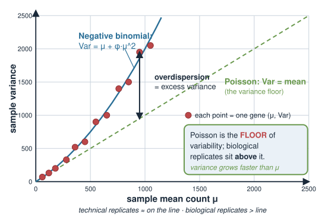{width="60%" fig-align="center"}

::: notes
This is the single most important practical fact for genomics count analysis. Poisson is the floor of variability — pure counting noise assuming a fixed rate. Real biological replicates carry additional variation because the rate itself fluctuates between samples (genetics, environment, cell state, batch). By the law of total variance, letting lambda vary inflates the variance above the mean. The classic distinction: technical replicates (same sample resequenced) can be near-Poisson; biological replicates (different organisms/cultures) are overdispersed. Any method that assumes Poisson for biological replicates will understate the true variability — the consequence, quantified two slides on, is too many false positives.
:::

## Negative binomial: overdispersed counts {.smaller}

The **negative binomial (NB)** is a count distribution with a **separate** dispersion knob, letting variance exceed the mean.

$$X \sim \text{NB}(\mu, \phi), \qquad \text{Var}(X) = \mu + \phi\,\mu^2$$

- $\mu$ = mean; $\phi \ge 0$ = **dispersion**.
- $\phi = 0$ recovers **Poisson** (variance $= \mu$); larger $\phi$ = more overdispersion.
- The extra $\phi\mu^2$ term is why highly expressed genes vary *disproportionately* more.

It arises naturally as a **Poisson whose rate $\lambda$ is itself Gamma-distributed** — exactly the "rate varies between samples" story.

The workhorse error model of **`DESeq2`** and **`edgeR`** for RNA-seq differential expression.

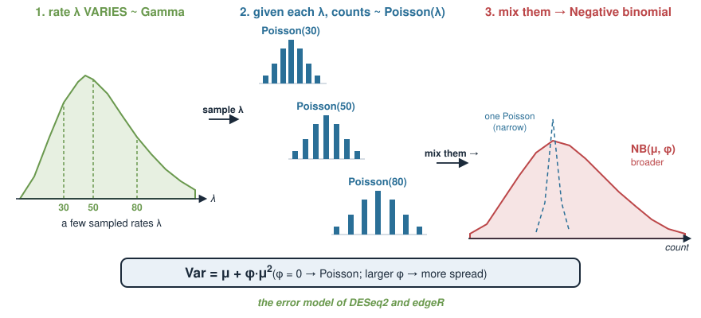{width="72%" fig-align="center"}

::: notes
NB is the fix for overdispersion: it is Poisson plus a dispersion parameter phi that decouples variance from mean. Variance = mu + phi*mu^2, so at phi = 0 it collapses back to Poisson, and the quadratic term means the variance gap widens for high-expression genes. Mechanistically it is a Gamma-Poisson mixture: draw a per-sample rate from a Gamma, then a Poisson count given that rate — precisely the "lambda varies between biological replicates" model from the previous slide. Name-drop DESeq2 and edgeR as the Bioconductor tools students will actually use; both are NB GLMs with clever dispersion estimation. Different sources parameterise phi differently (size = 1/phi in R's dnbinom) — mention only if asked. This connects forward to the Poisson and negative binomial distributions unit if listed separately.
:::

## Why the wrong model misleads {.smaller}

Using an error model whose variance is **too small** makes you **overconfident** — you declare differences "significant" that are just noise.

- **Gaussian / t-test on counts:** assumes one shared variance and allows negative values; mis-estimates spread, especially for low counts and near zero.
- **Poisson on overdispersed RNA-seq:** variance assumed $= \mu$, but true variance is $\mu + \phi\mu^2$ (larger). The test **understates** noise $\Rightarrow$ p-values too small $\Rightarrow$ **inflated false positives**.

```r
# same mean (mu = 50), very different spread
mean(rpois(1e5, 50)); var(rpois(1e5, 50))          # ~50, ~50
mu <- 50; size <- 2                                 # NB: size = 1/phi
mean(rnbinom(1e5, mu = mu, size = size))            # ~50
var(rnbinom(1e5, mu = mu, size = size))             # >> 50 (overdispersed)
```

Right shape, right conclusions. **The error model is not a technicality — it sets your false-discovery rate.**

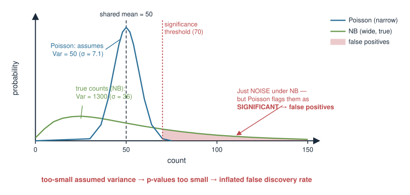{width="60%" fig-align="center"}

::: notes
This is the "so what". The direction of the error matters: assuming too little variance makes you anti-conservative — p-values shrink, and you call noise as signal. Poisson-on-biological-replicates is the canonical mistake, and it is why the field moved to negative binomial methods. The R makes it visceral: Poisson(50) has variance ~50; NB with the same mean but size = 2 has variance far above 50 (Var = mu + mu^2/size = 50 + 1250). A Poisson test on the NB data would treat that huge spread as if it were only 50, and every borderline gene becomes a false positive. Emphasise size = 1/phi in R's parameterisation so the code matches the earlier formula. Land the closing line: choosing the error model directly controls how many false discoveries you make.
:::

## Choosing the error model {.smaller}

Match the **data type** to the distribution:

| Your data | Distribution | Key feature |
|---|---|---|
| Continuous, symmetric spread | **Gaussian** $\mathcal{N}(\mu,\sigma^2)$ | mean and variance independent |
| Counts, idealised / technical | **Poisson**$(\lambda)$ | variance = mean |
| Counts, biological replicates | **Negative binomial**$(\mu,\phi)$ | variance = $\mu + \phi\mu^2$ |
| Waiting times / gaps (continuous, $\ge 0$) | **Exponential**$(\lambda)$ | memoryless, mean $1/\lambda$ |

**Diagnostic:** for counts, compare the sample variance to the sample mean. Variance $\approx$ mean $\to$ Poisson may do; variance $\gg$ mean $\to$ overdispersed, use NB.

::: notes
The decision table is the take-home cheat-sheet. Walk each row: what does the data look like, and what is the one feature that picks the distribution. The practical diagnostic is the mean-variance comparison for counts — cheap and decisive. If variance tracks the mean, Poisson is defensible (often only for technical replicates); if variance blows past the mean, you have overdispersion and need the negative binomial. Note that exponential is the odd one out here — continuous waiting times, not counts — included because it is the same Poisson process seen the other way. Students should leave able to look at a column of numbers and name the right error model.
:::

## Summary {.smaller}

| Idea | Key fact |
|---|---|
| Error model | the distribution you assume generated the data (the **likelihood**) |
| Gaussian | continuous, symmetric; mean and variance **independent** |
| Poisson | counts; **variance = mean = $\lambda$**; limit of many rare events |
| Exponential | waiting times/gaps; memoryless; mean $1/\lambda$ |
| Poisson process | one process: counts $\to$ Poisson, gaps $\to$ exponential |
| Overdispersion | real biological counts have **variance > mean** |
| Negative binomial | counts with dispersion; $\text{Var} = \mu + \phi\mu^2$; RNA-seq (`DESeq2`, `edgeR`) |
| Wrong model | too-small variance $\to$ overconfidence $\to$ **false positives** |

**Connects to:** the **prior, likelihood and posterior** unit (this likelihood plugs into Bayes' theorem); the **Poisson and negative binomial distributions** for count data.

::: notes
Recap as an exam cheat-sheet. Drill the reflex: name the data type, name the distribution, name its defining feature. The three claims most worth memorising: Poisson has variance = mean, real biological counts are overdispersed so need the negative binomial, and assuming too little variance inflates false positives. Close by pointing forward — the likelihood defined today is exactly what multiplies the prior in the Bayesian unit, and the negative binomial gets fuller treatment alongside the Poisson for count data. Keep the provisional-block caveat in mind: this material may relocate to a later stats/ML course.
:::
