## About this lecture

We have spent the course changing how we *look* at data. A matrix rotates the axes; PCA finds the axes along which the data spreads. Today we meet another change of viewpoint — one that has quietly powered a huge fraction of signal and image analysis in biology.

- Any signal or image can be written as a **sum of simple waves** (sinusoids) of different **frequencies**. That recipe is the **Fourier transform**.
- The transform is nothing exotic: it is a **change of basis**, exactly like the ones from Matrices as transformations and PCA.
- The waves form an **orthogonal basis**. Fourier uses a **fixed** basis; PCA learns a **data-driven** one. Same linear-algebra machinery, different choice of axes.
- Why biologists care: **image compression**, **denoising**, **filtering**, and **feature extraction** in microscopy and other signals.
- A teaser at the end: **wavelets**, a basis that is local in both space and frequency.

This is a **light, intuitive** lecture — the goal is that you know this tool *exists* and understand *why* alternative basis functions are useful. No exam-level derivations today.

::: notes
Frame the day as "one more change of basis." Students have now met the standard basis, matrices as changes of coordinates, and the eigen/PCA basis. Fourier slots in as: instead of describing a signal by its value at each time point, describe it by how much of each frequency it contains. Emphasise that the mathematics is deliberately kept light — this is an Applications-block tour, meant to plant intuition and vocabulary (frequency, spectrum, basis, orthogonal, filter), not to drill a by-hand recipe. Keep the energy playful; the "cute intro" framing is intentional.
:::

## A biology picture first {.smaller}

Two everyday biological signals:

- A **microscopy image** of tissue — but it is grainy, and there is a faint periodic stripe artefact from the detector.
- A **recording over time** — say a fluorescence trace, an ECG-like electrophysiology signal, or an oscillating gene-expression readout — buried in noise.

In both cases the *interesting* structure and the *unwanted* structure live at different **scales of variation**: smooth trends, fine texture, a repeating rhythm, random speckle.

**Question:** is there a representation in which "slow smooth stuff", "a specific repeating pattern", and "fine noise" become *separate, addressable* pieces?

Yes — that representation is **frequency**. The Fourier transform sorts a signal by frequency.

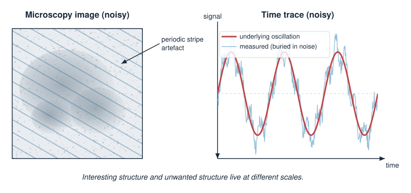{width="75%" fig-align="center"}

::: notes
Anchor the abstraction in two concrete biological signals before any maths, following the course's method-biology pairing principle. The key intuition to plant: different kinds of structure (a slow trend, a repeating rhythm, fine grain) correspond to different frequencies, and once you sort by frequency you can treat them separately — keep the trend, remove the stripe, smooth the noise. Do not define anything formally yet. Just sell the promise: frequency is a viewpoint in which messy signals become separable.
:::

## The core idea: everything is a sum of waves {.smaller}

A single **sinusoid** is described by three numbers:

$$A\,\cos(2\pi f\, t + \varphi)$$

- **frequency** $f$ — how many cycles per unit time (or space): fast wiggle vs slow wave,
- **amplitude** $A$ — how tall the wave is (how *much* of that frequency is present),
- **phase** $\varphi$ — where the wave starts in its cycle.

The central claim of Fourier analysis:

> **Any** signal can be built by **adding up** sinusoids of different frequencies, each with its own amplitude and phase.

The Fourier transform is the machine that, given a signal, tells you the **amplitude and phase of every frequency** — the *recipe* of waves.

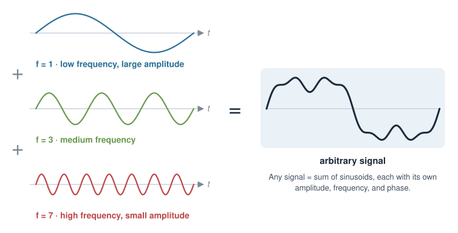{width="55%" fig-align="center"}

::: notes
This is the heart of the lecture, stated in words. A sinusoid has three knobs: frequency, amplitude, phase. The Fourier claim is that summing enough sinusoids reproduces any signal — a square wave, a spike train, a micrograph row. The transform runs this backwards: hand it a signal and it returns "how much of each frequency, and at what phase." Use the cooking metaphor: the signal is the baked cake, the Fourier transform reads back the recipe (2 cups of the 3 Hz component, a pinch of the 50 Hz component). Keep it intuitive; the orthogonality that makes the recipe *unique* comes two slides later.
:::

## Building a signal, one frequency at a time {.smaller}

Start with a slow wave. Add a faster one. Add a faster one still. With the right amplitudes, the sum sharpens into whatever shape you want.

| Frequencies included | What the sum looks like |
|---|---|
| just the lowest | a single smooth swell |
| low + a few middle | a gentle wiggly curve |
| low + middle + high | sharp edges, fine detail resolved |

- **Low frequencies** carry the broad shape (the slow trends, the overall brightness of an image).
- **High frequencies** carry the fine detail (sharp edges, texture — and, unfortunately, most noise).

This split — *broad shape vs fine detail* — is exactly what makes the frequency viewpoint so useful for biology.

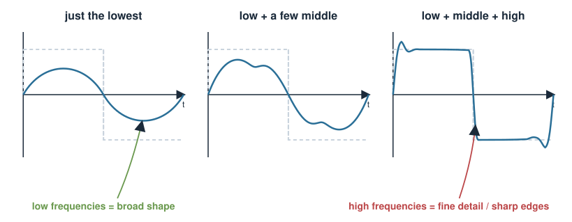{width="80%" fig-align="center"}

::: notes
Give the constructive picture: adding successively higher frequencies is like adding successively finer detail. A partial sum with only low frequencies is a blurred version of the signal; adding highs sharpens edges. This is the intuition behind both compression (throw away highs you can't see) and denoising (throw away highs that are just noise). Foreshadow that "high frequency = fine detail = often noise" but flag the caveat now: sharp real edges also live at high frequency, so naive high-frequency removal blurs real structure. That honesty pays off in the denoising slide.
:::

## The Fourier transform is a change of basis {.smaller}

Recall from Matrices as transformations and PCA: a **basis** is a set of directions you describe your data in, and changing basis just re-expresses the *same* object in *new* coordinates.

- **Standard viewpoint:** a signal of length $N$ is a list of $N$ numbers — its value at each time point. That is coordinates in the **standard basis** (one axis per time point).
- **Fourier viewpoint:** the *same* signal is a list of $N$ numbers — the **amount of each frequency**. Coordinates in the **Fourier basis** (one axis per frequency).

$$\underbrace{\text{signal in time}}_{\text{standard basis}} \;\xrightarrow{\;\text{Fourier transform}\;}\; \underbrace{\text{signal in frequency}}_{\text{Fourier basis}}$$

No information is lost — you can transform straight back (the **inverse** transform). It is a **rotation of the coordinate system**, nothing more.

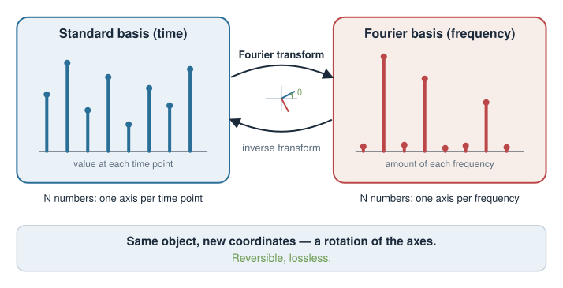{width="70%" fig-align="center"}

::: notes
This is the linear-algebra payoff and the slide to linger on. The Fourier transform is *literally* a change of basis: multiply the signal vector by a fixed matrix (the DFT matrix) whose rows are the sampled sinusoids. Same object, new coordinates — reversible, information-preserving. Connect explicitly to prior units: the standard basis has one axis per time/pixel; the Fourier basis has one axis per frequency. Stress reversibility (inverse transform) so students see it as a lossless rotation, not a summary. This reframing demystifies the whole topic: if you understood change of basis, you understand Fourier.
:::

## Why sinusoids? Because they are orthogonal {.smaller}

For a basis to give clean, *unique* coordinates, the basis directions should be **orthogonal** — perpendicular, non-overlapping — just like the orthogonal eigenvectors of a symmetric matrix in Eigenvalues & eigenvectors.

Sinusoids of different frequencies are orthogonal. The "dot product" of two whole signals is their overlap summed over all points:

$$\langle f, g\rangle = \sum_t f(t)\,g(t)$$

For two sinusoids of **different** frequencies this sum is **zero** — they do not overlap. So each frequency's amplitude can be read off **independently**, without the others interfering.

- Orthogonal basis $\Rightarrow$ the amplitude of each wave is just a **projection** (a dot product) onto that wave.
- This is the *same* projection idea as reading off PCA scores — only the axes differ.

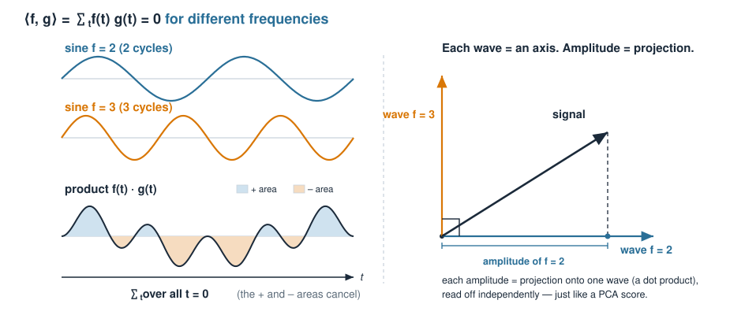{width="70%" fig-align="center"}

::: notes
Explain orthogonality as the property that makes the recipe unique and easy to read. Reuse the dot-product-as-overlap intuition and the projection idea students already have from the vector-geometry and PCA units. The one fact to convey: integrate/sum the product of two different-frequency sinusoids over a full period and you get zero — they are perpendicular as vectors in signal space. Consequently each Fourier coefficient is a projection of the signal onto one basis wave, computed independently of all the others, exactly as a PCA score is a projection onto a principal axis. Do not prove the orthogonality integral; assert it and give the intuition (the products cancel over a cycle).
:::

## Fixed basis vs data-driven basis {.smaller}

Fourier and PCA are cousins: both re-express data in an **orthogonal basis**. The difference is *where the basis comes from*.

| | **Fourier basis** | **PCA basis** |
|---|---|---|
| Basis vectors | **fixed** sinusoids, chosen in advance | **learned** from the data (eigenvectors of the covariance) |
| Depends on the data? | No — same axes for every signal | Yes — axes point along the data's variation |
| Good at capturing | periodic / oscillatory structure | whatever directions the data actually vary in |
| Cost | none — no fitting needed | must estimate a covariance and diagonalise it |

- Use **Fourier** when you expect structure at particular **frequencies** (rhythms, textures, periodic patterns).
- Use **PCA** when you want the basis to **adapt** to *your* dataset's main axes of variation.

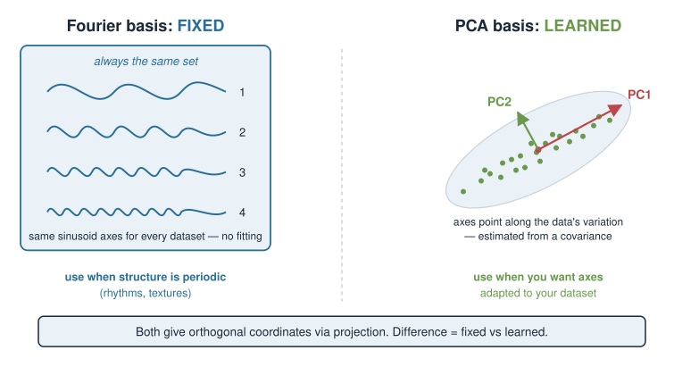{width="70%" fig-align="center"}

::: notes
This comparison is the conceptual spine of the lecture and ties the Applications block together. Both methods produce orthogonal coordinates via projection; the philosophical split is fixed vs learned. Fourier commits to sinusoids no matter what the data look like — cheap, universal, and unbeatable when the signal really is oscillatory. PCA pays a fitting cost to discover a basis tailored to the dataset's variance structure. Neither is "better"; they answer different questions. If students leave with only one idea, make it this table: a transform is a choice of basis, and you can either fix it (Fourier) or learn it (PCA).
:::

## From 1D signals to 2D images {.smaller}

An image is a 2D signal — brightness as a function of *two* spatial coordinates. The idea extends directly: the basis functions become **2D waves** (ripples across the image at a given orientation and spatial frequency).

- **Low spatial frequencies** = broad regions of brightness (overall illumination, large structures).
- **High spatial frequencies** = fine detail (edges, texture, and speckle noise).
- A **periodic artefact** (a detector stripe, a grid pattern) shows up as a **bright spot** at one specific frequency — easy to see and easy to remove.

The 2D Fourier transform gives the **spatial frequency spectrum** of an image: a map of how much of each ripple the image contains.

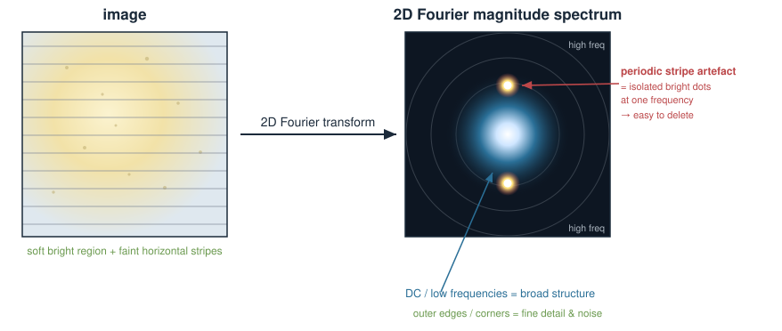{width="70%" fig-align="center"}

::: notes
Generalise to images without new machinery: replace "value at each time point" with "brightness at each pixel," and replace 1D sinusoids with 2D ripples that have an orientation as well as a frequency. The payoff picture is the 2D magnitude spectrum: DC/low frequencies near the centre (broad structure), high frequencies toward the edges (fine detail), and a periodic artefact as a discrete bright pair of dots. That last point sets up the filtering application: because an artefact is localised in frequency, you can delete it in the frequency domain and transform back. Keep it visual; this is where the FIGURE comment matters most.
:::

## Application 1: image compression {.smaller}

Most of the *visible* content of a natural image lives in its **low frequencies**. The high-frequency coefficients are often small and perceptually unimportant.

**Recipe:** transform to frequency space, keep the largest / lowest-frequency coefficients, throw the rest away, transform back.

- You store far fewer numbers, yet the image still looks nearly the same.
- This is the core idea behind **JPEG**, which uses a close Fourier relative, the **discrete cosine transform (DCT)**, on small image blocks.
- The trade-off is **lossy**: push it too far and you see "blocky" artefacts (the discarded high frequencies were real edges).

Same lesson as truncating a PCA to its top components: **keep the few coordinates that carry the signal, discard the rest.**

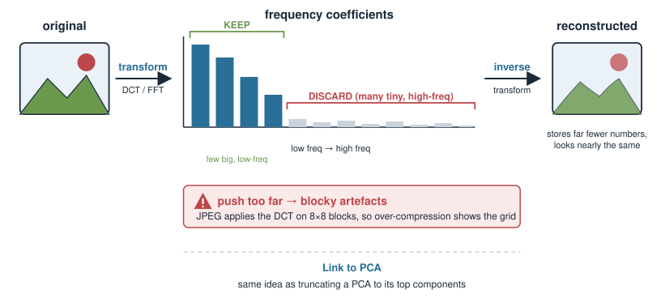{width="75%" fig-align="center"}

::: notes
Compression is the cleanest demonstration that a good basis concentrates information. In the Fourier/DCT basis, natural images have most of their energy in a handful of low-frequency coefficients, so you can zero out the many small high-frequency ones and lose little perceptual quality. Name JPEG and be precise that it uses the DCT (a real-valued cousin of the Fourier transform) on 8x8 blocks — do not overclaim it is "the Fourier transform." Draw the explicit parallel to PCA truncation, which students just met: both are "represent in a smart basis, then keep only the coordinates that matter." Mention lossiness and blocking artefacts to stay honest.
:::

## Application 2: denoising and filtering {.smaller}

Random noise (speckle, electrical hiss) is spread across **high frequencies**; much real signal sits at **lower** frequencies. So:

- **Low-pass filter** — keep low frequencies, suppress high: **smooths / denoises**.
- **High-pass filter** — keep high frequencies: **sharpens / enhances edges**.
- **Band-pass / notch** — keep or *delete* a specific band: isolate a rhythm, or **remove one artefact frequency** (e.g. a mains-hum line, a detector stripe).

Filtering is *multiply the spectrum by a mask, then transform back.* This is efficient because of the **convolution theorem**:

$$\text{convolution in space/time} \;\Longleftrightarrow\; \text{multiplication in frequency}$$

**Caveat (be honest):** sharp *real* edges are also high-frequency, so aggressive low-pass filtering blurs true detail. Filtering is a trade-off, not a free lunch.

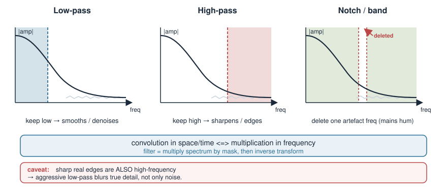{width="75%" fig-align="center"}

::: notes
Filtering is the operational reason biologists meet Fourier at the microscope and the electrophysiology rig. The mental model: transform, multiply the spectrum by a mask that keeps the frequencies you want, transform back. Low-pass smooths, high-pass sharpens, notch removes a single offending frequency (mains hum at 50/60 Hz, a periodic detector artefact). The convolution theorem is why this is fast and why "blurring = low-pass" — a smoothing convolution in space is a simple multiplication in frequency. Repeat the honesty note from earlier: noise and real edges share the high-frequency band, so filtering always trades noise reduction against detail loss. This caveat also motivates wavelets at the end.
:::

## Application 3: feature extraction in microscopy {.smaller}

The frequency spectrum is itself a **set of features** describing structure and texture — useful input for downstream statistics or classification.

- **Periodicity detection:** regular structures — sarcomere striations in muscle, a diffraction grating, a crystalline or lattice arrangement — produce sharp **peaks** in the spectrum. The peak location gives the **spacing**.
- **Texture / orientation:** the spread and direction of energy in the 2D spectrum quantifies how fine and how oriented the texture is (e.g. aligned fibres vs isotropic tissue).
- **Resolution assessment:** how far out into high frequencies real signal extends is a proxy for the effective resolution of an image.

Turning an image into a handful of frequency-domain numbers gives a compact, comparable **feature vector** — which you can then feed into the very tools from earlier in the course.

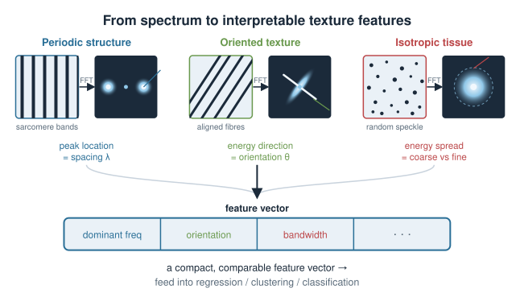{width="75%" fig-align="center"}

::: notes
Close the biology loop by showing Fourier as a feature generator, not just a filter. Concrete examples resonate: striated muscle and diffraction gratings give textbook spectral peaks whose position encodes the physical spacing; fibre alignment shows up as directional energy in the 2D spectrum; the high-frequency cutoff relates to resolution. The framing to leave students with: the spectrum compresses a whole image into interpretable numbers (dominant frequency, orientation, bandwidth) that become a feature vector for regression, clustering, or classification — connecting this Applications lecture back to the statistics they already know. Keep claims standard and avoid inventing specific numeric thresholds.
:::

## In R: the transform in one function {.smaller}

Base R computes the Fourier transform with `fft()`. A tiny 1D demo (illustrative — not run here):

```r
# a signal: a slow 3-cycle wave plus a fast 20-cycle wave, plus noise
t <- seq(0, 1, length.out = 256)
x <- sin(2*pi*3*t) + 0.5*sin(2*pi*20*t) + rnorm(256, sd = 0.2)

X    <- fft(x)             # discrete Fourier transform (complex numbers)
mag  <- Mod(X)             # magnitude = how much of each frequency
mag  <- mag[1:128]         # keep the lower half (the rest is a mirror image)

plot(mag, type = "h")      # expect tall spikes near index 3 and 20
```

- `fft()` returns **complex** numbers: `Mod()` gives amplitude, `Arg()` gives phase.
- The spectrum is **mirror-symmetric** for a real signal, so we look at the first half.
- Reconstruct with the inverse: `Re(fft(X, inverse = TRUE) / length(X))`.

For images, `fft()` also works on a matrix; production microscopy pipelines use dedicated imaging libraries.

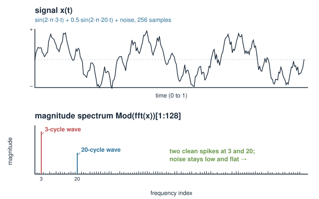{width="60%" fig-align="center"}

::: notes
Show that the whole lecture is one function call, so the tool feels approachable. Walk the demo verbally: a signal made of a 3-cycle and a 20-cycle sinusoid plus noise; fft() returns complex coefficients; Mod() gives amplitudes and you see two clean spikes at frequencies 3 and 20 while the noise stays low and flat. Flag the two gotchas that trip everyone: the output is complex (magnitude and phase), and for a real signal the spectrum is mirror-symmetric so you only read the first half. Note base R's fft is unnormalised, hence the divide-by-N on the inverse. This is static illustrative code — no packages assumed at render — and the exercise lets them reason about it on paper.
:::

## Teaser: wavelets {.smaller}

The Fourier transform has one blind spot: its basis waves stretch across the **whole** signal, so it tells you *which* frequencies are present but not **where** they occur.

For signals whose content **changes over time or space** — a transient spike, an edge, a burst of activity — we want a basis that is **local**.

- **Wavelets** are little wave-packets, localised in **both** position **and** frequency.
- They describe a signal at **multiple scales at once**: coarse shape *and* the location of fine features.
- Used in **image compression** (JPEG 2000), **denoising** with sharp-edge preservation, and multi-scale biological signal analysis.

Same big idea, better-suited basis: **choose the basis functions to match the structure you expect.**

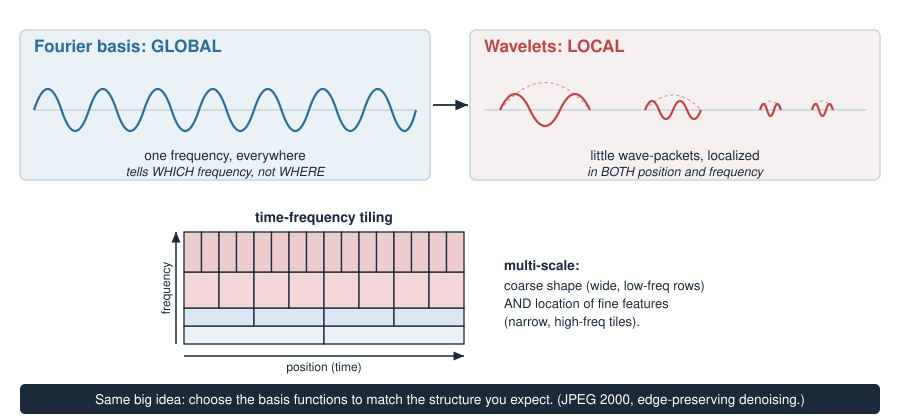{width="75%" fig-align="center"}

::: notes
End by opening a door rather than closing one. The honest limitation of Fourier is poor localisation: a global sinusoid basis cannot say *when* a frequency appeared, which is bad for transients and edges — exactly the detail that naive filtering blurs. Wavelets fix this with basis functions localised in both position and frequency, giving a multi-scale description. Name real uses (JPEG 2000, edge-preserving denoising) without going into the maths. The meta-lesson, and the through-line of the whole lecture, is the payoff sentence: analysis is the art of choosing a basis that matches your data's structure — fixed sinusoids, learned PCA axes, or localised wavelets. Do not teach wavelet mechanics; this is a pointer only.
:::

## Summary {.smaller}

| Idea | Key point |
|---|---|
| Fourier transform | write a signal as a **sum of sinusoids** of different frequencies |
| Frequency content | low = broad shape, high = fine detail (and most noise) |
| It's a **change of basis** | time/pixel coordinates $\to$ frequency coordinates; reversible, lossless |
| Orthogonal basis | different-frequency sinusoids are perpendicular $\Rightarrow$ each amplitude is a projection |
| Fixed vs data-driven | Fourier = **fixed** basis; PCA = **learned** basis; same projection machinery |
| Compression | keep the big low-frequency coefficients (JPEG/DCT) — like truncating a PCA |
| Denoising / filtering | mask the spectrum, transform back (convolution theorem); noise vs edges trade off |
| Feature extraction | spectral peaks, orientation, bandwidth = a compact feature vector |
| Wavelets | a **local** basis — where *and* which frequency; match the basis to the structure |

**In R:** `fft()` for the transform, `Mod()`/`Arg()` for amplitude/phase.

::: notes
The summary doubles as the take-home vocabulary sheet. Drill the single unifying sentence one more time: a transform is a choice of basis, Fourier fixes it to sinusoids, PCA learns it from data, wavelets localise it — and every application (compression, denoising, filtering, feature extraction) is "represent in a good basis, then keep or mask the coordinates you want." This is an Applications-block appreciation lecture, so success is conceptual fluency and comfort with the words, not a by-hand exam skill. Point them to the exercise (reasoning about a small spectrum and fft output on paper) and the quiz to consolidate.
:::
