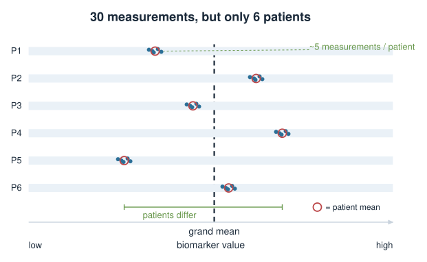
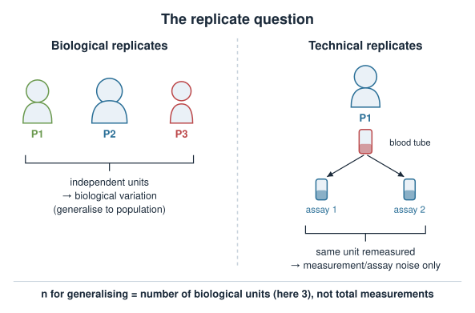
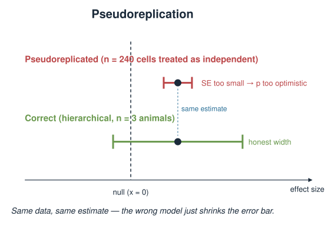
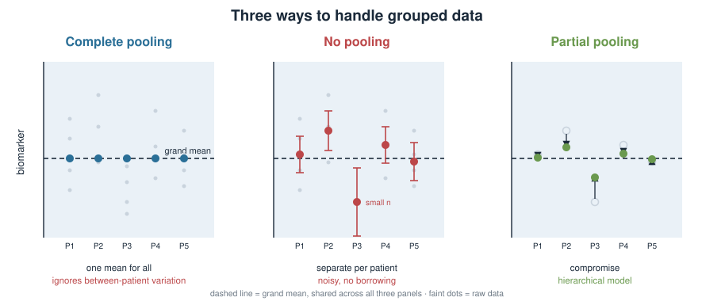
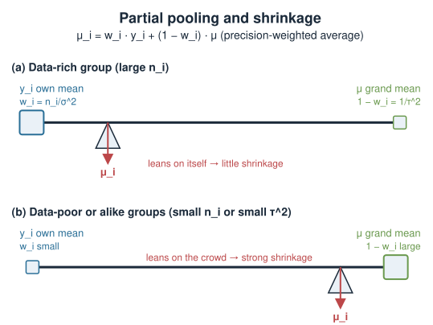
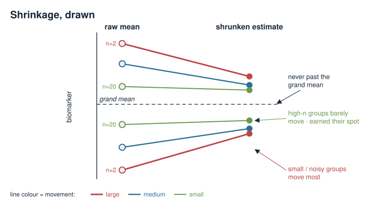
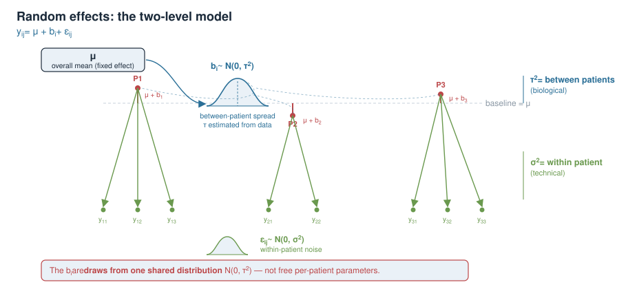
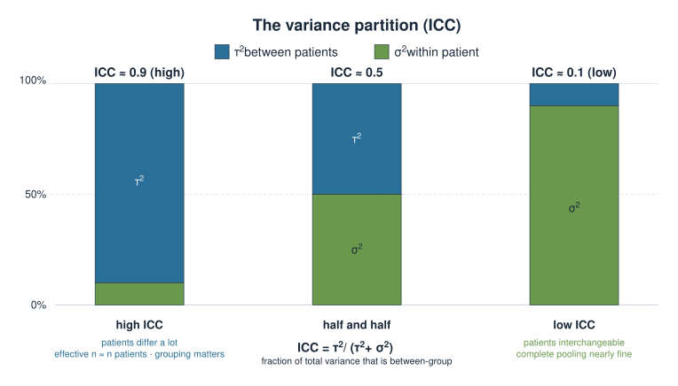
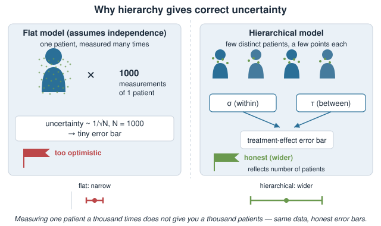
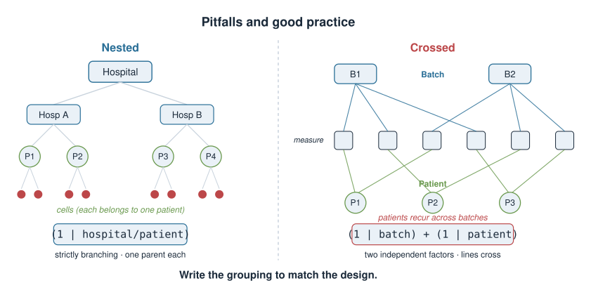

## About this lecture

Your data almost never arrive as one flat list of independent numbers. They come **grouped**: several cells per animal, several reads per cell, several time points per patient. Today we learn to model that structure instead of pretending it isn't there.

- **Biological vs technical replicates** — and why confusing them (**pseudoreplication**) is one of the most common mistakes in the literature.
- **Three ways to handle grouped data**: pool everything, pool nothing, or the middle road — **partial pooling**.
- **Shrinkage**: group estimates are pulled toward the overall mean, more so when a group is small or noisy.
- **Random effects** and the two-level model equation; the same idea in `lme4` and Bayesian `brms`/Stan syntax.
- Why hierarchy gives you the **right uncertainty**, not just the right average.

:::: {.callout-warning}
## Provisional block
This whole **Bayesian statistics** block is provisional and may move to a later statistics / machine-learning course. Treat it as a conceptual bridge, not exam-critical material.
::::

::: notes
The one sentence to leave the room with: measurements taken on the same biological unit are not independent, and a model that ignores that will report false confidence. Everything else today — replicates, pooling, shrinkage, random effects — is machinery for respecting that grouping. This builds directly on the Bayesian ideas of prior, likelihood and posterior: a hierarchical model is, in effect, a model that learns its own prior for the group-level parameters from the data. Flag the provisional status honestly; students should know where this sits.
:::

## A biology picture first {.smaller}

You measure a blood biomarker to compare **treated vs control** patients. But you don't get one number per patient — you draw **several samples per patient**, and each sample is assayed.

- 6 patients, roughly 5 measurements each → about 30 numbers.
- The 5 measurements from one patient are **more similar to each other** than to another patient's: same physiology, same day, same tube.

**How many independent data points do you really have — 30, or 6?**

The honest answer is *somewhere between*, and today's model is exactly what puts a number on "somewhere between".

{width="70%" fig-align="center"}

::: notes
Anchor everything in this concrete design before any equation. The tension is entirely captured by the question "30 or 6?". Naively treating all 30 as independent (this is pseudoreplication) exaggerates your sample size and shrinks your p-values dishonestly. Treating each patient as a single averaged number throws away the within-patient information and the fact that some patients were measured more than others. The hierarchical model keeps all 30 numbers but counts them correctly. Keep the biomarker example running through the whole lecture.
:::

## The replicate question {.smaller}

Before any statistics, ask of every number: **what is being repeated?**

- **Biological replicate** — an independent biological unit: a different patient, animal, or independently grown culture. Captures **biological variation** between units.
- **Technical replicate** — the same biological unit measured again: the same blood sample split and assayed twice, the same library sequenced twice. Captures **measurement / assay noise** only.

Averaging two technical replicates makes your *measurement* of one unit more precise. It does **not** give you a second unit.

::: {.callout-note}
The number that limits your ability to **generalise** to new patients is the number of **biological** replicates, not the total count of measurements.
:::

{width="70%" fig-align="center"}

::: notes
This distinction is the conceptual core and where most real errors live. Technical replicates reduce measurement error about a single unit; biological replicates are what let you say anything about the population. A study with 3 mice measured 100 times each has n = 3 for the biological question, not 300. Students with a wet-lab background usually recognise this immediately from grant/reviewer feedback; students from a pure data background often have not internalised it. Tie it to the earlier Poisson / negative binomial idea that different sources of variation stack.
:::

## Pseudoreplication {.smaller}

**Pseudoreplication** = analysing technical replicates (or repeated measures within a unit) as if they were independent biological replicates.

Consequences:

- The **effective sample size** is overstated (you claim 30 when you have nearer 6).
- Standard errors come out **too small**, confidence intervals **too narrow**.
- p-values are **too optimistic** → inflated false-positive rate.

A classic tell in a paper: "n = 240 cells from 3 animals, p < 0.001." The relevant *n* for a between-animal claim is **3**.

{width="70%" fig-align="center"}

::: notes
Give the name and make it stick — pseudoreplication (Hurlbert's term) is a citable, recognised problem, not a nitpick. The mechanism is simply that within-unit measurements are positively correlated, so each additional one carries less than a full data point's worth of new information; standard formulas that assume independence divide by too large an n. The "240 cells from 3 animals" pattern is worth having them memorise as a red flag they will genuinely see in seminars. The fix is not to throw data away but to model the grouping, which is the rest of the lecture.
:::

## Three ways to handle grouped data {.smaller}

Say each patient $i$ has a true mean $\mu_i$ and you want to describe them.

1. **Complete pooling** — ignore patients; one grand mean $\mu$ for everyone. *Throws away real between-patient variation.*
2. **No pooling** — a separate, independent mean for each patient, estimated from that patient's data alone. *Noisy for patients with few measurements; can't borrow strength.*
3. **Partial pooling** — each $\hat\mu_i$ is a **compromise** between the patient's own mean and the grand mean. *The hierarchical model.*

Partial pooling is the "have your cake and eat it": patient-specific, but stabilised by the group.

{width="70%" fig-align="center"}

::: notes
Frame these as the two extremes and the middle. Complete pooling assumes all patients are identical (between-patient variance = 0). No pooling assumes patients tell you nothing about each other (between-patient variance = infinity). Neither is usually true. Partial pooling estimates *how* similar patients are from the data and lets that estimate set the compromise. Emphasise "borrow strength": a patient with only two noisy measurements gets rescued toward the group, while a patient with twenty measurements barely moves.
:::

## Partial pooling and shrinkage {.smaller}

The partial-pooling estimate for a group is a **precision-weighted average** of its own mean and the grand mean:

$$
\hat\mu_i \;=\; w_i\,\bar y_i \;+\; (1-w_i)\,\hat\mu,
\qquad
w_i \;=\; \frac{n_i/\sigma^2}{\,n_i/\sigma^2 + 1/\tau^2\,}
$$

- $\bar y_i$ = patient $i$'s own sample mean, from $n_i$ measurements.
- $\hat\mu$ = grand mean; $\sigma^2$ = within-patient noise; $\tau^2$ = between-patient spread.
- Every group estimate is pulled toward $\hat\mu$ — this pull is called **shrinkage**.

More shrinkage when a group is **small** ($n_i$ tiny) or when groups are **truly alike** ($\tau^2$ small).

{width="70%" fig-align="center"}

::: notes
This one formula carries the whole idea, so read the weights slowly. The weight on a group's own mean grows with how much information that group carries (n_i / sigma^2, its precision) relative to the between-group spread (1 / tau^2). A data-rich group leans on itself; a data-poor group leans on the crowd. Two limiting cases recover the previous slide: tau^2 -> 0 forces w_i -> 0, complete pooling; tau^2 -> infinity forces w_i -> 1, no pooling. Shrinkage is not a fudge — it is the estimate that minimises expected error when groups genuinely share a distribution, echoing the Bayesian posterior-mean idea from earlier in this block.
:::

## Shrinkage, drawn {.smaller}

{width="70%" fig-align="center"}

Picture each patient's raw mean on the left and its shrunken estimate on the right:

- Points **move toward the grand mean**, never past it.
- Patients with **few / noisy** measurements move the **most**.
- Patients with **many** measurements barely move — they've earned their position.

This is *regularisation*: extreme group estimates, which are often extreme only by chance, are reined in.

::: notes
The dumbbell / caterpillar picture is the single most memorable image for shrinkage; describe it even without the figure. The key intuition to install: an extreme raw group mean is more likely to be extreme because of sampling noise than because the group is genuinely extreme, so pulling it toward the centre improves it on average. This is the same logic as ridge/penalised regression coming later in Penalized linear models, and the same logic as a Bayesian prior: both discipline extreme estimates. Note the "never past the grand mean" property — shrinkage interpolates, it doesn't overshoot.
:::

## Random effects: the two-level model {.smaller}

Write the biomarker for measurement $j$ in patient $i$ as a sum of levels:

$$
y_{ij} \;=\; \mu \;+\; b_i \;+\; \varepsilon_{ij},
\qquad
b_i \sim \mathcal N(0,\tau^2),
\quad
\varepsilon_{ij} \sim \mathcal N(0,\sigma^2)
$$

- $\mu$ — the overall mean (a **fixed effect**).
- $b_i$ — how patient $i$ deviates from it (a **random effect**), drawn from a shared distribution.
- $\varepsilon_{ij}$ — measurement noise within a patient.

The move that makes it *hierarchical*: the $b_i$ are not free parameters — they share a distribution $\mathcal N(0,\tau^2)$ whose spread $\tau$ is **estimated from the data**.

{width="70%" fig-align="center"}

::: notes
Two levels, two variances: sigma^2 lives between measurements of one patient (technical), tau^2 lives between patients (biological). This is exactly the biological/technical distinction from earlier, now written as an equation. The crucial and initially strange idea is that b_i are treated as draws from a distribution rather than as ordinary parameters we estimate freely — that shared distribution is what couples the patients together and produces partial pooling automatically. Because tau is learned from the data, the model discovers how much to pool. Contrast "fixed effect" (one number for the whole dataset) with "random effect" (one draw per group from a common pool).
:::

## The variance partition (ICC) {.smaller}

The two variances answer "how correlated are two measurements from the *same* patient?"

$$
\text{ICC} \;=\; \frac{\tau^2}{\tau^2 + \sigma^2}
$$

- **ICC near 1** — patients differ a lot, measurements within a patient are tight. Grouping matters enormously; your effective sample size is close to the **number of patients**.
- **ICC near 0** — patients are basically interchangeable; grouping barely matters and complete pooling is nearly fine.

The **intraclass correlation** is the single number that tells you *how much* your hierarchy matters.

{width="70%" fig-align="center"}

::: notes
ICC = fraction of total variance that is between-group. It is the same quantity that governs how much pseudoreplication would have hurt you: high ICC means within-group measurements are highly redundant, so counting them all as independent is very wrong. Give the two poles. A useful mental check: with high ICC, going from 5 to 50 measurements per patient barely helps the between-patient question — you need more patients. This directly answers the opening "30 or 6?" question quantitatively.
:::

## Why hierarchy gives correct uncertainty {.smaller}

A flat model that ignores grouping assumes all $N$ measurements are independent, so its uncertainty scales like $1/\sqrt{N}$ — **too optimistic** when measurements cluster.

The hierarchical model instead:

- separates **within-patient** noise ($\sigma$) from **between-patient** variation ($\tau$),
- propagates **both** into the uncertainty of the group means and of $\mu$,
- so the confidence interval on the treatment effect reflects the number of **patients**, not the raw count of measurements.

**Same data, honest error bars.** You are no longer fooled by measuring one patient a thousand times.

{width="70%" fig-align="center"}

::: notes
This is the payoff slide and the reason the topic sits in a Bayesian/statistics course rather than a lab-methods aside. The flat model's error bar is wrong not because the point estimate is badly biased but because the uncertainty is badly understated — and understated uncertainty is exactly what drives irreproducible findings. The hierarchical model widens the interval to acknowledge that you have few truly independent units. Reconnect to the pseudoreplication slide: this model is the principled cure for that disease. Stress "same data" — nothing is discarded, the accounting is just correct.
:::

## In R: the model formula {.smaller}

The grouping is written with `(1 | patient)` — read it as "let the intercept vary by patient."

Frequentist multilevel fit with `lme4`:

```r
library(lme4)

# random intercept per patient, plus a treatment fixed effect
set.seed(1)
d <- data.frame(patient = factor(rep(seq_len(40), each = 4)),
                treatment = rep(c("control", "control", "treated", "treated"), 40))
patient_effect <- rnorm(40, sd = sqrt(2))
d$biomarker <- 6 + 1.5 * (d$treatment == "treated") +
  patient_effect[as.integer(d$patient)] + rnorm(nrow(d), sd = sqrt(8))
fit <- lmer(biomarker ~ treatment + (1 | patient), data = d)

summary(fit)     # fixed effects + variance of the random intercept (tau^2) and residual (sigma^2)
ranef(fit)       # the shrunken per-patient deviations b_i
```

- `treatment` — a **fixed** effect (the population-level question).
- `(1 | patient)` — a **random** intercept: one $b_i$ per patient, from a shared $\mathcal N(0,\tau^2)$.

::: notes
Keep this static — nothing is installed at render time — and read the formula syntax aloud because it is the part students actually reuse. Everything left of the bar is what varies by group (here just 1, the intercept); everything right of the bar is the grouping factor. summary() reports the two variance components, which are tau^2 and sigma^2 from our equations, plus the fixed-effect estimate and its (correctly widened) standard error. ranef() returns the partially pooled b_i — those are the shrunken estimates from the dumbbell picture. lme4 is the standard non-Bayesian entry point; the next slide gives the Bayesian version.
:::

## The Bayesian version: brms / Stan {.smaller}

The **same formula**, now fully Bayesian — priors on every parameter, a posterior for each:

```r
library(brms)

fit <- brm(biomarker ~ treatment + (1 | patient),
           data = d,
           family = gaussian())      # brms writes and runs the Stan model for you

summary(fit)                          # posterior means + credible intervals
```

The hierarchy is Bayesian at heart: the line $b_i \sim \mathcal N(0,\tau^2)$ **is** a prior on the patient effects — an **adaptive prior** whose width $\tau$ is itself estimated (given its own hyperprior).

::: notes
The punchline that ties the block together: a random effect is literally a prior on the group-level parameters, and because tau is learned, it is an *adaptive* or *hierarchical* prior — the data tell you how strongly to pool. This is why hierarchical models feel so natural in the Bayesian framework and why brms uses the identical (1 | patient) syntax on top of Stan. Everything from the prior/likelihood/posterior lectures applies unchanged; we've just added a layer where a parameter's prior has parameters of its own. Don't dwell on MCMC mechanics here — the point is conceptual continuity, not sampler details.
:::

## Reading it off correctly {.smaller}

Whichever engine you use, the workflow is the same:

- Report the **fixed effect** (e.g. treatment difference) with its interval — this is your scientific answer.
- Report the **variance components**: $\hat\tau$ (between patients) and $\hat\sigma$ (within patients); their ratio gives the ICC.
- Use the **shrunken** per-group estimates (`ranef` / posterior) when you need patient-level values, never the raw per-patient means.

A one-line sanity check: if $\hat\tau \approx 0$ the data say patients are alike (near complete pooling); if $\hat\tau \gg \hat\sigma$ grouping dominates.

::: notes
Give them a concrete reporting checklist so the model output isn't opaque. The fixed effect answers the biology; the variance components describe the structure and let a reader compute the ICC and judge how much pooling happened. Warn them not to grab raw group means after fitting a hierarchical model — the whole point was to improve those via shrinkage. The tau-hat sanity check connects the fitted numbers back to the three-ways slide: the model chose its own spot on the pooling spectrum, and tau-hat tells you where.
:::

## Pitfalls and good practice {.smaller}

- **Too few groups.** You cannot estimate $\tau$ from 2–3 patients; the between-group variance is barely identified. Rule of thumb: aim for **more groups**, not just more measurements per group.
- **Crossed vs nested grouping.** Cells within patients within hospitals *nest*; but batch and patient may *cross*. Write the grouping to match the design.
- **Don't model the treatment as random** if it's the effect you care about and has few, deliberately chosen levels — that's a fixed effect.
- **Balance isn't required.** Unequal $n_i$ is fine and handled automatically — that's a strength over averaging.

{width="70%" fig-align="center"}

::: notes
These are the practical traps that turn a good idea into a mis-specified model. The "too few groups" point is the most common: with a handful of patients tau is essentially unestimable and the model can collapse toward complete pooling or misbehave — this is where Bayesian priors on tau genuinely help over lme4. Nested vs crossed is about writing (1 | hospital/patient) versus (1 | batch) + (1 | patient) to match how the units actually relate. The fixed/random choice for treatment trips people up: few, chosen, of-interest levels → fixed. End on the reassurance that unbalanced data is a feature, not a bug, unlike naive averaging.
:::

## Summary {.smaller}

| Concept | Key fact |
|---|---|
| Biological replicate | independent unit; sets your power to generalise |
| Technical replicate | same unit remeasured; reduces measurement noise only |
| Pseudoreplication | counting technical reps as biological → false confidence |
| Complete / no / partial pooling | ignore groups / separate per group / **compromise** |
| Shrinkage | group estimates pulled toward the grand mean, most for small groups |
| Random effect | $b_i \sim \mathcal N(0,\tau^2)$; a group deviation from a shared pool |
| Two variances | $\sigma^2$ within, $\tau^2$ between; $\text{ICC}=\tau^2/(\tau^2+\sigma^2)$ |
| Correct uncertainty | error bars reflect number of **groups**, not measurements |
| R | `lmer(y ~ x + (1\|group))`; Bayesian `brm(...)` — same formula |
| Bayesian view | a random effect **is** an adaptive prior on group means |

::: notes
The table is the revision sheet. Drill the through-line one more time: data are grouped, groups are not independent draws, so model the grouping; partial pooling gives each group a shrunken estimate and, crucially, gives the whole analysis honest uncertainty tied to the number of independent units. The R syntax (1 | group) is identical in the frequentist lme4 and Bayesian brms worlds. Close on the unifying idea for this block — a hierarchical model is a Bayesian model that learns its own prior for the group parameters — which is why the topic lives here even though the tooling also exists in a frequentist form.
:::
