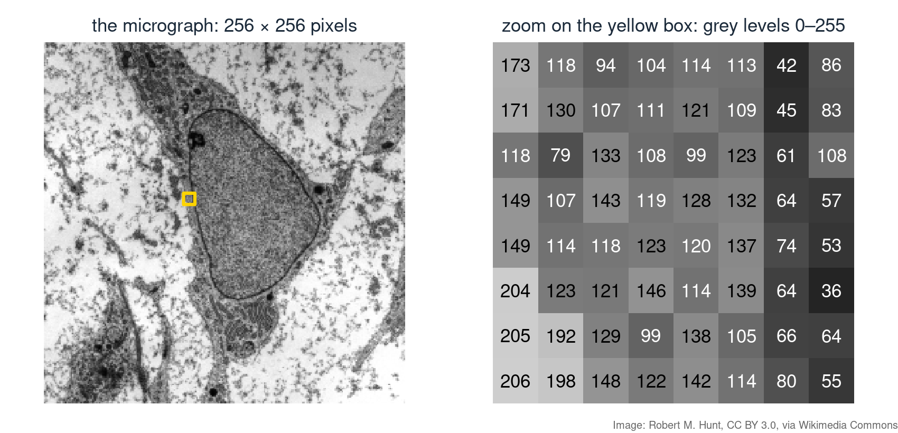
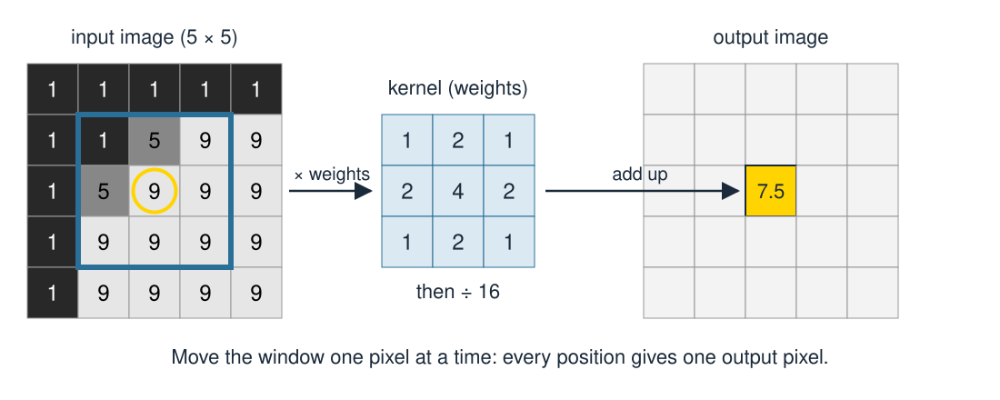
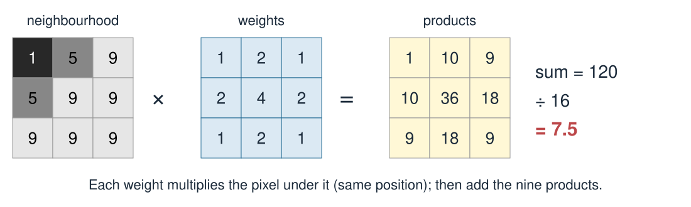
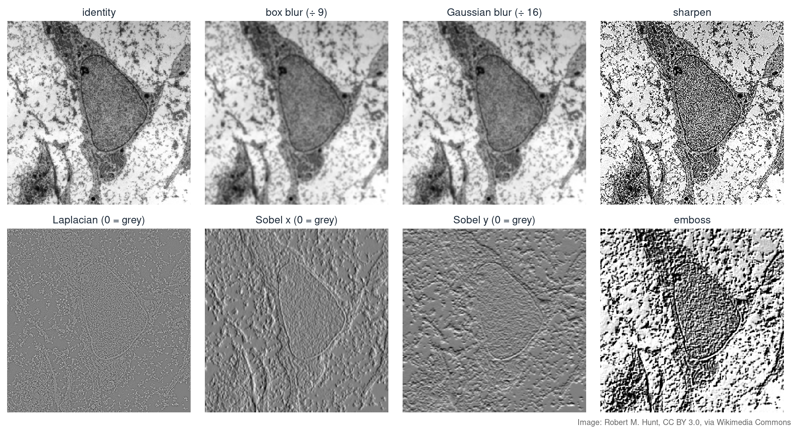
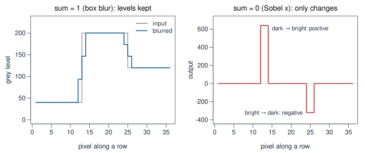
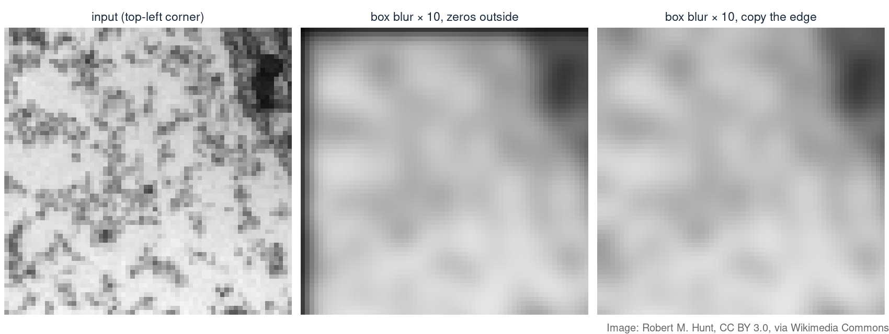
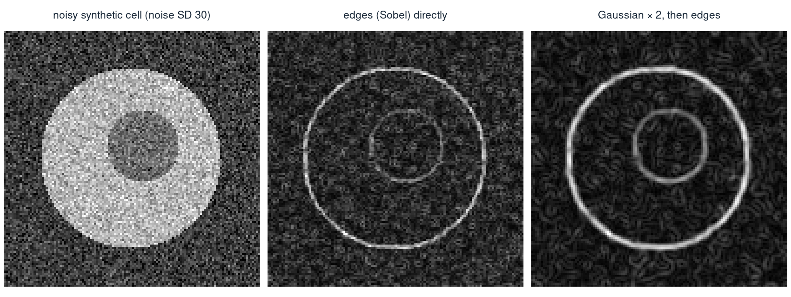
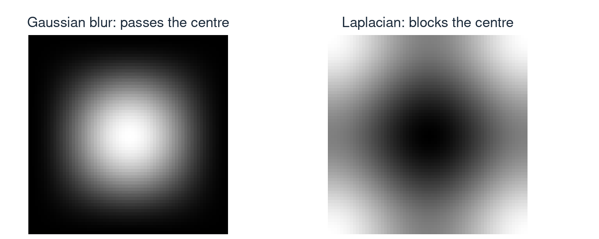

## About this lecture

In Transforming images with matrices, an image was a grid of numbers that we **moved around**. Today we **change the numbers** themselves, using the pixels nearby.

- A **kernel** is a small 3 × 3 grid of weights.
- Slide it over the image. Each output pixel is the **weighted sum** of the 3 × 3 pixels around it.
- With different weights you get **blur**, **sharpening**, **edge detection** or **emboss**.
- What the **sum of the weights** tells you, and what to do at the **border**.
- Why this matters in bioimage analysis, and how it links to the **Fourier** view of images.

::: notes
This is extra material that builds on Transforming images with matrices (an image is a matrix of grey levels) and on Fourier transform & basis functions (filtering as low-pass and high-pass). The maths is a weighted sum of nine numbers, nothing more. Students will compute one pixel by hand, then play with the demo, where they can edit the nine weights and see the output change live. Keep it visual: every kernel today is a 3 by 3 grid of numbers, and the question is always "what does this grid do to a picture?".
:::

## An image is a grid of numbers {.smaller}

A greyscale image is a matrix: one number per pixel, here from 0 (black) to 255 (white).

{width="88%" fig-align="center"}

In the zoom, the dark column of numbers (42, 45, 61, …) is the **nuclear envelope**. To a computer, "an edge" is nothing more than numbers that change quickly from one pixel to the next.

::: notes
Same micrograph as in Transforming images with matrices and in the Fourier demo: a transmission electron micrograph of a mesenchymal stem cell, here as a 256 by 256 crop. The yellow box is an 8 by 8 patch at the left edge of the nucleus. Point at the zoom: brighter cytoplasm on the left (numbers around 110 to 200), a dark column of 40 to 80 (the envelope), and the nucleus on the right. Everything we do today works on these numbers. A filter looks at each pixel together with its eight neighbours, so it can "see" whether the numbers change there.
:::

## A kernel: a small grid of weights that slides

{width="80%" fig-align="center"}

- Put the 3 × 3 kernel on top of the image, centred on one pixel.
- Multiply every pixel by the weight lying on top of it, and **add the nine products**.
- That sum is the **output** pixel. Then move one pixel on and repeat, until every pixel has been visited.

The output is a new image of the same size. The input is never changed along the way.

::: notes
The picture is the whole method. The blue window is centred on the pixel with the yellow ring; the kernel here is the Gaussian blur, 1 2 1 / 2 4 2 / 1 2 1, divided by 16. The yellow output pixel is the result for that position, worked out on the next slide. Stress two points. First, the window always reads from the original input, not from outputs computed earlier, so the order of the positions does not matter. Second, the same nine weights are used everywhere: the filter treats every part of the image the same way. Image software calls this "filtering" or "convolution"; we come back to the word on a later slide.
:::

## One output pixel, by hand {.smaller}

{width="92%" fig-align="center"}

The **same** 3 × 3 neighbourhood with other kernels:

| Kernel | Weights | Weighted sum | Output |
|---|---|---|---|
| box blur | all 1, then ÷ 9 | 65 | 65 ÷ 9 ≈ 7.2 |
| Gaussian blur | 1 2 1 / 2 4 2 / 1 2 1, then ÷ 16 | 120 | 7.5 |
| sharpen | 0 −1 0 / −1 5 −1 / 0 −1 0 | 45 − 28 | 17 |
| Laplacian (edges) | 0 1 0 / 1 −4 1 / 0 1 0 | 28 − 36 | −8 |

::: notes
Work through the top figure on the board. The neighbourhood comes from the 5 by 5 image on the previous slide: dark in the top left corner, bright elsewhere. Products: 1, 10, 9, 10, 36, 18, 9, 18, 9, which add up to 120; divided by 16 this gives 7.5. Then the table: the box blur gives the plain average, 65/9 ≈ 7.2. The Gaussian gives 7.5 because it trusts the centre pixel (a 9) more than the corner (a 1). Sharpen gives 17, far above any input value: it exaggerates the difference between the centre and its neighbours. The Laplacian gives −8: a negative number, which cannot be shown directly as a grey level. That is the first hint that edge kernels need special care when we display them.
:::

## Blurring: box and Gaussian

:::: {.columns}
::: {.column width="50%"}
**Box blur**: the plain average of the 9 pixels.
$$\tfrac19\begin{bmatrix} 1 & 1 & 1\\ 1 & 1 & 1\\ 1 & 1 & 1 \end{bmatrix}$$
:::
::: {.column width="50%"}
**Gaussian blur**: a weighted average, with most weight in the centre.
$$\tfrac1{16}\begin{bmatrix} 1 & 2 & 1\\ 2 & 4 & 2\\ 1 & 2 & 1 \end{bmatrix}$$
:::
::::

- Each pixel becomes more like its neighbours: **noise is averaged away**, and sharp steps become ramps.
- The Gaussian is gentler and looks more natural: it is a small version of the bell curve $e^{-\text{distance}^2}$, the same shape in every direction.
- Want **more** blur? Apply the kernel again. Two Gaussian passes act like one larger, wider Gaussian.

::: notes
Both kernels compute an average, so a flat region stays exactly as it was. The difference is how much the corners count. The box treats all nine pixels equally, which gives slightly blocky artefacts; the Gaussian gives the corners a quarter of the weight of the centre. The numbers 1 2 1 are the row 1 2 1 of Pascal's triangle; the 3 by 3 kernel is that row times itself, which is why it looks the same horizontally and vertically. Repeating a blur is how small kernels are used in practice: five passes of a 3 by 3 blur act like one 11 by 11 kernel. The demo has an "apply ×" slider to try this.
:::

## Sharpening: the original plus its edges

$$\underbrace{\begin{bmatrix} 0 & -1 & 0\\ -1 & 5 & -1\\ 0 & -1 & 0 \end{bmatrix}}_{\text{sharpen}}
= \underbrace{\begin{bmatrix} 0 & 0 & 0\\ 0 & 1 & 0\\ 0 & 0 & 0 \end{bmatrix}}_{\text{identity: the original}}
- \underbrace{\begin{bmatrix} 0 & 1 & 0\\ 1 & -4 & 1\\ 0 & 1 & 0 \end{bmatrix}}_{\text{Laplacian: the edges}}$$

- The **identity** kernel copies the image unchanged: only the centre weight is 1.
- Sharpening takes the original and **removes a bit of the local average**: where a pixel differs from its neighbours, the difference is made larger.
- Flat regions are unchanged (weights sum to 5 − 4 = **1**). Edges get a dark rim on the dark side and a bright rim on the bright side, so they look crisper.
- Nothing new is created: sharpening cannot restore detail that was never recorded, and it makes **noise** stronger as well.

::: notes
Kernels can be added and subtracted entry by entry, just like matrices, and filtering with the sum is the same as adding the two filtered images. So sharpen = original minus Laplacian. The Laplacian is large where a pixel stands out from its four neighbours; subtracting it pushes such pixels further away from their surroundings. In the by-hand example the centre 9 became 17. Microscope software often calls a softer version of this "unsharp masking": original plus a fraction of (original minus blurred). Warn about noise: noise is exactly "a pixel that differs from its neighbours", so sharpening a noisy image makes it look worse.
:::

## Finding edges: Laplacian and Sobel

:::: {.columns}
::: {.column width="33%"}
**Laplacian**
$$\begin{bmatrix} 0 & 1 & 0\\ 1 & -4 & 1\\ 0 & 1 & 0 \end{bmatrix}$$
neighbours minus centre: spots and outlines, in **any** direction
:::
::: {.column width="33%"}
**Sobel x**
$$\begin{bmatrix} -1 & 0 & 1\\ -2 & 0 & 2\\ -1 & 0 & 1 \end{bmatrix}$$
right minus left: **vertical** edges
:::
::: {.column width="34%"}
**Sobel y**
$$\begin{bmatrix} -1 & -2 & -1\\ 0 & 0 & 0\\ 1 & 2 & 1 \end{bmatrix}$$
below minus above: **horizontal** edges
:::
::::

- On a flat region all three give **0**. They answer only where the brightness **changes**.
- The **sign** says which way: Sobel x is positive where the image gets brighter to the right, negative where it gets darker.
- **Edge strength** in any direction: combine both Sobels like the length of a vector, $\sqrt{(\text{Sobel x})^2 + (\text{Sobel y})^2}$.

::: notes
Read each kernel as a comparison. The Laplacian compares the centre with its four direct neighbours. Sobel x compares the column on the right with the column on the left; the middle row counts double, which is a little built-in smoothing along the edge. Sobel x therefore finds vertical edges, because a vertical edge is a change from left to right. That naming often confuses students: x is the direction of the change, not the direction of the edge line. The edge strength formula is the length of the vector (Sobel x, Sobel y), exactly as in the vectors unit. It is not a 3 by 3 kernel itself, because of the square root, but it is built from two of them.
:::

## A gallery of kernels on the micrograph {.smaller}

{width="74%" fig-align="center"}

- Edge kernels give negative numbers, so they are shown with **0 as mid-grey**: darker = negative, brighter = positive.
- **Emboss** $\begin{bmatrix} -2 & -1 & 0\\ -1 & 1 & 1\\ 0 & 1 & 2 \end{bmatrix}$ is the original plus a diagonal edge detector: the cell looks lit from one corner.
- **Shift** $\begin{bmatrix} 0 & 0 & 0\\ 1 & 0 & 0\\ 0 & 0 & 0 \end{bmatrix}$ copies each pixel's **left** neighbour, so the image moves one pixel to the right. The weights decide where information comes from.

::: notes
This gallery is also the printable version of the demo. Walk through the rows. Top: the identity, then the two blurs (the nucleus texture softens, the outline survives), then sharpen, which brings out the texture but also the grain. Bottom: the Laplacian responds to every fine speck, so it looks like noise with a faint outline; Sobel x lights up the left and right sides of the nucleus, Sobel y the top and bottom; emboss gives a relief effect. The output ranges are far outside 0..255: sharpen goes from −325 to 514, Sobel x from −631 to 624. So any display of these needs a decision about how to map numbers to grey; the demo lets students switch between three choices. The shift kernel is not in the gallery (the picture would look unchanged); try it in the demo with "apply ×" at 5. A note on the name: image software calls this operation "filtering" or "convolution". Strictly, mathematical convolution turns the kernel upside down and left to right before sliding it; what we compute, without the flip, is called correlation. For symmetric kernels (box, Gaussian, Laplacian, sharpen) the two are identical. For asymmetric ones the flip matters: with a true convolution the shift kernel moves the image to the left, and Sobel x changes sign. Libraries differ in which one they call "filter", so check when the sign or direction matters. In a neural network the distinction is irrelevant, since the weights are learned.
:::

## The sum of the weights tells you a lot {.smaller}

{width="72%" fig-align="center"}

| Sum of the weights | On a flat region | Examples | Kind of filter |
|---|---|---|---|
| **1** | brightness **kept** | identity, blurs, sharpen, emboss | smoothing or enhancing |
| **0** | output **0** | Laplacian, Sobel x, Sobel y | detects **change** (edges) |
| anything else | brightness × sum | e.g. box of ones without ÷ 9 | divide by the sum to fix |

::: notes
On a flat region every pixel under the kernel has the same value, say 100. The weighted sum is then 100 times the sum of the weights. Sum 1 gives 100 back; sum 0 gives 0 whatever the brightness, which is exactly why edge kernels ignore flat regions and only respond to change. The figure is one row of pixels with two steps: the box blur keeps the three levels (40, 200, 120) and turns each step into a ramp; Sobel x is 0 on the flat parts, +640 at the dark-to-bright step and −320 at the smaller bright-to-dark step. That is why a box of ones is divided by 9: without it the image would be 9 times too bright. The demo has a "divide by the sum" box that does this.
:::

## Try it: edit a kernel and watch the output

```{=html}
<link rel="stylesheet" href="../demos/dist/demo.css">
<div data-demo="kernel3x3" data-image="cell" data-preset="gauss"></div>
<script src="../demos/dist/kernel3x3.js"></script>
```

::: notes
Left: the input; middle: the nine weights, which can be typed (press Enter to give the keyboard back to the slides) or changed with the − and + buttons; right: the output, updated live. Below: a click on either image selects a pixel, and the grey box shows its 3 by 3 neighbourhood, the weights and the products, just as on the by-hand slide. Suggested tour: Gaussian, then click "box blur" and raise "apply ×" to 5. Then Laplacian: the output switches to "0 = grey", because the sum of the weights is 0; try "as is" to see why that is needed (everything negative turns black). Then Sobel x versus Sobel y on the test pattern: the vertical lines light up in one, the horizontal ones in the other. Turn the noise up to about 30 and pick the Laplacian: the noise swamps everything. Then try "shift": the picture moves one pixel to the right; with apply × 5 it moves five. Finally edit the centre of the box blur to 3 and watch the sum update. The credit line is shown whenever the micrograph is used.
:::

## What happens at the border? {.smaller}

At the edge of the image, part of the 3 × 3 window falls **outside**. Three common choices:

- **Zeros** outside: simple, but the border darkens (the missing pixels count as black).
- **Copy the edge** (replicate): pretend the outermost pixels continue. Usually the safest.
- **Skip** the border: only compute where the window fits. The output is then 2 pixels narrower and 2 pixels shorter.

{width="80%" fig-align="center"}

::: notes
The figure is the top-left corner of the micrograph after 10 passes of the box blur. With zeros outside, a dark frame creeps in from the border, and it grows with every pass: the corner pixel drops from 209 to 12.6. Copying the edge keeps the corner at a sensible 150.9. Skipping is what many textbook definitions do, and it is common in neural networks ("valid" convolution), but it makes the output smaller, which is awkward when you want to compare input and output pixel by pixel. Other options exist (mirroring, wrapping around), and software packages differ in their default, so it is worth checking when results near the border matter. The demo offers "copy edge" and "zeros".
:::

## Caveats: lost detail and amplified noise {.smaller}

{width="86%" fig-align="center"}

- **Edge kernels amplify noise.** Noise is a pixel that differs from its neighbours, which is exactly what they look for.
- **So blur first, then look for edges.** On this noisy cell the outline is 2.8 times stronger than the background with edges only, and 5.9 times after two Gaussian passes.
- **Blurring loses detail.** Thin lines and small spots fade along with the noise, and two nearby objects can merge. Use the smallest blur that does the job.

::: notes
The synthetic cell is a bright disk with a darker nucleus plus Gaussian noise with SD 30. In the middle panel the Sobel edge strength shows both outlines, but the background is full of speckle; in the right panel, after two passes of the Gaussian blur, the speckle is weaker and smoother and both outlines stand out. The numbers are the mean edge strength on the cell outline divided by the mean in a background ring: 374/133 ≈ 2.8 without blur and 259/44 ≈ 5.9 with it. The price is that the edges are now thicker and less precise. This trade-off, noise against detail, is the same one met in Fourier filtering. Combining a Gaussian blur with a Laplacian gives the "Laplacian of Gaussian", a standard spot and blob detector.
:::

## In R: a filter in a few lines {.smaller}

```r
filter3 <- function(img, k) {
  nr <- nrow(img); nc <- ncol(img)
  p <- img[c(1, 1:nr, nr), c(1, 1:nc, nc)]          # copy the edge pixels outward
  out <- matrix(0, nr, nc)
  for (i in 1:nr) for (j in 1:nc)
    out[i, j] <- sum(k * p[i:(i + 2), j:(j + 2)])    # weights × neighbourhood, added up
  out
}

img5  <- matrix(c(1, 1, 1, 1, 1,
                  1, 1, 5, 9, 9,
                  1, 5, 9, 9, 9,
                  1, 9, 9, 9, 9,
                  1, 9, 9, 9, 9), 5, byrow = TRUE)
gauss <- matrix(c(1, 2, 1,  2, 4, 2,  1, 2, 1), 3, byrow = TRUE) / 16
filter3(img5, gauss)[3, 3]
# [1] 7.5
```

`k * p[...]` multiplies **entry by entry** (not `%*%`), and `sum()` adds the nine products. The padded matrix `p` has one extra row and column on every side, so `p[i:(i + 2), j:(j + 2)]` is the neighbourhood of pixel `[i, j]`.

::: notes
This is the same function students write in the exercise. The padding line repeats the first and last row and column, which is the "copy the edge" border rule. The double loop visits every pixel and does exactly the by-hand calculation. For a 256 by 256 image that is 65 536 small sums, about a tenth of a second in R; real software does the same thing in compiled code, or with the shift trick shown in the exercise solutions. The check on the last line reproduces 7.5 from the by-hand slide. Watch out for the classic R mistake: k %*% p would be a matrix product, which is something else entirely.
:::

## Where 3 × 3 kernels are used in bioimage analysis

- **Denoising before segmentation.** A Gaussian blur before a brightness threshold gives smoother, less ragged masks of nuclei or cells.
- **Outlines.** The Sobel edge strength marks nucleus and cell boundaries; segmentation methods such as watershed often start from it.
- **Spots.** The Laplacian of a blurred image picks out small bright dots, such as single-molecule FISH spots or vesicles.
- **Uneven illumination.** A very wide blur (many passes) estimates the slowly varying background, which is then subtracted.
- **Neural networks.** The first layers of a convolutional neural network (CNN) are exactly such small kernels, but their weights are **learned** from examples instead of chosen by hand.

::: notes
Each bullet is a standard step in tools such as Fiji/ImageJ or CellProfiler, usually with larger kernels than 3 by 3, but the idea is identical. For background subtraction the "blur" has to be much wider than the objects of interest, otherwise it removes the objects too. Keep the CNN point brief: a convolutional layer slides many small kernels over the image, and training adjusts their weights. After training, first-layer kernels often look like the edge and blob detectors of today. U-Net, a network design behind many cell-segmentation tools, is built from stacked 3 by 3 kernels (Ronneberger, Fischer & Brox, 2015, MICCAI, "U-Net: Convolutional networks for biomedical image segmentation").
:::

## The Fourier view: blur = low-pass, edges = high-pass

:::: {.columns}
::: {.column width="55%"}
{width="100%"}
:::
::: {.column width="45%"}
How strongly a kernel lets through each spatial frequency (centre = smooth parts, corners = fine detail):

- **Gaussian blur** keeps the centre and suppresses the fine detail: a **low-pass** filter.
- **Laplacian** is 0 in the centre and largest at fine detail: a **high-pass** filter.
- The value in the centre is the **sum of the weights**: 1 and 0.
:::
::::

**Convolution in image space is multiplication in frequency space:** sliding a kernel over the image does the same as multiplying the image's spectrum by the kernel's response.

::: notes
This links to Fourier transform & basis functions, where low-pass and high-pass filters were masks on the spectrum. The pictures are the size of the Fourier transform of each 3 by 3 kernel (padded with zeros to 64 by 64, centre = frequency 0). The Gaussian's response is 1 in the centre and falls to 0 at the corners; the Laplacian's is 0 in the centre and rises to 8. The centre value is the sum of the weights because frequency 0 is the plain sum. We state the convolution theorem without proof. Practical consequence: small kernels are cheapest to apply directly, while very large blurs are often done in frequency space. In the fourier2d demo, a low-pass mask gives a blur that looks much like several passes of the Gaussian here.
:::

## Summary

| Idea | In one line |
|---|---|
| Image | a grid of numbers, here 0–255 |
| Kernel | a 3 × 3 grid of weights |
| Filtering | each output pixel = weighted sum of its 3 × 3 neighbourhood |
| Sum of weights = 1 | brightness kept: blurs, sharpen, emboss |
| Sum of weights = 0 | responds only to change: Laplacian, Sobel |
| Border | zeros, copy the edge, or skip |
| Noise | edge kernels amplify it: blur first |
| Fourier | blur = low-pass, edges = high-pass; convolution = multiplication of spectra |

Same nine-number recipe, very different results: the **weights** are the whole story.

::: notes
Return to the main message: one simple operation, a weighted sum over a small window, and the choice of nine numbers decides whether you blur, sharpen or find edges. The sum of the weights tells you which family a kernel belongs to. The exercise practises the by-hand calculation, the demo, and a base R filter on a synthetic noisy cell.
:::
