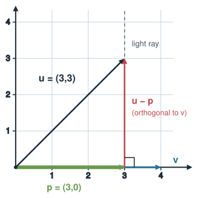
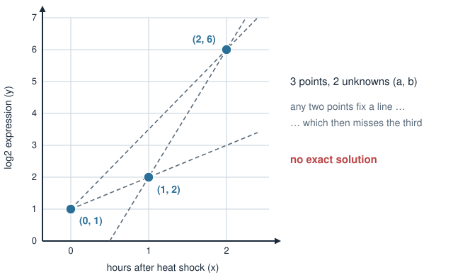
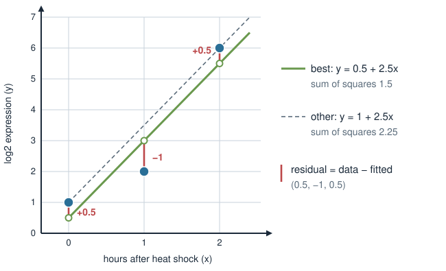
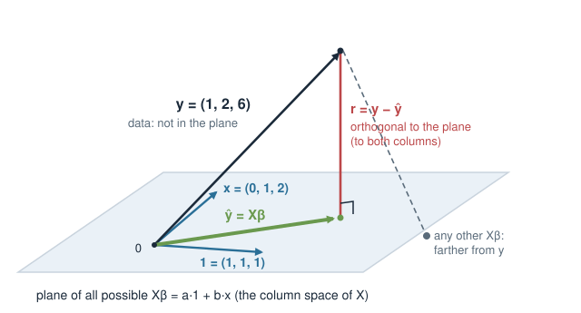

## About this lecture

Every linear model you fit, with [`lm`](https://rdrr.io/r/stats/lm.html), limma or DESeq2, has to find the coefficients $\boldsymbol\beta$ somehow. Today: **how**, and why it is the Week 1 projection in disguise.

- Fitting a line to a few points gives **more equations than unknowns**: no exact solution.
- **Least squares**: pick the line with the smallest sum of squared residuals.
- The geometry: the fitted values are the **projection** of the data onto the columns of $X$, and the residual is **orthogonal** to every column.
- That gives the **normal equations** $X^\mathsf{T}X\boldsymbol\beta = X^\mathsf{T}\mathbf{y}$, which is what `lm` solves.
- When $X^\mathsf{T}X$ **cannot be inverted**, there is no unique $\boldsymbol\beta$.

::: notes
A short bridge deck. Students have seen three separate pieces: the least-squares slide in Linear systems in R (qr.solve and lm give "the best x"), projection in Vectors, dot product & projection (the shadow, the leftover is orthogonal), and they are about to build design matrices in Design matrices for covariates. This deck glues them together: least squares is projection, and the normal equations are just "the residual is orthogonal to every column of X" written as a matrix equation. Keep it concrete: one tiny data set with three points runs through the whole deck. No calculus needed.
:::

## Recap: the shadow is the closest point {.smaller}

From *Vectors, dot product & projection*: the shadow of $\mathbf{u}$ on the line through $\mathbf{v}$ is

$$
\mathbf{p} = \frac{\mathbf{u}\cdot\mathbf{v}}{\mathbf{v}\cdot\mathbf{v}}\,\mathbf{v},
\qquad
(\mathbf{u} - \mathbf{p})\cdot\mathbf{v} = 0 .
$$

- The leftover $\mathbf{u} - \mathbf{p}$ meets the line at a **right angle**.
- Because of that right angle, $\mathbf{p}$ is the point on the line **closest** to $\mathbf{u}$: any other point is farther away (Pythagoras).

{width="36%" fig-align="center"}

Today we project onto a **plane** instead of a line. The idea is the same: drop a perpendicular.

::: notes
Re-show the Week 1 picture. The new point to make explicit is "closest": the perpendicular drop is the shortest way from the tip of u to the line. If you walk along the line away from p, the distance to u is the hypotenuse of a right triangle, so it grows. That one fact is the whole of least squares. Everything else today is bookkeeping to do it with more than one direction at once.
:::

## Fitting a line to three points

A stress gene, log2 expression measured 0, 1 and 2 hours after heat shock:

| hours $x$ | 0 | 1 | 2 |
|---|---|---|---|
| log2 expression $y$ | 1 | 2 | 6 |

We want a line $y = a + bx$. Each point gives one equation:

$$
a + 0b = 1, \qquad a + 1b = 2, \qquad a + 2b = 6 .
$$

{width="50%" fig-align="center"}

::: notes
The unknowns are now a and b, not x and y: x and y are the data. Three equations, two unknowns. Ask the room: which line goes through all three points? None. The first two equations give a = 1, b = 1, and then the third says 1 + 2 = 6, which is false. Any two points fix a line, and the third point disagrees. With real measurements this is the normal situation, not a mistake: noise means points never lie exactly on a line.
:::

## Too many equations: Case 2 again {.smaller}

The same three equations as a matrix system $X\boldsymbol\beta = \mathbf{y}$:

$$
\underbrace{\begin{pmatrix} 1 & 0 \\ 1 & 1 \\ 1 & 2 \end{pmatrix}}_{X}
\underbrace{\begin{pmatrix} a \\ b \end{pmatrix}}_{\boldsymbol\beta}
=
\underbrace{\begin{pmatrix} 1 \\ 2 \\ 6 \end{pmatrix}}_{\mathbf{y}}
$$

- Column 1 of $X$ is all 1's (the **intercept**); column 2 is the hours $\mathbf{x}$. This is the **design matrix** of `y ~ x`.
- 3 rows (samples) and 2 columns (coefficients): **over-determined**, Case 2 from *Linear systems in R*. No exact solution.
- `solve(X, y)` refuses: $X$ is not square.

So we change the question: not "which $\boldsymbol\beta$ fits exactly?" but "which $\boldsymbol\beta$ fits **best**?"

::: notes
Point out that this X is exactly what model.matrix(~ x) prints; the next deck, Design matrices for covariates, is all about building X for more complicated experiments. Here we only care about how beta is found once X is given. Connect to the three solution spaces: one, none, infinitely many. We are in "none". At the end of today we meet "infinitely many" again.
:::

## "Best" = smallest sum of squared residuals {.smaller}

For any line, the **residuals** are data minus fitted: $\mathbf{r} = \mathbf{y} - X\boldsymbol\beta$.

**Least squares** picks the $\boldsymbol\beta$ that makes $\lVert\mathbf{r}\rVert^2 = \mathbf{r}\cdot\mathbf{r}$, the sum of squared residuals, as small as possible.

{width="56%" fig-align="center"}

The best line is $y = 0.5 + 2.5x$: residuals $(0.5, -1, 0.5)$, sum of squares $0.25 + 1 + 0.25 = 1.5$. The line through the first and last point misses the middle one by $1.5$: sum of squares $2.25$.

::: notes
Residuals are vertical gaps, data minus fitted value, one per sample. Squaring makes positive and negative misses count the same and punishes big misses more. The sum of squared residuals is the squared length of the residual vector, the norm from Week 1. Ask: can you find a line with sum of squares below 1.5? They cannot. The next two slides explain why 0.5 + 2.5x is the winner without trying every line.
:::

## The picture: project $\mathbf{y}$ onto a plane {.smaller}

Think of $\mathbf{y} = (1, 2, 6)$ as **one vector** in 3-D, one axis per sample.

- Every possible fit $X\boldsymbol\beta = a\,\mathbf{1} + b\,\mathbf{x}$ is a combination of the two columns of $X$. All of them together form a **plane**: the **column space** of $X$.
- $\mathbf{y}$ is not in the plane (no exact solution).
- The closest point of the plane to $\mathbf{y}$ is the **projection** $\hat{\mathbf{y}}$, and the residual $\mathbf{r} = \mathbf{y} - \hat{\mathbf{y}}$ is **orthogonal** to the plane.

{width="56%" fig-align="center"}

::: notes
This is the key slide. Change of viewpoint: on the previous slide each sample was a point in a 2-D scatter plot; here the whole data set is one arrow in a space with one axis per sample. With 3 samples that is 3-D; with 20 samples it is 20-D, and the picture still holds. The fitted values are forced to lie in the plane spanned by the columns of X, because a fitted vector is always a times the ones column plus b times the hours column. The best fit is the shadow of y on that plane, exactly as on the recap slide but with a plane instead of a line. The dashed grey line: any other point in the plane is farther away, by Pythagoras.
:::

## The residual is orthogonal to every column {.smaller}

"Orthogonal to the plane" means orthogonal to **both** columns of $X$. Check with the best fit, $\mathbf{r} = (0.5, -1, 0.5)$:

$$
\mathbf{1}\cdot\mathbf{r} = 0.5 - 1 + 0.5 = 0,
\qquad
\mathbf{x}\cdot\mathbf{r} = 0\cdot0.5 + 1\cdot(-1) + 2\cdot0.5 = 0 .
$$

- $\mathbf{1}\cdot\mathbf{r} = 0$: the residuals **sum to zero**; the line passes through the average point.
- $\mathbf{x}\cdot\mathbf{r} = 0$: what is left over has no trend with $x$; nothing more the slope can explain.

For the other line, $y = 1 + 2.5x$, the residuals are $(0, -1.5, 0)$ and $\mathbf{1}\cdot\mathbf{r} = -1.5 \ne 0$: not orthogonal, so not the best.

::: notes
This turns the geometry into a test you can do with pen and paper: a fit is the least-squares fit exactly when the residual vector has dot product zero with every column of X. Give the biological reading of each condition. Residuals summing to zero is the intercept's job; zero dot product with x is the slope's job. With more columns (sex, batch, age) there is one such condition per column.
:::

## The normal equations {.smaller}

Write the "dot product with every column" in one go. $X^\mathsf{T}$ (**transpose**, `t(X)` in R) is $X$ with rows and columns swapped, so its rows are the columns of $X$, and $X^\mathsf{T}\mathbf{r}$ stacks the dot products $\mathbf{1}\cdot\mathbf{r}$ and $\mathbf{x}\cdot\mathbf{r}$:

$$
X^\mathsf{T}(\mathbf{y} - X\boldsymbol\beta) = \mathbf{0}
\quad\Longrightarrow\quad
\boxed{X^\mathsf{T}X\,\boldsymbol\beta = X^\mathsf{T}\mathbf{y}}
$$

For our three points:

$$
X^\mathsf{T}X = \begin{pmatrix} 3 & 3 \\ 3 & 5 \end{pmatrix},\quad
X^\mathsf{T}\mathbf{y} = \begin{pmatrix} 9 \\ 14 \end{pmatrix}
\quad\Longrightarrow\quad
\begin{aligned} 3a + 3b &= 9 \\ 3a + 5b &= 14 \end{aligned}
$$

Subtract: $2b = 5$, so $b = 2.5$ and $a = 0.5$. A **square** 2 × 2 system: solvable with Week 1 tools.

::: notes
The normal equations are named for "normal" in the sense of perpendicular. Walk through the entries: the top-left 3 is 1·1 (the number of samples), the off-diagonal 3 is 1·x (the sum of the hours), the 5 is x·x (0 + 1 + 4). On the right, 9 is the sum of y and 14 is x·y = 0 + 2 + 12. The trick: we started with 3 equations and 2 unknowns, multiplying by X transpose leaves 2 equations and 2 unknowns, always square, one equation per coefficient. Solve by elimination as in Solving linear equation systems.
:::

## In R: this is what `lm` does {.smaller}

```r
x <- c(0, 1, 2)
y <- c(1, 2, 6)
X <- cbind(1, x)                      # same as model.matrix(~ x)

solve(t(X) %*% X, t(X) %*% y)         # normal equations
#   [,1]
#    0.5
# x  2.5

fit <- lm(y ~ x)
coef(fit)                             # (Intercept) 0.5   x 2.5
fitted(fit)                           # 0.5 3.0 5.5  = X %*% beta, the projection
resid(fit)                            # 0.5 -1.0 0.5
t(X) %*% resid(fit)                   # 0 0  (up to rounding): orthogonal
```

`lm` gives the same $\boldsymbol\beta$. (Inside, it uses a QR decomposition, `qr.solve`, which is more accurate on a computer but solves the same problem.)

::: notes
Have them type this. The point: the formula y ~ x builds X, and lm returns the solution of the normal equations. fitted(fit) is X beta, the projection of y onto the column space; resid(fit) is the orthogonal leftover. The orthogonality check prints numbers like 2e-16, which is zero up to floating point. Mention that lm does not literally form t(X) %*% X, because that loses accuracy when columns are nearly dependent, but the answer is the same; that is why qr.solve appeared in Linear systems in R.
:::

## Intercept only: the best constant is the mean {.smaller}

The smallest model, `y ~ 1`, has one column $\mathbf{1} = (1, 1, 1)$. Projecting $\mathbf{y}$ onto a single vector is exactly the Week 1 formula:

$$
\hat{\mathbf{y}} = \frac{\mathbf{y}\cdot\mathbf{1}}{\mathbf{1}\cdot\mathbf{1}}\,\mathbf{1}
= \frac{1 + 2 + 6}{3}\,\mathbf{1} = 3\cdot\mathbf{1} = (3, 3, 3).
$$

- The coefficient $\frac{\mathbf{y}\cdot\mathbf{1}}{\mathbf{1}\cdot\mathbf{1}}$ is the **sum divided by the count**: the **mean**.
- The residuals $\mathbf{y} - \bar{y}\,\mathbf{1}$ are the deviations from the mean, and their squared length is what the variance is built from.

```r
coef(lm(y ~ 1))   # 3
mean(y)           # 3
```

::: notes
A small but satisfying special case: the average is a least-squares fit, and it is literally the projection formula from Week 1. This is also why an intercept-only model is the baseline every other model is compared against: adding columns can only shrink the residual (the plane contains the line), never grow it. If time is short, skip this slide; the exercise has it as a problem.
:::

## When $X^\mathsf{T}X$ cannot be inverted {.smaller}

The projection $\hat{\mathbf{y}}$ always exists. But $\boldsymbol\beta$ is **unique** only when the columns of $X$ are **independent**.

- All samples measured at the same time, $\mathbf{x} = (1, 1, 1)$: the two columns are identical, the "plane" is only a line.

```r
x <- c(1, 1, 1)
X <- cbind(1, x)
t(X) %*% X                  # 3 3 / 3 3: singular
solve(t(X) %*% X, t(X) %*% y)
# Error ... system is exactly singular
coef(lm(y ~ x))             # (Intercept) 3   x NA
```

- Any $a + b = 3$ gives the **same** fitted values: Case 3, infinitely many $\boldsymbol\beta$.
- Dependent columns in real designs (batch = treatment, the dummy trap) and **more columns than samples** are next in *Design matrices for covariates*. Fixing $p > n$ with a penalty comes in the penalized-models block.

::: notes
Same three cases as in Linear systems in R, one more time. The fitted values are still well defined: the shadow on a line is the shadow on a line, however you describe the line. What breaks is the split between a and b. lm handles this by dropping the redundant column and printing NA, which students will meet again in the covariates deck. The penalized-models block adds a penalty to make X transpose X invertible again (ridge literally adds a number to its diagonal). Just plant the seed here.
:::

## Summary {.smaller}

| Concept | Key fact | R |
|---|---|---|
| Over-determined | more samples than coefficients: no exact $\boldsymbol\beta$ | `solve(X, y)` fails |
| Least squares | minimise the sum of squared residuals $\lVert\mathbf{y} - X\boldsymbol\beta\rVert^2$ | `lm(y ~ x)` |
| Geometry | fitted values $\hat{\mathbf{y}} = X\boldsymbol\beta$ = **projection** of $\mathbf{y}$ onto the column space of $X$ | `fitted(fit)` |
| Orthogonality | residual has dot product 0 with **every column** of $X$ | `t(X) %*% resid(fit)` |
| Normal equations | $X^\mathsf{T}X\boldsymbol\beta = X^\mathsf{T}\mathbf{y}$: square, one equation per coefficient | `solve(t(X) %*% X, t(X) %*% y)` |
| Intercept only | the best constant is the **mean** | `coef(lm(y ~ 1))` |
| Not unique | dependent columns: $X^\mathsf{T}X$ singular, `lm` reports `NA` | `qr(X)$rank` |

**Next:** *Design matrices for covariates*: building $X$ for real experiments (treatment, sex, age, batch). The fitting step is always the one from today.

::: notes
The one-line takeaway: lm finds beta by projecting the data onto the columns of the design matrix, and the normal equations are just "the residual is orthogonal to every column". From now on, every model in the course (covariates, limma, DESeq2's starting point, ridge) only changes what goes into X or what is added to the sum of squares; the projection picture stays.
:::
