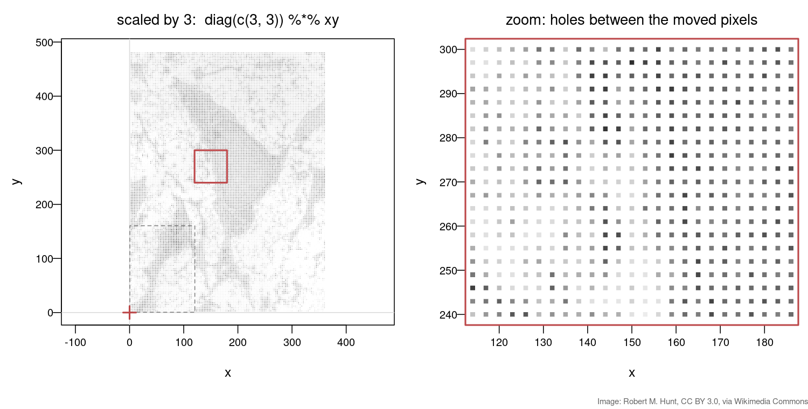

## Goal

By the end of this exercise you should be able to:

- treat an image as a $2 \times N$ matrix of pixel coordinates and transform it with one [`%*%`](https://rdrr.io/r/base/matmult.html),
- recognise **shear**, **reflection** and a **singular** matrix from their columns, by hand and on an image,
- combine a pipeline of transformations into **one** matrix and explain why the order of the factors matters,
- undo a known transformation with [`solve`](https://rdrr.io/r/base/solve.html).

This builds directly on Matrices as transformations; keep that exercise's R session open.

## Background

| Transformation | Matrix |
|---|---|
| Rotation by $\theta$ | $\begin{pmatrix}\cos\theta&-\sin\theta\\\sin\theta&\cos\theta\end{pmatrix}$ |
| Shear (x moves by $k$ times y) | $\begin{pmatrix}1&k\\0&1\end{pmatrix}$ |
| Reflection (flip x) | $\begin{pmatrix}-1&0\\0&1\end{pmatrix}$ |
| Scaling (x by $p$, y by $q$) | $\begin{pmatrix}p&0\\0&q\end{pmatrix}$ |

The columns of a matrix are where the axes $(1,0)$ and $(0,1)$ land. A pipeline "first $A$, then $B$, then $C$" is the single matrix $CBA$ (rightmost acts first).

## By hand

**B1.** Let $H = \begin{pmatrix} 1 & 2 \\ 0 & 1 \end{pmatrix}$ (a shear). Where do the axes $(1,0)$ and $(0,1)$ land? Apply $H$ to the four corners of the unit square $(0,0)$, $(1,0)$, $(1,1)$, $(0,1)$ and sketch the result.

## Explore {#explore}

The same idea on a picture: a drawn cell (with an "F" in the corner, so mirror images are easy to spot), centred on the origin. Drag the red and blue handles (the columns of $A$) or use the presets and the rotation slider.

```{=html}
<link rel="stylesheet" href="../demos/dist/demo.css">
<div data-demo="matrix2x2" data-mode="image" data-a="1 0 0 1"></div>
<script src="../demos/dist/matrix2x2.js"></script>
```

**E1.** Drag the blue handle to make the shear $H$ from B1. Does the frame (solid outline) look like your sketch?

**E2.** Before clicking, predict each preset from its columns: **Rotate 30°**, **Scale**, **Reflect**, **Misaligned**. Which one gives a mirror image? Then set the rotation slider to 180°: is that a mirror image too?

**E3.** Click **Collapse**, then slowly drag the blue handle away from the red one. When exactly does the cell become a line?

**E4.** Here the picture turns about its centre; in the R code it turns about its bottom-left corner. Why the difference?

::: {.callout-note collapse="true" title="Solutions"}
**E1.** The red handle stays at $(1, 0)$; put the blue one at $(2, 1)$. Horizontal lines stay horizontal and every point slides sideways by 2 times its height: the x-axis stays put, the top edge of the frame (height 1.5) slides 3 units to the right and the bottom edge 3 units to the left, so the corners leave the view. The lean is the same as in the B1 sketch, where the top of the unit square (height 1) slides 2 units.

**E2.** Rotate 30°: columns $(0.87, 0.5)$ and $(-0.5, 0.87)$, the picture turns counter-clockwise. Scale: columns $(2, 0)$ and $(0, 0.5)$, twice as wide, half as tall. Reflect: column 1 is $(-1, 0)$, so the picture is mirrored left–right and the F reads backwards. Misaligned: tilted and skewed, as on the registration slide. Rotating by 180° turns the F upside down, but it is not a mirror image: turn your head (or the screen) and it reads normally again. Only the reflection flips it.

**E3.** Exactly when the two columns lie on one line through the origin. Then every point $x\cdot\text{col 1} + y\cdot\text{col 2}$ is on that line, so the whole picture is squashed onto it. As soon as the columns point in different directions, the picture is a (thin) parallelogram again.

**E4.** A $2\times2$ matrix never moves the origin, $A(0,0) = (0,0)$, so the picture turns about whatever point sits at the origin. In the demo the origin is the centre of the picture; in R the pixel coordinates start at the corner, so the corner stays fixed.
:::

## In R

An image is a grid of pixels, and each pixel sits at a coordinate $(x, y)$. Stored as a $2 \times N$ matrix with one pixel per column, the whole image can be transformed with a single `%*%`, exactly like the little square of points in Matrices as transformations.

Download [`msc-small.jpg`](msc-small.jpg) into your R working directory. It is a downsampled transmission electron micrograph of a mesenchymal stem cell (image: Robert M. Hunt, [CC BY 3.0](https://creativecommons.org/licenses/by/3.0), via [Wikimedia Commons](https://commons.wikimedia.org/wiki/File:MSC_high_magnification.jpg)). You need the `jpeg` package: `install.packages("jpeg")` once.

```r
img <- jpeg::readJPEG("msc-small.jpg")            # 160 x 120 grey levels, 0..1
img <- t(img[nrow(img):1, ])                      # flip so up is up; now img[x, y]
xy  <- t(expand.grid(1:nrow(img), 1:ncol(img)))   # 2 x 19200: one pixel per COLUMN
col <- gray(img)                                  # the grey level of each pixel

rot <- function(theta) {
  matrix(c(cos(theta), -sin(theta),
           sin(theta),  cos(theta)), nrow = 2, byrow = TRUE)
}
shear <- function(k) matrix(c(1, k,
                              0, 1), nrow = 2, byrow = TRUE)

plot(t(xy), col = col, pch = 15, asp = 1)                # the original
plot(t(rot(pi/6) %*% xy), col = col, pch = 15, asp = 1)  # rotated 30 degrees
```

The colours never change: `col[j]` belongs to pixel `j` wherever the matrix moves it. Only the positions are transformed.

**R1.** Rotate the image by $30^\circ$ and then by $-30^\circ$. Plot the result and confirm with `max(abs(... - xy))` that you are back at the original. What is `rot(-pi/6) %*% rot(pi/6)`?

**R2.** Make your own gallery. Plot the image after each of `diag(c(2, 0.5))`, `shear(0.5)`, `diag(c(-1, 1))` and `matrix(c(1, 1, 0.5, 0.5), 2, byrow = TRUE)`. For each one, **first** predict the result from the columns of the matrix, then plot. Which one cannot be undone, and why?

**R3.** Build the pipeline "rotate $30^\circ$, then `shear(0.5)`, then resize with `diag(c(1.5, 0.75))`" as **one** matrix `M`. Check that `M %*% xy` gives the same result as applying the three matrices one after the other (use [`all.equal`](https://rdrr.io/r/base/all.equal.html)). Then multiply the same three matrices in the reverse order, plot both images, and describe the difference.

**R4.** A second image of the same cell came out misaligned by a known matrix:
```r
A <- matrix(c( 1.1, 0.4,
              -0.3, 0.9), nrow = 2, byrow = TRUE)
moved <- A %*% xy
plot(t(moved), col = col, pch = 15, asp = 1)
```
Use `solve(A)` to restore the original image and plot it. Check that `solve(A) %*% A` is the identity.

**R5.** Scale the image up by 3, `big <- diag(c(3, 3)) %*% xy`, plot it and zoom in with `xlim = c(120, 180), ylim = c(240, 300)` in `plot()`. Describe what you see between the pixels and explain why. How far apart are two neighbouring pixels before and after scaling (compare `xy[, 1:2]` with `big[, 1:2]`)? What would that distance be if you scaled **down** with `diag(c(0.5, 0.5))`, and why can holes not appear then?

## Hints

::: {.callout-tip collapse="true" title="Hint 1 — plotting a transformed image"}
Every image task uses the same line: `plot(t(A %*% xy), col = col, pch = 15, asp = 1)`, with a different `A`. `asp = 1` keeps squares square. If the result looks odd, check `A` by asking where its columns send the axes $(1,0)$ and $(0,1)$.
:::

::: {.callout-tip collapse="true" title="Hint 2 — undoing a transformation"}
`solve(A)` with one argument returns the inverse $A^{-1}$, the matrix that undoes $A$: $A^{-1}(A\mathbf{x}) = \mathbf{x}$. It only exists when $A$ is not singular, i.e. when its columns do not point along the same line. Comparing two matrices of numbers, `max(abs(a - b))` close to 0 (like `1e-14`) means "equal up to rounding".
:::

## Solutions

::: {.callout-note collapse="true" title="Solution"}

**B1.** The columns of $H$ are the images of the axes: $(1,0)\to(1,0)$ (the x-axis stays put) and $(0,1)\to(2,1)$ (the y-axis tips over to the right). Corners, with the row recipe $(x + 2y,\ y)$:
$(0,0)\to(0,0)$, $(1,0)\to(1,0)$, $(1,1)\to(3,1)$, $(0,1)\to(2,1)$.
The square becomes a parallelogram leaning to the right: the bottom edge is unchanged, the top edge slides 2 units right. Its base (1) and height (1) are unchanged, so the area is still 1.

**R1.** Rotating by $-30^\circ$ undoes rotating by $+30^\circ$:

```r
back <- rot(-pi/6) %*% (rot(pi/6) %*% xy)
plot(t(back), col = col, pch = 15, asp = 1)   # the original image again
max(abs(back - xy))                           # about 1e-14: equal up to rounding
round(rot(-pi/6) %*% rot(pi/6), 10)           # the identity matrix
```
`rot(-pi/6) %*% rot(pi/6)` is the identity: the two rotations cancel, so $R(-\theta)$ is the inverse of $R(\theta)$ (you can check `solve(rot(pi/6))` gives the same matrix).

**R2.**

```r
plot(t(diag(c(2, 0.5)) %*% xy), col = col, pch = 15, asp = 1)
plot(t(shear(0.5) %*% xy),      col = col, pch = 15, asp = 1)
plot(t(diag(c(-1, 1)) %*% xy),  col = col, pch = 15, asp = 1)
Z <- matrix(c(1, 1, 0.5, 0.5), 2, byrow = TRUE)
plot(t(Z %*% xy),               col = col, pch = 15, asp = 1)
```
- `diag(c(2, 0.5))`: columns $(2,0)$ and $(0,0.5)$ — twice as wide, half as tall.
- `shear(0.5)`: columns $(1,0)$ and $(0.5,1)$ — the image leans to the right, the top edge slides half its height sideways.
- `diag(c(-1, 1))`: columns $(-1,0)$ and $(0,1)$ — a mirror image, now to the left of the y-axis.
- `Z`: both columns, $(1,0.5)$ and $(1,0.5)$, point in the **same** direction, so every pixel lands on the line $y = x/2$. The image collapses to a line. This one cannot be undone: many different pixels land on the same point, so there is no way to tell them apart again. `solve(Z)` fails with an error that the matrix is singular.

**R3.**

```r
R <- rot(pi/6)
H <- shear(0.5)
S <- diag(c(1.5, 0.75))

M <- S %*% H %*% R                                # rotate first, so R is rightmost
all.equal(M %*% xy, S %*% (H %*% (R %*% xy)))     # TRUE
plot(t(M %*% xy), col = col, pch = 15, asp = 1)

M2 <- R %*% H %*% S                               # resize, then shear, then rotate
plot(t(M2 %*% xy), col = col, pch = 15, asp = 1)
```
Both products are built from the same three matrices, but the images differ. In `M` the image is rotated first and then stretched along x and squashed along y, which partly undoes the tilt: the cell ends up wide, flat and only slightly tilted. In `M2` the image is resized and sheared while still upright and only rotated at the end: it ends up as a taller parallelogram leaning more steeply. One product matrix replaces the whole pipeline, but the order of its factors must follow the order of the steps. The same happens with just two matrices:

{width="90%" fig-align="center"}

**R4.**

```r
restored <- solve(A) %*% moved
plot(t(restored), col = col, pch = 15, asp = 1)   # the original image
max(abs(restored - xy))                           # about 1e-14
round(solve(A) %*% A, 10)                         # the 2 x 2 identity
```
`solve(A)` is the inverse of `A`, so applying it after `A` gives back every pixel's original position. It exists because the columns of `A`, $(1.1, -0.3)$ and $(0.4, 0.9)$, do not lie on one line ($\det A = 1.11 \neq 0$).

**R5.**

```r
big <- diag(c(3, 3)) %*% xy
plot(t(big), col = col, pch = 15, asp = 1, xlim = c(120, 180), ylim = c(240, 300))
```
There are **holes**: a regular grid of small squares with white gaps between them.

{width="80%" fig-align="center"}

Each pixel is a single point, and the matrix only moves the points. `xy[, 1:2]` is $(1,1)$ and $(2,1)$, 1 apart; `big[, 1:2]` is $(3,3)$ and $(6,3)$, 3 apart. Each pixel still covers only about one unit, so two out of every three positions in each direction get no pixel at all: nothing is drawn in between. Scaling **down** with `diag(c(0.5, 0.5))` puts neighbours 0.5 apart, closer than before, so every unit of the smaller image receives at least one pixel and there are no holes (instead, several pixels compete for the same spot).
:::

## Where this leads

- **Eigenvalues & eigenvectors:** under the shear the x-axis does not move at all — a direction that is only scaled (here by 1). Those special directions are eigenvectors.
- **Polar coordinates: measuring a ring** (Applications block, after Fourier) changes coordinates in a way no matrix can, and uses the same working-backwards trick to unwrap an image around a centre.
- **Image software** fixes the holes from R5 by working backwards: for every pixel of the *output* image, it uses `solve(A)` to find where it came from in the input and interpolates a grey level there.
- **Translations** (shifting an image sideways) are not 2 × 2 matrix multiplications, because they move the origin. Image software uses a trick with 3 × 3 matrices (homogeneous coordinates) to write shifts as matrix multiplications too, so a whole pipeline is still one product.
- **Fourier transform for image analysis** (later in the course) is another way of describing an image with linear algebra.
