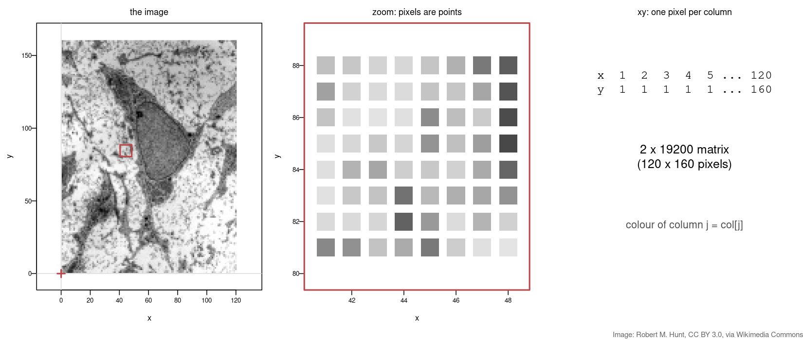
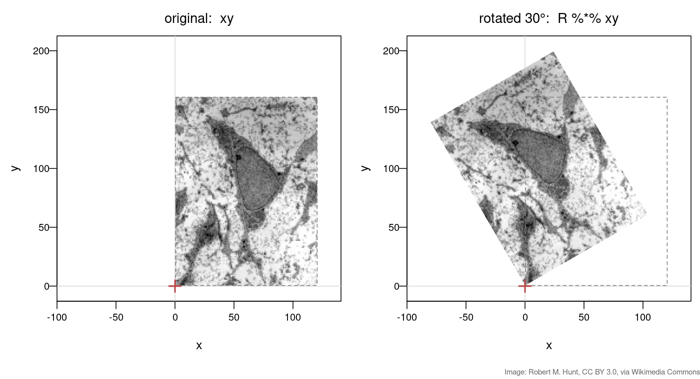
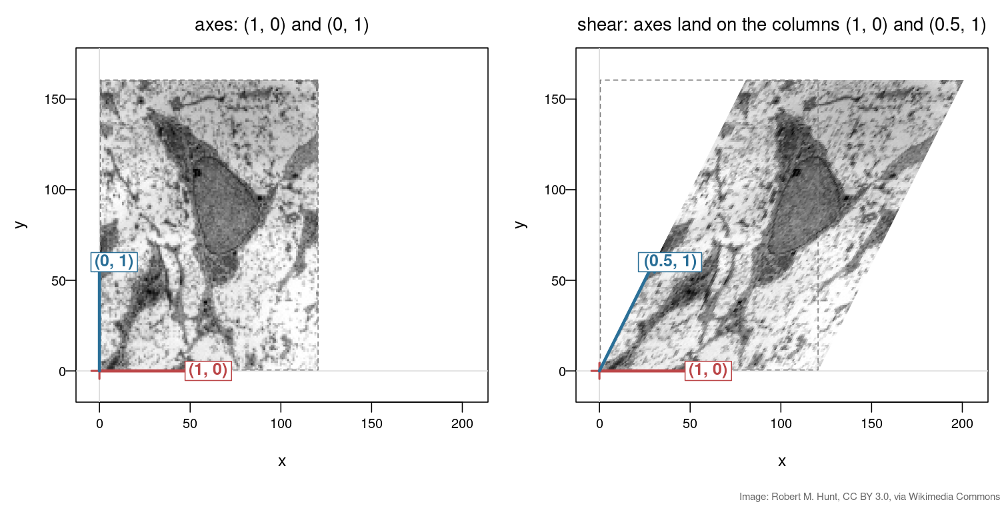
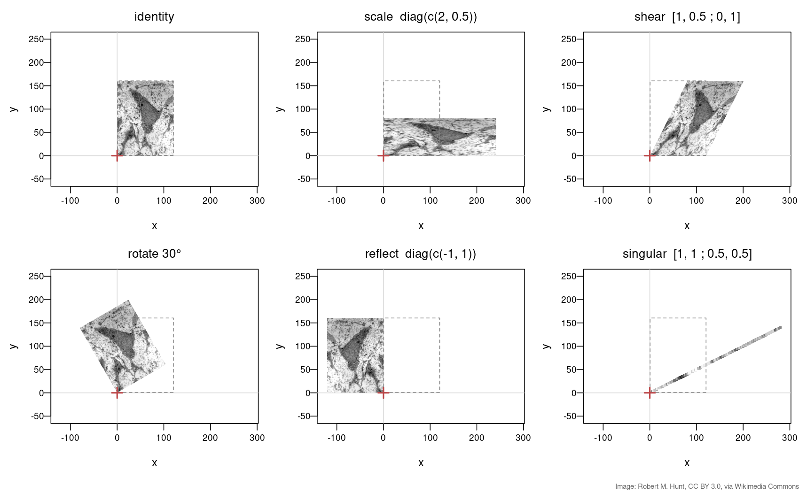
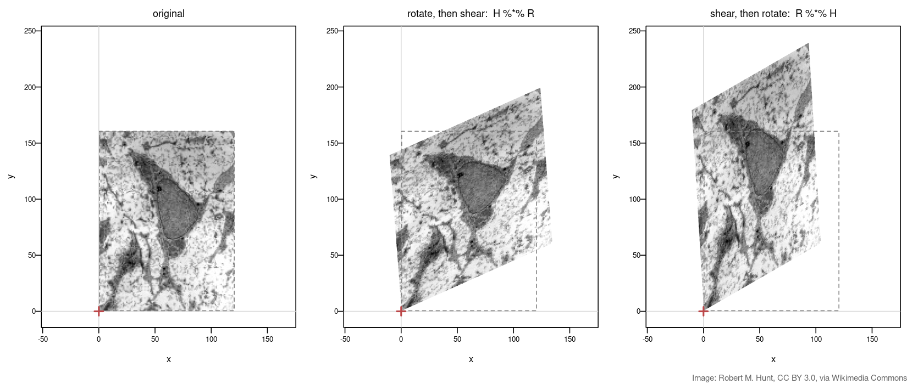
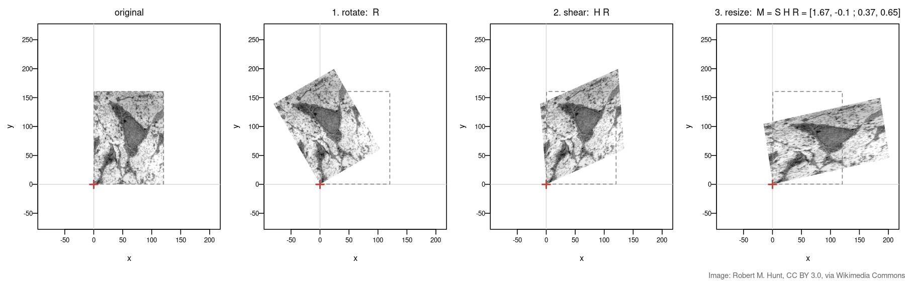
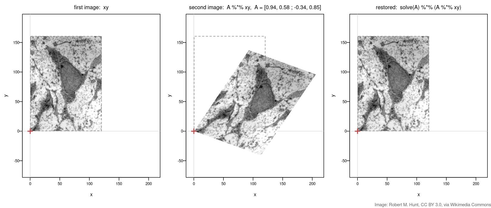

## About this lecture

In Matrices as transformations a matrix moved a handful of points. Today the same matrices move **a whole image** — a micrograph of a cell, 19 200 pixels at once.

- An image is a **2 × N matrix of points**, one pixel per column.
- Rotation, scaling, and two new ones: **shear** and **reflection** — each read off from the matrix **columns**.
- **Why we multiply matrices:** a pipeline of steps becomes **one** matrix, applied once — and the order of the steps shows.
- Biology: **undoing a misalignment** between two images of the same specimen with `solve(A)`.

You need the [`jpeg`](https://cran.r-project.org/package=jpeg) package: `install.packages("jpeg")`.

::: notes
This is a short, visual follow-up to Matrices as transformations: no new maths beyond shear and reflection, but the same ideas made visible at scale, plus the real motivation for matrix-matrix multiplication. Students should have the R session from Matrices as transformations open. The image is a transmission electron micrograph of a mesenchymal stem cell (CC BY 3.0, Robert M. Hunt).
:::

## An image is a matrix of points {.smaller}

A greyscale image is a grid of intensities. Each pixel sits at a coordinate $(x, y)$, so the whole image is a **2 × N matrix of points** — one pixel per column, exactly like a dataset of samples.

```r
img <- jpeg::readJPEG("msc-small.jpg")            # 160 x 120 grey levels, 0..1
img <- t(img[nrow(img):1, ])                      # flip so up is up; now img[x, y]
xy  <- t(expand.grid(1:nrow(img), 1:ncol(img)))   # 2 x 19200: one pixel per COLUMN
col <- gray(img)                                  # the grey level of each pixel
plot(t(xy), col = col, pch = 15, asp = 1)
```

{width="80%" fig-align="center"}

[Download [`msc-small.jpg`](msc-small.jpg). Image: transmission electron micrograph of a mesenchymal stem cell, Robert M. Hunt, [CC BY 3.0](https://creativecommons.org/licenses/by/3.0), via [Wikimedia Commons](https://commons.wikimedia.org/wiki/File:MSC_high_magnification.jpg).]{style="font-size: 0.6em; color: #666;"}

::: notes
From here on, every transformation we meet is also applied to this image, so students see thousands of points move at once instead of four. The key idea: pixel coordinates are just points, stored as columns — the same "samples as columns" layout used for pts in Matrices as transformations. The colours ride along — col[j] belongs to column j of xy, whatever happens to its position. The flip is only because image files count rows from the top; it is bookkeeping, not maths. Needs the jpeg package (install.packages("jpeg")).
:::

## Rotating an image {.smaller}

The rotation matrix $R(\theta)$ from Matrices as transformations, applied to all 19 200 pixels in **one** `%*%`:

```r
theta <- pi/6                       # 30 degrees
R <- matrix(c(cos(theta), -sin(theta),
              sin(theta),  cos(theta)), nrow = 2, byrow = TRUE)
plot(t(R %*% xy), col = col, pch = 15, asp = 1)
```

{width="72%" fig-align="center"}

[Image: Robert M. Hunt, [CC BY 3.0](https://creativecommons.org/licenses/by/3.0), via Wikimedia Commons.]{style="font-size: 0.6em; color: #666;"}

::: notes
Nothing new in the maths: it is the rotation matrix from Matrices as transformations, now applied to a 2 x 19200 matrix instead of a single vector. The image turns about the origin (red cross), which is the bottom-left corner of the image — a linear map always keeps the origin fixed. Biology hook: a section placed on the grid at an angle, or the same cell imaged twice, will be rotated like this relative to the first image.
:::

## Shear: read it from the columns {.smaller}

A **shear** (skew) slides each row sideways in proportion to its height:

$$H = \begin{pmatrix} 1 & 0.5 \\ 0 & 1 \end{pmatrix}: \quad (x, y) \mapsto (x + 0.5\,y,\ y)$$

```r
H <- matrix(c(1, 0.5,
              0, 1), nrow = 2, byrow = TRUE)
plot(t(H %*% xy), col = col, pch = 15, asp = 1)
```

The x-axis stays put (column 1 = $(1,0)$); the y-axis tips over to column 2 = $(0.5, 1)$.

{.nostretch width="58%" fig-align="center"}

[Image: Robert M. Hunt, [CC BY 3.0](https://creativecommons.org/licenses/by/3.0), via Wikimedia Commons.]{style="font-size: 0.6em; color: #666;"}

::: notes
Shear is the transformation students have not seen yet, and it is the cleanest demonstration of "columns are where the axes land": red arrow = column 1, blue arrow = column 2. The whole image follows the two arrows. Ask: what matrix would skew the other way (y moves with x)? Answer: put the 0.5 below the diagonal.
:::

## A gallery of 2 × 2 matrices {.smaller}

Every panel is `plot(t(A %*% xy), ...)` with a different $A$. Predict each one from its columns first.

{width="68%" fig-align="center"}

- **Reflection** `diag(c(-1, 1))`: flips x — the cell is now mirrored.
- **Singular** `matrix(c(1, 1, 0.5, 0.5), 2, byrow = TRUE)`: both columns point the same way, so the whole image collapses onto a **line**. Information is lost and cannot be undone.
- Bonus (not for exam): the area changes by the factor [`det(A)`](https://rdrr.io/r/base/det.html) — 1 for rotation, shear and `diag(c(2, 0.5))`; −1 for the reflection (flipped); **0** for the singular matrix. See the determinant slide in Matrices as transformations.

[Image: Robert M. Hunt, [CC BY 3.0](https://creativecommons.org/licenses/by/3.0), via Wikimedia Commons.]{style="font-size: 0.6em; color: #666;"}

::: notes
Go round the gallery and make students say what each matrix does BEFORE revealing the panel: scaling stretches and squashes, shear tips, rotation turns, reflection mirrors (the cell's orientation flips — the tell-tale sign), and the singular matrix flattens everything onto a line because its columns are parallel. The determinant line is a preview only — it comes back properly in Eigenvalues & eigenvectors. The singular case also previews Linear systems: a singular matrix has no inverse, which is exactly the "no unique solution" situation.
:::

## Order matters — on an image {.smaller}

Same two matrices, $R$ (rotate 30°) and $H$ (shear), applied in the two possible orders:

```r
plot(t(H %*% R %*% xy), col = col, pch = 15, asp = 1)   # rotate, then shear
plot(t(R %*% H %*% xy), col = col, pch = 15, asp = 1)   # shear, then rotate
```

{width="85%" fig-align="center"}

[Image: Robert M. Hunt, [CC BY 3.0](https://creativecommons.org/licenses/by/3.0), via Wikimedia Commons.]{style="font-size: 0.6em; color: #666;"}

::: notes
The abstract AB != BA from Matrices as transformations, made visible: same two ingredients, clearly different cells. Read each product right to left — the matrix next to xy acts first.
:::

## Why multiply matrices? A pipeline in one step {.smaller}

Rotate, then shear, then resize. Either move every pixel three times, or multiply the three **small** matrices first and move every pixel **once**:

```r
S <- diag(c(1.5, 0.75))                 # resize: wider and flatter
out1 <- S %*% (H %*% (R %*% xy))        # three passes over 19 200 pixels
M    <- S %*% H %*% R                   # one 2 x 2 matrix for the whole pipeline
out2 <- M %*% xy                        # one pass
all.equal(out1, out2)                   # TRUE
```

{width="95%" fig-align="center"}

- A whole chain of transformations is still just **one** 2 × 2 matrix $M = SHR$.
- Combining costs a few multiplications of 2 × 2 matrices; the image is touched once. With millions of pixels (or genes), that matters.

[Image: Robert M. Hunt, [CC BY 3.0](https://creativecommons.org/licenses/by/3.0), via Wikimedia Commons.]{style="font-size: 0.6em; color: #666;"}

::: notes
This is THE motivation for matrix-matrix multiplication: composing is multiplying, and the product is a single object you can store, inspect, invert, and apply once. all.equal confirms both routes give the same pixel positions. Stress that M is only four numbers no matter how many steps went into it — and that the order of the factors is fixed by the order of the steps (rightmost first).
:::

## Biology: undoing a misalignment {.smaller}

The same cell is imaged a second time, but the section sits at an angle and is slightly skewed: the second image is $A\,\mathbf{xy}$. If we **know** $A$, its inverse undoes it — `solve(A)` from Linear systems in R.

```r
A <- matrix(c( 0.94, 0.58,
              -0.34, 0.85), nrow = 2, byrow = TRUE)   # the misalignment
moved    <- A %*% xy
restored <- solve(A) %*% moved
max(abs(restored - xy))                               # about 1e-14: back where we started
```

{width="85%" fig-align="center"}

[Image: Robert M. Hunt, [CC BY 3.0](https://creativecommons.org/licenses/by/3.0), via Wikimedia Commons.]{style="font-size: 0.6em; color: #666;"}

::: notes
Image registration — aligning two images of the same specimen (repeated imaging rounds, H&E vs a spatial-transcriptomics grid, a crooked slide) — is a matrix problem. Here A is given; real registration software estimates A from the images, which is beyond this course. The inverse exists because det(A) is not 0; a singular A (the collapsed line in the gallery) could never be undone. Link: solve(A) is the same function used to solve Ax = b in Linear systems in R. The same undo-with-the-inverse idea returns in Compensation & spectral unmixing, where solve(S) separates mixed fluorescent dyes.
:::

## Summary {.smaller}

| Concept | Key fact | R |
|---|---|---|
| Image as points | pixel coordinates as a 2 × N matrix; colours ride along | `xy`, `col` |
| Transform an image | one `%*%` moves every pixel | `plot(t(A %*% xy), ...)` |
| Shear | one axis tips over: column 2 = $(k, 1)$ | `matrix(c(1,k,0,1),2,byrow=TRUE)` |
| Reflection | mirror image; $\det = -1$ | `diag(c(-1, 1))` |
| Singular | columns parallel → image collapses to a line; cannot be undone | `det(A) == 0` |
| Order | $HR \neq RH$: rightmost acts first | `H %*% R` vs `R %*% H` |
| Pipeline | many steps = **one** product matrix, applied once | `M <- S %*% H %*% R` |
| Undo | inverse transformation | `solve(A)` |

**Next (Polar coordinates):** a change of coordinates that is *not* a matrix — distance and angle from a centre. Then Eigenvalues & eigenvectors.

::: notes
The one-line takeaway: everything a 2 x 2 matrix does to an image is decided by its two columns, and a chain of transformations is still just one 2 x 2 matrix. Under the shear, the x-axis does not move at all — a first example of a special direction, which is exactly what Eigenvalues & eigenvectors is about.
:::
