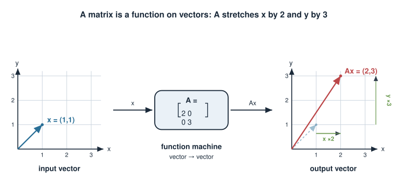
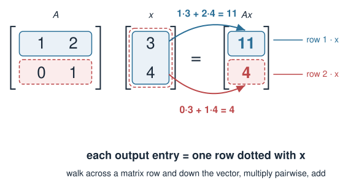
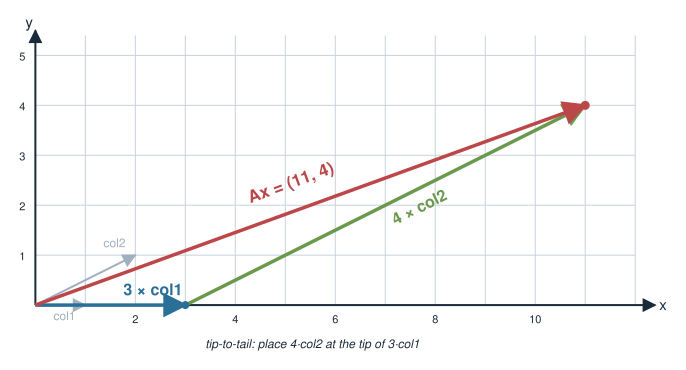
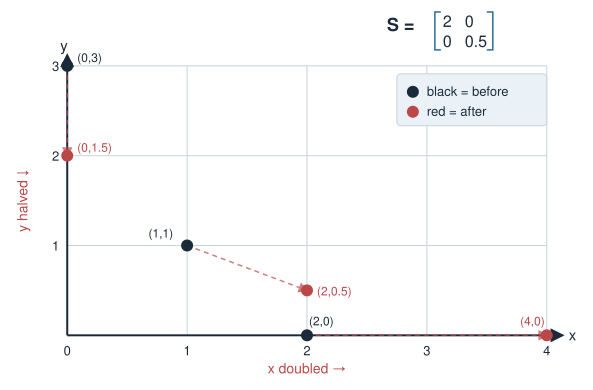
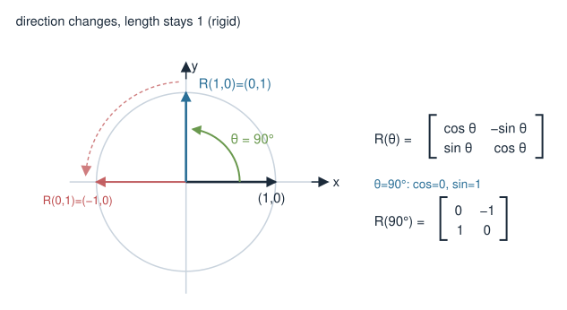
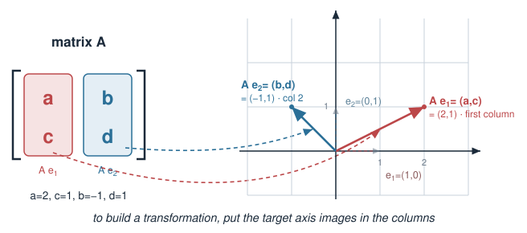
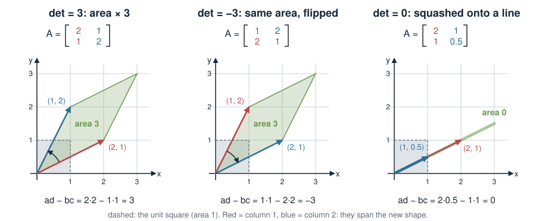
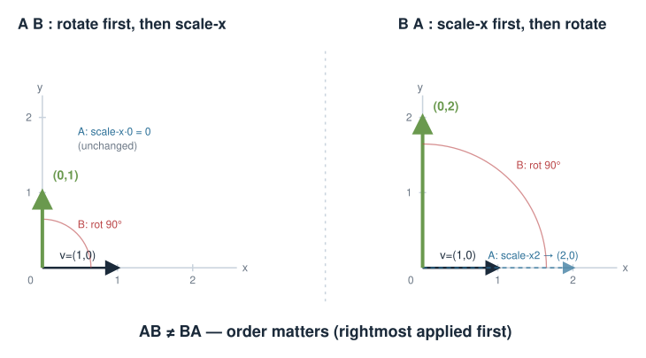
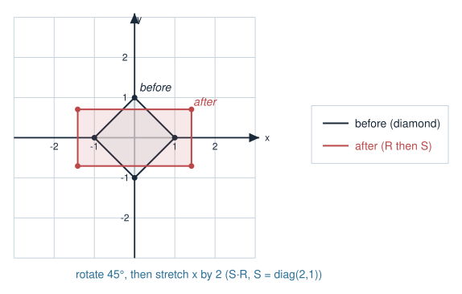

## About this lecture

In Vectors, dot product & projection a vector was a point/arrow (a sample). Today we learn what a **matrix** does to vectors.

- A matrix is a **function** that maps vectors to vectors.
- The matrix–vector product $A\mathbf{x}$ is a **linear combination of the columns** of $A$ — and each output entry is a **dot product** (the tool from Vectors, dot product & projection).
- Special transformations: **identity**, **scaling**, **rotation**.
- **Composing** two transformations = **multiplying** their matrices.
- All of it in R with [`%*%`](https://rdrr.io/r/base/matmult.html).

This is a hands-on **R walkthrough** day: follow along, run every block, and watch points move.

::: notes
The mental shift today: stop seeing a matrix as a static grid of numbers and start seeing it as a verb — something that DOES things to vectors. Everything connects back to Vectors, dot product & projection: matrix-vector multiplication is just a stack of dot products. This day is deliberately R-heavy; tell students to keep an R session open and reproduce each transformation, ideally plotting the before/after points.
:::

## A matrix is a function on vectors {.smaller}

A function takes an input and returns an output. A matrix takes a **vector in** and gives a **vector out**:

$$\mathbf{x} \ \longrightarrow\ A\mathbf{x}$$

Example — take a 2-D point and transform it:
$$A = \begin{pmatrix} 2 & 0 \\ 0 & 3 \end{pmatrix}, \quad \mathbf{x} = \begin{pmatrix} 1 \\ 1 \end{pmatrix} \ \Rightarrow\ A\mathbf{x} = \begin{pmatrix} 2 \\ 3 \end{pmatrix}$$

- Here $A$ stretches the x-axis by 2 and the y-axis by 3.
- Think of $A$ acting on **every** sample point at once — a uniform operation applied to a whole dataset.

{width="70%" fig-align="center"}

::: notes
Frame the matrix as a verb / machine from the very first slide. Input vector, output vector. The diagonal scaling example is the gentlest possible: each axis stretched independently. Stress "the same matrix is applied to every sample identically" — that is what makes it a transformation of the whole dataset, e.g. a normalisation or a coordinate change.
:::

## How to multiply $A\mathbf{x}$ by hand {.smaller}

Each output entry is the **dot product** of a matrix **row** with $\mathbf{x}$:

$$\begin{pmatrix} a & b \\ c & d \end{pmatrix}\begin{pmatrix} x \\ y \end{pmatrix} = \begin{pmatrix} ax + by \\ cx + dy \end{pmatrix}$$

Worked example:
$$\begin{pmatrix} 1 & 2 \\ 0 & 1 \end{pmatrix}\begin{pmatrix} 3 \\ 4 \end{pmatrix} = \begin{pmatrix} 1\cdot3 + 2\cdot4 \\ 0\cdot3 + 1\cdot4 \end{pmatrix} = \begin{pmatrix} 11 \\ 4 \end{pmatrix}$$

- Row 1 of $A$ dotted with $\mathbf{x}$ → first output entry.
- Row 2 of $A$ dotted with $\mathbf{x}$ → second output entry.

{width="65%" fig-align="center"}

::: notes
This connects directly to Vectors, dot product & projection: the matrix-vector product is literally a stack of dot products, one per row. Make students compute the (11, 4) example by hand on the spot. The "row dot vector" recipe is the single most important manual skill from this block for the written exam.
:::

## The same product, columns view {.smaller}

There is a second, equally important way to read $A\mathbf{x}$: as a **linear combination of the columns** of $A$, weighted by the entries of $\mathbf{x}$.

$$\begin{pmatrix} 1 & 2 \\ 0 & 1 \end{pmatrix}\begin{pmatrix} 3 \\ 4 \end{pmatrix} = 3\begin{pmatrix} 1 \\ 0 \end{pmatrix} + 4\begin{pmatrix} 2 \\ 1 \end{pmatrix} = \begin{pmatrix} 3 \\ 0 \end{pmatrix} + \begin{pmatrix} 8 \\ 4 \end{pmatrix} = \begin{pmatrix} 11 \\ 4 \end{pmatrix}$$

- "3 units of column 1, plus 4 units of column 2."
- This view explains why the output can only ever be a blend of the columns — the **column space**.

{width="60%" fig-align="center"}

::: notes
The columns view is conceptually deeper than the rows view and pays off later (column space, rank, PCA loadings). Same answer (11,4), different story: the input vector's entries are mixing weights for the columns. Both views are worth memorising; rows are easier for hand computation, columns are better for understanding what outputs are reachable.
:::

## Matrix–vector product in R

```r
A <- matrix(c(1, 2,
              0, 1), nrow = 2, byrow = TRUE)
x <- c(3, 4)
A %*% x
#      [,1]
# [1,]   11
# [2,]    4
```

- `%*%` is matrix multiplication. Plain `*` would be elementwise — **wrong** here.
- `byrow = TRUE` fills the matrix row by row, so it matches how we write it on paper. (Default is column by column!)

::: notes
The single most common beginner mistake: using * instead of %*%. Hammer this. Also flag the byrow trap: matrix() fills columns first by default, which silently transposes your matrix relative to what you wrote on paper. Recommend byrow = TRUE while learning, and always print the matrix to confirm.
:::

## The identity matrix — "do nothing"

$$I = \begin{pmatrix} 1 & 0 \\ 0 & 1 \end{pmatrix}, \qquad I\mathbf{x} = \mathbf{x} \ \text{for every } \mathbf{x}$$

The identity leaves every vector unchanged — the matrix version of multiplying by 1.

```r
I <- diag(2)      # 2x2 identity
I
#      [,1] [,2]
# [1,]    1    0
# [2,]    0    1
I %*% c(3, 4)     # 3 4  (unchanged)
```

::: notes
The identity is the reference point for all transformations: it does nothing. diag(2) builds it in R. Later (eigenvalues, solving systems) the identity is everywhere, so introduce it now while it is trivial. Mention that diag() with a vector argument instead makes a scaling matrix — the next slide.
:::

## Scaling matrices {.smaller}

A **diagonal** matrix stretches each axis independently:

$$S = \begin{pmatrix} 2 & 0 \\ 0 & 0.5 \end{pmatrix} \ \Rightarrow\ \text{double the x-axis, halve the y-axis}$$

```r
S <- diag(c(2, 0.5))
pts <- matrix(c(1, 1,
                2, 0,
                0, 3), nrow = 2)   # 3 points as COLUMNS
S %*% pts
#      [,1] [,2] [,3]
# [1,]    2    4  0.0    # x doubled
# [2,]  0.5    0  1.5    # y halved
```

- Putting samples in **columns** lets one `%*%` transform the whole dataset at once.
- Biology: this is exactly a per-axis **normalisation / rescaling** of features.

{width="55%" fig-align="center"}

::: notes
Scaling is the most intuitive non-trivial transformation. The key practical pattern is on this slide: store your samples as columns, then a single S %*% data transforms every sample simultaneously. Connect to normalisation — rescaling each feature (gene) by a constant is a diagonal matrix multiply. Watch the dimensions: S is 2x2, data is 2x3, output is 2x3.
:::

## Rotation matrices {.smaller}

To rotate every point by angle $\theta$ (counter-clockwise) about the origin:

$$R(\theta) = \begin{pmatrix} \cos\theta & -\sin\theta \\ \sin\theta & \cos\theta \end{pmatrix}$$

```r
theta <- pi/2                       # 90 degrees
R <- matrix(c(cos(theta), -sin(theta),
              sin(theta),  cos(theta)), nrow = 2, byrow = TRUE)
round(R %*% c(1, 0))                # 0 1  -> x-axis rotates onto y-axis
```

- A rotation changes **direction** but never **length** (it is *rigid*).
- The columns of $R$ are where the old axes land — a recurring theme.

{width="55%" fig-align="center"}

::: notes
Rotation introduces a transformation that mixes the axes (off-diagonal entries). The check round(R %*% c(1,0)) == c(0,1) makes the geometry tangible: the x-axis swings up onto the y-axis under a 90-degree turn. Emphasise that rotations preserve length and angles — useful intuition for later when we talk about orthogonal matrices and PCA's rotation of the data cloud.
:::

## Reading the columns of a transformation

The columns of any matrix $A$ tell you **where the standard axes go**:

$$A = \begin{pmatrix} \color{red}{a} & \color{blue}{b} \\ \color{red}{c} & \color{blue}{d} \end{pmatrix}$$

- $A\begin{pmatrix}1\\0\end{pmatrix} = \color{red}{(a,c)}$ → first column = image of the x-axis unit vector.
- $A\begin{pmatrix}0\\1\end{pmatrix} = \color{blue}{(b,d)}$ → second column = image of the y-axis unit vector.

To *design* a transformation: decide where the axes should land, then write those as the columns.

{width="60%" fig-align="center"}

::: notes
This is a powerful shortcut and a frequent exam question: to understand or build a matrix, just ask where the unit axes go. Multiplying A by (1,0) selects column 1; by (0,1) selects column 2. This reframes "what does this matrix do?" as "look at its columns", and reframes "build a matrix that does X" as "place the target axis images in the columns".
:::

## Bonus: the determinant is an area (not for exam) {.smaller}

The two columns of $A$ span a parallelogram: the image of the unit square. Its area is the **determinant** $\det A = ad - bc$.

{width="88%" fig-align="center"}

- $\lvert \det A \rvert$: how much $A$ scales **areas** (here 3 times).
- Sign: **negative** means the picture is **flipped** (the turn from column 1 to column 2 goes clockwise).
- **Zero**: the columns are parallel, so everything collapses onto a line, and $A$ cannot be undone.

```r
det(matrix(c(2, 1,
             1, 2), nrow = 2, byrow = TRUE))   # 3
```

[Bonus material: you do not need to memorise determinants for the exam.]{style="font-size: 0.8em; color: #bc4749;"}

::: notes
Bonus slide: not examined. It gives a picture for a number that otherwise looks like an arbitrary formula. Middle panel: the same columns as the left panel, swapped, so the same parallelogram, but the turn from red to blue is now clockwise, and the determinant changes sign. Right panel: column 2 is half of column 1, so the "parallelogram" is a line segment with area 0. This is the singular case from Linear systems: no inverse. It comes back in Transforming images with matrices (the gallery), and the formula ad - bc is used again in Eigenvalues & eigenvectors.
:::

## Composing transformations = multiplying matrices {.smaller}

Do $B$, then $A$. Applied to $\mathbf{x}$: first $B\mathbf{x}$, then $A(B\mathbf{x}) = (AB)\mathbf{x}$.

So **composition is matrix multiplication**, and $AB$ means "apply $B$ first, then $A$" — right to left.

$$AB:\quad (AB)_{ij} = (\text{row } i \text{ of } A)\cdot(\text{column } j \text{ of } B)$$

```r
A <- matrix(c(2,0, 0,1), 2, byrow = TRUE)   # scale x by 2
B <- matrix(c(0,-1, 1,0), 2, byrow = TRUE)  # rotate 90 deg
A %*% B          # rotate THEN scale
B %*% A          # scale THEN rotate -- NOT the same!
```

- Order matters: $AB \neq BA$ in general. (Try both above.)

{width="70%" fig-align="center"}

::: notes
Composition is the reason matrix multiplication is defined the way it is — each entry is a row-dot-column, the dot product from Vectors, dot product & projection again. The crucial cautionary point: matrix multiplication is NOT commutative, so the ORDER of operations matters, and AB applies the rightmost matrix first. Demonstrate A%*%B vs B%*%A giving different results live.
:::

## Putting it together: transform a small dataset {.smaller}

```r
# 4 sample points (2 features each) stored as COLUMNS
data <- matrix(c( 1, 0,
                  0, 1,
                 -1, 0,
                  0,-1), nrow = 2)

theta <- pi/4
R <- matrix(c(cos(theta), -sin(theta),
              sin(theta),  cos(theta)), 2, byrow = TRUE)
S <- diag(c(2, 1))

out <- S %*% (R %*% data)   # rotate 45 deg, then stretch x by 2
round(out, 2)

plot(t(data), xlim=c(-3,3), ylim=c(-3,3), pch=19)   # before (rows = points)
points(t(out), col = "red", pch = 19)               # after
```

One `%*%` chain applies the whole pipeline to every sample at once.

{width="50%" fig-align="center"}

::: notes
This capstone block is what students should reproduce and stare at: a rotation then a scaling applied to a little square of points, plotted before (black) and after (red). Note the transpose t() in plot() because plot expects points as ROWS but we stored them as columns for the math. This "columns for math, transpose for plotting" pattern recurs throughout the course.
:::

## Design / contrast matrices: a biology aside {.smaller}

In differential-expression analysis (e.g. `limma`, `DESeq2`) a **design matrix** $X$ encodes which samples are control vs treated. The model is

$$\mathbf{y} \approx X\boldsymbol\beta$$

- $X$ is a matrix that maps coefficients $\boldsymbol\beta$ (e.g. baseline, treatment effect) to predicted expression $\mathbf{y}$.
- Same machinery as today: a matrix takes one vector and produces another, as a linear combination of its columns.

You will not build these by hand in this course — but recognise that the matrix-as-transformation idea is *exactly* what powers the statistics you already use.

::: notes
This slide grounds the abstraction in tools the students likely already touch. A design matrix is just a transformation mapping effect sizes to expected measurements; fitting the model is "solving" that relationship (Linear systems by hand and Linear systems in R). The aim is recognition, not mastery: when they next see model.matrix() output, they should think "ah, a transformation, columns are the predictors".
:::

## Summary {.smaller}

| Concept | Key fact | R |
|---|---|---|
| Matrix as function | $\mathbf{x}\mapsto A\mathbf{x}$ | `A %*% x` |
| Output entry | row of $A$ $\cdot$ $\mathbf{x}$ (a dot product!) | — |
| Columns view | $A\mathbf{x}$ = linear combination of columns of $A$ | — |
| Identity | $I\mathbf{x}=\mathbf{x}$ | `diag(2)` |
| Scaling | diagonal matrix stretches each axis | `diag(c(2, 0.5))` |
| Rotation | rigid; preserves length | `matrix(c(cos,-sin,sin,cos),2,byrow=TRUE)` |
| Composition | apply $B$ then $A$ = $AB$ (order matters!) | `A %*% B` |

**Next (Transforming images with matrices):** the same matrices applied to a whole microscopy image — plus shear, reflection, and why we multiply matrices. **Then (Eigenvalues & eigenvectors):** some special vectors are only *scaled* by a transformation — eigenvectors.

::: notes
The summary table is the cheat sheet: everything is "row dot vector" under the hood. Remind them: %*% not *, watch byrow, store samples as columns. Preview Eigenvalues & eigenvectors: for most matrices a vector changes both length and direction, but special directions get only stretched (not rotated) — those eigenvectors reveal the deep structure of a transformation, and underlie PCA.
:::
