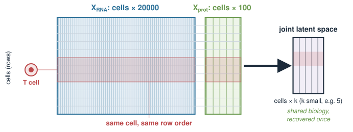
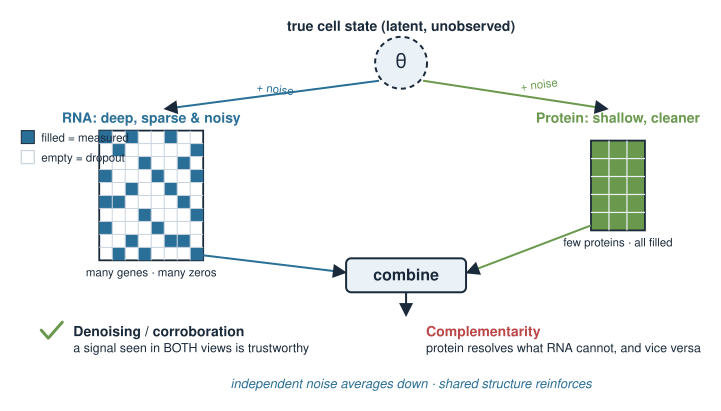
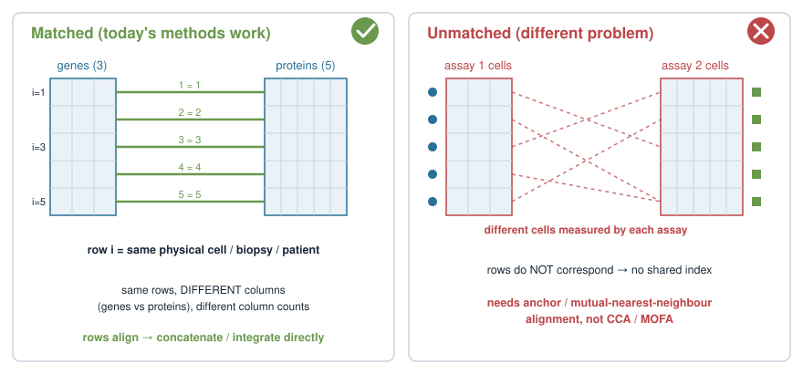
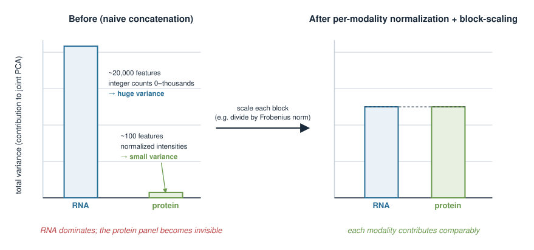
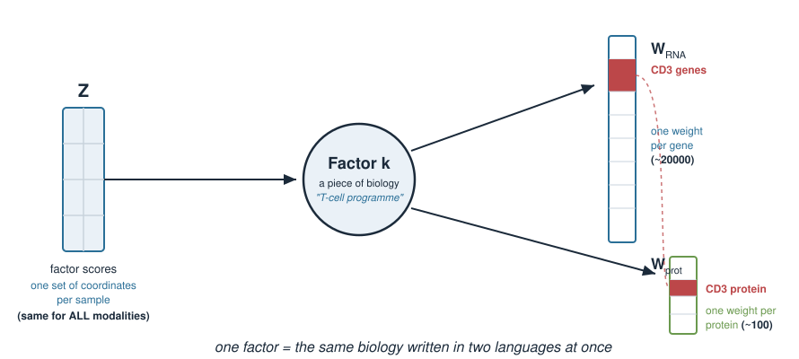
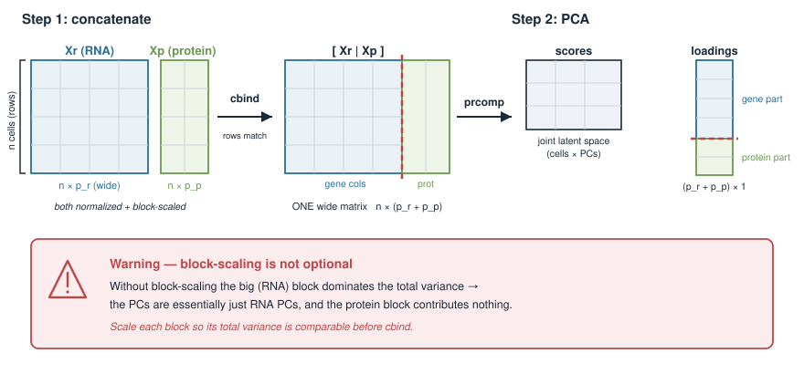
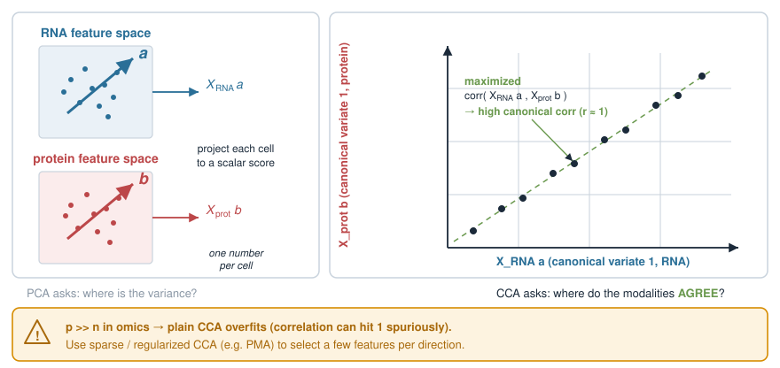
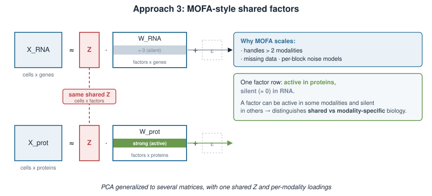
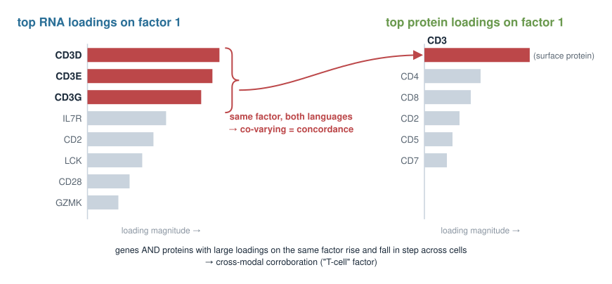
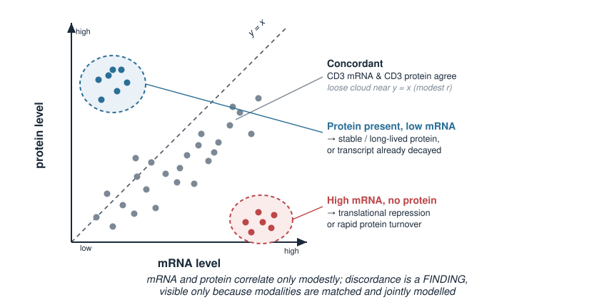

## About this lecture

Modern experiments often measure **several kinds of molecule on the same cells or samples** — RNA and protein, RNA and chromatin, and so on. Each measurement is a separate matrix, but they describe **one biology**. Today we learn how to put them into a **shared picture**.

- Why **integrate** at all: the modalities share biology, and each one is separately **noisy**.
- The setup: **matched samples**, one matrix per modality, wildly different **scales** and **feature counts**.
- The key idea: a **joint latent space** — a few shared axes that all modalities are noisy views of.
- Three families of methods, named without heavy math: **concatenation-then-PCA**, **CCA**, and **MOFA-style shared factors**.
- Reading the result: which genes and proteins **co-vary**, and where mRNA and protein **disagree**.

This is an **Applications** day. It builds directly on Principal component analysis: a latent space is still a small set of directions, found from covariance.

::: notes
This lecture assumes students have already met PCA (covariance, eigenvectors as axes of variation, loadings and scores). The one new mental move today is: instead of one data matrix, we now have two or more matrices measured on the same samples, and we want a single low-dimensional summary that respects all of them. Keep the maths light — the learning objective is conceptual fluency (what each method tries to do, and what can go wrong), not the derivations of CCA or MOFA. Emphasise repeatedly that "same samples" is the whole premise: the rows of every matrix line up.
:::

## A biology picture first {.smaller}

You run a CITE-seq experiment: for **each single cell** you measure

- its **transcriptome** — counts for ~20,000 genes (RNA), and
- a panel of **surface proteins** — say 100 antibody-tagged markers.

Two matrices, **same cells in the same row order**:

$$X_{\text{RNA}}:\ \text{cells} \times 20000, \qquad X_{\text{prot}}:\ \text{cells} \times 100.$$

A T cell is a T cell in **both** views. The cell types, the activation states, the biology — that shared structure lives in **both** matrices at once. We want to recover it **jointly**, not twice.

{width="75%" fig-align="center"}

::: notes
Anchor everything in one concrete paired assay before any method. CITE-seq (RNA + surface protein) or a true multiome kit (RNA + ATAC) are the canonical examples. The picture to plant: two matrices whose ROWS are the same cells, whose COLUMNS are completely different features. The biology (cell identity, state) is shared and is what we want; it shows up as correlated structure across the two views. Contrast with the wrong alternative: analysing each modality separately and trying to reconcile two independent clusterings afterwards. Integration means finding the shared structure once.
:::

## Why integrate: shared biology, separate noise {.smaller}

Each modality on its own is an **incomplete, noisy** measurement of the same underlying state.

- **RNA** is deep (thousands of genes) but very **sparse and noisy** per cell — dropouts, low counts.
- **Protein** panels are shallow (a handful of markers) but often **cleaner** and closer to function.
- The **true cell state** is not directly observed; each assay is a **partial view** of it.

Two payoffs from combining them:

1. **Denoising / corroboration** — a signal seen in *both* views is far more trustworthy than one seen in either alone.
2. **Complementarity** — protein resolves what RNA cannot (and vice versa); together they separate states neither could alone.

{width="60%" fig-align="center"}

::: notes
The core justification for integration is statistical: if two noisy measurements share an underlying signal, combining them averages down the independent noise and reinforces the common structure. Make the biology concrete — RNA dropout is severe in single cell, so a gene reading zero may just be unmeasured; a corroborating protein signal rescues it. Complementarity is the second, equally important reason: some distinctions are only visible in one modality (surface protein isotypes, chromatin priming). The goal is a representation richer than either modality alone, not just a tidier version of one.
:::

## The premise: matched samples {.smaller}

Everything today rests on one condition:

$$\text{row } i \text{ of every matrix is the } \textbf{same physical sample}.$$

- Same cells (a multiome droplet), or same tumour biopsy split for RNA-seq and proteomics, or same patient.
- The **columns** differ completely: genes in one matrix, proteins in another, and different **numbers** of them.
- This "**same rows, different columns**" layout is what lets us look for structure that is **shared across modalities**.

If the samples are **not** matched (different cells measured by each assay), this is a *different* problem — you would need anchor-based alignment, not the methods here.

{width="70%" fig-align="center"}

::: notes
Draw a hard line here. Today's methods (concatenation-PCA, CCA, MOFA) all require paired observations: the same n samples measured by every modality. This is the "multiome" / "same-sample multi-omics" setting. Contrast explicitly with the un-paired case (two separate experiments on different cells, e.g. an RNA dataset and a separate ATAC dataset) which needs anchor/mutual-nearest-neighbour methods — mention it exists so students do not misapply CCA to unpaired data, but do not teach it. Reassure that bulk multi-omics (same patients, RNA + methylation + proteomics) fits the same paired template.
:::

## The obstacle: different scales and sizes {.smaller}

The two matrices are not on speaking terms numerically:

| | RNA | Protein |
|---|---|---|
| # features | ~20,000 | ~100 |
| typical values | integer counts, 0–thousands | normalized intensities |
| total variance | **huge** (many features) | small (few features) |

If we naively glue them together, the modality with **more features and bigger numbers dominates** everything — the small protein panel becomes invisible.

So **before** any integration we must put the modalities on a **comparable footing**: normalize *within* each modality, then **scale each block** so no one modality drowns out the others.

{width="65%" fig-align="center"}

::: notes
This is the practical crux and where naive integration fails silently. Total variance scales with the number of features, so a 20,000-gene block carries orders of magnitude more raw variance than a 100-protein block. Concatenate without scaling and PCA will essentially ignore the protein block. The fix has two stages: (1) modality-appropriate normalisation WITHIN each block (count transforms for RNA, whatever is standard for the protein intensities) — you cannot z-score raw counts meaningfully; (2) block-level scaling so each modality contributes comparably to the joint analysis. Preview that "how to scale a block" is the recurring theme of every method today.
:::

## The big idea: a joint latent space {.smaller}

Recall from Principal component analysis: PCA replaces thousands of features with a few **latent axes** — directions along which samples vary.

For multiome, we want **one shared set of latent axes** that *both* modalities express:

- each sample gets **one** set of coordinates (factor scores) in the joint space,
- each modality contributes its **own loadings** — how its features read out along each shared axis.

$$\underbrace{\text{shared factors}}_{\text{same for all modalities}} \;\longrightarrow\; \underbrace{\text{RNA loadings}}_{\text{one per gene}} \;\;\text{and}\;\; \underbrace{\text{protein loadings}}_{\text{one per protein}}.$$

A factor is a piece of **biology** (a cell type, an activation programme) written in **two languages** at once.

{width="70%" fig-align="center"}

::: notes
This is the unifying abstraction that ties all three methods together. In single-modality PCA: scores (per sample) x loadings (per feature). In the joint version: ONE set of scores per sample, but a SEPARATE loading vector per modality — because a shared factor "cell is a T cell" manifests as particular genes AND particular proteins. This factor/loading language is exactly MOFA's, and it is the cleanest way to think about all the methods. Stress that the factor is latent (unobserved biology) and the loadings are how we interpret it back in measurable features. This slide is the conceptual centre of the lecture.
:::

## Approach 1: concatenate, then PCA {.smaller}

The simplest idea: **paste the blocks side by side** into one wide matrix, then run ordinary PCA.

$$X = [\,X_{\text{RNA}}\ \;|\;\ X_{\text{prot}}\,] \quad\text{(same rows, columns stacked)}$$

- After per-modality normalization **and block-scaling**, this can work well.
- The PCs are shared axes; loadings split naturally into a gene part and a protein part.

**Danger:** without block-scaling, the big modality dominates and the PCs are essentially just RNA PCs — the protein panel contributes nothing.

```r
# static illustration — not executed
Xr <- scale(rna)                       # normalize/standardize RNA block
Xp <- scale(prot)                      # normalize/standardize protein block
Xr <- Xr / sqrt(sum(Xr^2))             # block-scale: equalize total variance
Xp <- Xp / sqrt(sum(Xp^2))
X  <- cbind(Xr, Xp)                    # concatenate: same cells, all features
pc <- prcomp(X)                        # joint latent space = the PCs
```

{width="60%" fig-align="center"}

::: notes
Start with the method they can already fully understand, since it is just PCA on a glued matrix. The entire subtlety is the pre-processing: normalise each block, then divide each block by its Frobenius norm (or its first singular value, as Multiple Factor Analysis does) so the blocks contribute equally. Point out that cbind is trivially valid ONLY because rows are matched. The honest limitation: concatenation-PCA treats all features as one pool and has no explicit notion of "shared vs modality-specific" variation — it cannot tell you a factor is protein-only. That motivates the next two methods. Keep the code static; nothing is installed at render time.
:::

## Approach 2: canonical correlation (CCA) {.smaller}

Turn the question around: instead of maximizing **variance**, maximize **agreement between the modalities**.

CCA finds a direction in RNA space and a direction in protein space whose sample scores are **maximally correlated**:

$$\text{find } \mathbf a,\mathbf b \ \text{ maximizing } \ \operatorname{corr}\big(X_{\text{RNA}}\mathbf a,\ X_{\text{prot}}\mathbf b\big).$$

- Each **canonical pair** is a shared axis defined by being **consistent across modalities**.
- By construction it emphasizes the **common** signal and downweights modality-specific noise.

**Caveat:** with more features than samples (always, in omics) plain CCA overfits — practical versions are **regularized / sparse** (e.g. the `PMA` package's sparse CCA).

{width="65%" fig-align="center"}

::: notes
CCA reframes integration as: find the linear combination of genes and the linear combination of proteins that move together across cells. The output is pairs of canonical variates with a canonical correlation each. Its philosophy differs from concatenation-PCA: PCA asks "where is the variance", CCA asks "where do the modalities agree". That makes CCA naturally robust to modality-specific noise but blind to modality-specific SIGNAL. The must-say caveat: with p >> n (thousands of features, hundreds of cells) the sample correlation can be driven to 1 spuriously, so real applications use sparse/regularised CCA. Note Seurat's older integration used a CCA variant — good name-drop, but keep it a name.
:::

## Approach 3: MOFA-style shared factors {.smaller}

The most general framing, and the one matching our "joint latent space" picture directly.

**MOFA** (Multi-Omics Factor Analysis) learns a small set of **factors** such that each modality is approximately

$$X_{\text{modality}} \approx \underbrace{Z}_{\text{shared factor scores}} \; \underbrace{W_{\text{modality}}}_{\text{modality loadings}} \;+\; \text{noise}.$$

- **One** score matrix $Z$ (samples × factors), shared by **all** modalities.
- A **separate** loading matrix per modality — so a factor can be **active in some modalities and silent in others**.
- Handles **more than two** modalities, missing data, and different noise models per block.

Think of it as **PCA generalized to several matrices at once**, with the honesty to say *"this factor is protein-only."*

{width="65%" fig-align="center"}

::: notes
MOFA is the cleanest realisation of the factor/loading abstraction from the central slide, so present it as the natural destination. Key selling points over the first two methods: (1) explicit shared score matrix Z with per-modality loadings, so factors are directly interpretable; (2) a factor can load on one modality and not another, which neither concatenation-PCA nor two-block CCA expresses cleanly — this is how MOFA distinguishes shared biology from modality-specific biology; (3) it scales to many modalities and tolerates missing samples in some blocks. Frame it honestly as (approximately) group factor analysis / a probabilistic matrix factorisation — do not overclaim mechanism. It is a Bioconductor/Python tool (MOFA2); students call it, they do not implement it.
:::

## The three at a glance {.smaller}

| Method | Optimizes | Shared object | Sees modality-specific signal? |
|---|---|---|---|
| Concatenation + PCA | total **variance** of the glued matrix | principal components | no (one feature pool) |
| CCA | **correlation between** modalities | canonical variate pairs | no (only the agreement) |
| MOFA-style factors | reconstruction of **each block** | factor scores $Z$ + per-block loadings | **yes** (per-factor activity) |

All three produce a **joint latent space** — a few shared coordinates per sample — and all three **require per-modality normalization and block-scaling first**.

::: notes
This is the summary table students should carry away. The distinguishing axis is what each method optimises and whether it can represent modality-specific structure. Reinforce the common denominator: every method reduces to "give each sample a handful of shared coordinates", and every method breaks without the pre-processing from the scales/sizes slide. If a student remembers only one comparison, make it: PCA = variance, CCA = cross-modal correlation, MOFA = per-block reconstruction with shared factors.
:::

## Reading the result: co-varying features {.smaller}

A joint factor is only useful once you **interpret its loadings back into biology**.

For a given factor, look at its **top-loading features in each modality together**:

- genes with large loadings **and** proteins with large loadings on the *same* factor are **co-varying** — they rise and fall across samples in step.
- Concordant example: the *CD3* genes and the CD3 surface protein both load high on the "T-cell" factor — RNA and protein **agree**.

That agreement is the biological signal you trusted *because* it appears in both languages of the same factor.

```r
# static illustration: features co-varying on factor 1
head( sort(loadings_rna[ , 1],  decreasing = TRUE) )   # top genes on factor 1
head( sort(loadings_prot[, 1],  decreasing = TRUE) )   # top proteins on factor 1
```

{width="55%" fig-align="center"}

::: notes
Interpretation is where the biology comes back. A factor is a direction; its meaning is read from which features load on it. The powerful move in multiome: line up the top RNA loadings and top protein loadings for the SAME factor. When a gene and its protein product both load strongly (CD3 mRNA and CD3 protein on a T-cell factor), you have cross-modal corroboration — the concordance case. Keep the R static and schematic; the point is the workflow (sort loadings per modality, compare across modalities on a shared factor), not a runnable pipeline.
:::

## When mRNA and protein disagree {.smaller}

The **more interesting** cases are the **discordant** ones.

- mRNA and protein levels correlate only **modestly** — post-transcriptional regulation, translation rate, and protein degradation all intervene.
- A factor may load strongly on a **protein** but barely on its mRNA (or vice versa).

Biologically that discordance is a **finding**, not a nuisance:

- surface protein present without high mRNA → protein is **stable / long-lived**, or already translated and the transcript has decayed,
- high mRNA without protein → **translational repression** or rapid protein turnover.

Multiome integration makes these mismatches **visible and quantifiable** — something neither assay alone can do.

{width="55%" fig-align="center"}

::: notes
This slide is the biological payoff and a genuine research use of integration. The empirical fact: across genes, steady-state mRNA and protein abundance correlate only moderately (well documented across many systems) because protein level is set by translation and degradation as well as transcription. So a shared-factor model that puts mRNA and protein on the same axes lets you spot where they part ways. Give the two directions of discordance and their standard interpretations (protein stability / transcript decay vs translational repression / protein turnover). Frame discordance as signal — it is only detectable because the modalities are matched and jointly modelled.
:::

## Caveats and failure modes {.smaller}

- **Normalize within each modality first.** Counts, intensities, and peak accessibilities each need their **own** appropriate transform — you cannot treat them as one homogeneous table.
- **Block-scale** so total variance is comparable; otherwise the biggest block dominates (the recurring trap).
- **Different dimensionalities** ($p$ differs wildly per modality) — a raw feature count is not a fair vote.
- **Batch effects** live in each modality separately; integration does **not** automatically remove them.
- **Correlation is not mechanism** — co-varying features share an axis; that is a hypothesis, not a proven regulatory link.

::: notes
The consolidated warning list. The first two are the ones that actually bite in practice and have appeared throughout the lecture: modality-appropriate normalisation, then block-scaling. Add three more mature cautions: (1) unequal feature counts mean naive concatenation over-weights the large block even after per-feature standardisation, hence block-scaling; (2) batch/technical effects are per-modality and integration will happily carry them into the joint space unless corrected first; (3) the usual correlation-vs-causation discipline — a shared factor is a co-variation hypothesis. Tie back to the course's habit of stating assumptions honestly.
:::

## A minimal workflow in R {.smaller}

Putting the pieces together (schematic, base R for the simple route):

```r
# 1. normalize WITHIN each modality (modality-appropriate transforms)
Xr <- scale(log1p(rna_counts))     # RNA: log-transform counts, then standardize
Xp <- scale(prot_intensity)        # protein: standardize its own values

# 2. block-scale so neither modality dominates the joint space
Xr <- Xr / sqrt(sum(Xr^2))
Xp <- Xp / sqrt(sum(Xp^2))

# 3a. simplest joint space: concatenate + PCA
joint <- prcomp(cbind(Xr, Xp))     # scores in joint$x, loadings in joint$rotation

# 3b. cross-modal agreement instead: canonical correlation
cc <- cancor(Xr, Xp)               # base-R CCA (use sparse CCA for real p >> n data)
```

For production multi-omics with many modalities, missing data, and interpretable per-block loadings, reach for **MOFA2** (Bioconductor) rather than rolling your own.

::: notes
One consolidated, static workflow so students see the pipeline end to end: normalise each block, block-scale each block, then either concatenate+PCA or CCA. Point out cancor exists in base R but overfits with p >> n, so it is a teaching tool not a production one — sparse CCA (PMA) or MOFA2 is the real route. The message: the easy route is a few lines they already understand from PCA; the hard parts are all in the pre-processing and interpretation, not the linear algebra. Nothing here runs at render time; it is illustrative.
:::

## Summary {.smaller}

| Idea | Key point |
|---|---|
| Premise | **matched samples** — same rows, different columns per modality |
| Why | shared biology, independent noise → corroborate and complement |
| Pre-processing | normalize **within** each modality, then **block-scale** |
| Joint latent space | one set of shared factor scores; per-modality loadings |
| Concatenation + PCA | glue blocks, run PCA — simplest; needs block-scaling |
| CCA | maximize **cross-modal correlation**; regularize when $p \gg n$ |
| MOFA-style factors | shared $Z$ + per-block loadings; factors can be modality-specific |
| Interpretation | co-varying genes/proteins = concordance; mismatch = **discordance** signal |

Builds on **Principal component analysis**; the shared-factor view generalizes it to several matrices measured on the same samples.

::: notes
The exam-style takeaway sheet. Drill the through-line one more time: matched samples make integration possible; normalisation + block-scaling make it fair; a joint latent space (shared scores, per-modality loadings) makes it interpretable; and the three method families trade off variance vs cross-modal correlation vs per-block reconstruction. End on the biology: concordance corroborates, discordance is a discovery. Reconnect to PCA as the foundation students already own — everything today is PCA-thinking extended to several matrices at once.
:::
