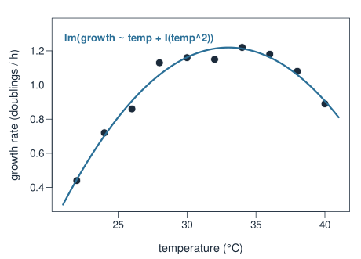
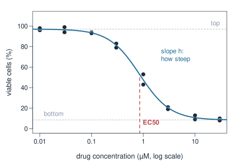
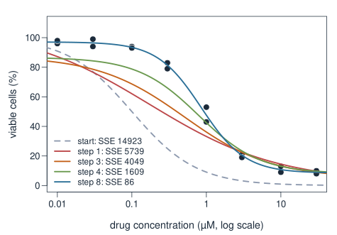
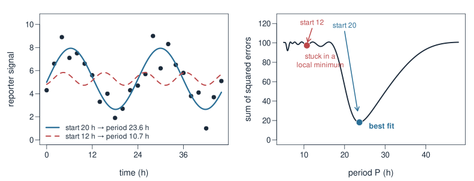
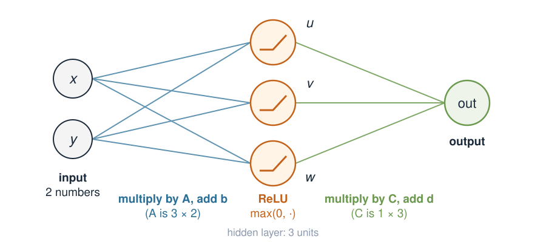
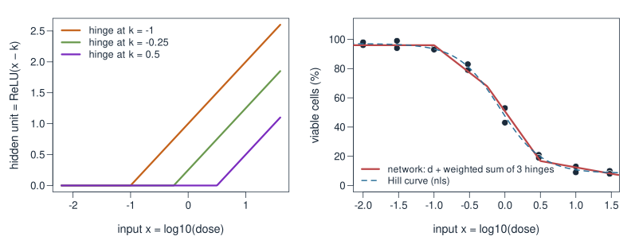
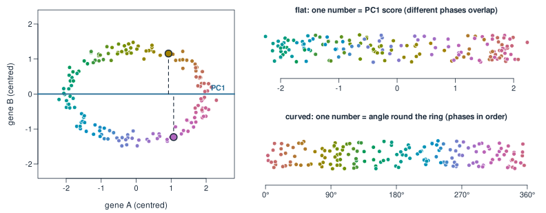

## About this lecture

So far almost every model in the course was **linear**: $\mathbf{y} = X\boldsymbol\beta$, solved by least squares, limma or a penalty. This week is about what lies beyond.

- "Linear" means **linear in the parameters** $\boldsymbol\beta$. A curve can still be a linear model.
- Some biology is **truly nonlinear**: a dose–response curve. We fit it with `nls()`, which has to **search**.
- A **neural network** is matrix × vector, then a bend, repeated. Without the bend it collapses to one matrix.
- **Flat vs curved latent spaces**: PCA gives a flat map of the cells; some data need a curved one. That sets up UMAP and variational autoencoders.

Pictures and small examples only.

::: notes
This opens the last week. Students have done linear algebra, PCA, design matrices, limma, penalized regression and Bayesian basics, so they know linear models well. The aim today is not a new toolbox but a clear line between what linear models can and cannot do, plus the vocabulary (nonlinear least squares, starting values, local minimum, neural network, ReLU, latent space) that the rest of the week uses. Single cell comes next as the application; today has small biological examples that do not need it.
:::

## "Linear" means linear in the parameters {.smaller}

:::: {.columns}
::: {.column width="52%"}
{width="100%"}
:::
::: {.column width="48%"}
Growth rate of a bacterium peaks at some temperature: a **curve**. Yet

$$\text{growth} = a + b\cdot\text{temp} + c\cdot\text{temp}^2$$

is a linear model. $\text{temp}^2$ is just **one more column** of $X$:

$$X = \begin{pmatrix} 1 & 22 & 484 \\ 1 & 24 & 576 \\ 1 & 26 & 676 \\ \vdots & \vdots & \vdots \end{pmatrix}, \qquad \boldsymbol\beta = \begin{pmatrix} a \\ b \\ c \end{pmatrix}$$

`lm(growth ~ temp + I(temp^2))` gives $c = -0.0064$, optimum at $33.0\,^\circ$C.

"Linear" is about $a, b, c$, not about the shape in temp.
:::
::::

::: notes
The single most useful idea of the first half: lm only needs the prediction to be a weighted sum of columns that you can compute from the data. What the columns are is up to you: temp, temp squared, log of dose, a dummy for treatment. The curve is curved in temp, but the prediction is still X times beta, so everything from Design matrices for covariates and least squares applies unchanged, including the exact solution in one step. The I() in the formula tells R to square temp arithmetically instead of reading ^ as formula syntax. The data are simulated (script make-nonlinear-figs.R); the optimum is at minus b over 2c.
:::

## Linear or not? A quick test {.smaller}

Ask: **is every parameter only multiplying something I can compute from the data?**

| Model | Linear in the parameters? |
|---|---|
| $y = a + b x + c x^2$ | yes: columns $1, x, x^2$ |
| $y = a + b \log(x)$ | yes: column $\log(x)$ |
| $y = a + b\sin(2\pi t/24) + c\cos(2\pi t/24)$ | yes: a **Fourier basis** with a known period |
| $y = a + b x + c\, x z$ | yes: an interaction column |
| $y = \dfrac{a\, x}{b + x}$ (Michaelis–Menten) | **no**: $b$ sits in the denominator |
| $y = a\, e^{b x}$ | **no**: $b$ sits in the exponent |
| $y = a\sin(2\pi t / P)$, $P$ unknown | **no**: $P$ sits inside the sine |

Linear in the parameters → one exact least-squares solution. Not linear → the computer has to **search**.

::: notes
Go down the table with the class. The Fourier row links to Fourier transform & basis functions: a sum of sines and cosines with known frequencies is a change of basis, so fitting it is a linear model; splines are the same idea with other basis columns. The last three rows each have a parameter that is not a simple multiplier. For y = a e^(bx) you can take logs and get log y = log a + b x, which is linear again; that is a classic trick, but it also changes how the noise behaves, so the fit is not the same. Michaelis–Menten has the same story with the Lineweaver–Burk plot (the exercise has it as a bonus).
:::

## A truly nonlinear model: dose–response {.smaller}

:::: {.columns}
::: {.column width="55%"}
{width="100%"}
:::
::: {.column width="45%"}
Cells treated with a drug at 8 concentrations, in duplicate. Viability falls along an S-shaped curve (the **Hill** or **four-parameter logistic** curve):

$$\text{viable} = \text{bottom} + \frac{\text{top} - \text{bottom}}{1 + (\text{dose}/\text{EC50})^{h}}$$

- **top, bottom**: the plateaus.
- **EC50**: the dose that gives half the effect. The number a pharmacologist wants.
- **h**: how steep the drop is.

EC50 and $h$ sit **inside** the curve, so no design matrix can hold them.
:::
::::

::: notes
This is one of the most common curve fits in biology: drug screens, toxicity, receptor binding, enzyme kinetics. Every parameter means something, which is exactly why people want this model and not a polynomial. Point out that a polynomial could also follow the points, but none of its coefficients would be the EC50, and it does silly things outside the data (the exercise shows a cubic predicting 164% viable cells at 1000 µM). The data are simulated with true EC50 0.8 µM and h 1.2.
:::

## No formula for the answer: search step by step {.smaller}

:::: {.columns}
::: {.column width="55%"}
{width="100%"}
:::
::: {.column width="45%"}
Still **least squares**: find the parameters that make the sum of squared errors (SSE) smallest. But there is no one-step formula. Instead:

1. **Start** from a guess.
2. Near the current guess, pretend the curve is linear and solve that small least-squares problem: a **step**.
3. **Repeat** until the SSE stops dropping.

From a poor start (EC50 = 0.1 µM) it takes 8 steps: SSE 14923 → 5739 → … → 86.
:::
::::

::: notes
The method behind nls is Gauss–Newton: at each step it approximates the curve by its tangent (a linear model in small changes of the parameters), solves that with ordinary least squares, moves, and repeats. So linear models are still doing the work, one step at a time. Students do not need the name or the derivative; "pretend it is linear nearby, take a step, repeat" is enough. The curves are the fit after 0, 1, 3, 4 and 8 steps; EC50 goes 0.1, 0.17, 0.51, 0.79, 0.85.
:::

## `nls()` in R {.smaller}

```r
dose <- rep(c(0.01, 0.03, 0.1, 0.3, 1, 3, 10, 30), each = 2)
v    <- c(96, 98, 99, 94, 94, 93, 79, 83, 43, 53, 21, 19, 9, 13, 10, 8)
fit  <- nls(v ~ bottom + (top - bottom) / (1 + (dose / ec50)^h),
            start = list(bottom = 0, top = 100, ec50 = 1, h = 1))
summary(fit)
#        Estimate Std. Error
# bottom    8.465      1.572
# top      97.087      1.308
# ec50      0.852      0.053
# h         1.469      0.123
```

- The formula is the curve written out; R treats every name that is not in the data as a parameter.
- **Starting values** are required. Read them off the plot: plateaus near 100 and 0, half-way at about 1 µM.
- A bad start can fail: from `ec50 = 10` R stops with *"Missing value or an infinity produced"*.

EC50 = 0.85 µM, with a standard error, as for any regression coefficient.

::: notes
Guessing starting values from a plot is the practical skill. For this curve the plateaus and the half-way dose are easy to see. The failure from ec50 = 10 happens because the first step overshoots into values where the curve cannot be computed (a negative or tiny h, a negative dose ratio raised to a power). Packages such as drc fit dose–response curves with automatic starting values, and R has self-starting models (SSfpl, SSmicmen) that do the guessing for you. The standard errors rely on the curve being nearly linear close to the answer; that is usually fine for a well-designed dose series.
:::

## Local minima: where you start matters {.smaller}

{width="96%" fig-align="center"}

A clock reporter, measured every 2 h. Fit $\text{signal} = m + a\cos(2\pi t/P) + b\sin(2\pi t/P)$ with the **period** $P$ unknown.

- Start at $P = 20$ h → $P = 23.6$ h, SSE 18: the circadian rhythm.
- Start at $P = 12$ h → $P = 10.7$ h, SSE 97: a dip in the SSE curve, but not the lowest. A **local minimum**.

R reports success both times. Plot the fit, and try several starts.

::: notes
The right panel is the whole story. For every fixed P the model is linear (a Fourier basis with known period, so lm gives the best m, a and b). Plotting the best SSE against P shows a landscape with one deep valley at about 24 h and many shallow dips at short periods. The search only walks downhill from where it starts, so a start at 12 h settles in the shallow dip near 10.7 h. Nothing in the R output says that this is wrong: the fit converged. The defence is to plot the fitted curve over the data, compare several starting values, or, as here, scan the nonlinear parameter on a grid first. Neural networks have this problem in a much bigger landscape, which is one reason two trainings of the same network give different answers.
:::

## A neural network: matrix, bend, matrix {.smaller}

{width="70%" fig-align="center"}

$$\begin{pmatrix} u \\ v \\ w \end{pmatrix} = \text{ReLU}\!\left(A\begin{pmatrix} x \\ y \end{pmatrix} + \mathbf{b}\right), \qquad \text{out} = C\begin{pmatrix} u \\ v \\ w \end{pmatrix} + d, \qquad \text{ReLU}(s) = \max(0, s)$$

Every line is one number in $A$ or $C$. **Training** = searching for all of them at once, as `nls()` does.

::: notes
Demystify the word. A layer is exactly what students have done since week 1: multiply a vector by a matrix (and add a shift). The only new part is ReLU, applied to each number separately: negative numbers become 0, positive numbers pass through. "Hidden units" are just the entries of the intermediate vector. A network for cells would have thousands of inputs (genes) and more hidden units, but the same structure. The weights are found by the same idea as nls: start somewhere (random), step downhill on the error, repeat. The VAE lecture uses one hidden layer of 32 units in each direction.
:::

## One input through the network, by hand {.smaller}

$A = \begin{pmatrix} 1 & 1 \\ 1 & -1 \\ -1 & 2 \end{pmatrix}$, $\mathbf{b} = \mathbf{0}$, $C = \begin{pmatrix} 1 & 2 & 1 \end{pmatrix}$, $d = 0$, input $(x, y) = (1, 2)$.

1. **Matrix**: $A\begin{pmatrix} 1 \\ 2 \end{pmatrix} = \begin{pmatrix} 1 + 2 \\ 1 - 2 \\ -1 + 4 \end{pmatrix} = \begin{pmatrix} 3 \\ -1 \\ 3 \end{pmatrix}$
2. **Bend** (ReLU): $\begin{pmatrix} 3 \\ 0 \\ 3 \end{pmatrix}$: the negative number becomes 0.
3. **Matrix**: $\text{out} = 1\cdot 3 + 2\cdot 0 + 1\cdot 3 = 6$.

Without the bend: $1\cdot 3 + 2\cdot(-1) + 1\cdot 3 = 4$. The bend changed the answer.

::: notes
Do this live on the board. Every step is a row-times-column dot product from Vectors, dot product & projection, except step 2, which just clips negatives. The exercise has a similar network with shifts b and d, and asks for the same calculation for a second input where ReLU happens to change nothing, to show that a ReLU network is a straight-line map within each region and bends only at the borders.
:::

## Without the bend, layers collapse to one matrix {.smaller}

From Matrices as transformations: **applying $A$ then $C$ is the same as applying the single matrix $CA$**.

$$C(A\mathbf{x}) = (CA)\,\mathbf{x}, \qquad CA = \begin{pmatrix} 1 & 2 & 1 \end{pmatrix}\begin{pmatrix} 1 & 1 \\ 1 & -1 \\ -1 & 2 \end{pmatrix} = \begin{pmatrix} 2 & 1 \end{pmatrix}$$

Check: $(2, 1)\cdot(1, 2) = 4$, the "without the bend" answer.

- 2 layers, or 100 layers, of matrices with no bend in between = **one matrix**. Shifts $\mathbf{b}, d$ do not help: still a straight-line map.
- So a deep network **without** nonlinearities is just a linear model, however big.
- The bend between the matrices is what lets a network draw **curves**.

::: notes
This is the key link to week 1: composition is matrix multiplication. Stacking linear maps never leaves the set of linear maps; you just get another matrix. With shifts, C(Ax + b) + d = (CA)x + (Cb + d), still a line or plane. This is why every neural network has a nonlinearity between layers. ReLU is the most common; older networks used S-shaped curves (the logistic function: the same S-shape as the Hill curve on a log-dose axis), and the choice matters less than having one at all.
:::

## Bends add up to curves {.smaller}

{width="96%" fig-align="center"}

One input (log dose), three hidden units. Each unit is a **hinge**: flat, then rising. The output adds the hinges with weights: a bent line that follows the dose–response data.

- More hidden units → more hinges → any smooth curve, as closely as you like.
- With the hinges fixed, the output weights are an ordinary `lm()`: the hinges are just columns of $X$.
- The price: many weights with no biological meaning, which need lots of data, a penalty or cross-validation, and a search with local minima.

::: notes
This connects both halves. Left: three ReLU units with hinges at log dose −1, −0.25 and 0.5 (in the training of a real network the hinge positions are learned too; here they are fixed by hand). Right: with fixed hinges, the best output weights come from lm on the three hinge columns plus an intercept; the result is a piecewise straight line close to the Hill curve. Compared with nls: the Hill fit has 4 parameters, each with a meaning; the network has weights that mean nothing on their own, but it did not need us to know the shape of the curve. That trade (meaning vs flexibility) is the theme of the week. Overfitting is the same problem as in Penalized linear models, and the same tools apply: penalties (weight decay is ridge) and held-out data.
:::

## Flat vs curved latent spaces {.smaller}

{width="96%" fig-align="center"}

Cycling cells trace out a **ring** in two marker genes. One number should be enough to say where a cell is in the cycle.

- **PC1** (flat): the two marked cells, in different phases, get **the same score**. A straight axis folds the ring onto itself.
- **The angle** round the ring (Polar coordinates) keeps all phases in order: a **curved** coordinate, which no matrix can give.

::: notes
PCA projects onto flat directions: a line, a plane. That is perfect when the data lie near a flat subspace and poor when they lie on a curve. A ring of cycling cells is the cleanest example: it is truly one-dimensional (the phase) but no single straight axis can represent it; PC1 maps the cell at 60° and the cell at 300° to nearly the same score. The angle from Polar coordinates is the right one-number summary, and it is a nonlinear function of the gene values (atan2). With thousands of genes we cannot write the curved coordinate down by hand; that is what the methods later this week learn from the data. A differentiation trajectory is the same story with an open curve instead of a ring.
:::

## Where this week goes {.smaller}

| | Map from genes to a few numbers | Map back to genes |
|---|---|---|
| PCA | flat (a matrix) | flat (a matrix) |
| UMAP | **curved**, built from a kNN graph | none |
| Autoencoder / VAE | **curved**: a neural network | **curved**: a neural network |

- **kNN graphs & UMAP**: a curved 2D picture of the cells, drawn from who-is-near-whom.
- **Variational autoencoders**: the encoder and decoder are networks like today's, so the latent space can bend. With no bends, they reduce to PCA.

::: notes
This is the hand-over. The next lectures introduce the single-cell dataset and then two ways to get curved latent spaces. UMAP is curved but one-way: there is no formula from a UMAP position back to expression. The VAE has explicit encoder and decoder networks; the VAE lecture starts from "PCA is a linear autoencoder", which is today's collapse argument seen from the other side: with no ReLU, an encoder and decoder are just matrices, and the best pair of matrices is PCA.
:::

## Summary {.smaller}

| Idea | In one line |
|---|---|
| Linear model | linear in the **parameters**: $x^2$, $\log x$, sines and interactions are just columns of $X$ |
| Nonlinear model | a parameter sits inside the curve (EC50, a period, a Michaelis constant) |
| `nls()` | least squares by **search**: starting values, steps, repeat |
| Local minimum | a fit that converged but is not the best; plot it, try several starts |
| Neural network | matrix × vector, then ReLU, repeated; weights found by search |
| No bend | stacked matrices collapse to one matrix ($CA$): a linear model |
| Latent space | PCA gives a flat map; rings and trajectories need a curved one |

::: notes
Return to the opening question: what does "linear" mean? Linear in the parameters, which covers a surprising number of curves. When a parameter sits inside the curve we need a search, with the practical risks of bad starts and local minima. Neural networks are the extreme case: a search over thousands of weights, made from matrices and a bend. The exercise checks a list of models for linearity, pushes a vector through a tiny ReLU network by hand, and fits the dose–response curve with nls in R.
:::
