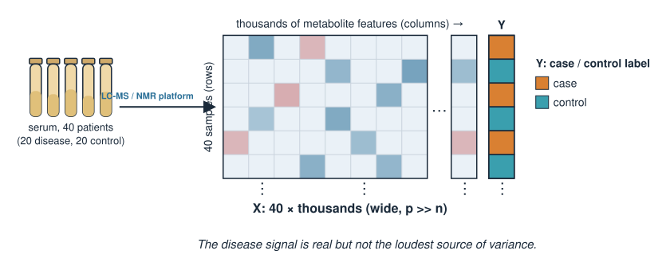
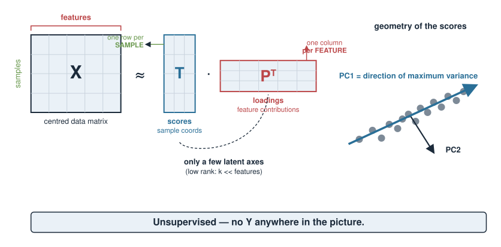
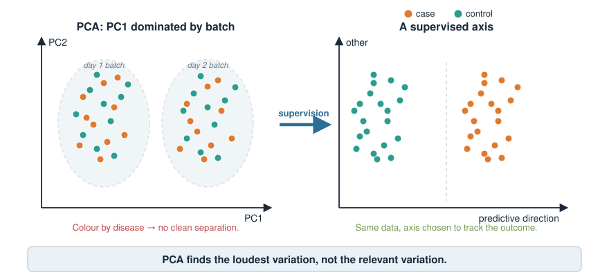
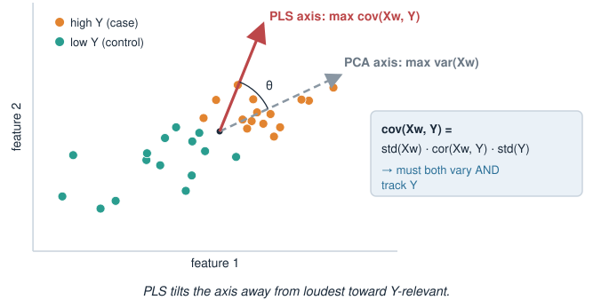
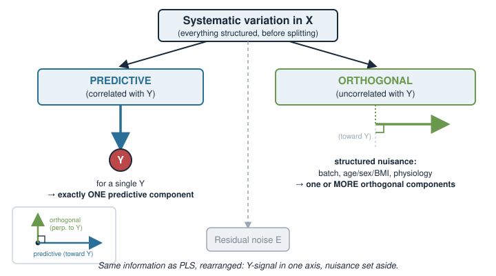
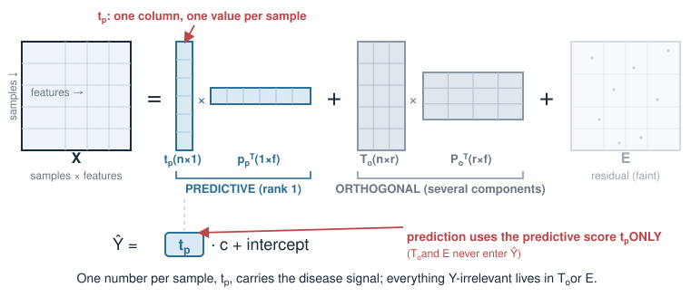
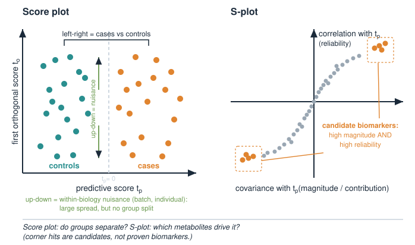
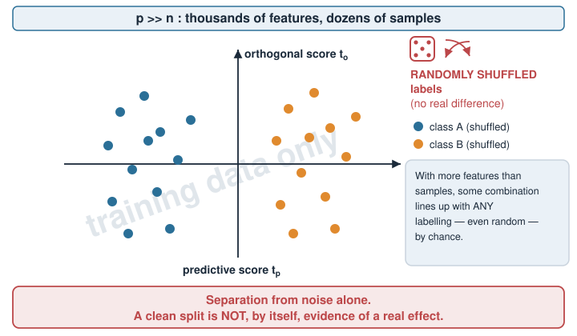
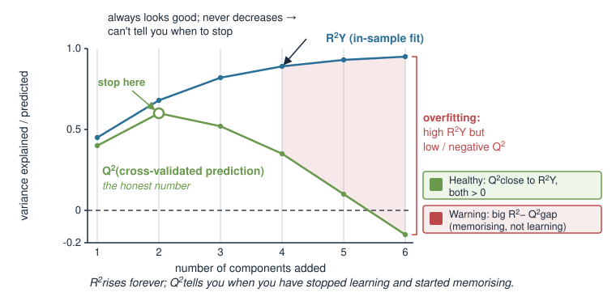
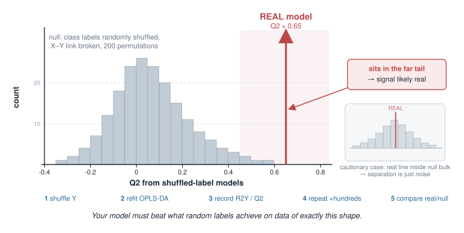

## About this lecture

In PCA we found the directions of **greatest variation** in a data matrix $X$ — a purely **unsupervised** view that never looks at any outcome. Today we bring the outcome back in.

- Why **PCA can miss the biology**: its biggest axis may be a batch effect, not your disease.
- **PLS**: find directions in $X$ that **covary with an outcome $Y$** (supervised latent variables).
- **OPLS**: split $X$-variation into a **predictive** part (correlated with $Y$) and an **orthogonal** part (structured noise — batch, instrument, physiology).
- Why this split makes a model **easier to interpret**, and where it is standard (**metabolomics**).
- The catch: supervised models can **fit noise**, so we must **validate** honestly.

This is a **concept** day. The goal is to know what OPLS does, when to reach for it, and how not to fool yourself. Light math, heavy intuition.

::: notes
This is an optional unit under Extra material, built on PCA, so lean on PCA hard: students already know that PCA diagonalises a covariance matrix and returns orthogonal axes ordered by variance. The one new idea today is supervision — letting a response Y steer which directions we care about — and then OPLS's particular trick of separating Y-related variation from everything else. Emphasise up front that this is conceptual: the vocabulary (scores, loadings, predictive vs orthogonal, R2/Q2, permutation test) and the overfitting message are what they should leave with.
:::

## A biology picture first {.smaller}

A metabolomics study: **serum from 40 patients**, 20 with a metabolic disease and 20 healthy controls. An LC–MS or NMR platform measures **thousands of metabolite features** per sample.

The question is simple: **which metabolites separate cases from controls?**

But the measured variation is dominated by things you did **not** ask about:

- samples run on **different days** / different instrument batches,
- **age, sex, BMI, diet** differing between individuals,
- baseline **physiological** spread that has nothing to do with the disease.

The disease signal is real but **not the loudest thing in the data**. We need a method that listens for the outcome, not just the loudest source of variance.

{width="80%" fig-align="center"}

::: notes
Ground the whole lecture in this one metabolomics scenario and return to it repeatedly. The defining features of the data: very wide (features far outnumber samples), highly collinear (metabolites move in correlated groups), and dominated by nuisance structure (batch, demographics). This is exactly the regime where PCA underperforms as a discovery tool and where PLS/OPLS were developed. Keep the biological question concrete — "which metabolites differ between sick and healthy" — because every abstract idea today (supervision, predictive vs orthogonal) answers a piece of it.
:::

## Recap: what PCA gives us {.smaller}

PCA takes the (centred) data matrix $X$ and returns latent axes ordered by variance:

- **Scores** $T$ — coordinates of each **sample** on the new axes,
- **Loadings** $P$ — how each **feature** contributes to each axis,
- reconstruction $X \approx T P^\top$, with the first axes capturing the most variance.

$$\text{PC 1 = direction of maximum variance in } X.$$

PCA is **unsupervised**: it never sees any outcome $Y$. It answers *"what varies most?"* — a fine question, but **not** *"what varies **with the disease**?"*

{width="70%" fig-align="center"}

::: notes
A one-slide refresher tying to the PCA unit. Reuse their vocabulary exactly: scores are the samples' new coordinates, loadings tell you which original features build each component, and X factorises approximately as scores times loadings transposed. The single sentence to burn in: PCA maximises variance and is blind to Y. Everything today is a reaction to that blindness. Do not re-derive PCA; just re-activate it.
:::

## The problem: PCA can point the wrong way {.smaller}

In our serum study, suppose the **batch** (day 1 vs day 2) creates more spread than the **disease** does. Then:

- **PC1** aligns with **batch**, not case/control,
- the disease difference hides in some **later, smaller** component — or is smeared across several.

You plot PC1 vs PC2, colour by disease, and see... **no clean separation**. Not because the biology is absent, but because PCA optimised for the wrong thing.

> PCA finds the **loudest** variation. It has no reason to care that your loudest variation is a **nuisance**.

{width="75%" fig-align="center"}

::: notes
This is the motivating failure. Make it vivid: the student does the natural thing (PCA, colour by phenotype) and it "fails," and the trap is to conclude there is no signal. The real issue is that variance and relevance are different criteria. Nuisance variance — batch, demographic — is often larger than the effect of interest, so an unsupervised method will rank it first. Note honestly that this is not always the case; sometimes PC1 IS your biology. But when it is not, you need supervision. This sets up PLS on the next slide.
:::

## Bring in the outcome: supervision {.smaller}

Attach the response we care about as a vector (or matrix) $Y$:

- **regression flavour:** $Y$ is a quantity — e.g. a drug dose, a bioactivity value;
- **classification flavour:** $Y$ encodes a class — e.g. case $=1$, control $=0$ (this is **OPLS-DA**, discriminant analysis).

Now ask a **supervised** question:

$$\text{find directions in } X \text{ that are useful for } Y.$$

Instead of maximising variance in $X$ alone, we bring $X$ **and** $Y$ into the objective. That single change turns PCA into **PLS**.

::: notes
Introduce Y as the pivot. Two modes: continuous Y (PLS regression) and categorical Y coded as dummy 0/1 (the discriminant variant, OPLS-DA, which is the common one in metabolomics case/control work). Keep the phrasing "directions in X useful for Y" deliberately loose here; the precise objective (covariance) comes next. The conceptual leap is small but important: we are no longer describing X, we are relating X to Y. Students who have used lm() know supervision; frame PLS as "regression that also builds its own latent axes."
:::

## PLS: directions that covary with Y {.smaller}

**Partial Least Squares.** PLS builds latent components $t = Xw$ as linear combinations of the features, choosing the weights $w$ so the component has **maximum covariance with $Y$**:

$$\max_{\|w\|=1}\ \operatorname{cov}(Xw,\ Y).$$

Contrast with PCA, which maximises $\operatorname{var}(Xw)$ alone.

- Covariance = variance **and** correlation-with-$Y$ together, so a PLS component must both **vary** and **track $Y$**.
- After extracting one component, PLS **removes** it from $X$ (deflation) and finds the next — giving several ordered components, like PCA but $Y$-aware.

{width="60%" fig-align="center"}

::: notes
The clean contrast: PCA maximises var(Xw), PLS maximises cov(Xw, Y). Because covariance factors as std(Xw) times cor(Xw, Y) times std(Y), a PLS direction is pulled toward variation that also correlates with the outcome — a compromise between "big" and "relevant." Mention deflation lightly: extract a component, subtract its contribution from X, repeat, so you again get an ordered set of components. Don't derive the NIPALS algorithm. The takeaway is the objective swap. This is the parent method; OPLS is a re-parameterisation of it.
:::

## Scores and loadings, again {.smaller}

PLS keeps the same two-part vocabulary as PCA, now $Y$-aware:

| Object | Meaning | Lives in |
|---|---|---|
| **Scores** $t$ | each **sample's** coordinate on a latent component | sample space |
| **Loadings / weights** | how each **feature** contributes to that component | feature space |

- **Score plot** → do the **samples** (cases vs controls) separate?
- **Loading plot** → which **metabolites** drive that separation?

A latent component is still just a **weighted combination of the original features** — a new "meta-feature" — only now the weights are chosen with $Y$ in view.

::: notes
Reassure students that no new machinery is needed to read PLS output: scores and loadings mean what they meant in PCA. The score plot answers "do my groups separate," the loading plot answers "which features are responsible." The phrase "latent variable" simply means a constructed axis that is a linear combination of measured features; it is latent because it is not directly measured. This slide is the bridge that lets them interpret OPLS output later without new vocabulary.
:::

## The OPLS idea: split the variation {.smaller}

PLS mixes two kinds of $X$-variation inside its components: variation that **relates to $Y$**, and variation that is **large but irrelevant** (batch, physiology). That makes components hard to read.

**OPLS** (Orthogonal PLS) adds one idea: **separate** them.

$$\underbrace{\text{variation in } X}_{\text{systematic part}} = \underbrace{\text{predictive}}_{\text{correlated with } Y} \ +\ \underbrace{\text{orthogonal}}_{\text{uncorrelated with } Y} \ +\ \text{residual noise}$$

- **Predictive** variation → put it in **one** component (for a single $Y$) that carries the $Y$-related signal.
- **Orthogonal** variation → structured, but **uncorrelated with $Y$**; parked in **separate** orthogonal components.

{width="70%" fig-align="center"}

::: notes
Here is the one genuinely new concept of the day. OPLS (Trygg and Wold, 2002) does not predict Y any better than PLS — it rearranges the same information so that all the Y-correlated variation is concentrated into a single predictive component and everything else systematic-but-irrelevant is pushed into orthogonal components. "Orthogonal" here means orthogonal (uncorrelated) to Y. For a single response there is exactly one predictive component; there can be several orthogonal ones. The payoff is entirely interpretational, which is why it caught on in metabolomics where interpretation is the goal.
:::

## What is "orthogonal variation"? {.smaller}

Orthogonal variation is **real, structured** signal in $X$ that has **nothing to do with $Y$**. In the serum study it might be:

- **instrument / batch** drift between run days,
- **age, sex, BMI, diet** differences between individuals,
- baseline physiological differences unrelated to the disease.

It is **not** random measurement error — that lands in the residual. It is systematic nuisance that PCA would happily rank first.

OPLS says: *keep it, but keep it **separate** — do not let it contaminate the axis you use to interpret the disease.*

::: notes
Clarify the three-way split that trips people up: predictive (correlated with Y), orthogonal (structured but uncorrelated with Y), and residual (unstructured noise). Orthogonal variation is the star of OPLS's marketing because it is exactly the batch/physiology structure that plagues omics. The method does not discard it — discarding would be dangerous — it isolates it so the predictive component is clean. Connect to the multiome/integration and chemometrics units where nuisance structure recurs. A good analogy: OPLS is like adjusting for covariates, but the covariates are discovered from the data rather than measured.
:::

## The OPLS decomposition {.smaller}

For a single response $Y$, OPLS factorises $X$ as

$$X = \underbrace{t_p\, p_p^\top}_{\text{predictive}} \;+\; \underbrace{T_o\, P_o^\top}_{\text{orthogonal}} \;+\; E,$$

and predicts $Y$ from the **predictive score only**:

$$\hat Y = t_p\, c + \text{(intercept)}.$$

- $t_p$ — the **predictive scores** (one per sample): the samples' position along the $Y$-related axis.
- $T_o, P_o$ — **orthogonal** scores and loadings: the nuisance structure, set aside.
- $E$ — residual.

So a single number per sample, $t_p$, carries the disease signal; everything Y-irrelevant is elsewhere.

{width="75%" fig-align="center"}

::: notes
Show the equation but do not derive it — flag it as "light math, for orientation." The structure to read: X is a sum of a rank-one predictive piece (score vector times loading vector), a multi-component orthogonal piece, and residual. The prediction of Y uses only the predictive score t_p times a scalar c. The pedagogical point is that OPLS collapses "how diseased is this sample" into one coordinate t_p, which is what makes the score plot so readable. Symbols: subscript p = predictive, o = orthogonal. Reassure them the software computes all of this; they need to interpret it.
:::

## Reading an OPLS-DA model {.smaller}

The standard plot: **predictive score $t_p$** on the x-axis vs the **first orthogonal score $t_o$** on the y-axis.

- **Left–right (predictive axis):** cases vs controls should separate **horizontally**.
- **Up–down (orthogonal axis):** spread that is **within** the biology — batch, individual variation — but does **not** separate the groups.

To find *which metabolites* drive the separation, metabolomics often uses an **S-plot**: for each feature, plot its **covariance** with $t_p$ against its **correlation** with $t_p$. Features in the extreme corners are the strong, reliable discriminators.

{width="75%" fig-align="center"}

::: notes
This is how the model is actually consumed. The predictive axis is the interpretable one: group separation lives there, by construction. Orthogonal axes show you the nuisance spread you have quarantined. The S-plot (Wiklund et al., 2008) is a metabolomics staple for biomarker shortlisting: high covariance means the feature contributes a lot (magnitude), high correlation means it does so reliably (low relative noise); the corners have both. Caution students that S-plot "hits" are candidates requiring independent validation, not proven biomarkers — a recurring theme.
:::

## When to prefer OPLS {.smaller}

| Situation | Reach for |
|---|---|
| Explore structure, **no outcome** in mind | **PCA** |
| Loudest variation **is** your biology | PCA is fine |
| Outcome known; nuisance variation **large** | **PLS / OPLS** |
| Many correlated features, wide matrix ($p \gg n$) | **PLS / OPLS** |
| Want the $Y$-signal in **one interpretable axis** | **OPLS** |

- **OPLS vs PLS:** essentially the **same predictive power** — OPLS just **rotates** the solution so interpretation is cleaner (one predictive axis, nuisance set aside).
- **OPLS vs PCA:** use OPLS when you have an outcome and PCA's top axes are dominated by things you don't care about.

::: notes
Give an honest decision guide. Do not oversell OPLS: if you have no Y, it does not apply; if PC1 already captures your biology, PCA is simpler and safer. The key honesty point, and a common misconception to pre-empt: OPLS does NOT predict better than PLS. Same cross-validated performance. The entire benefit is interpretational — the predictive/orthogonal rotation. Wide, collinear omics matrices are the natural habitat for both PLS and OPLS because ordinary least squares regression breaks down when features outnumber samples.
:::

## The catch: supervision can fit noise {.smaller}

The moment we let $Y$ steer the axes, we gain a new danger PCA never had: with **thousands of features and dozens of samples**, a supervised model can separate the groups **even when there is no real difference**.

- With $p \gg n$, some linear combination of features will line up with **any** labelling — including a random one — **by chance**.
- A beautiful case/control separation on the **training** data can be **pure overfitting**.

> An OPLS-DA score plot that cleanly splits your groups is **not**, by itself, evidence of a real effect.

{width="60%" fig-align="center"}

::: notes
This is the single most important warning of the unit and worth dwelling on. Supervision is powerful precisely because it optimises to fit Y — which means it can fit Y even when Y is noise. In the p greater-than-n regime this is almost guaranteed: you can nearly always find a direction separating two arbitrary groups. Students must internalise that a pretty separation plot proves nothing on its own. This directly motivates validation on the next slides, and connects forward to the Cross-validation unit where the machinery is treated properly.
:::

## Validate honestly: R², Q² {.smaller}

Two numbers report the model's fit and its **generalisation**:

- **$R^2$** — variance **explained** on the data used to fit ($R^2X$, $R^2Y$). Always looks good; **rises** as you add components.
- **$Q^2$** — variance **predicted** under **cross-validation** (hold out samples, predict them). This is the honest number.

Healthy model: $Q^2$ close to $R^2Y$, both clearly above 0.
Warning sign: high $R^2Y$ but **low or negative $Q^2$** → the model fits the training data but **does not generalise** — overfitting.

{width="60%" fig-align="center"}

::: notes
Define the two metrics plainly. R2 is in-sample fit and is optimistic by construction — it never goes down as you add components, so it cannot tell you when to stop. Q2 is the cross-validated analogue: repeatedly leave samples out, predict them, measure how much variance you genuinely capture. The diagnostic gap between a high R2Y and a low or negative Q2 is the fingerprint of overfitting. This is students' first close look at cross-validation as a guard; the Cross-validation unit builds it out. Rule of thumb only: there is no universal Q2 threshold, it depends on the field and problem.
:::

## Validate honestly: the permutation test {.smaller}

The strongest simple check: **break the link between $X$ and $Y$ on purpose**, many times.

1. Randomly **shuffle** the class labels $Y$.
2. Refit OPLS-DA and record $R^2Y$ and $Q^2$.
3. Repeat hundreds of times to build a **null distribution**.
4. Compare your **real** model against that null.

If the real $Q^2$ is **not clearly better** than what shuffled labels achieve, your separation is **noise**. If it sits far out in the tail, the signal is likely real.

{width="60%" fig-align="center"}

::: notes
The permutation test is the most intuitive safeguard and worth teaching as a habit. By shuffling Y you destroy any true X-Y relationship while preserving the shapes and sizes of both matrices, so the resulting R2/Q2 values show what this method can achieve on pure chance for data of exactly this dimensionality. Your real model must beat that null convincingly. This is a concrete instance of the general permutation-testing logic; frame it as the same reasoning students may meet elsewhere for significance. Emphasise: in the p greater-than-n regime, always permute — a good-looking plot is not enough.
:::

## OPLS in R (sketch) {.smaller}

The Bioconductor package [`ropls`](https://bioconductor.org/packages/ropls/) fits PCA, PLS(-DA) and OPLS(-DA) with built-in cross-validation and permutation testing.

```r
library(ropls)

# X: samples x metabolite-features matrix   y: factor (case / control)
model <- opls(X, y,
              predI  = 1,      # 1 predictive component (single response)
              orthoI = NA,     # let CV choose the number of orthogonal comps
              permI  = 200)    # 200 permutations for the validation test

model                 # prints R2X, R2Y, Q2 and the permutation p-values
getScoreMN(model)     # predictive & orthogonal scores  (the score plot)
getLoadingMN(model)   # feature loadings                (which metabolites)
plot(model, typeVn = "x-score")   # the t_p vs t_o score plot
```

Read the printed **$Q^2$** and **permutation p-values before** you trust any score plot.

::: notes
Static code only — nothing runs at render time. ropls is the de facto metabolomics tool (Thevenot et al., 2015) and conveniently bundles the validation we just described. Walk the arguments: predI = 1 because a single response has one predictive component; orthoI = NA lets cross-validation pick the orthogonal count (guarding against adding noise components); permI triggers the permutation test. The deliberate order of the punchline: look at Q2 and the permutation p-value first, plots second. Mention pls as the base-R-adjacent alternative for plain PLS regression, but ropls is the one to know here.
:::

## Summary {.smaller}

| Idea | Key point |
|---|---|
| PCA | unsupervised; maximises **variance**, ignores $Y$ |
| PCA pitfall | top axis may be **batch/nuisance**, not your biology |
| PLS | supervised; maximises **covariance** of $Xw$ with $Y$ |
| Scores / loadings | samples' coordinates / features' contributions (as in PCA) |
| OPLS | splits $X$ into **predictive** ($Y$-correlated) + **orthogonal** (nuisance) |
| Predictive score $t_p$ | one axis carrying the $Y$-signal — the interpretable one |
| OPLS vs PLS | same prediction, **cleaner interpretation** (a rotation) |
| Home field | **metabolomics** — wide, collinear, nuisance-heavy data |
| The danger | with $p \gg n$, supervision can **separate noise** |
| Honesty | trust **$Q^2$** + **permutation test**, not a pretty plot |

**Next (Extra material): Chemometrics** applies these latent-variable ideas to spectra.

::: notes
The summary is the cheat-sheet for the concepts. Drill the arc: PCA maximises variance and is blind to Y; PLS maximises covariance with Y; OPLS re-parameterises PLS to separate predictive from orthogonal variation for interpretability, at no cost or gain in prediction; its home is metabolomics; and the overriding caution is overfitting in the wide-data regime, defended against by Q2 and permutation testing. If they remember only one sentence, make it: a clean supervised separation plot is a hypothesis, not a result. Forward pointers: Chemometrics and Multiome integration reuse these ideas; Cross-validation formalises the validation.
:::
