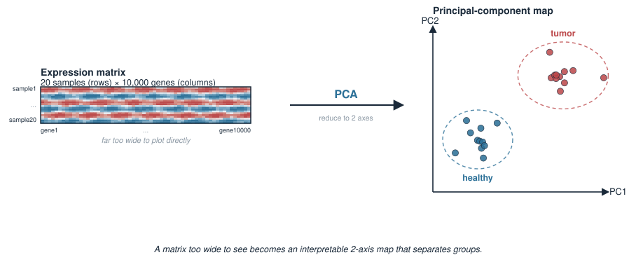
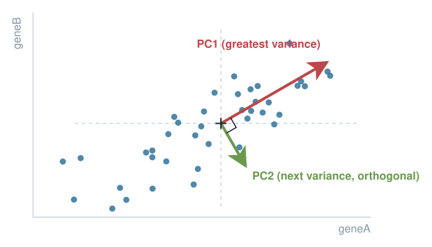
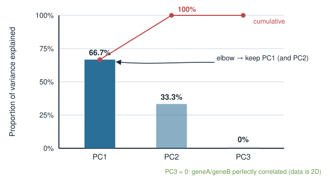
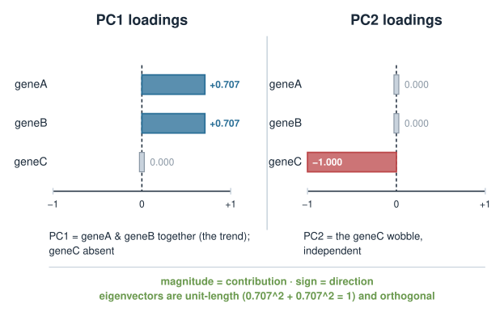
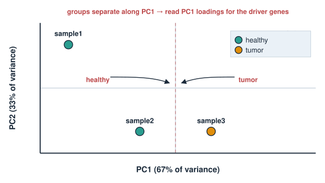
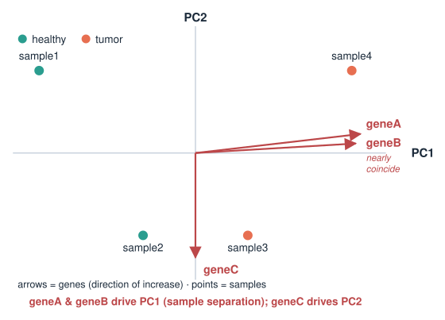
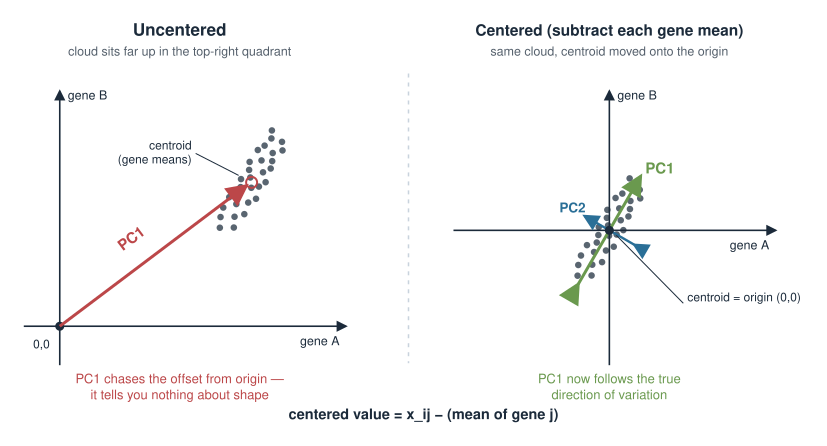
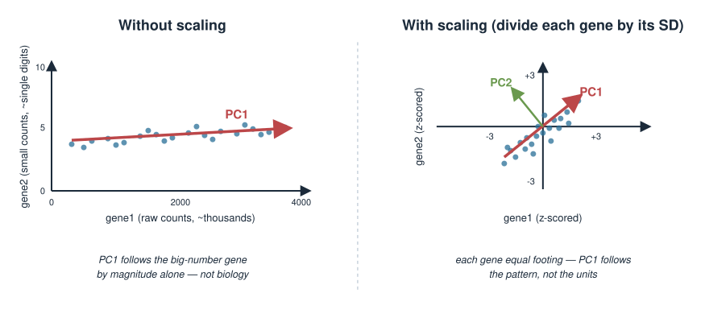

## About this lecture

In Eigenvalues & eigenvectors you learned that the eigenvectors of a **covariance matrix** point along the axes of greatest variation in a dataset. **Principal component analysis (PCA)** is exactly that idea turned into a practical tool. Today we run it in R.

- What PCA **does**: find new axes (principal components) that capture the most variation in a high-dimensional dataset, in order.
- Run it with one function: [`prcomp`](https://rdrr.io/r/stats/prcomp.html), and inspect its three outputs — `$sdev`, `$rotation`, `$x`.
- See that `prcomp` is just the **eigen-decomposition** of the covariance matrix — the engine you already built.
- Read **variance explained** from `$sdev`, plot **scores** (`$x`) to separate sample groups, and read **loadings** (`$rotation`) to find the genes that drive the separation.
- Practical craft: samples as **rows**, why we **center**, and why **scaling** matters when features live on different scales.

This is a **hands-on** day. The exam may ask you to interpret PCA output and explain what each piece means.

::: notes
The one-sentence takeaway: PCA re-expresses your data in a new coordinate system whose axes are ordered by how much variation they capture, and in R that is a single call to prcomp. Everything else today is reading the three outputs and knowing which knobs (center, scale) to turn. Lean hard on Eigenvalues & eigenvectors: students already proved that the leading eigenvector of a covariance matrix is the direction of greatest spread. PCA is that theorem made into a workflow. Keep this a code-and-interpretation day, not a derivation day, but do show the eigen equivalence once so the tool is not a black box. No package is installed at render time, so all R here is shown as static code with results in comments.
:::

## The biology problem {.smaller}

You have an expression matrix: **20 samples** (rows) measured over **10,000 genes** (columns). Some samples are tumor, some are healthy.

- You cannot plot 10,000 dimensions. You cannot eyeball 10,000 genes per sample.
- But you suspect the samples fall into **groups**, and that a **few** underlying patterns (a proliferation program, an immune program) explain most of the differences.

**The question:** can we collapse 10,000 gene-columns into 2 or 3 informative axes that reveal the group structure — and then ask *which genes* define those axes?

That is precisely what PCA delivers. The first axis is the single direction along which the samples differ the most.

{width="80%" fig-align="center"}

::: notes
Ground the abstraction in a real omics shape before any math: a samples-by-genes matrix that is far too wide to visualise. The biological bet behind PCA is that the thousands of measured genes are not independent — they are driven by a handful of coordinated programs, so the true dimensionality is small. PCA finds those few dominant directions. Emphasise the two payoffs students will get today: (1) a 2D picture that separates sample groups, and (2) the loadings, which name the genes responsible. This dual payoff — a map plus its legend — is the whole reason PCA is the first thing biologists run on a new dataset.
:::

## What PCA is, in one picture {.smaller}

Think of the data cloud from Eigenvalues & eigenvectors: samples plotted in gene-space form a tilted, elongated blob.

- **PC1** is the direction along which the cloud is **most stretched** — the axis of greatest variance.
- **PC2** is the direction of next-greatest variance, **perpendicular** to PC1.
- Each further PC is orthogonal to all the previous ones and captures the most remaining variance.

PCA **rotates** the coordinate system so the new axes line up with the natural axes of the cloud. The data does not change — only the description of it.

$$\text{principal components} = \text{eigenvectors of the covariance matrix}$$

{width="55%" fig-align="center"}

::: notes
Reuse the exact mental image from the eigen lecture — the tilted sausage-shaped cloud — because that is the bridge students already own. PCA just names the long axis PC1 and the perpendicular short axis PC2, and keeps going into higher dimensions. Stress two properties: the PCs are ordered by variance (PC1 captures the most), and they are mutually orthogonal (guaranteed because the covariance matrix is symmetric, per the spectral theorem from the eigen unit). Emphasise that PCA is a rotation, not a distortion: no information is lost if you keep all PCs; dimension reduction happens only when you choose to keep the first few.
:::

## The toy dataset we will use all lecture {.smaller}

Four samples, three genes. Small enough to check every number by hand.

```r
X <- matrix(c(
  # geneA geneB geneC
     2,    0,   1,     # sample1
     4,    1,   2,     # sample2
     6,    2,   2,     # sample3
     8,    3,   1      # sample4
  ), nrow = 4, byrow = TRUE)
rownames(X) <- c("sample1", "sample2", "sample3", "sample4")
colnames(X) <- c("geneA", "geneB", "geneC")
X
#         geneA geneB geneC
# sample1     2     0     1
# sample2     4     1     2
# sample3     6     2     2
# sample4     8     3     1
```

**Convention (memorise): samples are rows, features (genes) are columns.** geneA and geneB rise together across samples (perfectly correlated); geneC just wobbles, independent of the trend.

::: notes
A tiny matrix that students can hold in their head is worth more than a realistic one they cannot check. Point out the built-in structure: geneA and geneB increase steadily from sample1 to sample4 (in fact perfectly correlated), while geneC wobbles 1,2,2,1 with no relation to that trend. That planted structure is what PCA should recover: PC1 will be the geneA-geneB trend, and geneC will not contribute to PC1 at all. Hammer the orientation convention now — samples as rows — because getting it backwards is the single most common PCA mistake, and R's prcomp assumes exactly this layout. We will feed this same X to prcomp and to eigen and show they agree.
:::

## One call: prcomp {.smaller}

```r
pca <- prcomp(X, center = TRUE, scale. = TRUE)
```

Two arguments you should always think about explicitly:

- `center = TRUE` — subtract each gene's mean so the cloud is centered on the origin. **PCA is about variation, so you must remove the mean first.** (Default `TRUE`.)
- `scale. = TRUE` — divide each gene by its standard deviation, putting all genes on a common scale. (Default `FALSE` — you usually want to set it.)

The result is a list with three pieces we will now open:

- `pca$sdev` — standard deviation along each PC (→ variance explained),
- `pca$rotation` — the **loadings** (how genes combine into PCs),
- `pca$x` — the **scores** (coordinates of each sample on the PCs).

::: notes
This is the whole tool in one line, but the two named arguments carry the practical wisdom. Centering is not optional in spirit: PCA measures spread around the mean, so if you do not center, PC1 will chase the distance from the origin rather than the direction of variation. prcomp centers by default; still say it out loud. Scaling is the real decision and gets its own slide later, so here just flag that the default is FALSE and biologists usually want TRUE. Note the dot in scale. — it is an unfortunate but real quirk of the function signature (scale is taken by another meaning), so students who type scale = TRUE get a surprise. Preview the three outputs as the map of the rest of the lecture.
:::

## Output 1: pca$sdev and variance explained {.smaller}

`$sdev` holds the standard deviation of the data **along each PC**. Square it to get variance, then normalise:

```r
pca$sdev
# [1] 1.4142 1.0000 0.0000

variances <- pca$sdev^2                 # variance captured by each PC
prop <- variances / sum(variances)      # proportion of total variance
round(prop, 3)
# [1] 0.667 0.333 0.000

cumsum(prop)
# [1] 0.667 1.000 1.000
```

**PC1 alone explains ~67% of the variation; PC1 + PC2 explain 100%.** The third PC is exactly zero — because geneA and geneB are perfectly correlated, the data truly lives in **two** dimensions.

{width="55%" fig-align="center"}

::: notes
This is the payoff of the whole eigenvalue story: variance along PC k equals the k-th eigenvalue of the (scaled) covariance matrix, and sdev is its square root. Walk the arithmetic: square sdev to get variances, divide by the total to get proportions, and cumsum to see how fast you accumulate the signal. Here PC1 grabs two thirds because geneA and geneB move together — one dominant program. The exactly-zero third value confirms the data really lives in two dimensions (perfect correlation collapses one dimension entirely). Introduce the word scree plot for the bar chart of these proportions; the elbow tells you how many PCs to keep. This is how biologists justify reducing thousands of genes to a handful of components.
:::

## Output 2: pca$rotation (the loadings) {.smaller}

`$rotation` is the matrix of **loadings**: each column is a PC, each row a gene. It tells you **how much each gene contributes** to each PC.

```r
pca$rotation
#          PC1  PC2     PC3
# geneA  0.707    0   0.707
# geneB  0.707    0  -0.707
# geneC  0.000   -1   0.000
```

- The columns are the **eigenvectors** of the covariance matrix (unit length, mutually orthogonal).
- **PC1**: geneA and geneB have equal loadings (0.707) and geneC is exactly 0 → PC1 is purely "geneA and geneB together".
- **PC2**: entirely geneC (loading −1) → PC2 is the geneC wobble, independent of the trend.

Reading loadings tells you the **biological meaning** of an axis: *which genes define this direction?*

{width="65%" fig-align="center"}

::: notes
Loadings are where PCA stops being a black box and starts naming biology. Each PC is a weighted combination of the original genes, and rotation holds those weights. Large-magnitude loadings (positive or negative) are the genes that define the axis; zero loadings are irrelevant to it. Here PC1 is an equal mix of the two co-varying genes with geneC exactly absent — the proliferation-program idea from the motivation — and PC2 isolates the independent geneC wobble. Remind students these columns are literally the eigenvectors from the eigen unit: unit length, orthogonal, sign-ambiguous. The sign point matters: R may flip a whole column, which flips the axis but changes no interpretation, just like eigenvector sign freedom.
:::

## Output 3: pca$x (the scores) {.smaller}

`$x` gives the **coordinates of each sample** in the new PC space — one row per sample, one column per PC.

```r
pca$x
#              PC1     PC2   PC3
# sample1  -1.643   0.866    ~0
# sample2  -0.548  -0.866    ~0
# sample3   0.548  -0.866    ~0
# sample4   1.643   0.866    ~0
```

- The **PC1 scores** increase steadily sample1 → sample4: PCA recovered the geneA-geneB trend we planted.
- These scores are what you **plot** to see sample structure.

Scores are the projections of each (centered, scaled) sample onto the PC directions:
$$\text{scores} = X_{\text{centered, scaled}} \cdot \text{rotation}$$

::: notes
Scores answer where does each sample land on the new axes. Each sample's PC1 score is its position along the direction of greatest variation. Here the PC1 scores march monotonically from sample1 to sample4, recovering exactly the trend built into the toy data. Make the projection explicit: scores equal the preprocessed data matrix times the rotation matrix — a change of basis, the same matrix-times-vector operation from the linear algebra block. This is the object we visualise: a plot of PC1 vs PC2 scores is the map that separates sample groups. Rotation is the legend (genes), scores are the map (samples); students should keep the two straight.
:::

## The plot that starts every omics analysis {.smaller}

Plot **PC1 score vs PC2 score**, one point per sample. This 2D map often reveals the group structure hidden in thousands of genes.

```r
plot(pca$x[, 1], pca$x[, 2],
     xlab = "PC1 (67% of variance)",
     ylab = "PC2 (33% of variance)",
     pch = 19)
text(pca$x[, 1], pca$x[, 2], labels = rownames(X), pos = 3)
```

In a real study you would **colour** the points by a known label (tumor vs healthy, treated vs control) and look for separation:

```r
group <- c("healthy", "healthy", "tumor", "tumor")
plot(pca$x[, 1], pca$x[, 2], col = factor(group), pch = 19)
```

If groups separate along PC1, then PC1's **loadings** name the genes that distinguish them.

{width="55%" fig-align="center"}

::: notes
This slide is the practical climax. Every RNA-seq or single-cell analysis begins with a PC1-vs-PC2 scatter because it is the fastest sanity check and discovery tool at once. Axis labels should always carry the percent variance explained (from the sdev slide) so viewers know how much of the story each axis tells. The real move is colouring points by a known metadata label and asking: do my biological groups separate? If yes along PC1, you immediately jump to PC1's loadings to get the gene list — closing the loop from map to mechanism. Also flag the diagnostic use: if samples separate by batch or by which day they were processed rather than by biology, PCA just caught a confounder. Keep the code base-R and simple.
:::

## The biplot: scores and loadings together {.smaller}

A **biplot** overlays the two things we have been reading — sample **scores** (points) and gene **loadings** (arrows) — on one PC1–PC2 picture.

```r
biplot(pca)
```

- **Points** are samples positioned by their scores.
- **Arrows** are genes; an arrow points in the direction that gene increases.
- A gene whose arrow points strongly along PC1 is a gene that drives PC1 — and thus separates samples along it.

One glance links *which samples differ* to *which genes explain the difference*.

{width="55%" fig-align="center"}

::: notes
The biplot is the one-figure summary of a PCA: it fuses the map (scores) and the legend (loadings) into a single view so you can read sample structure and its gene drivers simultaneously. Arrows pointing the same direction as a cluster of samples are the genes elevated in those samples. Here geneA and geneB arrows lie along PC1 (they drive the main separation) while geneC points along PC2. Caution students that biplots get crowded fast with thousands of genes, so in practice you subset to the top-loading genes; but conceptually it is the cleanest illustration of the scores-plus-loadings duality. Mention prcomp's biplot works directly on the returned object.
:::

## PCA is eigen-decomposition of the covariance matrix {.smaller}

`prcomp` is not magic — it is the machinery from Eigenvalues & eigenvectors. On the **scaled, centered** data:

```r
Xs <- scale(X, center = TRUE, scale = TRUE)   # same preprocessing prcomp does
C  <- cov(Xs)                                 # 3x3 covariance (here = correlation) matrix
e  <- eigen(C)

e$values
# [1] 2 1 0                     # variance along each PC = eigenvalues

pca$sdev^2
# [1] 2 1 0                     # identical!

e$vectors        # eigenvectors == columns of pca$rotation (up to sign)
```

**The eigenvalues are the per-PC variances; the eigenvectors are the loadings.** PCA = eigen-decomposition of the covariance matrix. You built this engine already.

::: notes
This slide pays off the promise that PCA is not a new black box. Show the equivalence concretely: scale the data yourself, form the covariance matrix (which for scaled data equals the correlation matrix), and call eigen on it — the eigenvalues match pca$sdev squared and the eigenvectors match pca$rotation up to sign. Emphasise that scale() and cov() reproduce exactly prcomp's internal preprocessing. Two honest footnotes for the curious: prcomp actually uses the SVD of the data matrix rather than forming the covariance explicitly (numerically better), but the result is identical; and the eigenvalues here match sdev^2 exactly because cov uses the n-1 denominator, the same convention prcomp uses. The point for students: everything they proved by hand about symmetric matrices governs PCA.
:::

## Why centering is not optional {.smaller}

PCA finds directions of **variation around the mean**. If you skip centering, "variation" is measured from the **origin** instead — and PC1 will chase the mean position of the cloud, not its shape.

- With genes on wildly different baseline levels (a housekeeping gene at 10,000 counts, a transcription factor at 5), the uncentered PC1 is dominated by the high-mean gene's offset, telling you nothing.
- `prcomp` centers by default (`center = TRUE`). Leave it on unless you have a specific reason.

$$\text{centered value} = x_{ij} - \overline{x_{\cdot j}}\quad(\text{subtract gene } j\text{'s mean})$$

{width="70%" fig-align="center"}

::: notes
Centering is conceptually mandatory because variance is defined as spread about the mean; measuring spread about the origin conflates the mean with the variation and PC1 ends up pointing at the centroid. The count-data example makes it vivid: a highly expressed housekeeping gene sits far from zero, so an uncentered analysis wastes PC1 on that constant offset. prcomp defaults center to TRUE, so students rarely need to change it, but they must understand why it is there. Contrast with scaling, the next slide, which is a genuine judgement call. Keep the formula trivial: subtract each column's mean.
:::

## Why scaling usually matters {.smaller}

`scale. = TRUE` divides each gene by its standard deviation, so every gene contributes on an **equal footing**.

- **Without scaling**, a gene with large numerical variance (say raw counts in the thousands) dominates PC1 purely because its numbers are big — not because it is biologically important.
- **With scaling**, PCA weighs the *pattern* of each gene equally, regardless of its units or magnitude.

When to scale:

| Situation | Scale? |
|---|---|
| Features on **different units/scales** (gene counts, protein levels, pH) | **Yes** |
| Features already comparable (e.g. all log-transformed expression) | Often no |

`prcomp` does **not** scale by default (`scale. = FALSE`) — decide deliberately.

{width="70%" fig-align="center"}

::: notes
Scaling is the one real decision in a basic PCA and a favourite exam question. The mechanism: variance has units, so a gene measured in large numbers has large variance for trivial reasons and hijacks PC1 if you do not scale. Scaling to unit variance puts every gene on equal footing so PCA responds to correlation patterns, not magnitudes. The nuance: if all features are already on a common, meaningful scale — for instance log-transformed expression where differences are comparable — scaling can throw away real information by inflating quiet, noisy genes. So it is genuinely situational. The safe default for heterogeneous features is scale = TRUE, but say the reasoning, do not memorise a rule. Note again that prcomp's default is FALSE, the opposite of what beginners expect.
:::

## Practical checklist {.smaller}

Before you trust a PCA plot, confirm:

- **Orientation:** samples are **rows**, features are **columns**. (Transpose with [`t`](https://rdrr.io/r/base/t.html) if your matrix is genes × samples — omics tables often are.)
- **Centering:** on (default). PCA needs it.
- **Scaling:** decided on purpose, based on whether features share a scale.
- **Missing values:** `prcomp` cannot handle `NA` — impute or drop first.
- **Variance explained:** report it on the axis labels; a PC1 with 8% is a very different story from one with 80%.
- **Sign/rotation:** an axis may be flipped between runs or software; the interpretation is unchanged.

::: notes
A pre-flight checklist consolidates the practical craft. Orientation is the number one bug: many omics matrices ship as genes-by-samples (the transpose of what prcomp wants), so a t() is often the first line of a real analysis; a PCA run on the wrong orientation silently gives you a PCA of genes instead of samples. NA handling trips people up because prcomp errors or misbehaves with missing data, so imputation or filtering must come first. Reporting variance explained on axes keeps the audience honest about how much structure PC1 actually holds. And remind them of sign freedom one more time so a flipped plot between sessions does not cause panic. This slide is the thing to photograph before doing PCA on real data.
:::

## From toy to real data {.smaller}

The workflow is identical at scale — only the matrix is bigger.

```r
# expr: a matrix with samples in rows, genes in columns
# (transpose first if yours is genes x samples)
pca <- prcomp(expr, center = TRUE, scale. = TRUE)

# how many PCs carry real signal?
prop <- pca$sdev^2 / sum(pca$sdev^2)
round(prop[1:5], 3)

# the map: colour samples by a metadata label
plot(pca$x[, 1], pca$x[, 2], col = factor(metadata$condition), pch = 19)

# the drivers: top genes on PC1
sort(abs(pca$rotation[, 1]), decreasing = TRUE)[1:20]
```

For large genomics datasets you will later meet production tools (Bioconductor workflows, `DESeq2`'s `plotPCA`) that wrap these same steps with sensible defaults.

::: notes
Close by showing that nothing changes going from four samples to four thousand: same prcomp call, same three outputs, same two questions (how many PCs, and what drives PC1). The only new habit is checking orientation and pulling the top-loading genes with sort(abs(...)) to get a ranked driver list you can hand to a biologist or feed to enrichment analysis. Name the production tools — Bioconductor, DESeq2::plotPCA — so students know the base-R version they learned today is the transparent core inside those wrappers, consistent with the course principle of teaching the honest engine first, then pointing at the optimised tool. Do not teach those wrappers now; just signpost them.
:::

## Summary {.smaller}

| Idea | In R |
|---|---|
| Run PCA (samples = rows) | `prcomp(X, center=TRUE, scale.=TRUE)` |
| Std dev per PC → variance | `pca$sdev`, then `pca$sdev^2` |
| Proportion of variance | `pca$sdev^2 / sum(pca$sdev^2)` |
| Loadings (gene weights) | `pca$rotation` — the eigenvectors |
| Scores (sample coords) | `pca$x` — what you plot |
| The map | `plot(pca$x[,1], pca$x[,2])` |
| Map + legend in one | `biplot(pca)` |
| Same as | `eigen(cov(scale(X)))` |

**Core message:** PCA is the eigen-decomposition of the covariance matrix — it finds ordered, orthogonal axes of variation. **Scores** map your samples; **loadings** name the genes; **`sdev`** says how much each axis matters.

**Builds on:** Eigenvalues & eigenvectors. **Leads to:** clustering, and latent-variable methods in the Applications block.

::: notes
The summary table is the exam cheat-sheet and the lab reference card. Drill the three outputs one more time by role: sdev tells you how much each axis matters, rotation (loadings) tells you which genes define each axis, and x (scores) tells you where each sample sits — plot the last one. Re-state the unifying fact: prcomp equals eigen of the covariance of the scaled data, so all the by-hand eigenvalue skills transfer directly. Point forward: PC scores are a natural input to clustering, and PCA is the gateway to the broader family of latent-variable and dimension-reduction methods in the Applications block. Remind students the two knobs, center and scale, are the only real decisions and they should be able to justify both.
:::
