## About this lecture

In Computing PCA you learned to run a PCA and read its scores and loadings. PCA always hands you as many principal components as you have features — but only the first few carry signal. Today's two questions: **how many components do I keep**, and **how can PCA quietly mislead me?**

- Read the **variance explained** by each PC (an eigenvalue in disguise) and turn it into a **proportion**.
- Choose a number of PCs with a **scree plot / elbow**, a **cumulative-variance threshold**, or simple rules of thumb.
- Know the **pitfalls**: PCA is **unsupervised**, so the biggest-variance axis need not be the biologically interesting one; **batch effects** can hijack PC1; results shift with **scaling** and **outliers**; and PCA only sees **linear** structure.
- A teaser of what lies beyond: **ICA** (independent, not merely uncorrelated) and **non-linear maps** like **UMAP** (seen in the single-cell block).

This is a **judgement** day: fewer formulas, more "what would a careful analyst do here."

::: notes
The students can already produce a PCA; the gap this lecture closes is interpretation and scepticism. Two threads run in parallel: a constructive one (how to pick the number of PCs) and a cautionary one (why the answer PCA gives can be biologically wrong). Emphasise that none of the "how many PCs" rules is a law — they are heuristics, and the honest analyst reports which one they used. Keep an R session mental-model handy but remember nothing executes at render time; all code here is for reading. Reference earlier units by name (Computing PCA, Eigenvalues & eigenvectors) rather than by day.
:::

## The biology: you ran a PCA, now what? {.smaller}

You have a gene-expression matrix: 60 tumour samples $\times$ 20,000 genes. You run `prcomp` and get **60 principal components** back.

- Plotting **PC1 vs PC2** shows two clean clusters. Great — but are two components *enough*?
- Would PC3 split a cluster into two disease subtypes? Would PC4? Where do you stop?
- And the clusters you see on PC1: are they **biology** (tumour subtype) or **technology** (two sequencing runs)?

Keeping too **few** PCs discards real signal; keeping too **many** re-imports noise. And a confident-looking plot can be showing you the wrong thing entirely.

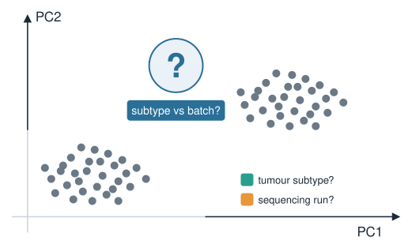{width="55%" fig-align="center"}

::: notes
Ground the whole lecture in a concrete, familiar object: an expression matrix with far more genes than samples, exactly the shape they meet in omics. The tension is real and practical — the number of PCs you retain is a modelling choice that changes every downstream step (clustering, distances, differential tests on scores). Plant both worries now: (1) how many to keep, (2) whether the leading axis is even biological. The batch-vs-subtype hook returns later as a full pitfall slide.
:::

## Each PC carries a slice of variance {.smaller}

From Eigenvalues & eigenvectors: PCA diagonalises the (centred) data's covariance matrix. Each PC is an **eigenvector**; its **eigenvalue $\lambda_k$ is the variance of the data along that PC**.

- PCs come **sorted**: $\lambda_1 \ge \lambda_2 \ge \dots \ge \lambda_p \ge 0$. PC1 captures the most variance, PC2 the most of what remains, and so on.
- The eigenvalues sum to the **total variance** in the data: $\sum_k \lambda_k = $ total variance.
- In R, `prcomp` reports the **standard deviation** of each PC in `sdev`, so the variance (the eigenvalue) is `sdev^2`.

"How many PCs to keep" is really: **how many eigenvalues are big enough to matter?**

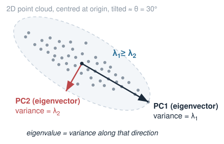{width="55%" fig-align="center"}

::: notes
Re-anchor to the eigen material so PCA does not feel like a new black box: principal components ARE the eigenvectors of the covariance matrix, and the eigenvalue is literally the variance along that direction. Two facts to nail: eigenvalues are non-negative and sorted descending, and they sum to the total variance. The prcomp detail (sdev is a standard deviation, so square it to get the eigenvalue/variance) is a recurring source of bugs — say it explicitly. Everything about "choosing components" is downstream of reading these eigenvalues.
:::

## From eigenvalue to proportion of variance {.smaller}

Raw eigenvalues depend on units. Convert each to a **proportion of variance explained (PVE)**:

$$\text{PVE}_k = \frac{\lambda_k}{\sum_{j=1}^{p} \lambda_j}$$

- PVE$_k$ is a number in $[0,1]$: the **fraction** of total variance living on PC $k$.
- The **cumulative** PVE, $\sum_{j\le k}\text{PVE}_j$, is the fraction captured by the **first $k$** PCs together.
- Example: if the first three PVEs are $0.42, 0.18, 0.07$, then PC1–PC3 together explain $0.42+0.18+0.07 = 0.67$, i.e. **67%** of the variance.

This is the raw material for every rule that follows.

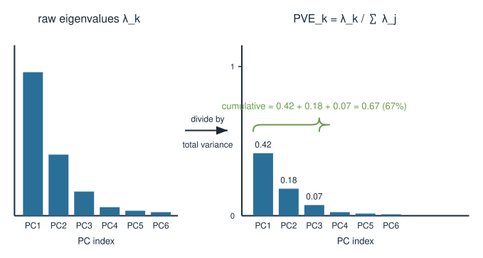{width="72%" fig-align="center"}

::: notes
The move from eigenvalue to proportion is what makes the numbers comparable and interpretable — an eigenvalue of "8.3" means nothing on its own, but "42% of variance" does. Define both the per-PC proportion and the cumulative proportion, because the two rules that follow (elbow vs threshold) use them respectively. Walk the tiny arithmetic example so the cumulative idea is concrete before the plots.
:::

## The scree plot and the elbow {.smaller}

Plot PVE (or the eigenvalue) against PC number. Typically it **drops steeply then flattens** into a shallow tail — the shape of a rubble slope, hence *scree*.

- The **elbow** is where the steep drop gives way to the flat tail.
- Heuristic (Cattell's): **keep the PCs before the elbow**; treat the flat tail as noise.
- The first few PCs are **structure**; the long flat tail is many tiny, roughly-equal eigenvalues — the fingerprint of noise.

Judgement call: the elbow is read by eye and is often **ambiguous**. Report how you chose it.

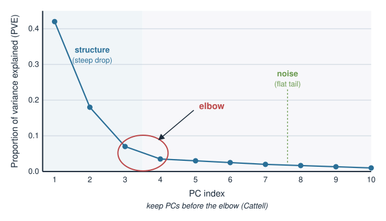{width="60%" fig-align="center"}

::: notes
The scree plot is the single most common tool, so give it a clear mental image: a cliff then a rubble slope. The elbow separates the two. Be honest that "read the elbow by eye" is exactly as soft as it sounds — real scree plots frequently have no clean elbow, or two candidate elbows, and two analysts can disagree. That softness is the point: this is a heuristic, not a theorem. The noise intuition (a flat tail of many near-equal small eigenvalues) is worth stating because it also motivates the permutation/parallel-analysis idea later.
:::

## Cumulative-variance threshold {.smaller}

A more decisive rule: keep **as many PCs as needed to reach a target cumulative PVE** — commonly **80%, 90%, or 95%**.

- "Keep enough PCs to explain **90%** of the variance" → find the smallest $k$ with cumulative PVE $\ge 0.90$.
- Good when PCA is a **compression / denoising** step feeding a downstream model, and you want a guaranteed amount of signal retained.
- The threshold is still a **choice**: 90% is a convention, not a fact. A flat scree tail means the last few percent cost **many** PCs.

Elbow and threshold often **disagree** — that disagreement is information about how structured your data is.

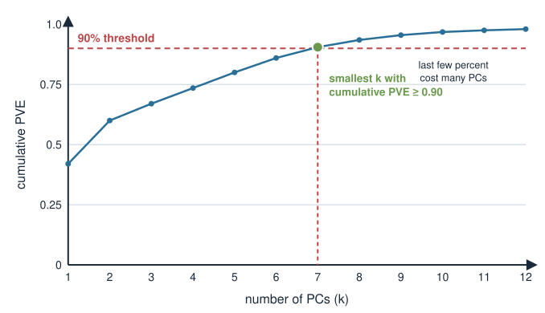{width="58%" fig-align="center"}

::: notes
Contrast this with the elbow: the threshold rule is reproducible (no eyeballing) but the threshold itself is arbitrary, so you have simply moved the judgement from "where is the elbow" to "which percentage." Tie it to purpose: for data reduction before clustering or regression you care about how much signal you keep, so a cumulative threshold is natural. Warn that in high-dimensional omics with a long flat tail, reaching 95% can demand a huge number of PCs — evidence that most of the variance is diffuse noise, not that you need 200 components. When elbow and threshold disagree, that is diagnostic, not a failure.
:::

## Two more rules you will meet {.smaller}

- **Kaiser criterion** — on **standardised** data (correlation matrix), keep PCs with **eigenvalue $> 1$**. Rationale: after standardising, each original variable contributes variance 1, so the average eigenvalue is 1; a PC "worth more than one variable" clears the bar. Known to **over-retain**; use with care.
- **Parallel analysis / permutation** — compare your eigenvalues to those from **randomised data** (columns shuffled independently, so real correlations are destroyed). Keep only PCs whose eigenvalue **exceeds** what pure noise produces. More principled, needs a little computation.

No rule is authoritative. Sensible practice: look at the **scree plot**, sanity-check with a **threshold**, and if it matters, run a **permutation** check.

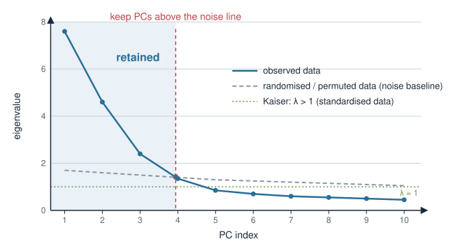{width="58%" fig-align="center"}

::: notes
Round out the toolkit without overselling any tool. Kaiser is popular because it is a single clean number, but it is tied to the correlation-matrix setting (eigenvalues average to 1 only after standardising) and is notorious for keeping too many components — say both things. Parallel analysis / permutation is the most defensible because it builds an explicit noise baseline from the data itself, which connects back to the "flat tail = noise" intuition. The meta-message: triangulate across rules rather than trusting one, and always report which you used.
:::

## In R: variance explained and a scree plot {.smaller}

`prcomp` returns `sdev`; square it for the eigenvalues, then normalise.

```r
pca <- prcomp(X, center = TRUE, scale. = TRUE)  # X: samples x genes

eig <- pca$sdev^2            # eigenvalues = variance per PC
pve <- eig / sum(eig)        # proportion of variance explained
cumsum(pve)                  # cumulative PVE: 0.42, 0.60, 0.67, ...

# scree plot: PVE vs PC index
plot(pve, type = "b", xlab = "PC", ylab = "Proportion of variance")

# smallest k reaching 90% cumulative variance
which(cumsum(pve) >= 0.90)[1]
```

`summary(pca)` prints the same PVE and cumulative rows directly. `screeplot(pca)` draws the eigenvalues, but a hand-rolled PVE plot is clearer.

::: notes
Keep this purely illustrative — nothing runs at render. The load-bearing lines: sdev must be squared to become an eigenvalue/variance; dividing by the sum gives PVE; cumsum gives the cumulative curve; the which(...)[1] idiom finds the smallest k crossing a threshold. Mention summary(prcomp) because students will reach for it and it already tabulates PVE and cumulative proportion. Note scale. = TRUE here because the next pitfall block is exactly about that choice — flag that it is deliberate, not a default.
:::

## Pitfall 1: PCA is unsupervised {.smaller}

PCA maximises **variance**. It never sees your labels (tumour vs normal, treated vs control). So the largest-variance direction is **not guaranteed** to be the direction that separates your biological groups.

- The interesting contrast might live on **PC4**, buried under three larger axes of nuisance variation.
- Two samples far apart on PC1 need not differ in any way you care about.

If you have labels and want the axis that best **separates** them, that is a **supervised** question — the job of tools like the **OPLS model** (under Extra material) or LDA, not PCA.

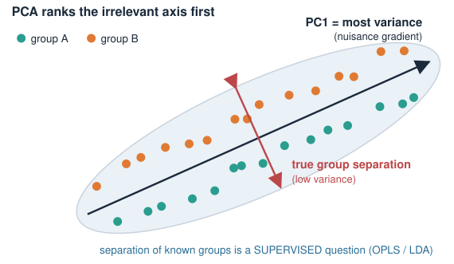{width="55%" fig-align="center"}

::: notes
This is the most important conceptual pitfall. Students internalise "PC1 = most important," but "most variance" and "most biologically relevant" are different claims that happen to coincide only sometimes. The classic picture: two groups separated along a low-variance direction while the high-variance axis is some irrelevant gradient (library size, a continuous covariate). PCA will rank the irrelevant axis first. Name the fix without teaching it: if separation of known groups is the goal, use a supervised method (OPLS in this block, or LDA), because those methods do look at the labels.
:::

## Pitfall 2: batch effects can dominate PC1 {.smaller}

A **batch effect** is unwanted technical variation — two sequencing runs, two reagent lots, two hospitals. It is often **large**, so PCA, chasing variance, can put it on **PC1**.

- You interpret PC1 as "disease subtype"; it is really "sequencing run." The clusters are **machines**, not biology.
- Colour the PCA by **known technical variables** (batch, run date, library size) *before* interpreting anything. If a technical variable lines up with a PC, that PC is suspect.

Batch effects are addressed by **experimental design** (randomise samples across batches) and **correction methods** (later, in the single-cell block), *not* by staring harder at the plot.

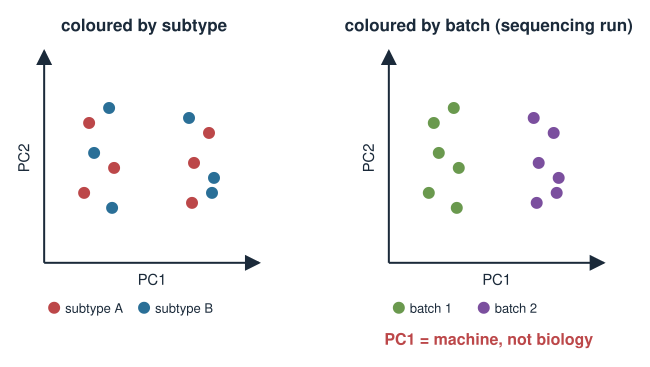{width="70%" fig-align="center"}

::: notes
This is the practical, career-saving warning. Batch effects are ubiquitous in omics and frequently larger than the biological signal, so an unsupervised variance-chaser will surface them first. The habit to drill: always colour the score plot by every technical covariate you have (batch, run, date, RIN, library size, sex) before believing any biological story. If batch aligns with a PC, stop and correct. Reference that correction/integration is taught later (single-cell block) so they know the fix exists without derailing today. The deeper lesson connects to Pitfall 1: PCA has no idea which variance is wanted.
:::

## Pitfall 3: sensitivity to scaling {.smaller}

PCA is driven by variance, and **variance depends on units**. A feature measured in large numbers can dominate purely because its numbers are big.

- **`scale. = FALSE`** (covariance PCA, the default): high-variance / high-expression genes dominate. Sensible only when all features share units and their spread is meaningful.
- **`scale. = TRUE`** (correlation PCA): every feature standardised to variance 1, so all contribute **equally** regardless of scale. Usual choice when features are **heterogeneous**.

The two can give **different PCs and a different scree plot**. Scaling is a real modelling decision — state which you used and why.

```r
prcomp(X, scale. = FALSE)   # covariance PCA: big-variance features dominate
prcomp(X, scale. = TRUE)    # correlation PCA: all features weighted equally
```

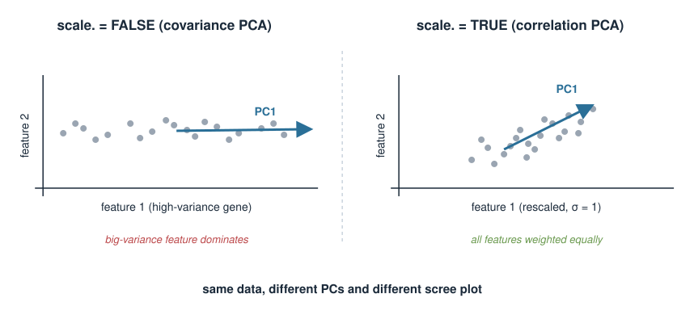{width="65%" fig-align="center"}

::: notes
Make scaling feel consequential, not cosmetic. Because PCA is literally an eigen-decomposition of either the covariance matrix (scale = FALSE) or the correlation matrix (scale = TRUE), the choice changes the matrix being decomposed and therefore the components and the whole scree plot. Rule of thumb: standardise when features are on different scales or units (mixed measurements, metabolomics with wildly different abundances); leave unscaled only when a common unit makes raw spread meaningful. Note this also interacts with the Kaiser rule, which assumes standardised data. The professional habit: report the choice explicitly.
:::

## Pitfall 4: sensitivity to outliers {.smaller}

Variance is dominated by **large deviations**, so a single aberrant sample can **bend a whole principal component** toward itself.

- One mislabelled or degraded sample can define **PC1 by itself**: everyone else collapses to a blob while the outlier sits alone at the far end.
- **Symptom:** one point far off, the rest bunched — a PC that "explains variance" but only *that one point's* variance.

Look at the score plots, investigate extreme points (technical failure? contamination?), and decide deliberately whether to fix, exclude, or keep them. Robust PCA variants exist for heavily contaminated data.

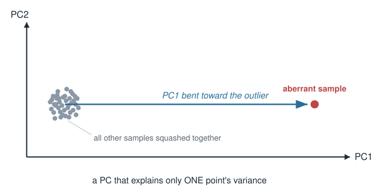{width="60%" fig-align="center"}

::: notes
Outliers exploit the same weakness as scaling and batch: PCA rewards large variance uncritically, and an outlier is maximal variance in one point. The tell-tale score plot is one lonely dot far out with everything else crushed into a corner — a red flag that PC1 is describing an artefact, not the population. The action is investigative, not automatic: find out WHY the point is extreme (failed library, swapped label, real biological extreme) before deciding to drop it. Mention robust PCA exists but do not teach it. This closes the trio of "variance is not automatically meaningful" pitfalls (2, 3, 4).
:::

## Pitfall 5: PCA only sees linear structure {.smaller}

Every PC is a **linear combination** of the original features — a straight axis through the data. PCA can only find **linear** structure.

- Data on a **curved** manifold (an S-curve, a spiral, a developmental trajectory) has no good straight axis; PCA flattens the curve and may need many PCs to describe something simple.
- Nonlinear biological structure — a differentiation trajectory, a cyclic process — is exactly where PCA struggles to summarise cleanly.

This is a **built-in limitation**, not a bug, and it motivates the **non-linear** methods on the next slide.

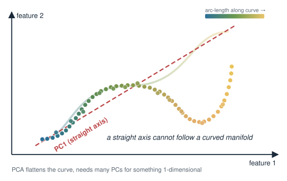{width="55%" fig-align="center"}

::: notes
The final pitfall is structural rather than a mistake you can avoid: linearity is baked into what a principal component IS (a linear combination = a straight direction). When the real structure is curved — a 1D trajectory bent through high-dimensional space, a cell-cycle loop — a straight axis cannot follow it, and PCA either misrepresents it or spreads it across many components. This is the natural bridge to nonlinear embeddings. Do not frame it as PCA being bad; frame it as PCA answering a linear question, and some biological questions being nonlinear.
:::

## Beyond PCA (1): ICA {.smaller}

PCA gives axes that are **uncorrelated** and **orthogonal**, ordered by variance. Sometimes you want axes that correspond to **separate underlying sources** instead.

- **Independent Component Analysis (ICA)** seeks components that are **statistically independent**, not merely uncorrelated — a stronger condition.
- Uncorrelated and independent are the **same** only for Gaussian data; for non-Gaussian signals, independence says much more.
- Motivating picture (the "cocktail party"): unmix overlapping sources. In biology, ICA can separate mixed transcriptional programmes co-occurring in the same samples.
- ICA components are **not ordered** by importance, and their **sign/scale** are arbitrary — so "how many components" is decided differently than for PCA.

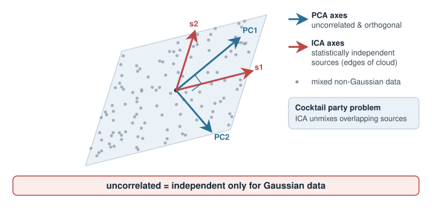{width="52%" fig-align="center"}

::: notes
Keep this a teaser, not a method lesson. The one crisp idea: PCA only removes correlation (a second-order, linear notion), while ICA targets full statistical independence (a stronger, higher-order notion), and the two coincide only in the Gaussian case. The cocktail-party framing lands well; the biological analogue is separating overlapping regulatory or transcriptional programmes that PCA would blend because it only decorrelates. Flag the practical differences (no natural ordering, arbitrary sign/scale) so they are not surprised. This directly answers the linearity limitation only partly — ICA is still linear — which is why the next slide moves to nonlinear maps.
:::

## Beyond PCA (2): non-linear maps {.smaller}

To capture **curved** structure, use methods that preserve **local** relationships rather than global straight axes.

- **UMAP** (and **t-SNE**) build a low-dimensional map that keeps **nearby points nearby** — good for visualising clusters and trajectories PCA flattens. You will use **UMAP** in the **single-cell** block.
- **Caveats:** these embeddings are **non-linear and stochastic**; **distances between clusters are not meaningful**, axes have no units, and results depend on tuning parameters and the random seed. Great for *seeing* structure, poor for *measuring* it.
- Common pipeline: **PCA first** to denoise and reduce dimensions, **then UMAP** on the top PCs — so today's "how many PCs" question feeds directly into it.

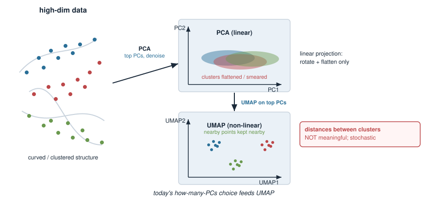{width="70%" fig-align="center"}

::: notes
Close the constructive arc: nonlinear embeddings exist precisely for the curved structure PCA cannot follow, and UMAP is the one they will actually use in the single-cell block, so name it. The essential warnings: UMAP/t-SNE are for visualisation, not measurement — inter-cluster distances and axis directions are not interpretable, and different seeds/parameters give different-looking maps. Crucially, the standard pipeline runs PCA first (denoise, reduce to a few dozen PCs) and UMAP on those PCs, which means the "how many PCs to keep" decision from today is an input to that later workflow. That ties the whole lecture together.
:::

## Summary {.smaller}

| Question | Tool / idea |
|---|---|
| How much does PC $k$ explain? | PVE$_k = \lambda_k / \sum_j \lambda_j$ (in R: `sdev^2`, normalise) |
| How many PCs? (eyeball) | **scree plot**, keep PCs before the **elbow** |
| How many PCs? (reproducible) | **cumulative-variance threshold** (80/90/95%) |
| Other rules | **Kaiser** ($\lambda>1$, standardised; over-retains), **permutation / parallel analysis** |
| Largest variance $\ne$ interesting | PCA is **unsupervised**; use OPLS/LDA to separate known groups |
| PC1 looks like biology? | check it is not a **batch effect** — colour by technical variables |
| Same data, different PCs | sensitive to **scaling** (`scale.`) and **outliers** |
| Curved structure | PCA is **linear**; try **ICA** (independence) or **UMAP** (non-linear, single-cell) |

**Bottom line:** every "how many PCs" rule is a heuristic — triangulate and report your choice; and always ask whether the variance PCA ranked highest is the variance you actually care about.

::: notes
The summary doubles as the exam cheat-sheet and the analyst's checklist. Drill two takeaways above all: (1) no component-count rule is authoritative, so look at the scree plot, cross-check with a threshold or permutation, and state what you did; (2) PCA is an unsupervised, linear, variance-maximising method, so its top axis can be a batch effect, an outlier, a scaling artefact, or simply the wrong (linear) answer to a nonlinear question. Point forward: OPLS (this block) for supervised separation, and UMAP (single-cell block) for nonlinear structure, with PCA feeding into it.
:::
