## About this lecture

You have measured thousands of genes across hundreds of samples. You cannot plot a cloud of points in 20,000 dimensions. **PCA finds a handful of new axes that capture most of the variation**, so you can see the structure in two dimensions.

- The **covariance matrix** of the data is **symmetric**, so (from Eigenvalues & eigenvectors) its eigenvectors are **orthogonal** and its eigenvalues are **real and non-negative**.
- The **leading eigenvector** points along the direction of **maximum variance** — the first **principal component (PC)**.
- **Scores** = where each sample lands when we **project** it onto a PC. **Loadings** = the eigenvector entries = how much each **gene** contributes.
- We **centre** (and sometimes **scale**) the data first, then **rotate the axes** to line up with the data cloud.

This is a **concept** day. We build PCA from the eigen-decomposition of a covariance matrix. The R function `prcomp` that does it all in one call comes in the next unit (PCA in R).

::: notes
The one mental image: a high-dimensional data cloud is stretched more along some directions than others; PCA rotates our coordinate axes so the first new axis lies along the longest stretch, the second along the next longest, and so on. Everything else — scores, loadings, variance explained — hangs off that picture. Stress continuity with the eigen units: we already proved that a symmetric matrix has orthogonal eigenvectors and real eigenvalues, and that the covariance matrix is symmetric. PCA is just eigen-decomposition of that matrix, read in a biological way. Keep the maths light today; the mechanics of prcomp are the next unit.
:::

## The biology problem {.smaller}

A typical RNA-seq experiment gives an expression matrix: **samples (rows) × genes (columns)**.

| sample | *GENE1* | *GENE2* | *GENE3* | ... | *GENE20000* |
|---|---|---|---|---|---|
| tumour_01 | 8.2 | 0.1 | 5.4 | ... | 2.0 |
| tumour_02 | 7.9 | 0.0 | 5.1 | ... | 2.3 |
| normal_01 | 2.1 | 6.7 | 5.3 | ... | 1.9 |
| ... | | | | | |

- Each sample is a point in **20,000-dimensional** space. We cannot look at it.
- But the genes are **not independent** — they are co-regulated in **programmes** (cell-cycle genes rise together, immune genes rise together...).
- So the real structure lives in **far fewer** dimensions than 20,000. **PCA finds them.**

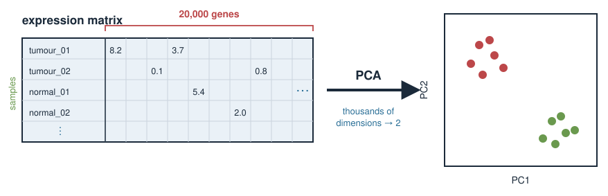{width="75%" fig-align="center"}

::: notes
Ground the abstraction in the data format they actually meet: a wide expression matrix, samples as rows, genes as columns, tens of thousands of columns. The key biological fact that makes dimension reduction possible is co-regulation: genes move together in programmes, so the effective number of independent directions is small. PCA is the tool that discovers those directions from the data alone, without being told the sample labels. Emphasise "unsupervised": we do not tell PCA which are tumours; we ask whether structure falls out on its own. That is exactly what makes a PCA plot a good first look at any omics dataset.
:::

## Why not just look at genes one at a time? {.smaller}

You could plot *GENE1* against *GENE2*, then *GENE1* against *GENE3*, ...

- With 20,000 genes there are about **200 million** pairwise scatter plots. Hopeless.
- Any single gene is **noisy** and captures only a sliver of the biology.
- The interesting signal — "these samples separate into two groups" — is usually spread **across many genes at once**, not visible in any single pair.

PCA builds **new composite variables** (mixtures of many genes) chosen so that the **first few show the most variation**. We look at those instead.

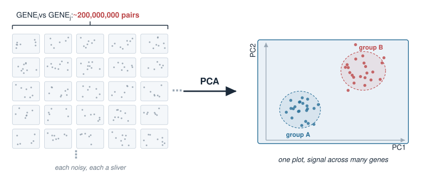{width="70%" fig-align="center"}

::: notes
Motivate why marginal, one-gene-at-a-time thinking fails: too many pairs, each gene noisy, and the signal is distributed. This is the conceptual jump — from "measured variables" (genes) to "derived variables" (principal components) that are weighted combinations of all genes. Reassure them a PC is not mysterious: it is just a weighted sum of the genes, with weights (the loadings) chosen by the eigenvector. The choice criterion is "maximise variance", which is where the covariance matrix and its leading eigenvector enter.
:::

## Recall: the covariance matrix {.smaller}

Variance measures spread of one variable; **covariance** measures how two vary **together**.

For $p$ genes, the covariance matrix $C$ is $p \times p$:

$$C_{ij} = \text{cov}(\text{gene}_i, \text{gene}_j), \qquad C_{ii} = \text{var}(\text{gene}_i)$$

- **Diagonal** = each gene's own variance. **Off-diagonal** = co-variation between gene pairs.
- $C$ is **symmetric** because $\text{cov}(g_i, g_j) = \text{cov}(g_j, g_i)$.

From Eigenvalues & eigenvectors, a symmetric matrix has:

- **real, non-negative** eigenvalues (they are variances — they cannot be negative), and
- **orthogonal** eigenvectors — a clean set of perpendicular axes.

**Those eigenvectors are the principal components.**

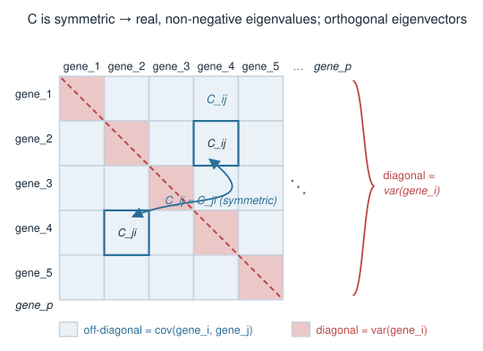{width="55%" fig-align="center"}

::: notes
This is the load-bearing recall slide. Covariance generalises variance to pairs; stacking all pairwise covariances gives the symmetric p-by-p covariance matrix, diagonal = variances, off-diagonal = covariances. The symmetry is not a lucky accident — it is guaranteed because cov is symmetric in its two arguments. Then invoke the spectral theorem result they already proved: symmetric implies real eigenvalues and orthogonal eigenvectors. Add the biological reason eigenvalues are non-negative here: they equal variances along the eigen-directions, and variance cannot be negative. Land the punchline plainly: the eigenvectors of C are the principal components. The rest of the lecture unpacks that sentence on a tiny example.
:::

## A tiny worked example: two genes {.smaller}

Keep it to **2 genes and 5 samples** so we can see everything by hand.

| sample | *GENE_A* | *GENE_B* |
|---|---|---|
| s1 | 1 | 5 |
| s2 | 3 | 3 |
| s3 | 4 | 6 |
| s4 | 5 | 7 |
| s5 | 7 | 9 |

- Plot the 5 points with *GENE_A* on the x-axis, *GENE_B* on the y-axis.
- The cloud is a **tilted, elongated sausage** — the two genes rise together (positive covariance).
- PCA will find the **long axis** of that sausage.

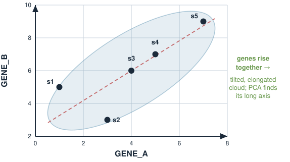{width="50%" fig-align="center"}

::: notes
Deliberately choose tiny round-ish numbers so every step is doable on the board. Two genes means the data cloud lives in the plane and the "long axis" is literally visible. Have students sketch the five points; they will see a diagonal, elongated cloud because gene A and gene B increase together. That visible long axis is PC1; the perpendicular short axis is PC2. Everything from here — centring, covariance, eigenvectors, scores — is making that visual intuition precise and numerical.
:::

## Step 1: centre the data {.smaller}

PCA describes **variation around the mean**, so we first subtract each gene's mean (**centring**).

Means: $\bar{A} = (1+3+4+5+7)/5 = 4$, $\quad \bar{B} = (5+3+6+7+9)/5 = 6$.

Centred data (subtract the column mean from each column):

| sample | $A - \bar A$ | $B - \bar B$ |
|---|---|---|
| s1 | $-3$ | $-1$ |
| s2 | $-1$ | $-3$ |
| s3 | $0$ | $0$ |
| s4 | $1$ | $1$ |
| s5 | $3$ | $3$ |

Now the cloud is **centred on the origin**. Each column sums to 0.

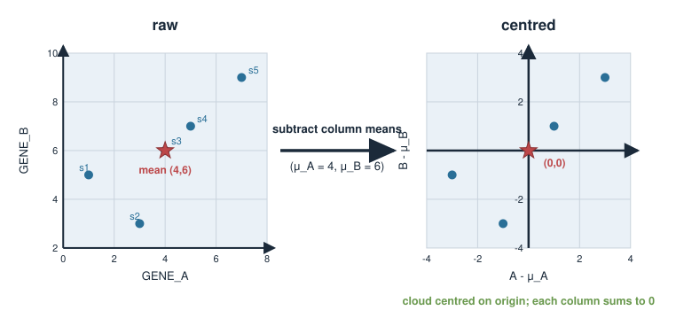{width="70%" fig-align="center"}

::: notes
Centring is non-negotiable and a classic source of confusion, so do it explicitly. PCA is about the shape of the cloud around its centre, not where the centre sits, so we move the centre to the origin by subtracting each gene's mean from that gene's column. After centring, every column has mean zero. Warn them: if you forget to centre, the "first PC" tends to just point from the origin to the data centroid, capturing the mean rather than the variation — a common bug. Note that prcomp centres by default; today we do it by hand so they see why.
:::

## Step 2: the covariance matrix {.smaller}

With centred columns, the covariance uses $\dfrac{1}{n-1}\sum (\text{centred}_i)(\text{centred}_j)$ (here $n-1 = 4$).

$$\text{var}(A) = \tfrac{1}{4}\big[(-3)^2 + (-1)^2 + 0^2 + 1^2 + 3^2\big] = \tfrac{1}{4}(9+1+0+1+9) = \tfrac{20}{4} = 5$$
$$\text{var}(B) = \tfrac{1}{4}\big[(-1)^2+(-3)^2+0^2+1^2+3^2\big] = \tfrac{1}{4}(1+9+0+1+9) = \tfrac{20}{4} = 5$$
$$\text{cov}(A,B) = \tfrac{1}{4}\big[(-3)(-1)+(-1)(-3)+0+1\cdot1+3\cdot3\big] = \tfrac{1}{4}(3+3+0+1+9) = \tfrac{16}{4} = 4$$

$$C = \begin{pmatrix} 5 & 4 \\ 4 & 5 \end{pmatrix}$$

Symmetric, as promised. The large **positive** off-diagonal says the two genes strongly **co-vary**.

::: notes
Walk the arithmetic slowly; the numbers are small on purpose. Emphasise the divide-by-(n-1) convention (sample covariance) matches what R's var and cov use, so their hand answer will match prcomp later. The resulting 2x2 covariance matrix is symmetric with a big positive off-diagonal, quantifying the co-regulation they saw as a tilted cloud. This is exactly the kind of symmetric matrix they diagonalised in the eigen exercises (compare with the covariance-flavour problem there). The next step is to find its eigenvectors — the principal component directions.
:::

## Step 3: eigenvectors = principal components {.smaller}

Diagonalise $C$ (by hand: the symmetric pattern from Eigenvalues & eigenvectors).

$C = \begin{pmatrix} 5 & 4 \\ 4 & 5 \end{pmatrix}$ has the form $\begin{pmatrix} a & b \\ b & a \end{pmatrix}$, so $C(1,1) = 9\,(1,1)$ and $C(1,-1) = 1\,(1,-1)$:

$$\lambda_1 = 9, \qquad \lambda_2 = 1,$$

with eigenvectors $\mathbf{u}_1 = \tfrac{1}{\sqrt2}(1,1)$ (for $\lambda_1$) and $\mathbf{u}_2 = \tfrac{1}{\sqrt2}(1,-1)$ (for $\lambda_2$). (This is exactly the covariance-flavour problem from the Eigenvalues & eigenvectors exercise.)

- $\mathbf{u}_1$ points along the $45^\circ$ **long axis** of the cloud — this is **PC1**.
- $\mathbf{u}_2$ is **perpendicular** to it — **PC2** — along the thin direction.
- Each eigenvalue is the **variance captured** along its PC: $9 \gg 1$, so most of the spread is along PC1.

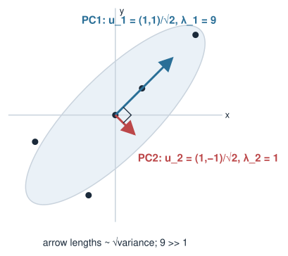{width="50%" fig-align="center"}

::: notes
Connect straight back to the by-hand toolbox: C has the symmetric [[a, b], [b, a]] pattern, so the eigenvectors are (1,1) and (1,-1) with eigenvalues a + b = 9 and a - b = 1; verify by multiplying. (Bonus, not for exam: the characteristic equation (5 - lambda)^2 - 16 = 0 gives the same.) Because this is the same matrix as the covariance-flavour problem in the eigen exercise, the answers are clean: eigenvalues 9 and 1, eigenvectors (1,1) and (1,-1), guaranteed perpendicular because C is symmetric. Stress the interpretation of the eigenvalue as variance along that direction: 9 vs 1 means PC1 captures most of the variation, so a 1-D summary would already be very good. Sanity check with trace: 5 + 5 = 10 = 9 + 1, which also equals the total variance — a fact we use for variance explained.
:::

## Principal components are new axes {.smaller}

The two eigenvectors form a **new, rotated coordinate system**:

- **PC1**: the direction of **greatest** variance (biggest eigenvalue).
- **PC2**: orthogonal to PC1, the direction of the **next** greatest variance.
- In general, PC$k$ is orthogonal to all earlier PCs and captures the largest remaining variance.

We have not thrown anything away yet — we have only **rotated the axes** to line up with the data cloud. Same points, new description.

$$\text{PCs are orthonormal: } \mathbf{u}_i \cdot \mathbf{u}_j = 0 \ (i \neq j), \quad \|\mathbf{u}_i\| = 1.$$

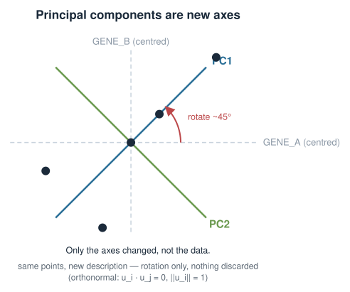{width="50%" fig-align="center"}

::: notes
Emphasise that rotating to the PC axes is loss-less: no information is discarded, we have merely re-expressed each sample in a coordinate system aligned with the cloud instead of aligned with the genes. The PCs are orthonormal — mutually perpendicular and unit length — because they are eigenvectors of a symmetric matrix, normalised. Dimension reduction (the payoff) comes when we choose to keep only the first few PCs and drop the rest; that is a later choice, not part of the rotation itself. Keep the two ideas separate in their minds: rotate (exact), then optionally truncate (approximate). Callback: this is the same rotation matrix that turned the cell image in Transforming images with matrices, now applied to a cloud of samples instead of pixels — and, as with the image, rotating it back recovers everything.
:::

## Scores: projecting samples onto a PC {.smaller}

A **score** is the coordinate of a sample along a PC — its **projection** onto that PC direction (dot product with the unit eigenvector).

For a centred sample $\mathbf{x}$ and unit PC direction $\mathbf{u}$:

$$\text{score} = \mathbf{x} \cdot \mathbf{u} = x_1 u_1 + x_2 u_2$$

- The **PC1 score** tells you where the sample sits **along the long axis**.
- Samples with similar biology get **similar scores**; different groups spread apart along PC1.
- Plotting **PC1 score vs PC2 score** for all samples is the **PCA plot** you see in papers.

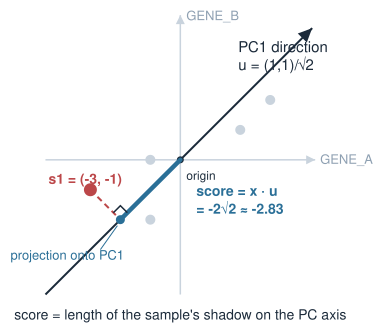{width="50%" fig-align="center"}

::: notes
This reuses projection intuition directly from the vector-geometry unit: the score is the dot product of the centred sample with the unit PC vector, i.e. the length of the sample's shadow on the PC axis. Make the biology vivid: the PC1 score is a single number summarising each sample along the main axis of variation, and plotting PC1 vs PC2 scores is exactly the ubiquitous PCA scatter in omics papers. Samples close together in that plot are similar across many genes at once. Emphasise projection = dot product so this does not feel like new machinery; it is the same operation they already know, applied to the eigenvectors.
:::

## Loadings: how much each gene contributes {.smaller}

The **loadings** of a PC are just the **entries of its eigenvector** — one weight per gene.

If PC1 $= \mathbf{u} = (u_A, u_B)$, then

$$\text{PC1 score} = u_A \cdot (\text{gene A}) + u_B \cdot (\text{gene B}).$$

- A gene with a **large** loading (positive or negative) **drives** that PC.
- A gene with a loading near **zero** barely matters for that PC.
- Loadings tell the **biological story**: "PC1 is high in the immune-gene programme", read off from which genes load heavily.

Scores describe **samples**; loadings describe **genes**. Two sides of the same eigenvector.

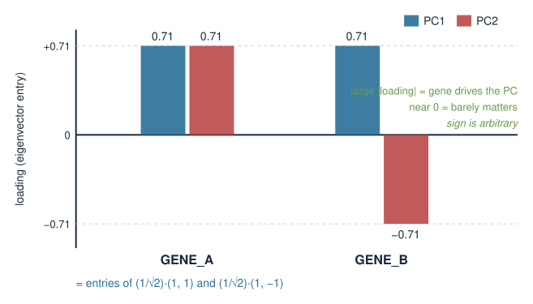{width="55%" fig-align="center"}

::: notes
The single most useful distinction to nail: scores are per-sample (where samples land), loadings are per-gene (how genes combine to build the PC). They are the two readings of the same eigen-decomposition — the eigenvector entries are the loadings, and dotting a sample with the eigenvector gives its score. Biologically, loadings are how you interpret a PC: sort genes by loading and the top ones tell you what biological programme that axis represents (cell cycle, immune response, batch, etc.). Warn that sign is arbitrary (eigenvectors are defined up to sign, from the eigen unit), so "positive vs negative loading" only matters relative to other genes on the same PC.
:::

## Variance explained {.smaller}

Each eigenvalue is the variance along its PC. The **fraction of total variance** captured by PC$k$ is

$$\text{variance explained by PC}_k = \frac{\lambda_k}{\lambda_1 + \lambda_2 + \cdots + \lambda_p}.$$

For our example ($\lambda_1 = 9$, $\lambda_2 = 1$, total $= 10$):

$$\text{PC1}: \frac{9}{10} = 90\%, \qquad \text{PC2}: \frac{1}{10} = 10\%.$$

- PC1 alone captures **90%** of the variation — a 1-D summary keeps most of the signal.
- The sum of all eigenvalues equals the **total variance** (the trace of $C$: $5+5=10$) — so the fractions add to 100%.

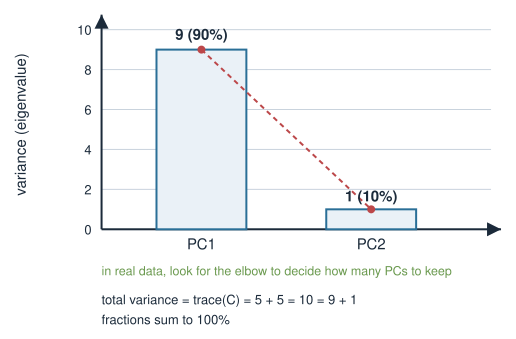{width="50%" fig-align="center"}

::: notes
Variance explained turns eigenvalues into an interpretable percentage: each PC's eigenvalue over the sum of all eigenvalues. Tie the denominator back to the trace fact from the eigen unit — sum of eigenvalues equals the trace equals the total variance across all genes — which is why the fractions sum to one. In the toy example PC1 explains 90 percent, so summarising each sample by a single PC1 score keeps most of the signal. Introduce the word scree plot for the bar chart of eigenvalues; in real data you look for an elbow to decide how many PCs to keep. Do not over-formalise how many PCs to keep today; the concept (a ranked, exhaustive variance budget) is enough.
:::

## Try it: rotate the axis

```{=html}
<link rel="stylesheet" href="../demos/dist/demo.css">
<div data-demo="pca2d" data-mode="rotate"></div>
<script src="../demos/dist/pca2d.js"></script>
```

::: notes
Live version of the last few slides, on the same five samples (already centred). The green line is a candidate axis; the dashed lines drop each sample perpendicularly onto it, and the orange dots are the projections, i.e. the scores. The big percentage is the variance of those scores out of the total variance of 10. Start at 20 degrees and drag a handle round slowly: ask the room to call out when they think the percentage is largest. At 0 and 90 degrees it reads 50% (the variance of gene A alone, then gene B alone). It peaks at 45 degrees with 9 out of 10, 90%, which is lambda 1; at 135 degrees it bottoms out at 1, 10%, which is lambda 2. Tick "Show PC1 and PC2" to confirm the peak is the eigenvector we found by hand, with PC2 perpendicular. Point out that "along" plus "perpendicular" always adds to the total of 10: rotating moves variance between the two directions but never creates or destroys it. At 45 degrees the score readout matches the B5 table. If time: drag s3 away from the diagonal and watch PC1 and the percentage move.
:::

## Optional Step 0: scaling {.smaller}

Centring is always done. **Scaling** (dividing each gene by its standard deviation) is a **choice**.

- **Without scaling**, a gene measured on a **large numeric range** dominates the variance — and therefore PC1 — just because of its units, not its biology.
- **With scaling**, every gene has variance 1, so all genes get an **equal say**. (This uses the **correlation** matrix instead of the covariance matrix.)

When to scale:

- Variables on **different units** (gene expression + a pH + a temperature)? **Scale.**
- All variables already comparable (all log-expression)? Often leave **unscaled**.

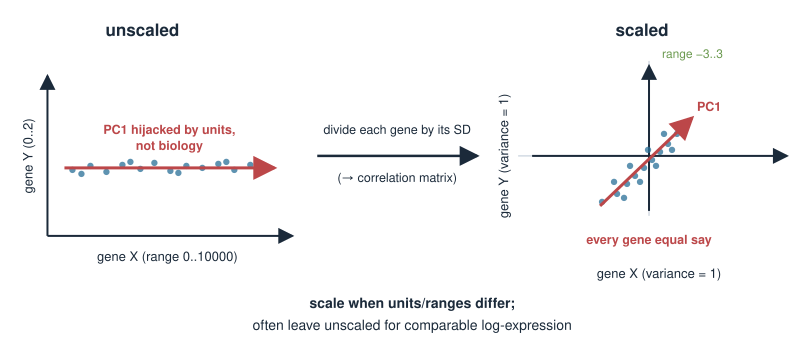{width="70%" fig-align="center"}

::: notes
Scaling is the one genuine judgement call in basic PCA. Make the failure mode concrete: if one gene ranges 0 to 10000 and another 0 to 2, the first swamps the covariance and hijacks PC1 purely because of its scale, not its importance. Dividing each variable by its standard deviation puts everything on equal footing, which is equivalent to running PCA on the correlation matrix rather than the covariance matrix. The rule of thumb: scale when variables have different units or wildly different ranges; you may skip it when they are already on one comparable scale such as log-transformed expression. prcomp exposes this as scale. = TRUE/FALSE, previewed for the next unit.
:::

## Reading a PCA plot biologically {.smaller}

A PCA plot is a **scatter of samples**: PC1 score on x, PC2 score on y.

- **Clusters** of points = groups of samples with **similar overall expression** (e.g. tumour vs normal).
- **Separation along PC1** = the biggest source of variation splits those groups.
- **Outliers** = possible failed libraries, contamination, or a genuinely unusual sample — worth checking.
- A PC that separates by **processing date**, not biology, reveals a **batch effect**.

PCA is **unsupervised**: it never saw the labels. If the biology falls out anyway, the signal is strong.

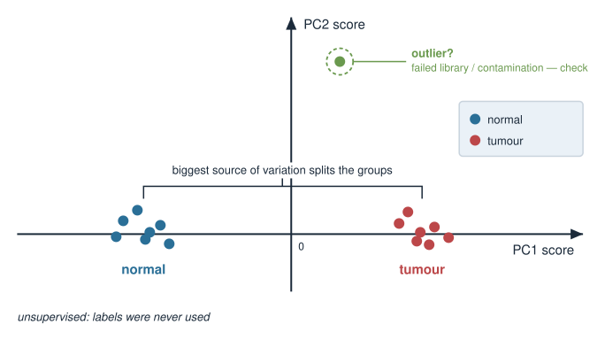{width="50%" fig-align="center"}

::: notes
This is the everyday payoff and the reason PCA is the first plot everyone makes on a new omics dataset. Walk through how to read it: clusters are similar samples, separation along PC1 is the dominant biological (or technical) split, outliers flag QC problems, and a PC aligned with batch/date rather than condition is the classic way PCA exposes batch effects. Reinforce unsupervised: labels were never used, so clustering by condition is real evidence of structure, not circular. Caution that a PCA plot is exploratory — it suggests hypotheses (groups, outliers, batches) that you then confirm with proper statistics, not a formal test in itself.
:::

## What PCA does and does not do {.smaller}

**Does:**

- Find orthogonal axes of **decreasing variance** — a compact, ranked summary.
- Give an honest first look at structure, outliers, and batch effects.
- Reduce thousands of genes to a few interpretable components.

**Does not:**

- Use sample labels (it is **unsupervised** — it optimises variance, not class separation).
- Guarantee PC1 is the **biologically interesting** axis — the largest variance might be a batch effect.
- Capture **non-linear** structure — PCs are straight-line combinations of genes.

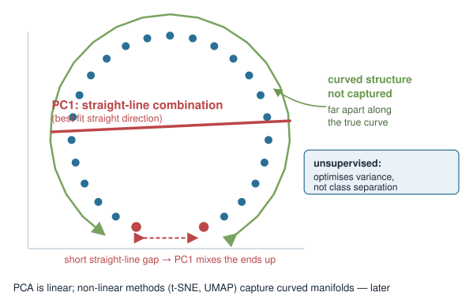{width="50%" fig-align="center"}

::: notes
Set expectations honestly. PCA maximises variance, which is not the same as maximising anything biologically meaningful; the dominant axis can be a technical artefact, so always colour the PCA plot by known covariates (condition, batch, sex) to interpret what each PC is. Because PCA is linear, curved or manifold structure is not captured — name that non-linear methods (t-SNE, UMAP) exist and come later or in the ML course, without teaching them. And because it is unsupervised, it is a discovery tool, not a classifier. This slide inoculates against the two most common misreadings: "PC1 must be my biology" and "PCA proves my groups".
:::

## Summary {.smaller}

| Concept | Key fact |
|---|---|
| Goal | rotate axes to line up with the data cloud; keep the high-variance ones |
| Covariance matrix $C$ | symmetric $p\times p$; diagonal = variances, off-diagonal = covariances |
| Principal components | eigenvectors of $C$ — orthogonal, ranked by variance |
| Eigenvalue $\lambda_k$ | variance captured along PC$k$ |
| Centre first | subtract each gene's mean (always) |
| Scale? | divide by SD when units differ (correlation vs covariance matrix) |
| Score | sample projected onto a PC: $\mathbf{x}\cdot\mathbf{u}$ (describes **samples**) |
| Loading | eigenvector entry = gene's weight in the PC (describes **genes**) |
| Variance explained | $\lambda_k / \sum_j \lambda_j$; sums to 100% (denominator = trace) |
| Unsupervised | never uses labels; PC1 = most variance, not necessarily the biology |

**Next (PCA in R):** `prcomp` does centring, scaling, and the eigen-decomposition in one call — you will read its scores, loadings, and variance explained.

::: notes
The summary is the revision sheet. Recite the pipeline once: centre (and maybe scale), form the symmetric covariance matrix, take its eigenvectors as the PCs and eigenvalues as the variances, project samples for scores, read eigenvector entries as loadings, and divide eigenvalues by their sum for variance explained. Reinforce the two hardest distinctions: scores (samples) vs loadings (genes), and rotation (exact) vs truncation (the actual dimension reduction). Preview PCA in R: prcomp packages all of this, but its output only makes sense if today's concepts are solid — they must map values, vectors, and rotation onto scores, variance explained, and loadings.
:::
