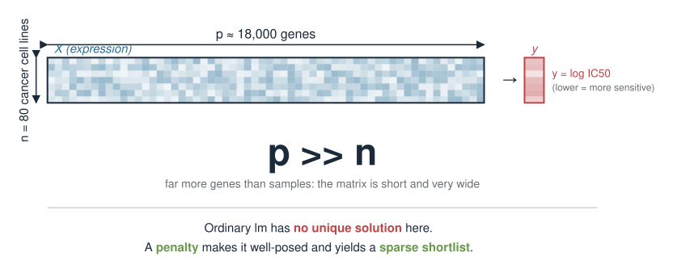
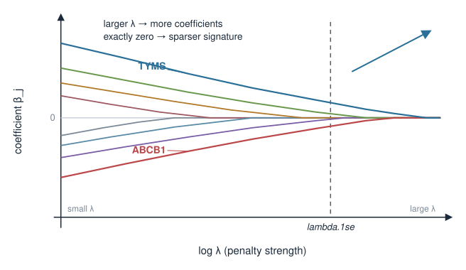
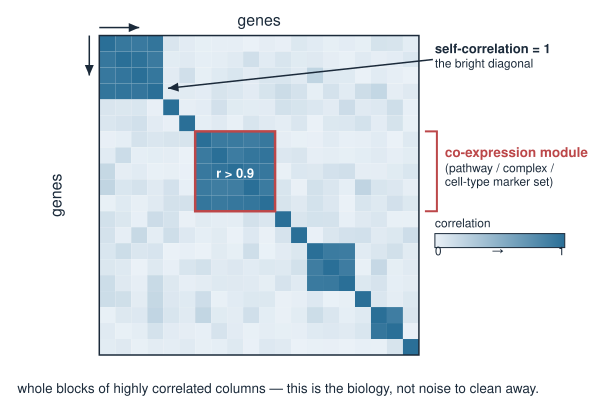
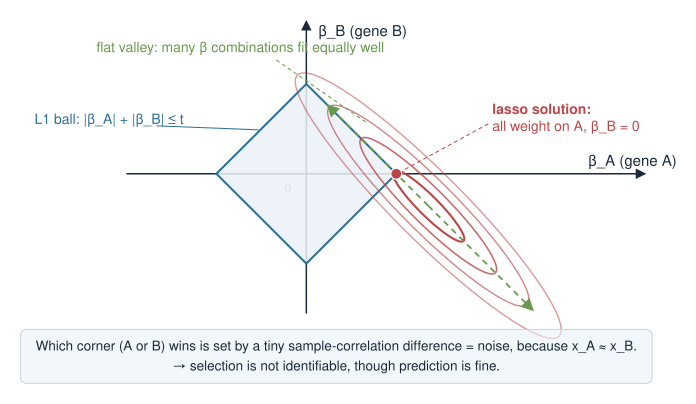
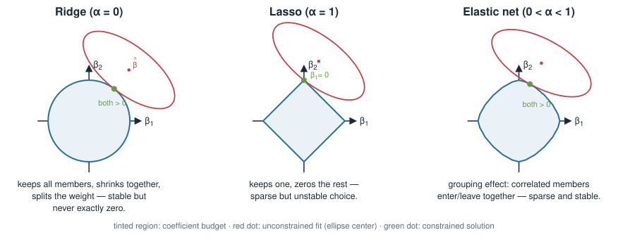
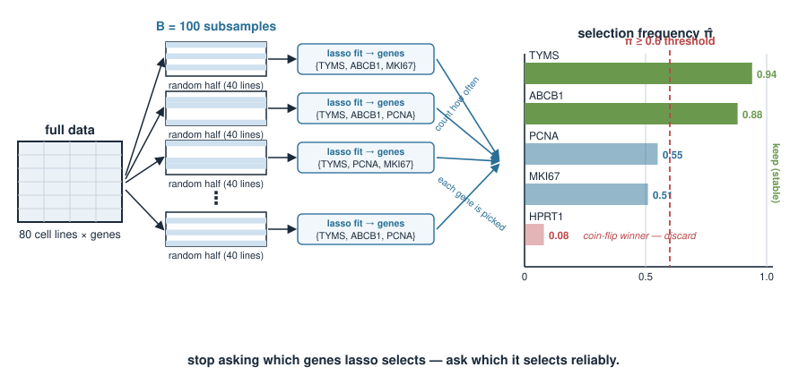
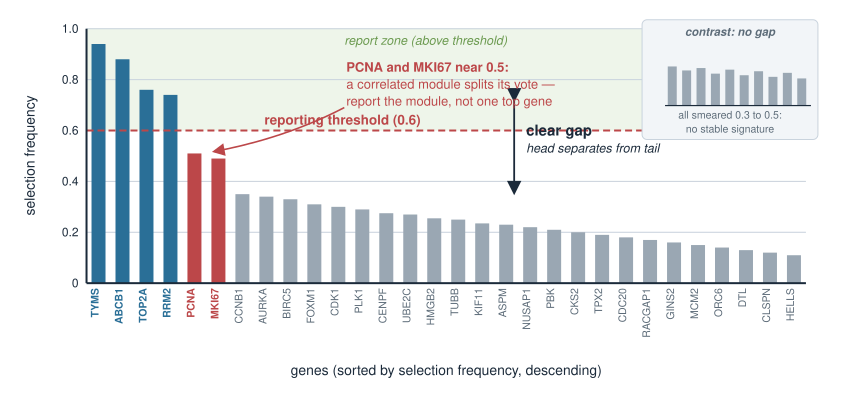
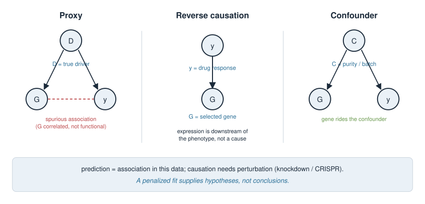
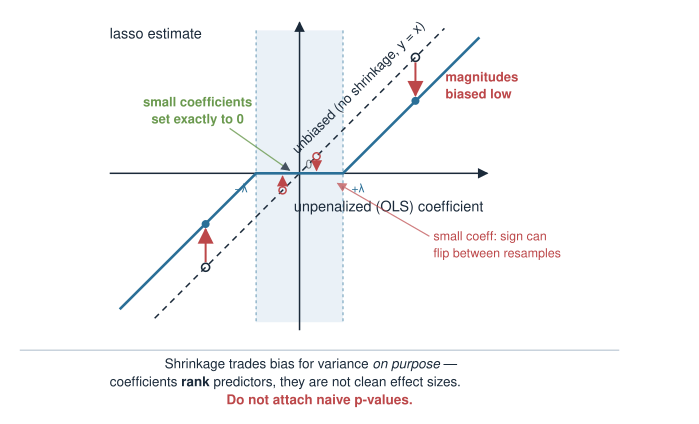
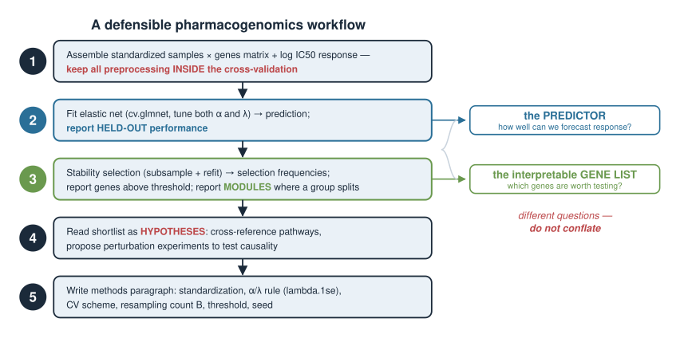

## About this lecture

In Ridge, lasso & elastic net you learned *what* a penalty does, and in Cross-validation & model selection you learned how to *tune* it. Today we put a penalized model to work on a real biological question and, crucially, stare hard at how it can **mislead** us.

- **Identifiability:** when predictors are correlated (as biological features almost always are), the lasso picks **one** member of a correlated group more or less **arbitrarily** — and the choice flips under tiny data changes.
- **Stability selection:** a resampling idea that turns an unstable one-shot selection into a **selection frequency** you can trust.
- **Interpretation:** a selected gene is a **predictor**, not proven **causal**. Coefficients are **shrunk and biased**; naive p-values after selection are **invalid**.
- **Reporting:** what an honest methods paragraph must state so the analysis is reproducible.

::: {.callout-note}
**Provisional block.** Penalized linear models may move to a later statistics / machine-learning course. Treat this unit as a first pass; the depth and placement are still being decided.
:::

::: notes
This is a judgement day, not a formula day. The students can already fit and tune a penalized model; the gap we close is scepticism about what the output means. Two threads run in parallel: a constructive one (stability selection to get a trustworthy variable list) and a cautionary one (why the single fitted model over-claims). Nothing executes at render time — all R here is for reading. Reference earlier units by name (Ridge, lasso & elastic net; Cross-validation & model selection; Penalties as Bayesian priors) rather than by day. Keep hammering the course principle: every method idea is tied to a concrete biological problem.
:::

## The biology: predict drug response from expression {.smaller}

A pharmacogenomics study measures, for 80 cancer cell lines:

- gene expression for ~18,000 genes (a **samples × genes** matrix), and
- sensitivity to a drug, summarised as a continuous $\log \text{IC}_{50}$ (lower = more sensitive).

**The question:** which genes predict drug response, and can we build a compact predictive signature?

- Far more genes ($p \approx 18{,}000$) than samples ($n = 80$) — the classic **$p \gg n$** regime. Ordinary `lm` cannot even be fit uniquely.
- A penalty makes the problem solvable **and** hands us a **sparse** shortlist. This is exactly the job the lasso was built for.

{width="72%" fig-align="center"}

::: notes
Ground the whole lecture in one concrete dataset and keep coming back to it. The $p \gg n$ point is essential: with more genes than samples the design matrix has no unique least-squares solution, so a penalty is not a nicety, it is what makes the problem well-posed at all. This connects straight back to Why penalize: overfitting & identifiability. Frame the deliverable the biologists actually want: a short, interpretable gene signature — which is precisely where the pitfalls bite, because "short and interpretable" tempts over-interpretation.
:::

## Recap: the model we are fitting {.smaller}

We fit a penalized linear model. For the **lasso** ($L_1$ penalty):

$$\hat{\boldsymbol\beta} = \arg\min_{\boldsymbol\beta}\ \underbrace{\tfrac{1}{2n}\sum_{i=1}^n \big(y_i - \beta_0 - \mathbf{x}_i^\top\boldsymbol\beta\big)^2}_{\text{fit to the data}} \;+\; \underbrace{\lambda \sum_{j=1}^p |\beta_j|}_{L_1\text{ penalty}}$$

- $\lambda$ (chosen by cross-validation) sets how hard we shrink; larger $\lambda$ → more coefficients driven **exactly to zero** → sparser signature.
- Predictors are **standardized** before fitting so the penalty treats every gene on the same scale (`glmnet` does this internally by default).

```r
library(glmnet)
x <- as.matrix(expr)          # 80 samples x 18000 genes
y <- logIC50                  # length-80 response

fit <- cv.glmnet(x, y, alpha = 1, standardize = TRUE, nfolds = 10)
coef(fit, s = "lambda.1se")   # sparse: most genes have coefficient 0
```

{width="60%" fig-align="center"}

::: notes
A one-slide refresher so the case is self-contained. Two things to stress. First, standardization: the $L_1$ penalty is scale-dependent, so genes must be put on a common scale or the penalty silently favours high-variance genes; glmnet standardizes internally and reports coefficients back on the original scale. Second, alpha = 1 is the lasso; we will vary alpha shortly. lambda.1se (the largest lambda within one standard error of the CV minimum) gives a sparser, more stable model than lambda.min — a point from Cross-validation & model selection we will lean on again.
:::

## The trap: biological predictors are correlated {.smaller}

Genes do not vary independently. They travel in **co-regulated groups**:

- genes in the same **pathway** or **co-expression module** rise and fall together,
- members of a **protein complex** are transcriptionally coupled,
- a **cell-type proportion** shift moves hundreds of marker genes in lockstep.

So the design matrix has whole **blocks of highly correlated columns** — often $r > 0.9$.

This is not a data-quality problem to be cleaned away. **Co-regulation is the biology.** And it is precisely what makes variable selection unstable.

{width="48%" fig-align="center"}

::: notes
This slide reframes correlation from "nuisance" to "the signal". Biologists intuitively know genes co-vary — that is the whole basis of pathways and modules — but they may not connect it to why a selection method misbehaves. Make the link explicit: co-expression means the columns of X are near-duplicates, and near-duplicate predictors are mathematically hard to tell apart. Everything on the next few slides follows from this one fact. Foreshadow: the lasso is forced to choose among interchangeable columns.
:::

## Identifiability: why the lasso picks just one {.smaller}

Suppose genes $A$ and $B$ are almost perfectly correlated and each truly relates to the response.

- To the fit, $\beta_A x_A + \beta_B x_B$ with $x_A \approx x_B$ is almost the same as putting **all** the weight on $A$, or **all** on $B$, or splitting it.
- The $L_1$ penalty $|\beta_A| + |\beta_B|$ is **smallest** when the weight sits on **one** predictor, not split — so the lasso concentrates on a **single** member and zeros the rest.
- Which one? Whichever has a hair more correlation with $y$ *in this particular sample*. That tie-break is essentially **noise**.

The model's predictions are fine. The **selected gene list is not identifiable**: a different sample would pick $B$ instead of $A$.

{width="52%" fig-align="center"}

::: notes
This is the conceptual heart of the lecture. Walk the geometry verbally: with two collinear columns the loss surface has a long flat valley (many coefficient combinations fit equally well), and the L1 penalty's diamond geometry snaps the solution to a corner — a single nonzero coefficient. The choice of corner is decided by a vanishingly small difference in sample correlation, i.e. by noise. The key distinction to leave them with: prediction is stable, selection is not. Students routinely conflate "the model predicts well" with "these are the important genes" — that conflation is the error this whole lecture attacks.
:::

## Watch it happen: same data, tiny perturbation {.smaller}

Fit the lasso, then refit after dropping a **single** cell line, and compare which genes survive:

```r
sel <- function(cvfit) which(as.vector(coef(cvfit, s = "lambda.1se"))[-1] != 0)

set.seed(1)
fit_all  <- cv.glmnet(x,        y,        alpha = 1)
fit_drop <- cv.glmnet(x[-1, ],  y[-1],    alpha = 1)   # drop one sample

colnames(x)[sel(fit_all)]
#> [1] "MKI67"  "TYMS"   "ABCB1"   ...
colnames(x)[sel(fit_drop)]
#> [1] "PCNA"   "TYMS"   "ABCB1"   ...   # MKI67 out, PCNA in
```

`MKI67` and `PCNA` are both **proliferation** markers — near-interchangeable columns. The lasso swapped one for the other on a one-sample change. Re-run with a different `set.seed` and the list shifts again.

::: notes
Make the instability visceral. The output is illustrative (nothing runs), but it mirrors exactly what students see in the exercise: dropping one sample, or changing the CV seed, swaps members within a correlated module. The punchline biology: MKI67 and PCNA are both textbook proliferation markers, so swapping them changes nothing biologically — yet a naive reader of "the selected genes" would report a different signature each time. Warn them that this is not a bug in glmnet; it is the correct behaviour of L1 selection on correlated data. The fix is not a better single fit but a different question: how *often* is each gene selected?
:::

## Ridge and elastic net handle groups differently {.smaller}

The three penalties treat a correlated group in three distinct ways:

| Penalty | `alpha` | Correlated group behaviour |
|---|---|---|
| **Ridge** ($L_2$) | 0 | keeps **all** members, shrinks them **together**, splits the weight |
| **Lasso** ($L_1$) | 1 | keeps **one**, zeros the rest (unstable choice) |
| **Elastic net** | $0<\alpha<1$ | **grouping effect**: correlated members tend to enter or leave **together** |

- Ridge never gives you a short list (nothing is exactly zero) but its coefficients are **stable**.
- Elastic net is the usual compromise for omics: sparse *and* it keeps co-regulated genes as a group rather than picking a lone representative.

```r
fit_enet <- cv.glmnet(x, y, alpha = 0.5)   # a middle ground; tune alpha too
```

{width="80%" fig-align="center"}

::: notes
Position this as the menu of trade-offs, not a winner. Ridge: stable coefficients, no selection — good when you want a predictor and do not need a short list. Lasso: maximal sparsity, unstable membership. Elastic net (Zou & Hastie's grouping effect): the practical default for correlated omics because it retains groups. Note honestly that alpha is a second tuning parameter — you cross-validate over it too, which costs you some of the tidiness. Tie back to Ridge, lasso & elastic net for the geometry; today we only care about the consequence for a correlated design.
:::

## Stability selection: the idea {.smaller}

If one fit is unstable, don't trust one fit. **Resample and count.**

1. Draw many **subsamples** of the data (e.g. 100 random halves of the cell lines).
2. Refit the lasso on each subsample.
3. For each gene, record the **fraction of subsamples in which it was selected** — its **selection frequency** $\pi_j \in [0,1]$.
4. Keep the genes whose frequency clears a threshold (e.g. $\pi_j \ge 0.6$).

- A gene selected in **90 of 100** subsamples is a robust finding.
- A gene selected in **8 of 100** was a coin-flip winner in one particular sample — discard it.

This converts a fragile yes/no into a **graded, reproducible** shortlist.

{width="78%" fig-align="center"}

::: notes
Give credit lightly: this is the stability-selection idea of Meinshausen and Bühlmann. The mental model is a democratic vote across resamples rather than a single verdict. The crucial reframing: we stop asking "which genes does the lasso select?" (unstable) and start asking "which genes does the lasso select *reliably*?" (stable). For a correlated module, expect the vote to spread across its members — that itself is informative: it tells you the *module* matters even when no single gene dominates. Threshold choice (0.6, 0.8) is a judgement call to be reported, echoing the "no rule is a law" theme from Choosing components & pitfalls.
:::

## Stability selection in R {.smaller}

```r
set.seed(1)
B <- 100
n <- nrow(x); p <- ncol(x)
counts <- integer(p)

for (b in seq_len(B)) {
  idx  <- sample(n, floor(n / 2))            # a random half of the samples
  fb   <- cv.glmnet(x[idx, ], y[idx], alpha = 1)
  beta <- as.vector(coef(fb, s = "lambda.1se"))[-1]   # drop intercept
  counts <- counts + as.integer(beta != 0)   # tally each gene's selection
}

freq        <- counts / B                     # selection frequency in [0, 1]
names(freq) <- colnames(x)
stable      <- sort(freq[freq >= 0.6], decreasing = TRUE)
stable
#>  TYMS  ABCB1  PCNA  MKI67   ...
#>  0.94   0.88  0.55  0.51    ...
```

`TYMS` and `ABCB1` are robust; the proliferation markers `PCNA`/`MKI67` each sit near 0.5 — split within one module, exactly as expected.

::: notes
Read the loop aloud: subsample half the cell lines, refit lasso with its own inner cross-validation, mark which genes survived, tally. The result is a frequency per gene. This is a static illustration but structurally identical to what they build in the exercise; keep B small in class for speed and note that real use wants B in the hundreds. Point at the output interpretation: high-frequency genes are keepers; the proliferation pair splitting near 0.5 is the module-splitting phenomenon, not a failure. Mention set.seed for reproducibility — resampling methods must be seeded or results are not repeatable, which matters for the reporting slide.
:::

## Reading the selection-frequency plot {.smaller}

Plot every gene's selection frequency, sorted:

```r
barplot(sort(freq, decreasing = TRUE)[1:30],
        las = 2, ylab = "selection frequency")
abline(h = 0.6, col = "red", lty = 2)        # the reporting threshold
```

What to look for:

- A **clear gap** between a handful of high-frequency genes and a long low-frequency tail → a defensible signature.
- **No gap**, everything smeared around 0.3–0.5 → the data cannot support a stable signature; say so rather than forcing one.
- Several correlated genes all at **moderate** frequency → report the **module**, not a single "top" gene.

{width="65%" fig-align="center"}

::: notes
Teach them to read the shape, the way the scree plot was read in Choosing components & pitfalls — look for an elbow / gap. A big gap licenses a confident shortlist; a smeared distribution is the data telling you it is underpowered for selection, and the honest move is to report that limitation, not to lower the threshold until you get a story. The "report the module" advice is the biologically literate response to the identifiability problem: if five complex members all sit at 0.5, the biology is "this complex matters", not "gene X matters". This is where quantitative humility and biological insight meet.
:::

## Selected does not mean causal {.smaller}

A gene in your signature earned its place by **predicting** $y$. That is weaker than it sounds:

- It may be a **proxy** — correlated with the true driver but not itself functional (the interchangeable-module problem again).
- It may be a **downstream consequence** of the phenotype, not a cause (reverse direction).
- It may be a **confounder marker** — e.g. it tracks tumour **purity** or a **batch**, and drug response also tracks that; the gene rides the confounder.

Prediction is about **association in this data**. Causation needs **perturbation** (knockdown/knockout, CRISPR screens) or a proper **causal design**. A penalized fit supplies **hypotheses**, not conclusions.

{width="78%" fig-align="center"}

::: notes
This is the interpretation slide that matters most for a biology audience, because the temptation to read a coefficient as a mechanism is enormous. Give the three failure modes concrete handles: proxy (correlated non-functional gene), reverse causation (the phenotype changes the transcriptome), and confounding (purity/batch drives both predictor and response). The constructive close: the right role of a penalized model is hypothesis generation; the shortlist is a ranked list of things to test at the bench. Never let a lasso coefficient stand in for a validation experiment.
:::

## The coefficients themselves are biased {.smaller}

Even for genes you keep, be careful reading the numbers:

- Shrinkage **pulls every coefficient toward zero** on purpose. The magnitudes are **biased low** — they are *not* unbiased effect sizes, and comparing their sizes across genes is fraught.
- The **sign** is usually trustworthy for strongly selected genes, but a small coefficient's sign can flip between resamples.
- **Do not** report naive `lm`-style **p-values or confidence intervals** for the selected coefficients. Selecting *and then* testing on the **same data** invalidates the standard errors (this is **post-selection inference**; it needs specialised methods, not `summary(lm(...))`).

**Report:** which genes are stably selected, their sign, and their predictive performance — not a table of "significant" effect sizes.

{width="52%" fig-align="center"}

::: notes
Two distinct cautions. First, shrinkage bias: the penalty deliberately trades bias for variance, so coefficients are systematically shrunk — they rank predictors but are not clean effect sizes, and glmnet coefficients should never be reported as if from an unbiased regression. Second, and more serious, is the double-use-of-data problem: choosing variables by lasso and then computing p-values for them on the same data gives anticonservative, meaningless p-values. Name post-selection / selective inference as the honest remedy but keep it out of scope. The practical instruction is concrete: report stable selection + sign + held-out predictive performance, not a significance table. This connects to the frequentist-vs-Bayesian and MAP framing from Penalties as Bayesian priors — the penalty is a prior, not a hypothesis test.
:::

## A checklist of quieter pitfalls {.smaller}

- **Data leakage.** Any step that peeks at $y$ — pre-filtering genes by correlation with the response, or standardizing using the whole dataset — must live **inside** the cross-validation loop, never before it. Leakage inflates performance.
- **`lambda.min` vs `lambda.1se`.** `lambda.min` predicts marginally better; `lambda.1se` is **sparser and more stable** — usually the better choice when the goal is an interpretable signature.
- **Unscaled predictors.** If you switch off standardization, the penalty favours high-variance genes for the wrong reason. Keep `standardize = TRUE` unless you have a specific reason.
- **Ignoring the CV seed.** Cross-validation folds and subsampling are random; **set and report a seed**, and check the result is not knife-edge dependent on it.

::: notes
A grab-bag of the mistakes that silently break a penalized analysis. Leakage is the biggest and most common: any supervised preprocessing (filtering genes by their correlation with y, or scaling with statistics computed on all the data) done outside the CV fold leaks label information and produces optimistic, irreproducible performance — this is the single error most likely to embarrass them in a paper. The lambda.min/lambda.1se point recurs from Cross-validation & model selection. The seed point ties back to stability selection: randomness that is not seeded is not reproducible. Keep this slide as a scannable checklist they can return to.
:::

## Putting it together: the mini-case {.smaller}

A defensible pharmacogenomics workflow for the drug-response question:

1. Assemble the standardized **samples × genes** matrix and the $\log\text{IC}_{50}$ response; keep all preprocessing **inside** the CV.
2. Fit **elastic net** (`cv.glmnet`, tune both $\alpha$ and $\lambda$) for prediction; report **held-out** performance honestly.
3. Run **stability selection** (subsample + refit) to get **selection frequencies**; report genes above a stated threshold, and report **modules** where a group splits.
4. Read the shortlist as **hypotheses**: cross-reference known pathways, then propose **perturbation experiments** to test causality.
5. Write a **methods paragraph** stating: standardization, $\alpha$/$\lambda$ choice and rule (`lambda.1se`), CV scheme, resampling count $B$, threshold, and **seed**.

{width="70%" fig-align="center"}

::: notes
This is the synthesis: the whole lecture assembled into a workflow the students could actually run. Emphasise the split of duties — elastic net for the *predictor*, stability selection for the *interpretable gene list*; these answer different questions and should not be conflated. Step 4 is where biology re-enters: the shortlist meets pathway knowledge and becomes an experimental plan. Step 5 is the reporting discipline that makes the analysis reproducible; walk through each item they must state. This mirrors the structure of the exercise, so it doubles as a preview.
:::

## Reporting: what an honest methods paragraph states {.smaller}

Everything a reader needs to **reproduce** and **trust** the analysis:

| Item | Example |
|---|---|
| Preprocessing | genes standardized inside CV; log-response |
| Model & tuning | elastic net; $\alpha=0.5$; $\lambda$ = `lambda.1se` by 10-fold CV |
| Selection method | stability selection, $B=100$ half-subsamples, threshold $\pi \ge 0.6$ |
| Performance | held-out $R^2$ on an untouched test set (not the CV used for tuning) |
| Reproducibility | random **seed**, package versions, code available |
| Interpretation stance | signature = **predictive hypotheses**, not causal effects |

The last row is not boilerplate — it is the sentence that stops a reader over-reading your coefficients.

::: notes
Reporting is a first-class scientific skill, not an afterthought. The table is the deliverable students should be able to produce for their own analyses. Two things to underline: performance must be reported on data untouched by tuning (the CV used to pick lambda cannot also certify performance — that needs a held-out set or nested CV), and the interpretation-stance sentence explicitly caps what the reader may conclude. Tell them that reviewers increasingly demand exactly this level of detail, and that omitting the seed or the threshold makes an analysis unreproducible by definition. Good reporting is what separates a hypothesis-generating result from noise dressed as discovery.
:::

## Summary {.smaller}

| Idea | Take-home |
|---|---|
| Correlated predictors | biology *is* correlated (pathways, modules) — expect it |
| Identifiability | lasso picks **one** of a correlated group, near-arbitrarily |
| Ridge / elastic net | ridge keeps groups together but never sparse; elastic net = sparse + grouping |
| Stability selection | subsample + refit + count → a **selection frequency** you can trust |
| Selected ≠ causal | proxies, reverse causation, confounders — validate by perturbation |
| Coefficients | shrunk and **biased**; no naive post-selection p-values |
| Reporting | state standardization, $\alpha/\lambda$ rule, CV, $B$, threshold, **seed** |

A penalized model is a superb **hypothesis generator** and a stable **predictor**. It is not, by itself, a discovery of the genes that matter — that claim needs stability, then the bench.

::: notes
The summary is the exam-and-life cheat-sheet. Drill the one distinction that ties the whole lecture together: prediction is stable, single-shot selection is not, and stability selection is how you recover a trustworthy list. Reiterate that a selected gene is a hypothesis awaiting perturbation, that coefficients are biased and not testable naively, and that reproducible reporting is non-negotiable. Close by reminding them this block is provisional and may migrate to a later stats/ML course — but the scepticism it teaches (a model that fits well can still mislead about mechanism) generalises far beyond penalized regression.
:::
