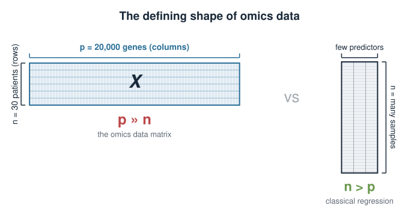
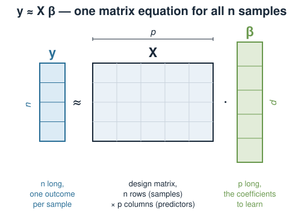
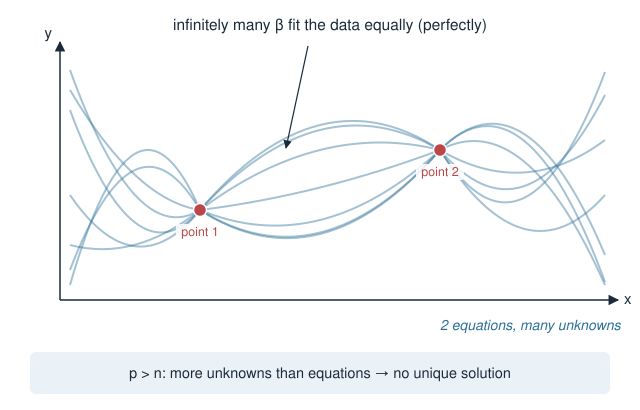
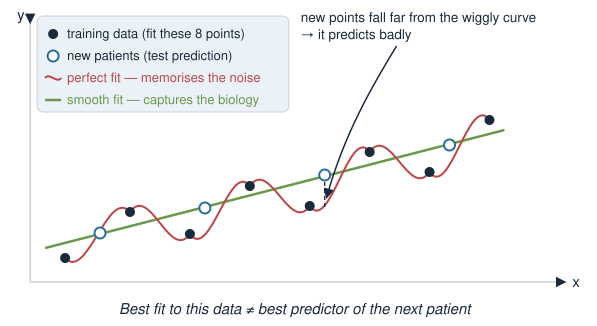
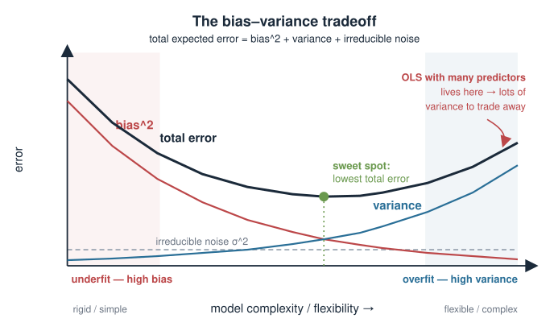
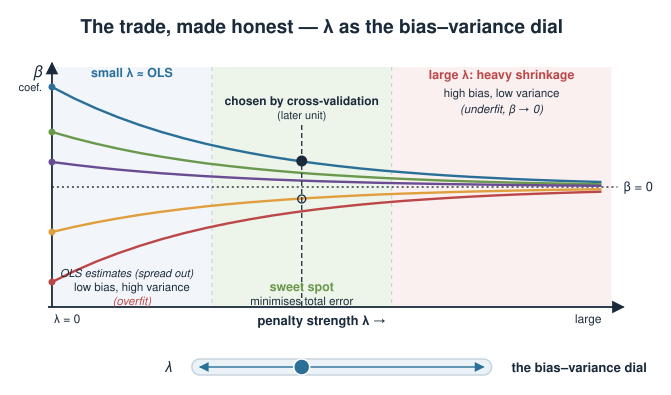
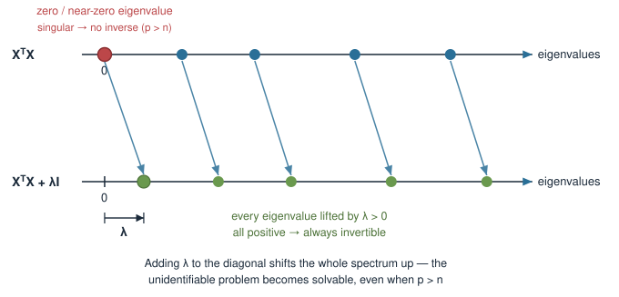

## About this lecture

In the linear-algebra block we learned how to **solve** a linear system and when a solution is unique. Today we ask a harder question: what do we do when the honest least-squares answer is either **impossible to compute** or **untrustworthy**?

- Why fitting many genes from few samples (**p ≫ n**) breaks ordinary least squares.
- The **bias–variance tradeoff**: why the "best fit to this data" is often a bad predictor.
- The core idea of **penalization** — pay a price for large coefficients to buy stability.
- This is a **concept** day: no formulas to grind, one idea to internalise.

::: notes
This is the motivation lecture for the whole penalized-models block. The single message: ordinary least squares assumes you have more samples than parameters and that the parameters are well-determined. In genomics that assumption is routinely violated — thousands of genes, dozens of samples. When it breaks, we do not get a slightly worse answer, we get no unique answer at all, or a wildly overfit one. Penalization is the fix. Keep it conceptual today; the ridge and lasso mechanics come in later units.
:::

## A biology picture first {.smaller}

A typical transcriptomics experiment: measure the expression of **20,000 genes** across **30 patients**, and predict a clinical outcome (say, drug response) from expression.

- Each patient is one **row**; each gene is one **column** (a predictor).
- You want a linear model: outcome $\approx \beta_1 g_1 + \beta_2 g_2 + \dots + \beta_p g_p$.
- You have **30 equations** (patients) but **20,000 unknowns** (the $\beta$'s).

There are vastly **more predictors than samples**. This is the defining shape of omics data, and ordinary regression was never designed for it.

{width="75%" fig-align="center"}

::: notes
Anchor the abstraction in the standard omics shape before any math: the data matrix is wide and short. In the statistics they have seen (the linear-models material with `lm`), n was always comfortably larger than the number of predictors. Here it inverts. Stress that this is not an exotic edge case — it is the normal situation in gene expression, methylation, proteomics. The whole block exists because classical regression assumes the opposite shape. Do not define p and n formally yet; just plant "more genes than patients."
:::

## Recall: the linear model {.smaller}

A linear model predicts an outcome $y$ from predictors as a weighted sum:

$$y \approx \beta_0 + \beta_1 x_1 + \beta_2 x_2 + \dots + \beta_p x_p$$

Stacked over all $n$ samples, this is a matrix equation:

$$\mathbf{y} \approx X\boldsymbol{\beta}$$

- $\mathbf{y}$: the outcome, one number per sample ($n$ long).
- $X$: the **design matrix**, $n$ rows (samples) × $p$ columns (predictors).
- $\boldsymbol{\beta}$: the coefficients we want to learn ($p$ long).

You have used this as `lm()` in the statistics block. Today we look **underneath** it.

{width="70%" fig-align="center"}

::: notes
Reconnect to what they already know: `lm()` fits exactly this. The novelty is not the model but the linear-algebra view of it — y is approximately X times beta, a single matrix equation. This links straight back to the Linear systems units: fitting a linear model is solving (a best-fit version of) a linear system. Keep the notation light; the point is only to set up X, beta, y so the next slide can talk about what "solve" means here.
:::

## Least squares only works when there is sufficient data {.smaller}

We can't hit every $y$ exactly (data is noisy), so **ordinary least squares (OLS)** picks the coefficients with the **smallest total squared error**:

- For each sample, take the miss: observed $y$ minus predicted $y$.
- Square the misses and add them up.
- Choose the $\boldsymbol{\beta}$ that makes this total as small as possible. That is what `lm()` does.

This needs **enough data to pin down every coefficient**. Each sample gives one equation; each coefficient is one unknown. Fewer equations than unknowns, and there is no single best answer.

::: notes
State the least-squares objective in words only: find the coefficients that minimise the total squared gap between prediction and truth. lm() solves this for them. The one idea to plant: every sample is one equation and every coefficient is one unknown, so ordinary least squares needs at least as many samples as coefficients, and the coefficients must not be able to stand in for each other. The next two slides are the two ways this fails in genomics. The matrix formula (the normal equations and the inverse) is on the optional slide at the end, for those who want the linear-algebra view.
:::

## When p > n, there is no single answer {.smaller}

Count equations and unknowns:

- **30 patients** = 30 equations. **20,000 genes** = 20,000 unknowns.
- With more unknowns than equations, **infinitely many** sets of coefficients fit the data **perfectly**.
- The data cannot tell them apart: the model is **unidentifiable**. In R, `lm()` gives up and returns `NA` for every gene beyond the 29th.

This is not "ordinary least squares does a bit worse". It cannot return **one** answer at all.

{width="55%" fig-align="center"}

::: notes
The hard failure mode, by counting. Two points and a curve with many free parameters: every curve in the bundle goes through both points, so all fit perfectly, and they disagree everywhere else. Same with 30 patients and 20,000 genes: 30 equations, 20,000 unknowns, infinitely many perfect fits. This is the "infinitely many solutions" case from the Linear systems units. In R, lm() estimates the intercept plus as many genes as it can (29 here) and returns NA for the rest; the exercise shows this. In linear-algebra language the matrix in the ordinary least squares formula has no inverse; that is on the optional slide at the end.
:::

## Even with enough samples, correlated genes are trouble {.smaller}

Genes in the same pathway move together. Take two genes A and B that are **almost identical**, and an outcome that is really $2 \times$ A. All of these predict almost the same:

| coefficient on A | coefficient on B | prediction |
|---|---|---|
| 2 | 0 | 2·A |
| 1 | 1 | ≈ 2·A |
| 100 | −98 | ≈ 2·A |
| −50 | 52 | ≈ 2·A |

- The data pin down the **sum** of the two coefficients (about 2), but not the **split**.
- A little noise decides which split ordinary least squares returns: **large, unstable** coefficients that flip sign from one sample to the next.

This is **multicollinearity**, and in genomics it is the rule, not the exception.

::: notes
The second, softer failure mode. Even with more samples than predictors, two highly correlated genes can stand in for each other. Read the table: 100 times A minus 98 times B is about 2 times A when A and B are almost the same, and so is minus 50 A plus 52 B. The data only see the sum of the two coefficients. Which split ordinary least squares returns is decided by the noise, so refitting on slightly different patients gives wildly different coefficients that cancel each other. The next slide shows exactly this with 50 resampled datasets. (Linear-algebra view, optional slide: the matrix that ordinary least squares inverts is nearly singular.)
:::

## Try it: correlated genes, resampled

```{=html}
<link rel="stylesheet" href="../demos/dist/demo.css">
<div data-demo="penaltygeom" data-mode="resample"></div>
<script src="../demos/dist/penaltygeom.js"></script>
```

::: notes
Interactive demo. The true model is y = gene 1 + gene 2, so the true coefficients are (1, 1) (the cross). Each dot is one fit to a new training set of 20 samples; 50 sets. Defaults: correlation 0.95, ridge with lambda 5. The ordinary least squares dots (orange cloud, labelled OLS) spread along the dashed line beta1 + beta2 = 2: beta1 ranges from about -0.3 to 3.1, but the sum stays between 1.6 and 2.4. The data pin down the combined effect, not the split, exactly as in the table. The ridge dots sit in a tight blob near (1, 1): beta1 from 0.6 to 1.3. Push the correlation to 0.99: ordinary least squares beta1 now runs from -1.8 to 5.4 and beta2 goes down to -3, while ridge stays at 0.7 to 1.2. Pull it down to 0: ordinary least squares is already tight (0.7 to 1.5), so the penalty only matters when genes are correlated. Click "resample 50 datasets" to show it is not a fluke. Leave the lasso button for the Ridge and lasso unit.
:::

## The real goal: A good prediction of future data, not a perfect fit {.smaller}

It is tempting to want the $\boldsymbol{\beta}$ that fits *this* dataset best. But we almost never care about this dataset — we care about the **next** patient.

- A model with enough free parameters can fit the training data **perfectly**, noise and all.
- That model has learned the **noise**, not the biology — it **overfits**.
- On new patients it predicts **badly**, because the noise it memorised won't repeat.

The best fit to the data at hand is often the **worst** predictor of new data.

{width="65%" fig-align="center"}

::: notes
Reframe the objective. Beginners equate "best model" with "smallest error on my data." That is exactly wrong for prediction. With enough flexibility you interpolate the training data perfectly, but you have fit the noise, and noise does not generalise. The classic picture: a high-degree polynomial threading every point versus a smooth line — the smooth line is worse on training data but better on new data. This slide sets up the bias–variance tradeoff, which names the tension.
:::

## The bias–variance tradeoff {.smaller}

Prediction error has two competing parts:

- **Bias** — error from the model being too rigid to capture the true pattern. (Underfitting.)
- **Variance** — error from the model being so flexible it chases noise, changing wildly from sample to sample. (Overfitting.)

$$\text{prediction error} \;=\; \text{bias}^2 \;+\; \text{variance} \;+\; \text{noise you cannot remove}$$

Ordinary least squares with many predictors is a **low-bias, high-variance** machine: flexible enough to fit anything, so unstable it generalises poorly. We can often **lower total error by accepting a little bias** to cut variance a lot.

{width="55%" fig-align="center"}

::: notes
This is the conceptual heart of the lecture. Two sources of error pull in opposite directions. A too-simple model misses the real signal (bias); a too-flexible model fits noise and swings around (variance). Total error is their sum plus noise that no model can remove. Read the equation as words, not as something to compute. The key insight that justifies everything downstream: you can trade a small increase in bias for a large decrease in variance and come out ahead on total error. Ordinary least squares in high dimensions sits at the high-variance extreme, so there is lots of variance to trade away. Penalization is the knob that makes the trade; the next slide lets them turn it.
:::

## Try it: the bias–variance dial

```{=html}
<link rel="stylesheet" href="../demos/dist/demo.css">
<div data-demo="biasvar" data-lambda="0.001"></div>
<script src="../demos/dist/biasvar.js"></script>
```

::: notes
Interactive demo. Expression of one gene at 16 doses, fitted with a very flexible curve; lambda is the penalty that makes it stiffer. Panel (a) is the fit, panel (b) the training error (blue) and test error on new points (red) for every lambda; click or drag in (b) to set lambda. Start at lambda 0.001: the curve wiggles through the points, training error 0.23 but test error 1.66, about three times the noise level of 0.6. That is overfitting. Click "best lambda" (about 0.79): test error drops to 0.68, while training error rises to 0.39. Drag to about 300: the curve is almost flat, training 1.42 and test 1.34, underfitting. Then tick "show 20 refits": the spread of the 20 fits is the variance (1.74 at lambda 0.001, 0.35 at the best lambda, 0.16 at 320) and the offset of their average from the true curve is the bias (0.24 at the best lambda, 1.21 at 320). Training error always goes down as lambda goes down; test error has a U. Cross-validation (later unit) finds the bottom of the U without a test set.
:::

## The idea: Penalizing large coefficients improves fit{.smaller}

Instead of minimising only the fit error, add a **penalty** that grows with the size of the coefficients:

$$\text{what we minimise} \;=\; \underbrace{\text{fit error}}_{\text{fit the data}} \;+\; \lambda \times \underbrace{\text{(size of the coefficients)}}_{\text{stay small}}$$

- The first term still rewards fitting the data.
- The second term **punishes** large coefficients. $\lambda \ge 0$ sets how hard.
- The fit now has to *justify* every unit of coefficient it uses against the penalty.

We deliberately move **away** from the perfect-fit solution to buy **stability**.

::: notes
Here is the whole idea in one line of words, so the specific penalty (sum of squares for ridge, sum of absolute values for lasso) can come later. We add a term that charges for coefficient size. Lambda is the price. With lambda = 0 we are back to ordinary least squares; as lambda grows, coefficients are pulled toward zero. The intuition to leave them with: the model can no longer spend coefficient size freely; it must earn each unit by improving the fit more than the penalty costs. That is what stops it from chasing noise.
:::

## What the penalty buys {.smaller}

**One answer again.** Among all the coefficient sets that fit (almost) equally well, the penalty prefers the one with the **smallest** coefficients, and there is only one of those.

- Correlated genes A and B: of 2·A, 1·A + 1·B, 100·A − 98·B, … the penalty picks **1·A + 1·B**, the smallest.
- With $p > n$: of the infinitely many perfect fits, the penalty picks one. The model can be fitted even with 20,000 genes and 30 patients.

**It calms the variance.** Shrinking coefficients toward zero makes them **less sensitive** to noise in any one sample. Estimates stop swinging, as the ridge cloud in the resampling demo showed.

::: notes
Two payoffs, one for each failure mode. First, the hard failure: when many coefficient sets fit equally well, the penalty breaks the tie by preferring small coefficients, and there is exactly one smallest. For two nearly identical genes that is splitting the effect evenly, 1 and 1, instead of 100 and -98. So p > n becomes solvable again. Second, the soft failure: shrinking directly reduces variance; smaller, steadier coefficients that do not lurch when you resample (the tight ridge blob in the demo). The linear-algebra reason (adding lambda to the diagonal makes the matrix invertible) is on the optional slide at the end.
:::

## The trade, made honest {.smaller}

Penalization is not free. By pulling coefficients toward zero we introduce **bias**: the estimates are systematically shrunk, so they no longer match the true values on average.

- Small $\lambda$: close to ordinary least squares — low bias, high variance (overfits).
- Large $\lambda$: heavy shrinkage — high bias, low variance (underfits, coefficients near 0).
- **Somewhere in between** minimises total prediction error.

$$\text{penalty strength } \lambda \;\longleftrightarrow\; \text{the bias–variance dial}$$

Choosing $\lambda$ well (e.g. by **cross-validation**, in a later unit) is the whole game.

{width="65%" fig-align="center"}

::: notes
Be honest about the cost, per the course's "honest about what we defer" principle. Shrinkage biases the estimates — that is the price. So lambda is literally the bias–variance dial: turn it up and you move from the overfit ordinary least squares end toward the oversmoothed end. The sweet spot in the middle minimises total error. How to find it — cross-validation — is deferred to a later unit; name it, don't teach it today. The takeaway: penalization does not magically improve everything; it lets you *choose* a better point on the tradeoff than ordinary least squares forces on you.
:::

## Biological payoff {.smaller}

Why this matters for the wide, short omics matrix we started with:

- **Solvable at all.** With $p \gg n$, penalization is what makes a gene-expression predictor computable in the first place.
- **Stable signatures.** Shrinkage gives coefficients that don't flip sign when you swap a few patients — reproducible gene signatures.
- **Better prediction** on held-out patients, which is what a clinical model is for.
- **Some penalties select genes.** One flavour (coming in a later unit) drives most coefficients exactly to zero, yielding a short, interpretable gene list.
- **You have met it already.** `lfcShrink` in *Bulk RNA-seq with DESeq2* pulled noisy low-count fold changes towards 0.

::: notes
Close the loop back to the opening biology. The four payoffs map onto real genomics needs: you can actually fit a model when p >> n; the resulting signatures are reproducible rather than an artifact of which patients you happened to sample; predictions generalise to new patients; and one penalty variant (lasso, named but deferred) performs feature selection, handing biologists a short gene list instead of twenty thousand tiny coefficients. Don't teach lasso here — just promise it. The last bullet recalls the bulk RNA-seq day: lfcShrink pulled the noisy fold changes of low-count genes towards 0 and left well-measured genes almost unchanged. Same idea: when the data are weak, believe less extreme values. This slide answers "why should a biologist care," which is the course's core pairing principle.
:::

## A first look in R {.smaller}

You have used `lm()` for ordinary least squares. Penalized models use `glmnet`, which fits along a whole range of $\lambda$ at once:

```r
# ordinary least squares -- fails or overfits when p >> n
fit_ols <- lm(response ~ ., data = expr)

# penalized regression (ridge / lasso) with glmnet
library(glmnet)
x <- as.matrix(expr[, genes])   # n samples x p genes
y <- expr$response

fit_pen <- glmnet(x, y, alpha = 0)   # alpha = 0 is ridge; alpha = 1 is lasso
```

Don't worry about the details yet — later units unpack `alpha`, the $\lambda$ path, and choosing $\lambda$ by cross-validation. Today only the **idea** matters.

::: notes
Show the tool at the horizon so the code is not a surprise later, but keep it static and unrun — no package is installed at render time, and today is conceptual. The one thing to register: `lm()` gives ordinary least squares; `glmnet` adds the penalty and fits many lambdas at once. Mention that alpha picks the penalty flavour (0 = ridge, 1 = lasso) without explaining the difference — that is a later unit. Reassure them the details come later; do not let them get lost in glmnet arguments today.
:::

## Summary {.smaller}

| Idea | Takeaway |
|---|---|
| **p ≫ n** biology | omics has many genes, few samples |
| OLS | picks the coefficients with the smallest total squared error; needs enough data to pin each one down |
| Hard failure | more genes than samples ⇒ more unknowns than equations ⇒ **no unique** solution |
| Soft failure | correlated genes can stand in for each other ⇒ **unstable, huge** coefficients |
| Real goal | predict **new** patients, not fit this data perfectly |
| Bias–variance | trade a little bias for a large cut in variance |
| **Penalize** | minimise fit error + $\lambda$ × (coefficient size) |
| The fix | the penalty picks the smallest of the equally good answers; coefficients shrink & stabilise |
| The cost | shrinkage adds bias; $\lambda$ is the dial, tuned later |

**Next in this block:** the specific penalties — **ridge** and **lasso** — and how to choose $\lambda$.

::: notes
The summary is the whole argument in one table. Drill the storyline verbally one more time: omics is wide and short; ordinary least squares needs at least as many samples as coefficients, and coefficients that cannot stand in for each other; p > n gives more unknowns than equations (hard failure) and correlated genes give many near-equal answers (soft failure); we actually care about predicting new data, not fitting this data; the bias–variance tradeoff says we can trade bias for variance; penalization does exactly that by charging for coefficient size, which also picks one answer when many fit. The cost is bias, controlled by lambda. Next units make the penalty concrete (ridge, lasso) and teach choosing lambda.
:::

## Optional: the maths behind penalization {.smaller}

The same story in the linear-algebra language of the first weeks, for those who want it.

| In words (this lecture) | In matrices |
|---|---|
| OLS: smallest total squared error | $\hat{\boldsymbol\beta}=\arg\min_{\boldsymbol\beta}\lVert\mathbf{y}-X\boldsymbol\beta\rVert^2$, solved by the normal equations $\hat{\boldsymbol\beta}=(X^\top X)^{-1}X^\top\mathbf{y}$ |
| more unknowns than equations | $\text{rank}(X^\top X)\le n<p$: the $p\times p$ matrix $X^\top X$ is singular, no inverse |
| correlated genes, many near-equal answers | $X^\top X$ is nearly singular (an eigenvalue near 0), so its inverse blows up |
| penalty picks the smallest answer | ridge: $\hat{\boldsymbol\beta}=(X^\top X+\lambda I)^{-1}X^\top\mathbf{y}$; adding $\lambda I$ lifts every eigenvalue by $\lambda$, so it always inverts |

{width="48%" fig-align="center"}

::: notes
Optional slide; skip it in a short session. It translates each step of the lecture into the linear-algebra language from the first weeks: least squares as the normal equations; p > n as a rank argument (X-transpose-X is p by p but built from n samples, so its rank is at most n); multicollinearity as a near-zero eigenvalue, which makes the inverse huge in that direction; and the ridge fix as the identity shift, which lifts every eigenvalue by lambda so the matrix is always invertible. The exercise has optional items (B3d, B5, R5, R6) for those who want to see this by hand and in R.
:::
