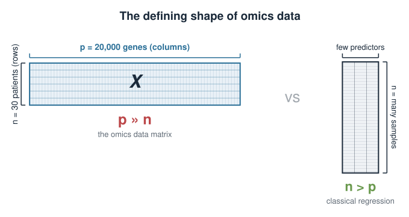
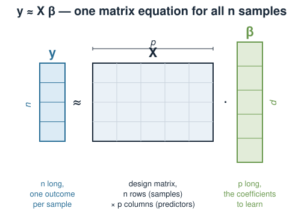
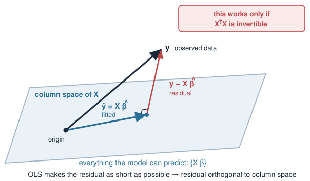
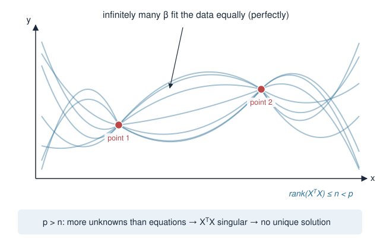
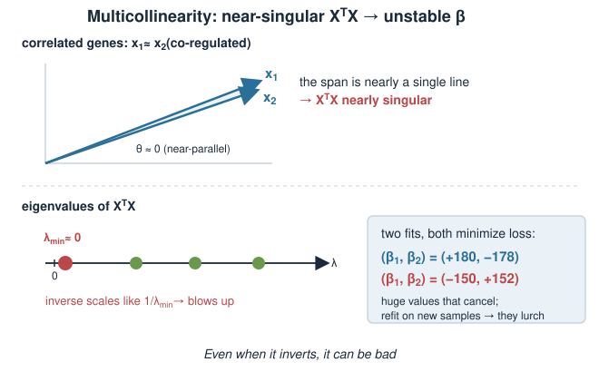
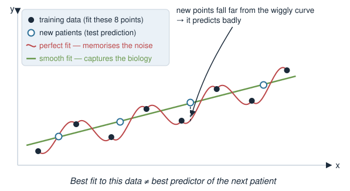
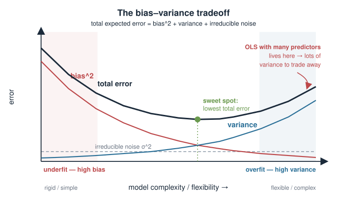
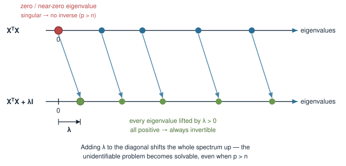
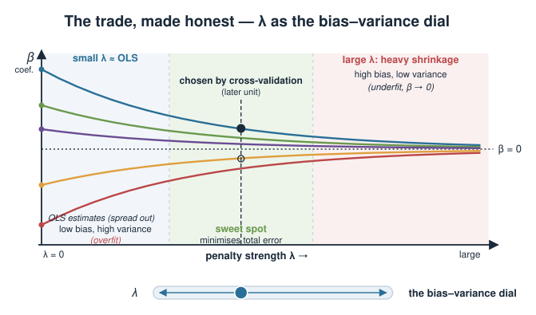

## About this lecture

::: {.callout-warning title="Provisional block"}
This block is **provisional**. Depending on how the syllabus settles, "Penalized linear models" may move to a later statistics / machine-learning course. Treat it as a bridge from the linear-algebra block into modelling, not as a fixed exam topic.
:::

In the linear-algebra block we learned how to **solve** a linear system and when a solution is unique. Today we ask a harder question: what do we do when the honest least-squares answer is either **impossible to compute** or **untrustworthy**?

- Why fitting many genes from few samples (**p ≫ n**) breaks ordinary least squares.
- The **bias–variance tradeoff**: why the "best fit to this data" is often a bad predictor.
- The core idea of **penalization** — pay a price for large coefficients to buy stability.
- This is a **concept** day: no formulas to grind, one idea to internalise.

::: notes
This is the motivation lecture for the whole penalized-models block. The single message: ordinary least squares assumes you have more samples than parameters and that the parameters are well-determined. In genomics that assumption is routinely violated — thousands of genes, dozens of samples. When it breaks, we do not get a slightly worse answer, we get no unique answer at all, or a wildly overfit one. Penalization is the fix. Keep it conceptual today; the ridge and lasso mechanics come in later units. Flag the provisional status honestly so students know where this sits.
:::

## A biology picture first {.smaller}

A typical transcriptomics experiment: measure the expression of **20,000 genes** across **30 patients**, and predict a clinical outcome (say, drug response) from expression.

- Each patient is one **row**; each gene is one **column** (a predictor).
- You want a linear model: outcome $\approx \beta_1 g_1 + \beta_2 g_2 + \dots + \beta_p g_p$.
- You have **30 equations** (patients) but **20,000 unknowns** (the $\beta$'s).

There are vastly **more predictors than samples**. This is the defining shape of omics data, and ordinary regression was never designed for it.

{width="75%" fig-align="center"}

::: notes
Anchor the abstraction in the standard omics shape before any math: the data matrix is wide and short. In the statistics they have seen (the linear-models material with `lm`), n was always comfortably larger than the number of predictors. Here it inverts. Stress that this is not an exotic edge case — it is the normal situation in gene expression, methylation, proteomics. The whole block exists because classical regression assumes the opposite shape. Do not define p and n formally yet; just plant "more genes than patients."
:::

## Recall: the linear model {.smaller}

A linear model predicts an outcome $y$ from predictors as a weighted sum:

$$y \approx \beta_0 + \beta_1 x_1 + \beta_2 x_2 + \dots + \beta_p x_p$$

Stacked over all $n$ samples, this is a matrix equation:

$$\mathbf{y} \approx X\boldsymbol{\beta}$$

- $\mathbf{y}$: the outcome, one number per sample ($n$ long).
- $X$: the **design matrix**, $n$ rows (samples) × $p$ columns (predictors).
- $\boldsymbol{\beta}$: the coefficients we want to learn ($p$ long).

You have used this as `lm()` in the statistics block. Today we look **underneath** it.

{width="70%" fig-align="center"}

::: notes
Reconnect to what they already know: `lm()` fits exactly this. The novelty is not the model but the linear-algebra view of it — y is approximately X times beta, a single matrix equation. This links straight back to the Linear systems units: fitting a linear model is solving (a best-fit version of) a linear system. Keep the notation light; the point is only to set up X, beta, y so the next slide can talk about what "solve" means here.
:::

## What least squares wants {.smaller}

We can't hit $\mathbf{y} = X\boldsymbol{\beta}$ exactly (data is noisy), so **ordinary least squares (OLS)** picks the $\boldsymbol{\beta}$ that makes the total squared error smallest:

$$\hat{\boldsymbol{\beta}} = \arg\min_{\boldsymbol{\beta}} \ \|\mathbf{y} - X\boldsymbol{\beta}\|^2$$

Working this out gives the **normal equations**:

$$X^\top X\,\boldsymbol{\beta} = X^\top \mathbf{y} \qquad\Longrightarrow\qquad \hat{\boldsymbol{\beta}} = (X^\top X)^{-1} X^\top \mathbf{y}$$

Everything hinges on that inverse: we can only solve for $\boldsymbol{\beta}$ **if $X^\top X$ is invertible**.

{width="60%" fig-align="center"}

::: notes
State the least-squares objective in words: find the coefficients that minimise the total squared gap between prediction and truth. Don't derive the normal equations — just present them and point at the single load-bearing object, the matrix X-transpose-X (a p by p matrix), and its inverse. The entire rest of the lecture is about when that inverse fails to exist or is untrustworthy. Students met invertibility and singular matrices in the Linear systems units and eigenvalues; lean on that vocabulary: a matrix you cannot invert is singular.
:::

## When p > n, the inverse does not exist {.smaller}

$X^\top X$ is a $p \times p$ matrix, but it is built from only $n$ samples. A basic fact of linear algebra:

$$\text{rank}(X^\top X) \le n$$

So when **$p > n$** (more genes than patients), $X^\top X$ is a $p\times p$ matrix of rank at most $n < p$ — it is **singular**. It has **no inverse**.

- There is **no unique** least-squares solution — infinitely many $\boldsymbol{\beta}$ fit the data equally (perfectly) well.
- The model is **unidentifiable**: the data cannot pin down the coefficients.

{width="60%" fig-align="center"}

::: notes
This is the hard failure mode, and it is pure linear algebra. X-transpose-X is p by p but its rank cannot exceed n, the number of samples. When p exceeds n the matrix is rank-deficient, hence singular, hence not invertible — the normal equations have no unique solution. Give the intuition: with more unknowns than constraints, infinitely many coefficient vectors reproduce y perfectly. Connect to the Linear systems picture of "infinitely many solutions" when there are fewer independent equations than unknowns. This is not "OLS does badly" — it literally cannot return one answer.
:::

## Even when it inverts, it can be bad {.smaller}

Suppose $p < n$, so $X^\top X$ *is* invertible. You are still not safe if predictors are **correlated** — which genes always are (co-regulated pathways, batch structure).

- Correlated columns make $X^\top X$ **nearly singular** (an eigenvalue close to 0).
- Inverting a nearly-singular matrix **amplifies noise**: tiny changes in the data cause huge swings in $\hat{\boldsymbol{\beta}}$.
- The fitted coefficients become **large, unstable, and hard to interpret** — often big positive and negative values that cancel.

This is **multicollinearity**, and in genomics it is the rule, not the exception.

{width="55%" fig-align="center"}

::: notes
The second, softer failure mode. Even with more samples than predictors, biology gives you highly correlated predictors — genes in the same pathway move together. Correlated columns push X-transpose-X toward singularity: one of its eigenvalues gets close to zero. Recall from the eigenvalue unit that a near-zero eigenvalue means the inverse blows up along that direction. The practical symptom is coefficients that are enormous and unstable — refit on a slightly different sample and they lurch. This motivates wanting to *control* coefficient size, which is exactly what penalization does.
:::

## The real goal: prediction, not perfect fit {.smaller}

It is tempting to want the $\boldsymbol{\beta}$ that fits *this* dataset best. But we almost never care about this dataset — we care about the **next** patient.

- A model with enough free parameters can fit the training data **perfectly**, noise and all.
- That model has learned the **noise**, not the biology — it **overfits**.
- On new patients it predicts **badly**, because the noise it memorised won't repeat.

The best fit to the data at hand is often the **worst** predictor of new data.

{width="65%" fig-align="center"}

::: notes
Reframe the objective. Beginners equate "best model" with "smallest error on my data." That is exactly wrong for prediction. With enough flexibility you interpolate the training data perfectly, but you have fit the noise, and noise does not generalise. The classic picture: a high-degree polynomial threading every point versus a smooth line — the smooth line is worse on training data but better on new data. This slide sets up the bias–variance tradeoff, which names the tension formally.
:::

## The bias–variance tradeoff {.smaller}

Prediction error decomposes into two competing parts:

- **Bias** — error from the model being too rigid to capture the true pattern. (Underfitting.)
- **Variance** — error from the model being so flexible it chases noise, changing wildly from sample to sample. (Overfitting.)

$$\text{expected prediction error} \;=\; \text{bias}^2 \;+\; \text{variance} \;+\; \text{irreducible noise}$$

OLS with many predictors is a **low-bias, high-variance** machine: flexible enough to fit anything, so unstable it generalises poorly. We can often **lower total error by accepting a little bias** to cut variance a lot.

{width="60%" fig-align="center"}

::: notes
This is the conceptual heart of the lecture. Two sources of error pull in opposite directions. A too-simple model misses the real signal (bias); a too-flexible model fits noise and swings around (variance). Total expected error is their sum plus irreducible noise. The key insight that justifies everything downstream: you can trade a small increase in bias for a large decrease in variance and come out ahead on total error. OLS in high dimensions sits at the high-variance extreme, so there is lots of variance to trade away. Penalization is the knob that makes the trade.
:::

## The idea: penalize large coefficients {.smaller}

Instead of minimising only the fit error, add a **penalty** that grows with the size of the coefficients:

$$\hat{\boldsymbol{\beta}} = \arg\min_{\boldsymbol{\beta}} \ \underbrace{\|\mathbf{y} - X\boldsymbol{\beta}\|^2}_{\text{fit the data}} \;+\; \lambda\underbrace{\,\text{(size of }\boldsymbol{\beta}\text{)}}_{\text{stay small}}$$

- The first term still rewards fitting the data.
- The second term **punishes** large coefficients. $\lambda \ge 0$ sets how hard.
- The fit now has to *justify* every unit of coefficient it uses against the penalty.

We deliberately move **away** from the perfect-fit solution to buy **stability**.

::: notes
Here is the whole idea in one equation, stated conceptually so the specific penalty (sum of squares for ridge, sum of absolute values for lasso) can come later. We augment the objective with a term that charges for coefficient magnitude. Lambda is the price. With lambda = 0 we are back to OLS; as lambda grows, coefficients are pulled toward zero. The intuition to leave them with: the model can no longer spend coefficient magnitude freely — it must earn each unit by improving the fit more than the penalty costs. That is what stops it from chasing noise.
:::

## What the penalty buys, geometrically {.smaller}

Two ways to see why shrinking coefficients helps:

**It fixes the inverse.** The penalized normal equations replace $X^\top X$ with

$$X^\top X + \lambda I$$

Adding $\lambda$ to the diagonal lifts every eigenvalue by $\lambda > 0$, so the matrix is **always invertible** — even when $p > n$. The unidentifiable problem becomes solvable.

**It calms the variance.** Shrinking coefficients toward zero makes them **less sensitive** to noise in any one sample. Estimates stop swinging.

{width="65%" fig-align="center"}

::: notes
Two payoffs, one from each failure mode. First, the hard failure: the penalized solution uses X-transpose-X plus lambda times the identity. Recall from the eigenvalue unit that adding lambda*I shifts every eigenvalue up by lambda; a matrix with all-positive eigenvalues is invertible. So the singular p > n case becomes solvable, and there is again a unique answer. Second, the soft failure: shrinking coefficients directly reduces variance — smaller, steadier coefficients that do not lurch when you resample. This slide ties the abstract penalty back to concrete linear algebra they already own.
:::

## The trade, made honest {.smaller}

Penalization is not free. By pulling coefficients toward zero we introduce **bias**: the estimates are systematically shrunk, so they no longer match the true values on average.

- Small $\lambda$: close to OLS — low bias, high variance (overfits).
- Large $\lambda$: heavy shrinkage — high bias, low variance (underfits, coefficients near 0).
- **Somewhere in between** minimises total prediction error.

$$\text{penalty strength } \lambda \;\longleftrightarrow\; \text{the bias–variance dial}$$

Choosing $\lambda$ well (e.g. by **cross-validation**, in a later unit) is the whole game.

{width="65%" fig-align="center"}

::: notes
Be honest about the cost, per the course's "honest about what we defer" principle. Shrinkage biases the estimates — that is the price. So lambda is literally the bias–variance dial: turn it up and you move from the overfit OLS end toward the oversmoothed end. The sweet spot in the middle minimises total error. How to find it — cross-validation — is deferred to a later unit; name it, don't teach it today. The takeaway: penalization does not magically improve everything; it lets you *choose* a better point on the tradeoff than OLS forces on you.
:::

## Biological payoff {.smaller}

Why this matters for the wide, short omics matrix we started with:

- **Solvable at all.** With $p \gg n$, penalization is what makes a gene-expression predictor computable in the first place.
- **Stable signatures.** Shrinkage gives coefficients that don't flip sign when you swap a few patients — reproducible gene signatures.
- **Better prediction** on held-out patients, which is what a clinical model is for.
- **Some penalties select genes.** One flavour (coming in a later unit) drives most coefficients exactly to zero, yielding a short, interpretable gene list.

::: notes
Close the loop back to the opening biology. The four payoffs map onto real genomics needs: you can actually fit a model when p >> n; the resulting signatures are reproducible rather than an artifact of which patients you happened to sample; predictions generalise to new patients; and one penalty variant (lasso, named but deferred) performs feature selection, handing biologists a short gene list instead of twenty thousand tiny coefficients. Don't teach lasso here — just promise it. This slide answers "why should a biologist care," which is the course's core pairing principle.
:::

## A first look in R {.smaller}

You have used `lm()` for ordinary least squares. Penalized models use `glmnet`, which fits along a whole range of $\lambda$ at once:

```r
# ordinary least squares -- fails or overfits when p >> n
fit_ols <- lm(response ~ ., data = expr)

# penalized regression (ridge / lasso) with glmnet
library(glmnet)
x <- as.matrix(expr[, genes])   # n samples x p genes
y <- expr$response

fit_pen <- glmnet(x, y, alpha = 0)   # alpha = 0 is ridge; alpha = 1 is lasso
```

Don't worry about the details yet — later units unpack `alpha`, the $\lambda$ path, and choosing $\lambda$ by cross-validation. Today only the **idea** matters.

::: notes
Show the tool at the horizon so the code is not a surprise later, but keep it static and unrun — no package is installed at render time, and today is conceptual. The one thing to register: `lm()` gives OLS; `glmnet` adds the penalty and fits many lambdas at once. Mention that alpha picks the penalty flavour (0 = ridge, 1 = lasso) without explaining the difference — that is a later unit. Reassure them the details come later; do not let them get lost in glmnet arguments today.
:::

## Link back to the linear-algebra block {.smaller}

Everything today rested on machinery you already built:

| From the linear-algebra block | Used here |
|---|---|
| Solving $A\mathbf{x}=\mathbf{b}$, unique vs. infinite solutions | when OLS has no unique $\hat{\boldsymbol\beta}$ |
| **Rank** and singular matrices | why $p>n$ makes $X^\top X$ non-invertible |
| Matrix **inverse** | the normal equations $\hat{\boldsymbol\beta}=(X^\top X)^{-1}X^\top\mathbf{y}$ |
| **Eigenvalues** near zero | why correlated genes make the inverse explode |
| Adding $\lambda I$ shifts eigenvalues up | why the penalty restores invertibility |

Penalized regression is applied linear algebra with a statistical purpose.

::: notes
Make the continuity explicit — this block is the payoff for the linear-algebra grind. Each row of the table is a concept they already learned, now doing real work. Rank and singularity explain the p > n breakdown; the inverse is the normal-equations solution; near-zero eigenvalues explain multicollinearity blow-up; the lambda*I eigenvalue shift explains the fix. Emphasise that they are not learning new linear algebra today, they are seeing why it mattered. Reference units by topic name, never by day number.
:::

## Summary {.smaller}

| Idea | Takeaway |
|---|---|
| **p ≫ n** biology | omics has many genes, few samples |
| OLS solution | $\hat{\boldsymbol\beta}=(X^\top X)^{-1}X^\top\mathbf{y}$ — needs an invertible $X^\top X$ |
| Hard failure | $p>n$ ⇒ $X^\top X$ singular ⇒ **no unique** solution |
| Soft failure | correlated genes ⇒ near-singular ⇒ **unstable, huge** coefficients |
| Real goal | predict **new** patients, not fit this data perfectly |
| Bias–variance | trade a little bias for a large cut in variance |
| **Penalize** | add $\lambda\cdot(\text{coefficient size})$ to the objective |
| The fix | $X^\top X + \lambda I$ is always invertible; coefficients shrink & stabilise |
| The cost | shrinkage adds bias; $\lambda$ is the dial, tuned later |

**Next in this block:** the specific penalties — **ridge** and **lasso** — and how to choose $\lambda$.

::: notes
The summary is the whole argument in one table. Drill the storyline verbally one more time: omics is wide and short; OLS needs an invertible X-transpose-X; p > n makes it singular (hard failure) and correlated genes make it nearly singular (soft failure); we actually care about predicting new data, not fitting this data; the bias–variance tradeoff says we can trade bias for variance; penalization does exactly that by charging for coefficient size, which also restores invertibility via lambda*I. The cost is bias, controlled by lambda. Next units make the penalty concrete (ridge, lasso) and teach choosing lambda. Remind them the block is provisional.
:::
