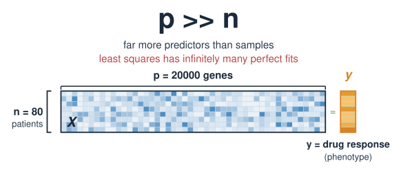
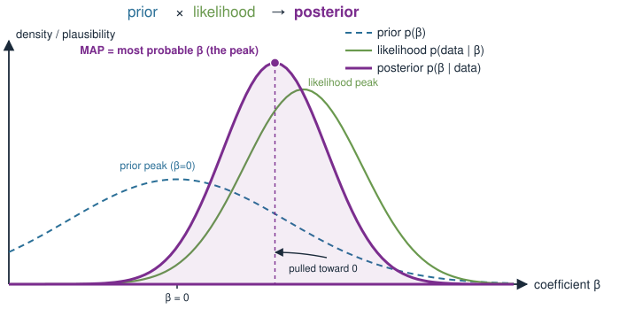
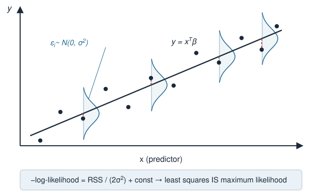
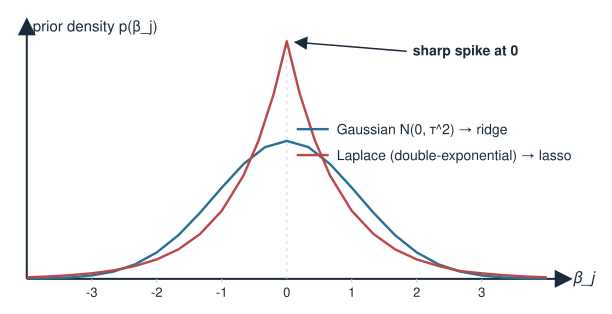
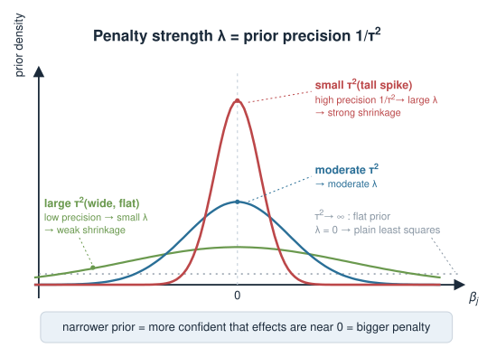
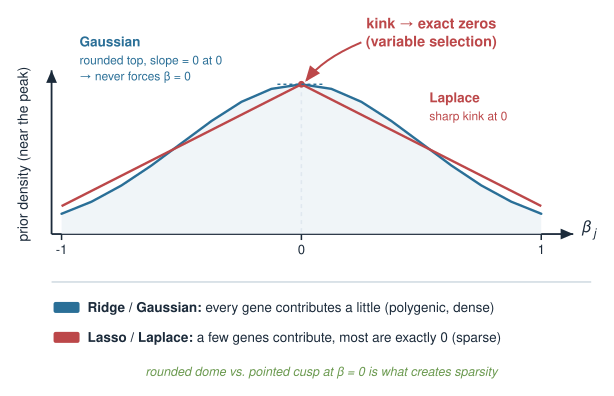
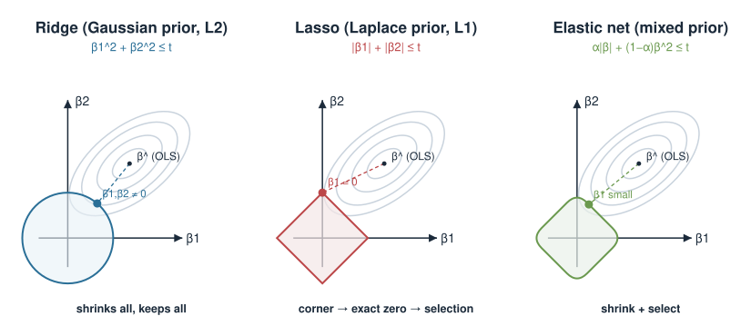
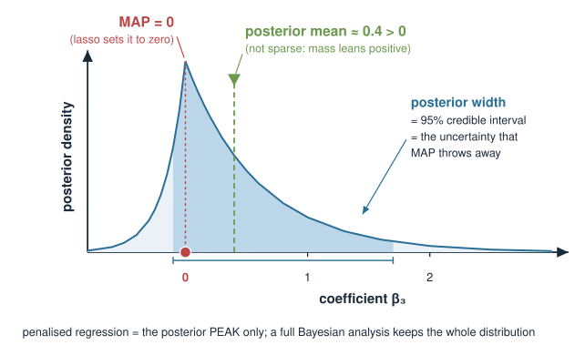

## About this lecture

::: {.callout-note title="Provisional placement"}
This block sits at the seam between the **penalized-regression** and **Bayesian** parts of the course. It may be **moved to a later statistics / machine-learning course** as the syllabus settles. Treat it as a bridge unit: it assumes you have already met ridge and lasso as optimisation, and Bayes' theorem as inference.
:::

In **Ridge and lasso regression** we added a **penalty** to least squares to tame wobbly coefficients. In the **Bayesian inference** block we learned to combine a **prior** with a **likelihood**. Today we show these are **the same move seen from two sides**.

- A penalty on the coefficients *is* a **prior belief** about the coefficients.
- Minimising *penalised loss* = finding the **most probable coefficients** given the data (the **MAP** estimate).
- **Ridge** ⇔ a **Gaussian** prior; **lasso** ⇔ a **Laplace** (double-exponential) prior.
- The penalty strength $\lambda$ encodes **how sure** you were before seeing data — the **prior precision**.

This is a **concept** day: light math, one master equation, and a change of viewpoint that makes both blocks click together.

::: notes
The single idea for today: a penalty and a prior are two languages for the same statement. The engineer says "I penalise large coefficients to stop overfitting"; the Bayesian says "I believe a priori that coefficients are small." They write down the *same* objective and get the *same* answer. Everything else — ridge = Gaussian, lasso = Laplace, lambda = prior precision — is detail hanging off that equivalence. Stress that this reframes material students already own from Ridge and lasso regression and from Bayesian inference; nothing here is a brand-new technique, it is a unifying view. Flag the provisional-placement callout out loud: this bridge may migrate to a dedicated stats/ML course.
:::

## A biology picture first {.smaller}

You want to predict a phenotype — say **drug response** — from a gene-expression profile.

- You measure **20 000 genes** in **80 patients**. Far **more predictors than samples** ($p \gg n$).
- Plain least squares is hopeless here: it has infinitely many perfect fits and memorises noise.
- But you *know things before you look*: **most genes are irrelevant** to this drug, and the few that matter probably have **modest** effects, not wild ones.

That prior knowledge is exactly what a **penalty** quietly injects. Today we make the belief **explicit**: what does ridge assume about your genes? What does lasso assume?

{width="80%" fig-align="center"}

::: notes
Ground the abstraction in the canonical omics predicament: wide matrices, p far bigger than n, where ordinary least squares cannot even be computed uniquely. Biologists already carry strong priors into such problems — sparsity (few driver genes) and modest effect sizes (biology is buffered, single genes rarely swing a phenotype enormously). The penalty they used in Ridge and lasso regression was silently encoding one of these beliefs. The lecture's promise: name the belief. By the end they should be able to say which biological assumption ridge makes and which lasso makes, and choose accordingly.
:::

## Recap: the penalised objective {.smaller}

From **Ridge and lasso regression**, we fit coefficients $\boldsymbol\beta$ by minimising *fit error + penalty*:

$$\hat{\boldsymbol\beta} = \arg\min_{\boldsymbol\beta}\ \underbrace{\sum_{i=1}^n \big(y_i - \mathbf{x}_i^\top\boldsymbol\beta\big)^2}_{\text{residual sum of squares (RSS)}} \;+\; \lambda\, \underbrace{\mathcal{P}(\boldsymbol\beta)}_{\text{penalty}}$$

- **Ridge:** $\mathcal{P}(\boldsymbol\beta) = \sum_j \beta_j^2 = \lVert\boldsymbol\beta\rVert_2^2$ (sum of squares).
- **Lasso:** $\mathcal{P}(\boldsymbol\beta) = \sum_j |\beta_j| = \lVert\boldsymbol\beta\rVert_1$ (sum of absolute values).

$\lambda \ge 0$ dials the penalty: $\lambda = 0$ is plain least squares; large $\lambda$ shrinks coefficients hard toward $0$.

::: notes
Pure recap, no new content — just re-establish the objective and notation so the Bayesian side has something to map onto. Remind them ridge shrinks all coefficients smoothly toward zero but keeps them nonzero, while lasso can set some exactly to zero (variable selection). Keep lambda's role vivid: it is the single knob trading fit against simplicity. We are about to reinterpret every symbol here in probability language.
:::

## Recap: Bayes in one line {.smaller}

From **Bayesian inference**: to learn parameters $\boldsymbol\beta$ from data, combine what you believed before with what the data say.

$$\underbrace{p(\boldsymbol\beta \mid \text{data})}_{\text{posterior}} \;\propto\; \underbrace{p(\text{data} \mid \boldsymbol\beta)}_{\text{likelihood}} \;\times\; \underbrace{p(\boldsymbol\beta)}_{\text{prior}}$$

- **Likelihood** — how well a given $\boldsymbol\beta$ explains the observed data.
- **Prior** — how plausible that $\boldsymbol\beta$ was *before* seeing any data.
- **Posterior** — the updated belief, combining both.

A quick summary of the posterior is its **peak** — the single most probable $\boldsymbol\beta$. That is the **MAP** estimate (*maximum a posteriori*), and it is where the bridge to penalties is built.

{width="60%" fig-align="center"}

::: notes
Second recap slide. Reinstate the prior/likelihood/posterior trinity from the Bayesian block. Emphasise proportionality: we drop the normalising constant p(data) because it does not depend on beta and so does not move the location of the peak. Introduce MAP gently as "the top of the posterior hill" — a point summary, in contrast to the full posterior distribution a Bayesian would ideally report. Foreshadow the caveat slide: MAP throws away the width of the posterior, which matters, but it is exactly the quantity that equals penalised regression.
:::

## The one trick: turn products into sums {.smaller}

Maximising a product of probabilities is awkward; maximising its **logarithm** is easy and gives the same peak (log is increasing). Taking $-\log$ turns "maximise" into "minimise":

$$\arg\max_{\boldsymbol\beta}\ p(\boldsymbol\beta\mid\text{data}) \;=\; \arg\min_{\boldsymbol\beta}\ \Big[\,-\log p(\text{data}\mid\boldsymbol\beta) \;-\; \log p(\boldsymbol\beta)\,\Big]$$

$$\underbrace{\ \ \text{MAP estimate}\ \ }_{\text{find the posterior peak}} \;=\; \arg\min_{\boldsymbol\beta}\ \big[\ \underbrace{\text{(negative log-likelihood)}}_{\text{fit term}} \;+\; \underbrace{\text{(negative log-prior)}}_{\text{penalty term}}\ \big]$$

This already **looks like** *fit + penalty*. The rest of the lecture is just plugging in specific likelihoods and priors and reading off the terms.

::: notes
This is the mechanical heart of the equivalence and worth doing slowly. Two facts: (1) argmax is unchanged by a monotonically increasing transform, so we may take logs; (2) log turns products into sums and the minus sign flips max to min. The result is structurally already "fit term plus penalty term." Point at the two braces and say: the negative log-likelihood will become the RSS, and the negative log-prior will become the ridge or lasso penalty. Nothing subtle remains — only substitution. Reassure the less mathematical students that they do not need to reproduce this derivation, only to recognise the shape.
:::

## The likelihood of linear regression {.smaller}

The standard linear model assumes the noise is **Gaussian**:

$$y_i = \mathbf{x}_i^\top\boldsymbol\beta + \varepsilon_i, \qquad \varepsilon_i \sim \mathcal{N}(0,\ \sigma^2)$$

So each residual is Gaussian, and the negative log-likelihood is (dropping constants that do not involve $\boldsymbol\beta$):

$$-\log p(\text{data}\mid\boldsymbol\beta) \;=\; \frac{1}{2\sigma^2}\sum_{i=1}^n \big(y_i - \mathbf{x}_i^\top\boldsymbol\beta\big)^2 \;+\; \text{const} \;=\; \frac{1}{2\sigma^2}\,\text{RSS} \;+\; \text{const}$$

**The fit term is just the residual sum of squares**, scaled by $1/(2\sigma^2)$. This is why ordinary least squares *is* maximum-likelihood under Gaussian noise — a fact from the **Linear regression** block, now in probability language.

{width="60%" fig-align="center"}

::: notes
Connect back to a result they have already been told, perhaps without proof: least squares equals maximum likelihood when errors are Gaussian. Here is the reason in one line — the Gaussian density has exp(-residual^2 / 2 sigma^2), so its negative log is residual^2 / 2 sigma^2, and summing over independent samples gives RSS / 2 sigma^2. The 1/(2 sigma^2) prefactor will matter on the next slides because it sets the exchange rate between the fit term and the penalty term, which is where lambda comes from. Keep sigma^2 in view; do not absorb it yet.
:::

## Adding a prior on the coefficients {.smaller}

Now assert a **prior** on each coefficient $\beta_j$. Take them independent and centred at $0$ — encoding "before seeing data, I expect effects to be **small**, and I have no reason to prefer positive over negative."

$$p(\boldsymbol\beta) = \prod_{j=1}^p p(\beta_j)$$

The **shape** of $p(\beta_j)$ is the modelling choice. Two natural bell-ish curves centred at $0$:

- a **Gaussian** $\mathcal{N}(0,\tau^2)$ — smoothly peaked, light-ish tails;
- a **Laplace** (double-exponential) — a **sharp spike** at $0$ with heavier tails.

Each choice, pushed through $-\log$, produces a **different penalty**. That is the whole story.

{width="60%" fig-align="center"}

::: notes
The prior is a statement about coefficients before data. Centring at zero encodes shrinkage-toward-zero and symmetry encodes no directional preference. The variance/scale of the prior encodes how small we think effects are. Preview the punchline visually: Gaussian is a smooth hump, Laplace has a pointed cusp at zero. Tell them to hold that cusp in mind — it is the geometric reason lasso produces exact zeros while ridge does not. The next two slides do the two substitutions explicitly.
:::

## Ridge = a Gaussian prior {.smaller}

Put a **Gaussian** prior on each coefficient: $\beta_j \sim \mathcal{N}(0,\ \tau^2)$. Its density is $\propto \exp\!\big(-\beta_j^2 / 2\tau^2\big)$, so

$$-\log p(\boldsymbol\beta) \;=\; \frac{1}{2\tau^2}\sum_{j=1}^p \beta_j^2 \;+\; \text{const} \;=\; \frac{1}{2\tau^2}\,\lVert\boldsymbol\beta\rVert_2^2 \;+\; \text{const}$$

Add this to the fit term from the previous slide and minimise:

$$\arg\min_{\boldsymbol\beta}\ \frac{1}{2\sigma^2}\,\text{RSS} \;+\; \frac{1}{2\tau^2}\,\lVert\boldsymbol\beta\rVert_2^2 \;\;\equiv\;\; \arg\min_{\boldsymbol\beta}\ \text{RSS} \;+\; \frac{\sigma^2}{\tau^2}\,\lVert\boldsymbol\beta\rVert_2^2$$

That second form (multiply through by $2\sigma^2$) is **exactly ridge regression**, with

$$\boxed{\ \lambda_{\text{ridge}} = \dfrac{\sigma^2}{\tau^2}\ }$$

::: notes
First concrete substitution. Gaussian prior gives a squared penalty because the log of exp(-beta^2/...) is -beta^2/... . Adding to RSS/2sigma^2 and clearing the constant 2sigma^2 lands precisely on the ridge objective. The eye-opener is the boxed identity: the ridge penalty strength is the ratio of noise variance to prior variance. Walk through both extremes verbally (next slide formalises them). Emphasise this is an identity, not an analogy — the ridge estimator and the Gaussian-prior MAP estimator are the same vector of numbers.
:::

## Penalty strength = prior precision {.smaller}

Read the identity $\lambda = \sigma^2/\tau^2$ as a statement about **confidence**. The **precision** of the prior is $1/\tau^2$ — how tightly it is concentrated at $0$.

| Prior variance $\tau^2$ | Prior belief | Precision $1/\tau^2$ | $\lambda$ | Effect |
|---|---|---|---|---|
| small | "effects are **surely** tiny" | high | **large** | strong shrinkage |
| large | "effects **could be** anything" | low | **small** | weak shrinkage |
| $\tau^2 \to \infty$ | flat / no prior | $0$ | $0$ | plain least squares |

So **choosing $\lambda$ is choosing how sure you were before the data.** A big penalty is not an arbitrary knob — it is a **strong, confident prior** that the genes have small effects.

{width="55%" fig-align="center"}

::: notes
This slide converts the algebra into intuition and is the conceptual payoff. Large lambda equals small prior variance equals high prior precision equals strong conviction that coefficients are near zero. Small lambda equals diffuse prior equals letting the data speak. The limit tau^2 to infinity is a "flat" (improper) prior, under which MAP collapses to maximum likelihood, i.e. ordinary least squares. This reframes cross-validation for lambda (from Ridge and lasso regression) as data-driven tuning of how strong a prior to adopt. Biologically: setting lambda large is asserting you already believe most genes barely matter.
:::

## Lasso = a Laplace prior {.smaller}

Now swap the Gaussian for a **Laplace** (double-exponential) prior: $p(\beta_j) \propto \exp\!\big(-|\beta_j| / b\big)$. Its negative log is **linear in $|\beta_j|$**:

$$-\log p(\boldsymbol\beta) \;=\; \frac{1}{b}\sum_{j=1}^p |\beta_j| \;+\; \text{const} \;=\; \frac{1}{b}\,\lVert\boldsymbol\beta\rVert_1 \;+\; \text{const}$$

Add the Gaussian-noise fit term and minimise:

$$\arg\min_{\boldsymbol\beta}\ \frac{1}{2\sigma^2}\,\text{RSS} \;+\; \frac{1}{b}\,\lVert\boldsymbol\beta\rVert_1 \;\;\equiv\;\; \arg\min_{\boldsymbol\beta}\ \text{RSS} \;+\; \frac{2\sigma^2}{b}\,\lVert\boldsymbol\beta\rVert_1$$

which is **exactly the lasso**, with $\lambda_{\text{lasso}} = 2\sigma^2/b$. Same recipe, different prior: the **absolute-value penalty comes from the Laplace's $|\beta|$ in the exponent**.

::: notes
Second substitution, mechanically identical to ridge but with a Laplace prior. The key structural difference: the Laplace density has exp(-|beta|/b), so its negative log is linear in |beta|, giving the L1 penalty rather than L2. Everything else — clearing 2sigma^2, reading off lambda — is the same. Stress the parallel so students see one unified derivation with a swappable prior, not two unrelated tricks. Next slide explains why this seemingly small change (|beta| vs beta^2) produces the qualitatively different behaviour of exact zeros.
:::

## Why the shape matters: sparsity {.smaller}

The two priors differ most **right at $\boldsymbol\beta = 0$**:

- **Gaussian** ($\propto e^{-\beta^2}$) is **smooth and flat** at $0$ — its slope there is zero, so it never *insists* a coefficient be exactly $0$. Ridge shrinks everything but keeps all $\beta_j \ne 0$.
- **Laplace** ($\propto e^{-|\beta|}$) has a **sharp cusp** at $0$ — a kink that puts a lot of prior mass on "exactly zero." Lasso therefore sets weak coefficients **exactly to $0$** (variable selection).

{width="55%" fig-align="center"}

So the biological reading is direct:

- **Ridge / Gaussian prior:** *"every gene contributes a little"* — a **polygenic**, dense belief.
- **Lasso / Laplace prior:** *"a few genes contribute, most contribute nothing"* — a **sparse** belief.

::: notes
This is the intuition students should leave with. The cusp of the Laplace at zero is what makes lasso select variables: the kink means there is a genuine "corner" the optimiser can land on with a coefficient at exactly zero. The Gaussian's rounded top has zero slope at the origin, so it gently discourages large values but never pins anything to zero. Translate to biology, which is the whole point of the pairing: choosing ridge vs lasso is choosing between a polygenic model (many small effects, e.g. height, complex traits) and a sparse model (a handful of drivers, e.g. a few oncogenes). The right choice is a biological hypothesis, now made explicit as a prior.
:::

## Try it: prior × likelihood → posterior peak

```{=html}
<link rel="stylesheet" href="../demos/dist/demo.css">
<div data-demo="penaltygeom" data-mode="prior" data-ols="2 0.6" data-corr="0.4" data-lambda="2" data-alpha="0"></div>
<script src="../demos/dist/penaltygeom.js"></script>
```

::: notes
Live version of the last few slides, for two coefficients. Green shading is the prior (darker = more prior belief), grey ellipses are the likelihood centred on the OLS / maximum-likelihood point, purple contours are the posterior, and the purple dot is the posterior peak (MAP), which is exactly the penalized estimate; the path panel on the right is the same ridge/lasso path as in Ridge and lasso regression. The demo fixes sigma squared at 1, so the readout shows tau squared = 1/lambda for the Gaussian and b = 2/lambda for the Laplace. Start with the Gaussian prior (ridge): the MAP sits between the prior centre and the OLS point, with both coefficients nonzero. Raise lambda: the prior tightens (a more confident prior) and pulls the MAP toward zero; lower it and the MAP slides back to OLS. Now click the Laplace prior at lambda = 2: the shading becomes diamonds, and the MAP jumps onto the beta-1 axis, so beta-2 is exactly zero (red mark) — the cusp at work. Drag the OLS point a little: the MAP stays on the axis over a whole range, while the Gaussian MAP never does. Close with the caveat slide in mind: the purple contours show a whole posterior, and MAP reports only its peak.
:::

## Choosing a prior is a biological statement {.smaller}

Because the penalty *is* a prior, picking a penalty is picking a **hypothesis about your system** — state it out loud:

| Biological belief | Prior | Penalty | Behaviour |
|---|---|---|---|
| "Many genes, each a small effect" (polygenic trait) | Gaussian | ridge ($\lVert\boldsymbol\beta\rVert_2^2$) | shrink all, keep all |
| "A few driver genes, rest irrelevant" | Laplace | lasso ($\lVert\boldsymbol\beta\rVert_1$) | select a sparse set |
| "Effects are small *and* mostly zero" | Gaussian + Laplace mix | **elastic net** | shrink + select |
| "I truly know nothing" | flat | none | least squares (fails if $p\gg n$) |

The elastic net (from **Ridge and lasso regression**) is the MAP under a **blend** of the two priors — which is why it both shrinks *and* selects.

{width="80%" fig-align="center"}

::: notes
Bring it together as a decision table the student can actually use. The framing to hammer: you are not tuning a machine, you are declaring what you believe about the biology, and different beliefs are different priors that happen to have familiar penalty names. Elastic net slots in naturally as a mixed prior (a combination of Gaussian and Laplace), explaining its hybrid behaviour without new machinery. The last row is a warning: a genuinely flat prior in the p>>n regime gives you nothing to lean on and least squares breaks — which is exactly why some prior/penalty is not optional in genomics.
:::

## A glimpse in R {.smaller}

Nothing new to run — the same `glmnet` fit you used in **Ridge and lasso regression** is a MAP estimate under a prior. The point is only to *read* it that way:

```r
library(glmnet)

# X: 80 patients x 20000 genes ; y: drug response
fit <- glmnet(X, y, alpha = 0)   # alpha = 0  -> ridge   (Gaussian prior)
fit <- glmnet(X, y, alpha = 1)   # alpha = 1  -> lasso   (Laplace prior)
fit <- glmnet(X, y, alpha = 0.5) # 0<alpha<1  -> elastic net (mixed prior)

# lambda picked by cross-validation = data-driven choice of prior strength
cvfit  <- cv.glmnet(X, y, alpha = 1)
lambda <- cvfit$lambda.min       # small lambda = weak prior; large = strong prior
```

Reading each line as a prior:

- `alpha` selects the **prior shape** (Gaussian, Laplace, or a blend).
- `lambda` sets the **prior precision** — how strongly you assert small effects *before* the data.
- cross-validating `lambda` = letting the **data choose how confident a prior** to hold.

::: notes
Deliberately no new code — this is the code they already met, relabelled. glmnet's alpha mixes L2 and L1 penalties, i.e. mixes Gaussian and Laplace priors, so alpha is literally a prior-shape dial and lambda a prior-strength dial. Reinforce that cross-validating lambda is an empirical way to set prior confidence, a pragmatic hybrid of Bayesian and frequentist thinking. Since no packages run at render time, this is a static illustration; students run it in the exercise. Do not overclaim: glmnet reports the MAP point, not a full posterior — segue to the caveat.
:::

## Caveat: MAP is only the peak {.smaller}

The equivalence is exact, but it identifies penalised regression with the **peak** of the posterior — not the whole thing.

- A full **Bayesian** analysis reports the **entire posterior**: the peak *and its width* (uncertainty), so you get credible intervals on each $\beta_j$. MAP throws the width away.
- The prior "variance" $\tau^2$ (or scale $b$) is usually **not known** in advance. Cross-validating $\lambda$ is a practical stand-in for a fully Bayesian treatment of that unknown.
- **Subtlety:** under the Laplace prior, the *MAP* is sparse (exact zeros) but the *posterior mean* is **not** — so "lasso = Bayesian sparsity" holds for the peak, not for the averaged estimate.

The bridge is genuine and useful, but "penalised regression is secretly Bayesian" is a **statement about the MAP point**, with the honesty a real Bayesian analysis adds on top.

{width="55%" fig-align="center"}

::: notes
Intellectual honesty slide, in the spirit of the course's "be honest about what we defer" principle. The penalty-equals-prior identity is real but partial: it matches the posterior mode, discarding the uncertainty that is arguably the whole benefit of going Bayesian. Two caveats worth stating: (1) treating tau^2/b as fixed and known is a simplification; a full hierarchical Bayesian model would put a prior on it too, and cross-validation is the frequentist workaround. (2) The Laplace-MAP is sparse but the Laplace-posterior-mean is not, so one must be careful about which "Bayesian lasso" is meant. Do not overstate the unification; present it as a clarifying viewpoint, not a replacement for either method.
:::

## Summary {.smaller}

| Penalised view | Bayesian view |
|---|---|
| minimise RSS + penalty | maximise posterior (find the **MAP**) |
| fit term (RSS) | negative log-**likelihood** (Gaussian noise) |
| penalty term | negative log-**prior** on $\boldsymbol\beta$ |
| ridge, $\lVert\boldsymbol\beta\rVert_2^2$ | **Gaussian** prior $\mathcal N(0,\tau^2)$ |
| lasso, $\lVert\boldsymbol\beta\rVert_1$ | **Laplace** prior $\propto e^{-|\beta|/b}$ |
| penalty strength $\lambda$ | **prior precision** ($\lambda_{\text{ridge}}=\sigma^2/\tau^2$) |
| large $\lambda$ | tight, confident prior at $0$ |
| lasso's exact zeros | Laplace **cusp** at $0$ (sparse belief) |

**Take-home:** a penalty is a prior in disguise. Choosing ridge vs lasso is choosing a **biological hypothesis** — polygenic vs sparse — and $\lambda$ is how strongly you hold it. **Next / related:** full posteriors and uncertainty in the **Bayesian inference** block; the penalties themselves in **Ridge and lasso regression**.

::: notes
The summary table is the one thing to photograph. Recite the mapping once more as a two-column dictionary: fit-plus-penalty on the left, MAP-of-a-posterior on the right, row by row. Land on the two headline messages: (1) penalty = prior, so (2) model choice is a biological hypothesis, and lambda is your confidence in it. Point forward to the Bayesian inference block for the full-posterior treatment this MAP view abbreviates, and back to Ridge and lasso regression for the mechanics of the penalties. Remind them of the provisional-placement note: this bridge may relocate to a later stats/ML course.
:::
