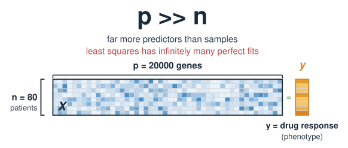
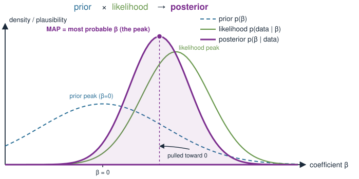
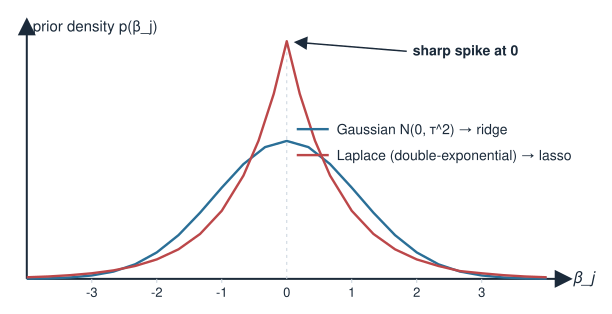
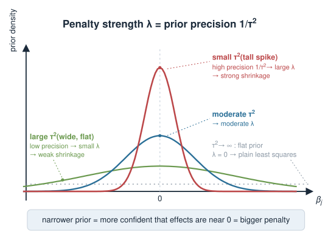
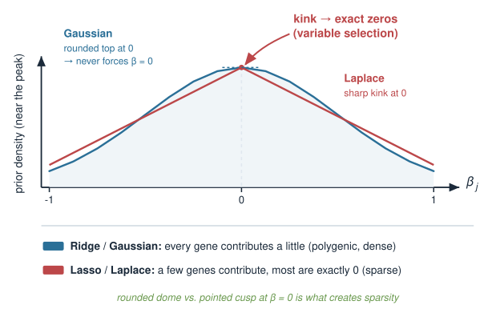
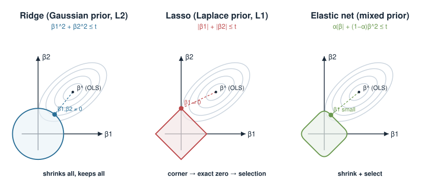
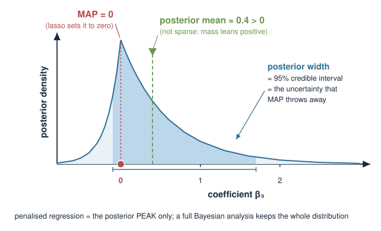
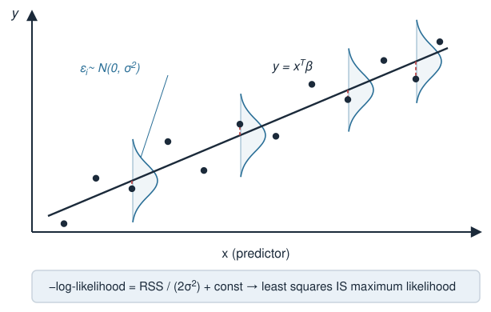

## About this lecture

In **Ridge and lasso regression** we added a **penalty** to least squares to tame wobbly coefficients. In the **Bayesian inference** block we learned to combine a **prior** with a **likelihood**. Today we show these are **the same move seen from two sides**.

- A penalty on the coefficients *is* a **prior belief** about the coefficients.
- Minimising *penalised loss* = finding the **most probable coefficients** given the data (the **MAP** estimate).
- **Ridge** ⇔ a **Gaussian** prior; **lasso** ⇔ a **Laplace** (double-exponential) prior.
- The penalty strength $\lambda$ encodes **how sure** you were before seeing data — the **prior precision**.

This is a **concept** day: no derivations, one slogan, two demos, and a change of viewpoint that makes both blocks click together.

::: notes
The single idea for today: a penalty and a prior are two languages for the same statement. The engineer says "I penalise large coefficients to stop overfitting"; the Bayesian says "I believe a priori that coefficients are small." They write down the *same* objective and get the *same* answer. Everything else — ridge = Gaussian, lasso = Laplace, lambda = prior precision — is detail hanging off that equivalence. Stress that this reframes material students already own from Ridge and lasso regression and from Bayesian inference; nothing here is a brand-new technique, it is a unifying view.
:::

## A biology picture first {.smaller}

You want to predict a phenotype — say **drug response** — from a gene-expression profile.

- You measure **20 000 genes** in **80 patients**. Far **more predictors than samples** ($p \gg n$).
- Plain least squares is hopeless here: it has infinitely many perfect fits and memorises noise.
- But you *know things before you look*: **most genes are irrelevant** to this drug, and the few that matter probably have **modest** effects, not wild ones.

That prior knowledge is exactly what a **penalty** quietly injects. Today we make the belief **explicit**: what does ridge assume about your genes? What does lasso assume?

{width="80%" fig-align="center"}

::: notes
Ground the abstraction in the canonical omics predicament: wide matrices, p far bigger than n, where ordinary least squares cannot even be computed uniquely. Biologists already carry strong priors into such problems — sparsity (few driver genes) and modest effect sizes (biology is buffered, single genes rarely swing a phenotype enormously). The penalty they used in Ridge and lasso regression was silently encoding one of these beliefs. The lecture's promise: name the belief. By the end they should be able to say which biological assumption ridge makes and which lasso makes, and choose accordingly.
:::

## Recap: the penalised objective {.smaller}

From **Ridge and lasso regression**, we fit the coefficients $\beta$ by making this as small as possible:

$$\underbrace{\text{RSS}}_{\text{fit error: how badly the model misses the data}} \;+\; \lambda \times \underbrace{\text{penalty}}_{\text{how big the coefficients are}}$$

- **Ridge:** penalty $= \sum \beta^2$ (sum of squares).
- **Lasso:** penalty $= \sum |\beta|$ (sum of absolute values).

$\lambda \ge 0$ dials the penalty: $\lambda = 0$ is plain least squares; large $\lambda$ shrinks coefficients hard toward $0$.

::: notes
Pure recap, no new content: re-establish "fit error plus lambda times penalty" so the Bayesian side has something to map onto. RSS is the residual sum of squares, the total squared miss between the data and the fitted values. Remind them ridge shrinks all coefficients smoothly toward zero but keeps them nonzero, while lasso can set some exactly to zero (variable selection). Keep lambda's role vivid: it is the single knob trading fit against simplicity. We are about to reinterpret each piece in probability language.
:::

## Recap: Bayes in one line {.smaller}

From **Bayesian inference**: to learn parameters $\boldsymbol\beta$ from data, combine what you believed before with what the data say.

$$\underbrace{p(\boldsymbol\beta \mid \text{data})}_{\text{posterior}} \;\propto\; \underbrace{p(\text{data} \mid \boldsymbol\beta)}_{\text{likelihood}} \;\times\; \underbrace{p(\boldsymbol\beta)}_{\text{prior}}$$

- **Likelihood** — how well a given $\boldsymbol\beta$ explains the observed data.
- **Prior** — how plausible that $\boldsymbol\beta$ was *before* seeing any data.
- **Posterior** — the updated belief, combining both.

A quick summary of the posterior is its **peak** — the single most probable $\boldsymbol\beta$. That is the **MAP** estimate (*maximum a posteriori*), and it is where the bridge to penalties is built.

::: notes
Second recap slide. Reinstate the prior/likelihood/posterior trinity from the Bayesian block. Emphasise proportionality: we drop the normalising constant p(data) because it does not depend on beta and so does not move the location of the peak. Introduce MAP gently as "the top of the posterior hill" — a point summary, in contrast to the full posterior distribution a Bayesian would ideally report. Foreshadow the caveat slide: MAP throws away the width of the posterior, which matters, but it is exactly the quantity that equals penalised regression.
:::

## The bridge: penalty = how unlikely the prior finds $\beta$ {.smaller}

Finding the **posterior peak** (MAP) means finding the $\beta$ that does well on **both** counts at once:

| | Bayesian view | Penalised view |
|---|---|---|
| how well $\beta$ explains the data | **likelihood** | **fit error (RSS)**: small RSS = high likelihood |
| how plausible $\beta$ was beforehand | **prior** | **penalty**: big penalty = the prior finds $\beta$ unlikely |

**Slogan:** *the penalty is how unlikely the prior finds $\beta$.* Minimising "RSS + penalty" is climbing to the top of "likelihood × prior". Same answer, two languages.

{width="60%" fig-align="center"}

::: notes
This replaces the derivation. Two sentences carry it. (1) With Gaussian noise, a line with a small total squared miss (RSS) is a line under which the data are likely: least squares is maximum likelihood, as in the Linear regression block. (2) A prior that says "coefficients are near 0" finds big coefficients unlikely, and the penalty is exactly that unlikeliness, written as a cost. Adding the two costs and minimising lands on the same beta as multiplying likelihood by prior and taking the peak: in the figure, the posterior peak sits between the prior peak at 0 and the likelihood peak, pulled toward 0, exactly like a penalised estimate. Students do not need to reproduce why; the optional slide near the end has the log algebra for those who want it.
:::

## Adding a prior on the coefficients {.smaller}

Now put a **prior** on each coefficient $\beta$, centred at $0$ — encoding "before seeing data, I expect effects to be **small**, and I have no reason to prefer positive over negative."

The **shape** of the prior is the modelling choice. Two natural bell-ish curves centred at $0$:

- a **Gaussian** with variance $\tau^2$ — a rounded top, light-ish tails;
- a **Laplace** (double-exponential) — a **sharp spike** at $0$ with heavier tails.

Each shape, read as "how unlikely is this $\beta$", gives a **different penalty**. That is the whole story.

{width="60%" fig-align="center"}

::: notes
The prior is a statement about coefficients before data. Centring at zero encodes shrinkage-toward-zero and symmetry encodes no directional preference. The variance/scale of the prior encodes how small we think effects are. Preview the punchline visually: Gaussian is a smooth hump, Laplace has a pointed cusp at zero. Tell them to hold that cusp in mind — it is the geometric reason lasso produces exact zeros while ridge does not. The next slide names the two penalties.
:::

## Ridge = Gaussian prior, lasso = Laplace prior {.smaller}

| Prior on each $\beta$ | How unlikely it finds $\beta$ grows like | Penalty | Method |
|---|---|---|---|
| **Gaussian**, variance $\tau^2$ | $\beta^2$: a smooth bowl | $\sum \beta^2$ | **ridge** |
| **Laplace**, scale $b$ | $\lvert\beta\rvert$: a V | $\sum \lvert\beta\rvert$ | **lasso** |

These are **identities**, not analogies: the ridge estimate *is* the posterior peak under a Gaussian prior, and the lasso estimate *is* the posterior peak under a Laplace prior.

The prior's width sets $\lambda$: **a narrow prior means a big $\lambda$.** For ridge, $\lambda = \sigma^2/\tau^2$ (noise variance over prior variance).

::: notes
State the two results as facts. A Gaussian prior is unhappy with a coefficient in proportion to beta squared, so the penalty it adds is the ridge sum of squares; a Laplace prior is unhappy in proportion to |beta|, so it adds the lasso sum of absolute values. The width of the prior becomes lambda: the narrower the prior (the more sure you are that effects are near 0), the bigger lambda. For ridge the exact exchange rate is lambda = sigma^2 / tau^2; for lasso it is lambda = 2 sigma^2 / b. Where these come from is on the optional maths slide; nobody needs to derive them. Stress the identity: same objective, same vector of numbers.
:::

## Penalty strength = prior precision {.smaller}

Read "narrow prior means big $\lambda$" as a statement about **confidence**. The **precision** of the prior is $1/\tau^2$ — how tightly it is concentrated at $0$.

| Prior variance $\tau^2$ | Prior belief | Precision $1/\tau^2$ | $\lambda$ | Effect |
|---|---|---|---|---|
| small | "effects are **surely** tiny" | high | **large** | strong shrinkage |
| large | "effects **could be** anything" | low | **small** | weak shrinkage |
| $\tau^2 \to \infty$ | flat / no prior | $0$ | $0$ | plain least squares |

So **choosing $\lambda$ is choosing how sure you were before the data.** A big penalty is not an arbitrary knob — it is a **strong, confident prior** that the genes have small effects.

`lfcShrink` in *Bulk RNA-seq with DESeq2* is a prior centred at 0 on each fold change: noisy low-count genes are pulled in, well-measured genes barely move.

{width="55%" fig-align="center"}

::: notes
This slide is the conceptual payoff. Large lambda equals small prior variance equals high prior precision equals strong conviction that coefficients are near zero. Small lambda equals diffuse prior equals letting the data speak. The limit tau^2 to infinity is a "flat" (improper) prior, under which MAP collapses to maximum likelihood, i.e. ordinary least squares. This reframes cross-validation for lambda (from Ridge and lasso regression) as data-driven tuning of how strong a prior to adopt. Biologically: setting lambda large is asserting you already believe most genes barely matter. Recall lfcShrink from the bulk RNA-seq day: it puts a prior centred at 0 on every fold change, and since the likelihood is weak for low-count genes, the prior wins there; for high-count genes the data win.
:::

## Why the shape matters: sparsity {.smaller}

The two priors differ most **right at $\beta = 0$**:

- **Gaussian:** a **rounded top** at $0$. Near zero its penalty bowl is almost flat, so the pull toward $0$ fades away and never finishes the job. Ridge shrinks everything but keeps every $\beta \ne 0$.
- **Laplace:** a **pointed top** at $0$. Its V-shaped penalty keeps pulling just as hard right up to $0$, so weak coefficients land **exactly on $0$** (variable selection).

{width="55%" fig-align="center"}

So the biological reading is direct:

- **Ridge / Gaussian prior:** *"every gene contributes a little"* — a **polygenic**, dense belief.
- **Lasso / Laplace prior:** *"a few genes contribute, most contribute nothing"* — a **sparse** belief.

::: notes
This is the intuition students should leave with: pointed top versus rounded top. The point of the Laplace at zero is what makes lasso select variables: there is a genuine corner the fit can land on with a coefficient at exactly zero. The Gaussian's rounded top gently discourages large values but never pins anything to zero. The next demo shows it for one coefficient. Translate to biology, which is the whole point of the pairing: choosing ridge vs lasso is choosing between a polygenic model (many small effects, e.g. height, complex traits) and a sparse model (a handful of drivers, e.g. a few oncogenes). The right choice is a biological hypothesis, now made explicit as a prior.
:::

## Try it: one coefficient, two priors

```{=html}
<link rel="stylesheet" href="../demos/dist/demo.css">
<div data-demo="penaltygeom" data-mode="prior1d"></div>
<script src="../demos/dist/penaltygeom.js"></script>
```

::: notes
One coefficient beta. Green is the prior, grey the likelihood (centred on the estimate from the data alone), purple the posterior, with its peak marked; the side panel shows the penalty the prior stands for. The slider "how sure we are that beta is near 0" narrows the prior and the readout shows the matching lambda (narrow prior = big lambda). Defaults: Gaussian prior of width 0.5 (lambda = 4), data alone say beta = 1 from n = 5 samples: the peak is at 0.56, pulled 0.44 toward 0. Click the Laplace prior at the same width (lambda about 5.7): the peak is 0.43. Now drag the data strength down to n = 2: the Laplace peak jumps to exactly 0 ("gene dropped"); it stays there until the data-alone estimate is above about 1.4. Switch back to Gaussian at n = 2: the peak is 0.33, smaller but never exactly 0, however weak the data. Point at the penalty panel: the parabola is flat at the bottom, so its pull fades near 0; the V keeps its sharp tip, so it keeps pulling and can hold beta at exactly 0.
:::

## Try it: two coefficients, prior × likelihood → posterior peak

```{=html}
<link rel="stylesheet" href="../demos/dist/demo.css">
<div data-demo="penaltygeom" data-mode="prior" data-ols="2 0.6" data-corr="0.4" data-lambda="2" data-alpha="0"></div>
<script src="../demos/dist/penaltygeom.js"></script>
```

::: notes
Live version of the last few slides, for two coefficients. Green shading is the prior (darker = more prior belief), grey ellipses are the likelihood centred on the ordinary least squares (OLS) / maximum-likelihood point, purple contours are the posterior, and the purple dot is the posterior peak (MAP), which is exactly the penalized estimate; the path panel on the right is the same ridge/lasso path as in Ridge and lasso regression. The demo fixes sigma squared at 1, so the readout shows tau squared = 1/lambda for the Gaussian and b = 2/lambda for the Laplace. Start with the Gaussian prior (ridge): the MAP sits between the prior centre and the ordinary least squares point, with both coefficients nonzero. Raise lambda: the prior tightens (a more confident prior) and pulls the MAP toward zero; lower it and the MAP slides back to the ordinary least squares point. Now click the Laplace prior at lambda = 2: the shading becomes diamonds, and the MAP jumps onto the beta-1 axis, so beta-2 is exactly zero (red mark) — the cusp at work. Drag the ordinary least squares point a little: the MAP stays on the axis over a whole range, while the Gaussian MAP never does. Close with the caveat slide in mind: the purple contours show a whole posterior, and MAP reports only its peak.
:::

## Choosing a prior is a biological statement {.smaller}

Because the penalty *is* a prior, picking a penalty is picking a **hypothesis about your system** — state it out loud:

| Biological belief | Prior | Penalty | Behaviour |
|---|---|---|---|
| "Many genes, each a small effect" (polygenic trait) | Gaussian | ridge ($\sum\beta^2$) | shrink all, keep all |
| "A few driver genes, rest irrelevant" | Laplace | lasso ($\sum\lvert\beta\rvert$) | select a sparse set |
| "Effects are small *and* mostly zero" | Gaussian + Laplace mix | **elastic net** | shrink + select |
| "I truly know nothing" | flat | none | least squares (fails if $p\gg n$) |

The elastic net (from **Ridge and lasso regression**) is the MAP under a **blend** of the two priors — which is why it both shrinks *and* selects.

{width="80%" fig-align="center"}

::: notes
Bring it together as a decision table the student can actually use. The framing to hammer: you are not tuning a machine, you are declaring what you believe about the biology, and different beliefs are different priors that happen to have familiar penalty names. Elastic net slots in naturally as a mixed prior (a combination of Gaussian and Laplace), explaining its hybrid behaviour without new machinery. The last row is a warning: a genuinely flat prior in the p>>n regime gives you nothing to lean on and least squares breaks — which is exactly why some prior/penalty is not optional in genomics.
:::

## A glimpse in R {.smaller}

Nothing new to run — the same `glmnet` fit you used in **Ridge and lasso regression** is a MAP estimate under a prior. The point is only to *read* it that way:

```r
library(glmnet)

# X: 80 patients x 20000 genes ; y: drug response
fit <- glmnet(X, y, alpha = 0)   # alpha = 0  -> ridge   (Gaussian prior)
fit <- glmnet(X, y, alpha = 1)   # alpha = 1  -> lasso   (Laplace prior)
fit <- glmnet(X, y, alpha = 0.5) # 0<alpha<1  -> elastic net (mixed prior)

# lambda picked by cross-validation = data-driven choice of prior strength
cvfit  <- cv.glmnet(X, y, alpha = 1)
lambda <- cvfit$lambda.min       # small lambda = weak prior; large = strong prior
```

Reading each line as a prior:

- `alpha` selects the **prior shape** (Gaussian, Laplace, or a blend).
- `lambda` sets the **prior precision** — how strongly you assert small effects *before* the data.
- cross-validating `lambda` = letting the **data choose how confident a prior** to hold.

::: notes
Deliberately no new code — this is the code they already met, relabelled. glmnet's alpha mixes L2 and L1 penalties, i.e. mixes Gaussian and Laplace priors, so alpha is literally a prior-shape dial and lambda a prior-strength dial. Reinforce that cross-validating lambda is an empirical way to set prior confidence, a pragmatic hybrid of Bayesian and frequentist thinking. Since no packages run at render time, this is a static illustration; students run it in the exercise. Do not overclaim: glmnet reports the MAP point, not a full posterior — segue to the caveat.
:::

## Caveat: MAP is only the peak {.smaller}

The equivalence is exact, but it identifies penalised regression with the **peak** of the posterior — not the whole thing.

- A full **Bayesian** analysis reports the **entire posterior**: the peak *and its width* (uncertainty), so you get credible intervals on each $\beta$. MAP throws the width away.
- The prior "variance" $\tau^2$ (or scale $b$) is usually **not known** in advance. Cross-validating $\lambda$ is a practical stand-in for a fully Bayesian treatment of that unknown.
- *(Optional subtlety)* Under the Laplace prior, the **peak** has exact zeros but the posterior **average** does not: "lasso = Bayesian sparsity" holds for the peak only.

The bridge is genuine and useful, but "penalised regression is secretly Bayesian" is a **statement about the MAP point**, with the honesty a real Bayesian analysis adds on top.

{width="55%" fig-align="center"}

::: notes
Intellectual honesty slide, in the spirit of the course's "be honest about what we defer" principle. The penalty-equals-prior identity is real but partial: it matches the posterior mode, discarding the uncertainty that is arguably the whole benefit of going Bayesian. Two caveats worth stating: (1) treating tau^2/b as fixed and known is a simplification; a full hierarchical Bayesian model would put a prior on it too, and cross-validation is the frequentist workaround. (2) The Laplace-MAP is sparse but the Laplace-posterior-mean is not, so one must be careful about which "Bayesian lasso" is meant. Do not overstate the unification; present it as a clarifying viewpoint, not a replacement for either method.
:::

## Optional: the maths behind penalty = prior {.smaller}

::: {.callout-note collapse="true" title="Optional: the maths"}
**Logs turn the product into a sum.** The logarithm is increasing, so it does not move the peak; $-\log$ turns *maximise* into *minimise*:
$$\arg\max_{\beta}\ p(\beta\mid\text{data}) = \arg\min_{\beta}\ \big[-\log p(\text{data}\mid\beta) \;-\; \log p(\beta)\big].$$

**Fit term.** With Gaussian noise of variance $\sigma^2$, $-\log p(\text{data}\mid\beta) = \text{RSS}/2\sigma^2 + \text{const}$.

**Penalty term.** Gaussian prior $p(\beta_j)\propto e^{-\beta_j^2/2\tau^2}$ gives $-\log p = \sum_j \beta_j^2/2\tau^2 + \text{const}$. Laplace prior $p(\beta_j)\propto e^{-|\beta_j|/b}$ gives $\sum_j |\beta_j|/b + \text{const}$.

**Exchange rate.** Multiply the whole objective by $2\sigma^2$ (this does not move the minimum): $\text{RSS} + \tfrac{\sigma^2}{\tau^2}\sum_j\beta_j^2$ is ridge with $\lambda = \sigma^2/\tau^2$; $\text{RSS} + \tfrac{2\sigma^2}{b}\sum_j|\beta_j|$ is lasso with $\lambda = 2\sigma^2/b$.
:::

{width="45%" fig-align="center"}

::: notes
Optional slide for students who want the formulas behind the slogan; nothing in the main path or the exercise main items needs it. Take minus the log of "likelihood times prior": the Gaussian noise gives RSS over 2 sigma^2, the Gaussian prior gives the sum of squares over 2 tau^2, the Laplace prior the sum of absolute values over b. Clearing the 2 sigma^2 gives the two lambdas. The figure shows the fit term's origin: Gaussian noise around the line, whose minus-log is RSS / 2 sigma^2. The optional items B2 to B4 in the exercise walk through these steps.
:::

## Summary {.smaller}

| Penalised view | Bayesian view |
|---|---|
| minimise RSS + penalty | maximise posterior (find the **MAP**) |
| fit error (RSS) | the **likelihood**: small RSS = data likely (Gaussian noise) |
| penalty | how unlikely the **prior** finds $\beta$ |
| ridge, $\sum\beta^2$ | **Gaussian** prior |
| lasso, $\sum\lvert\beta\rvert$ | **Laplace** prior |
| penalty strength $\lambda$ | **prior precision**: narrow prior = big $\lambda$ |
| large $\lambda$ | tight, confident prior at $0$ |
| lasso's exact zeros | Laplace's **pointed top** at $0$ (sparse belief) |

**Take-home:** a penalty is a prior in disguise. Choosing ridge vs lasso is choosing a **biological hypothesis** — polygenic vs sparse — and $\lambda$ is how strongly you hold it. **Related:** the penalties themselves in **Ridge, lasso & elastic net**; full posteriors in **Fitting equations (regression)**. **Next (week 5):** *Beyond linear models*.

::: notes
The summary table is the one thing to photograph. Recite the mapping once more as a two-column dictionary: fit-plus-penalty on the left, MAP-of-a-posterior on the right, row by row. Land on the two headline messages: (1) penalty = prior, so (2) model choice is a biological hypothesis, and lambda is your confidence in it. Point forward to the Bayesian inference block for the full-posterior treatment this MAP view abbreviates, and back to Ridge and lasso regression for the mechanics of the penalties.
:::
