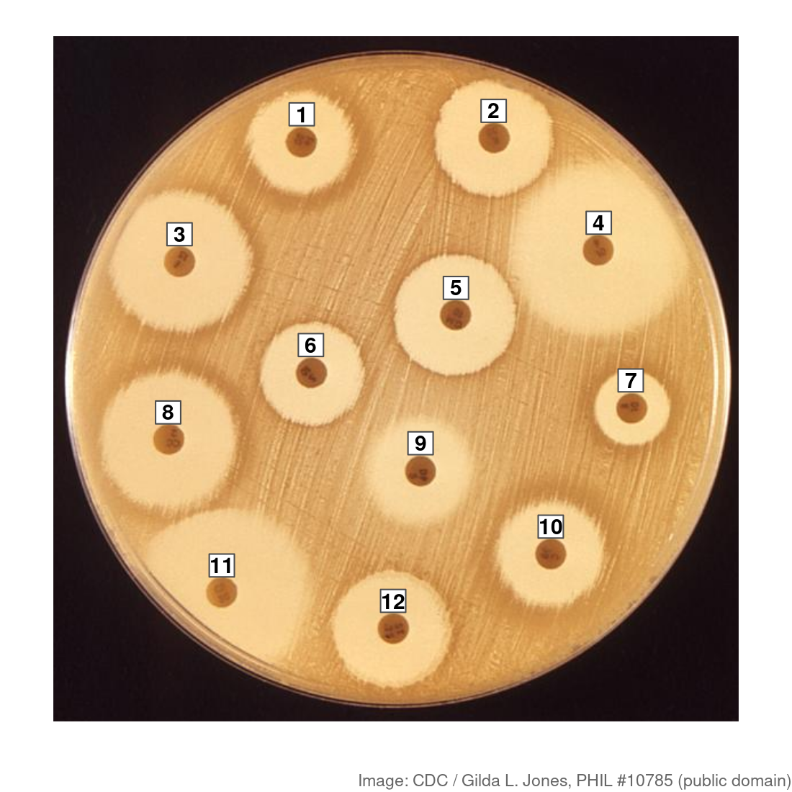
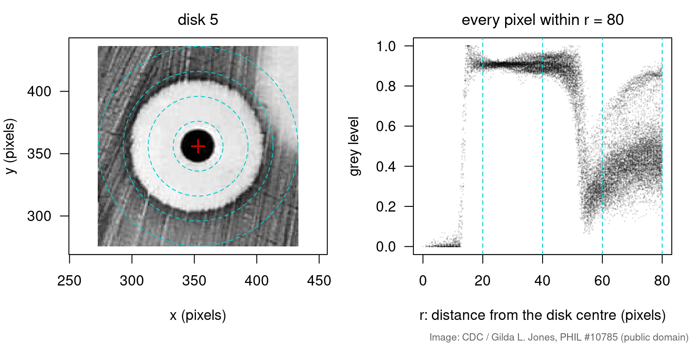
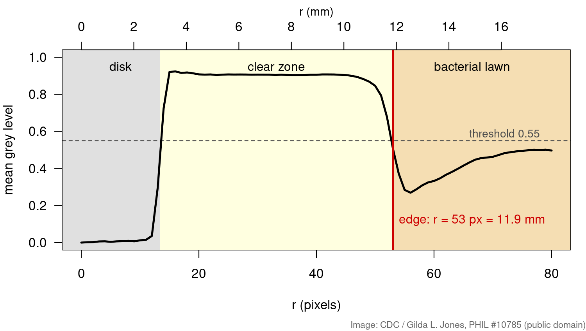
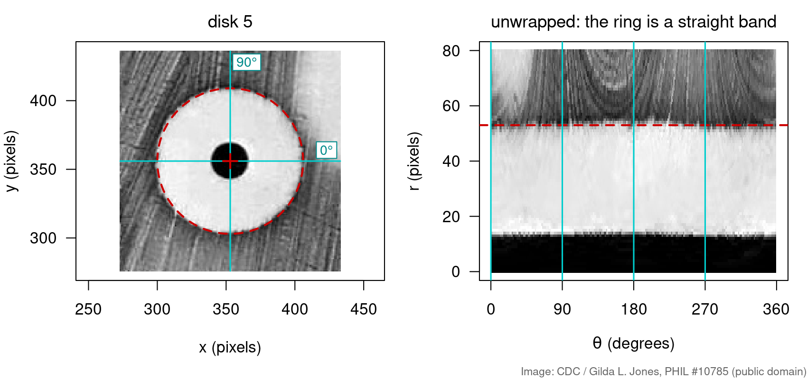
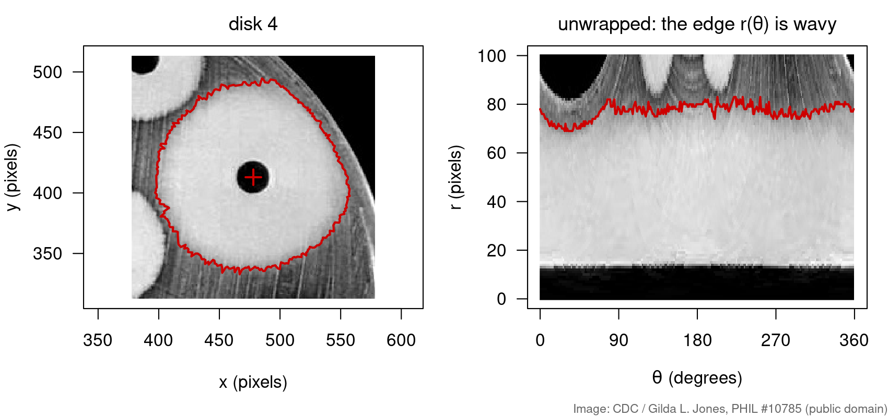
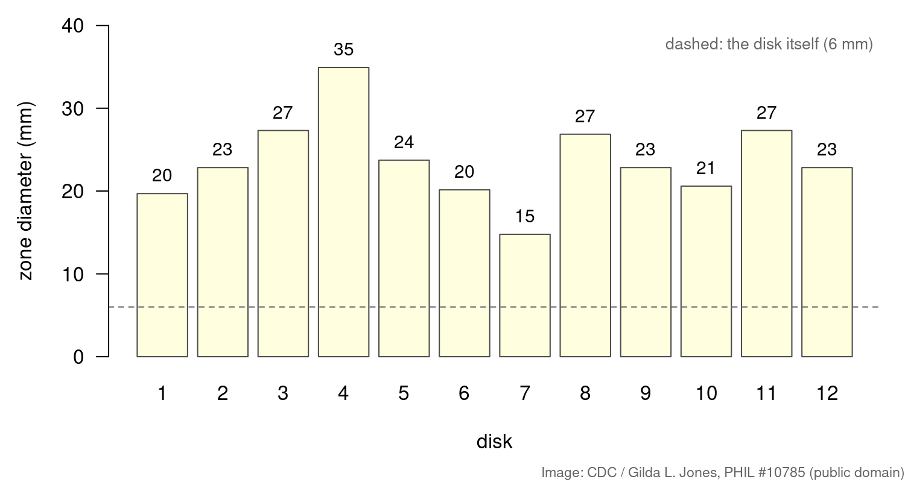

## Goal

By the end of this exercise you should be able to:

- convert between $(x, y)$ and polar coordinates $(r, \theta)$ around a chosen centre, by hand and with [`sqrt`](https://rdrr.io/r/base/MathFun.html) and [`atan2`](https://rdrr.io/r/base/Trig.html),
- explain why the change to polar coordinates is **not** a matrix transformation,
- compute a **radial profile** of an image and find the edge of a ring in it,
- **unwrap** an image around a centre and measure how round a zone is,
- turn a distance in pixels into millimetres with an object of known size.

This builds on Transforming images with matrices; the image setup is the same. Polar coordinates are a very useful transformation, but a **nonlinear** one: no matrix can do it.

## Background

Around a centre $(x_0, y_0)$, a point $(x, y)$ has

$$r = \sqrt{(x - x_0)^2 + (y - y_0)^2}, \qquad \theta = \operatorname{atan2}(y - y_0,\ x - x_0)$$

and, going back, $x = x_0 + r\cos\theta$, $y = y_0 + r\sin\theta$. In R, `atan2(dy, dx)` returns $\theta$ in radians between $-\pi$ and $\pi$ (multiply by `180 / pi` for degrees). Note the order: `dy` first.

**The disk diffusion test.** Paper disks (6 mm across), each soaked in an antibiotic, are placed on agar covered with bacteria. Where the diffusing drug is strong enough, no bacteria grow: a clear **zone of inhibition** around the disk. Its diameter in mm, compared with a breakpoint table for that drug and species, tells the lab whether the strain is susceptible or resistant.

## By hand

**B1.** Take the centre at the origin. Find $r$ and $\theta$ (in degrees) for $(3, 4)$, $(0, -2)$ and $(-1, -1)$. For the last point, what does `atan(dy / dx)` give, and why is it wrong?

**B2.** Go back: which $(x, y)$ has $r = 2$, $\theta = 90^\circ$? And $r = 4$, $\theta = 180^\circ$, with the centre at $(10, 10)$?

**B3.** Let $f$ map a point to its polar coordinates $(r, \theta)$ around the origin. Compute $f(p)$, $f(q)$ and $f(p + q)$ for $p = (1, 0)$ and $q = (0, 1)$. Is $f(p + q) = f(p) + f(q)$? What does that tell you about whether $f$ can be written as a matrix?

**B4.** In a photo, a 6 mm disk is 27 pixels wide. The zone around it is 110 pixels across. What is the zone diameter in mm?

## Explore {#explore}

The demo below shows the plate around one disk. Drag the red cross (or press anywhere on the photo) to move the centre. On the right: the photo **unwrapped** around that centre ($\theta$ across, $r$ up, as in R3) and the **radial profile** (mean grey level at each $r$, as in R2). Yellow marks pixels brighter than the threshold; the red line is the edge found separately for each angle, as in R4. The grey curve is the profile at the best centre.

```{=html}
<link rel="stylesheet" href="../demos/dist/demo.css">
<div data-demo="polar" data-disk="5" data-disks="5 4 11 7" data-offset="9 -6"></div>
<script src="../demos/dist/polar.js"></script>
```

**E1.** The demo starts with the centre a little off disk 5. What shape does the zone edge have in the strip, and at which angle is it furthest from the centre? In which direction, and roughly how far, should you move the centre? Try it, then compare with "snap to best centre".

**E2.** At the best centre, read off the edge and the zone diameter. Compare with R2. Why is the drop in the profile so much steeper than at the starting centre?

**E3.** Choose disk 4 and snap. Can any centre make its edge flat? What does that tell you about the zone?

**E4.** Choose disk 11 and snap. Move the threshold between 0.5 and 0.6 and watch the profile edge. Do the same for disk 5. Which zone is more sensitive to the threshold, and why? (Compare R5.)

::: {.callout-note collapse="true" title="Solutions"}
**E1.** The edge is a wave instead of a straight line: about 41 to 66 pixels, furthest at about 145° (up and to the left) and nearest at about 305° (down and to the right). The true centre lies in the direction where the edge is furthest away, so move the centre up and to the left, by about half the spread: $(66 - 41) / 2 \approx 12$ pixels. The snap lands at about $(352, 356.5)$, 12 pixels from the start and within a pixel or two of the table centre $(353, 356)$.

**E2.** The edge is at $r = 53$ pixels, a diameter of $2 \cdot 53 / 4.47 \approx 23.7$ mm, as in R2. The profile is a mean over all angles. When the centre is right, every angle sees the edge at (almost) the same $r$, so they all drop together. Off-centre, each angle drops at a different $r$ (41 to 66 pixels), and their mean falls slowly over that whole range: the edge is smeared out, and the profile edge (60 pixels at the start) is wrong.

**E3.** No. At the best centre the edge per angle still runs from about 71 to 83 pixels; moving the centre only shifts which side is too far. The zone itself is not a circle (R4): it is cut short towards the plate rim and stretched towards disk 5.

**E4.** At the best centre of disk 11, the profile edge moves from 69 pixels (threshold 0.5) to 62 (0.55) and 53 (0.6): from about 31 mm to 24 mm. For disk 5 it barely moves (54, 53, 53 pixels). Disk 11's zone fades out gradually (partial inhibition at its rim), so its profile drops slowly and every threshold crosses it at a different $r$. Disk 5 has a sharp edge: a steep drop, which any threshold between lawn and zone crosses at the same place. For disk 11 the per-angle edge is not even found in some directions at threshold 0.5.
:::

## In R

Download [`plate.jpg`](plate.jpg) into your R working directory. It is a greyscale version of a disk diffusion test (image: CDC / Gilda L. Jones, 1972, [Public Health Image Library #10785](https://phil.cdc.gov/Details.aspx?pid=10785), public domain). The clear zones are light, the bacterial lawn is darker, and the paper disks are black.

{width="55%" fig-align="center"}

```r
img <- jpeg::readJPEG("plate.jpg")                # 600 x 600 grey levels, 0..1
img <- t(img[nrow(img):1, ])                      # flip so up is up; now img[x, y]
xy  <- t(expand.grid(1:nrow(img), 1:ncol(img)))   # 2 x N: one pixel per COLUMN

# centres of the 12 disks, in pixels
disks <- data.frame(x = c(218, 386, 111, 478, 353, 226, 506, 101, 322, 436, 148, 298),
                    y = c(508, 511, 403, 413, 356, 306, 275, 247, 220, 147, 113,  82))
px_per_mm <- 26.8 / 6                             # a 6 mm disk is about 26.8 pixels wide

image(1:600, 1:600, img, col = gray.colors(256, 0, 1), asp = 1)   # the plate
text(disks$x, disks$y + 20, 1:12, col = "red")
```

`img[x, y]` is the grey level at pixel $(x, y)$, and `img[cbind(i, j)]` looks up many pixels at once.

**R1.** For disk 5 (centre `353, 356`), compute `r` and `theta` for **every** pixel, as two vectors. Plot the grey level against `r` for the pixels with `r <= 80`. Name the parts of the plot: where is the disk, the clear zone and the lawn? Then colour the points by `theta` (e.g. `col = hcl.colors(8)[cut(theta[near], 8)]`): which direction does the second, brighter cloud at large `r` come from?

**R2.** Compute the **radial profile** of disk 5 with `tapply(img[near], round(r[near]), mean)` and plot it. Find the edge as the first radius of at least 16 pixels (past the disk) where the profile drops below 0.55. Convert the diameter to mm. Repeat for disk 7 (centre `506, 275`).

**R3.** Write the function `unwrap(x0, y0, rmax = 80)` from the lecture, which returns a matrix with one row per radius $0, 1, \ldots, r_{max}$ and one column per degree. Unwrap disk 5 and show it with `image(0:359, 0:80, t(u), col = gray.colors(256, 0, 1))`. Check that `rowMeans(u)` gives the same edge as R2.

**R4.** Unwrap disk 4 (centre `478, 413`) with `rmax = 100`. For **each** angle (column), find the edge with the same rule as in R2. Plot the edge against the angle. How much does the radius vary? In which directions is it shortest and longest, and what is there on the plate? (Look at the picture above.)

**R5.** Measure all 12 zones: write `edge_of(p)` for a profile `p`, then use `sapply` over the disks. Make a bar plot of the diameters in mm. Then repeat with threshold 0.5 and 0.6 instead of 0.55. Which zone changes most, and why? Look at its edge on the plate.

## Hints

::: {.callout-tip collapse="true" title="Hint 1 — r and theta for every pixel"}
`xy[1, ]` holds the x coordinate of every pixel and `xy[2, ]` the y coordinate, so `dx <- xy[1, ] - x0` and `dy <- xy[2, ] - y0` are vectors with one entry per pixel. `r <- sqrt(dx^2 + dy^2)` and `theta <- atan2(dy, dx)` then work on all pixels at once, with no loop. `img[near]` picks the grey levels in the same order, because `as.vector(img)` and the columns of `xy` list the pixels in the same order.
:::

::: {.callout-tip collapse="true" title="Hint 2 — finding the edge in a profile"}
For a profile `p` at radii `0, 1, 2, ...`, `which(0:(length(p) - 1) >= 16 & p < 0.55)` lists the positions that are past the disk and dark. The first of them, `min(...)`, is the edge, as a position in the vector; subtract 1 to get the radius, because position 1 is $r = 0$. If the profile never drops below the threshold, `min()` returns `Inf` with a warning: increase `rmax`.
:::

::: {.callout-tip collapse="true" title="Hint 3 — unwrapping"}
`outer(r, cos(theta))` is a matrix with one row per radius and one column per angle, so `x0 + outer(r, cos(theta))` holds the x position of every grid point. `round()` turns positions into pixel indices; `cbind(as.vector(i), as.vector(j))` makes a two-column index matrix for `img[ ]`; `matrix(..., nrow = length(r))` puts the looked-up values back into the grid. Keep `rmax` small enough that the circle stays inside the image (1 to 600).
:::

## Solutions

::: {.callout-note collapse="true" title="Solution"}

**B1.** $(3, 4)$: $r = \sqrt{9 + 16} = 5$, $\theta = \operatorname{atan2}(4, 3) = 53.1^\circ$.
$(0, -2)$: $r = 2$, $\theta = -90^\circ$ (straight down; $270^\circ$ is the same direction).
$(-1, -1)$: $r = \sqrt 2 \approx 1.41$, $\theta = -135^\circ$ (down and to the left). `atan(-1 / -1) = atan(1)` gives $45^\circ$, which points up and to the right: the ratio $dy/dx$ is the same for $(1, 1)$ and $(-1, -1)$, so `atan` cannot tell opposite directions apart. `atan2` looks at the signs of both.

**B2.** $r = 2$, $\theta = 90^\circ$: $(2\cos 90^\circ, 2\sin 90^\circ) = (0, 2)$.
$r = 4$, $\theta = 180^\circ$ around $(10, 10)$: $(10 + 4\cos 180^\circ,\ 10 + 4\sin 180^\circ) = (6, 10)$.

**B3.** $f(p) = (1, 0^\circ)$, $f(q) = (1, 90^\circ)$, and $p + q = (1, 1)$, so $f(p + q) = (\sqrt 2, 45^\circ)$. But $f(p) + f(q) = (2, 90^\circ)$. They differ, so $f$ is not linear, and every matrix map is linear ($A(p + q) = Ap + Aq$). No matrix can turn $(x, y)$ into $(r, \theta)$.

**B4.** One mm is $27 / 6 = 4.5$ pixels, so $110 / 4.5 \approx 24.4$ mm.

**R1.**

```r
x0 <- 353; y0 <- 356
dx <- xy[1, ] - x0
dy <- xy[2, ] - y0
r     <- sqrt(dx^2 + dy^2)
theta <- atan2(dy, dx)
near  <- r <= 80
plot(r[near], img[near], pch = 16, cex = 0.3, xlab = "r (pixels)", ylab = "grey level")
plot(r[near], img[near], pch = 16, cex = 0.3, col = hcl.colors(8)[cut(theta[near], 8)])
```

{width="90%" fig-align="center"}

Up to $r \approx 13$ the grey level is near 0: the black disk. From about 14 to 50 it is high (about 0.9): the clear zone. Around $r = 53$ it drops sharply: the zone edge. Beyond that is the lawn (about 0.3), but from $r \approx 60$ the cloud splits: a brighter branch rises towards 0.8. Coloured by `theta`, the bright branch comes from angles of roughly 0° to 45°, i.e. up and to the right: the circle of radius 80 reaches into the zone of disk 4.

**R2.**

```r
prof <- tapply(img[near], round(r[near]), mean)
rr   <- as.numeric(names(prof))
plot(rr, prof, type = "l", xlab = "r (pixels)", ylab = "mean grey level")
edge <- min(rr[rr >= 16 & prof < 0.55])
edge                          # 53
2 * edge / px_per_mm          # 23.7 mm
```

{width="90%" fig-align="center"}

For disk 7, the same code with `x0 <- 506; y0 <- 275` gives an edge at 33 pixels, a diameter of about 15 mm: the smallest zone on the plate.

**R3.**

```r
unwrap <- function(x0, y0, rmax = 80) {
  r     <- 0:rmax
  theta <- (0:359) * pi / 180
  x <- x0 + outer(r, cos(theta))
  y <- y0 + outer(r, sin(theta))
  matrix(img[cbind(round(as.vector(x)), round(as.vector(y)))], nrow = length(r))
}
u <- unwrap(353, 356)
image(0:359, 0:80, t(u), col = gray.colors(256, 0, 1), xlab = "theta (degrees)", ylab = "r")
p <- rowMeans(u)
min(which(0:80 >= 16 & p < 0.55)) - 1     # 53, as in R2
```

{width="90%" fig-align="center"}

The ring becomes a horizontal band, with its edge a straight line at $r = 53$. `image()` wants the first index along the horizontal axis, hence `t(u)`. The two routes sample the plate differently (all pixels grouped by rounded $r$, versus 360 looked-up points per radius) but give the same edge.

**R4.**

```r
u4 <- unwrap(478, 413, rmax = 100)
edge_at <- apply(u4, 2, function(v) min(which(0:100 >= 16 & v < 0.55)) - 1)
plot(0:359, edge_at, type = "l", xlab = "theta (degrees)", ylab = "edge (pixels)")
range(edge_at)                         # 69 83
2 * range(edge_at) / px_per_mm         # 31 to 37 mm
which.min(edge_at) - 1                 # 28 degrees
which.max(edge_at) - 1                 # 203 degrees
```

{width="90%" fig-align="center"}

The radius varies from 69 to 83 pixels, so the zone is not a circle. It is shortest at about 28° (up and to the right), where the zone runs towards the rim of the plate, and longest at about 203° (down and to the left), towards disk 5, where the two zones almost touch. A single diameter for this zone hides a 6 mm spread; a lab would read the undisturbed side or repeat the test with the disks further apart.

**R5.**

```r
edge_of <- function(p, threshold = 0.55) min(which(0:(length(p) - 1) >= 16 & p < threshold)) - 1
profiles <- lapply(1:12, function(i) rowMeans(unwrap(disks$x[i], disks$y[i])))
diam <- function(threshold) 2 * sapply(profiles, edge_of, threshold = threshold) / px_per_mm
barplot(diam(0.55), names.arg = 1:12, xlab = "disk", ylab = "zone diameter (mm)")
round(cbind(t0.5 = diam(0.5), t0.55 = diam(0.55), t0.6 = diam(0.6)))
```

{width="90%" fig-align="center"}

With threshold 0.55 the zones range from 15 mm (disk 7) to 35 mm (disk 4). Changing the threshold to 0.5 or 0.6 moves most diameters by 0 to 2 mm, but disk 11 goes from 31 mm to 23 mm. On the plate, disk 11's zone fades out gradually instead of ending sharply: the bacteria are only partly inhibited near its rim, so "where the edge is" depends on what you call clear. Sharp edges make the measurement robust; fuzzy ones need a rule agreed in advance (labs read the edge of complete inhibition).
:::

## Where this leads

- **Finding the centres automatically:** we were given the disk centres. Software finds them first, e.g. by looking for dark round blobs, then measures each zone exactly as here.
- **Fourier transform & basis functions** (previous unit): a complex number $a + bi$ is a point in the plane, and `Mod()` and `Arg()` are its $r$ and $\theta$. That is why Fourier coefficients are read in polar form: size and phase.
- **Other radial biology:** the same radial-profile code measures the necrotic core of a tumour spheroid or the spread of a protein from the centre of a nucleus. Directions alone (do cells move towards a chemoattractant?) need **circular statistics**, because 359° and 1° are close.
