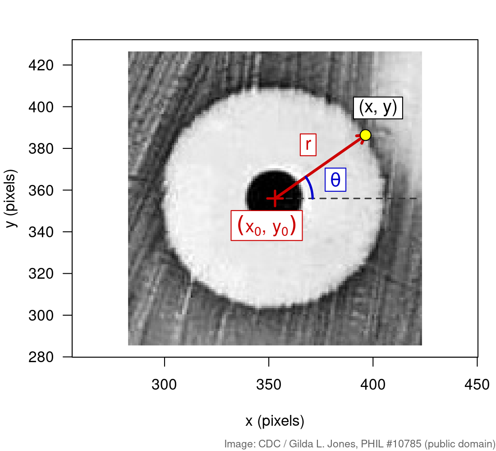
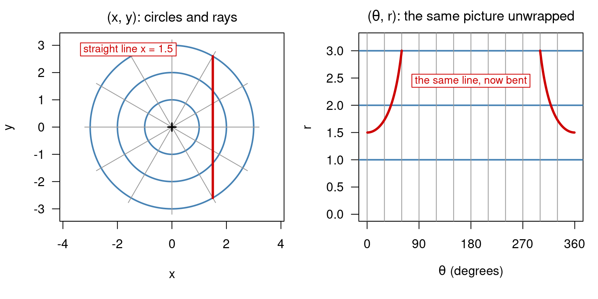

## About this lecture

Many things in biology grow or spread **outwards from a centre**: a drop of antibiotic, a colony, a tumour spheroid, a cell nucleus. For those, $(x, y)$ is the wrong way to describe a position. **Distance from the centre and direction** fit much better.

- **Polar coordinates** $(r, \theta)$: how far from the centre, and in which direction.
- Unlike rotation or shear, the change to polar coordinates is **not a matrix**.
- **Unwrapping** an image around a centre turns rings into straight lines.
- Biology: measuring the **zone of inhibition** of an antibiotic, from a photo of a real plate.

You need the `jpeg` package from Transforming images with matrices.

::: notes
This unit follows Transforming images with matrices and reuses its setup (image as img[x, y], pixel coordinates as a 2 x N matrix). The new idea is a coordinate change that is not linear, and the payoff is a real measurement that clinical microbiology labs make every day. The plate photo is from the CDC Public Health Image Library (PHIL #10785, Gilda L. Jones, 1972), public domain.
:::

## Biology: the disk diffusion test {.smaller}

:::: {.columns}
::: {.column width="48%"}
{width="100%"}
:::
::: {.column width="52%"}
Is this bacterium **resistant** to an antibiotic? The disk diffusion (Kirby–Bauer) test answers it in one plate:

- Spread bacteria evenly on agar; place 6 mm paper **disks**, each soaked in a different antibiotic.
- The drug diffuses outwards. Where it is strong enough, nothing grows: a clear **zone of inhibition**.
- Next day, measure each zone's **diameter in mm**. A lab compares it with a breakpoint table (EUCAST or CLSI) for that drug and species: **susceptible** or **resistant**.

Diffusion spreads equally in all directions, so the zones are (nearly) circles. Circles are easy in polar coordinates.

[Image: CDC / Gilda L. Jones, [Public Health Image Library #10785](https://phil.cdc.gov/Details.aspx?pid=10785), public domain.]{style="font-size: 0.6em; color: #666;"}
:::
::::

::: notes
This is the standard antimicrobial susceptibility test in clinical microbiology, and its result decides which antibiotic a patient gets. A bigger zone means the drug stops growth further from the disk, so the bacterium is more sensitive. In the lab the zone is usually read by eye with a ruler or calliper; automated plate readers do exactly what we do today: find each disk, then measure the zone around it. The disk numbers are ours; the photo does not say which drugs these are, so today we measure diameters, not S/R calls.
:::

## Polar coordinates {.smaller}

:::: {.columns}
::: {.column width="50%"}
A point $(x, y)$, seen from a centre $(x_0, y_0)$:

- $r$ = **distance** from the centre
- $\theta$ = **angle**, counter-clockwise from the $x$ direction

$$r = \sqrt{(x - x_0)^2 + (y - y_0)^2}, \qquad \theta = \operatorname{atan2}(y - y_0,\ x - x_0)$$

and back again:

$$x = x_0 + r\cos\theta, \qquad y = y_0 + r\sin\theta$$

```r
dx <- 3; dy <- 4
sqrt(dx^2 + dy^2)          # r = 5
atan2(dy, dx) * 180 / pi   # theta = 53.1 degrees
```
:::
::: {.column width="50%"}
{width="100%"}
:::
::::

[Image: CDC / Gilda L. Jones, PHIL #10785, public domain.]{style="font-size: 0.6em; color: #666;"}

::: notes
r is Pythagoras, and the "back again" formulas are the same cos and sin that appear in the rotation matrix. Use atan2, not atan: atan(dy / dx) cannot tell (1, 1) from (-1, -1) because the ratio is the same, so it only covers half the circle. atan2(dy, dx) looks at both signs and returns an angle between -180 and 180 degrees. Note the argument order: y first. Angles in R are in radians; multiply by 180/pi to get degrees.
:::

## Polar coordinates are not a matrix {.smaller}

{width="82%" fig-align="center"}

- Every transformation in Transforming images with matrices kept **straight lines straight**: that is what a matrix does.
- Polar coordinates turn **circles into straight lines** and **straight lines into curves**. No 2 × 2 matrix can do that.
- Check with one point: doubling $(1, 1)$ doubles $r$ but **keeps** $\theta$. A linear map would double both outputs.

::: notes
This is the conceptual point of the unit. A linear map satisfies f(a + b) = f(a) + f(b) and f(c a) = c f(a). For polar coordinates, f(2 p) = (2r, theta): theta does not scale. Also (1, 0) has theta = 0 and (0, 1) has theta = 90, but their sum (1, 1) has theta = 45, not 90. So there is no matrix for it, and we compute r and theta with sqrt and atan2 instead of %*%. The upside is the right panel: around the right centre, a circle is the simplest possible shape, a horizontal line.
:::

## Every pixel gets a distance {.smaller}

Load the plate as in Transforming images with matrices, then compute $r$ for **every** pixel around disk 5:

```r
img <- jpeg::readJPEG("plate.jpg")                # 600 x 600 grey levels, 0..1
img <- t(img[nrow(img):1, ])                      # flip so up is up; now img[x, y]
xy  <- t(expand.grid(1:nrow(img), 1:ncol(img)))   # 2 x N pixel coordinates
x0 <- 353; y0 <- 356                              # centre of disk 5
r  <- sqrt((xy[1, ] - x0)^2 + (xy[2, ] - y0)^2)   # one distance per pixel
near <- r <= 80
plot(r[near], img[near], pch = 16, cex = 0.3)     # grey level against distance
```

{width="70%" fig-align="center"}

[Download [`plate.jpg`](plate.jpg). Image: CDC / Gilda L. Jones, [PHIL #10785](https://phil.cdc.gov/Details.aspx?pid=10785), public domain.]{style="font-size: 0.6em; color: #666;"}

::: notes
No loop: r is computed for all 360 000 pixels in one vectorised line, just like A %*% xy moved every pixel at once. img[near] works because as.vector(img) has the same pixel order as the columns of xy. Reading the scatter: the dark disk (r < 13), the bright clear zone, a sharp drop at the zone edge near r = 53, then the darker lawn. Beyond r = 60 the cloud splits in two: towards the upper right the 80-pixel circle reaches into the next zone (disk 4). Ask students to find that in the left panel.
:::

## The radial profile: average over the angle {.smaller}

Group the pixels by distance and average: one number per radius.

```r
prof <- tapply(img[near], round(r[near]), mean)   # mean grey level at r = 0, 1, ..., 80
rr   <- as.numeric(names(prof))
edge <- min(rr[rr >= 16 & prof < 0.55])           # first radius past the disk that is dark
edge                                              # 53 pixels
2 * edge / (26.8 / 6)                             # diameter: 24 mm (a 6 mm disk is 26.8 px)
```

{width="72%" fig-align="center"}

[Image: CDC / Gilda L. Jones, PHIL #10785, public domain.]{style="font-size: 0.6em; color: #666;"}

::: notes
Averaging over theta throws away direction and keeps distance: 360 000 pixels become 81 numbers, and the noise from scratches and streaks averages out. The edge is where the profile crosses a threshold halfway between the zone (about 0.9) and the lawn (about 0.3); rr >= 16 skips the dark disk itself. The disk gives us a free ruler: it is 6 mm across and about 26.8 pixels in this photo, so 1 mm is about 4.5 pixels. Zone diameter = 2 * edge, converted to mm.
:::

## Unwrapping: work backwards from (r, θ) {.smaller}

To turn the ring into a **picture** in $(\theta, r)$, go backwards: for each $(r, \theta)$ on a grid, compute $x, y$ and look up the nearest pixel.

```r
unwrap <- function(x0, y0, rmax = 80) {
  r     <- 0:rmax
  theta <- (0:359) * pi / 180                     # one column per degree
  x <- x0 + outer(r, cos(theta))                  # (rmax + 1) x 360 grid of positions
  y <- y0 + outer(r, sin(theta))
  matrix(img[cbind(round(as.vector(x)), round(as.vector(y)))], nrow = length(r))
}
u <- unwrap(353, 356)                             # rows = r, columns = theta
```

{width="72%" fig-align="center"}

[Image: CDC / Gilda L. Jones, PHIL #10785, public domain.]{style="font-size: 0.6em; color: #666;"}

::: notes
This is the "work backwards" trick mentioned at the end of Transforming images with matrices: instead of pushing input pixels forward (which leaves holes), we ask, for every output position, where it comes from in the input. Here that is easy, because x = x0 + r cos(theta) is an explicit formula. round() picks the nearest pixel; image software interpolates between neighbours instead. img[cbind(i, j)] looks up many pixels at once by their (x, y) indices. In the strip the zone edge is a straight horizontal line at r = 53, and rowMeans(u) gives the same radial profile as tapply on the previous slide.
:::

## A zone that is not round {.smaller}

Disk 4 sits near the plate edge, between two other zones. Find the edge **separately for every angle**, one column of the strip at a time:

```r
u4 <- unwrap(478, 413, rmax = 100)
edge_at <- apply(u4, 2, function(v) min(which(0:100 >= 16 & v < 0.55)) - 1)   # row 1 is r = 0
range(edge_at)                                    # 69 to 83 pixels: not a circle
```

{width="72%" fig-align="center"}

- The edge $r(\theta)$ is a **curve** in the strip, not a line. Averaging over $\theta$ would hide that.
- Lab rule of thumb: an irregular or merging zone is unreliable; repeat the test or read the **undisturbed** side.

[Image: CDC / Gilda L. Jones, PHIL #10785, public domain.]{style="font-size: 0.6em; color: #666;"}

::: notes
apply(u4, 2, ...) runs the edge rule down each column, i.e. each direction. The edge lies between 69 and 83 pixels (31 to 37 mm as a diameter). The shortest radius points up and to the right, towards the plate rim, where only a thin strip of lawn is left; the longest points down and to the left, towards disk 5, where the two zones almost touch. In polar coordinates, "is it a circle?" becomes "is r(theta) flat?", a question about one curve. Large r also reaches into neighbouring zones (the bright bumps at the top of the strip), which is why rmax matters.
:::

## Measuring the whole plate {.smaller}

The same three lines for every disk: centre → unwrap → profile → edge.

```r
disks <- data.frame(x = c(218, 386, 111, 478, 353, 226, 506, 101, 322, 436, 148, 298),
                    y = c(508, 511, 403, 413, 356, 306, 275, 247, 220, 147, 113,  82))
edge_of <- function(p) min(which(0:80 >= 16 & p < 0.55)) - 1   # row 1 is r = 0
edges <- sapply(1:12, function(i) edge_of(rowMeans(unwrap(disks$x[i], disks$y[i]))))
diam_mm <- 2 * edges / (26.8 / 6)
```

{width="70%" fig-align="center"}

- Each diameter is then compared with the breakpoint for its drug and species.
- Disk 11 has a **fuzzy** edge: its diameter depends strongly on the threshold (exercise R5).

[Image: CDC / Gilda L. Jones, PHIL #10785, public domain.]{style="font-size: 0.6em; color: #666;"}

::: notes
Zones range from 15 mm (disk 7) to 35 mm (disk 4). Measurements are only as good as the scale (the disk is 6 mm; the 26.8-pixel width was measured once) and the threshold. Sharp edges barely move when the threshold changes (1 to 2 mm between thresholds 0.5 and 0.6); the fuzzy zone of disk 11 (partial inhibition at its rim) shifts by about 8 mm, which is exactly the situation where human readers also disagree. The disk centres were found once from the dark disks; finding them automatically is another image analysis step.
:::

## Polar coordinates elsewhere {.smaller}

The same move, "pick a centre, then use distance and angle", appears all over biology:

| Where | What $r$ or $\theta$ tells you |
|---|---|
| Tumour spheroids, organoids | radial profile of a stain: living rim, oxygen-starved **necrotic core** |
| Cell nucleus | how chromatin or a protein is spread from the centre to the nuclear envelope |
| Centrosome, mitotic spindle | microtubules radiate outwards: in $(\theta, r)$ they become vertical lines |
| Cell migration | $\theta$ alone: do cells move **towards** a chemoattractant? (circular statistics) |
| Fourier transform (later) | a complex coefficient is stored in polar form: size `Mod()` and phase `Arg()` |

::: notes
Pick one or two to mention depending on the audience. The spheroid case is the closest analogue to today: the same radial profile code, with a fluorescence image instead of a plate. Cell migration uses only the angle, which needs special statistics because 359 degrees and 1 degree are close. The Fourier link comes back in Fourier transform & basis functions: every complex number a + bi is a point in the plane, and Mod and Arg are its r and theta.
:::

## Summary {.smaller}

| Concept | Key fact | R |
|---|---|---|
| Polar coordinates | distance and angle from a chosen centre | `sqrt(dx^2 + dy^2)`, `atan2(dy, dx)` |
| Back to $(x, y)$ | $x = x_0 + r\cos\theta,\ y = y_0 + r\sin\theta$ | `x0 + r * cos(theta)` |
| Not a matrix | circles → lines, lines → curves; $\theta$ does not scale | — |
| Radial profile | average over $\theta$: one number per distance | `tapply(img, round(r), mean)` |
| Unwrapping | for each $(r, \theta)$, look up the pixel it came from | `img[cbind(i, j)]` |
| Shape of a zone | edge per angle, $r(\theta)$; flat means round | `apply(u, 2, ...)` |
| Scale | a known object (6 mm disk) converts pixels to mm | `26.8 / 6` px per mm |

**Next (Compensation & spectral unmixing):** back to matrices: undoing the colour mixing in flow cytometry with `solve()`.

::: notes
The one-line takeaway: choose coordinates that match the shape of the problem. For something that spreads from a centre, distance and angle turn a hard 2D problem (where is the edge of this blob?) into an easy 1D one (where does this curve drop?).
:::
