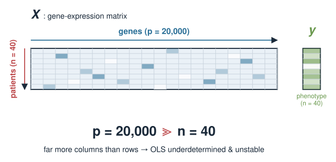
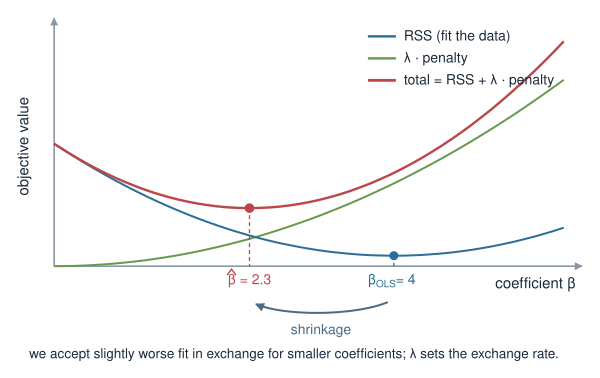
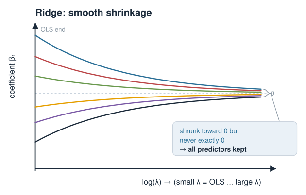
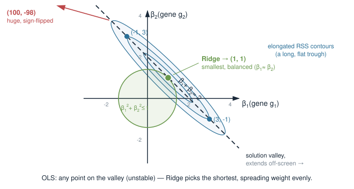
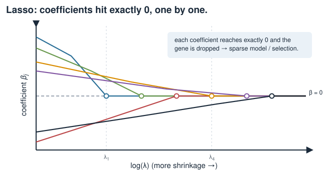
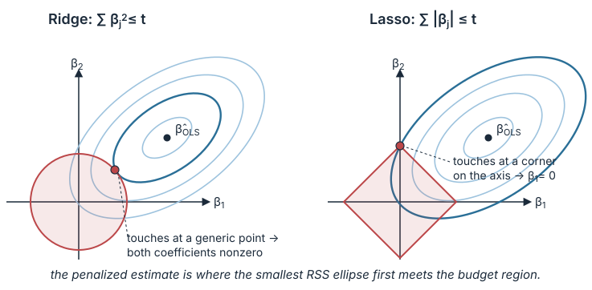
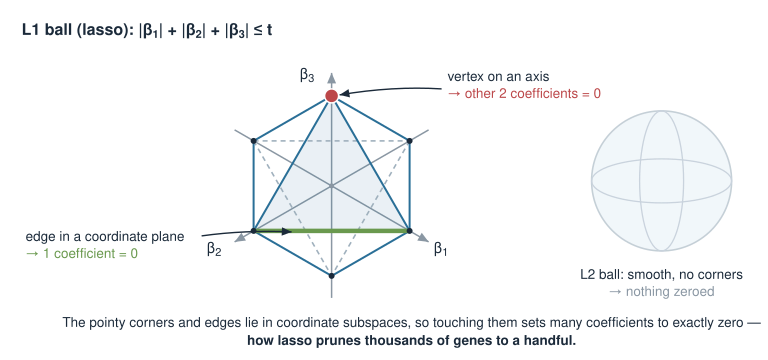
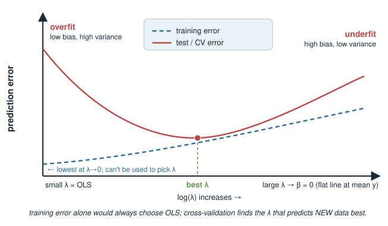

## About this lecture

In Linear models we fit $\mathbf{y} = X\boldsymbol\beta$ by **least squares** — the best straight-line predictor. That works beautifully when we have many samples and few predictors. In genomics we usually have the **opposite**: thousands of genes, a few dozen samples. Ordinary least squares breaks. Today we fix it by **penalizing** large coefficients.

- **Ridge (L2):** shrink all coefficients toward zero — tames collinearity, keeps every predictor.
- **Lasso (L1):** shrink *and* set some coefficients **exactly to zero** — automatic feature selection (a sparse model).
- **Elastic net:** a tunable **mix** of the two.
- The **geometry** behind why lasso zeros coefficients but ridge does not (a diamond vs. a circle).
- The tuning parameter $\lambda$, and how to choose it by **cross-validation**.
- In R: the `glmnet` package. Biology: **selecting a handful of predictive genes** from a whole transcriptome.

::: notes
The single mental image for today: least squares chases the training data too hard when predictors outnumber samples, so we add a "leash" that pulls the coefficients back toward zero. Ridge shortens every leash a bit; lasso can pull some coefficients all the way to zero and drop those predictors entirely. Everything else — the geometry, lambda, cross-validation, glmnet — hangs off that one picture. Emphasise that this is the first time the course meets a genuinely high-dimensional problem (p much greater than n), which is the normal situation in omics. Keep an R session open but do not depend on live output; the code is illustrative.
:::

## A note on where this sits {.smaller}

::: {.callout-important}
This **Penalized linear models** block is **provisional**. It may move to a later dedicated statistics / machine-learning course (*Statistics and machine learning in bioinformatics*), which is not a prerequisite here. We include it now because penalized regression is the most direct answer to a problem biologists hit immediately — *too many genes, too few samples* — and it needs nothing beyond the linear-algebra and linear-model machinery we have already built. Treat the cross-validation and model-selection parts as a **first look**, not the full treatment.
:::

::: notes
Be transparent with students and with reviewers: this unit is a candidate for relocation. It is included because it is a natural, self-contained payoff of the linear-models material and it solves a problem they will recognise from their own data. Nothing here requires the ML course. If a colleague reviewing the syllabus decides penalized regression belongs with cross-validation, resampling, and train/test splits in the ML course, this block moves wholesale. Say this out loud so nobody assumes it is load-bearing for later units.
:::

## Biology first: too many genes, too few samples {.smaller}

You measure expression of **20 000 genes** in **40 patients** and want to predict a phenotype (drug response, tumour subtype, survival). You would like a model

$$\text{phenotype} \approx \beta_1\,\text{gene}_1 + \beta_2\,\text{gene}_2 + \dots + \beta_p\,\text{gene}_p.$$

- Predictors $p = 20\,000$ hugely exceeds samples $n = 40$. This is the **$p \gg n$** regime — the normal situation in omics.
- Ordinary least squares has **infinitely many** perfect fits and picks nonsense: huge, unstable coefficients that memorise noise.
- Many genes are **co-regulated** (collinear), so their coefficients trade off wildly.

We want a model that is **stable** and, ideally, **short** — built on a few genes we could take to the bench. That is exactly what penalties deliver.

{width="75%" fig-align="center"}

::: notes
Ground the whole lecture in the wide-matrix picture. In omics the data matrix is short and very wide: far more features than samples. Two concrete failures of ordinary least squares here: (1) with more unknowns than equations there is no unique solution — the fit is underdetermined; (2) co-regulated genes are near-duplicates, so the design matrix is nearly collinear and coefficients become huge and sign-unstable. Both are cured by shrinkage. Also plant the biological wish: a *sparse* predictor built from a handful of genes is testable and interpretable, unlike a dense 20 000-gene formula. That wish is what lasso answers.
:::

## Recall: least squares and where it breaks {.smaller}

Ordinary least squares (OLS) chooses $\boldsymbol\beta$ to make the **residual sum of squares** as small as possible:

$$\hat{\boldsymbol\beta}_{\text{OLS}} = \arg\min_{\boldsymbol\beta}\ \underbrace{\sum_{i=1}^{n}\big(y_i - \mathbf{x}_i^\top\boldsymbol\beta\big)^2}_{\text{RSS} \,=\, \lVert \mathbf{y} - X\boldsymbol\beta \rVert^2}, \qquad \hat{\boldsymbol\beta}_{\text{OLS}} = (X^\top X)^{-1}X^\top \mathbf{y}.$$

- The formula needs $X^\top X$ to be **invertible**. When $p > n$, or when predictors are collinear, $X^\top X$ is **singular** (or nearly so) — no stable inverse.
- OLS has only one goal: fit the training data. With enough predictors it fits it **perfectly**, including the noise — **overfitting**.

We need a second goal that competes with "fit the data": *keep the coefficients small.*

::: notes
Reconnect to Linear models and to the singular-matrix idea from Linear systems by hand: OLS relies on inverting X-transpose-X, and that inverse fails to exist (or explodes) exactly when p exceeds n or predictors are collinear — the same "no unique solution / columns (nearly) parallel" situation they met with linear systems. The conceptual pivot of the whole lecture is here: OLS optimises a single objective (fit). Penalized regression adds a second, competing objective (small coefficients). The tug-of-war between the two is regularisation. Do not write the ridge formula yet; just set up the need.
:::

## The idea: add a penalty for big coefficients {.smaller}

Keep the fit term, but **add a cost** that grows with the size of the coefficients:

$$\hat{\boldsymbol\beta} = \arg\min_{\boldsymbol\beta}\ \Big\{\ \underbrace{\lVert \mathbf{y} - X\boldsymbol\beta \rVert^2}_{\text{fit the data}} \ +\ \underbrace{\lambda \cdot \text{penalty}(\boldsymbol\beta)}_{\text{keep }\boldsymbol\beta\text{ small}}\ \Big\}$$

- $\lambda \ge 0$ sets the **exchange rate** between the two goals. $\lambda = 0$ gives plain OLS; larger $\lambda$ buys smaller coefficients at the price of some fit.
- The **shape** of the penalty is what distinguishes the three methods:

| Method | penalty$(\boldsymbol\beta)$ | name |
|---|---|---|
| Ridge | $\sum_j \beta_j^2$ | L2 (squared) |
| Lasso | $\sum_j \lvert\beta_j\rvert$ | L1 (absolute) |
| Elastic net | mix of both | L1 + L2 |

{width="55%" fig-align="center"}

::: notes
This is the master equation of the lecture: minimise fit plus lambda times penalty. Read it aloud as a compromise — we deliberately fit the data slightly worse in exchange for smaller, more stable coefficients. Lambda is the dial controlling that compromise. Stress that only the *shape* of the penalty differs between ridge, lasso, and elastic net; the fit term and the role of lambda are identical. Everything that follows is "what does each penalty shape do?" A small but crucial technical point coming up: the penalty is applied to standardised predictors and never to the intercept.
:::

## First: put predictors on a common scale {.smaller}

The penalty $\sum_j \beta_j^2$ (or $\sum_j |\beta_j|$) adds up coefficients across **all** predictors. That only makes sense if the predictors are **comparable in scale**.

- A gene measured in large units gets an artificially **small** coefficient and is under-penalized; a gene in small units is over-penalized. The penalty would depend on your **units**, which is unacceptable.
- **Fix:** standardize each predictor to mean 0 and standard deviation 1 before fitting. Then a coefficient's size reflects **importance**, not units.
- The **intercept is never penalized** — it just anchors the overall level of $\mathbf{y}$.

`glmnet` does this standardization **for you** (`standardize = TRUE` by default) and reports coefficients back on the **original** scale.

::: notes
Standardisation is easy to forget and it matters a lot. Because the penalty sums coefficients across predictors, predictors must be on the same footing or the penalty silently favours whichever ones happen to be in big units. The cure is to centre and scale each column before penalising. Reassure students that glmnet handles this automatically and, helpfully, back-transforms the coefficients to the original units so the output is interpretable. Also note the intercept is excluded from the penalty: we never want to shrink the baseline level of the response toward zero. This is a good place to connect to standardisation they saw in the statistics course.
:::

## Ridge regression (L2 penalty) {.smaller}

Penalize the **sum of squared** coefficients:

$$\hat{\boldsymbol\beta}_{\text{ridge}} = \arg\min_{\boldsymbol\beta}\ \lVert \mathbf{y} - X\boldsymbol\beta \rVert^2 + \lambda \sum_{j=1}^{p}\beta_j^2$$

This has a clean closed form — just add $\lambda$ to the diagonal of $X^\top X$:

$$\hat{\boldsymbol\beta}_{\text{ridge}} = (X^\top X + \lambda I)^{-1} X^\top \mathbf{y}$$

- Adding $\lambda I$ makes the matrix **invertible again**, even when $X^\top X$ alone is singular ($p>n$ or collinear). This is why ridge **tames collinearity**.
- Every coefficient is **shrunk toward zero**, but essentially **none becomes exactly zero** — ridge **keeps all predictors**.

{width="60%" fig-align="center"}

::: notes
Ridge is the gentle one. Two things to land. First, the closed form: it is OLS with lambda added to the diagonal of X-transpose-X. That single change guarantees an invertible matrix — connect straight back to the eigenvalue idea: adding lambda*I shifts every eigenvalue up by lambda, so a zero eigenvalue (singular, non-invertible) becomes lambda (invertible). That is the exact mechanism by which ridge rescues the p greater than n case and stabilises collinear predictors, which otherwise fight over a shared signal. Second: ridge shrinks everything smoothly but sets nothing exactly to zero, so the model still uses all p genes. If you want selection, ridge alone will not give it — that is lasso's job.
:::

## When collinear predictors fight {.smaller}

Two co-regulated genes $g_1, g_2$ carry almost the **same** signal. OLS is free to write

$$100\,g_1 - 98\,g_2, \quad\text{or}\quad -50\,g_1 + 52\,g_2, \quad\text{or}\dots$$

— wildly different coefficients that predict almost identically. The coefficients are **unstable**: a tiny change in the data flips them.

- **Ridge** dislikes large coefficients (they cost $\beta^2$), so it **spreads** the weight smoothly and roughly **equally** between $g_1$ and $g_2$ — small, stable, sensible values.
- This "sharing" behaviour is a hallmark of the L2 penalty and is often **desirable** in biology, where truly co-regulated genes *should* share credit.

{width="55%" fig-align="center"}

::: notes
Make collinearity concrete with the near-duplicate-gene example: because the two genes carry the same information, OLS can trade one off against the other without hurting the fit, producing gigantic and sign-flipping coefficients. Ridge, penalising squared size, prefers to split the weight evenly between them — two moderate coefficients cost less than one huge one. Frame this as a feature, not just a fix: in biology, co-regulated genes arguably *should* receive shared, comparable weights. Contrast with what lasso will do next (arbitrarily pick one of the pair and zero the other), which is sometimes what you want and sometimes not.
:::

## Lasso regression (L1 penalty) {.smaller}

Penalize the **sum of absolute values** instead:

$$\hat{\boldsymbol\beta}_{\text{lasso}} = \arg\min_{\boldsymbol\beta}\ \lVert \mathbf{y} - X\boldsymbol\beta \rVert^2 + \lambda \sum_{j=1}^{p}\lvert\beta_j\rvert$$

- One small change — squares become absolute values — has a dramatic effect: as $\lambda$ grows, coefficients are driven **exactly to zero**, one after another.
- A coefficient of exactly zero means the predictor is **dropped**. Lasso therefore performs **automatic feature selection**: it returns a **sparse** model using only a subset of the genes.
- No closed form (the $|\beta|$ kink is not differentiable at $0$); solved numerically — which is what `glmnet` does.

{width="60%" fig-align="center"}

::: notes
Lasso is the selector. The headline: switching the penalty from squared to absolute values changes the behaviour qualitatively, not just quantitatively. Instead of shrinking everything a little, the L1 penalty sends coefficients to exactly zero as lambda increases, and a zero coefficient means that gene is out of the model. So lasso does variable selection and estimation in one step, returning a sparse, interpretable model — exactly the "few genes we can take to the bench" wish from the motivation slide. Flag that there is no tidy formula because the absolute value has a corner at zero; the solver handles it. The next two slides explain *why* the corner produces zeros.
:::

## Why lasso zeros coefficients: the geometry {.smaller}

Equivalent view: minimize RSS **subject to a budget** on the coefficients.

$$\text{Ridge: } \sum_j \beta_j^2 \le t \qquad\qquad \text{Lasso: } \sum_j \lvert\beta_j\rvert \le t$$

In two dimensions ($\beta_1,\beta_2$) the budget region is:

- **Ridge → a circle** (disk): $\beta_1^2 + \beta_2^2 \le t$ — smooth, round, no special points.
- **Lasso → a diamond** (square on its corner): $\lvert\beta_1\rvert + \lvert\beta_2\rvert \le t$ — with **sharp corners sitting on the axes**.

The RSS forms **elliptical contours** around the OLS solution. The penalized estimate is where the **smallest ellipse first touches** the budget region.

{width="72%" fig-align="center"}

::: notes
This is the money slide and worth going slowly. Recast the penalty as a hard budget: minimise the fit error while keeping the coefficients inside a region of a fixed size. The shape of that region is set by the penalty. L2 gives a round disk; L1 gives a diamond with corners poking out along the axes. Now overlay the RSS contours — concentric ellipses centred on the unconstrained OLS solution — and grow them until they first touch the budget region. The touch point is the solution. On the circle the touch happens at a generic point with both coordinates nonzero. On the diamond it tends to happen at a corner. A corner lies *on an axis*, meaning one coordinate is exactly zero. That is the geometric origin of sparsity. Draw it live if you can.
:::

## The corner is on the axis = a zero coefficient {.smaller}

- A **corner** of the diamond sits **on an axis**: at that point one of the coordinates is **exactly zero** (e.g. $\beta_2 = 0$).
- Expanding ellipses are very likely to first touch a **pointy corner** rather than a flat edge — so the lasso solution often lands with some coefficients **exactly zero**.
- The **circle** has no corners, so the touch point almost never sits exactly on an axis — ridge coefficients get small but stay **nonzero**.

**One sentence:** the *corners* of the L1 diamond are what create sparsity; the *roundness* of the L2 circle is what prevents it.

In higher dimensions the diamond becomes a many-cornered shape whose edges and faces lie in coordinate subspaces — touching one zeros **several** coefficients at once.

{width="50%" fig-align="center"}

::: notes
Reinforce the punchline in words: corners equal zeros. Because the diamond's corners are the parts that stick out furthest toward the ellipses, the growing RSS contour usually meets a corner first, and a corner has one (or in high dimensions, many) coordinates exactly zero. The circle, being smooth, offers no such preferred points, so ridge never sets things exactly to zero. Students remember this as "diamond selects, circle shrinks." Then generalise: in p dimensions the L1 ball is a cross-polytope with low-dimensional faces lying in coordinate subspaces, and contact with those faces zeros many coefficients simultaneously — which is why lasso can prune thousands of genes down to a handful.
:::

## Elastic net: the best of both {.smaller}

Combine **both** penalties, with a mixing parameter $\alpha \in [0,1]$:

$$\hat{\boldsymbol\beta}_{\text{enet}} = \arg\min_{\boldsymbol\beta}\ \lVert \mathbf{y} - X\boldsymbol\beta \rVert^2 + \lambda\Big[\, \alpha\sum_j \lvert\beta_j\rvert \;+\; (1-\alpha)\sum_j \beta_j^2 \,\Big]$$

- $\alpha = 1$ → pure **lasso**; $\alpha = 0$ → pure **ridge**; in between → a **blend**.
- Fixes a real lasso weakness: among a group of **correlated** genes, lasso tends to pick **one arbitrarily** and zero the rest. Elastic net's L2 part encourages **grouping** — correlated genes are selected (or dropped) **together**.
- Also lets lasso select **more than $n$** predictors (pure lasso caps at $n$ when $p>n$).

A common recipe: keep some sparsity ($\alpha$ around $0.5$) so you still get a short gene list, but with stabler, group-aware selection.

{width="50%" fig-align="center"}

::: notes
Elastic net is the pragmatic default for genomics. It literally adds the two penalties with a knob alpha that dials from pure ridge (0) to pure lasso (1). The reason it matters biologically: pure lasso, faced with a cluster of co-regulated genes, arbitrarily keeps one and discards its neighbours, which is unstable and biologically misleading — the whole pathway is relevant, not one gene. The ridge component makes elastic net keep or drop such correlated groups together (the grouping effect). It also lifts lasso's technical ceiling of at most n selected variables when p exceeds n. Note glmnet uses exactly this alpha parameterisation, so the code will feel natural. Suggest alpha around 0.5 as a sensible starting point, to be tuned.
:::

## The tuning parameter $\lambda$ {.smaller}

$\lambda$ controls **how hard we shrink** — it trades bias against variance.

- $\lambda \to 0$: back to **OLS** — low bias, high variance, **overfits**.
- $\lambda \to \infty$: all coefficients $\to 0$ — the model becomes a flat line at $\bar y$: high bias, low variance, **underfits**.
- Somewhere in between is the $\lambda$ that predicts **new** data best.

We cannot read the best $\lambda$ off the **training** fit — training error just keeps dropping as $\lambda\to0$. We must estimate performance on data the model **did not see**.

{width="60%" fig-align="center"}

::: notes
Lambda is the single most important knob and it embodies the bias-variance trade-off, which for many students is the first time they meet that idea explicitly. Too small: essentially OLS, fits noise, great on training data and poor on new data. Too large: crushes all signal, predicts the mean. The sweet spot minimises error on *unseen* data. Crucial pedagogical warning: you cannot choose lambda by minimising training error, because training error falls monotonically as lambda shrinks toward zero — it would always pick the overfit model. You need an honest estimate of out-of-sample error, which is what cross-validation provides on the next slide. This is a first look at the idea; the full ML treatment lives elsewhere.
:::

## Choosing $\lambda$ by cross-validation {.smaller}

**$k$-fold cross-validation** estimates out-of-sample error honestly:

1. Split the samples into $k$ groups (folds), e.g. $k = 10$.
2. For each fold: **train** on the other $k-1$ folds, **predict** the held-out fold, record the error.
3. Average the errors across folds → a **cross-validated error** for that $\lambda$.
4. Repeat over a grid of $\lambda$ values; pick the $\lambda$ with the **lowest CV error**.

Two standard choices `glmnet` reports:

- `lambda.min` — the $\lambda$ with **minimum** CV error.
- `lambda.1se` — the **largest** $\lambda$ within **one standard error** of that minimum: a **simpler, sparser** model that performs about as well. Often preferred for a **short gene list**.

{width="65%" fig-align="center"}

::: notes
Cross-validation is the engine that turns lambda from a mystery into a data-driven choice. Walk the k-fold loop slowly: hold out a fold, train on the rest, predict the fold, and rotate so every sample is held out exactly once; average to get a fair error estimate for each candidate lambda. Then scan the lambda grid and pick the best. Introduce the two conventions glmnet gives: lambda.min is the raw minimiser; lambda.1se deliberately errs toward more shrinkage, taking the simplest model statistically indistinguishable from the best. For a biologist wanting a short, robust gene list, lambda.1se is usually the better pick because it is sparser and less likely to be a fluke of one CV split. Mention that with tiny n, CV estimates are themselves noisy — honesty about a stepping stone.
:::

## In R: `glmnet` {.smaller}

The `glmnet` package fits ridge, lasso, and elastic net over a whole grid of $\lambda$ efficiently.

```r
library(glmnet)

# x: samples x genes matrix (n rows, p columns); y: the phenotype vector
x <- as.matrix(expr)      # e.g. 40 patients x 20000 genes
y <- response            # numeric outcome (e.g. drug IC50)

# alpha = 1 -> lasso, alpha = 0 -> ridge, 0 < alpha < 1 -> elastic net
fit <- glmnet(x, y, alpha = 1)     # fits a path of lambda values

plot(fit, xvar = "lambda")          # coefficient paths vs log(lambda)
print(fit)                          # Df (# nonzero), %Dev, Lambda per step
```

- `glmnet` **standardizes** predictors internally (`standardize = TRUE`) and returns coefficients on the **original** scale.
- It does **not** fit a single $\lambda$ — it returns the whole **path**, so you see how coefficients enter and leave as $\lambda$ changes.

::: notes
Keep this practical and reassuring: one function, one alpha argument, and you have all three methods. glmnet is fast because it solves the entire lambda path at once using warm starts, so the coefficient-path plot comes essentially for free — and that plot is the best way to *see* shrinkage and selection happening. Remind them the code here is illustrative and not executed at render time; they will run it in the exercise. Point out the Df column in print(fit) is the number of nonzero coefficients, i.e. how many genes the model currently uses — the sparsity, made visible. Reiterate the internal standardisation so they do not double-scale.
:::

## In R: cross-validated fit and the gene list {.smaller}

```r
set.seed(1)                              # CV is random; fix the seed for reproducibility
cvfit <- cv.glmnet(x, y, alpha = 1, nfolds = 10)

plot(cvfit)                              # CV error vs log(lambda), with lambda.min / .1se
cvfit$lambda.min                         # lambda with lowest CV error
cvfit$lambda.1se                         # sparser model within 1 SE

# coefficients at the chosen lambda
beta <- coef(cvfit, s = "lambda.1se")    # a sparse vector; most entries are 0
selected <- rownames(beta)[which(beta != 0)]
selected                                 # the genes the model kept  <- the biology

# predict the phenotype for new samples
predict(cvfit, newx = x_new, s = "lambda.1se")
```

- For a **binary** phenotype (responder vs. not) use `family = "binomial"` — penalized **logistic** regression, same machinery.

::: notes
This slide is the payoff: from a 20 000-gene matrix to a named short list of genes in a few lines. cv.glmnet runs the k-fold loop across the lambda grid and stores lambda.min and lambda.1se. Extract the coefficients at the chosen lambda, drop the zeros, and the surviving row names are your selected genes — that vector *is* the biological result, a candidate signature to validate experimentally. Show predict() so they see the model is also usable for new patients. Finally note the family argument: swap to binomial and the identical framework does penalized logistic regression for a yes/no outcome, which is extremely common (responder vs non-responder, tumour vs normal). Remind them to set a seed because the fold assignment is random.
:::

## Biology: from transcriptome to a testable signature {.smaller}

- **Predictive gene signatures.** Lasso / elastic net on expression + drug response returns a **small panel** of genes that predict response — a candidate **biomarker** you can take to a targeted assay.
- **Interpretability & cost.** A 20-gene panel can be run cheaply in the clinic; a 20 000-gene model cannot. Sparsity is not just statistics — it is **assay design**.
- **Stability matters.** With $n \approx 40$, different CV splits can select somewhat different genes. Report a **stable core**, prefer `lambda.1se`, and consider elastic net so **correlated pathway members** are kept together.
- **Not causal.** A selected gene is **predictive**, not proven **causal** — collinearity means a dropped gene may be just as relevant as the one kept. Validate on the bench.

::: notes
Bring it back to biology and to honesty. The realistic use case is building a compact predictive signature from omics data — the sort of thing behind commercial expression-based diagnostic panels. Emphasise three caveats that separate a naive from a careful analysis. First, sparsity has a practical payoff beyond parsimony: a short panel is assayable and affordable in a clinical setting. Second, selection is unstable at small n — do not over-interpret the exact membership of the list; look for genes that recur across resamples, and lean on lambda.1se and elastic net for robustness. Third, and most important scientifically: penalized regression finds *predictive*, not *causal*, genes; because of collinearity the specific gene kept may be a stand-in for a co-regulated neighbour. The model proposes; the bench disposes.
:::

## Which penalty when? {.smaller}

| Situation | Reach for |
|---|---|
| Many collinear predictors, want to **keep them all** | **Ridge** |
| Want a **short, interpretable** subset (feature selection) | **Lasso** |
| $p \gg n$ **and** correlated groups of predictors | **Elastic net** |
| Purely predictive, interpretability not needed | Ridge (often lowest error) |
| Need a testable **gene panel** | Lasso / elastic net |

- All three **reduce variance / overfitting** relative to OLS; they differ in **whether and how** they zero coefficients.
- Always **standardize** (glmnet does it), never penalize the **intercept**, and choose $\lambda$ by **cross-validation**.

::: notes
A decision table to consolidate. The one-line summary: ridge shrinks and keeps everything and is often the best pure predictor; lasso shrinks and selects, giving interpretability; elastic net blends them and is the safe default for wide, correlated omics matrices. All three beat OLS on new data whenever p is large or predictors collinear, because they trade a little bias for a lot less variance. End on the three non-negotiables: standardise predictors, leave the intercept unpenalised, and pick lambda by cross-validation rather than by eye or by training error. These are the habits that keep the analysis honest.
:::

## Summary {.smaller}

| Concept | Key fact |
|---|---|
| Problem | $p \gg n$ or collinearity → OLS unstable / overfits |
| General form | minimize $\lVert \mathbf{y}-X\boldsymbol\beta\rVert^2 + \lambda\,\text{penalty}(\boldsymbol\beta)$ |
| Ridge (L2) | penalty $\sum\beta_j^2$; shrinks all, keeps all; $(X^\top X+\lambda I)^{-1}X^\top\mathbf{y}$ |
| Lasso (L1) | penalty $\sum\lvert\beta_j\rvert$; sets some $\beta_j = 0$ → **feature selection** |
| Geometry | circle (ridge) vs **diamond** (lasso); corners on axes → zeros |
| Elastic net | $\alpha\sum\lvert\beta_j\rvert + (1-\alpha)\sum\beta_j^2$; grouped selection |
| $\lambda$ | shrinkage dial; bias–variance trade-off; choose by **cross-validation** |
| R | `glmnet(x, y, alpha=…)`, `cv.glmnet(…)`, `coef(cvfit, s="lambda.1se")` |
| Biology | short, testable **gene signatures**; predictive $\neq$ causal |

**Next:** apply this to a real wide expression matrix in the exercise, then test yourself with the quiz.

::: notes
The summary is the revision sheet. Drill the storyline once more: OLS breaks when predictors outnumber samples or are collinear; adding a penalty times lambda fixes it; the penalty shape decides behaviour — squared (ridge) shrinks and keeps all, absolute (lasso) shrinks and selects, and the mix (elastic net) does grouped selection; the geometry (round circle vs cornered diamond) explains why only lasso zeros coefficients; lambda is chosen by cross-validation, not by training error; and glmnet does all of it in a few lines. Close on the biological through-line and the caveat that a predictive gene is not a proven causal one. Remind them this block is provisional and may migrate to the ML course.
:::
