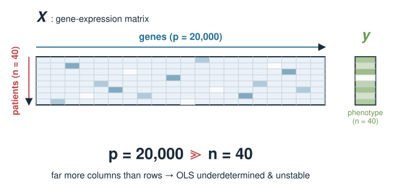
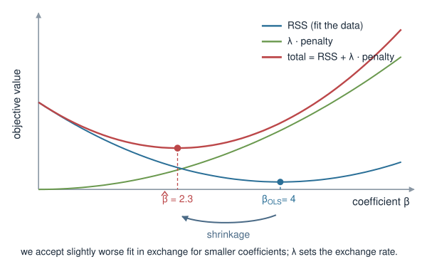
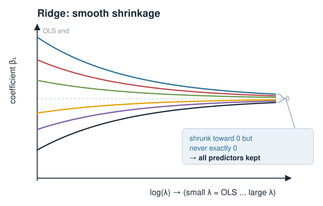
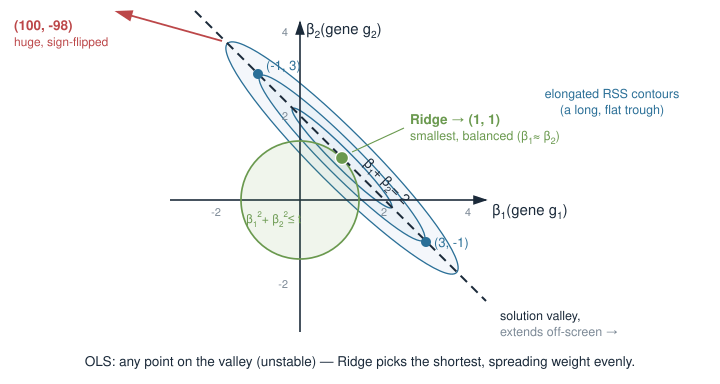
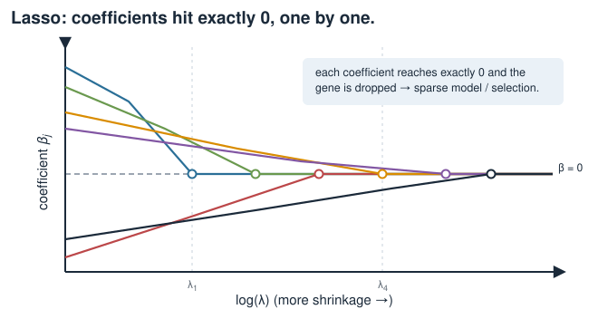
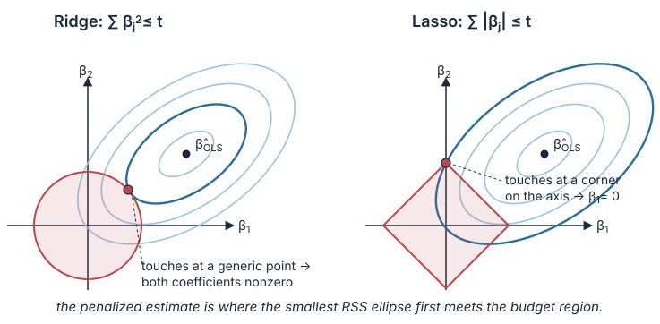
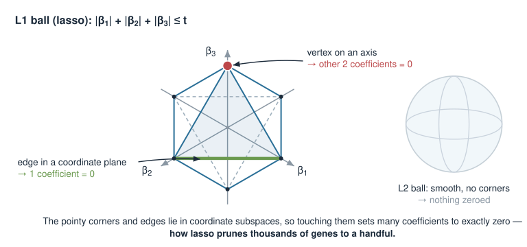
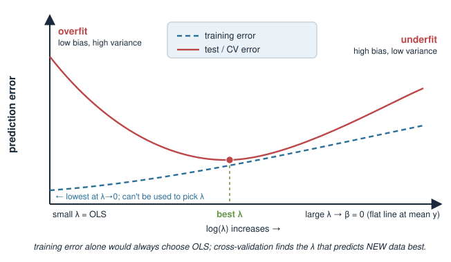

## About this lecture

In Linear models we fit a straight-line model by **least squares**. That works beautifully when we have many samples and few predictors. In genomics we usually have the **opposite**: thousands of genes, a few dozen samples. Ordinary least squares breaks. Today we fix it by **penalizing** large coefficients.

- **Ridge (L2):** shrink all coefficients toward zero — tames collinearity, keeps every predictor.
- **Lasso (L1):** shrink *and* set some coefficients **exactly to zero** — automatic feature selection (a sparse model).
- **Elastic net:** a tunable **mix** of the two.
- The **geometry** behind why lasso zeros coefficients but ridge does not (a diamond vs. a circle).
- The tuning parameter $\lambda$, and a first look at choosing it (**cross-validation** is the next unit).
- In R: the `glmnet` package. Biology: **selecting a handful of predictive genes** from a whole transcriptome.

::: notes
The single mental image for today: least squares chases the training data too hard when predictors outnumber samples, so we add a "leash" that pulls the coefficients back toward zero. Ridge shortens every leash a bit; lasso can pull some coefficients all the way to zero and drop those predictors entirely. Everything else — the geometry, lambda, cross-validation, glmnet — hangs off that one picture. Emphasise that this is the first time the course meets a genuinely high-dimensional problem (p much greater than n), which is the normal situation in omics. Keep an R session open but do not depend on live output; the code is illustrative.
:::

## Biology first: too many genes, too few samples {.smaller}

You measure expression of **20 000 genes** in **40 patients** and want to predict a phenotype (drug response, tumour subtype, survival). You would like a model

$$\text{phenotype} \approx \beta_1\,\text{gene}_1 + \beta_2\,\text{gene}_2 + \dots + \beta_p\,\text{gene}_p.$$

- Predictors $p = 20\,000$ hugely exceeds samples $n = 40$. This is the **$p \gg n$** regime — the normal situation in omics.
- Ordinary least squares has **infinitely many** perfect fits and picks nonsense: huge, unstable coefficients that memorise noise.
- Many genes are **co-regulated** (collinear), so their coefficients trade off wildly.

We want a model that is **stable** and, ideally, **short** — built on a few genes we could take to the bench. That is exactly what penalties deliver.

{width="75%" fig-align="center"}

::: notes
Ground the whole lecture in the wide-matrix picture. In omics the data matrix is short and very wide: far more features than samples. Two concrete failures of ordinary least squares here: (1) with more unknowns than equations there is no unique solution — the fit is underdetermined; (2) co-regulated genes are near-duplicates, so the design matrix is nearly collinear and coefficients become huge and sign-unstable. Both are cured by shrinkage. Also plant the biological wish: a *sparse* predictor built from a handful of genes is testable and interpretable, unlike a dense 20 000-gene formula. That wish is what lasso answers.
:::

## Recall: least squares and where it breaks {.smaller}

Ordinary least squares (OLS) picks the coefficients that make the **total squared miss** (the residual sum of squares, RSS) as small as possible. *Why penalize?* showed where that breaks:

- **More genes than samples ($p > n$):** many different coefficient sets fit the training data **perfectly**, so ordinary least squares has no single answer.
- **Correlated genes:** the data pin down their **combined** effect but not the split, so the coefficients jump around from one dataset to the next (the resampling demo).
- Either way ordinary least squares has only one goal, fit the training data, and with enough predictors it fits the **noise** too: **overfitting**.

We need a second goal that competes with "fit the data": *keep the coefficients small.*

::: notes
A short recap of *Why penalize?*, in words. Ordinary least squares has one goal: the smallest total squared miss on the training data. It fails in two ways that students have already seen there: with more genes than samples there are infinitely many perfect fits (more unknowns than equations, the same situation as an underdetermined linear system), and with correlated genes the split of the weight between them is decided by noise (the orange OLS cloud, i.e. ordinary least squares, in the resampling demo). The conceptual pivot of the whole lecture is here: penalized regression adds a second, competing goal (small coefficients). The tug-of-war between the two is regularisation. The matrix version (a singular X-transpose-X) is on the optional slide at the end of *Why penalize?*; no need to show it here.
:::

## The idea: add a penalty for big coefficients {.smaller}

Keep the fit term, but **add a cost** that grows with the size of the coefficients. The computer picks the coefficients that make

> **total squared miss** (fit the data) **+ $\lambda$ × penalty** (keep the coefficients small)

as small as possible.

- $\lambda \ge 0$ sets the **exchange rate** between the two goals. $\lambda = 0$ gives plain ordinary least squares; larger $\lambda$ buys smaller coefficients at the price of some fit.
- The **shape** of the penalty is what distinguishes the three methods:

| Method | penalty$(\boldsymbol\beta)$ | name |
|---|---|---|
| Ridge | $\sum_j \beta_j^2$ | L2 (squared) |
| Lasso | $\sum_j \lvert\beta_j\rvert$ | L1 (absolute) |
| Elastic net | mix of both | L1 + L2 |

{width="55%" fig-align="center"}

::: notes
This is the master idea of the lecture: make "squared miss plus lambda times penalty" as small as possible. Read it aloud as a compromise — we deliberately fit the data slightly worse in exchange for smaller, more stable coefficients. Lambda is the dial controlling that compromise. Stress that only the *shape* of the penalty differs between ridge, lasso, and elastic net; the fit term and the role of lambda are identical. Everything that follows is "what does each penalty shape do?" A small but crucial technical point coming up: the penalty is applied to standardised predictors and never to the intercept.
:::

## First: put predictors on a common scale {.smaller}

The penalty $\sum_j \beta_j^2$ (or $\sum_j |\beta_j|$) adds up coefficients across **all** predictors. That only makes sense if the predictors are **comparable in scale**.

- A gene measured in large units gets an artificially **small** coefficient and is under-penalized; a gene in small units is over-penalized. The penalty would depend on your **units**, which is unacceptable.
- **Fix:** standardize each predictor to mean 0 and standard deviation 1 before fitting. Then a coefficient's size reflects **importance**, not units.
- The **intercept is never penalized** — it just anchors the overall level of $\mathbf{y}$.

`glmnet` does this standardization **for you** (`standardize = TRUE` by default) and reports coefficients back on the **original** scale.

::: notes
Standardisation is easy to forget and it matters a lot. Because the penalty sums coefficients across predictors, predictors must be on the same footing or the penalty silently favours whichever ones happen to be in big units. The cure is to centre and scale each column before penalising. Reassure students that glmnet handles this automatically and, helpfully, back-transforms the coefficients to the original units so the output is interpretable. Also note the intercept is excluded from the penalty: we never want to shrink the baseline level of the response toward zero. This is a good place to connect to standardisation they saw in the statistics course.
:::

## Ridge regression (L2 penalty) {.smaller}

Penalty = the **sum of squared** coefficients, $\sum_j \beta_j^2$.

- With one predictor, ridge is the formula from *Why penalize?*: the usual slope with $\lambda$ added below the line, $\hat\beta = \dfrac{\sum xy}{\sum x^2 + \lambda}$. Bigger $\lambda$, bigger denominator, smaller slope — but never exactly $0$.
- With many predictors the same happens to all of them: every coefficient is **shrunk toward zero**, none becomes **exactly zero**. Ridge **keeps all predictors**.
- Ridge always gives **one** stable answer, even when $p > n$ or genes are correlated. This is why ridge **tames collinearity**.

{width="60%" fig-align="center"}

::: notes
Ridge is the gentle one. Use the one-predictor formula students met in *Why penalize?*: lambda sits in the denominator, so as it grows the slope shrinks smoothly toward 0 but never reaches it (exercise B2 does the arithmetic: 2, 1, 0.5, ...). Point at the path figure: every curve bends toward 0 as lambda grows to the right, and none touches the axis. Second point: ridge always returns one stable answer, even for p greater than n or collinear genes, which is how it rescues the cases where ordinary least squares broke. The matrix reason (adding lambda to the diagonal makes X-transpose-X invertible) is on the optional slide at the end; skip it unless asked. If you want selection, ridge alone will not give it — that is lasso's job.
:::

## When collinear predictors fight {.smaller}

Two co-regulated genes $g_1, g_2$ carry almost the **same** signal. Ordinary least squares is free to write

$$100\,g_1 - 98\,g_2, \quad\text{or}\quad -50\,g_1 + 52\,g_2, \quad\text{or}\dots$$

— wildly different coefficients that predict almost identically. The coefficients are **unstable**: a tiny change in the data flips them.

- **Ridge** dislikes large coefficients (they cost $\beta^2$), so it **spreads** the weight smoothly and roughly **equally** between $g_1$ and $g_2$ — small, stable, sensible values.
- This "sharing" behaviour is a hallmark of the L2 penalty and is often **desirable** in biology, where truly co-regulated genes *should* share credit.

{width="55%" fig-align="center"}

::: notes
Make collinearity concrete with the near-duplicate-gene example: because the two genes carry the same information, ordinary least squares can trade one off against the other without hurting the fit, producing gigantic and sign-flipping coefficients. Ridge, penalising squared size, prefers to split the weight evenly between them — two moderate coefficients cost less than one huge one. Frame this as a feature, not just a fix: in biology, co-regulated genes arguably *should* receive shared, comparable weights. If students saw the resampling demo in *Why penalize?*, remind them: the ridge cloud was the tight blob near (1, 1), weight shared equally. Contrast with what lasso will do (arbitrarily pick one of the pair and zero the other), which we will see live in the demo after the geometry slides.
:::

## Lasso regression (L1 penalty) {.smaller}

Penalty = the **sum of absolute values**, $\sum_j \lvert\beta_j\rvert$, instead of squares.

- One small change — squares become absolute values — has a dramatic effect: as $\lambda$ grows, coefficients are driven **exactly to zero**, one after another.
- A coefficient of exactly zero means the predictor is **dropped**. Lasso therefore performs **automatic feature selection**: it returns a **sparse** model using only a subset of the genes.
- There is no simple formula like ridge's; the computer **searches** for the best coefficients — which is what `glmnet` does.

{width="60%" fig-align="center"}

::: notes
Lasso is the selector. The headline: switching the penalty from squared to absolute values changes the behaviour qualitatively, not just quantitatively. Instead of shrinking everything a little, the L1 penalty sends coefficients to exactly zero as lambda increases, and a zero coefficient means that gene is out of the model. So lasso does variable selection and estimation in one step, returning a sparse, interpretable model — exactly the "few genes we can take to the bench" wish from the motivation slide. Flag that there is no tidy formula: the absolute value has a sharp corner at zero, and the computer simply searches for the best coefficients. The next two slides explain *why* the corner produces zeros.
:::

## Why lasso zeros coefficients: the geometry {.smaller}

Equivalent view: minimize RSS **subject to a budget** on the coefficients.

$$\text{Ridge: } \sum_j \beta_j^2 \le t \qquad\qquad \text{Lasso: } \sum_j \lvert\beta_j\rvert \le t$$

In two dimensions ($\beta_1,\beta_2$) the budget region is:

- **Ridge → a circle** (disk): $\beta_1^2 + \beta_2^2 \le t$ — smooth, round, no special points.
- **Lasso → a diamond** (square on its corner): $\lvert\beta_1\rvert + \lvert\beta_2\rvert \le t$ — with **sharp corners sitting on the axes**.

The RSS forms **elliptical contours** around the ordinary least squares solution. The penalized estimate is where the **smallest ellipse first touches** the budget region.

{width="72%" fig-align="center"}

::: notes
This is the money slide and worth going slowly. Recast the penalty as a hard budget: minimise the fit error while keeping the coefficients inside a region of a fixed size. The shape of that region is set by the penalty. L2 gives a round disk; L1 gives a diamond with corners poking out along the axes. Now overlay the RSS contours — concentric ellipses centred on the unconstrained ordinary least squares solution — and grow them until they first touch the budget region. The touch point is the solution. On the circle the touch happens at a generic point with both coordinates nonzero. On the diamond it tends to happen at a corner. A corner lies *on an axis*, meaning one coordinate is exactly zero. That is the geometric origin of sparsity. Draw it live if you can.
:::

## The corner is on the axis = a zero coefficient {.smaller}

- A **corner** of the diamond sits **on an axis**: at that point one of the coordinates is **exactly zero** (e.g. $\beta_2 = 0$).
- Expanding ellipses are very likely to first touch a **pointy corner** rather than a flat edge — so the lasso solution often lands with some coefficients **exactly zero**.
- The **circle** has no corners, so the touch point almost never sits exactly on an axis — ridge coefficients get small but stay **nonzero**.

**One sentence:** the *corners* of the L1 diamond are what create sparsity; the *roundness* of the L2 circle is what prevents it.

In higher dimensions the diamond becomes a many-cornered shape whose edges and faces lie in coordinate subspaces — touching one zeros **several** coefficients at once.

{width="50%" fig-align="center"}

::: notes
Reinforce the punchline in words: corners equal zeros. Because the diamond's corners are the parts that stick out furthest toward the ellipses, the growing RSS contour usually meets a corner first, and a corner has one (or in high dimensions, many) coordinates exactly zero. The circle, being smooth, offers no such preferred points, so ridge never sets things exactly to zero. Students remember this as "diamond selects, circle shrinks." Then generalise: in p dimensions the L1 ball is a cross-polytope with low-dimensional faces lying in coordinate subspaces, and contact with those faces zeros many coefficients simultaneously — which is why lasso can prune thousands of genes down to a handful.
:::

## Try it: circle vs diamond

```{=html}
<link rel="stylesheet" href="../demos/dist/demo.css">
<div data-demo="penaltygeom" data-ols="2 0.6" data-corr="0.4" data-lambda="2" data-alpha="1"></div>
<script src="../demos/dist/penaltygeom.js"></script>
```

::: notes
Interactive demo, the live version of the last two slides (also in the exercise, E1 to E4). Grey ellipses are RSS contours around the ordinary least squares point (labelled OLS; drag it); green is the penalty region at the budget the current lambda leads to; the purple ellipse is the smallest contour that touches it, and the touching point is the penalized estimate. The right panel is the coefficient path, current lambda dashed. Start on the lasso defaults (ordinary least squares point (2, 0.6), corr 0.4, lambda 2): beta-2 is already exactly 0 and the estimate sits on the diamond's corner on the beta-1 axis (red mark). Slide lambda down: beta-2 comes back in below about 1.7; slide it up: beta-1 also hits 0 at about 4.5. Click Ridge at lambda 2: about (0.70, 0.37), both nonzero, the touch point on the smooth circle; even at lambda 100 both are tiny but not zero. Back on lasso, drag the OLS point: over a whole band of ordinary least squares points the estimate stays on the corner.
:::

## Try it: lasso on correlated genes

```{=html}
<link rel="stylesheet" href="../demos/dist/demo.css">
<div data-demo="penaltygeom" data-mode="resample" data-method="lasso" data-corr="0.99"></div>
<script src="../demos/dist/penaltygeom.js"></script>
```

::: notes
The resampling demo from *Why penalize?*, now with the lasso. True model y = gene 1 + gene 2, true coefficients (1, 1) (the cross); each dot is one fit to a new training set of 20 samples, 50 sets, lambda 5. Correlation is set to 0.99. The orange cloud (ordinary least squares) is the same mess as before: beta-1 from about -1.8 to 5.4. The lasso dots stay within 0 to 2.3, so the penalty tames the wild values, but look where they sit: in 27 of the 50 datasets the lasso sets one gene exactly to 0 (dots on the axes), and which gene it drops changes from dataset to dataset. Two genes carrying the same signal, and lasso keeps one more or less at random. Click Ridge for contrast: a tight blob near (1, 1), beta-1 0.7 to 1.2, weight shared, nothing dropped. Click "resample 50 datasets" to show it is not a fluke. This is the weakness elastic net fixes on the next slide.
:::

## Elastic net: the best of both {.smaller}

Combine **both** penalties; a mixing parameter $\alpha$ between $0$ and $1$ sets how much of each:

> penalty $= \alpha \times$ (lasso penalty) $+ (1-\alpha) \times$ (ridge penalty)

- $\alpha = 1$ → pure **lasso**; $\alpha = 0$ → pure **ridge**; in between → a **blend**.
- Fixes the lasso weakness from the demo: among a group of **correlated** genes, lasso tends to pick **one arbitrarily** and zero the rest. Elastic net's L2 part encourages **grouping** — correlated genes are selected (or dropped) **together**.
- Also lets lasso select **more than $n$** predictors (pure lasso caps at $n$ when $p>n$).

A common recipe: keep some sparsity ($\alpha$ around $0.5$) so you still get a short gene list, but with stabler, group-aware selection.

{width="50%" fig-align="center"}

::: notes
Elastic net is the pragmatic default for genomics. It literally adds the two penalties with a knob alpha that dials from pure ridge (0) to pure lasso (1). The reason it matters biologically: pure lasso, faced with a cluster of co-regulated genes, arbitrarily keeps one and discards its neighbours, which is unstable and biologically misleading — the whole pathway is relevant, not one gene. The ridge component makes elastic net keep or drop such correlated groups together (the grouping effect). It also lifts lasso's technical ceiling of at most n selected variables when p exceeds n. Note glmnet uses exactly this alpha parameterisation, so the code will feel natural. Suggest alpha around 0.5 as a sensible starting point, to be tuned.
:::

## Choosing $\lambda$ (preview) {.smaller}

$\lambda$ controls **how hard we shrink** — the bias–variance dial from *Why penalize?*.

- $\lambda \to 0$: back to **ordinary least squares** — **overfits** (high variance).
- $\lambda \to \infty$: all coefficients $\to 0$, the model predicts the mean — **underfits** (high bias).
- Somewhere in between is the $\lambda$ that predicts **new** data best. Training error cannot find it (it keeps falling as $\lambda \to 0$), so we estimate error on held-out data: **cross-validation**, the next unit.

`glmnet` reports two choices: `lambda.min` (lowest cross-validated error) and `lambda.1se` (the largest $\lambda$ within one standard error of it: a **sparser** model that predicts about as well, often preferred for a **short gene list**).

{width="55%" fig-align="center"}

::: notes
Keep this short: it is a pointer, not the full treatment. Lambda is the bias–variance dial students turned in the biasvar demo in *Why penalize?* (too small: wiggly fit, great on training data and poor on new data; too large: a flat line). Say once, firmly, that you cannot choose lambda by training error, because it always falls as lambda shrinks and would always pick the overfit model. Cross-validation, next unit, does it honestly, with its own demo of the folds. Introduce the two names now only because the R code on the next slides uses them: lambda.min is the raw best, lambda.1se deliberately errs toward more shrinkage and gives a shorter gene list.
:::

## In R: `glmnet` {.smaller}

The `glmnet` package fits ridge, lasso, and elastic net over a whole grid of $\lambda$ efficiently.

```r
library(glmnet)

# x: samples x genes matrix (n rows, p columns); y: the phenotype vector
x <- as.matrix(expr)      # e.g. 40 patients x 20000 genes
y <- response            # numeric outcome (e.g. drug IC50)

# alpha = 1 -> lasso, alpha = 0 -> ridge, 0 < alpha < 1 -> elastic net
fit <- glmnet(x, y, alpha = 1)     # fits a path of lambda values

plot(fit, xvar = "lambda")          # coefficient paths vs log(lambda)
print(fit)                          # Df (# nonzero), %Dev, Lambda per step
```

- `glmnet` **standardizes** predictors internally (`standardize = TRUE`) and returns coefficients on the **original** scale.
- It does **not** fit a single $\lambda$ — it returns the whole **path**, so you see how coefficients enter and leave as $\lambda$ changes.

::: notes
Keep this practical and reassuring: one function, one alpha argument, and you have all three methods. glmnet is fast because it solves the entire lambda path at once using warm starts, so the coefficient-path plot comes essentially for free — and that plot is the best way to *see* shrinkage and selection happening. Remind them the code here is illustrative and not executed at render time; they will run it in the exercise. Point out the Df column in print(fit) is the number of nonzero coefficients, i.e. how many genes the model currently uses — the sparsity, made visible. Reiterate the internal standardisation so they do not double-scale.
:::

## In R: cross-validated fit and the gene list {.smaller}

```r
set.seed(1)                              # CV is random; fix the seed for reproducibility
cvfit <- cv.glmnet(x, y, alpha = 1, nfolds = 10)

plot(cvfit)                              # CV error vs log(lambda), with lambda.min / .1se
cvfit$lambda.min                         # lambda with lowest CV error
cvfit$lambda.1se                         # sparser model within 1 SE

# coefficients at the chosen lambda
beta <- coef(cvfit, s = "lambda.1se")    # a sparse vector; most entries are 0
selected <- rownames(beta)[which(beta != 0)]
selected                                 # the genes the model kept  <- the biology

# predict the phenotype for new samples
predict(cvfit, newx = x_new, s = "lambda.1se")
```

- For a **binary** phenotype (responder vs. not) use `family = "binomial"` — penalized **logistic** regression, same machinery.

::: notes
This slide is the payoff: from a 20 000-gene matrix to a named short list of genes in a few lines. cv.glmnet runs the k-fold loop across the lambda grid and stores lambda.min and lambda.1se. Extract the coefficients at the chosen lambda, drop the zeros, and the surviving row names are your selected genes — that vector *is* the biological result, a candidate signature to validate experimentally. Show predict() so they see the model is also usable for new patients. Finally note the family argument: swap to binomial and the identical framework does penalized logistic regression for a yes/no outcome, which is extremely common (responder vs non-responder, tumour vs normal). Remind them to set a seed because the fold assignment is random.
:::

## Biology: from transcriptome to a testable signature {.smaller}

- **Predictive gene signatures.** Lasso / elastic net on expression + drug response returns a **small panel** of genes that predict response — a candidate **biomarker** you can take to a targeted assay.
- **Interpretability & cost.** A 20-gene panel can be run cheaply in the clinic; a 20 000-gene model cannot. Sparsity is not just statistics — it is **assay design**.
- **Stability matters.** With $n \approx 40$, different CV splits can select somewhat different genes. Report a **stable core**, prefer `lambda.1se`, and consider elastic net so **correlated pathway members** are kept together.
- **Not causal.** A selected gene is **predictive**, not proven **causal** — collinearity means a dropped gene may be just as relevant as the one kept. Validate on the bench.

::: notes
Bring it back to biology and to honesty. The realistic use case is building a compact predictive signature from omics data — the sort of thing behind commercial expression-based diagnostic panels. Emphasise three caveats that separate a naive from a careful analysis. First, sparsity has a practical payoff beyond parsimony: a short panel is assayable and affordable in a clinical setting. Second, selection is unstable at small n — do not over-interpret the exact membership of the list; look for genes that recur across resamples, and lean on lambda.1se and elastic net for robustness. Third, and most important scientifically: penalized regression finds *predictive*, not *causal*, genes; because of collinearity the specific gene kept may be a stand-in for a co-regulated neighbour. The model proposes; the bench disposes.
:::

## Which penalty when? {.smaller}

| Situation | Reach for |
|---|---|
| Many collinear predictors, want to **keep them all** | **Ridge** |
| Want a **short, interpretable** subset (feature selection) | **Lasso** |
| $p \gg n$ **and** correlated groups of predictors | **Elastic net** |
| Purely predictive, interpretability not needed | Ridge (often lowest error) |
| Need a testable **gene panel** | Lasso / elastic net |

- All three **reduce variance / overfitting** relative to ordinary least squares; they differ in **whether and how** they zero coefficients.
- Always **standardize** (glmnet does it), never penalize the **intercept**, and choose $\lambda$ by **cross-validation**.

::: notes
A decision table to consolidate. The one-line summary: ridge shrinks and keeps everything and is often the best pure predictor; lasso shrinks and selects, giving interpretability; elastic net blends them and is the safe default for wide, correlated omics matrices. All three beat ordinary least squares on new data whenever p is large or predictors collinear, because they trade a little bias for a lot less variance. End on the three non-negotiables: standardise predictors, leave the intercept unpenalised, and pick lambda by cross-validation rather than by eye or by training error. These are the habits that keep the analysis honest.
:::

## Summary {.smaller}

| Concept | Key fact |
|---|---|
| Problem | $p \gg n$ or collinearity → OLS unstable / overfits |
| General form | make **squared miss + $\lambda$ × penalty** as small as possible |
| Ridge (L2) | penalty $\sum\beta_j^2$; shrinks all, keeps all; shares weight between correlated genes |
| Lasso (L1) | penalty $\sum\lvert\beta_j\rvert$; sets some $\beta_j = 0$ → **feature selection**; picks one of two correlated genes |
| Geometry | circle (ridge) vs **diamond** (lasso); corners on axes → zeros |
| Elastic net | $\alpha$ mixes lasso and ridge; grouped selection |
| $\lambda$ | shrinkage dial; bias–variance trade-off; choose by **cross-validation** |
| R | `glmnet(x, y, alpha=…)`, `cv.glmnet(…)`, `coef(cvfit, s="lambda.1se")` |
| Biology | short, testable **gene signatures**; predictive $\neq$ causal |

**Next:** apply this to a real wide expression matrix in the exercise, then test yourself with the quiz.

::: notes
The summary is the revision sheet. Drill the storyline once more: ordinary least squares breaks when predictors outnumber samples or are collinear; adding a penalty times lambda fixes it; the penalty shape decides behaviour — squared (ridge) shrinks and keeps all, absolute (lasso) shrinks and selects, and the mix (elastic net) does grouped selection; the geometry (round circle vs cornered diamond) explains why only lasso zeros coefficients; lambda is chosen by cross-validation, not by training error; and glmnet does all of it in a few lines. Close on the biological through-line and the caveat that a predictive gene is not a proven causal one.
:::

## Optional: the maths behind ridge and lasso {.smaller}

The same objectives in matrix notation, for those who want them.

| In words (this lecture) | In matrices |
|---|---|
| ridge: squared miss + $\lambda$ × sum of squares | $\hat{\boldsymbol\beta}_{\text{ridge}} = \arg\min_{\boldsymbol\beta}\ \lVert \mathbf{y} - X\boldsymbol\beta \rVert^2 + \lambda \sum_{j}\beta_j^2$ |
| ridge has a formula | $\hat{\boldsymbol\beta}_{\text{ridge}} = (X^\top X + \lambda I)^{-1} X^\top \mathbf{y}$; adding $\lambda I$ lifts every eigenvalue by $\lambda$, so it always inverts |
| lasso: squared miss + $\lambda$ × sum of absolute values | $\hat{\boldsymbol\beta}_{\text{lasso}} = \arg\min_{\boldsymbol\beta}\ \lVert \mathbf{y} - X\boldsymbol\beta \rVert^2 + \lambda \sum_{j}\lvert\beta_j\rvert$ (no formula: $\lvert\beta\rvert$ has a kink at $0$) |
| elastic net: $\alpha$ mixes the two | penalty $\lambda\big[\alpha\sum_j \lvert\beta_j\rvert + (1-\alpha)\sum_j \beta_j^2\big]$ |

::: notes
Optional slide; skip it in a short session. It writes the three objectives in the argmin and norm notation, and gives the ridge closed form: the ordinary least squares formula with lambda added to the diagonal of X-transpose-X. Adding lambda times the identity shifts every eigenvalue up by lambda, so a zero eigenvalue (singular) becomes lambda (invertible); that is the matrix reason ridge rescues p > n and collinear designs (more on the optional slide at the end of *Why penalize?*). The lasso has no closed form because the absolute value has a kink at zero; glmnet solves it numerically. The exercise has optional items (B3, B4) that do this by hand.
:::
