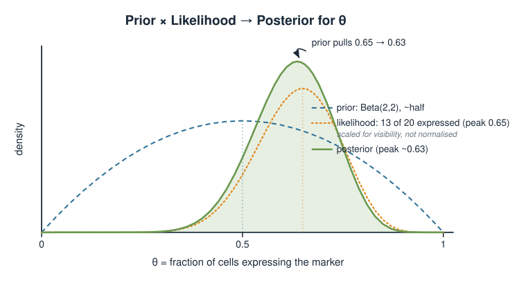
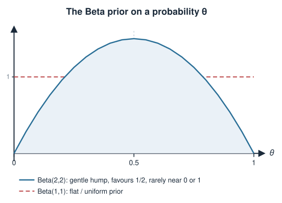
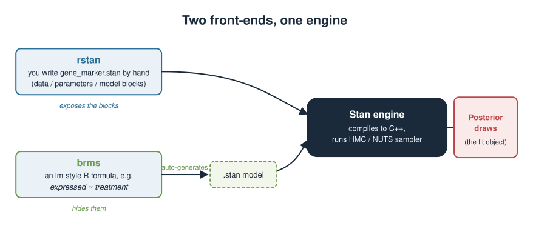
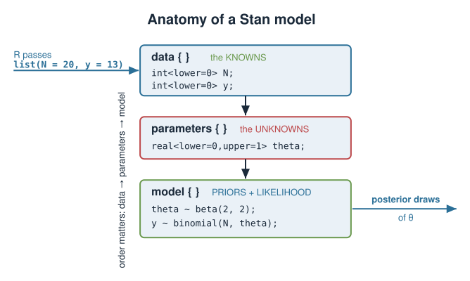
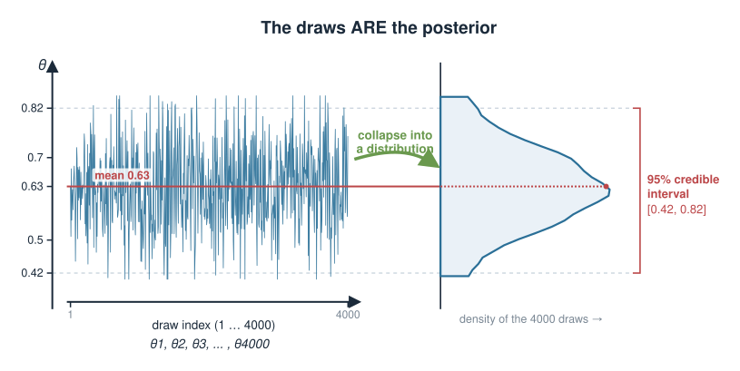
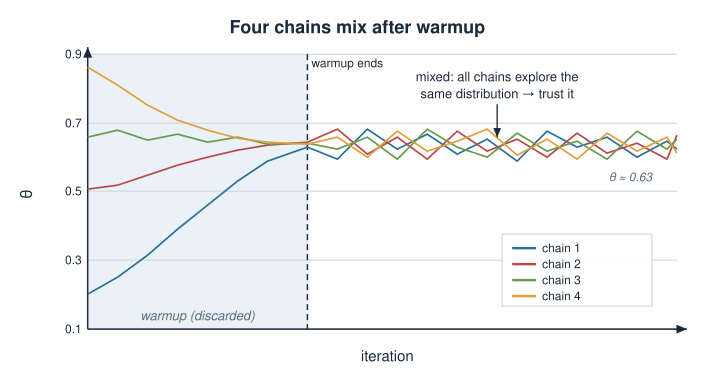
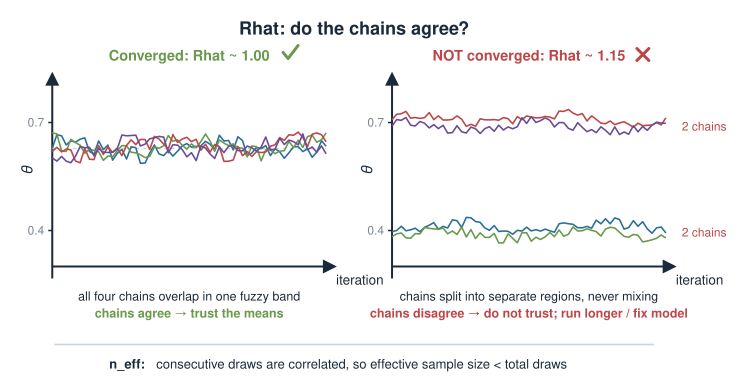

## About this lecture

In the Bayesian inference units you learned the *idea*: combine a **prior** with a **likelihood** to get a **posterior**. Today we learn the **tool** that computes that posterior for real models — **Stan**, driven from R.

- What **Stan** is, and why we need a computer once a model is bigger than a toy.
- The **anatomy** of a Stan model: the `data`, `parameters`, and `model` blocks.
- How to declare a **prior** and a **likelihood** in that language.
- How to **run** the model from R with `rstan`, and the shortcut package `brms`.
- The idea of **MCMC**: the fit is a big pile of **draws from the posterior**, not one number.
- How to **read the output**: posterior means, **credible intervals**, `Rhat`, and effective sample size.

::: {.callout-warning title="Provisional unit"}
This whole **Bayesian statistics** block is provisional and may move to a later statistics / machine-learning course. Treat today as a first look at the machinery, not an exam-critical by-hand skill.
:::

::: notes
Set expectations clearly. Earlier Bayesian units built the concept — prior, likelihood, posterior, and the Bayesian-vs-frequentist distinction. Those were done on toy problems where the posterior could be written down by hand (conjugate priors). Today is the jump to a general-purpose engine: Stan writes and samples the posterior for almost any model you can specify. Emphasise this is a mechanics-and-fluency lecture, not a derivation lecture, and flag the provisional status so students know the block may relocate. Keep an R session open conceptually but remember nothing here is executed at render time — all code is static.
:::

## A biology problem first {.smaller}

You stain a tissue and score cells for a marker gene. Out of **20 cells**, **13 express** it. What fraction $\theta$ of cells in this tissue express the marker?

- The naive point estimate is $13/20 = 0.65$. But with only 20 cells, how **sure** are we?
- A frequentist gives a confidence interval. A **Bayesian** wants the whole **posterior distribution** of $\theta$ — a probability curve over every value $\theta$ could take.
- We also have **prior** knowledge: this marker is usually expressed in *roughly half* the cells, rarely near 0 or 1.

The question is not "what is $\theta$?" but "**what does the data plus prior tell us about the plausible values of $\theta$?**" That is a posterior, and Stan will compute it.

{width="70%" fig-align="center"}

::: notes
Anchor the abstraction in a concrete count. Scoring 13 of 20 cells positive is exactly the kind of small-sample problem where uncertainty matters and a single ratio is misleading. Contrast the frequentist confidence interval (which students met in their prior stats course) with the Bayesian posterior: a full probability distribution over the unknown fraction. Plant the prior naturally — biological background says the marker sits around half — so priors feel like real information, not a philosophical imposition. This binomial-proportion problem is the running example for the whole lecture; keep coming back to it.
:::

## Recap: prior, likelihood, posterior {.smaller}

Bayes' theorem, in the form we actually use:

$$\underbrace{p(\theta \mid y)}_{\text{posterior}} \;\propto\; \underbrace{p(y \mid \theta)}_{\text{likelihood}} \times \underbrace{p(\theta)}_{\text{prior}}$$

For the marker example:

- **Parameter:** $\theta$, the fraction expressing (a number between 0 and 1).
- **Likelihood:** the count $y=13$ out of $N=20$ is **Binomial**: $y \sim \text{Binomial}(N, \theta)$.
- **Prior:** "usually about half" — a **Beta** distribution, e.g. $\theta \sim \text{Beta}(2,2)$, a gentle hump centred on $0.5$.

The posterior is the prior *reshaped* by the data. Stan's job is to produce that posterior for us.

{width="60%" fig-align="center"}

::: notes
Re-state Bayes in the proportional form, because the normalising constant is exactly what makes this hard by hand and what Stan sidesteps. Name each piece against the running example so the three abstract words become three concrete choices. The Binomial likelihood should feel familiar from the distributions block; the Beta prior is the natural companion on [0,1]. Beta(2,2) is a mild prior favouring the middle without excluding the extremes — contrast it mentally with Beta(1,1), the flat/uniform prior. Do not derive the Beta-Binomial conjugacy here; the point is that Stan does not need conjugacy at all.
:::

## Why we need a computer {.smaller}

For this one example the posterior happens to have a clean formula (Beta prior + Binomial likelihood is **conjugate**). But that is a lucky special case.

$$p(\theta \mid y) = \frac{p(y \mid \theta)\,p(\theta)}{\displaystyle\int p(y \mid \theta)\,p(\theta)\,d\theta}$$

- The denominator is an **integral over all parameter values**. For one parameter it is doable; for a realistic model with **dozens or hundreds** of parameters it is a hopeless high-dimensional integral.
- Almost no real model is conjugate, so there is **no formula** for the posterior.
- The escape: don't compute the curve — **draw samples** from it. That is what **MCMC** does, and what Stan is built for.

::: notes
This is the motivating "why". Students may have solved conjugate posteriors by hand in the earlier units and could wonder why a whole software package is needed. The honest answer: conjugacy is rare, and the normalising integral in the denominator is intractable the moment the model has more than a couple of parameters — think of a regression with many coefficients, or a hierarchical model over many genes. The conceptual pivot is that we never need the normalised curve; a large sample of draws from the posterior lets us compute any summary we want. That reframing is the whole reason MCMC and Stan exist.
:::

## What is Stan? {.smaller}

**Stan** is a probabilistic programming language: you *describe* a model, and Stan figures out how to **sample from its posterior**.

- You write the model in Stan's own small language (a `.stan` file or a string).
- Stan compiles it to fast C++ and runs an **MCMC** sampler (a modern one called **HMC / NUTS**).
- You drive it entirely from R. Two common front-ends:
  - [`rstan`](https://mc-stan.org/rstan/) — you write the Stan model yourself. Maximum control; you see every block.
  - [`brms`](https://paul-buerkner.github.io/brms/) — you write a familiar R **formula** (`y ~ x`) and it *generates* the Stan model for you.

Today we write one model **by hand** with `rstan` to see the moving parts, then show the `brms` shortcut.

{width="75%" fig-align="center"}

::: notes
Define Stan plainly: a language for describing statistical models, plus an engine that samples their posteriors. Stress the division of labour — you specify the model, Stan works out the sampling. Mention that under the hood it compiles to C++ and uses Hamiltonian Monte Carlo (the No-U-Turn Sampler), but do not go into HMC mechanics; the name is enough. The two front-ends matter pedagogically: rstan exposes the anatomy (our teaching goal), while brms hides it behind lm-style formulas they already know. We deliberately do the hand-written version first so the formula shortcut later is demystified, not magic.
:::

## The anatomy of a Stan model {.smaller}

A Stan model is organised into named **blocks**. The three essential ones:

| Block | What it declares | Analogy |
|---|---|---|
| `data` | the **known** inputs (counts, sample sizes, predictors) | what you pass in from R |
| `parameters` | the **unknowns** you want to learn | what the posterior is *over* |
| `model` | the **priors** and the **likelihood** | how data and parameters connect |

Order matters: `data`, then `parameters`, then `model`. Every variable must be **declared with a type** before use (Stan is strict, like C++).

{width="60%" fig-align="center"}

::: notes
Give the mental scaffold before showing code. Three blocks, three roles: data is what you know, parameters are what you want to find out, model wires them together with priors and a likelihood. The R-to-Stan hand-off is that the data block names exactly the things you must supply from R as a list. Warn that Stan is statically typed and picky about declaration order and semicolons — this is the number-one source of beginner frustration, so naming it now saves pain. There are more blocks (transformed data, generated quantities) but three are enough for a first model.
:::

## The `data` block {.smaller}

Declare everything you will pass in from R, with its **type** and any **constraints**.

```stan
data {
  int<lower=0> N;   // number of cells assayed
  int<lower=0> y;   // number of them expressing the marker
}
```

- `int` = integer; `real` = continuous. Vectors and matrices have their own types.
- `<lower=0>` is a **constraint**: a count cannot be negative. Constraints are checked — they catch bad input early.
- The names here (`N`, `y`) are exactly the names R must supply.

::: notes
Walk the block line by line. Types are mandatory: N and y are counts, so int. The <lower=0> bound documents and enforces that these are non-negative — Stan will error loudly if you pass a negative count, which is a feature. Emphasise the contract: the identifiers declared here (N, y) are the keys R will provide in a named list. Comments use // like C++. This is deliberately the simplest possible data block; a regression would add a vector of predictors and an int for the number of observations.
:::

## The `parameters` block {.smaller}

Declare the **unknowns** — the quantities the posterior is a distribution over.

```stan
parameters {
  real<lower=0, upper=1> theta;   // fraction of cells expressing
}
```

- `theta` is our unknown fraction. It is `real` (continuous).
- `<lower=0, upper=1>` constrains it to a valid **probability**. Stan samples *only* inside this range.
- This one line is why the whole model exists: **the posterior we want is $p(\theta \mid y)$.**

::: notes
The parameters block is short but conceptually central: it names what we are trying to learn and therefore what the posterior lives on. theta is a fraction, so it is continuous and bounded to [0,1] — the lower/upper constraints are not decoration, they tell Stan to only ever propose valid probabilities, which also makes the sampler behave. Contrast with the data block: data are fixed numbers you supply; parameters are never supplied, they are inferred. Everything the printout reports later will be about this theta.
:::

## The `model` block: prior + likelihood {.smaller}

Two statements: the **prior** on the parameter, and the **likelihood** of the data.

```stan
model {
  theta ~ beta(2, 2);          // prior: gentle hump around 0.5
  y ~ binomial(N, theta);      // likelihood: 13 of 20 expressed
}
```

- `~` reads "**is distributed as**". `theta ~ beta(2,2)` *is* the prior $p(\theta)$.
- `y ~ binomial(N, theta)` *is* the likelihood $p(y \mid \theta)$ — it links the known counts to the unknown $\theta$.
- Stan multiplies these together (adds their logs) to get the posterior — you never write the normalising integral.

::: notes
This block is where the Bayes' theorem slide becomes code, almost line for line. The tilde is the key syntax: "distributed as". The first tilde places the prior on theta; the second places the likelihood on the observed count y given N and theta. Point out that Stan works on the log scale internally and simply accumulates these contributions, which is exactly prior-times-likelihood — the intractable denominator never appears because sampling does not need it. If a student asks "where is the posterior written?", the answer is: nowhere explicitly; it emerges from these two lines plus sampling.
:::

## The full model, assembled {.smaller}

```stan
// gene_marker.stan
data {
  int<lower=0> N;                 // cells assayed
  int<lower=0> y;                 // cells expressing the marker
}
parameters {
  real<lower=0, upper=1> theta;   // fraction expressing
}
model {
  theta ~ beta(2, 2);             // prior
  y ~ binomial(N, theta);         // likelihood
}
```

That is a **complete, runnable** Bayesian model. Save it as `gene_marker.stan`. Three blocks, seven lines of logic — this is the whole thing.

::: notes
Show the assembled file so the pieces cohere into one artifact. Re-read it top to bottom in plain English: "we know N and y; we want theta; theta is a priori around a half; the data are Binomial." Point out how compact a full Bayesian model is once the language is familiar — and that this exact skeleton generalises: swap the likelihood line for a Poisson or negative binomial (from the distributions block) and you have a count model instead. Reassure that this file is genuinely complete and would run as-is.
:::

## Running it from R with `rstan` {.smaller}

Pass the data as a **named list** whose names match the `data` block, then call [`stan()`](https://mc-stan.org/rstan/reference/stan.html).

```r
library(rstan)

stan_data <- list(N = 20, y = 13)     # names match the data block

fit <- stan(
  file   = "gene_marker.stan",
  data   = stan_data,
  chains = 4,          # run 4 independent samplers
  iter   = 2000,       # 2000 iterations each (half are warmup)
  seed   = 1           # reproducibility
)
```

- The list keys `N` and `y` are the same identifiers declared in the model's `data` block.
- `stan()` compiles the model (once) and runs the sampler. `fit` holds all the posterior draws.

::: notes
This is the R-side mechanics. The single most important correspondence: the named list handed to data= must have exactly the identifiers declared in the Stan data block (N and y), or Stan complains. Explain the arguments plainly: chains launches several independent samplers (used later to check convergence), iter is the length of each, and seed makes the run reproducible — worth stressing because MCMC is stochastic and results vary run to run without a seed. Compilation to C++ happens on the first call and can take a minute; the returned fit object is the pile of draws we will summarise. Note this code is illustrative and not executed here.
:::

## What comes back: draws from the posterior {.smaller}

MCMC does not return *the* value of $\theta$. It returns thousands of **samples** of $\theta$, drawn in proportion to the posterior.

- After warmup, 4 chains $\times$ 1000 kept iterations $=$ **4000 draws** of $\theta$.
- A **histogram** of those draws *is* the posterior distribution.
- Any summary you want is just a summary of the draws:
  - posterior **mean** $\approx$ `mean(draws)`
  - 95% **credible interval** $\approx$ the 2.5% and 97.5% **quantiles** of the draws.

$$\theta_1, \theta_2, \theta_3, \dots, \theta_{4000} \quad\longrightarrow\quad \text{histogram} = \text{posterior}$$

{width="70%" fig-align="center"}

::: notes
This is the single most important conceptual slide and worth dwelling on. The output of Bayesian computation is not a point but a sample — a cloud of thousands of plausible theta values whose density reproduces the posterior. Everything downstream is descriptive statistics on that sample: the mean of the draws estimates the posterior mean, and the empirical 2.5%/97.5% quantiles give a 95% credible interval. Contrast a credible interval ("95% probability theta is in here", a direct probability statement) with a frequentist confidence interval, which students learned has a more contorted interpretation — this directness is a selling point of the Bayesian approach. The more draws, the sharper these estimates.
:::

## Chains, warmup, and convergence {.smaller}

Why **four** chains instead of one long run?

- Each **chain** starts from a different random point and wanders the posterior.
- The first half (**warmup**) is discarded — the sampler is still finding the high-probability region and tuning itself.
- If all four chains, from different starts, end up exploring the **same** distribution, we trust the result. If they disagree, something is wrong.

Running several chains is a built-in **sanity check**, not just extra samples.

{width="70%" fig-align="center"}

::: notes
Motivate the multi-chain design. A single chain could get stuck in a bad region and you would never know. Four independent chains from different starting points give a cheap, powerful diagnostic: if they converge to the same distribution they agree on the answer; if they wander apart, the model or sampler has a problem. Warmup (Stan's term; also called burn-in) is the initial phase where the sampler locates and adapts to the posterior — those iterations are tuning, not sampling, so they are thrown away. The next slide turns "do the chains agree" into a single number, Rhat.
:::

## Reading the output: `print(fit)` {.smaller}

```r
print(fit, pars = "theta")
```

```text
        mean se_mean   sd  2.5%   25%   50%   75% 97.5% n_eff Rhat
theta   0.63    0.00 0.10  0.42  0.56  0.63  0.70  0.82  1580    1
```

- **`mean`** $0.63$ — the posterior mean of $\theta$ (pulled slightly from $13/20=0.65$ toward the prior's $0.5$).
- **`2.5%` … `97.5%`** $= [0.42,\ 0.82]$ — a **95% credible interval**: there is a 95% posterior probability that $\theta$ lies in this range.
- **`n_eff`** and **`Rhat`** are diagnostics — the next slide.

::: notes
Read the summary table like a lab result. The mean column is the posterior mean; note it sits a touch below the raw 0.65 because the Beta(2,2) prior gently pulls toward 0.5 — a concrete illustration of the prior "reshaping" the data, and of shrinkage with small samples. The 2.5% and 97.5% columns bracket the central 95% of the draws: the credible interval, stated as a direct probability about theta. The median (50%) is another point summary. Do not gloss over how wide the interval is — with only 20 cells the uncertainty is large, which is exactly the honesty the Bayesian posterior gives you. Then hand off to the diagnostics columns.
:::

## Did it work? `Rhat` and `n_eff` {.smaller}

Two numbers tell you whether to **trust** the draws:

- **`Rhat`** ($\hat R$): compares variation **between** chains to variation **within** chains.
  - $\hat R \approx 1.00$ means the chains agree → converged. **Want $\hat R < 1.01$.**
  - $\hat R = 1.1$ or more → chains disagree → **do not trust the result.** Run longer or fix the model.
- **`n_eff`** (effective sample size): MCMC draws are **correlated**, so 4000 draws are worth *fewer* independent ones. `n_eff` is that effective count.
  - Bigger is better; a few hundred is usually plenty. Very low `n_eff` → estimates are noisy.

**Always check these before reading the means.** A pretty posterior from an unconverged sampler is meaningless.

{width="75%" fig-align="center"}

::: notes
These are the go/no-go gauges and students must build the habit of reading them first. Rhat, the potential scale reduction factor, formalises the four-chains-agree check into one number: at convergence between-chain and within-chain variance match and Rhat is 1; values above ~1.01 signal the chains have not mixed and the summaries are untrustworthy. Effective sample size acknowledges that consecutive MCMC draws are autocorrelated, so the real information content is less than the raw draw count; low n_eff means your posterior summaries are themselves noisy and you should sample more. The discipline to state: check Rhat and n_eff before you ever quote a posterior mean. This mirrors checking model diagnostics before trusting an lm fit.
:::

## The shortcut: `brms` {.smaller}

For standard models you rarely hand-write Stan. [`brms`](https://paul-buerkner.github.io/brms/) takes an `lm`-style **formula** and generates the Stan model for you.

Say each of many cells has a marker outcome (`expressed` = 0/1) and a `treatment`:

```r
library(brms)

fit <- brm(
  expressed ~ treatment,          # familiar formula interface
  data   = cells,
  family = bernoulli(),           # 0/1 outcome -> logistic regression
  prior  = prior(normal(0, 1), class = "b"),   # prior on coefficients
  chains = 4, iter = 2000, seed = 1
)

summary(fit)                      # same Rhat / credible-interval output
```

Same engine, same diagnostics — you just didn't write the blocks. Understanding the `rstan` version is what lets you read and trust what `brms` builds.

::: notes
Show the payoff of understanding the anatomy. brms lets you specify a Bayesian regression with the exact formula syntax students already use for lm/glm, and it writes, compiles, and runs the underlying Stan code automatically — including sensible defaults you can override, like the normal(0,1) prior on the regression coefficients. The family argument picks the likelihood (bernoulli for a 0/1 outcome gives Bayesian logistic regression; you could use poisson or negative_binomial for counts). Crucially, the output is the same posterior-draws-plus-Rhat picture, so everything learned today transfers. The pedagogical point: brms is not magic once you have seen the three blocks by hand — you know what it generated and how to check it.
:::

## Common pitfalls {.smaller}

- **Data names must match.** The list passed from R must use the exact identifiers in the `data` block (`N`, `y`), or Stan errors.
- **Types and constraints are strict.** A count is `int`; a probability is `real<lower=0, upper=1>`. Mismatches fail to compile.
- **Ignoring `Rhat` / `n_eff`.** Never quote a posterior before checking convergence.
- **Too few iterations.** If `Rhat` is high or `n_eff` low, increase `iter` (and `warmup`).
- **The prior is a choice.** State it and, ideally, check whether the posterior is sensitive to it. A flat prior is still a prior.

::: notes
A short troubleshooting tour so first errors are less baffling. The name-matching and type-strictness points cover the overwhelming majority of "it won't compile" beginner failures — worth saying explicitly. The diagnostic points reinforce the previous two slides: a run can complete and still be untrustworthy, so Rhat and n_eff gate everything. The prior reminder is both practical and philosophical: choosing a prior is unavoidable (even "flat" is a decision), it should be reported alongside results, and a good habit is a sensitivity check — does the conclusion change under a reasonable alternative prior? This connects back to the Bayesian-vs-frequentist discussion from earlier units.
:::

## Summary {.smaller}

| Idea | Takeaway |
|---|---|
| Goal | compute the **posterior** $p(\theta\mid y)$ for real models |
| Stan | a language + engine that **samples** the posterior |
| `data` block | the **knowns** you pass in from R (typed, constrained) |
| `parameters` block | the **unknowns** the posterior is over |
| `model` block | `~` statements: **prior** and **likelihood** |
| Run it | `stan(file, data = list(...), chains, iter)` |
| Output | thousands of **draws**; summarise them |
| Posterior mean | `mean` of the draws |
| Credible interval | 2.5% / 97.5% **quantiles** of the draws |
| `Rhat` | $\approx 1$ = chains agree = **trust it** ($<1.01$) |
| `n_eff` | effective (independent) sample size — bigger is better |
| `brms` | writes the Stan model from an `lm`-style formula |

**The mantra:** describe the model, sample the posterior, **check `Rhat`**, then read the draws.

::: notes
The summary is the working checklist. Drill the pipeline verbally one more time: pick a likelihood and priors, write the three blocks, hand R a matching data list, call stan, and — before anything else — check Rhat and n_eff; only then read the posterior mean and credible interval off the draws. Reiterate the one-sentence mantra. Remind them brms automates the writing but not the understanding or the checking. Close by re-flagging that the block is provisional and may move, so this is groundwork rather than exam material, and point them to the exercise, which walks through a Poisson count model in the same three-block pattern.
:::
