## About this lecture

In UMAPs and clustering you turned a single-cell dataset into **clusters** — groups of cells that look alike. But a cluster is just a *number* ("cluster 3"). The biology question is: **cluster 3 is which cell type?**

- A cluster is a **cloud of cells** in gene space; annotation asks what that cloud *is*.
- **Marker genes**: the genes a cluster switches on that the others do not — found by **differential expression** (DE) of each cluster against the rest.
- Two routes to a label: **manual** (match markers to known cell-type signatures) and **reference-based** (let a labelled dataset vote).
- The honest caveats: **ambiguous** clusters, **doublets**, and **continuous states** that resist discrete labels.
- The maths underneath is the same as before: cells are **vectors**, a cluster mean is a **centroid**, and a marker is a coordinate where two groups of vectors differ.

::: notes
The one sentence for today: clustering groups cells, annotation names the groups. Everything else — marker genes, differential expression, reference mapping — is machinery for attaching a biological label to an otherwise anonymous cluster. Stress that this is where the linear-algebra and statistics of the whole course pay off in a real workflow: each cell is a vector of gene counts, a cluster is a cloud of those vectors, and finding markers is comparing coordinates between clouds. Keep an R session narrative going but remind them nothing here runs live; the point is to read the output of a FindMarkers-style table, not to memorise a package API.
:::

## A biology picture first {.smaller}

You dissociate a piece of tissue — say a tumour biopsy — into single cells, sequence them, and cluster. The UMAP shows a dozen blobs.

- One blob is probably **T cells**, another **macrophages**, another **tumour epithelium** — but the algorithm does not know that. It only knows "these cells are similar."
- To *use* the experiment — "how many T cells infiltrated the tumour?", "which cluster is proliferating?" — every blob needs a **name**.
- Immunologists already know that **T cells express `CD3D`**, **B cells express `MS4A1` (CD20)**, **macrophages express `CD68`**. That prior knowledge is what we exploit.

Annotation is the bridge from *clusters the computer found* to *cell types the biologist recognises*.

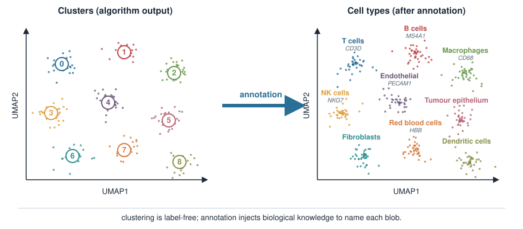{width="80%" fig-align="center"}

::: notes
Ground the abstraction in a concrete experiment before any method. A tumour biopsy is ideal because the audience already has the intuition that tissue is a mixture of cell types, and the whole point of single-cell is to pull that mixture apart. Emphasise that the clustering step is unsupervised and therefore label-free: the algorithm returns "cluster 0..11", not "T cell". The biological knowledge that CD3D marks T cells etc. lives in the literature and in the biologist's head; annotation is the disciplined way of injecting it. Do not yet say how we find that CD3D is high in a cluster — that is the DE step, coming up.
:::

## What a cluster is, in vector terms {.smaller}

From PCA and clustering: each cell is a **vector** of measured genes,

$$\mathbf{x}_{\text{cell}} = (x_1, x_2, \dots, x_G), \qquad x_g = \text{(normalised) expression of gene } g.$$

- A **cluster** is a set of these vectors that sit close together — a cloud in $G$-dimensional gene space.
- Its **mean vector** (the average over cells in the cluster) is the cluster **centroid** — the "typical expression profile" of that cell type.
- Annotation compares centroids: *which genes is this cluster's centroid high in, relative to the others?*

So the question "what is cluster 3?" becomes "**on which gene coordinates does cluster 3's centroid stick out?**"

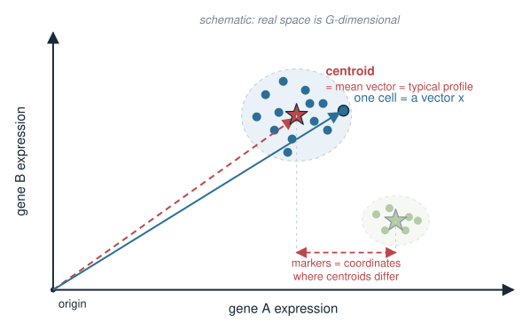{width="60%" fig-align="center"}

::: notes
This slide explicitly reconnects to the vector and PCA language the students already own. A cell is a point/vector; a cluster is a cloud; the centroid is the mean vector, coordinate by coordinate. Framing annotation as comparing centroids coordinate-by-coordinate sets up differential expression as nothing exotic — it is per-gene comparison of group means, exactly the sort of two-group comparison they met in the statistics course. Resist introducing the test yet; just plant that a "marker" will be a coordinate where one centroid is far above the others.
:::

## Marker genes: the core idea {.smaller}

A **marker gene** for a cluster is a gene that is **expressed much more highly in that cluster than in the rest** of the cells.

- Markers are how we recognise a type: high `CD3D` → T cell, high `MS4A1` → B cell, high `HBB` → red blood cell.
- Good markers are **specific** (on in one cluster, off elsewhere) and **sensitive** (on in *most* cells of that cluster).
- We do not pick markers by eye across thousands of genes — we **rank** genes by how strongly they separate the cluster from everything else.

That ranking is a **differential expression** problem: for each gene, compare its expression **inside** the cluster to **outside**.

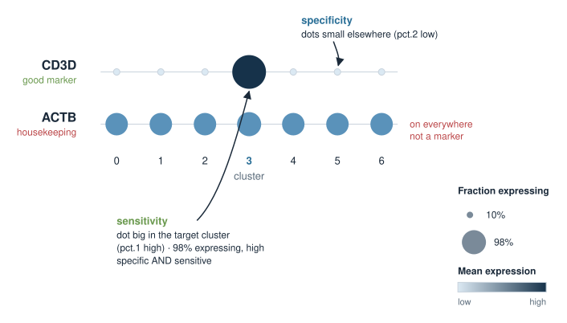{width="70%" fig-align="center"}

::: notes
Define a marker crisply: differentially high in one group. Two quality axes matter and map onto quantities we will see in the output table — specificity (expressed elsewhere or not, i.e. pct.2 low) and sensitivity (expressed in most of the cluster, i.e. pct.1 high). Make the point that with ~20000 genes you cannot eyeball this; you need a systematic score per gene. That score is a differential-expression statistic, which is the next block. Note that "marker" is relative — a gene is a marker with respect to a particular comparison (this cluster vs the rest).
:::

## Differential expression: one cluster vs the rest {.smaller}

To find markers for cluster $k$, split the cells into two groups and test **every gene**:

- **Group 1**: the cells *in* cluster $k$.
- **Group 2**: *all other* cells (the "rest").

This is the **one-vs-rest** comparison. For each gene we ask: is its expression distribution **different** between the two groups, and by how much?

Two numbers summarise each gene:

- a **log fold change** — how many-fold higher (or lower) the mean is in group 1 vs group 2, on a $\log_2$ scale;
- a **p-value** — is the difference bigger than we would expect by chance?

Repeat for every cluster and you have candidate markers for all of them.

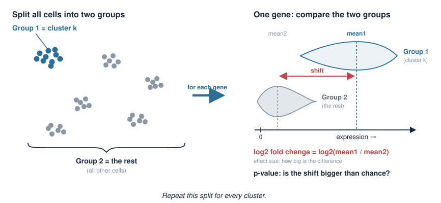{width="70%" fig-align="center"}

::: notes
One-vs-rest is the standard framing for marker discovery: cluster k against the pooled remainder. Contrast with a pairwise comparison (cluster k vs cluster j), which is also possible and sometimes needed to separate two similar types, but one-vs-rest is the default first pass. Emphasise the two outputs per gene: an effect size (log fold change, a difference of log means) and a significance (p-value). Both matter — a huge but noisy difference and a tiny but rock-solid difference are both misleading on their own. This is exactly the effect-size-plus-p-value thinking from their statistics course, now applied per gene across the transcriptome.
:::

## The statistic under the hood {.smaller}

For a single gene, we are comparing two sets of numbers (its expression in group 1 vs group 2). The default test in single-cell tools is the **Wilcoxon rank-sum test**:

- rank all the cells by that gene's expression, then ask whether group-1 cells sit **systematically higher** in the ranking;
- it is **non-parametric** — it does not assume the counts are Gaussian, which matters because single-cell counts are sparse and skewed (recall the negative-binomial / overdispersion story for count data).

The **log fold change** is the effect size:

$$\text{log}_2\text{FC} = \log_2\frac{\text{mean expression in group 1}}{\text{mean expression in group 2}}.$$

A large positive $\log_2$FC **and** a small p-value together flag a marker.

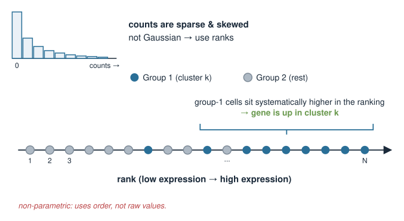{width="65%" fig-align="center"}

::: notes
Name the default test honestly: Wilcoxon rank-sum (Mann-Whitney). Explain the intuition — rank cells by the gene, see if one group is shifted up — rather than the formula. Justify non-parametric by pointing back to the count-data thread of the course: expression counts are overdispersed and zero-inflated, not Gaussian, so a t-test's assumptions are shaky; a rank test sidesteps the distributional assumption. Then define log fold change as a difference of log means (log of a ratio = difference of logs). Stress that neither number alone is a marker: you filter on both effect size and significance. Mention that other tests exist (t-test, negative-binomial-based, MAST) but Wilcoxon is the common default.
:::

## Reading a marker table (FindMarkers-style) {.smaller}

In practice you run a one-vs-rest scan across all clusters. A typical call (Seurat):

```r
# cells already clustered; identities set to cluster labels
markers <- FindAllMarkers(
  seurat_obj,
  only.pos       = TRUE,   # keep genes UP in each cluster (candidate markers)
  min.pct        = 0.25,   # gene must be detected in >=25% of one group
  logfc.threshold = 0.25   # require at least this log2 fold change
)
```

This returns one row per (gene, cluster) that passes the filters. The columns are the quantities from the last two slides.

::: notes
Show the call as static code they read, not run. Walk the arguments: only.pos keeps upregulated genes because markers are things a type switches ON; min.pct is a detection filter (skip genes seen in almost no cells, which are unstable); logfc.threshold is a minimum effect size so you are not testing thousands of flat genes. FindAllMarkers loops the one-vs-rest test over every cluster and stacks the results. Emphasise that these thresholds are pragmatic speed/false-positive filters, not deep truths. Next slide dissects the output columns.
:::

## What the columns mean {.smaller}

A few rows of the output for one cluster:

```r
#        p_val avg_log2FC pct.1 pct.2 p_val_adj cluster   gene
#  0.000e+00       3.85   0.98  0.05  0.000e+00       3  CD3D
#  1.2e-270        3.10   0.95  0.11  4.1e-266        3  CD3E
#  8.7e-190        2.40   0.90  0.20  3.0e-186        3   IL7R
```

- **`avg_log2FC`** — effect size: $\log_2$ fold change, cluster vs rest. $3.85$ means $\approx 2^{3.85} \approx 14\times$ higher.
- **`pct.1`** — fraction of **cluster** cells expressing the gene (sensitivity). $0.98$ = nearly all.
- **`pct.2`** — fraction of the **rest** expressing it (specificity). $0.05$ = almost none elsewhere.
- **`p_val_adj`** — p-value **after multiple-testing correction** (you tested ~20 000 genes).

`CD3D`: high fold change, on in 98% of the cluster, off (5%) elsewhere → a textbook T-cell marker.

::: notes
This is the heart of the practical skill: read a marker table. Spell out each column and tie it to a concept. avg_log2FC is the difference of log means from the DE slide; convert 3.85 to ~14-fold so the log scale feels concrete. pct.1 and pct.2 are the sensitivity/specificity pair from the marker-quality slide — pct.1 high and pct.2 low is exactly what "specific and sensitive" looks like numerically. p_val_adj must be the adjusted p-value because we ran ~20000 tests per cluster; recall multiple-testing from statistics (Seurat uses Bonferroni by default here). Land the reading: CD3D scores well on all axes, so cluster 3 is T cells. Warn that a good p-value alone is not enough — with thousands of cells almost everything is "significant"; the fold change and the pct columns are what make it a marker.
:::

## From markers to a label: the manual workflow {.smaller}

The classic annotation loop, cluster by cluster:

1. **Find markers** — one-vs-rest DE for each cluster (previous slides).
2. **Compare to known markers** — look the top genes up against curated cell-type signatures (`CellMarker`, `PanglaoDB`, or the lab's own list).
3. **Label** the cluster with the best-matching type; sanity-check on the UMAP.

```r
top <- head(markers[markers$cluster == 3, ], 10)$gene
top   # "CD3D" "CD3E" "IL7R" "CD2" "CD3G" ...  -> T cells

seurat_obj <- RenameIdents(seurat_obj, `3` = "T cell")
```

Repeat for every cluster until the whole UMAP is named.

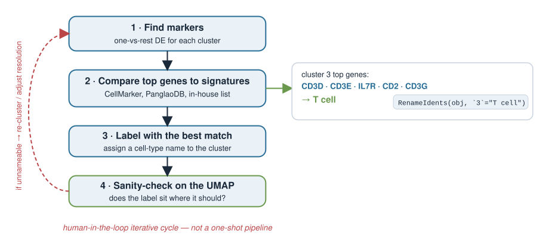{width="55%" fig-align="center"}

::: notes
This is the workflow the prompt asks us to make explicit: find markers, compare to known signatures, label. Databases (CellMarker, PanglaoDB) or a curated in-house list turn a gene list into a cell-type guess. Stress that this is human-in-the-loop and iterative: you propose a label, then check it makes biological sense (do the neighbouring clusters make a coherent lineage? does the fraction match expectation?). RenameIdents just attaches the human-readable name. Warn that top-10 lists can be dominated by housekeeping or ribosomal genes if normalisation was sloppy — another reason a human eye is in the loop.
:::

## Known cell-type signatures {.smaller}

A **signature** is a small set of genes expected to be high in a given type. Matching a cluster's markers to signatures is the manual annotator's dictionary.

| Cell type | Canonical markers |
|---|---|
| T cell | `CD3D`, `CD3E`, `CD2` |
| B cell | `MS4A1` (CD20), `CD79A` |
| Macrophage / monocyte | `CD68`, `LYZ`, `CD14` |
| NK cell | `NKG7`, `GNLY` |
| Endothelial | `PECAM1` (CD31), `VWF` |
| Red blood cell | `HBB`, `HBA1` |

- Instead of eyeballing one gene, you can **score** each cell for a whole signature (mean expression of the set) and see which cluster lights up.
- A signature is a **direction in gene space**; scoring a cell is essentially a **dot product** of its expression with the signature.

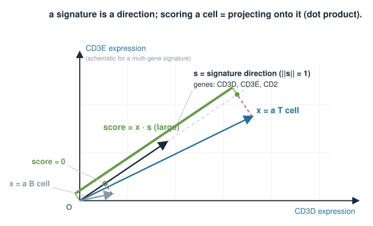{width="55%" fig-align="center"}

::: notes
Give them a real, standard marker table — these are all textbook and safe. The move from single markers to signatures matters: one gene is noisy (dropout means a real T cell may show zero CD3D reads), but the average over several markers is robust. Introduce module/signature scoring (AddModuleScore in Seurat) as averaging a gene set per cell. The linear-algebra payoff: a signature is a weighted direction in gene space and scoring a cell is a dot product / projection onto that direction — a callback to vectors and projection. Keep it conceptual; no need for the exact scoring algorithm.
:::

## Reference-based annotation {.smaller}

Instead of curating markers by hand, borrow labels from an **already-annotated** dataset (a reference atlas).

- Each **reference** cell type has a known expression profile (a centroid, or many labelled cells).
- For each **query** cell (yours), find which reference profile it most **resembles**, and copy that label.
- "Resembles" is a **similarity** measure — typically **correlation** between the query cell's expression vector and each reference profile.

Tools: **`SingleR`** (correlation to reference profiles), **`Azimuth`** (mapping onto a reference atlas), **`CellTypist`** (a trained classifier). All answer the same question: *which reference does this cell look like?*

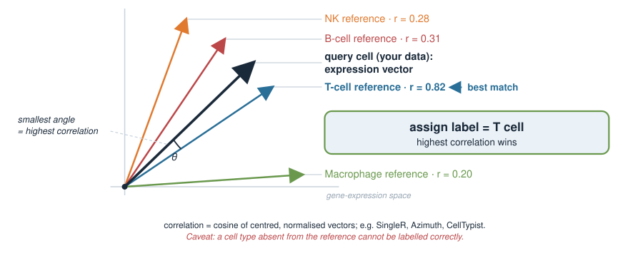{width="60%" fig-align="center"}

::: notes
Reference-based annotation automates the label transfer: given a trustworthy labelled dataset, assign each query cell the label of the reference it correlates with most. Frame the similarity as correlation between expression vectors — another vector-geometry callback (correlation is a centred, normalised dot product / cosine). Name the common tools truthfully and by what they do: SingleR correlates to reference profiles, Azimuth maps to a curated atlas, CellTypist is a logistic-regression classifier trained on labelled data. The key dependency to flag: the answer is only as good as the reference. A cell type absent from the reference cannot be labelled correctly — it will be forced onto the nearest wrong label.
:::

## Manual vs reference-based {.smaller}

| | Manual (markers) | Reference-based |
|---|---|---|
| **Input** | curated marker lists | a labelled reference dataset |
| **Granularity** | your choice, cluster-level | as fine as the reference |
| **Strength** | transparent, uses expert knowledge | fast, consistent, per-cell |
| **Weakness** | slow, subjective, needs expertise | only as good as the reference; misses novel types |
| **Best for** | new/unusual tissue, discovery | well-studied tissue (blood, common atlases) |

In practice you **combine** them: reference-based for a fast first pass, manual markers to confirm, refine, and catch anything the reference lacks.

::: notes
A balanced comparison so students choose appropriately. Manual is transparent and encodes expert judgement but is slow and subjective, and it labels clusters (not cells). Reference-based is fast, reproducible, and per-cell, but inherits every gap and bias of the reference — crucially it cannot discover a cell type the reference never saw. Best practice is to combine: run a reference method for speed, then verify with a handful of canonical markers per cluster. Emphasise that neither is "automatic truth"; both need the human sanity check on the UMAP and against known biology.
:::

## Caveat: ambiguous clusters {.smaller}

Not every cluster names cleanly.

- **No clear markers** — a cluster's top DE genes are weak or generic (ribosomal, mitochondrial). Often low-quality cells or a clustering artefact.
- **Mixed markers** — one cluster shows both T-cell (`CD3D`) *and* myeloid (`LYZ`) markers. Real biology? A doublet cluster? Under-clustering?
- **Resolution** — turning the clustering resolution up may split a vague blob into two clean types; too high and you over-split one type into noise.

Annotation and clustering are **iterative**: an unnameable cluster is a signal to **re-cluster**, adjust resolution, or check quality control.

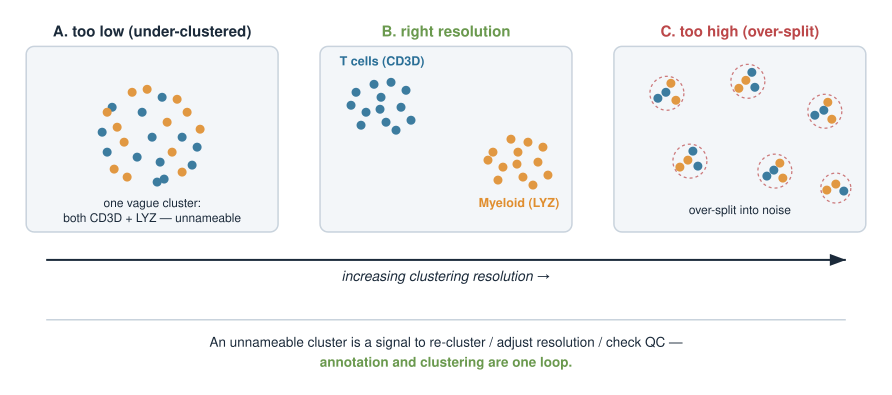{width="75%" fig-align="center"}

::: notes
Set expectations: real datasets always have a couple of clusters that resist a label. Enumerate the usual culprits — a cluster dominated by ribosomal/mito genes is usually dying or stressed cells (QC problem), not a cell type; a cluster with two lineages' markers is either a doublet artefact or a signal that the resolution is wrong. The takeaway is that annotation feeds back into clustering: you rarely get the resolution right on the first try, and an ambiguous cluster is diagnostic. This reinforces that the UMAPs-and-clustering step and the annotation step are one loop, not a pipeline you run once.
:::

## Caveat: doublets {.smaller}

A **doublet** is two cells captured in one droplet and sequenced as if they were one "cell."

- Its expression profile is a **sum of two types** → it shows **both** sets of markers (e.g. T-cell *and* B-cell genes).
- Doublets can form their own small cluster that looks like a fake "hybrid" cell type — a classic annotation trap.
- Detect them with dedicated tools (**`scDblFinder`**, **`DoubletFinder`**) that flag cells looking like blends of two profiles, then remove them **before** finalising annotation.

A "cell type" that co-expresses two lineages' exclusive markers should raise a **doublet** suspicion first.

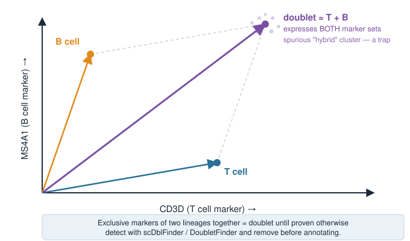{width="55%" fig-align="center"}

::: notes
Doublets are the most common way annotation goes wrong for a beginner: a droplet catches two cells, the reads combine, and you get a profile that is literally the sum of two centroids. Because it carries both marker sets, an untrained eye may christen a new "T/B hybrid" cell type that does not exist. The linear-algebra intuition — the doublet vector is roughly the sum of two cell vectors — is worth stating. Practically: run a doublet detector, remove flagged cells, then annotate. Give the rule of thumb: exclusive markers of two distinct lineages appearing together is a doublet until proven otherwise.
:::

## Caveat: continuous states vs discrete types {.smaller}

We label clusters as if cell identity were **discrete boxes**. Biology is often a **continuum**.

- **Differentiation**: stem → progenitor → mature is a smooth trajectory; any cut into "types" is partly arbitrary.
- **Activation states**: a resting vs activated T cell is the *same* type in a different state, not two types.
- **Cell cycle**: proliferating cells shift along a cycle axis — a continuous state that can even drive spurious clusters (revisited in Cell-cycle analysis).

Clustering **discretises** a continuum. Sometimes that is fine (blood has fairly distinct types); sometimes a **trajectory / pseudotime** view is truer than any set of labels.

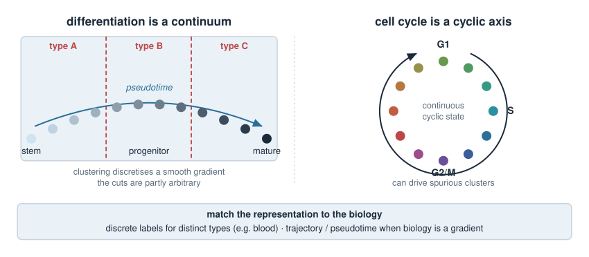{width="70%" fig-align="center"}

::: notes
The deepest caveat: the discrete-type model is a convenient fiction. Where cells sit on a smooth developmental or activation gradient, drawing cluster boundaries is a modelling choice, not a discovery of nature. Give the three canonical continua: differentiation trajectories, activation states (same type, different state), and the cell cycle (which is a continuous axis and can create artefactual clusters — a direct hook to the following Cell-cycle analysis unit). The honest message: match the representation to the biology. Discrete labels for discrete tissue; pseudotime/trajectory methods when the biology is a gradient. This is design principle 6 in action — be honest about what the simplification hides.
:::

## Tying it back: DE is comparing groups of vectors {.smaller}

Everything today is the course's linear-algebra and statistics, reused:

- A **cell** is a vector of gene expression; a **cluster** is a cloud of such vectors (UMAPs and clustering, PCA).
- A **cluster centroid** is the mean vector — the typical profile of a type.
- A **marker gene** is a **coordinate** where one cluster's centroid stands far from the rest.
- **Differential expression** is a **two-group comparison** per coordinate — effect size (log fold change = difference of log means) plus significance (a rank test), with **multiple-testing** correction because there are ~20 000 coordinates.
- A **signature score** is a **dot product** of a cell with a cell-type direction; **reference mapping** is **correlation** to reference profiles.

No new mathematics — a new *application* of vectors, means, and hypothesis tests.

::: notes
Consolidation slide: make the students see that annotation invented nothing mathematically new. Cells-as-vectors and clusters-as-clouds come from PCA and clustering; centroids are means; a marker is a coordinate where centroids separate; DE is the two-group hypothesis test from statistics applied per gene with multiple-testing control; signature scoring and reference mapping are dot products and correlations from vector geometry. This is the payoff of the whole course architecture — the same small toolkit (vectors, means, tests) recombines into a real single-cell workflow. Send them into the exercise with this map in mind.
:::

## Summary {.smaller}

| Idea | Key point |
|---|---|
| Clusters vs types | clustering groups cells; annotation **names** the groups |
| Marker gene | gene high in one cluster, low elsewhere (specific + sensitive) |
| Differential expression | one-vs-rest per gene: log fold change **and** adjusted p-value |
| Default test | Wilcoxon rank-sum (non-parametric — counts aren't Gaussian) |
| Reading the table | `avg_log2FC`, `pct.1`, `pct.2`, `p_val_adj` |
| Manual workflow | find markers → match to known signatures → label → check |
| Reference-based | copy labels from a labelled atlas by similarity (correlation) |
| Caveats | ambiguous clusters, **doublets**, continuous states |
| Under the hood | cells = vectors, centroids = means, markers = separating coordinates |

**Next (Cell-cycle analysis):** a continuous state that can dominate clustering — how to score it and, if needed, regress it out.

::: notes
The summary is the take-home map. Drill the reading of a marker table one more time because it is the concrete exam-and-lab skill: fold change for effect size, pct.1/pct.2 for sensitivity/specificity, adjusted p-value for significance under massive multiple testing. Restate the two annotation routes and when to use each, and the three caveats that catch beginners. Close on the unifying idea — vectors, means, and two-group tests — and hand off to Cell-cycle analysis, where a continuous state (the cycle) is treated head-on.
:::
