## About this lecture

You cluster a single-cell dataset and two "cell types" appear — but on closer look they are the **same** cell type, split into a dividing half and a resting half. The cell cycle has leaked into your analysis.

- The **cell cycle** is one of the strongest sources of cell-to-cell variation in expression, so it can **dominate** the data.
- We **score** each cell for cell-cycle phase (**G1 / S / G2M**) from small **marker gene sets**.
- Because it is a big axis of variation, the cycle often lines up with a **principal component** — closing the loop to Principal component analysis.
- If the cycle is a **nuisance** here, we can **regress it out**; if proliferation **is** the biology, we keep it.
- The broader lesson: **PCA components are axes of variation** — cell cycle, stress, batch, ambient RNA — so we must **interpret** them, not just use them.

This is an **applied concept** day. R is shown but not run; the goal is to understand what each step does and why.

::: notes
The single mental image: the cell cycle is a smooth, strong program that turns on hundreds of genes as a cell prepares to divide. Because it is strong, it behaves like any other big axis of variation in the data — it can eat a whole principal component and pull apart a cluster. Everything today hangs off that: scoring the phase, seeing it in PCA, deciding whether to remove it. Emphasise the judgement call at the end — cell cycle is not always noise. This unit deliberately ties the Single-cell block back to the Applications block: PCA is not a black box; its components mean something biological or technical, and cell cycle is the cleanest example.
:::

## A biology picture first {.smaller}

You sequence a tumour biopsy or a developing tissue. Many cells are **actively dividing**; others are **quiescent**.

- A cell preparing to divide **synthesises DNA**, then builds the **mitotic machinery** — hundreds of genes switch on in a coordinated wave.
- Two cells of the **same type** can therefore look very different in their expression profile — not because they *are* different, but because they are caught at different **points in the cycle**.
- Plot the cells and the dividing ones drift off to one side, forming what looks like a separate population.

The question for today: **how do we recognise this, measure it, and decide what to do about it?**

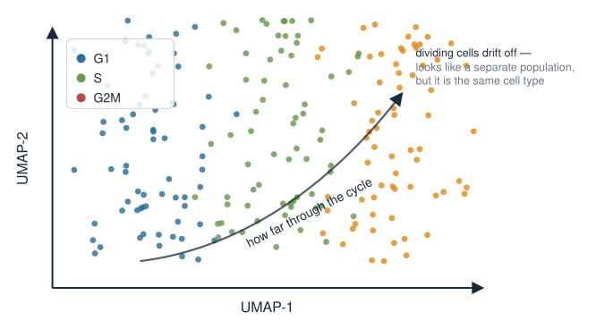{width="65%" fig-align="center"}

::: notes
Anchor everything in a real situation before any method: proliferating tissue (tumour, bone marrow, embryo, regenerating gut) is full of cycling cells. The key biological fact is that division is a coordinated transcriptional program, so cells of one identity fan out along a "how far through the cycle am I" direction. Stress that this within-type spread is genuine biological signal about proliferation, but it is often not the signal we came for (we usually want cell identity). That tension — real signal, wrong question — is the whole motivation.
:::

## The cell cycle in one minute {.smaller}

The division cycle runs through ordered phases, each with a characteristic transcriptional signature:

- **G1** — cell grows; no strong division program yet (the "resting-looking" default).
- **S** — **DNA replication**: histones and replication genes are high (e.g. *PCNA*, *MCM* family, *TYMS*).
- **G2/M** — preparing for and executing **mitosis**: spindle and division genes are high (e.g. *TOP2A*, *MKI67*, *CCNB1/2*, *CDK1*).

We collapse this into three labels a single-cell tool can assign: **G1**, **S**, **G2M**.

Key point: these are **sets of co-expressed genes** that rise and fall together — exactly the kind of coordinated pattern that dimensionality reduction picks up.

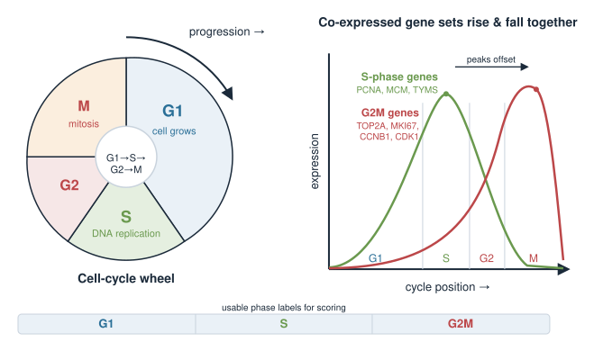{width="75%" fig-align="center"}

::: notes
Keep the biology light and correct: G1 growth, S is DNA synthesis, G2/M is mitosis. Name a few canonical markers so students recognise them in loadings later (PCNA/MCM/TYMS for S; TOP2A/MKI67/CCNB/CDK1 for G2M). The pedagogical hook for the maths: because these genes are co-regulated, they move together across cells, which is precisely a direction of high covariance — the thing PCA finds. Do not over-detail checkpoints or cyclin biochemistry; three labels is all the downstream method needs.
:::

## Why this is a single-cell problem {.smaller}

In bulk RNA-seq you average over millions of cells, so the cycle mostly **washes out**. In single-cell data every cell is caught at its **own** moment in the cycle.

- Hundreds of genes vary **together** across cells purely because of cell-cycle position.
- That coordinated variation is often **larger** than the difference between two related cell subtypes.
- So a naive clustering or embedding can group cells by **"how much are they dividing"** instead of by **"what are they"**.

This is the classic **confounder**: a strong, unwanted axis of variation sitting on top of the biology you actually want.

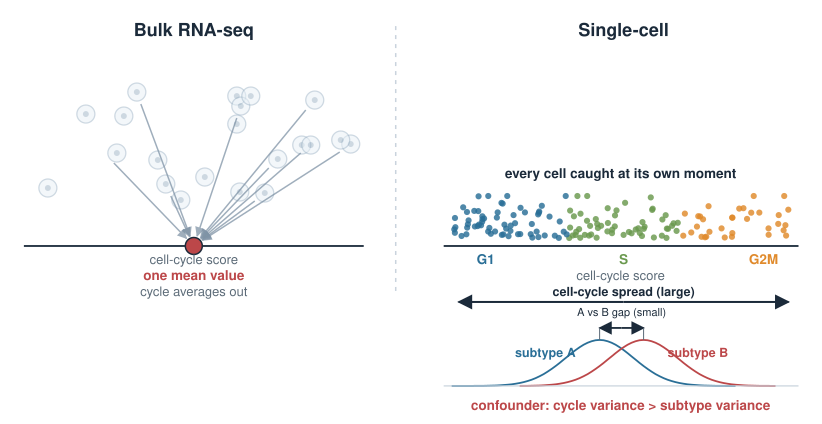{width="75%" fig-align="center"}

::: notes
Contrast bulk vs single-cell explicitly — this is why the problem is new here. In bulk, cell-cycle heterogeneity is averaged away; in single-cell it is front and centre because each cell has a definite phase. The magnitude point matters: cell-cycle variance can exceed subtype variance, so it wins in an unsupervised method that just chases the biggest variance. Frame it with the word confounder, which they know from the statistics course (covariates in lm): an axis correlated with the structure we see but not the structure we want.
:::

## Idea: score a phase from a gene set {.smaller}

We do not trust any **single** gene (dropouts, noise). Instead we use a **set** of phase markers and summarise them into one number per cell — a **module score**.

For cell $c$ and an S-phase gene set $\mathcal{S}$, a simple score is the **average expression** of those genes:

$$\text{Score}_S(c) = \frac{1}{|\mathcal{S}|}\sum_{g \in \mathcal{S}} x_{gc}$$

where $x_{gc}$ is the (log-normalised) expression of gene $g$ in cell $c$.

- A high $\text{Score}_S$ means the S-phase program is switched on in that cell.
- We compute an analogous $\text{Score}_{G2M}$ from the G2/M gene set.

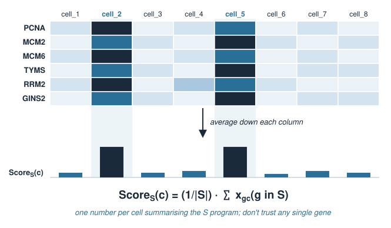{width="70%" fig-align="center"}

::: notes
Motivate the set-based approach from noise: single-cell counts are sparse and any one marker is unreliable, so we pool a curated set and average. Present the plain mean as the intuition-level score. This connects to descriptive statistics they already have — it is just a mean over a chosen list of features. The next slide refines it with a background correction, but the core idea (one number per cell summarising a program) is the takeaway. Note the expression is log-normalised, not raw counts, so averaging is reasonable.
:::

## Making the score fair: a background control {.smaller}

A problem: some cells simply have **more counts** or more genes detected, inflating any average. We want a score that reflects the **program**, not sequencing depth.

The standard fix (the `AddModuleScore` idea): subtract the average expression of a **matched set of control genes** picked to have **similar overall expression levels**:

$$\text{Score}_S(c) = \underbrace{\overline{x}_{\mathcal{S}}(c)}_{\text{marker average}} \;-\; \underbrace{\overline{x}_{\text{ctrl}}(c)}_{\text{control average}}$$

- The control genes track the **background** a cell would show anyway, so the difference isolates the **cell-cycle signal**.
- A score near **0** means "no more than background"; a clearly **positive** score means the program is active.

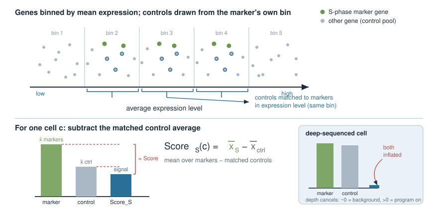{width="70%" fig-align="center"}

::: notes
This is the one non-obvious refinement and it is worth a slide because it explains the negative/positive scores students will see. Depth and complexity differences would make richer cells score high on everything; subtracting a background of expression-matched control genes cancels that. The genes are binned by average expression and controls are drawn from the same bins — no need to detail the binning, just the logic: compare markers against a fair background. Emphasise the interpretation of the sign: positive = above background = program on.
:::

## Assigning the phase {.smaller}

Each cell now has two numbers, $\text{Score}_S$ and $\text{Score}_{G2M}$. Assign a label by which program is **on**:

- If **both** scores are low (near or below 0) → **G1** (not obviously cycling).
- If $\text{Score}_S$ is the **highest** positive → **S**.
- If $\text{Score}_{G2M}$ is the **highest** positive → **G2M**.

This is the logic behind Seurat's `CellCycleScoring`: it returns `S.Score`, `G2M.Score`, and a discrete `Phase`.

Now we have both a **continuous** readout (the scores) and a **categorical** one (the phase) for every cell.

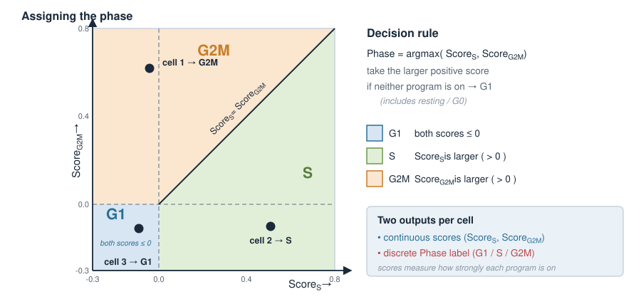{width="55%" fig-align="center"}

::: notes
Keep the decision rule simple and correct: take the larger of the two positive scores; if neither program is on, call it G1. Stress that we get two representations — continuous scores (good for regression and for correlating with PCs) and a discrete phase label (good for colouring plots and cross-tabs). Both matter downstream. Mention that "G1" here really means "no strong S or G2M signal", which includes truly resting/G0 cells; the method cannot cleanly separate G0 from G1.
:::

## In R: score and assign phase {.smaller}

Using the marker sets shipped with Seurat (from Tirosh *et al.* 2016) — shown, not run:

```r
library(Seurat)

# Built-in curated gene sets
s.genes   <- cc.genes.updated.2019$s.genes     # S-phase markers
g2m.genes <- cc.genes.updated.2019$g2m.genes   # G2/M markers

# obj is a Seurat object that has been normalised (LogNormalize)
obj <- CellCycleScoring(
  obj,
  s.features   = s.genes,
  g2m.features = g2m.genes,
  set.ident    = FALSE
)

head(obj[[]][, c("S.Score", "G2M.Score", "Phase")])
#>                    S.Score  G2M.Score Phase
#> cell_1           -0.0421     0.6215   G2M
#> cell_2            0.5130    -0.1002   S
#> cell_3           -0.0880    -0.1131   G1
```

Each cell gets two continuous scores and one phase label, stored in the metadata.

::: notes
This is the canonical call and the students should recognise it. Point out the prerequisites: the object must be normalised first (LogNormalize), because the scores average log-normalised expression. cc.genes.updated.2019 is the built-in human set from the Tirosh melanoma paper; for other species you map orthologues. set.ident = FALSE keeps their original cell identities as the active identity. The printed metadata is the deliverable — two scores plus Phase per cell — and everything downstream uses these columns. Remind them this is static code; nothing runs at render time.
:::

## The link to PCA {.smaller}

Recall from Principal component analysis: PCA finds the **directions of greatest variance** in the data (eigenvectors of the covariance matrix). It does not know or care what those directions **mean**.

- The cell-cycle genes are **strongly co-expressed** → they contribute a **large chunk of variance**.
- So one of the **top principal components** frequently aligns with the **cell-cycle axis**.
- Cells then spread along that PC by **phase**: G1 at one end, S and G2M at the other.

PCA is doing exactly its job — capturing the biggest variation. It just happens that here the biggest variation is *dividing vs. resting*, not the identity we were after.

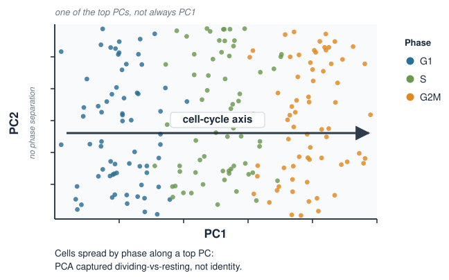{width="60%" fig-align="center"}

::: notes
This is the conceptual centre of the lecture and the payoff of the whole Applications block. Restate what PCA guarantees: it returns the top-variance orthogonal directions, agnostic to meaning. Because cell-cycle genes move together, they form a high-covariance bundle, so their shared direction is a leading eigenvector — a top PC. Hence colouring the PCA scatter by Phase reveals a gradient. Be careful and honest: say "one of the top PCs" or "often a leading PC", not "always PC1" — where it lands depends on how much other structure there is. The lesson: a PC is a direction, and its meaning is an empirical question.
:::

## Diagnosing what a PC means {.smaller}

Because a PC is just a direction, we **interpret** it by looking at two things:

1. **Loadings** — which genes define the axis. If the top-loading genes of a PC are *MKI67*, *TOP2A*, *PCNA*, *TYMS*..., that PC **is** the cell cycle.
2. **Correlation with a covariate** — relate the PC **scores** to something we measured, e.g. the cell-cycle score.

```r
# Correlate each cell's PC1 score with its cell-cycle scores
pc1 <- Embeddings(obj, "pca")[, 1]
cor(pc1, obj$S.Score)     # e.g. 0.71  -> PC1 tracks the S program
cor(pc1, obj$G2M.Score)   # e.g. 0.66  -> ... and the G2M program
```

A high correlation says: this principal component is (largely) the cell cycle.

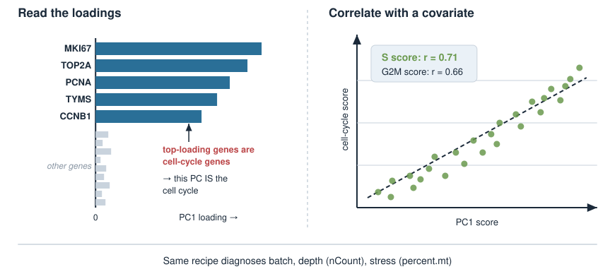{width="75%" fig-align="center"}

::: notes
Give them a concrete, reusable diagnostic recipe, because "interpret your components" is otherwise vague. Two complementary tools: read the loadings (top genes on the eigenvector — they met loadings in the PCA units) and correlate PC scores against a known covariate. High correlation between PC1 and the cell-cycle scores is direct evidence the axis is the cycle. Generalise: the same trick diagnoses batch (correlate PC with batch label), depth (with total counts), mitochondrial stress (with percent.mt). This is the transferable skill.
:::

## Cell cycle confounds clustering {.smaller}

Clustering and neighbour graphs are built **on top of** the PCA embedding. So if a top PC is the cell cycle:

- cells of **one** type can be split into a **"G1 cluster"** and a **"cycling cluster"**,
- or two genuinely different types can be **merged** because both are dividing.

Either way the clusters answer *"how much is this cell dividing?"* instead of *"what is this cell?"*.

A quick check — cross-tabulate clusters against phase:

```r
table(Cluster = Idents(obj), Phase = obj$Phase)
#>          Phase
#> Cluster    G1   S  G2M
#>       0   410  12    8    <- almost all G1
#>       3    18 205  190    <- almost all cycling: a cell-cycle artefact?
```

A cluster that is **almost entirely one phase** is a red flag.

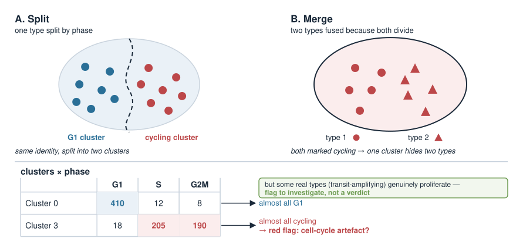{width="70%" fig-align="center"}

::: notes
Make the downstream damage concrete: clustering uses the PCA neighbour graph, so a cell-cycle PC propagates straight into the clusters. Two failure modes: one identity torn into resting vs cycling sub-clusters, or two identities fused because they share a proliferative signature. The cross-tab against Phase is a cheap, powerful diagnostic — a cluster that is ~100% G2M is probably a cell-cycle artefact, not a cell type. Caveat for honesty: sometimes a real cell type genuinely is highly proliferative (e.g. transit-amplifying cells), so the cross-tab is a flag to investigate, not an automatic verdict.
:::

## Removing the effect: regress it out {.smaller}

If the cell cycle is a **nuisance** here, we remove its contribution **before** PCA. The tool is one they already know: a **linear model per gene**.

For each gene $g$, fit its expression across cells on the cell-cycle scores and **keep the residuals**:

$$x_{gc} = \beta_{0g} + \beta_{1g}\,\text{Score}_S(c) + \beta_{2g}\,\text{Score}_{G2M}(c) + \varepsilon_{gc}$$

- The fitted part is the variation **explained by** the cell cycle.
- The **residual** $\varepsilon_{gc}$ is what is left **after** removing it — this is what we feed to PCA.

The cell-cycle axis is now flattened, so it no longer claims a top PC.

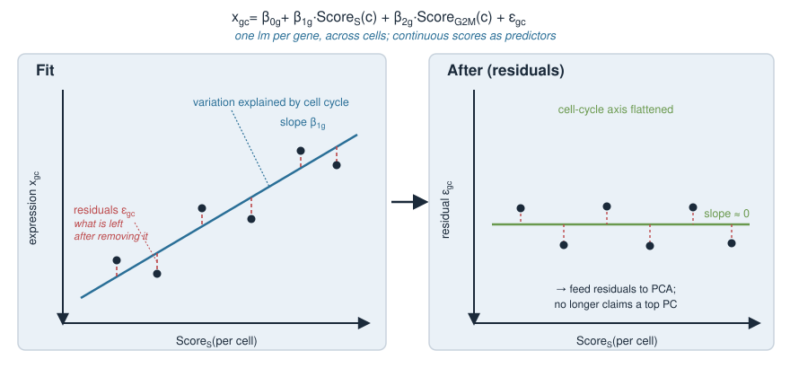{width="75%" fig-align="center"}

::: notes
This is the reassuring "you already own this tool" slide. Regressing out a covariate is exactly the lm they used in the statistics course, applied one gene at a time with the cell-cycle scores as predictors. The residual is the gene's expression with the cell-cycle-explained part subtracted. Do it before PCA/clustering so the axis is gone when variance is computed. Emphasise it is a per-gene regression across cells; the scores are continuous predictors. This also explains why the continuous scores (not just the phase label) were worth keeping.
:::

## In R: regress and re-run PCA {.smaller}

In Seurat this happens inside `ScaleData` via `vars.to.regress` — shown, not run:

```r
obj <- ScaleData(
  obj,
  vars.to.regress = c("S.Score", "G2M.Score"),
  features = rownames(obj)
)

obj <- RunPCA(obj)                 # PCA on the corrected (residual) data
```

Check it worked — the cell-cycle correlation with the top PCs should now be **weak**:

```r
pc1 <- Embeddings(obj, "pca")[, 1]
cor(pc1, obj$S.Score)     # e.g. 0.05  -> cycle no longer drives PC1
```

::: notes
Connect the earlier lm slide to the actual API: vars.to.regress inside ScaleData does the per-gene regression and passes residuals forward; RunPCA then operates on the corrected matrix. The verification is the same diagnostic as before, now expected to be near zero — always check that a correction did what you intended rather than assuming. Mention the common alternate recipe (regress the single difference S.Score - G2M.Score) on the next slide, which preserves cycling-vs-noncycling while removing phase-within-cycling.
:::

## When NOT to regress it out {.smaller}

Correcting the cell cycle is a **choice**, not a default. Ask: *is proliferation part of the answer?*

- **Tumour, immune activation, development, stem/progenitor cells** — here *dividing vs. resting* is real biology. Remove the cycle and you may **erase your result**.
- **Resolving fine cell subtypes in a proliferating tissue** — here the cycle is a **nuisance** hiding identity; removing it helps.

A common middle path: regress the **difference** $\text{Score}_S - \text{Score}_{G2M}$ instead of both. This removes **phase differences among cycling cells** but keeps **cycling vs. non-cycling** — useful when you still care *that* a cell divides, just not *where* in the cycle it is.

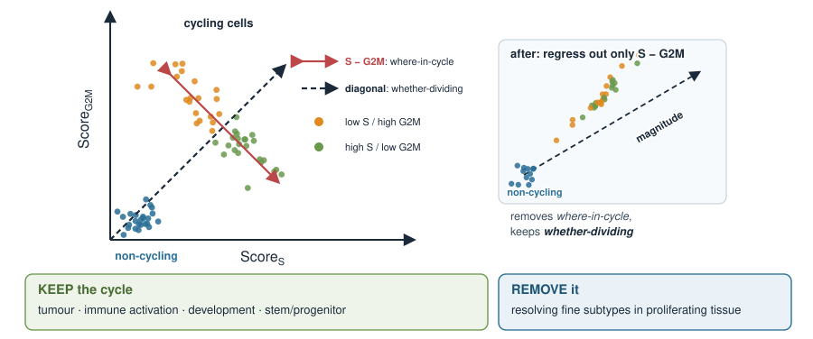{width="70%" fig-align="center"}

::: notes
This is the judgement slide and arguably the most important message. Regression is destructive: it removes a real signal, so only remove it when it is genuinely a nuisance for the current question. Give the two contrasting scenarios. Then the nuanced Seurat "alternate workflow": regressing S.Score minus G2M.Score collapses the within-cycle phase gradient but retains the cycling/non-cycling contrast — the right tool when proliferation status matters but exact phase does not. The meta-lesson: correction decisions must be driven by the biological question, not applied reflexively.
:::

## The broader point: PCs are axes of variation {.smaller}

Cell cycle is the cleanest example of a general truth from the Applications block: **a principal component is whatever varies most — and that can be anything.**

| A top PC might actually be... | Diagnose by correlating PC scores with... |
|---|---|
| Cell cycle | `S.Score`, `G2M.Score` |
| Sequencing depth | total counts per cell (`nCount_RNA`) |
| Mitochondrial / stress | `percent.mt` |
| Batch / donor | batch or donor label |
| Ambient / background RNA | empty-droplet profile |
| **Real cell identity** | marker genes of the cell type |

PCA is unsupervised: it hands you directions, not labels. **Interpreting** each component — biological signal vs. technical artefact — is the analyst's job.

::: notes
Zoom out to the transferable principle and make it a checklist. The exact same reasoning that catches cell cycle catches depth, mitochondrial stress, batch, and ambient RNA: each is a coordinated source of variance that can seize a top PC, and each is diagnosed by correlating PC scores against the relevant covariate. This is the antidote to treating PCA as a magic black box, which the whole Applications block was building toward. End the block's arc here: eigenvectors of covariance -> PCA -> components have meaning -> you must interpret them.
:::

## Summary {.smaller}

| Idea | Key point |
|---|---|
| Cell cycle | a strong, coordinated transcriptional program (G1 / S / G2M) |
| Why it matters | in single-cell data it is a **major axis of variation** |
| Scoring | average phase-marker expression minus a **background control** → `S.Score`, `G2M.Score`, `Phase` |
| Link to PCA | co-expressed cycle genes → high variance → often a **top PC** |
| Diagnose a PC | read **loadings**; **correlate** PC scores with the covariate |
| Confounding | clustering runs on PCA, so the cycle can split or merge clusters |
| Regress out | per-gene `lm` on the scores, keep **residuals**, then re-run PCA |
| Judgement | remove only if proliferation is a **nuisance**, not the biology |
| Big lesson | **PCA components are axes of variation — interpret them** |

This closes the loop from Principal component analysis: a PC is a direction, and its meaning is an empirical, biological question.

::: notes
The summary is the takeaway sheet. Drill the pipeline once verbally: normalise, score the phases, look at whether a top PC is the cycle (loadings + correlation), decide whether the cycle is nuisance or signal, regress out only if nuisance, re-run and verify. Land the final message hard: this unit was the concrete demonstration that principal components mean something, tying the Single-cell block back to the Applications block. Cell cycle is the exemplar; batch, depth, and stress follow the identical diagnostic logic.
:::
