## About this lecture

Until now a gene-expression experiment gave you **one number per gene per sample** — a bulk average over millions of cells. Single-cell RNA-seq gives you **one number per gene per cell**, for thousands of cells at once. That changes both the biology we can ask and the data structure we handle.

- The data object: a **sparse cells × genes count matrix**, mostly zeros.
- Where the numbers come from: the **droplet** workflow, at a high level.
- Why the counts are **noisy and sparse**, and what that forces us to do.
- **Quality control:** removing low-quality cells, empty droplets, and doublets.
- **Preprocessing:** normalization, log transform, and picking **highly variable genes**.

This is a **concept + data-handling** day. No new by-hand math; the log transform gets its own unit next (Log and pseudolog transforms), and the linear algebra payoff (PCA, UMAP) comes after that, in Dimensionality reduction & clustering.

::: notes
Frame the whole unit as a shift in resolution: bulk RNA-seq averages over a tissue, single-cell resolves the individual cells that make it up. Everything today is about (1) understanding the data structure that comes out of the machine and (2) cleaning it so the downstream analysis is trustworthy. Emphasise that we deliberately stop before PCA/clustering — those need the cleaned matrix we build today. Keep it conceptual; the R shown is Seurat-style pseudocode to read, not to run in the lecture.
:::

## A biology picture first {.smaller}

A tumour biopsy is not one thing. It is tumour cells, immune cells (T cells, B cells, macrophages), fibroblasts, and endothelial cells — all mixed together.

- **Bulk** RNA-seq measures the *average* expression across all of them. A gene that is high in a rare T-cell population but absent elsewhere looks like faint background.
- **Single-cell** RNA-seq measures each cell separately, so you can ask: *which cell types are present, in what proportions, and what is each one doing?*

The biological question — *what cell types make up this tissue, and how do they differ?* — is only answerable if we can read out expression **one cell at a time**.

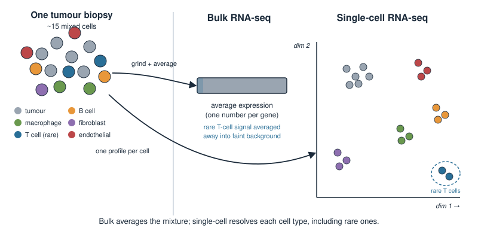{width="80%" fig-align="center"}

::: notes
This is the motivating pairing for the whole unit. The killer application of single-cell is resolving cellular heterogeneity that bulk averages away — rare cell types, mixtures, cell states. Use the tumour microenvironment because students know it and it is a real, high-stakes use case. Plant the idea that "many cells, measured separately" is what makes the new data structure (a big matrix) and the new problems (noise, sparsity, doublets) unavoidable. Do not mention PCA/clustering yet; just motivate why we want per-cell data.
:::

## The data: a cells × genes count matrix {.smaller}

The output of a single-cell experiment is a **table of counts**:

- **rows = cells** (often 1,000–50,000+),
- **columns = genes** (often ~20,000 for human/mouse),
- **entry $X_{cg}$** = the number of RNA molecules of gene $g$ detected in cell $c$ (a non-negative **integer count**).

$$X = \begin{pmatrix} X_{11} & X_{12} & \cdots & X_{1G} \\ X_{21} & X_{22} & \cdots & X_{2G} \\ \vdots & & \ddots & \vdots \\ X_{C1} & X_{C2} & \cdots & X_{CG} \end{pmatrix}$$

Same **sample × feature** shape you met with bulk expression tables — just with *cells* as the samples, and a lot more rows.

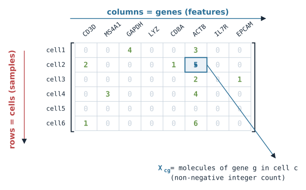{width="60%" fig-align="center"}

::: notes
Anchor on the object they will actually manipulate: a count matrix. Stress it is the same conceptual shape as any omics table (samples in rows, features in columns) so it is not alien — but the "samples" are now individual cells and there are thousands to tens of thousands of them. Some toolkits (Bioconductor's SingleCellExperiment, and Seurat internally) store the transpose with genes in rows and cells in columns; mention this so a transposed matrix later does not confuse them, but keep the mental model as cells = observations. Counts are integers; that matters for the distribution discussion later.
:::

## It is mostly zeros: sparsity {.smaller}

Most entries in the matrix are **exactly 0**. Typically **90–95%** of the matrix is zero.

Two reasons a zero appears:

- **Biological:** the gene is genuinely not expressed in that cell.
- **Technical ("dropout"):** the gene *is* expressed, but its few molecules were not captured or sequenced — a **false zero** from limited sensitivity.

We usually cannot tell the two apart from the count alone. Because so few molecules are sampled per cell, single-cell data is **sparse** and **noisy** by nature.

Practically, we store it as a **sparse matrix** (only the non-zero entries) — a dense $20{,}000 \times 50{,}000$ table of doubles would be tens of gigabytes.

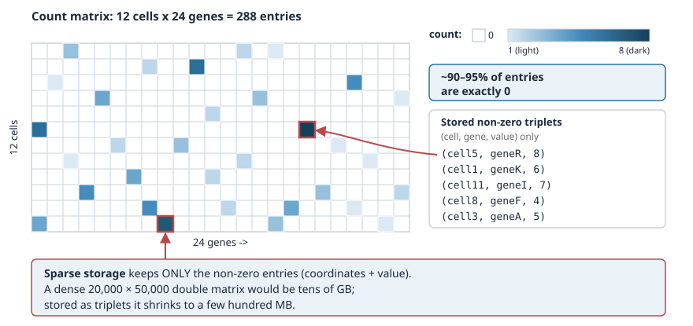{width="70%" fig-align="center"}

::: notes
Two key ideas here. First, sparsity is real and large (order 90%+ zeros), which is why we store the data in a sparse format — record only non-zeros. This is a genuine memory necessity, not an optimisation. Second, a zero is ambiguous: it can be true absence or a technical dropout caused by capturing only a tiny fraction of each cell's mRNA. Do not overclaim exact percentages of dropout; the honest statement is that low capture efficiency produces many false zeros and we generally cannot distinguish them per-entry. This ambiguity is why downstream methods are built to tolerate noise rather than trust individual counts.
:::

## Where the counts come from: droplets {.smaller}

The dominant technology (e.g. 10x Genomics) is **droplet-based**. High level:

1. A microfluidic chip pairs **single cells** with **barcoded gel beads** inside tiny **oil droplets** — ideally one cell per droplet.
2. The cell is lysed; each captured mRNA is tagged with that droplet's **cell barcode** (which cell) and a **UMI** — unique molecular identifier (which original molecule).
3. All droplets are pooled, reverse-transcribed, amplified, and **sequenced together**.
4. Computationally, reads are sorted **by cell barcode** back into cells, and **UMIs are counted** to rebuild the count matrix.

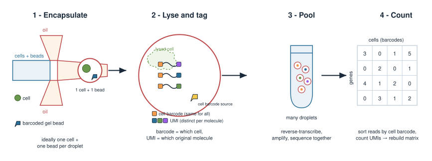{width="80%" fig-align="center"}

::: notes
Keep this high level — students need the concepts, not the wet-lab protocol. The three ideas that matter downstream: (1) the cell barcode is how reads get grouped back into cells; (2) the UMI lets us count original molecules rather than PCR duplicates, which is what makes the entries meaningful integer counts; (3) "ideally one cell per droplet" is an ideal that fails sometimes, which sets up empty droplets and doublets on the next slides. Everything is sequenced in one pool and de-multiplexed computationally by barcode.
:::

## Why UMIs matter {.smaller}

Sequencing involves a **PCR amplification** step that copies molecules unevenly. Without correction, a gene that happened to amplify well would look highly expressed.

- A **UMI** is a short random barcode attached to each *original* mRNA molecule **before** amplification.
- After sequencing, all reads sharing the same UMI (and cell barcode and gene) came from **one** original molecule — so we count them **once**.

Counting **unique UMIs** instead of raw reads removes most amplification bias, giving counts that better reflect the true number of molecules captured.

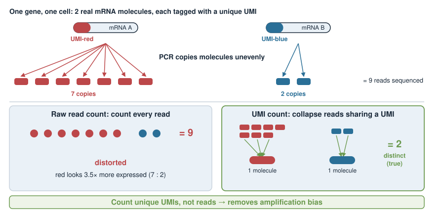{width="65%" fig-align="center"}

::: notes
This slide justifies why the matrix entries are trustworthy-ish integer counts and not just read pileups. Amplification is exponential and noisy, so raw read counts are badly distorted. The UMI tags each starting molecule, so collapsing duplicate UMIs recovers a molecule count. This is why people say "UMI counts". Note it removes amplification bias but does not fix capture efficiency — molecules never captured are still missing (the dropout story). Keep it short; the takeaway is UMI = de-duplicated molecule count.
:::

## The count matrix is raw — it needs cleaning {.smaller}

The matrix that comes off the pipeline is **not** ready for analysis. Two big problems, both from the "one cell per droplet" ideal breaking down, plus general quality issues:

- **Empty droplets:** a droplet with no cell still captures stray ambient RNA → a "cell" that is really background.
- **Doublets:** two cells share one droplet → one barcode that mixes two cells' expression.
- **Low-quality cells:** dying or damaged cells (leaked cytoplasm, stressed).

If we skip QC, these masquerade as real cells and create **fake cell types** and **fake intermediate states** downstream. QC is not optional bookkeeping — it protects every conclusion that follows.

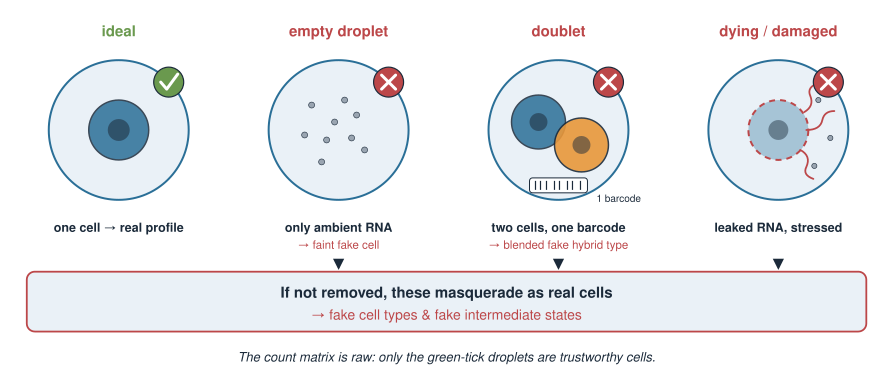{width="80%" fig-align="center"}

::: notes
Set up the QC section by naming the three failure modes. The framing to drill: bad cells do not just add noise, they produce *artefacts that look like biology* — an empty droplet full of ambient RNA can cluster as a "cell type"; a doublet of a T cell and a B cell looks like a novel cell expressing both programs. This is why QC comes before any dimensionality reduction or clustering. The next slides give the concrete signatures we filter on.
:::

## QC signature 1: counts and genes per cell {.smaller}

For each cell we compute two simple numbers:

- **total counts** (library size): $n_c = \sum_g X_{cg}$ — total UMIs in the cell.
- **number of genes detected:** $\#\{g : X_{cg} > 0\}$ — how many distinct genes are non-zero.

Interpreting the extremes:

- **Very low** on both → an **empty droplet** or a broken cell with little RNA. *Filter out.*
- **Very high** on both → possibly a **doublet** (two cells' worth of RNA). *Flag / filter.*

These are cheap, per-cell summaries — the first thing you look at.

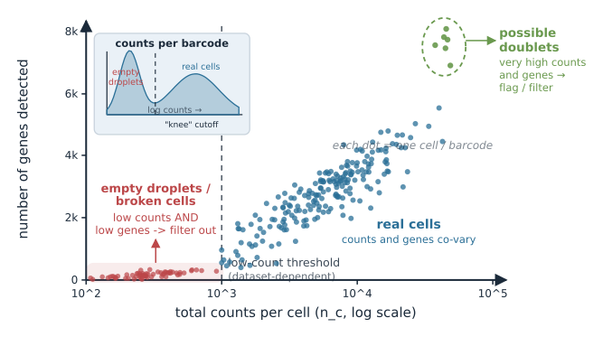{width="60%" fig-align="center"}

::: notes
These two per-cell QC metrics are the workhorses. Total counts (library size) and number of detected genes are strongly correlated and both track "how much real cell was in this droplet". Very low = empty/broken; very high = suspiciously much RNA, a doublet flag. Emphasise that thresholds are dataset-dependent and chosen by looking at the distributions, not universal magic numbers. Mention the "knee plot" idea: ranked barcodes by total counts show a sharp drop separating real cells from empty droplets, which dedicated tools use to call cells.
:::

## QC signature 2: mitochondrial fraction {.smaller}

Compute the fraction of each cell's counts coming from **mitochondrial genes** (in human, gene symbols starting `MT-`):

$$\text{pct.mt}_c = 100 \times \frac{\sum_{g \in \text{MT}} X_{cg}}{\sum_g X_{cg}}$$

- When a cell's membrane is **compromised** (dying/stressed), cytoplasmic mRNA **leaks out**, but mitochondrial mRNA stays trapped in mitochondria.
- So a **high mitochondrial fraction** is a hallmark of a **low-quality / dying cell**. *Filter cells above a threshold.*

The threshold is dataset-dependent (a common starting point is ~5–20%), and some healthy tissues are genuinely mito-rich — so inspect, don't blindly apply.

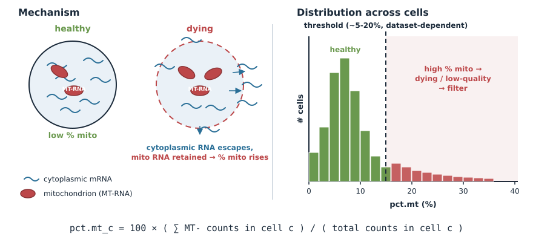{width="75%" fig-align="center"}

::: notes
This is the classic third QC metric. Mechanism: membrane damage lets cytoplasmic RNA escape while mitochondrial RNA is retained inside mitochondria, so the *proportion* that is mitochondrial rises. High pct.mt therefore flags dying cells. Be honest that the cutoff varies — 5% is common for some cell lines, but cardiomyocytes and other metabolically active tissues legitimately have high mitochondrial content, so a fixed threshold can throw away good cells. The design principle: look at the distribution, pick a threshold for your data. Ribosomal fraction is sometimes used similarly; mention only if asked.
:::

## Empty droplets and the ambient RNA problem {.smaller}

When cells are lysed during prep, some mRNA floats freely in the suspension — **ambient RNA**. Every droplet, even an empty one, captures a little.

- A droplet with **no cell** yields a low-count profile that is just **ambient background**.
- Ranking barcodes by total counts shows a sharp **"knee"**: real cells (high counts) drop off steeply to the empty-droplet background (low counts).

Simple low-count filtering removes the obvious empties; dedicated tools (e.g. `EmptyDrops`) model the ambient profile statistically to rescue small real cells and remove background.

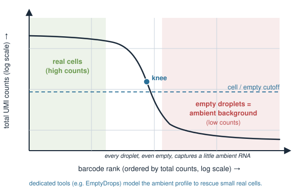{width="60%" fig-align="center"}

::: notes
Concept only. The ambient RNA pool is created by lysed cells before/during droplet formation and contaminates every droplet. Empty droplets contain only this background, so they sit at low total counts. The barcode-rank ("knee") plot is the standard diagnostic: sort barcodes by total UMI descending, plot on log-log, and there is a visible knee separating true cells from empties. Name-drop EmptyDrops as the principled tool but do not teach its statistics — the point is that "call which barcodes are real cells" is its own step. Ambient contamination also motivates later correction tools (SoupX/DecontX), which you can mention as deferred.
:::

## Doublets {.smaller}

A **doublet** is one barcode that captured **two cells**. Its expression is a **blend** of two profiles.

- Why it is dangerous: a doublet of a **T cell** and a **B cell** expresses both T-cell and B-cell markers — it can masquerade as a novel "hybrid" cell type or a fake transitional state.
- **Signatures:** unusually high total counts / genes; co-expression of markers that should be **mutually exclusive**.
- **Detection:** dedicated tools (e.g. `DoubletFinder`, `scDblFinder`) *simulate* artificial doublets by averaging random pairs of cells, then flag real cells that resemble those simulations.

Doublet rate scales with how many cells you load — more cells per run means more collisions.

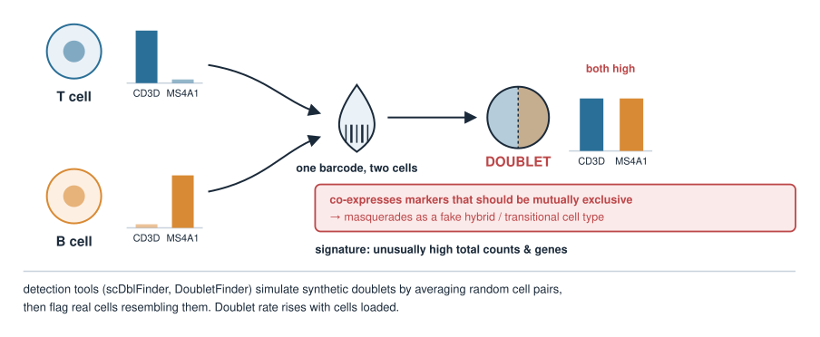{width="65%" fig-align="center"}

::: notes
Doublets are the second consequence of the one-cell-per-droplet ideal failing. The conceptual danger is the important bit: a doublet does not look like noise, it looks like a plausible new cell expressing two programs, which can lead to invented cell types. Detection tools work by simulating synthetic doublets (average pairs of real cells) and finding real barcodes that look like those synthetics. Also mention the practical trade-off: loading more cells increases throughput but raises the collision (doublet) rate — roughly linearly with the number of cells loaded for droplet platforms. Keep tool details out; the concept is what matters.
:::

## After filtering: normalization {.smaller}

Cells differ in **total counts** just from technical capture efficiency, not biology — one cell might have 2,000 UMIs and another 20,000. Comparing raw counts across cells is unfair.

**Library-size normalization:** divide each cell's counts by its total, then rescale to a common size (a "scale factor", e.g. 10,000):

$$\tilde{X}_{cg} = \frac{X_{cg}}{\sum_{g'} X_{cg'}} \times s$$

This makes cells comparable — it converts counts into **relative expression** per cell. It is the single-cell cousin of CPM/TPM from bulk RNA-seq.

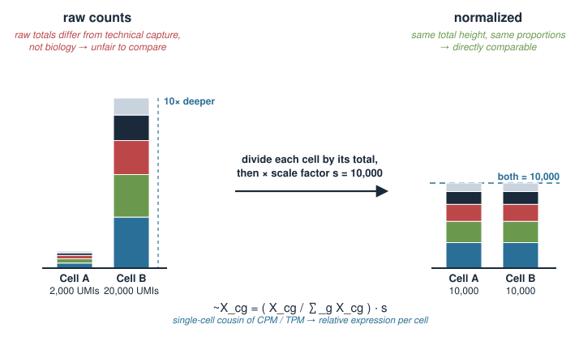{width="70%" fig-align="center"}

::: notes
Motivate normalization by the fact that library size (total UMIs per cell) varies a lot for purely technical reasons — differences in capture and sequencing depth — so raw counts across cells are not comparable. Library-size (a.k.a. total-count) normalization rescales each cell to a common total, turning counts into within-cell relative abundances. Connect to CPM/TPM which they may recall from bulk. Be honest that this simple normalization is a first-pass standard; more sophisticated approaches (scran pooling factors, SCTransform/Pearson residuals) exist and are deferred. Do not overstate that this fully removes technical effects.
:::

## Then the log transform {.smaller}

After scaling we apply $\log(1+x)$ (often written `log1p`):

$$Y_{cg} = \log\!\big(1 + \tilde{X}_{cg}\big)$$

Why log?

- Expression spans **orders of magnitude**; a few very-high-count genes would otherwise **dominate** every distance and variance calculation.
- Log **compresses** the large values and **stabilizes variance**, so highly and lowly expressed genes contribute more comparably.
- The $+1$ keeps **zeros as zeros** ($\log(1+0)=0$) and avoids $\log 0 = -\infty$.

The pair **(library-size normalize, then log1p)** is the standard baseline single-cell transform. More in the next unit, [Log and pseudolog transforms](../scrna-log/lec.qmd).

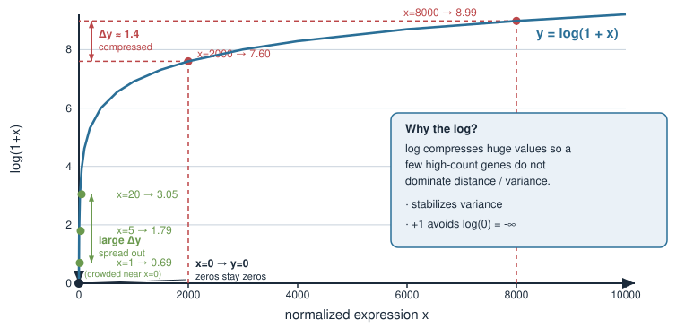{width="60%" fig-align="center"}

::: notes
The log serves two purposes: it tames the enormous dynamic range (a handful of housekeeping/ribosomal genes can be thousands of counts while most are single digits) so they do not swamp variance-based methods, and it roughly stabilises variance for count-like data. The +1 pseudocount is what lets zeros survive as zeros and avoids log(0). Emphasise this normalize-then-log pipeline is the default baseline that PCA/clustering assume downstream. Flag that Poisson/negative-binomial-aware alternatives exist (and that the count nature connects to the overdispersion topic from the distributions block) but are beyond today. Keep this slide short: the next unit, Log and pseudolog transforms, covers why the log, why it is nonlinear (average before you log), and how the pseudocount and the 10,000 scale factor change low counts.
:::

## Feature selection: highly variable genes {.smaller}

Of ~20,000 genes, **most are uninformative** for telling cell types apart — housekeeping genes are steadily on everywhere; many genes are just noise.

**Highly variable genes (HVGs):** keep the genes whose variation across cells is **larger than expected** for their mean expression level.

- Genes with real biological signal (cell-type markers) vary **more** than technical noise predicts.
- We rank genes by variability *relative to a mean–variance trend* and keep the top ~2,000.

Working with ~2,000 informative genes instead of 20,000 **cuts noise and computation** — and sets up the dimensionality reduction that comes next.

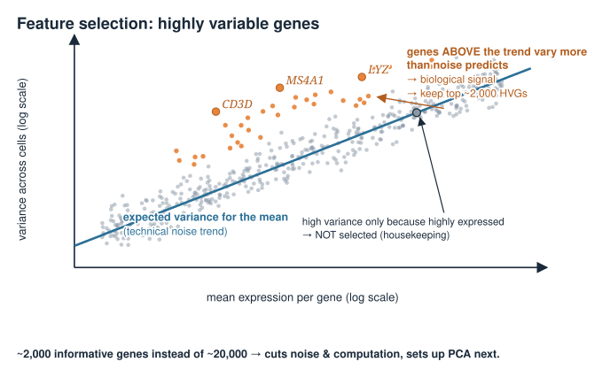{width="65%" fig-align="center"}

::: notes
Feature selection is the last preprocessing step. The key subtlety: you cannot just pick the highest-variance genes, because in count data variance grows with the mean — highly expressed genes are variable simply because they are big. So HVG selection ranks genes by variance *relative to what their mean predicts* (variance above a fitted mean-variance trend). Keeping ~2,000 top HVGs is the common default. Motivate it as noise reduction and computational tractability, and as the natural hand-off to Dimensionality reduction & clustering, where PCA runs on these selected, scaled genes. This is where the eigen/PCA machinery from the linear algebra block finally gets used on real data.
:::

## The standard pipeline in code (read, don't run) {.smaller}

Seurat-style pseudocode for the whole QC + preprocessing pass:

```r
library(Seurat)

# 1. Load the raw counts (cells x genes) into an object
counts <- Read10X("filtered_feature_bc_matrix/")
obj    <- CreateSeuratObject(counts, min.cells = 3, min.features = 200)

# 2. Per-cell QC metrics
obj[["percent.mt"]] <- PercentageFeatureSet(obj, pattern = "^MT-")

# 3. Filter low-quality cells (thresholds are dataset-dependent!)
obj <- subset(obj,
              subset = nFeature_RNA > 200 &
                       nFeature_RNA < 6000 &
                       percent.mt   < 15)

# 4. Normalize + log, then select highly variable genes
obj <- NormalizeData(obj)                       # library-size + log1p
obj <- FindVariableFeatures(obj, nfeatures = 2000)
```

Doublet detection (e.g. `scDblFinder`) is a separate step, usually run before or alongside filtering.

::: notes
Walk the pipeline top to bottom so the concepts map to real function names they will meet. Read10X loads the sparse matrix; CreateSeuratObject already does light gene/cell filtering (min.cells, min.features). PercentageFeatureSet computes pct.mt via the MT- pattern. subset() applies the QC thresholds — stress again these numbers are illustrative and must be chosen from the data. NormalizeData is the library-size + log1p we derived; FindVariableFeatures is HVG selection. Emphasise this is STATIC code to read — nothing is executed at render time and no packages are installed. The doublet step is separate. Dimensionality reduction & clustering picks up the obj and runs PCA/UMAP/clustering.
:::

## What we deliberately deferred {.smaller}

Today stopped at a **clean, normalized, HVG-selected matrix**. Not covered yet:

- **PCA / UMAP** — reducing the ~2,000-gene matrix to a few dimensions you can plot and cluster. *(Single-cell RNA-seq: dimensionality reduction.)*
- **Clustering & cell-type annotation** — grouping cells and naming the types.
- **Count-aware models** — Poisson / negative-binomial treatments of the counts, connecting to the **overdispersion** ideas from the distributions block.
- **Ambient-RNA correction** and advanced normalization (Pearson residuals / SCTransform).

The eigenvalue/eigenvector and PCA machinery you built earlier is exactly what Dimensionality reduction & clustering applies to this cleaned matrix.

::: notes
Be explicit about the stepping stones, per the course's "honest about what we defer" principle. The cleaned matrix is the deliverable; everything glamorous (dimensionality reduction, clustering, annotation) comes next and reuses the eigen/PCA foundation from the linear algebra block. Flag that the simple normalize+log baseline will be contrasted with count-aware models, tying back to Poisson/negative-binomial and overdispersion from the probability block. This slide is the map: students should see today as the data-cleaning foundation the rest of single-cell analysis stands on.
:::

## Summary {.smaller}

| Concept | Key fact |
|---|---|
| Data object | sparse **cells × genes** integer **count** matrix |
| Sparsity | ~90%+ zeros; zeros can be real **or** technical dropout |
| Droplet workflow | cell + barcoded bead in oil; **barcode** = which cell, **UMI** = which molecule |
| Empty droplets | low counts = ambient background; seen as a **knee** in the barcode-rank plot |
| Doublets | two cells, one barcode → blended profile; fake "hybrid" cell types |
| QC metrics | total counts, genes detected, **% mitochondrial** |
| Normalization | library-size scale, then $\log(1+x)$ |
| Feature selection | keep ~2,000 **highly variable genes** (variance above the mean trend) |
| Biology payoff | resolve **cell-type heterogeneity** a bulk average hides |

**Next ([Log and pseudolog transforms](../scrna-log/lec.qmd)):** why we log, what the +1 changes; then PCA and UMAP on this cleaned matrix.

::: notes
The summary is the revision sheet. Drill the pipeline as a story: counts come off the machine sparse and noisy → filter empties, doublets, and dying (high-mito) cells → normalize by library size and log → keep the highly variable genes → hand the clean matrix to PCA. Reconnect each technical step to its biological motivation (heterogeneity is the reason we do any of this). Preview what follows: a closer look at the log transform (next unit), then the eigen/PCA tools from the linear algebra block get applied to exactly this matrix to make the cell-type structure visible.
:::
