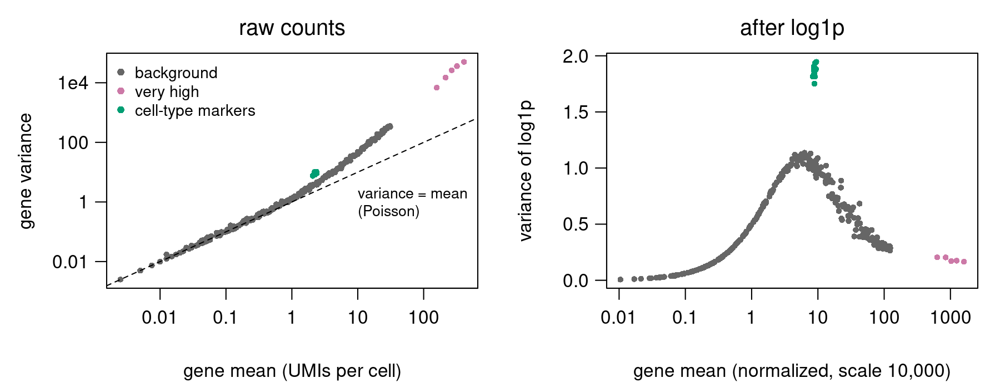
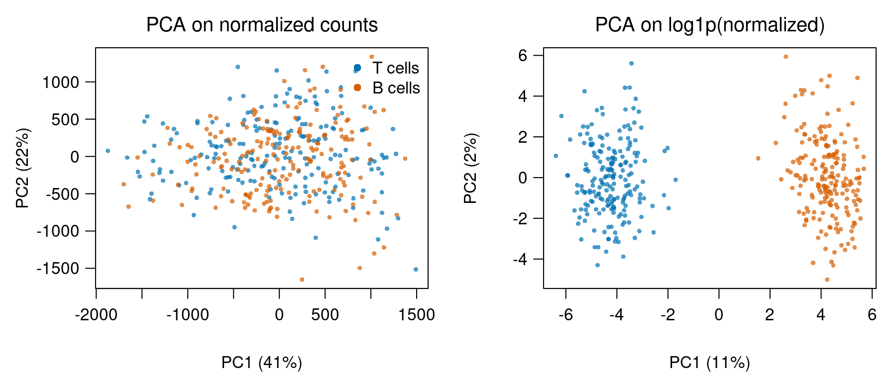
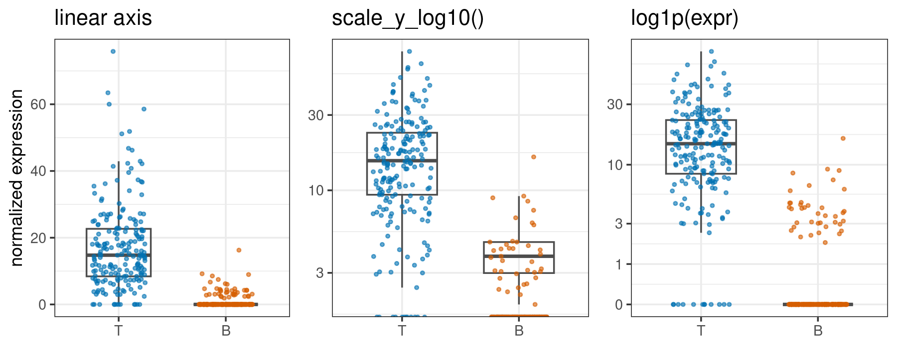

## Goal

By the end of this exercise you should be able to:

- compute and read $\log_2$ fold changes,
- show with numbers that the log is **not linear**, and say what that means for averaging and pseudobulk,
- apply the **pseudolog** $\log(1 + x)$ ([`log1p`](https://rdrr.io/r/base/Log.html)) and a general pseudocount $\log(x + c)$, and explain how the pseudocount changes low counts and fold changes,
- find the pseudocount hidden in library-size normalization with a scale factor,
- compare the mean–variance relation and a PCA before and after the transform,
- plot data with zeros without losing them.

This builds on Single-cell RNA-seq: data & QC (normalization, then log1p) and on PCA. The linearity test is the one from [Polar coordinates](../polar/exercise.qmd).

## Background

**Log rules.** $\log(a b) = \log a + \log b$ and $\log(a / b) = \log a - \log b$. A fold change $b / a$ becomes the difference $\log_2 b - \log_2 a$: $\log_2$ FC $= 1$ is a doubling, $-1$ a halving. Changing the base only rescales: $\log_2 x = \ln x / \ln 2$. In R, `log()` is the natural log; `log2()`, `log10()` and `log(x, base)` give the others.

**Linear test.** A function $f$ is linear if $f(a + b) = f(a) + f(b)$ and $f(c\,a) = c\,f(a)$. Every matrix map passes; the log does not.

**Pseudolog.** Counts contain zeros and $\log 0 = -\infty$. Adding a pseudocount $c$ fixes that: $\log(x + c)$. With $c = 1$ we call it the **pseudolog**, $\log(1 + x)$, in R `log1p(x)`. It maps 0 to 0, is close to $x$ for small $x$ and close to $\log x$ for large $x$.

**Library-size normalization** with scale factor $s$ (Seurat uses $s = 10{,}000$): $\log\!\big(1 + \tfrac{x}{n} s\big)$ for a gene with $x$ UMIs in a cell with $n$ UMIs in total.

## By hand

A calculator is fine.

**B1.** A gene has 50 UMIs per cell on average in control cells and 200 after treatment. What is the fold change, and the $\log_2$ fold change? Another gene goes from 40 to 10. A third has $\log_2$ FC $= 3$: by what factor did it change? And $\log_2$ FC $= -1$?

**B2.** Check the linear test for $f(x) = \log_{10} x$ with $a = 10$, $b = 1000$, $c = 2$: compute $f(a + b)$, $f(a) + f(b)$, $f(c\,a)$ and $c\,f(a)$. Then: a cell captured twice as much RNA as another, so all its counts are doubled. What happens to its $\log_2$ values?

**B3.** Three cells have 1, 10 and 100 normalized UMIs of a gene. Compute the **log of the mean**, $\log_{10}(\text{mean})$, and the **mean of the logs**, the average of $\log_{10}$ of each value. Which is smaller? Which value does the mean of the logs correspond to on the original scale?

**B4.** The $\log_2$ fold change between two counts $a \to b$ with pseudocount $c$ is $\log_2 \frac{b + c}{a + c}$. Fill in the table:

| $a \to b$ | $c = 0.1$ | $c = 1$ | $c = 10$ |
|---|---|---|---|
| 0 → 1 | | | |
| 1 → 3 | | | |
| 100 → 300 | | | |

The last two rows have the same true fold change. Which pseudocount reports it best, and for which counts? Why is a large $\log_2$ FC for 0 → 1 a problem?

**B5.** Compute $\log(1 + x)$ (natural log) and $\log x$ for $x = 0$, $0.01$, $1$ and $1000$. Where does the +1 matter, and where does it not?

**B6.** A cell has $n = 5{,}000$ UMIs in total, of which $x = 3$ are of gene G. Compute $\log(1 + \tfrac{x}{n} \cdot 10{,}000)$. Show that it equals $\log 2 + \log(x + 0.5)$. What is the pseudocount in raw counts? Do the same for the same 3 UMIs in a cell with $n = 20{,}000$.

**B7. (concept)** Five B cells have normalized expression $0, 0, 0, 2, 8$ for a T-cell marker. What is the median? You plot it with a log-scaled y axis, which drops the zeros: what median does the boxplot now show, and what would a reader conclude?

## Explore: choose the pseudocount

The demo uses a smaller simulation than the R part: 200 cells (100 T, 100 B) with total counts $n$ from about 1,300 to 12,600 UMIs, 60 background genes, 4 very high genes and 10 cell-type markers. (a) is the curve $\log(x + c)$ with the values for 0 and 1 UMI; (b) shows the transformed values of all cells for a low gene (orange) and a high gene (blue); (c) shows the variance after the transform for every gene, with a dashed line at the 10th largest: those 10 genes are what highly variable gene selection would pick.

```{=html}
<link rel="stylesheet" href="../demos/dist/demo.css">
<div data-demo="pseudocount" data-c="1" data-normalize="0"></div>
<script src="../demos/dist/pseudocount.js"></script>
```

**E1.** With raw counts (normalization off), base $e$, set $c = 0.01$, 1 and 100. For each, note the step from 0 to 1 UMI in (a) and the variance of the low gene in (b). Check the step for $c = 0.01$ by hand.

**E2.** For the same three values of $c$, how many of the 10 most variable genes in (c) are markers, and what kind of genes are the others? Explain both failures with the curve in (a).

**E3.** Switch the base from $e$ to 2. What changes in the three panels, and what does not? By what factor do the variances change?

**E4.** Set $c = 1$ and tick **normalize first**. Read off the step from 0 to 1 UMI in the deepest, the median and the shallowest cell. Relate it to the effective pseudocount $c \cdot n / 10{,}000$ from B6. What happens to the variance of the high gene, and why?

::: {.callout-note collapse="true" title="Solutions"}

**E1.** The step is $\log(1 + c) - \log c = \log\frac{1 + c}{c}$: 4.62 for $c = 0.01$ ($\log 101$), 0.69 for $c = 1$ ($\log 2$) and 0.01 for $c = 100$. The low gene (mean 0.35, 73% zeros) has variance 4.62, 0.14 and 0.00. With a small $c$ its zeros sit far below its ones and twos, so it looks very variable; with a large $c$ all its values are squashed together.

**E2.** $c = 0.01$: 5 of 10 are markers, the other 5 are background genes with many zeros, whose variance is mostly the 0-or-1 sampling noise blown up by the steep curve near 0. $c = 1$: all 10 are markers. $c = 100$: 2 markers, 4 very high genes and 4 high background genes. For counts well below $c$ the curve is almost flat, so low and moderate genes, including most markers, lose their variance; only genes with counts comparable to $c$ or larger still vary, and among them the biggest win, as on raw counts. Both ends of the slider hide the markers, for opposite reasons.

**E3.** The axes in (a) and (b) are relabelled (all values are multiplied by $1 / \ln 2 = 1.44$), and all variances are multiplied by $1 / (\ln 2)^2 = 2.08$. The shape of every panel and the ranking of the genes do not change: the base is a choice of units.

**E4.** The normalized value of 1 UMI is $10{,}000 / n$, so the step $\log(1 + 10{,}000 / n)$ is about 0.6 in the deepest cell, 1.13 in the median cell and 2.2 in the shallowest. Equivalently, the pseudocount in raw counts is $c \cdot n / 10{,}000$, from 0.13 to 1.26 here: a single UMI counts for more in a shallow cell. The variance of the high gene drops from 0.35 to 0.25, because on raw counts part of its spread is just sequencing depth (deep cells have more of everything); dividing by $n$ removes that.
:::

## In R

Base R is enough, except R5, which also uses `ggplot2`. The simulated data are the same as in the lecture: 400 cells (200 T cells, 200 B cells) and 300 genes, with negative-binomial counts.

```r
set.seed(1)
type <- rep(c("T", "B"), each = 200)                 # 400 cells: 200 T, 200 B
lib  <- rlnorm(400, 0, 0.35)                         # capture efficiency per cell
gene_mean <- c(exp(seq(log(0.01), log(30), length.out = 280)),   # 280 background genes
               150, 200, 250, 300, 400)                           # 5 very high genes
marker <- rbind(matrix(rep(c(4, 0.3), c(8, 7)), 200, 15, byrow = TRUE),   # T cells
                matrix(rep(c(0.3, 4), c(8, 7)), 200, 15, byrow = TRUE))   # B cells
mu <- cbind(outer(lib, gene_mean), lib * marker)     # expected count, cells x genes
X  <- matrix(rnbinom(length(mu), mu = mu, size = 5), nrow = 400)   # negative binomial counts
colnames(X) <- c(paste0("bg", 1:280), paste0("hi", 1:5), paste0("mk", 1:15))
```

The background genes `bg1`…`bg280` have the same mean in both cell types; `hi1`…`hi5` are very highly expressed (like ribosomal genes); the markers `mk1`…`mk8` are on in T cells and `mk9`…`mk15` in B cells.

**R1.** What fraction of `X` is zero? Compute the library size `n` per cell, the normalized matrix `N` (scale factor 10,000) and `L <- log1p(N)`. For every gene, compute the mean and variance of the raw counts `X`, and the variance of `L`. Plot variance against mean for `X` on log–log axes with the line variance = mean, and the variance of `L` against the mean. Which five genes have the largest variance before the log, and which after?

**R2.** Run `prcomp` on `N` and on `L`. Plot PC1 against PC2 for both, coloured by cell type. Which genes have the largest absolute loadings on PC1 in each case? What fraction of the total variance do the 5 `hi` genes make up in `N` and in `L`?

**R3.** For each gene, compute the mean normalized expression in T cells and in B cells (`colMeans` of `N` for each group). Then compute the $\log_2$ fold change T vs B, $\log_2 \frac{\bar x_T + c}{\bar x_B + c}$, for $c = 0.01$, 0.1, 1 and 10. Report it for `mk1` and `hi1`, and count how many **background** genes get $|\log_2 \text{FC}| > 0.5$. Their true fold change is 1. What happens to the markers when $c$ is large, and to the background genes when $c$ is small?

**R4.** For `mk1`, compare the mean of the log, `mean(L[type == "T", "mk1"])`, with the log of the mean, `log1p(mean(N[type == "T", "mk1"]))`, in each cell type. Then make a **pseudobulk**: `pb <- rowsum(X, type)` sums the raw counts per cell type. Compute the $\log_2$ fold change of `mk1` from the pseudobulk proportions, and compare it with the difference of mean log1p values (converted to $\log_2$ units by dividing by `log(2)`). The simulation used means 4 and 0.3: which estimate is closer to $\log_2(4 / 0.3)$?

**R5.** Plot `N[, "mk1"]` for all cells with base R `plot(..., log = "y")` and read the warning. Then make a ggplot boxplot of `mk1` by cell type three ways: linear axis, `scale_y_log10()`, and `log1p` values. What median does each show for B cells? Compare with `median(N[type == "B", "mk1"])`.

**R6.** The effective pseudocount in raw counts is $n / 10{,}000$ per cell. Find its range across the 400 cells. What is the log1p-normalized value of a **single** UMI in the smallest and in the largest cell? What would the pseudocount be with CPM (scale factor $10^6$) for the median cell?

## Hints

::: {.callout-tip collapse="true" title="Hint 1 — per-gene summaries"}
Cells are rows and genes are columns, so a per-gene summary works on columns: `colMeans(X)` and `apply(X, 2, var)`. Library sizes are per cell: `rowSums(X)`. `X / n` divides row $i$ by `n[i]`, because R recycles `n` down the columns, which is exactly what normalization needs.
:::

::: {.callout-tip collapse="true" title="Hint 2 — top genes and loadings"}
`names(sort(v, decreasing = TRUE))[1:5]` gives the names of the five largest values of a named vector `v`. For PCA, `p$rotation[, 1]` holds the PC1 loadings, one per gene; sort their absolute values. The variance share of the `hi` genes is `sum(v[281:285]) / sum(v)`, with `v` the per-gene variances.
:::

::: {.callout-tip collapse="true" title="Hint 3 — fold changes for many genes at once"}
`mT <- colMeans(N[type == "T", ])` and `mB <- colMeans(N[type == "B", ])` are vectors with one entry per gene. Then `log2((mT + c) / (mB + c))` gives all fold changes at once. Background genes are positions `1:280`.
:::

::: {.callout-tip collapse="true" title="Hint 4 — boxplot medians and log axes"}
For R5, `ggplot2::ggplot_build(p)$data[[1]]` holds the computed boxplot statistics (column `middle`). On a `scale_y_log10()` plot they are in $\log_{10}$ units, so take `10^middle`.
:::

## Solutions

::: {.callout-note collapse="true" title="Solution"}

**B1.** $200 / 50 = 4$, $\log_2 4 = 2$. From 40 to 10: fold change $0.25$, $\log_2 0.25 = -2$. $\log_2$ FC $= 3$ means $2^3 = 8$-fold up; $-1$ means halved. Up and down by the same factor give the same size with opposite signs.

**B2.** $f(a + b) = \log_{10} 1010 = 3.004$ but $f(a) + f(b) = 1 + 3 = 4$. $f(2 \cdot 10) = \log_{10} 20 = 1.30$ but $2 f(10) = 2$. Both parts of the test fail, so the log is not linear. Doubling all counts adds $\log_2 2 = 1$ to every $\log_2$ value: a multiplication becomes a shift. (With a pseudocount the shift is exact only for counts well above $c$.)

**B3.** Mean $= 111 / 3 = 37$, $\log_{10} 37 = 1.57$. Logs: $0, 1, 2$, mean $= 1$. The mean of the logs is smaller; it is always $\le$ the log of the mean. $10^1 = 10$ is the **geometric mean**, which gives the large value less weight than the arithmetic mean (37).

**B4.**

| $a \to b$ | $c = 0.1$ | $c = 1$ | $c = 10$ |
|---|---|---|---|
| 0 → 1 | 3.46 | 1.00 | 0.14 |
| 1 → 3 | 1.49 | 1.00 | 0.24 |
| 100 → 300 | 1.58 | 1.58 | 1.49 |

The true value for the last two rows is $\log_2 3 = 1.58$. At 100 counts every pseudocount up to 10 gets it nearly right. At 1 count, $c = 0.1$ is closest (1.49), $c = 1$ gives 1.00 and $c = 10$ shrinks it to 0.24. But a small $c$ also turns 0 → 1, a difference of a single molecule that is mostly sampling noise, into a 3.46 $\log_2$ FC (11-fold). The pseudocount sets the level below which differences are damped.

**B5.**

| $x$ | 0 | 0.01 | 1 | 1000 |
|---|---|---|---|---|
| $\log(1 + x)$ | 0 | 0.00995 | 0.693 | 6.909 |
| $\log x$ | $-\infty$ | $-4.61$ | 0 | 6.908 |

Near 0 the +1 dominates, and $\log(1 + x) \approx x$. At 1000 it changes the value by 0.001.

**B6.** $\tfrac{3}{5000} \cdot 10{,}000 = 6$, $\log(1 + 6) = \log 7 = 1.946$. And $\log 2 + \log 3.5 = 0.693 + 1.253 = 1.946$. In general $1 + 2x = 2(x + 0.5)$, so the pseudocount in raw counts is $0.5 = n / 10{,}000$. For $n = 20{,}000$: $\log(1 + 1.5) = 0.916 = \log 0.5 + \log(3 + 2)$, pseudocount 2. The same 3 UMIs are damped more in a bigger cell.

**B7.** The median of $0, 0, 0, 2, 8$ is 0: most B cells do not express the marker. Without the zeros the values are $2, 8$, median 5. The plot suggests B cells express the T-cell marker at a moderate level, which is wrong.

**R1.**

```r
mean(X == 0)                          # 0.50
n <- rowSums(X)
N <- X / n * 10000
L <- log1p(N)
median(n)                             # 2375

m  <- colMeans(X)
v  <- apply(X, 2, var)
vL <- apply(L, 2, var)
plot(m, v, log = "xy", xlab = "mean UMIs per cell", ylab = "variance")
abline(0, 1)                          # variance = mean (Poisson)
plot(colMeans(N), vL, log = "x", xlab = "mean (normalized)", ylab = "variance of log1p")
names(sort(v,  decreasing = TRUE))[1:5]    # "hi5" "hi4" "hi3" "hi2" "hi1"
names(sort(vL, decreasing = TRUE))[1:5]    # "mk2" "mk1" "mk7" "mk3" "mk6"
```

{width="90%" fig-align="center"}

Half the matrix is zero (real data have more). Raw-count variances grow with the mean and lie above the Poisson line for higher means (negative-binomial overdispersion); the 5 `hi` genes top the list only because they are big. After log1p the top five are all markers: the genes that differ between cell types.

**R2.**

```r
pN <- prcomp(N)
pL <- prcomp(L)
col <- ifelse(type == "T", "#0072B2", "#D55E00")
plot(pN$x[, 1:2], col = col, pch = 16, main = "normalized counts")
plot(pL$x[, 1:2], col = col, pch = 16, main = "log1p")
names(sort(abs(pN$rotation[, 1]), decreasing = TRUE))[1:5]   # "hi5" "hi4" "hi3" "hi2" "bg280"
names(sort(abs(pL$rotation[, 1]), decreasing = TRUE))[1:5]   # "mk2" "mk1" "mk6" "mk11" "mk7"
vN <- apply(N, 2, var)
sum(vN[281:285]) / sum(vN)            # 0.92
sum(vL[281:285]) / sum(vL)            # 0.005
```

{width="90%" fig-align="center"}

On normalized counts, 92% of the total variance comes from the 5 `hi` genes, and PC1 (41% of the variance) is their noise: T and B cells overlap. On log1p data they contribute 0.5%; PC1 (11%) is built from markers and separates the two cell types completely.

**R3.**

```r
mT <- colMeans(N[type == "T", ])
mB <- colMeans(N[type == "B", ])
for (c in c(0.01, 0.1, 1, 10)) {
  lfc <- log2((mT + c) / (mB + c))
  cat("c =", c, " mk1:", round(lfc["mk1"], 2), " hi1:", round(lfc["hi1"], 2),
      " background |lfc| > 0.5:", sum(abs(lfc[1:280]) > 0.5), "\n")
}
```

| $c$ | `mk1` | `hi1` | background genes with $|\log_2 \text{FC}| > 0.5$ |
|---|---|---|---|
| 0.01 | 4.27 | −0.04 | 58 |
| 0.1 | 4.14 | −0.04 | 23 |
| 1 | 3.27 | −0.04 | 0 |
| 10 | 1.32 | −0.04 | 0 |

The `hi1` gene (mean about 630 normalized) does not care about $c$. The marker `mk1` (means 17.2 in T, 0.88 in B) loses fold change as $c$ grows: with $c = 10$ a 20-fold difference looks like 2.5-fold. With $c = 0.01$, 58 of 280 background genes, all with true fold change 1, get $|\log_2 \text{FC}| > 0.5$. They are the rarely detected genes (means around 0.01–1), where a handful of UMIs in one group decides the ratio. The pseudocount trades false fold changes at low counts against shrinking real ones.

**R4.**

```r
for (g in c("T", "B")) {
  cat(g, " mean of log1p:", mean(L[type == g, "mk1"]),
      " log1p of mean:", log1p(mean(N[type == g, "mk1"])), "\n")
}
pb <- rowsum(X, type)                 # rows B and T; raw counts summed per cell type
pb[, "mk1"]                           # B 49, T 869
log2((pb["T", "mk1"] / sum(pb["T", ])) / (pb["B", "mk1"] / sum(pb["B", ])))   # 4.13
(mean(L[type == "T", "mk1"]) - mean(L[type == "B", "mk1"])) / log(2)          # 3.29
log2(4 / 0.3)                                                                 # 3.74
```

T cells: mean of log1p 2.60, log1p of mean 2.90. B cells: 0.32 and 0.63. The mean of the logs is smaller in both, as in B3. The pseudobulk $\log_2$ FC is 4.13, the difference of mean log1p values 3.29; the simulation's value is 3.74. The two estimates measure different things: the pseudobulk is a ratio of total expression, the mean-of-logs difference is a ratio of geometric means shrunk by the pseudocount. Neither is exactly 3.74 here because the B-cell pseudobulk has only 49 UMIs, so it is noisy. For a test between conditions with replicates, sum counts per sample and use a count-based bulk method.

**R5.**

```r
plot(N[, "mk1"], log = "y")           # warning: 173 y values <= 0 omitted

library(ggplot2)
d  <- data.frame(type = factor(type, levels = c("T", "B")), expr = N[, "mk1"])
p1 <- ggplot(d, aes(type, expr)) + geom_boxplot()
p2 <- p1 + scale_y_log10()
p3 <- ggplot(d, aes(type, log1p(expr))) + geom_boxplot() +
  scale_y_continuous(breaks = log1p(c(0, 1, 3, 10, 30, 100)), labels = c(0, 1, 3, 10, 30, 100))
ggplot_build(p1)$data[[1]]$middle[2]          # 0      (B cells)
10^ggplot_build(p2)$data[[1]]$middle[2]       # 3.82   (zeros dropped)
expm1(ggplot_build(p3)$data[[1]]$middle[2])   # 0
median(N[type == "B", "mk1"])                 # 0
```

{width="90%" fig-align="center"}

173 of 400 values are 0 (161 of the 200 B cells). Base R omits them with a warning; ggplot2 warns that the log transformation "introduced infinite values" and computes the boxplot without them, so the B-cell median jumps from 0 to 3.82. The log1p plot keeps every cell and shows the right median. `expm1()` is the inverse of `log1p()`.

**R6.**

```r
range(n / 10000)                      # 0.084 to 0.672
log1p(1 / min(n) * 10000)             # 2.56  (cell with 841 UMIs)
log1p(1 / max(n) * 10000)             # 0.91  (cell with 6721 UMIs)
median(n) / 1e6                       # 0.0024 with CPM
```

The effective pseudocount varies 8-fold between cells, from 0.08 to 0.67 raw counts, so a single UMI becomes 2.56 in the smallest cell and 0.91 in the largest. With CPM the median cell would get a pseudocount of 0.0024: the gap between 0 and 1 UMI becomes $\log(1 + 421) = 6.0$, larger than most real differences between cell types. Ahlmann-Eltze & Huber (2023, *Nature Methods* 20:665) relate the pseudocount to the overdispersion $\alpha$ of the counts, $c \approx 1 / (4\alpha)$, and recommend against CPM for single cells.
:::

## Where this leads

- **[Dimensionality reduction & clustering](../scrna-umap/exercise.qmd):** PCA, the neighbour graph and UMAP all run on the log-normalized matrix from this exercise. R2 is the reason.
- **Highly variable genes:** selecting genes by variance only works on a scale where variance is not decided by size (R1). Seurat's default HVG method fits the mean–variance trend instead.
- **Count models:** instead of transforming, model the counts directly (Poisson, negative binomial; Pearson residuals, SCTransform). These avoid choosing a pseudocount but make their own choices.
- **Differential expression:** a reported log fold change depends on whether it is a ratio of means or a difference of mean logs, and on the pseudocount (R3, R4). Read the documentation of the tool.
