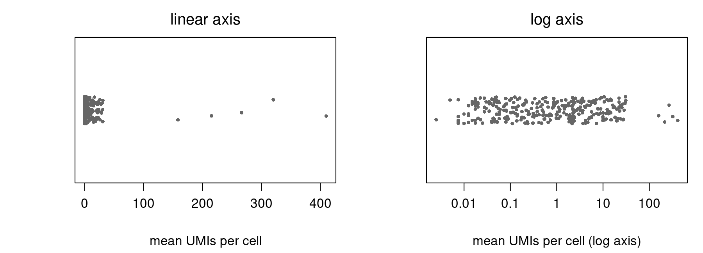
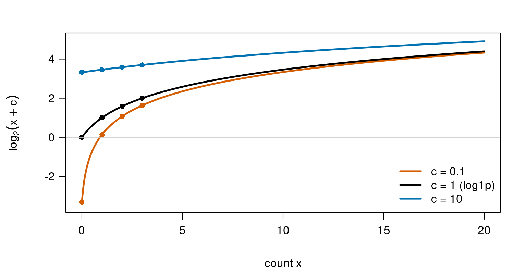

## About this lecture

In Single-cell RNA-seq: data & QC the last preprocessing step was one line: `log1p`. This unit is about that line: why we transform counts at all, what the log does to the numbers, and what the "+1" quietly changes.

- **Why transform:** expression spans orders of magnitude, changes are fold changes, and the variance of a count grows with its mean.
- **Log:** turns fold changes into differences. It is **nonlinear**, which has consequences.
- **Pseudolog** $\log(1 + x)$: the log with a pseudocount, so that zeros survive. The pseudocount is a **choice**.
- **Plotting:** a log axis is not the same as plotting log values.

All data today are simulated counts: 400 cells (200 T cells, 200 B cells), 300 genes.

::: notes
This unit zooms in on one step of the standard pipeline from the previous unit (normalize, then log1p). It is short on new maths: logs are school maths. The new content is what the log does to data, and why the pseudocount is not an innocent detail. The simulated data: negative-binomial counts with cell-to-cell differences in capture, 280 background genes with means from 0.01 to 30, 5 very highly expressed genes (like ribosomal or mitochondrial genes), and 15 marker genes that are on (mean 4) in one cell type and nearly off (0.3) in the other. The figure script is make-log-figs.R in the unit folder.
:::

## Expression spans orders of magnitude {.smaller}

{width="88%" fig-align="center"}

- One point per gene: its mean UMI count per cell. The means run from **0.003 to 410** UMIs per cell, a ratio of about 160,000.
- On a linear axis almost every gene sits at "0", and **5 genes** (ribosomal-like) carry **54%** of all UMIs.
- On a log axis each factor of 10 gets the same space, and the genes spread out.

Biology works in ratios too: a transcription factor at 0.5 UMIs per cell going to 1 is as much a doubling as a ribosomal gene going from 200 to 400.

::: notes
This is the first reason for the log. Real data look the same: in a 10x dataset a few ribosomal protein genes, MALAT1 and mitochondrial genes have hundreds of UMIs per cell, most transcription factors fewer than one. On a linear scale any summary (sum, variance, distance) is decided by the few big genes. The log axis gives every order of magnitude equal room. Ask: which change matters more biologically, +1 UMI in a ribosomal gene at 300, or +1 in a transcription factor at 0.5? The log answers that question the same way biologists do: by ratio.
:::

## Count variance grows with the mean {.smaller}

{width="82%" fig-align="center"}

- **Left:** for counts, variance ≥ mean (Poisson: variance = mean; negative binomial: more). The 5 very high genes have variances of **6,900–50,000**; the cell-type markers only **7.5–10**.
- **Right:** after log1p, the markers (green) have the **largest** variance (1.75–1.95); the very high genes drop to 0.17–0.20.

The log does not make variance perfectly constant (genes near 0 stay low), but it stops size from deciding what looks variable.

::: notes
Second reason: heteroskedasticity. For count data the variance is tied to the mean (overdispersion from the distributions block: the negative binomial has variance mu + mu^2 / theta). So a highly expressed gene is "variable" just because it is big. After log1p, the genes that vary because of biology (the markers, on in one cell type and off in the other) rise to the top. This is exactly what highly variable gene selection needs. Be honest about the right panel: very lowly expressed genes have small log variance, and the curve is a hump, not flat. Variance-stabilising transforms are approximate; that is fine for PCA.
:::

## Raw counts: PCA sees a few genes {.smaller}

{width="78%" fig-align="center"}

- **Normalized counts:** the 5 very high genes contribute **92%** of the total variance. PC1 is their noise; T and B cells overlap.
- **After log1p:** they contribute **0.5%**. PC1 is made of the 15 marker genes and splits the two cell types.

Same cells, same genes, same PCA. Only the transform changed.

::: notes
Payoff for the PCA block: PCA finds directions of largest variance, so it inherits whatever scale the data are on. On normalized counts the top loadings on PC1 are the very high genes, whose Poisson-plus-overdispersion noise is in the hundreds. On log1p data the top loadings are marker genes. The separation of the cell-type means along PC1, in units of the PC1 standard deviation, goes from 0.09 to 1.96. This is why every scRNA-seq pipeline logs (or uses another variance-stabilising transform) before PCA. Scaling each gene to variance 1 (ScaleData in Seurat) also helps, but it is done after the log, not instead of it.
:::

## Log turns fold changes into differences

The one rule that makes logs useful:

$$\log(a \cdot b) = \log a + \log b, \qquad \log\frac{a}{b} = \log a - \log b$$

So a **fold change** (a ratio) becomes a **difference** of logs. With base 2:

| Control | Treated | Fold change | $\log_2$ fold change |
|---|---|---|---|
| 50 | 200 | 4 | $\log_2 200 - \log_2 50 = 2$ |
| 40 | 10 | 0.25 | $-2$ |
| 100 | 150 | 1.5 | 0.58 |

$\log_2$ FC = 1 means doubling, $-1$ halving, 0 no change. Up and down are now symmetric: 4× up is $+2$, 4× down is $-2$.

The base only rescales: $\log_{10} x = \log_2 x / \log_2 10$. R's `log()` is natural log; `log1p()` too.

::: notes
This is why differential expression results are reported as log2 fold changes: a 4-fold increase and a 4-fold decrease are +2 and -2, equal and opposite, instead of 4 and 0.25. It also means that a multiplicative effect (a cell captures twice as much RNA, so every gene is doubled) becomes an additive shift of log 2 on every gene, which is easy to remove. Natural log versus log2 versus log10 only changes the units, like centimetres and inches. Seurat and scanpy use natural log for log1p; fold changes are usually reported in log2.
:::

## Log is not linear

The linear test from [Polar coordinates](../polar/lec.qmd): $f$ is linear if $f(a + b) = f(a) + f(b)$ and $f(c\,a) = c\,f(a)$. The log fails both:

$$\log_{10}(10 + 1000) = 3.004 \quad\text{but}\quad \log_{10} 10 + \log_{10} 1000 = 1 + 3 = 4$$

$$\log_{10}(2 \cdot 1000) = 3.30 \quad\text{but}\quad 2 \cdot \log_{10} 1000 = 6$$

- The log turns **products** into sums, not **sums** into sums. Scaling by $c$ becomes **adding** $\log c$.
- So there is no matrix for it, and the order of operations matters: anything linear (summing counts, averaging, library-size scaling, compensation in flow cytometry) must be done **before** the log, on the original scale.

::: notes
Same test as for polar coordinates in the Applications block: a matrix map always passes it, so the log is not a matrix. Most of single-cell preprocessing is linear: adding up UMIs, dividing by the library size, averaging cells into a pseudobulk sample. These are meaningful on counts. After the log, a sum of logs is the log of a product, which usually means nothing biologically. The next slide shows the most common case: averaging.
:::

## Average, then log ≠ log, then average

Four cells of one cluster, counts for one gene: $0, 1, 3, 15$.

| | $\log_2(1 + x)$ per cell | Average |
|---|---|---|
| Log, then average | $0, 1, 2, 4$ | **1.75** |
| Average, then log | mean count $= 4.75$ | $\log_2(5.75) =$ **2.52** |

- The **mean of logs** is always ≤ the **log of the mean** (equal only if all values are the same). Big values count less after the log.
- **Pseudobulk:** add up the raw counts of all cells in a cluster per sample, *then* normalize and log. Do not average the log1p values and call that the expression of the cluster.
- A fold change of mean log values is not the log of the fold change of means. Know which one a tool reports.

::: notes
Concrete version of "not linear". The mean of log values is the log of the geometric mean, which is pulled down by small values; for 1, 10, 100 the arithmetic mean is 37 but the geometric mean is 10 (exercise B3). Pseudobulk is the standard way to do differential expression between conditions with replicates: sum counts over cells within each sample and cell type, then use bulk tools on the summed counts. Summing is linear, so it must happen on counts. Several tools report a log fold change computed from mean log-normalized values; that is a different number from the log of the ratio of mean expression, and the two can disagree a lot for lowly expressed genes.
:::

## The zero problem, and the pseudolog

Half the entries in our matrix are 0 (real datasets: 90% or more), and $\log 0 = -\infty$.

The fix: add a **pseudocount** $c$ before taking the log. With $c = 1$ this is the **pseudolog**:

$$\text{pseudolog}(x) = \log(1 + x)$$

In R: `log1p(x)`.

- $0 \mapsto 0$: zeros stay zeros, so the matrix stays sparse.
- For large $x$, $\log(1 + x) \approx \log x$: the +1 does not matter.
- For small $x$ it matters a lot: $\log(1 + x) \approx x$, the transform is almost linear near 0.

In general, $\log(x + c)$ with any pseudocount $c > 0$. Our 0, 1, 3, 15 example used $c = 1$ in base 2.

::: notes
Pseudolog is our name for log(1 + x), the log with a pseudocount of 1. The pseudocount is not a correction derived from a model; it is a practical choice to make the log defined at zero. Two properties make c = 1 popular: zero maps to zero (so sparse storage still works), and near zero log(1+x) is approximately x, so tiny values are not blown up to large negative numbers. log1p in R also computes log(1 + x) accurately when x is very small, which is where the name comes from. For x = 1000, log(1001) and log(1000) differ by 0.001.
:::

## The pseudocount is a choice that matters {.smaller}

:::: {.columns}
::: {.column width="50%"}
{width="100%"}
:::
::: {.column width="50%"}
$\log_2$ fold change $\log_2\frac{b + c}{a + c}$ for counts $a \to b$:

| $a \to b$ | $c = 0.1$ | $c = 1$ | $c = 10$ |
|---|---|---|---|
| 0 → 1 | 3.46 | 1.00 | 0.14 |
| 1 → 3 | 1.49 | 1.00 | 0.24 |
| 10 → 30 | 1.58 | 1.49 | 1.00 |
| 100 → 300 | 1.58 | 1.58 | 1.49 |

True fold change for the last three rows: 3, i.e. $\log_2 3 = 1.58$.
:::
::::

- **Small $c$:** the gap between 0 and 1 count is huge; noise at low counts is blown up.
- **Large $c$:** low counts are **squashed** together; fold changes between small values shrink towards 0.
- Values well above $c$ are hardly affected.

::: notes
Read the figure first: with c = 0.1, the step from 0 to 1 count is 3.5 log2 units, larger than the step from 1 to 10. With c = 10 everything below about 10 counts is squashed into a narrow band. Then the table: the same true 3-fold change gives anything from 0.24 to 1.58 depending on c and on how many counts the gene has. A difference of 0 versus 1 UMI, which is mostly sampling noise, gets log2 FC 3.46 with c = 0.1. So the pseudocount sets the count level below which differences are treated as noise. There is no single right value; c = 1 is a convention.
:::

## Try it: choose the pseudocount

```{=html}
<link rel="stylesheet" href="../demos/dist/demo.css">
<div data-demo="pseudocount" data-c="1" data-normalize="0"></div>
<script src="../demos/dist/pseudocount.js"></script>
```

::: notes
Simulated counts in the same spirit as our data: 200 cells (100 T, 100 B) with sequencing depths from about 1,300 to 12,600 UMIs, 60 background genes, 4 very high genes and 10 cell-type markers. Panel (a) is the curve from the previous slide, with the 0 and 1 UMI points and the size of the step between them. Panel (b) shows every cell for a gene with mean 0.35 (73% zeros) and one with mean 30. Panel (c) is the variance after the log for every gene, against its mean; the dashed line marks the 10 most variable genes, which is what highly variable gene selection would pick. Start at c = 1: all 10 top genes are markers. Click c = 0.01: the zeros of the low gene drop to log 0.01 = -4.6, the step from 0 to 1 UMI becomes 4.6, and background genes with many zeros climb into the top 10 (5 of 10). Click c = 10 and 100: everything below about c counts is squashed, the low gene's variance goes to 0, and the very high genes take over the top 10, as on raw counts. Switching to base 2 only rescales the axis (variances by about 2.1), the ranking does not change. Finally tick "normalize first": the step from 0 to 1 UMI now depends on the depth of the cell, which is the next slide.
:::

## The pseudocount meets the scale factor

Seurat's `NormalizeData` computes $\log\!\big(1 + \tfrac{x}{n} \cdot 10{,}000\big)$ for a cell with $n$ UMIs. Rewrite it:

$$\log\!\Big(1 + \tfrac{10{,}000}{n}\, x\Big) = \log\tfrac{10{,}000}{n} + \log\!\Big(x + \tfrac{n}{10{,}000}\Big)$$

So in **raw counts**, the pseudocount is $n / 10{,}000$, and it differs per cell:

| UMIs in the cell, $n$ | 1,000 | 5,000 | 20,000 |
|---|---|---|---|
| effective pseudocount | 0.1 | 0.5 | 2 |
| log1p value of 1 UMI | 2.40 | 1.10 | 0.41 |

Changing the scale factor (10,000 vs $10^6$ for CPM) changes the pseudocount. Ahlmann-Eltze & Huber (2023, *Nature Methods* 20:665) show the pseudocount acts like an assumed **overdispersion** $\alpha$, with $c \approx 1/(4\alpha)$: 10,000 is a reasonable choice for typical droplet data; CPM ($10^6$) is not.

::: notes
The first term, log(10000 / n), is a per-cell shift that is the same for every gene; the second is a log with pseudocount n / 10000 in raw counts. So a single UMI in a small cell becomes a large value (2.40), and in a big cell a small one (0.41). Ahlmann-Eltze and Huber, "Comparison of transformations for single-cell RNA-seq data", Nature Methods 20, 665-672 (2023): they write the shifted logarithm log(y/s + y0) and show it approximates the variance-stabilising transform of the negative binomial when y0 = 1/(4 alpha). With the 10,000 scale factor and about 5,000 UMIs per cell the pseudocount is 0.5, i.e. alpha = 0.5, close to real data; CPM gives a pseudocount around 0.005, i.e. alpha = 50, far too large. They also found that this simple shifted log followed by PCA performed as well as or better than more sophisticated transforms in their benchmarks.
:::

## Log axis, or log values? {.smaller}

{width="78%" fig-align="center"}

- `scale_y_log10()` takes the log of 0, which is $-\infty$: the boxplot **drops the zeros**, with only a console warning. 161 of 200 B cells are 0, so the true median is **0**; the log-axis boxplot shows **3.82**.
- Plotting `log1p(expr)` keeps every cell; the axis can still be labelled in counts (code on the next slide).

::: notes
A log axis is a display choice: the data are untouched, only the ruler is stretched. For data with zeros this silently changes the statistics: ggplot2 computes boxplots, densities and smoothers after transforming the scale, so zeros become -Inf and are removed, with a warning in the console that is easy to miss. For a gene that is off in most B cells, the log-axis boxplot shows the median of the few B cells that expressed it, the opposite of the biology. Base R's plot(..., log = "y") omits zero values with a warning too. Plotting log1p values is honest about the zeros. The breaks/labels trick on the next slide puts familiar numbers on the log1p axis.
:::

## The whole transform in R

```r
# X: cells x genes matrix of raw UMI counts
n <- rowSums(X)                     # library size per cell
N <- X / n * 10000                  # library-size normalize (linear: do it first)
L <- log1p(N)                       # pseudolog, natural log

pc <- prcomp(L)                     # PCA on log values (after selecting HVGs)

# pseudobulk: sum RAW counts per cluster, then normalize and log
pb <- rowsum(X, cluster)            # one row per cluster
log1p(pb / rowSums(pb) * 1e6)

# log2 fold change with an explicit pseudocount
lfc <- log2((mean_B + 1) / (mean_A + 1))

# plot log1p values, label the axis in counts
ggplot(d, aes(type, log1p(expr))) + geom_boxplot() +
  scale_y_continuous(breaks = log1p(c(0, 1, 3, 10, 30, 100)), labels = c(0, 1, 3, 10, 30, 100))
```

Every number on the slides comes from this recipe applied to the simulated data (`make-log-figs.R`).

::: notes
Point out the order: rowSums and division are linear and happen on counts; log1p comes once, at the end. rowsum (no capital S) sums the rows of a matrix by group, which is the pseudobulk step. For pseudobulk the summed library sizes are in the hundreds of thousands to millions, so the CPM pseudocount n / 10^6 is around one count, a sensible value; on single cells CPM would give about 0.005 (previous slides). For a formal differential expression test, give the summed counts to a bulk tool such as edgeR or DESeq2 instead. The fold change line shows that a pseudocount is always lurking in a log fold change of means; write it explicitly so you know what you chose. Seurat's NormalizeData does lines 2 and 3 in one call.
:::

## Summary {.smaller}

| Concept | Key fact | R |
|---|---|---|
| Why transform | expression spans orders of magnitude; variance grows with the mean | `apply(X, 2, var)` |
| Log | fold changes become differences; $\log_2$ FC 1 = doubling | `log2(b / a)` |
| Not linear | $\log(a + b) \ne \log a + \log b$; scaling becomes a shift | — |
| Order matters | sum, average, normalize on counts; log last | `rowsum()`, then `log1p()` |
| Pseudolog | $\log(1 + x)$: 0 stays 0, ≈ $x$ near 0, ≈ $\log x$ for large $x$ | `log1p(x)` |
| Pseudocount $c$ | small $c$ blows up low-count noise; large $c$ squashes fold changes | `log(x + c)` |
| Scale factor | pseudocount in counts is $n / 10{,}000$ per cell | `NormalizeData()` |
| Plotting | a log axis drops zeros; plot log1p values instead | `aes(y = log1p(x))` |

**Next ([Dimensionality reduction & clustering](../scrna-umap/lec.qmd)):** PCA and UMAP on the log-normalized matrix.

::: notes
The one-line takeaway: the log is the right scale for expression because biology works in fold changes, but it is nonlinear, so do everything linear first, and the pseudocount you need for the zeros is a modelling choice with visible consequences for low counts. Next unit runs PCA on exactly this log-normalized, HVG-selected matrix.
:::
