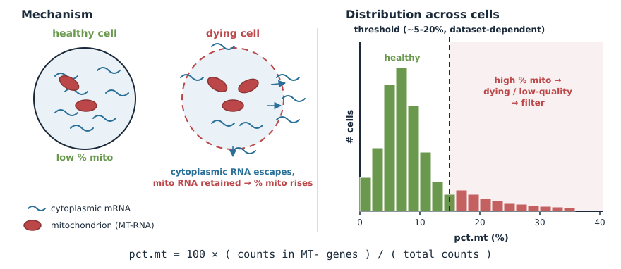
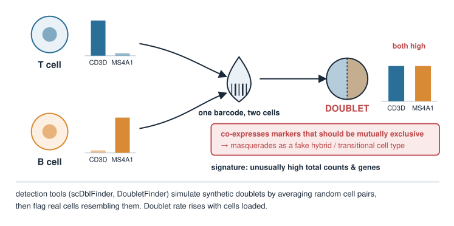
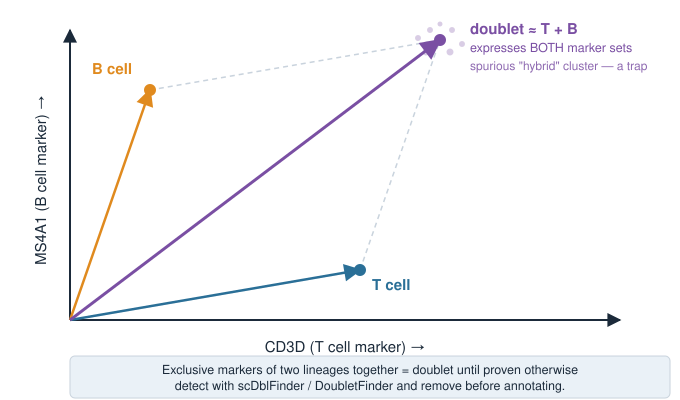

## About this lecture

*Single-cell RNA-seq: data & QC* filtered cells on two numbers: **total counts** and **genes detected**. Real pipelines look at more than that. This optional unit adds the other standard QC checks.

- **Mitochondrial fraction** (`percent.mt`): the classic flag for **dying / damaged** cells.
- **Ribosomal fraction** (`percent.ribo`): a covariate worth looking at, but rarely a hard filter.
- **Doublets**: one barcode, **two cells** — and why they are more dangerous than random noise.
- The **annotation trap**: a doublet is (roughly) the **sum of two cell vectors**, so it can look like a new "hybrid" cell type.

No new maths — fractions of counts, and the cells-as-vectors picture from *Cell-type annotation*.

::: notes
Frame the unit as the rest of the QC toolbox. The core unit kept QC to counts and genes per cell plus empty droplets; here we add the two per-cell fractions every Seurat tutorial computes (mitochondrial, ribosomal) and the second failure of the one-cell-per-droplet ideal (doublets). The single idea to carry away: bad cells do not just add noise, they produce artefacts that look like biology — a dying cell can cluster as a "stressed" type, a doublet as a "hybrid" type.
:::

## Mitochondrial fraction {.smaller}

Compute the fraction of each cell's counts coming from **mitochondrial genes** (in human, gene symbols starting `MT-`):

$$\text{pct.mt} = 100 \times \frac{\text{counts in MT- genes}}{\text{total counts}}$$

- When a cell's membrane is **compromised** (dying/stressed), cytoplasmic mRNA **leaks out**, but mitochondrial mRNA stays trapped in mitochondria.
- So a **high mitochondrial fraction** is a hallmark of a **low-quality / dying cell**. *Filter cells above a threshold.*

The threshold is dataset-dependent (a common starting point is ~5–20%), and some healthy tissues are genuinely mito-rich — so inspect, don't blindly apply.

{width="75%" fig-align="center"}

::: notes
This is the classic third QC metric. Mechanism: membrane damage lets cytoplasmic RNA escape while mitochondrial RNA is retained inside mitochondria, so the *proportion* that is mitochondrial rises. High pct.mt therefore flags dying cells. Be honest that the cutoff varies — 5% is common for some cell lines, but cardiomyocytes and other metabolically active tissues legitimately have high mitochondrial content, so a fixed threshold can throw away good cells. The design principle: look at the distribution, pick a threshold for your data. Mouse mitochondrial genes start with lower-case `mt-`, a classic source of a silently all-zero pct.mt.
:::

## Ribosomal fraction {.smaller}

The same recipe with **ribosomal protein genes** (in human, symbols starting `RPS` or `RPL`):

$$\text{pct.ribo} = 100 \times \frac{\text{counts in RPS/RPL genes}}{\text{total counts}}$$

- Ribosomal protein genes are among the most highly expressed genes in almost every cell, so pct.ribo is often 10–40%.
- It differs **between cell types** (e.g. resting lymphocytes are ribosome-rich), so it is **biology as much as quality** — usually **inspected**, rarely a hard filter.
- Very **low** ribosomal *and* high mitochondrial fraction together point to a damaged cell.
- A cluster whose top "markers" are only ribosomal or mitochondrial genes is usually **low-quality cells**, not a cell type.

::: notes
Keep this short and honest: unlike pct.mt there is no standard threshold for ribosomal content. Because it varies with cell type and with growth / activation state, filtering on it can remove a real population. The practical uses are (1) as a diagnostic plotted next to pct.mt, (2) as a covariate to check against a principal component, and (3) as a red flag in annotation when a cluster has no specific markers beyond RPS/RPL/MT- genes. Some pipelines simply drop ribosomal and mitochondrial genes before choosing highly variable genes so they cannot drive the clustering.
:::

## The fractions in the pipeline (read, don't run) {.smaller}

Seurat-style pseudocode, extending the QC step of the core pipeline:

```r
# per-cell fractions
obj[["percent.mt"]]   <- PercentageFeatureSet(obj, pattern = "^MT-")
obj[["percent.ribo"]] <- PercentageFeatureSet(obj, pattern = "^RP[SL]")

# look first: distributions per sample
VlnPlot(obj, features = c("nFeature_RNA", "nCount_RNA",
                          "percent.mt", "percent.ribo"))

# then filter (thresholds are dataset-dependent!)
obj <- subset(obj,
              subset = nFeature_RNA > 200 &
                       nFeature_RNA < 6000 &
                       percent.mt   < 15)
```

The upper limit on genes detected is a crude guard against doublets — next slides.

::: notes
PercentageFeatureSet computes the fraction for any gene-name pattern. Stress the order: plot first, threshold second. The numbers here are illustrative; pick them from the violin plots of your own data, per sample if samples differ. Note there is deliberately no percent.ribo filter. The nFeature_RNA < 6000 upper bound is the crude doublet filter that the dedicated tools improve on.
:::

## What is a doublet? {.smaller}

A **doublet** is one barcode that captured **two cells**. Its expression is a **blend** of two profiles.

- Why it is dangerous: a doublet of a **T cell** and a **B cell** expresses both T-cell and B-cell markers — it can masquerade as a novel "hybrid" cell type or a fake transitional state.
- It does **not** look like noise. It looks like a plausible cell expressing two programs.

The doublet rate scales with how many cells you load — more cells per run means more collisions.

{width="65%" fig-align="center"}

::: notes
Doublets are the second consequence of the one-cell-per-droplet ideal failing (the first is empty droplets). The conceptual danger is the important bit: a doublet does not look like noise, it looks like a plausible new cell expressing two programs, which can lead to invented cell types. Mention the practical trade-off: loading more cells increases throughput but raises the collision (doublet) rate — roughly linearly with the number of cells loaded for droplet platforms.
:::

## Spotting a doublet: two signatures {.smaller}

Two cells' worth of RNA under one barcode leaves traces in the QC metrics:

- **Very high total counts and genes detected** — about two cells' worth of RNA. On the counts-vs-genes QC plot, doublets sit in the extreme upper corner. *Flag / filter.*
- **Co-expression of mutually exclusive markers** — e.g. the T-cell marker `CD3D` **and** the B-cell marker `MS4A1` both high in one "cell". A single real cell almost never does this.

Neither signature is proof on its own: some real cells are large (high counts), and two cells of the **same** type give a doublet with no marker clash at all.

::: notes
Connect back to the counts-and-genes QC slide in the data & QC unit: very low counts and genes flag empty droplets, very high counts and genes are suspicious in the other direction. The marker clash is the more specific signal, but it only works for heterotypic doublets (two different types). Homotypic doublets (two cells of the same type) are nearly invisible — they mostly just look like a big cell — and are also less harmful, because they do not invent a new type. This is why a simple upper count threshold is a crude first pass, not a full solution.
:::

## Detection tools {.smaller}

Dedicated tools (e.g. [`scDblFinder`](https://bioconductor.org/packages/scDblFinder/), `DoubletFinder`) do better than a count threshold:

1. **Simulate** artificial doublets by averaging (or summing) the profiles of random pairs of real cells.
2. Put the simulated doublets and the real cells in the same space (e.g. PCA).
3. **Flag** real cells whose neighbours are mostly simulated doublets.

```r
library(scDblFinder)
sce <- scDblFinder(sce)          # adds a doublet score and a call per cell
table(sce$scDblFinder.class)     # "singlet" / "doublet"
sce <- sce[, sce$scDblFinder.class == "singlet"]
```

Doublet detection is a separate step, usually run before or alongside the other QC filters — and **before** annotation.

::: notes
Keep tool details light; the idea is what matters. If you knew what doublets look like, you could build a classifier — so the tools manufacture labelled examples by combining random pairs of real cells, then ask which real barcodes resemble those synthetics. It is a nice example of simulation used to create training data. The code is read-only; no single-cell packages are installed for the course. Stress the order: remove doublets before you start naming clusters, otherwise they can form their own small cluster.
:::

## The annotation trap: a doublet is a vector sum {.smaller}

In annotation, each cell is a **vector** of gene expression. A doublet is roughly the **sum of two cell vectors**:

$$\text{doublet} \approx \text{T cell} + \text{B cell}$$

- Its profile carries **both** sets of markers (T-cell *and* B-cell genes).
- Doublets can form their own small cluster that looks like a fake "hybrid" cell type — a classic annotation trap.
- A cluster with **mixed markers** of two lineages (e.g. `CD3D` *and* `LYZ`) should raise a doublet suspicion before anything else.

Rule of thumb: exclusive markers of two lineages appearing together is **a doublet until proven otherwise**.

{width="50%" fig-align="center"}

::: notes
Doublets are the most common way annotation goes wrong for a beginner: a droplet catches two cells, the reads combine, and you get a profile that is literally the sum of two centroids. Because it carries both marker sets, an untrained eye may christen a new "T/B hybrid" cell type that does not exist. The linear-algebra intuition — the doublet vector is roughly the sum of two cell vectors — is worth stating. After library-size normalization the sum becomes closer to an average, but the marker clash survives either way. Practically: run a doublet detector, remove flagged cells, then annotate.
:::

## Summary {.smaller}

| Idea | Key point |
|---|---|
| Mitochondrial fraction | high pct.mt → membrane damage → **dying cell**; filter, threshold from the data |
| Ribosomal fraction | varies with cell type; **inspect**, rarely filter |
| Ribo/mito-only cluster | usually low-quality cells, not a cell type |
| Doublet | two cells, one barcode → **blended** profile; rate grows with cells loaded |
| Doublet signatures | very high counts / genes; **mutually exclusive markers** both on |
| Detection | simulate doublets from random cell pairs, flag real cells that resemble them |
| Annotation trap | doublet ≈ **sum of two cell vectors** → carries both marker sets |
| Practice | plot first, filter second; remove doublets **before** annotating |

::: notes
The take-home sheet. Drill the story: the core QC (counts, genes, empty droplets) catches the obvious failures; pct.mt catches dying cells; pct.ribo is a diagnostic, not a filter; doublets are flagged by high counts and marker clashes, more reliably by simulation-based detectors, and removed before annotation so they cannot become fake cell types.
:::
